本章介绍深度学习这一重要主题。在撰写本章时（2020年），深度学习是机器学习和人工智能领域非常活跃的研究方向。深度学习的基石是**神经网络（neural network）**。

神经网络在20世纪80年代末声名鹊起。这一方法令人振奋，也伴随着一定程度的炒作。它推动了广受欢迎的神经信息处理系统会议（Neural Information Processing Systems，NeurIPS，原名NIPS）的兴起。该会议每年举行，地点通常是滑雪度假村等颇具异域风情的地方。随后进入了综合研究阶段，机器学习研究者、数学家和统计学家对神经网络的性质展开分析；算法得到改进，方法也逐渐稳定下来。此后，支持向量机、提升法和随机森林相继出现，神经网络受到的青睐有所减少。部分原因在于，神经网络需要反复调试，而这些新方法更加自动化。此外，在许多问题上，新方法也优于训练不充分的神经网络。这就是新千年头十年的基本状况。

不过，在此期间，一批核心的神经网络爱好者始终在规模越来越大的计算架构和数据集上不断推进这项技术。2010年之后，神经网络以“深度学习”这一新名称重新崛起，带来了新的架构、更多附加功能，以及在图像和视频分类、语音和文本建模等特定问题上的一连串成功。许多业内人士认为，这些成功主要归功于越来越大的训练数据集；科学和工业领域广泛采用数字化，使这样的数据集成为可能。

本章先讨论神经网络与深度学习的基础知识，再介绍针对特定问题的一些专门形式，例如用于图像分类的**卷积神经网络（convolutional neural networks，CNN）**，以及用于时间序列和其他序列的**循环神经网络（recurrent neural networks，RNN）**。

我们还将使用Python的 `torch` 包及若干辅助包演示这些模型。

本章内容比本书其他部分略具挑战性。

## 10.1 单层神经网络（Single Layer Neural Networks）

神经网络接收由 $p$ 个变量组成的输入向量 $X=(X_1,X_2,\ldots,X_p)$，构建一个非线性函数 $f(X)$，用来预测响应 $Y$。前面几章已经利用树、提升法和广义加性模型构建过非线性预测模型。神经网络与这些方法的区别，在于模型特定的*结构*。图10.1展示了一个简单的**前馈神经网络（feed-forward neural network）**，它使用 $p=4$ 个预测变量，对定量响应建模。在神经网络的术语中，四个特征 $X_1,\ldots,X_4$ 构成**输入层（input layer）** 中的单元。箭头表示，输入层中的每个输入都会传入每个**隐藏单元（hidden unit）**；隐藏单元共有 $K$ 个，$K$ 由我们选择，这里取5。神经网络模型的形式为

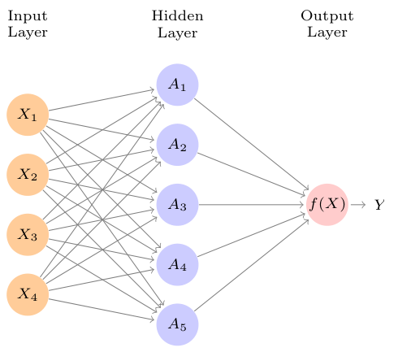

**图10.1** 具有一个**隐藏层（hidden layer）** 的神经网络。隐藏层计算**激活值（activations）** $A_k=h_k(X)$，它们是输入 $X_1,X_2,\ldots,X_p$ 的线性组合经过非线性变换得到的，因此不能直接观测到。函数 $h_k(\cdot)$ 并非预先固定，而是在网络训练过程中学习得到。**输出层（output layer）** 是一个以这些激活值 $A_k$ 为输入的线性模型，由此得到函数 $f(X)$。图内文字：Input Layer＝输入层；Hidden Layer＝隐藏层；Output Layer＝输出层；其余符号保持原样。

$$
\begin{aligned}
f(X)&=\beta_0+\sum_{k=1}^{K}\beta_kh_k(X)\\
&=\beta_0+\sum_{k=1}^{K}\beta_k g\left(w_{k0}+\sum_{j=1}^{p}w_{kj}X_j\right).
\end{aligned}\tag{10.1}
$$

这里分两步构建。首先，把隐藏层中的 $K$ 个激活值 $A_k$（$k=1,\ldots,K$）计算为输入特征 $X_1,\ldots,X_p$ 的函数：

$$
A_k=h_k(X)=g\left(w_{k0}+\sum_{j=1}^{p}w_{kj}X_j\right),\tag{10.2}
$$


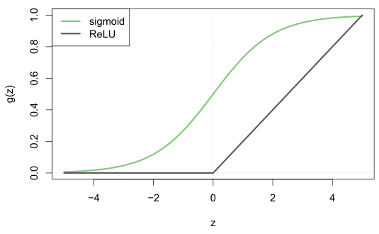

**图10.2** 激活函数。分段线性的ReLU函数因计算高效、易于计算而广受欢迎。为便于比较，图中将它缩小为原来的五分之一。图内的sigmoid、ReLU、$g(z)$、$z$ 及刻度保持原样。

其中，$g(z)$ 是预先指定的非线性**激活函数（activation function）**。可以把每个 $A_k$ 看作对原始特征的一种不同变换 $h_k(X)$，这与第7章的基函数很相似。隐藏层的这 $K$ 个激活值随后传入输出层，得到

$$
f(X)=\beta_0+\sum_{k=1}^{K}\beta_k A_k,\tag{10.3}
$$

即以 $K=5$ 个激活值为变量的线性回归模型。所有参数 $\beta_0,\ldots,\beta_K$ 和 $w_{10},\ldots,w_{Kp}$ 都需要从数据中估计。早期神经网络偏爱使用 **sigmoid激活函数（sigmoid activation function）**：

$$
g(z)=\frac{e^z}{1+e^z}=\frac{1}{1+e^{-z}},\tag{10.4}
$$

这与逻辑回归中把线性函数转换为0到1之间概率的函数相同（见图10.2）。现代神经网络更倾向于使用 **ReLU（rectified linear unit，整流线性单元）** 激活函数，其形式为

$$
g(z)=(z)_+=\begin{cases}0&\text{若 }z<0,\\z&\text{其他情况。}\end{cases}\tag{10.5}
$$

ReLU激活值的计算和存储比sigmoid激活值更高效。虽然它在0处设置阈值，但由于我们把它应用于线性函数（10.2），常数项 $w_{k0}$ 会使这个转折位置发生平移。

用文字概括，图10.1中的模型先计算 $X$ 的五个不同线性组合，再分别将它们送入激活函数 $g(\cdot)$ 进行变换，由此派生出五个新特征。最终模型对于这些派生变量是线性的。

“神经网络”这一名称，最初源于把这些隐藏单元看作类似于大脑中的神经元：当激活值 $A_k=h_k(X)$ 接近1时，神经元处于*兴奋*状态；接近0时则处于*静默*状态（这里使用sigmoid激活函数）。

激活函数 $g(\cdot)$ 中的非线性至关重要；没有它，式（10.1）中的模型 $f(X)$ 就会退化为关于 $X_1,\ldots,X_p$ 的简单线性模型。

此外，非线性激活函数使模型能够捕捉复杂的非线性关系和交互效应。考虑一个很简单的例子：有 $p=2$ 个输入变量 $X=(X_1,X_2)$，$K=2$ 个隐藏单元 $h_1(X)$ 和 $h_2(X)$，且 $g(z)=z^2$。其余参数指定为

$$
\begin{aligned}
\beta_0&=0,&\beta_1&=\tfrac14,&\beta_2&=-\tfrac14,\\
w_{10}&=0,&w_{11}&=1,&w_{12}&=1,\\
w_{20}&=0,&w_{21}&=1,&w_{22}&=-1.
\end{aligned}\tag{10.6}
$$

由式（10.2）可知，

$$
\begin{aligned}
h_1(X)&=(0+X_1+X_2)^2,\\
h_2(X)&=(0+X_1-X_2)^2.
\end{aligned}\tag{10.7}
$$

再将式（10.7）代入式（10.1），得到

$$
\begin{aligned}
f(X)&=0+\tfrac14\cdot(0+X_1+X_2)^2-\tfrac14\cdot(0+X_1-X_2)^2\\
&=\tfrac14\left[(X_1+X_2)^2-(X_1-X_2)^2\right]\\
&=X_1X_2.
\end{aligned}\tag{10.8}
$$

因此，两个线性函数经过非线性变换后再求和，就能产生交互项！实际中不会把二次函数用作 $g(z)$，因为这样始终只能得到原始坐标 $X_1,\ldots,X_p$ 的二次多项式。sigmoid或ReLU激活函数没有这种限制。

拟合神经网络需要估计式（10.1）中的未知参数。对于定量响应，通常使用平方误差损失，即选择参数使下式最小：

$$
\sum_{i=1}^{n}\left(y_i-f(x_i)\right)^2.\tag{10.9}
$$

如何完成这一最小化过程，详见10.7节。

## 10.2 多层神经网络（Multilayer Neural Networks）

现代神经网络通常不止一个隐藏层，而且每层往往有许多单元。理论上，具有大量单元的单个隐藏层就能逼近大多数函数。不过，使用多个规模适中的层，会大大简化寻找良好解的学习任务。

我们将用著名且公开可用的 `MNIST` 手写数字数据集，演示一个大型的**稠密网络（dense network）**。<sup><a href="#ch10-fn1" id="ch10-fnref1">1</a></sup> 图10.3给出了这些数字的例子。我们的目标是构建一个模型，把图像正确分到数字0–9的各类别中。每幅图像有 $p=28\times28=784$ 个**像素（pixels）**，每个像素是0到255之间的8位灰度值，表示书写数字在这个小方格中所占的相对比例。<sup><a href="#ch10-fn2" id="ch10-fnref2">2</a></sup>

<aside class="footnote" id="ch10-fn1"><a href="#ch10-fnref1">1</a> 参见LeCun、Cortes和Burges（2010），“The MNIST database of handwritten digits”，地址为 <a href="http://yann.lecun.com/exdb/mnist">http://yann.lecun.com/exdb/mnist</a>。</aside>


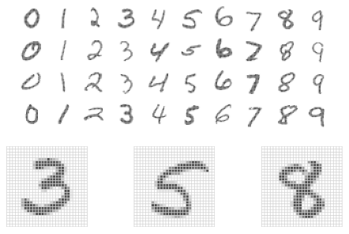

**图10.3** `MNIST` 图像库中的手写数字示例。每幅灰度图像有 $28\times28$ 个像素，每个像素是一个8位数（0–255），表示该像素的深浅程度。第一幅3、5、8分别放大，以显示各自的784个像素值。

<aside class="footnote" id="ch10-fn2"><a href="#ch10-fnref2">2</a> 在模数转换过程中，书写数字可能只有一部分落在代表某个特定像素的方格中。</aside>

这些像素存储在输入向量 $X$ 中，例如按列顺序排列。输出是类别标签，用包含10个虚拟变量的向量 $Y=(Y_0,Y_1,\ldots,Y_9)$ 表示：与标签对应的位置为1，其余位置为0。在机器学习领域，这称为独热编码。数据包含60,000幅训练图像和10,000幅测试图像。

从历史上看，数字识别问题是催化剂，在20世纪80年代末加速了AT&T贝尔实验室及其他机构神经网络技术的发展。这类模式识别任务对人类相对简单。视觉系统占据大脑的很大一部分，良好的识别能力是有利于生存的进化驱动力。但这些任务对机器并不那么简单；人们花了30多年不断改进神经网络架构，才使其达到人类水平。

图10.4展示了一种能够很好地解决数字分类任务的多层网络架构。它与图10.1有以下几方面区别：

- 它有两个隐藏层：$L_1$（256个单元）和 $L_2$（128个单元），而不是一个。后面还会看到一个具有七个隐藏层的网络。
- 它有十个输出变量，而不是一个。在这个例子中，这十个变量实际上表示同一个定性变量，因此彼此密切依赖。（为便于理解，我们按数字类别0–9对它们编号，而不是使用1–10。）更一般地，在**多任务学习（multi-task learning）** 中，可以用同一个网络同时预测不同响应；它们都会参与塑造隐藏层。
- 训练网络所用的损失函数，专门针对多类别分类任务设计。


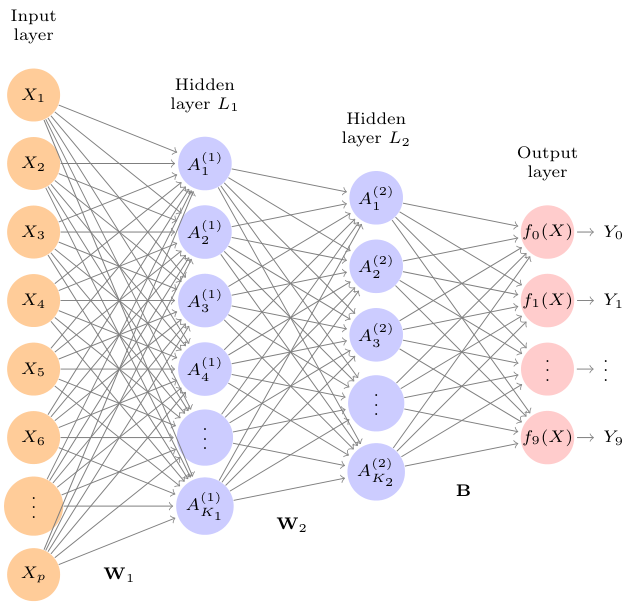

**图10.4** 具有两个隐藏层和多个输出的神经网络示意图，适用于 `MNIST` 手写数字问题。输入层有 $p=784$ 个单元，两个隐藏层分别有 $K_1=256$ 和 $K_2=128$ 个单元，输出层有10个单元。计入截距（深度学习领域称为**偏置，biases**）后，这个网络共有235,146个参数（称为**权重，weights**）。图内文字：Input layer＝输入层；Hidden layer＝隐藏层；Output layer＝输出层；$L_1,L_2,\mathbf W_1,\mathbf W_2,\mathbf B$ 及各单元的数学符号保持原样。

第一个隐藏层与式（10.2）相同，有

$$
\begin{aligned}
A_k^{(1)}&=h_k^{(1)}(X)\\
&=g\left(w_{k0}^{(1)}+\sum_{j=1}^{p}w_{kj}^{(1)}X_j\right)
\end{aligned}\tag{10.10}
$$

其中 $k=1,\ldots,K_1$。第二个隐藏层把第一层的激活值 $A_k^{(1)}$ 作为输入，计算新的激活值

$$
\begin{aligned}
A_\ell^{(2)}&=h_\ell^{(2)}(X)\\
&=g\left(w_{\ell0}^{(2)}+\sum_{k=1}^{K_1}w_{\ell k}^{(2)}A_k^{(1)}\right)
\end{aligned}\tag{10.11}
$$

其中 $\ell=1,\ldots,K_2$。注意，第二层的每个激活值 $A_\ell^{(2)}=h_\ell^{(2)}(X)$ 都是输入向量 $X$ 的函数。这是因为，虽然它们显式地是 $L_1$ 层激活值 $A_k^{(1)}$ 的函数，但后者又是 $X$ 的函数。增加隐藏层后，情况也一样。因此，经过一连串变换，网络能够构建相当复杂的 $X$ 的变换，并最终把它们作为特征输入输出层。

在式（10.10）和（10.11）中，我们引入了 $h_\ell^{(2)}(X)$、$w_{\ell j}^{(2)}$ 等额外上标，以表示激活值和权重（系数）属于哪一层；这里是第2层。

图10.4中的 $\mathbf W_1$ 表示从输入层传向第一个隐藏层 $L_1$ 的全部权重组成的矩阵。

这个矩阵有 $785\times256=200{,}960$ 个元素；这里是785而不是784，因为还需要计入截距，即偏置项。<sup><a href="#ch10-fn3" id="ch10-fnref3">3</a></sup>

<aside class="footnote" id="ch10-fn3"><a href="#ch10-fnref3">3</a> 在机器学习领域，人们通常把系数称为“权重”，把式（10.2）中的截距 $w_{k0}$ 称为“偏置”。这里的bias不能与本书其他地方“偏差—方差”中的bias混淆。</aside>

每个元素 $A_k^{(1)}$ 都通过权重矩阵 $\mathbf W_2$ 传向第二个隐藏层 $L_2$；该矩阵的维数为 $257\times128=32{,}896$。

接下来是输出层。这里有十个响应，而不是一个。第一步是计算十个不同的线性模型，类似于单模型（10.1）：

$$
\begin{aligned}
Z_m&=\beta_{m0}+\sum_{\ell=1}^{K_2}\beta_{m\ell}h_\ell^{(2)}(X)\\
&=\beta_{m0}+\sum_{\ell=1}^{K_2}\beta_{m\ell}A_\ell^{(2)},
\end{aligned}\tag{10.12}
$$

其中 $m=0,1,\ldots,9$。矩阵 $\mathbf B$ 存储全部 $129\times10=1{,}290$ 个这样的权重。

如果这些响应都是不同的定量响应，只需令每个 $f_m(X)=Z_m$，就完成了。不过，我们希望估计值代表类别概率 $f_m(X)=\Pr(Y=m\mid X)$，就像4.3.5节的多项逻辑回归一样。因此，使用特殊的 **softmax激活函数（softmax activation function）**（见书页145的式（4.13））：

$$
f_m(X)=\Pr(Y=m\mid X)=\frac{e^{Z_m}}{\sum_{\ell=0}^{9}e^{Z_\ell}},\tag{10.13}
$$

其中 $m=0,1,\ldots,9$。这样可确保这10个数具有概率的性质：非负且总和为1。虽然目标是构建分类器，模型实际上会估计十个类别各自的概率，分类器再把图像分配给概率最大的类别。

训练这个网络时，由于响应是定性的，我们寻找使负多项对数似然最小的系数估计值：

$$
-\sum_{i=1}^{n}\sum_{m=0}^{9}y_{im}\log(f_m(x_i)),\tag{10.14}
$$

这也称为交叉熵，是二分类逻辑回归准则（4.5）的推广。如何最小化这个目标，详见10.7节。如果响应是定量的，就改为像式（10.9）那样最小化平方误差损失。

表10.1把神经网络的测试表现，与第4章中使用线性决策边界的两种简单模型——多项逻辑回归和线性判别分析——进行比较。相对于这两种线性方法，神经网络的改善很大：使用**暂退正则化（dropout regularization）** 的网络，在10,000幅测试图像上的错误率低于2%。（10.7.3节介绍暂退正则化。）实验10.9.2节给出了拟合这个模型的代码，在笔记本电脑上运行只需两分钟多一点。

| 方法 | 测试错误率 |
|---|---:|
| 神经网络＋岭正则化 | 2.3% |
| 神经网络＋暂退正则化 | 1.8% |
| 多项逻辑回归 | 7.2% |
| 线性判别分析 | 12.7% |

**表10.1** 在 `MNIST` 数据上，采用两种正则化方式的神经网络，以及多项逻辑回归和线性判别分析的测试错误率。在本例中，神经网络额外的复杂性带来了测试误差的明显改善。

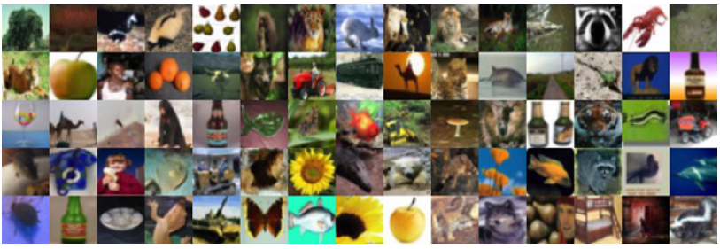

**图10.5** `CIFAR100` 数据库中的图像样本：这是日常生活中自然图像的集合，包含100个不同类别。

把 $\mathbf W_1$、$\mathbf W_2$ 和 $\mathbf B$ 中的系数数量相加，总共得到235,146个，超过多项逻辑回归所需 $785\times9=7{,}065$ 个系数的33倍。回顾一下，训练集共有60,000幅图像。虽然这看起来已是一个很大的训练集，但神经网络模型的系数数量几乎是训练观测数的四倍！为了避免过拟合，需要进行一定的正则化。本例使用两种形式：与第6章岭回归相似的**岭正则化（ridge regularization）**，以及暂退正则化。这两种形式都将在10.7节讨论。

## 10.3 卷积神经网络

2010年前后，神经网络凭借图像分类方面的巨大成功重新兴起。当时，大型的带标签图像数据库不断积累，类别数量也持续增加。图10.5展示了从 `CIFAR100` 数据库中抽取的75幅图像。<sup><a href="#ch10-fn4" id="ch10-fnref4">4</a></sup> 该数据库有60,000幅图像，按20个超类（例如水生哺乳动物）标记，每个超类又有五个类别（河狸、海豚、水獭、海豹、鲸）。每幅图像的分辨率为 $32\times32$ 像素，每个像素有三个8位数，分别表示红、绿、蓝。每幅图像的这些数值组成一个三维数组，称为**特征图（feature map）**。

<aside class="footnote" id="ch10-fn4"><a href="#ch10-fnref4">4</a> 参见Krizhevsky（2009）“Learning multiple layers of features from tiny images”第3章，地址为 <a href="https://www.cs.toronto.edu/~kriz/learning-features-2009-TR.pdf">https://www.cs.toronto.edu/~kriz/learning-features-2009-TR.pdf</a>。</aside>


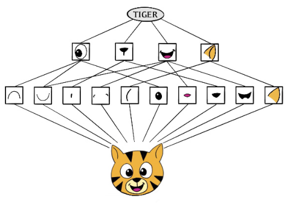

**图10.6** 示意图展示了卷积神经网络如何对一幅老虎图像分类。网络接收图像，识别局部特征，再把这些局部特征组合成复合特征，本例中包括眼睛和耳朵。利用这些复合特征，网络最终输出“老虎”这一标签。图内TIGER＝老虎。

前两个轴表示空间位置，两个方向的维数均为32；第三个轴是**通道（channel）**轴，代表三种颜色。<sup><a href="#ch10-fn5" id="ch10-fnref5">5</a></sup> 数据指定了50,000幅图像作为训练集、10,000幅作为测试集。

<aside class="footnote" id="ch10-fn5"><a href="#ch10-fnref5">5</a> “通道”一词来自信号处理文献。每个通道都是一种独立的信息来源。</aside>

针对这类图像的分类，人们发展出卷积神经网络（CNN）这一特殊家族，并在广泛的问题上取得了出色成绩。CNN在一定程度上模仿人类的图像分类方式：识别图像任意位置中能够区分特定物体类别的特征或模式。本节简要介绍其工作原理。

图10.6用一幅卡通老虎图像说明卷积神经网络的思路。<sup><a href="#ch10-fn6" id="ch10-fnref6">6</a></sup>

<aside class="footnote" id="ch10-fn6"><a href="#ch10-fnref6">6</a> 感谢Elena Tuzhilina绘制这幅示意图，并感谢 <a href="https://www.cartooning4kids.com/">https://www.cartooning4kids.com/</a> 允许使用这幅卡通老虎图像。</aside>

网络首先识别输入图像中的低层特征，例如短边缘、色块等。随后把这些低层特征组合成更高层特征，例如耳朵、眼睛等部位。最终，这些高层特征是否出现，会影响图像属于各个输出类别的概率。

卷积神经网络如何构建这一层级结构？它把两种特殊的隐藏层结合起来，分别称为**卷积层（convolution layer）**和**池化层（pooling layer）**。卷积层在图像中寻找小模式出现的位置，池化层则对它们进行下采样，选出其中突出的子集。为了达到最先进的效果，当代神经网络架构会使用许多卷积层和池化层。下面介绍这两种层。

### 10.3.1 卷积层

卷积层由大量的**卷积滤波器（convolution filters）**构成，每个滤波器都是一个模板，用来判断某种局部特征是否出现在图像中。

卷积滤波器依赖一种很简单的操作，称为**卷积（convolution）**，其基本做法是反复将矩阵元素相乘，再把结果相加。

为理解卷积滤波器的工作方式，考虑一个非常简单的 $4\times3$ 图像：

$$
\text{原始图像}=\begin{bmatrix}a&b&c\\d&e&f\\g&h&i\\j&k&l\end{bmatrix}.
$$

再考虑如下形式的 $2\times2$ 滤波器：

$$
\text{卷积滤波器}=\begin{bmatrix}\alpha&\beta\\\gamma&\delta\end{bmatrix}.
$$

将该滤波器与图像做卷积，得到<sup><a href="#ch10-fn7" id="ch10-fnref7">7</a></sup>

$$
\text{卷积后图像}=\begin{bmatrix}
a\alpha+b\beta+d\gamma+e\delta&b\alpha+c\beta+e\gamma+f\delta\\
d\alpha+e\beta+g\gamma+h\delta&e\alpha+f\beta+h\gamma+i\delta\\
g\alpha+h\beta+j\gamma+k\delta&h\alpha+i\beta+k\gamma+l\delta
\end{bmatrix}.
$$

<aside class="footnote" id="ch10-fn7"><a href="#ch10-fnref7">7</a> 卷积后图像小于原始图像，因为它的维数由原始图像中 $2\times2$ 子矩阵的数量决定。注意，$2\times2$ 是卷积滤波器的维数。如果希望卷积后图像与原始图像具有相同维数，可以使用**填充（padding）**。</aside>

例如，左上角元素的计算方法是：把 $2\times2$ 滤波器的每个元素，与图像左上角 $2\times2$ 区域中的对应元素相乘，再把结果相加。其他元素以类似方式得到：把卷积滤波器应用于原始图像中的每个 $2\times2$ 子矩阵，就能得到卷积后图像。如果原始图像中的某个 $2\times2$ 子矩阵与滤波器相似，卷积后图像的对应值就会较大；否则就较小。因此，卷积后图像会突出显示原始图像中与滤波器相似的区域。这里以 $2\times2$ 为例；一般而言，卷积滤波器是较小的 $\ell_1\times\ell_2$ 数组，其中 $\ell_1$ 和 $\ell_2$ 是不一定相等的较小正整数。

图10.7展示了将两个卷积滤波器应用于一幅 $192\times179$ 老虎图像的过程，原图位于左侧。<sup><a href="#ch10-fn8" id="ch10-fnref8">8</a></sup> 每个卷积滤波器都是一幅 $15\times15$ 图像，大部分取值为0（黑色），中间有一条由1（白色）组成的窄带，方向为竖直或水平。将每个滤波器与老虎图像卷积后，图像中与滤波器相似的区域（即具有水平或竖直条纹、边缘的区域）得到较大的值，不像该特征的区域得到较小的值。卷积后图像位于右侧。可以看到，水平条纹滤波器找出了原图中的水平条纹和边缘，竖直条纹滤波器则找出了原图中的竖直条纹和边缘。

<aside class="footnote" id="ch10-fn8"><a href="#ch10-fnref8">8</a> 图10.7–10.9使用的老虎图像，来自公共领域图像资源 <a href="https://www.needpix.com/">https://www.needpix.com/</a>。</aside>


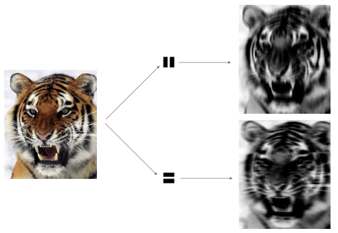

**图10.7** 卷积滤波器寻找图像中的局部特征，例如边缘和小形状。从左侧老虎图像出发，应用中间两个小型卷积滤波器。卷积后图像会突出原图中与滤波器相似的细节所在区域。具体来说，上方卷积后图像突出了老虎的竖直条纹，下方图像突出了水平条纹。可以把原始图像看作CNN的输入层，把卷积后图像看作第一个隐藏层中的单元。

图10.7为便于演示，使用了一幅大图像和两个大滤波器。对于 `CIFAR100` 数据库，每幅图像有 $32\times32$ 个彩色像素，我们使用 $3\times3$ 卷积滤波器。

在卷积层中，我们使用一整组滤波器，找出图像中各种不同方向的边缘和形状。在图像处理中，以这种方式使用预定义滤波器是标准做法。但在CNN中，滤波器是针对具体分类任务*学习*得到的。可以把滤波器权重看作从输入层到隐藏层的参数，卷积后图像中的每个像素对应一个隐藏单元。实际情况确实如此，但这些参数具有高度结构性，并受到约束（详见习题4）。它们作用于输入图像中的局部小块，因此存在许多结构性零；同一滤波器中的权重，会在图像所有可能的小块上反复使用，因此权重受到约束。<sup><a href="#ch10-fn9" id="ch10-fnref9">9</a></sup>

<aside class="footnote" id="ch10-fn9"><a href="#ch10-fnref9">9</a> 在神经网络发展的早期，这称为**权重共享（weight sharing）**。</aside>

下面补充一些细节。

- 输入图像是彩色的，因此有三个通道，用一个三维特征图（数组）表示。每个通道都是一个二维的 $32\times32$ 特征图，分别对应红、绿、蓝。单个卷积滤波器也有三个通道，每种颜色一个，每个通道的维数都是 $3\times3$，滤波器权重可以不同。把三次卷积的结果相加，形成一个二维输出特征图。注意，此时颜色信息已被利用，除了通过它在卷积中的作用之外，不会再直接传递到后续层。
- 如果在第一个隐藏层使用 $K$ 个不同卷积滤波器，就得到 $K$ 个二维输出特征图，它们合在一起视为一个三维特征图。每个二维输出特征图都被看作独立的信息通道，因此现在有 $K$ 个通道，而原始输入特征图只有三个颜色通道。这个三维特征图类似于简单神经网络隐藏层中的激活值，只是按空间结构组织和生成。
- 通常会把ReLU激活函数（10.5）应用于卷积后图像。有时，这一步被视为CNN中独立的一层，此时称为**检测层（detector layer）**。

### 10.3.2 池化层

池化层提供一种把大图像压缩成较小概括图像的方法。池化有多种可能的做法，其中**最大池化（max pooling）**操作用每个互不重叠的 $2\times2$ 像素块中的最大值来概括该块。这使图像在每个方向上的尺寸都减半，也带来一定的**位置不变性（location invariance）**：只要块内四个像素中的任何一个有较大值，整个块在缩小后的图像中就表现为较大值。

下面是最大池化的一个简单例子：

$$
\text{最大池化}\quad\begin{bmatrix}1&2&5&3\\3&0&1&2\\2&1&3&4\\1&1&2&0\end{bmatrix}\longrightarrow\begin{bmatrix}3&5\\2&4\end{bmatrix}.
$$

### 10.3.3 卷积神经网络的架构

到目前为止，我们定义了一个卷积层，其中每个滤波器生成一个新的二维特征图。卷积层中的滤波器数量，类似于10.2节那类**全连接神经网络（fully-connected neural network）**中某个隐藏层的单元数。这个数量也决定了所得三维特征图的通道数。我们还介绍了池化层，它会缩小每个三维特征图的前两个维度。深度CNN包含许多这样的层。图10.8展示了用于 `CIFAR100` 图像分类任务的一种典型CNN架构。

在输入层，可以看到彩色图像的三维特征图，其中每个颜色通道都是一个 $32\times32$ 的二维像素特征图。每个卷积滤波器在第一个隐藏层产生一个新通道，每个通道都是一个 $32\times32$ 特征图（在边缘进行适当填充之后）。经过第一轮卷积，就得到一幅新的“图像”：它的特征图通道数比输入的三个颜色通道多得多；图中有六个，因为使用了六个卷积滤波器。


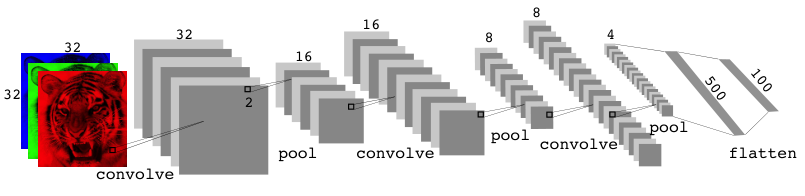

**图10.8** 用于 `CIFAR100` 分类任务的深度CNN架构。卷积层之间穿插 $2\times2$ 最大池化层，使两个方向的尺寸都减半。图内文字：convolve＝卷积；pool＝池化；flatten＝展平；尺寸及单元数保持原样。

随后是一个最大池化层，它把每个通道特征图的大小缩小为原来的四分之一：每个方向各减半。

接下来的两层重复这种“先卷积、后池化”的顺序。细节如下：

- 后续每个卷积层都与第一层相似。它把前一层的三维特征图作为输入，视为一幅多通道图像。学习得到的每个卷积滤波器，其通道数都与该特征图相同。
- 每次池化后，各通道特征图的尺寸都变小，因此通常会增加下一个卷积层的滤波器数量，以作补偿。
- 有时，在一个池化层之前会重复多个卷积层。这实际上增加了滤波器的维数。

重复这些操作，直到池化使每个通道特征图的每个方向都只剩几个像素。此时，将三维特征图**展平（flatten）**，把各像素视为独立单元，送入一个或多个全连接层，再到达输出层。输出层对100个类别使用softmax激活函数，如式（10.13）所示。

构建这样的网络时，除了各层的数量、类型和大小，还有许多调节参数需要选择。每层都可以使用暂退学习，也可以使用套索或岭正则化（见10.7节）。构建CNN的细节看起来可能令人望而生畏。幸运的是，已有很好的软件，提供丰富的示例和使用指南，帮助合理选择参数。在撰写本书时，`CIFAR100` 官方测试集上的最佳准确率略高于75%，但毫无疑问，表现还会继续改善。

### 10.3.4 数据增强（Data Augmentation）

图像建模还有一个重要技巧，就是数据增强。其基本做法是，把每幅训练图像复制多次，每份副本都以自然的方式随机变形，而不影响人类识别。图10.9给出了一些例子。


**图10.9** 数据增强。将最左侧的原始图像以自然方式变形，产生具有相同类别标签的不同图像。这些变形不会迷惑人类，在拟合CNN时起到正则化的作用。

常见的变形包括缩放、水平和竖直平移、剪切、小幅旋转，以及本例中的水平翻转。表面上，这是一种用略有不同的例子大幅扩充训练集、从而防止过拟合的方法。实际上，也可以把它看作正则化的一种形式：我们在每幅原始图像周围生成一簇图像，标签全部相同。这种把数据“加厚”的方式，与岭正则化的思路相近。

10.7.2节将介绍，用于拟合深度学习模型的**随机梯度下降（stochastic gradient descent）**算法，会反复处理随机抽取的训练图像批次，例如每次128幅。这与数据增强相得益彰，因为可以即时对批次中的每幅图像进行变形，而不必存储全部新图像。

### 10.3.5 使用预训练分类器的结果

这里使用一个工业级的预训练分类器，预测一些新图像的类别。`resnet50` 分类器是一个CNN，使用 `imagenet` 数据集训练；该数据集有数百万幅图像，类别数量不断增加。<sup><a href="#ch10-fn10" id="ch10-fnref10">10</a></sup> 图10.10展示了 `resnet50` 对六张照片的分类表现，这些照片来自一位作者的私人收藏。<sup><a href="#ch10-fn11" id="ch10-fnref11">11</a></sup> CNN对第二幅图像中鹰的分类还算合理。如果像第三幅图像那样缩小画面，它就会混淆，选择喷泉而不是鹰。最后一幅图中的“鹟鴷（jacamar）”是一类生活在南美洲和中美洲的热带鸟，羽色与南非织雀（Cape Weaver）相似；后者生活在南非。10.9.4节会进一步介绍这个例子。

<aside class="footnote" id="ch10-fn10"><a href="#ch10-fnref10">10</a> 关于resnet50，参见He、Zhang、Ren和Sun（2015）“Deep residual learning for image recognition”，<a href="https://arxiv.org/abs/1512.03385">https://arxiv.org/abs/1512.03385</a>。关于imagenet，参见Russakovsky、Deng等（2015）“ImageNet Large Scale Visual Recognition Challenge”，发表于 <em>International Journal of Computer Vision</em>。</aside>

<aside class="footnote" id="ch10-fn11"><a href="#ch10-fnref11">11</a> 这些resnet结果可能随时间变化，因为公开训练的模型会定期更新。</aside>

拟合CNN的很大一部分工作，是学习隐藏层中的卷积滤波器；这些就是CNN的系数。对于在 `imagenet` 这类大型、多类别图像库上拟合的模型，这些滤波器的输出可以充当一般自然图像分类问题的特征。面对训练集小得多的新问题，可以使用这些预训练的隐藏层，这一过程称为**权重冻结（weight freezing）**；只训练网络的最后几层，所需数据就少得多。


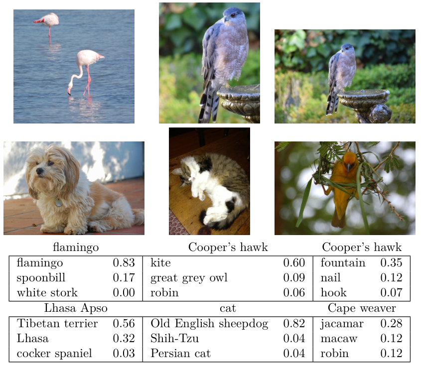

**图10.10** 使用在 `imagenet` 图像库上训练的 `resnet50` CNN对六张照片分类。图像下方的表格，在每个面板顶部给出真实（预期）标签，并列出分类器在100个类别中的前三个选择。数字是每个选择的估计概率。（鸢是一种猛禽，但不是鹰。）图内类别标签与概率保持原样；中文对照：flamingo＝火烈鸟，spoonbill＝琵鹭，white stork＝白鹳，Cooper’s hawk＝鸡鹰，kite＝鸢，great grey owl＝乌林鸮，robin＝知更鸟，fountain＝喷泉，nail＝钉子，hook＝钩子，Lhasa Apso／Lhasa＝拉萨犬，Tibetan terrier＝西藏梗，cocker spaniel＝可卡犬，cat＝猫，Old English sheepdog＝古代英国牧羊犬，Shih-Tzu＝西施犬，Persian cat＝波斯猫，Cape weaver＝南非织雀，jacamar＝鹟鴷，macaw＝金刚鹦鹉。

`keras` 包配套的使用指南和书籍<sup><a href="#ch10-fn12" id="ch10-fnref12">12</a></sup>，对这类应用有更详细的介绍。

<aside class="footnote" id="ch10-fn12"><a href="#ch10-fnref12">12</a> F. Chollet和J. J. Allaire，<em>Deep Learning with R</em>，2018，Manning Publications。</aside>

## 10.4 文档分类（Document Classification）

本节介绍一种新的示例，它在工业和科学中有重要应用：预测文档的属性。文档可以是医学期刊文章、路透社新闻推送、电子邮件、推文等。这里使用 `IMDb`（Internet Movie Database，互联网电影资料库）评分作为例子；这些是观众撰写的电影评论短文。<sup><a href="#ch10-fn13" id="ch10-fnref13">13</a></sup> 此时，响应是影评的**情感倾向（sentiment）**，取正面或负面。

<aside class="footnote" id="ch10-fn13"><a href="#ch10-fnref13">13</a> 详见Maas等（2011）“Learning word vectors for sentiment analysis”，载于 <em>Proceedings of the 49th Annual Meeting of the Association for Computational Linguistics: Human Language Technologies</em>，142–150页。</aside>

下面是一篇颇为有趣的负面影评的开头：

> 这肯定是20世纪90年代最糟糕的电影之一。我和朋友们看这部电影时（我们正是它瞄准的目标观众），头半个小时就这么坐着看，烂到让我们惊得下巴都掉到了地上。剩下的时间里，影院里的其他人开始彼此聊天、离场，或者对着自己的爆米花哭泣……

影评的长短可能各不相同，可能包含俚语或并不存在的词，也可能有拼写错误等。我们需要找到一种方式，对这样的文档进行**特征化（featurize）**。这是定义一组预测变量的现代说法。

最简单、最常见的特征化方式是词袋模型。对语言词典中的每个词——本例中是英语词典——记录它是否出现在文档中。如果词典有 $M$ 个词，就为每份文档创建一个长度为 $M$ 的二元特征向量：出现的词记1，其余记0。这个向量可能非常宽，因此要限制词典；这里选用25,000篇训练影评中出现最频繁的10,000个词。幸运的是，已有很好的工具自动完成这项工作。下面是一篇按这种方式处理过的正面影评的开头，保留原始英文词项和特殊标记：

> ⟨START⟩ this film was just brilliant casting location scenery story direction everyone’s really suited the part they played and you could just imagine being there robert ⟨UNK⟩ is an amazing actor and now the same being director ⟨UNK⟩ father came from the same scottish island as myself so i loved …

> 中文译文：⟨START⟩ 这部电影真是精彩 选角 地点 景色 故事 导演 每个人都很适合所扮演的角色 你简直能想象自己身临其境 robert ⟨UNK⟩ 是个了不起的演员 现在做导演也一样 ⟨UNK⟩ 父亲来自与我相同的苏格兰岛屿 所以我很喜欢……

可以看到，许多词已被省去，有些未知词被标记为UNK。经过这种简化，二元特征向量的长度为10,000，其中大部分是0，只有与文档中出现的词对应的位置有少量1。训练集和测试集各有25,000个例子，两者的正负情感类别都平衡。得到的训练特征矩阵 $\mathbf X$ 的维数是 $25{,}000\times10{,}000$，但二元元素中只有1.3%非零。由于大多数值相同（这里是0），这种矩阵称为稀疏矩阵，可以用**稀疏矩阵格式（sparse matrix format）**高效存储。<sup><a href="#ch10-fn14" id="ch10-fnref14">14</a></sup> 有多种方法可以考虑文档长度；这里仅记录词是否出现在文档中，但也可以改为记录词的相对频率等。我们从25,000个训练观测中划出2,000个作为验证集（用于调节模型），拟合两个模型序列：

<aside class="footnote" id="ch10-fn14"><a href="#ch10-fnref14">14</a> 不必存储整个矩阵，只需存储非零元素的位置和值。这里的非零值全都是1，所以只存储位置即可。</aside>

- 使用 `glmnet` 包的套索逻辑回归；
- 一个具有两个隐藏层的二分类神经网络，每层有16个ReLU单元。

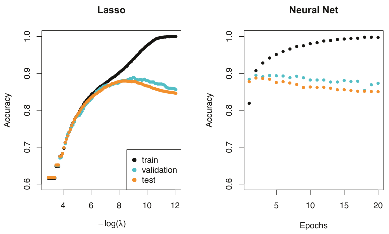

**图10.11** 套索法与双隐藏层神经网络在 `IMDb` 数据上的准确率。套索法的横轴为 $-\log(\lambda)$，神经网络的横轴为训练轮数，即拟合算法完整遍历训练集的次数。两者都表现出过拟合倾向，达到的测试准确率大致相同。图内文字：Lasso＝套索法；Neural Net＝神经网络；Accuracy＝准确率；Epochs＝训练轮数；train／validation／test＝训练／验证／测试。

两种方法都会产生一系列解。套索法的解序列以正则化参数 $\lambda$ 为索引；神经网络的解序列则以拟合时的梯度下降迭代次数为索引，用训练**轮（epochs）**衡量，即完整遍历训练集的次数（见10.7节）。注意，图10.11中的训练准确率（黑点）在两种情况下都单调增加。可以用验证误差，从每个序列中选择一个良好的解（图中的蓝点），再用它预测测试集。

注意，二分类神经网络相当于一个非线性逻辑回归模型。由式（10.12）和（10.13）可以看出，

$$
\begin{aligned}
\log\left(\frac{\Pr(Y=1\mid X)}{\Pr(Y=0\mid X)}\right)&=Z_1-Z_0\\
&=(\beta_{10}-\beta_{00})+\sum_{\ell=1}^{K_2}(\beta_{1\ell}-\beta_{0\ell})A_\ell^{(2)}.
\end{aligned}\tag{10.15}
$$

（这说明softmax函数存在冗余；对于 $K$ 个类别，实际上只需估计 $K-1$ 组系数，见4.3.5节。）图10.11展示的是准确率（正确分类的比例），而不是分类错误率（错误分类的比例）；前者在机器学习领域更常用。两个模型在测试集上的准确率都约为88%。

词袋模型用文档中出现的词来概括文档，忽略它们的上下文。至少有两种常用方法可以考虑上下文：

- **n元词袋模型（bag-of-n-grams model）**。例如，二元词袋记录每一对不同词连续共同出现的情况。

“Blissfully long”（长得让人陶醉）在影评中可以是正面短语，而“blissfully short”（短得让人庆幸）则是负面的。

- 把文档当作一个序列，结合每个词之前和之后的词来考虑所有词的上下文。

下节将研究序列数据模型，它们的应用包括天气预报、语音识别、语言翻译、时间序列预测等。我们还会在那里继续讨论 `IMDb` 这个例子。

## 10.5 循环神经网络

许多数据来源本质上具有序列结构，构建预测模型时需要特别处理。例如：

- 书评、影评、新闻报道和推文等文档。文档中词语的顺序和相对位置体现了叙述、主题与语气，可以用于主题分类、情感分析和语言翻译等任务。
- 温度、降雨量、风速、空气质量等时间序列。我们可能希望预测未来几天的天气，或未来几十年的气候。
- 金融时间序列，其中记录市场指数、交易量、股票和债券价格以及汇率。这类预测往往很困难，但我们将看到，有些指标可以得到相当准确的预测。
- 语音、音乐和其他声音录音。我们可能希望将语音转写为文字，或者进行语言翻译；也可能希望评价一段音乐的质量，或为它赋予某些属性。
- 医生笔记等手写文字，以及邮政编码等手写数字。我们希望将手写文字转成数字文本，或者识别其中的数字，即光学字符识别。

在循环神经网络（RNN）中，输入对象 $X$ 是一个序列。考虑一个文档语料库，例如IMDb影评集合。每篇文档可以表示为由 $L$ 个词组成的序列，即 $X=\{X_1,X_2,\ldots,X_L\}$，其中每个 $X_\ell$ 代表一个词。词语的顺序，以及句子中某些词语之间的接近程度，都传达着语义。RNN旨在适应并利用这类输入对象的序列性质，正如卷积神经网络适应图像输入的空间结构一样。输出 $Y$ 也可以是序列（例如语言翻译），但通常是标量，例如影评文档的二元情感标签。

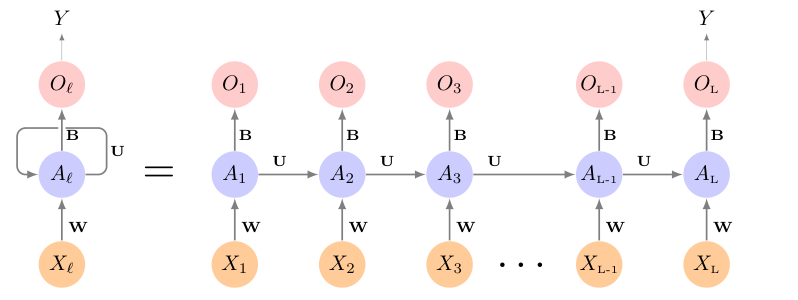

**图10.12** 简单循环神经网络示意图。输入是向量序列 $\{X_\ell\}_1^L$，这里的目标是单个响应。网络依次处理输入序列 $X$；每个 $X_\ell$ 进入隐藏层，该层还接收序列中前一个元素的激活向量 $A_{\ell-1}$ 作为输入，产生当前的激活向量 $A_\ell$。处理序列中的每个元素时，使用的是同一组权重 $\mathbf W$、$\mathbf U$ 和 $\mathbf B$。输出层根据当前激活值 $A_\ell$ 产生一个预测序列 $O_\ell$，但通常只有最后一个预测 $O_L$ 有意义。等号左侧是网络的简写表示，右侧是将其展开后更明确的表示。图内字母、下标和权重符号保持原样。

图10.12展示了一种最基本的RNN结构：输入为序列 $X=\{X_1,X_2,\ldots,X_L\}$，输出为单个 $Y$，隐藏层序列为 $\{A_\ell\}_1^L=\{A_1,A_2,\ldots,A_L\}$。每个 $X_\ell$ 都是一个向量；在文档例子中，$X_\ell$ 可以是根据该语料库的语言词典对第 $\ell$ 个词作出的独热编码（图10.13上图给出一个简单例子）。网络依次处理序列中的向量 $X_\ell$，将 $X_\ell$ 以及序列中前一步的激活向量 $A_{\ell-1}$ 作为输入，更新隐藏层中的激活值 $A_\ell$。每个 $A_\ell$ 都进入输出层，生成对 $Y$ 的一个预测 $O_\ell$。其中最后一个预测 $O_L$ 最为相关。

具体来说，假设输入序列中的每个向量 $X_\ell$ 有 $p$ 个分量，$X_\ell^T=(X_{\ell1},X_{\ell2},\ldots,X_{\ell p})$，隐藏层由 $K$ 个单元组成，$A_\ell^T=(A_{\ell1},A_{\ell2},\ldots,A_{\ell K})$。与图10.4一样，我们用矩阵 $\mathbf W$ 表示输入层的 $K\times(p+1)$ 个共享权重 $w_{kj}$；类似地，$\mathbf U$ 是隐藏层之间的权重 $u_{ks}$ 组成的 $K\times K$ 矩阵，$\mathbf B$ 是输出层权重 $\beta_k$ 组成的长度为 $K+1$ 的向量。于是，

$$
A_{\ell k}=g\left(w_{k0}+\sum_{j=1}^{p}w_{kj}X_{\ell j}+\sum_{s=1}^{K}u_{ks}A_{\ell-1,s}\right),\tag{10.16}
$$

对于定量响应，输出 $O_\ell$ 计算为

$$
O_\ell=\beta_0+\sum_{k=1}^{K}\beta_kA_{\ell k}\tag{10.17}
$$

例如，对于二元响应，还可以额外加上一个sigmoid激活函数。这里的 $g(\cdot)$ 是ReLU之类的激活函数。注意，处理序列中的每个元素时，都使用相同的权重 $\mathbf W$、$\mathbf U$ 和 $\mathbf B$。

也就是说，它们并不是 $\ell$ 的函数。这是RNN所采用的一种**权重共享（weight sharing）**形式，与卷积神经网络中使用滤波器的方式类似（10.3.1节）。随着我们从头到尾处理序列，激活值 $A_\ell$ 会积累此前所见信息的历史，从而利用学到的上下文进行预测。

对于回归问题，一个观测 $(X,Y)$ 的损失函数是

$$
(Y-O_L)^2,\tag{10.18}
$$

其中只涉及最终输出 $O_L=\beta_0+\sum_{k=1}^{K}\beta_kA_{Lk}$。因此，$O_1,O_2,\ldots,O_{L-1}$ 并不使用。拟合模型时，输入序列 $X$ 中的每个元素 $X_\ell$ 都通过式（10.16）所形成的链影响 $O_L$，因此通过损失（10.18）间接参与共享参数 $\mathbf W$、$\mathbf U$ 和 $\mathbf B$ 的学习。对于 $n$ 个输入序列与响应对 $(x_i,y_i)$，通过最小化以下平方和求得参数：

$$
\sum_{i=1}^{n}(y_i-o_{iL})^2=\sum_{i=1}^{n}\left(y_i-\left(\beta_0+\sum_{k=1}^{K}\beta_kg\left(w_{k0}+\sum_{j=1}^{p}w_{kj}x_{iLj}+\sum_{s=1}^{K}u_{ks}a_{i,L-1,s}\right)\right)\right)^2.\tag{10.19}
$$

这里用小写字母表示观测到的 $y_i$ 和向量序列 $x_i=\{x_{i1},x_{i2},\ldots,x_{iL}\}$，<sup><a href="#ch10-fn15" id="ch10-fnref15">15</a></sup> 以及由此得到的激活值。

<aside class="footnote" id="ch10-fn15"><a href="#ch10-fnref15">15</a> 这是一个向量序列；每个元素 $x_{i\ell}$ 都是一个 $p$ 维向量。</aside>

既然中间输出 $O_\ell$ 并不使用，人们自然会问，为什么还要保留它们？首先，它们不需要额外代价，因为它们使用的正是产生 $O_L$ 所需的同一组输出权重 $\mathbf B$，并能给出随序列处理而逐步更新的预测。此外，在某些学习任务中，响应本身也是序列，因此明确需要输出序列 $\{O_1,O_2,\ldots,O_L\}$。

充分发挥作用时，循环神经网络可能相当复杂。我们将用两个简单应用说明其用法。第一个应用继续上一节的IMDb情感分析，按顺序处理影评中的词语；第二个应用则说明如何将它用于金融时间序列预测。

### 10.5.1 用于文档分类的序列模型

这里回到IMDb影评的分类任务。10.4节采用了词袋模型；现在改用文档中词语出现的顺序，预测整篇文档的标签。

不过，我们面临一个维数问题：文档中的每个词都由包含10,000个元素的独热编码向量（虚拟变量）表示，词典中的每个词对应一个元素！一种日益常用的方法，是将每个词表示在维数低得多的**嵌入（embedding）**空间中。也就是说，不再用一个包含9,999个0、仅在某个位置有一个1的二元向量表示词语，而是改用 $m$ 个实数表示，通常其中没有一个数为0。这里的 $m$ 是嵌入维数，可以是几百以内，甚至更低。这意味着，在我们的例子中，需要一个维数为 $m\times10{,}000$ 的矩阵 $\mathbf E$。


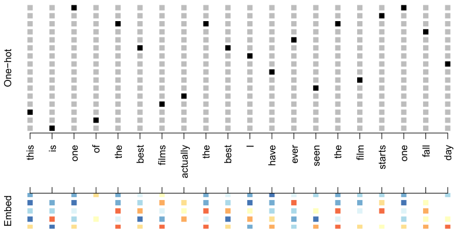

**图10.13** 用20个词组成的序列表示单篇文档：上图使用包含16个词的词典进行独热编码，下图将其嵌入 $m$ 维空间，其中 $m=5$。图内文字：One-hot＝独热编码；Embed＝嵌入。词语序列“this is one of the best films actually the best I have ever seen the film starts one fall day”意为“这是最好的电影之一，实际上是我看过的最好的电影，电影从一个秋日开始”；原词、顺序及颜色保持原样。

矩阵中的每一列由词典中10,000个词之一索引，该列的数值给出这个词在嵌入空间中的 $m$ 个坐标。

图10.13说明了这个思路，图中的词典有16个词而非10,000个，且 $m=5$。$\mathbf E$ 从何而来？如果有大量带标签的文档，可以让神经网络在优化过程中同时学习 $\mathbf E$。这时，$\mathbf E$ 称为**嵌入层（embedding layer）**，针对当前任务学习一个专用的 $\mathbf E$。也可以在嵌入层中放入一个预先计算好的矩阵 $\mathbf E$，这一过程称为**权重冻结（weight freezing）**。两种预训练嵌入word2vec和GloVe被广泛使用。<sup><a href="#ch10-fn16" id="ch10-fnref16">16</a></sup> 它们利用主成分分析（12.2节）的一种变体，在非常大的文档语料库上构建。其思想是让词语在嵌入空间中的位置保留语义；例如，同义词应彼此靠近。

<aside class="footnote" id="ch10-fn16"><a href="#ch10-fnref16">16</a> word2vec见Mikolov、Chen、Corrado和Dean（2013），网址为 <a href="https://code.google.com/archive/p/word2vec">https://code.google.com/archive/p/word2vec</a>。GloVe见Pennington、Socher和Manning（2014），网址为 <a href="https://nlp.stanford.edu/projects/glove">https://nlp.stanford.edu/projects/glove</a>。</aside>

到目前为止，一切顺利。现在，每篇文档被表示为一个 $m$ 维向量序列，对应其词语序列。下一步是只保留每篇文档的最后 $L$ 个词。如果文档长度不足 $L$，就在开头补0。于是，每篇文档都由 $L$ 个向量构成的序列 $X=\{X_1,X_2,\ldots,X_L\}$ 表示，序列中的每个 $X_\ell$ 有 $m$ 个分量。

接下来使用图10.12中的RNN结构。训练语料库由 $n$ 个相互独立、长度为 $L$ 的序列（文档）组成，每个序列都从左到右依次处理。在此过程中，对每篇文档，按式（10.16）生成一个与之平行的隐藏激活向量序列 $A_\ell$，$\ell=1,\ldots,L$。$A_\ell$ 进入输出层，生成逐步更新的预测 $O_\ell$。我们使用最终值 $O_L$ 预测响应，即影评的情感。

这是一个简单的RNN，参数相对较少。如果有 $K$ 个隐藏单元，共享权重矩阵 $\mathbf W$ 有 $K\times(m+1)$ 个参数，矩阵 $\mathbf U$ 有 $K\times K$ 个参数；对于式（10.15）那样的二分类逻辑回归，$\mathbf B$ 有 $2(K+1)$ 个参数。从左到右处理序列 $X=\{X_\ell\}_1^L$ 时，这些参数会被反复使用，正如使用一个卷积滤波器处理图像中的每个小块一样（10.3.1节）。如果还要学习嵌入层 $\mathbf E$，就会额外增加 $m\times D$ 个参数（这里 $D=10{,}000$），这远远是最大的参数开销。

我们按照图10.12及相关文字的说明，对IMDb数据拟合了RNN。模型包含一个 $m=32$ 的嵌入矩阵 $\mathbf E$（在训练中学习，而非预先计算），随后是一个具有 $K=32$ 个隐藏单元的循环层。模型在指定训练集的25,000篇影评上使用**暂退法（dropout）**进行正则化训练，在IMDb测试数据上只达到令人失望的76%准确率。采用GloVe预训练嵌入矩阵 $\mathbf E$ 的网络表现还略差一些。

为了便于说明，我们介绍的是一种非常简单的RNN。更复杂的版本采用**长短期记忆（long term and short term memory，LSTM）**。网络同时维护两条隐藏层激活值轨迹，使计算 $A_\ell$ 时，既能接收较久以前的隐藏单元的信息，也能接收较近时刻的信息，这就是所谓的LSTM RNN。对于长序列，这克服了早期信号沿链传播到最终激活向量 $A_L$ 时已被冲淡的问题。

当我们把隐藏层改为LSTM结构，重新拟合模型后，IMDb测试数据上的准确率提高到了87%，与10.4节词袋模型达到的88%相当。10.9.6节给出这些模型的拟合细节。

尽管增加了LSTM的复杂结构，这个RNN仍然比较“入门级”。通过改变模型大小、调整正则化，或增加隐藏层，可能还能取得稍好的结果。不过，LSTM模型训练耗时很长，因此尝试许多结构并优化参数相当繁琐。

RNN为数据序列建模提供了丰富的框架，而且还在不断发展。RNN在结构、数据增强和学习算法方面都取得了许多进展。截至本书写作时（2020年初），最好的RNN配置报告在IMDb数据上的准确率已超过95%。这些细节超出了本书范围。<sup><a href="#ch10-fn17" id="ch10-fnref17">17</a></sup>

<aside class="footnote" id="ch10-fn17"><a href="#ch10-fnref17">17</a> IMDb排行榜见 <a href="https://paperswithcode.com/sota/sentiment-analysis-on-imdb">https://paperswithcode.com/sota/sentiment-analysis-on-imdb</a>。</aside>

### 10.5.2 时间序列预测

图10.14展示了纽约证券交易所的历史交易统计。图中的三个日度时间序列覆盖1962年12月3日至1986年12月31日：<sup><a href="#ch10-fn18" id="ch10-fnref18">18</a></sup>

<aside class="footnote" id="ch10-fn18"><a href="#ch10-fnref18">18</a> 这些数据由LeBaron和Weigend（1998）整理，见 *IEEE Transactions on Neural Networks*，9(1)：213–220。</aside>


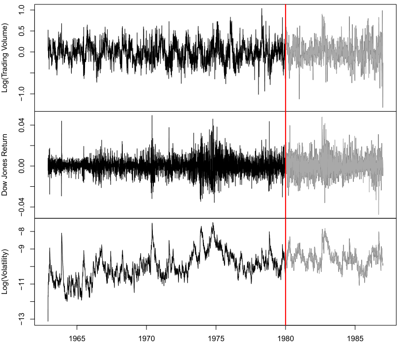

**图10.14** 纽约证券交易所的历史交易统计。图中给出了1962–1986年这24年间，归一化对数交易量、道琼斯工业平均指数（DJIA）收益率和对数波动率的日度取值。我们希望根据此前各日的历史记录预测某一天的交易量。红线（1980年1月2日）左侧是训练数据，右侧是测试数据。图内文字：Log(Trading Volume)＝对数交易量；Dow Jones Return＝道琼斯收益率；Log(Volatility)＝对数波动率；年份与数值保持原样。

- 对数交易量（Log trading volume）：当天交易股数占全部流通股数的比例，相对于过去换手率的100日移动平均值，再取对数。
- 道琼斯收益率（Dow Jones return）：相邻交易日道琼斯工业指数的对数之差。
- 对数波动率（Log volatility）：根据每日价格变动的绝对值计算。

众所周知，股票价格很难预测，但根据近期历史记录预测交易量要容易一些，而且有助于规划交易策略。

这里，一个观测由第 $t$ 天的测量值 $(v_t,r_t,z_t)$ 构成，分别对应 `log_volume`、`DJ_return` 和 `log_volatility`。一共有 $T=6{,}051$ 个这样的三元组，每个变量都在图10.14中画成时间序列。一个立即引起注意的特点是，每天的观测并不相互独立。这些序列表现出**自相关（auto-correlation）**，即在这里，时间上相近的取值往往彼此相似。这使时间序列不同于此前遇到的其他数据集；在那些数据集中，可以假设各观测相互独立。


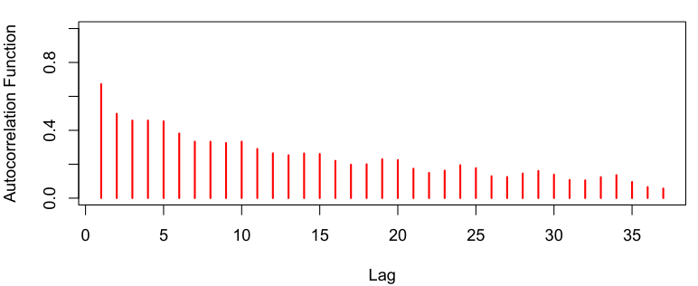

**图10.15** `log_volume` 的自相关函数。相近取值之间有相当强的相关性，即使相隔20天，相关系数仍高于0.2。图内文字：Autocorrelation Function＝自相关函数；Lag＝滞后；数值保持原样。

具体来说，考虑相隔 $\ell$ 天的一对观测 $(v_t,v_{t-\ell})$，称其**滞后（lag）**为 $\ell$。取出 $v_t$ 序列中所有这样的观测对，计算它们的相关系数，就得到滞后 $\ell$ 的自相关。图10.15给出了直到37阶滞后的自相关函数，可以看到明显的相关性。

这个预测问题还有一个有趣的特点：响应变量 $v_t$（`log_volume`）同时也是预测变量！具体来说，我们将利用 `log_volume` 的过去取值预测未来取值。

#### RNN预测器

我们希望利用过去的 $v_{t-1},v_{t-2},\ldots$ 预测 $v_t$，同时利用其他序列的过去取值 $r_{t-1},r_{t-2},\ldots$ 和 $z_{t-1},z_{t-2},\ldots$。虽然合并后的数据是一个包含6,051个交易日的长序列，但这个问题的结构不同于前面的文档分类例子。

- 我们只有一个数据序列，而不是25,000个。
- 我们有一整个目标序列 $v_t$，输入中也包含该序列的过去取值。

如何用图10.12的结构表示这个问题？方法是取出许多长度预先固定为 $L$ 的短输入序列 $X=\{X_1,X_2,\ldots,X_L\}$，并配上相应的目标 $Y$；这里的 $L$ 称为滞后长度。它们具有如下形式：

$$
X_1=\begin{pmatrix}v_{t-L}\\r_{t-L}\\z_{t-L}\end{pmatrix},\quad X_2=\begin{pmatrix}v_{t-L+1}\\r_{t-L+1}\\z_{t-L+1}\end{pmatrix},\quad\ldots,\quad X_L=\begin{pmatrix}v_{t-1}\\r_{t-1}\\z_{t-1}\end{pmatrix},\quad\text{且 }Y=v_t.\tag{10.20}
$$

这里的目标 $Y$ 是单个时间点 $t$ 上的对数交易量 $v_t$，输入序列 $X$ 是由三维向量构成的序列 $\{X_\ell\}_1^L$；每个向量由第 $t-L$、$t-L+1$，直到第 $t-1$ 天的三项测量值 `log_volume`、`DJ_return` 和 `log_volatility` 构成。对于 $t=L+1$ 到 $T$，每个 $t$ 值都产生一个单独的 $(X,Y)$ 对。

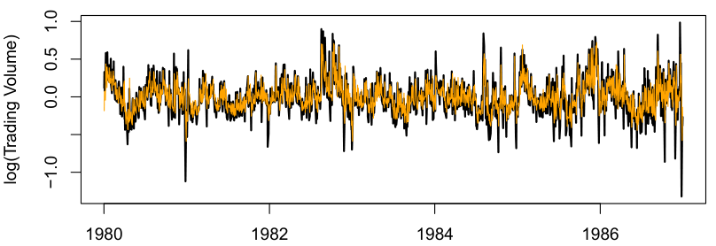

**图10.16** RNN对NYSE测试数据中 `log_volume` 的预测。黑线表示真实交易量，叠加的橙线表示预测值。预测序列解释了 `log_volume` 方差的42%。图内文字：log(Trading Volume)＝对数交易量；年份与数值保持原样。

对于NYSE数据，我们将使用过去五个交易日预测下一天的交易量，因此取 $L=5$。由于 $T=6{,}051$，可以构造6,046个这样的 $(X,Y)$ 对。显然，$L$ 是一个需要仔细选择的参数，或许可以用验证数据来选择。

我们利用1980年1月2日之前的数据（见图10.14）生成的4,281个训练序列，以 $K=12$ 个隐藏单元拟合模型，然后用它预测这一日期之后的1,770个 `log_volume` 取值。在测试数据上得到 $R^2=0.42$，细节见10.9.6节。作为一个简单基准（straw man），<sup><a href="#ch10-fn19" id="ch10-fnref19">19</a></sup> 直接用昨天的 `log_volume` 预测今天，其 $R^2=0.18$。图10.16展示了预测结果：1980–1986年测试期间每天观测到的 `log_volume` 用黑色画出，预测序列用橙色叠加在上面，两者看起来吻合得相当好。

<aside class="footnote" id="ch10-fn19"><a href="#ch10-fnref19">19</a> 这里的straw man指一个简单、合理的预测，可用作比较基准。</aside>

预测测试期间的 `log_volume` 时，必须使用测试数据本身构建输入序列 $X$。这可能让人觉得像在作弊，但实际上不是：我们始终是在利用过去的数据预测未来。

#### 自回归

刚才拟合的RNN与传统的**自回归（autoregression，AR）**线性模型有许多共同之处，下面介绍这一模型作为比较。先只考虑响应序列 $v_t$，为最小二乘回归构建响应向量 $\mathbf y$ 和预测变量矩阵 $\mathbf M$：

$$
\mathbf y=\begin{bmatrix}v_{L+1}\\v_{L+2}\\v_{L+3}\\\vdots\\v_T\end{bmatrix}\quad\mathbf M=\begin{bmatrix}1&v_L&v_{L-1}&\cdots&v_1\\1&v_{L+1}&v_L&\cdots&v_2\\1&v_{L+2}&v_{L+1}&\cdots&v_3\\\vdots&\vdots&\vdots&\cdots&\vdots\\1&v_{T-1}&v_{T-2}&\cdots&v_{T-L}\end{bmatrix}.\tag{10.21}
$$

$\mathbf M$ 和 $\mathbf y$ 都有 $T-L$ 行，每行对应一个观测。对于第 $t$ 天的响应 $v_t$，其预测变量是同一序列此前的 $L$ 个取值。

对 $\mathbf y$ 关于 $\mathbf M$ 做回归，相当于拟合模型

$$
\hat v_t=\hat\beta_0+\hat\beta_1v_{t-1}+\hat\beta_2v_{t-2}+\cdots+\hat\beta_Lv_{t-L},\tag{10.22}
$$

称为 $L$ 阶自回归模型，或简称 $\operatorname{AR}(L)$。对于NYSE数据，可以把 `DJ_return` 和 `log_volatility`（即 $r_t$ 和 $z_t$）的滞后取值也纳入预测变量矩阵 $\mathbf M$，这样共有 $3L+1$ 列。取 $L=5$ 的AR模型得到测试 $R^2=0.41$，略低于RNN的0.42。

当然，RNN与AR模型十分相似。在这个例子中，它们使用相同的响应 $Y$，以及长度 $L=5$、维数 $p=3$ 的输入序列 $X$。RNN使用相同的输入层权重 $\mathbf W$，从左到右处理序列；AR模型则把序列的全部 $L$ 个元素一视同仁，视为包含 $L\times p$ 个预测变量的向量，这个过程在神经网络文献中称为**展平（flattening）**。RNN还包含沿序列传递信息的隐藏层激活值 $A_\ell$，并引入了额外的非线性。由式（10.19），当有 $K=12$ 个隐藏单元时，RNN有 $13+12\times(1+3+12)=205$ 个参数，而AR(5)模型只有16个。

AR模型的一个显而易见的扩展，是把这些滞后预测变量作为普通前馈神经网络（10.1）的输入向量，从而增加灵活性。它的测试 $R^2=0.42$，比线性AR稍好，与RNN相同。

所有这些模型都能通过加入目标 $v_t$ 所在第 $t$ 天对应的 `day_of_week` 变量而得到改进。这个变量可根据数据附带的日历日期获得；星期一和星期五的交易量往往更高。由于有五个交易日，独热编码后得到五个二元变量。AR模型与RNN的 $R^2$ 都提高到0.46，非线性AR模型则提高到0.47。

这里的例子使用了最简单的RNN。进一步尝试RNN的LSTM扩展，得到小幅改进；在这些例子中，$R^2$ 的提高通常不超过1%。

10.9.6节给出这三种模型的拟合细节。

### 10.5.3 RNN小结

我们通过两个简单的用例介绍了RNN，但这只是触及皮毛。

用于序列建模的简单RNN有许多变体和改进。这里没有讨论的一种方法，是使用一维卷积神经网络，把向量序列（例如词语在嵌入空间中的表示）视为图像。卷积滤波器沿序列在一个维度上滑动，可能学到与任务相关的特定短语或短子序列。

RNN还可以增加隐藏层。例如，有两个隐藏层时，可以直接把序列 $A_\ell$ 作为下一个隐藏层的输入序列。

我们使用的RNN从文档开头扫描到结尾；另一类**双向（bidirectional）**RNN则沿两个方向扫描序列。

在语言翻译中，目标也是一个词语序列，只是语言不同于输入序列。输入序列和目标序列都由类似于图10.12的结构表示，两者共享隐藏单元。在这种所谓的**序列到序列（Seq2Seq）**学习中，人们认为隐藏单元能够捕捉句子的语义。语言建模和翻译中的一些重大突破，来自这类RNN在相对近期取得的改进。

用于拟合RNN的算法可能很复杂，而且计算代价很高。幸好，良好的软件能让用户在一定程度上免于接触这些复杂细节，使模型的指定和拟合相对轻松。日常生活中使用的许多模型，例如Google Translate，都采用了由高水平工程师团队开发的先进结构，并使用海量计算和数据资源进行训练。

## 10.6 何时使用深度学习

深度学习在本章中的表现相当出色。它很好地解决了数字分类问题，而深度CNN确实给图像分类带来了革命性变化。我们每天都能看到深度学习取得新成功的报道，其中许多涉及图像分类，例如对乳房X线影像或数字X线图像进行机器诊断、眼科扫描、MRI扫描标注等。同样，RNN在语音和语言翻译、预测、文档建模方面也有许多成功案例。由此产生了一个亟待回答的问题：*是否应该丢弃所有旧工具，对每个涉及数据的问题都使用深度学习？* 为了回答它，我们重新考察第6章的 `Hitters` 数据集。

这是一个回归问题，目标是根据棒球运动员1986年的表现统计，预测其1987年的 `Salary`。删除响应缺失的球员后，剩下263名球员和19个变量。我们随机把数据划分为包含176名球员的训练集（三分之二）和包含87名球员的测试集（三分之一），并用三种方法拟合回归模型。

- 用线性模型拟合训练数据，并预测测试数据。模型有20个参数。
- 对相同的线性模型使用套索正则化，通过训练数据上的10折交叉验证选择调节参数，最终选出12个变量具有非零系数的模型。
- 拟合一个只有一个隐藏层、含64个ReLU单元的神经网络。这个模型有1,345个参数。<sup><a href="#ch10-fn20" id="ch10-fnref20">20</a></sup>

<aside class="footnote" id="ch10-fn20"><a href="#ch10-fnref20">20</a> 模型采用随机梯度下降（stochastic gradient descent）拟合，批量大小为32，训练1,000轮（epochs），使用10%的暂退正则化。测试误差在1,000轮之后趋于平稳，随后开始缓慢上升。10.7节讨论这些拟合细节。</aside>

| 模型 | 参数数量 | 平均绝对误差（Mean Abs. Error） | 测试集 $R^2$ |
|---|---:|---:|---:|
| 线性回归 | 20 | 254.7 | 0.56 |
| 套索法 | 12 | 252.3 | 0.51 |
| 神经网络 | 1345 | 257.4 | 0.54 |

**表10.2** 在 `Hitters` 测试数据上的预测结果：比较采用普通最小二乘和套索法拟合的线性模型，以及使用随机梯度下降和暂退正则化拟合的神经网络。

|  | 系数 | 标准误 | $t$ 统计量 | $p$ 值 |
|---|---:|---:|---:|---:|
| `Intercept` | -226.67 | 86.26 | -2.63 | 0.0103 |
| `Hits` | 3.06 | 1.02 | 3.00 | 0.0036 |
| `Walks` | 0.181 | 2.04 | 0.09 | 0.9294 |
| `CRuns` | 0.859 | 0.12 | 7.09 | < 0.0001 |
| `PutOuts` | 0.465 | 0.13 | 3.60 | 0.0005 |

**表10.3** 在 `Hitters` 数据集中，用套索法选出的四个变量对 `Salary` 回归所得的最小二乘系数估计值。这个模型在测试数据上表现最好，平均绝对误差为224.8。此处报告的结果来自测试数据上的回归；这些数据没有用于套索模型的拟合。

表10.2比较了结果，三种模型的表现相近。这里报告了测试数据上的平均绝对误差（mean absolute error）和每种方法的测试 $R^2$，这些结果都不错（见习题5）。为了得到这些结果，我们花了相当多时间调整神经网络的配置参数。如果花更多时间，把正则化的形式和程度调得恰到好处，也许能达到甚至超过线性回归和套索法的表现。但我们很容易就获得了表现良好的线性模型。线性模型比神经网络更容易展示和理解，后者本质上是一个黑箱。套索法从19个变量中选出12个用于预测。因此，在这样的情况下，遵循**奥卡姆剃刀（Occam's razor）**原则更合适：面对几个表现大致相当的方法，选择最简单的。

进一步探索套索模型后，我们找到了一个只包含四个变量的更简单模型。随后，在训练数据上用这四个变量重新拟合线性模型，也就是所谓的**松弛套索（relaxed lasso）**，得到测试平均绝对误差224.8，成为总体表现最好的方法！我们很想展示这个拟合结果的汇总表，以查看系数和 $p$ 值；但由于模型是在训练数据上选择的，这样做会存在**选择偏差（selection bias）**。因此，我们改在未用于变量选择的测试数据上重新拟合模型，结果见表10.3。

我们手中有许多强大工具，例如神经网络、随机森林、提升法、支持向量机和广义加性模型等，还有线性模型及其简单变体。面对新的数据建模和预测问题，人们很容易总想采用时髦的新方法。它们往往能给出极其出色的结果，尤其是在数据集很大、足以支持高维非线性模型拟合时。不过，如果使用更简单的工具也能构建表现相当的模型，

那么，与更复杂的方法相比，这些模型通常更容易拟合和理解，也可能更稳健。只要条件允许，同时尝试较简单的模型，再根据表现与复杂程度的权衡作出选择，是合理的做法。

通常，当训练集样本量极大，而且模型可解释性并非优先考虑的因素时，我们预期深度学习会是一个有吸引力的选择。

## 10.7 拟合神经网络 

拟合神经网络有些复杂，这里只作简要介绍。这些思想也适用于复杂得多的网络。觉得这部分内容难以理解的读者，可以放心跳过。幸好，正如本章末实验所展示的，有很好的软件能够相对自动地拟合神经网络模型，无须操心模型拟合过程的技术细节。

先从10.1节图10.1所示的简单网络开始。模型（10.1）的参数包括 $\boldsymbol\beta=(\beta_0,\beta_1,\ldots,\beta_K)$，以及各个 $w_k=(w_{k0},w_{k1},\ldots,w_{kp})$，$k=1,\ldots,K$。给定观测 $(x_i,y_i)$，$i=1,\ldots,n$，可以通过求解非线性最小二乘问题拟合模型：

$$
\underset{\{w_k\}_1^K,\,\boldsymbol\beta}{\text{最小化}}\quad\frac12\sum_{i=1}^{n}(y_i-f(x_i))^2,\tag{10.23}
$$

其中

$$
f(x_i)=\beta_0+\sum_{k=1}^{K}\beta_kg\left(w_{k0}+\sum_{j=1}^{p}w_{kj}x_{ij}\right).\tag{10.24}
$$

式（10.23）的目标看上去足够简单，但由于参数相互嵌套，且隐藏单元具有对称性，要将它最小化并不直接。这个问题对于参数是非凸的，因此存在多个解。例如，图10.17给出了单变量 $\theta$ 的一个简单非凸函数，它有两个解，一个是**局部极小值（local minimum）**，另一个是**全局极小值（global minimum）**。而且，式（10.1）只是最简单的神经网络；本章介绍过复杂得多的网络，其中这些问题还会加剧。为了克服其中一些问题，并防止过拟合，拟合神经网络时采用两种一般策略。

- *缓慢学习*：使用**梯度下降（gradient descent）**，以相对缓慢的迭代方式拟合模型；检测到过拟合时就停止拟合。
- *正则化*：对参数施加惩罚，通常使用6.2节讨论的套索或岭惩罚。

假设将全部参数表示为一个长向量 $\theta$，便可将式（10.23）的目标改写为

$$
R(\theta)=\frac12\sum_{i=1}^{n}(y_i-f_\theta(x_i))^2,\tag{10.25}
$$

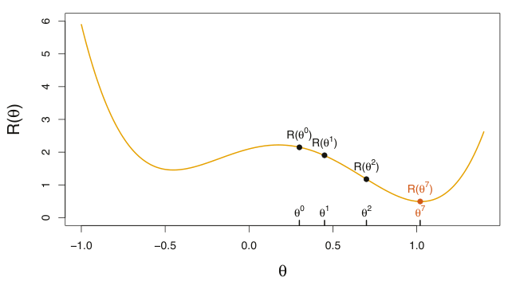

**图10.17** 一维参数 $\theta$ 的梯度下降示意图。目标函数 $R(\theta)$ 不是凸函数，有两个极小值，一个位于 $\theta=-0.46$（局部），另一个位于 $\theta=1.02$（全局）。从某个初值 $\theta^0$ 出发（通常随机选择），每一步都沿下坡方向，也就是梯度的反方向移动 $\theta$，直到无法再下降。在这个例子中，梯度下降经过7步到达全局极小值。图内的参数、函数值和刻度保持原样。

这里明确写出了 $f$ 对参数的依赖。梯度下降的想法非常简单。

1. 为 $\theta$ 中的全部参数设定初始猜测 $\theta^0$，并令 $t=0$。
2. 重复以下步骤，直到目标（10.25）不再下降：

    (a) 找一个向量 $\delta$，表示 $\theta$ 的一个小变化，使 $\theta^{t+1}=\theta^t+\delta$ 能降低目标，即满足 $R(\theta^{t+1})<R(\theta^t)$。

    (b) 令 $t\leftarrow t+1$。

可以想象自己站在一片山地中（图10.17），目标是通过一连串步伐走到谷底。只要每一步都向下走，最终必然能走到谷底。在这个例子中我们很幸运，从初始猜测 $\theta^0$ 出发，最终到达了全局极小值。一般而言，我们希望最终能到达一个不错的局部极小值。

### 10.7.1 反向传播（Backpropagation）

如何找到移动 $\theta$ 的方向，使式（10.25）的目标 $R(\theta)$ 下降？在当前值 $\theta=\theta^m$ 处，$R(\theta)$ 的**梯度（gradient）**，就是该点的偏导数向量：

$$
\nabla R(\theta^m)=\left.\frac{\partial R(\theta)}{\partial\theta}\right|_{\theta=\theta^m}.\tag{10.26}
$$

下标 $\theta=\theta^m$ 表示，求出导数向量后，在当前猜测 $\theta^m$ 处计算其值。它给出了 $\theta$ 空间中使 $R(\theta)$ *增加*最快的方向。梯度下降的思路，是让 $\theta$ 沿*相反*方向移动一小步，因为我们希望下坡：

$$
\theta^{m+1}\leftarrow\theta^m-\rho\nabla R(\theta^m).\tag{10.27}
$$

当**学习率（learning rate）** $\rho$ 足够小时，这一步会降低目标 $R(\theta)$，即 $R(\theta^{m+1})\le R(\theta^m)$。如果梯度向量为零，就可能已到达目标的一个极小值。

式（10.26）的计算有多复杂？由于求导的**链式法则（chain rule）**，这里的计算相当简单，即使网络复杂得多，仍然如此。

因为 $R(\theta)=\sum_{i=1}^{n}R_i(\theta)=\frac12\sum_{i=1}^{n}(y_i-f_\theta(x_i))^2$ 是一个和，其梯度也是对 $n$ 个观测的求和。因此，我们只需考察其中一项：

$$
R_i(\theta)=\frac12\left(y_i-\beta_0-\sum_{k=1}^{K}\beta_kg\left(w_{k0}+\sum_{j=1}^{p}w_{kj}x_{ij}\right)\right)^2.\tag{10.28}
$$

为简化后面的表达式，记 $z_{ik}=w_{k0}+\sum_{j=1}^{p}w_{kj}x_{ij}$。先对 $\beta_k$ 求导：

$$
\begin{aligned}
\frac{\partial R_i(\theta)}{\partial\beta_k}&=\frac{\partial R_i(\theta)}{\partial f_\theta(x_i)}\cdot\frac{\partial f_\theta(x_i)}{\partial\beta_k}\\
&=-(y_i-f_\theta(x_i))\cdot g(z_{ik}).
\end{aligned}\tag{10.29}
$$

然后对 $w_{kj}$ 求导：

$$
\begin{aligned}
\frac{\partial R_i(\theta)}{\partial w_{kj}}&=\frac{\partial R_i(\theta)}{\partial f_\theta(x_i)}\cdot\frac{\partial f_\theta(x_i)}{\partial g(z_{ik})}\cdot\frac{\partial g(z_{ik})}{\partial z_{ik}}\cdot\frac{\partial z_{ik}}{\partial w_{kj}}\\
&=-(y_i-f_\theta(x_i))\cdot\beta_k\cdot g'(z_{ik})\cdot x_{ij}.
\end{aligned}\tag{10.30}
$$

注意，这两个表达式都包含残差 $y_i-f_\theta(x_i)$。在式（10.29）中，残差的一部分按照 $g(z_{ik})$ 的取值分配给每个隐藏单元；在式（10.30）中，又通过隐藏单元 $k$，将类似的一部分分配给输入 $j$。因此，求导过程通过链式法则，把残差的一部分分配到每个参数，这个过程在神经网络文献中称为反向传播。虽然计算直接明了，但仍需仔细记录，才能跟踪所有组成部分。

### 10.7.2 正则化与随机梯度下降

梯度下降通常需要许多步才能到达局部极小值。实践中，有多种加速这一过程的方法。此外，当 $n$ 很大时，每次计算梯度更新时，可以抽取一小部分观测，也就是一个**小批量（minibatch）**，而不必对全部 $n$ 个观测求和计算式（10.29）–（10.30）。这个过程称为随机梯度下降（SGD），是学习深度神经网络的先进方法。幸好，有很好的软件可以建立深度学习模型并对数据进行拟合，因此大多数技术细节都不需要用户接触。

现在回到用于数字识别问题的多层网络（图10.4）。网络有超过235,000个权重，约为训练样本数的四倍。这里必须使用正则化来避免过拟合。

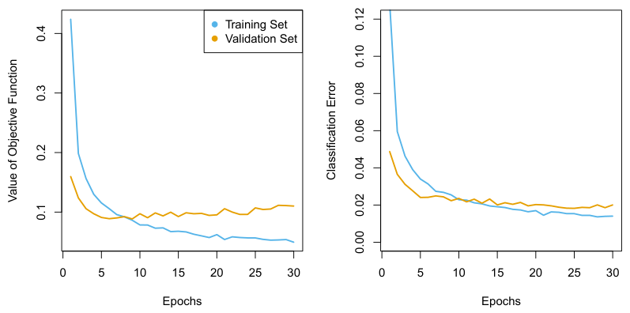

**图10.18** 图10.4所示MNIST神经网络的训练与验证误差，随训练轮数变化的情况。目标指的是对数似然（10.14）。图内文字：Training Set＝训练集；Validation Set＝验证集；Value of Objective Function＝目标函数值；Classification Error＝分类错误率；Epochs＝训练轮数；数值保持原样。

表10.1第一行对权重使用岭正则化，即给目标函数（10.14）增加一个惩罚项：

$$
R(\theta;\lambda)=-\sum_{i=1}^{n}\sum_{m=0}^{9}y_{im}\log(f_m(x_i))+\lambda\sum_j\theta_j^2.\tag{10.31}
$$

参数 $\lambda$ 往往预设为一个较小值，或者使用5.3.1节的验证集法确定。对于不同层的权重组，也可以使用不同的 $\lambda$。这里对 $\mathbf W_1$ 和 $\mathbf W_2$ 施加惩罚，而输出层相对较少的权重 $\mathbf B$ 完全不受惩罚。套索正则化也很常用，既可以作为额外的正则化方式，也可以代替岭正则化。

图10.18展示了网络在MNIST数据上训练过程中，一些指标的变化。实际上，SGD本身就会自然施加一种近似二次的正则化。<sup><a href="#ch10-fn21" id="ch10-fnref21">21</a></sup> 这里，每次梯度更新的小批量大小为128个观测。图10.18横轴上的epochs（轮数），统计的是相当于完整训练集被处理了多少遍。对于这个网络，从60,000个训练观测中取出20%作为验证集，用来确定何时停止训练，因此实际用于训练的是48,000个观测。于是，每轮约有 $48{,}000/128\approx375$ 次小批量梯度更新。可以看到，到30轮时，验证目标值实际上已开始上升，因此**早停（early stopping）**也可以作为一种额外的正则化方式。

<aside class="footnote" id="ch10-fn21"><a href="#ch10-fnref21">21</a> 本书写作时，SGD用于深度学习的这一性质以及其他性质，是机器学习文献中大量研究的主题。</aside>


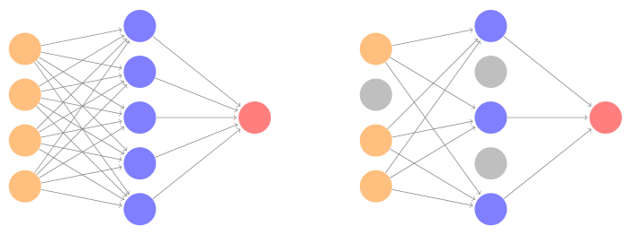

**图10.19** 暂退学习。左图：一个全连接网络。右图：在输入层和隐藏层采用暂退法的网络。灰色结点是随机选出的，在某次训练中被忽略。图中的结点颜色和连接关系保持原样。

### 10.7.3 暂退学习（Dropout Learning）

表10.1第二行标为dropout（暂退法）。这是一种相对较新且高效的正则化方式，在某些方面与岭正则化相似。它受到随机森林（8.2节）的启发：拟合模型时，随机移除某层中比例为 $\phi$ 的单元，如图10.19所示。每处理一个训练观测，都单独进行一次这样的随机移除。保留下来的单元替代那些缺失单元发挥作用，其权重按 $1/(1-\phi)$ 的倍数放大作为补偿。这能防止结点变得过度专门化，可以看作一种正则化。实践中，通过随机将被“暂退”的单元的激活值设为零来实现，同时保持网络结构不变。

### 10.7.4 网络调优

图10.4中的网络算是相对简单的，但仍然需要作出一些选择，而这些选择都会影响表现。

- *隐藏层数量，以及每层的单元数量*。目前的观点认为，每个隐藏层可以有较多单元，而通过各种正则化方式控制过拟合。
- *正则化调节参数*。包括暂退率 $\phi$，以及套索和岭正则化的强度 $\lambda$；通常分别为每一层设定。
- *随机梯度下降的细节*。包括批量大小、训练轮数，以及使用数据增强（10.3.4节）时的具体设置。

这些选择可能带来差异。准备这个MNIST例子时，我们经过一些反复尝试，达到了不错的1.8%误分类率。对类似网络进行更细致的调优和训练，可以在这些数据上将错误率降到1%以下，但调整过程可能十分繁琐，而且若不小心，也会导致过拟合。

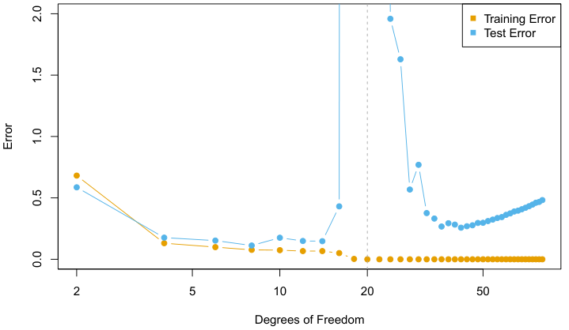

**图10.20** 用一个一维自然样条例子的误差曲线，说明**双下降（double descent）**现象。横轴为以对数刻度表示的样条基函数数量。当自由度与样本量 $n=20$ 相等时，到达“**插值阈值（interpolation threshold）**”，训练误差降到零，之后一直为零。测试误差在这一阈值附近急剧上升，随后再次下降至合理水平，最后又开始上升。图内文字：Training Error＝训练误差；Test Error＝测试误差；Error＝误差；Degrees of Freedom＝自由度；数值保持原样。

## 10.8 插值与双下降

本书反复讨论了偏差—方差权衡，这一概念最早在2.2.2节介绍。它意味着，从测试集误差来看，统计学习方法往往在模型复杂程度适中时表现最好。具体来说，如果横轴表示“灵活性”，纵轴表示误差，通常预期测试误差呈U形，而训练误差单调下降。书页29的图2.9右图，以及书页39的图2.17，展示了这种行为的两个“典型”例子。偏差—方差权衡的一个含义是，通常不宜对训练数据进行插值，也就是令训练误差为零，因为这往往导致很高的测试误差。

不过，在某些特定情形下，对训练数据进行插值的统计学习方法可能表现良好，至少会优于一个复杂程度稍低、尚未完全插值数据的模型。这个现象称为双下降，如图10.20所示。“双下降”这一名称来自这样的事实：到达插值阈值之前，测试误差呈U形；此后，随着拟合模型越来越灵活，测试误差会再次下降，至少会持续一段时间。

下面说明图10.20所用的设置。我们从模型

$$
Y=\sin(X)+\epsilon,
$$

模拟了 $n=20$ 个观测，其中 $X\sim U[-5,5]$，即均匀分布；$\epsilon\sim N(0,\sigma^2)$，且 $\sigma=0.3$。然后，按照7.4节的方法，对数据拟合一个具有 $d$ 个自由度的自然样条。<sup><a href="#ch10-fn22" id="ch10-fnref22">22</a></sup>


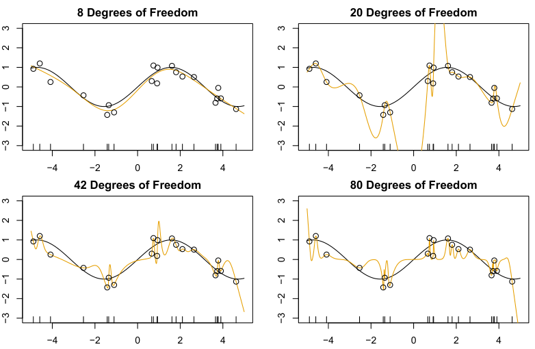

**图10.21** 拟合函数 $\hat f_d(X)$（橙色）、真实函数 $f(X)$（黑色），以及观测到的20个训练数据点。每幅子图采用不同的 $d$（自由度）。当 $d\ge20$ 时，橙色曲线都对训练点进行插值，因此训练误差为零。图内文字：8／20／42／80 Degrees of Freedom＝8／20／42／80个自由度；数值与曲线保持原样。

回顾7.4节，用 $d$ 个自由度拟合自然样条，相当于用一组 $d$ 个基函数作为预测变量，对响应进行最小二乘回归。图10.21左上图展示了数据、真实函数 $f(X)$，以及具有 $d=8$ 个自由度的自然样条拟合 $\hat f_8(X)$。

<aside class="footnote" id="ch10-fn22"><a href="#ch10-fnref22">22</a> 这意味着要选择 $d$ 个结点，这里取训练数据的 $d$ 个等概率分位点。当 $d>n$ 时，通过插值求分位点。</aside>

接下来，拟合一个具有 $d=20$ 个自由度的自然样条。因为 $n=20$，此时 $n=d$，训练误差为零；也就是说，我们对训练数据进行了插值！从图10.21右上图可见，$\hat f_{20}(X)$ 剧烈起伏，因此测试误差会很大。

现在继续对数据拟合自然样条，并不断增大 $d$。当 $d>20$ 时，用 $d$ 个基函数对 $Y$ 进行最小二乘回归的解不唯一：有无穷多个最小二乘系数估计值都能使误差为零。为了从中选择，我们取系数平方和 $\sum_{j=1}^{d}\hat\beta_j^2$ 最小的那个，称为**最小范数解（minimum-norm solution）**。

图10.21下方两幅子图展示了 $d=42$ 和 $d=80$ 个自由度的最小范数自然样条拟合。令人惊讶的是，尽管 $\hat f_{42}(X)$ *使用了更多自由度*，它却比 $\hat f_{20}(X)$ 平缓得多；$\hat f_{80}(X)$ 与它也相差不大。这是怎么回事？本质上，$\hat f_{20}(X)$ 之所以剧烈起伏，是因为用 $d=20$ 个基函数插值 $n=20$ 个观测只有一种方式，而这一唯一方式产生了一个较为极端的拟合函数。相反，

用 $d=42$ 或 $d=80$ 个基函数插值 $n=20$ 个观测有无穷多种方式，其中最平滑的，也就是最小范数解，比 $\hat f_{20}(X)$ 平缓得多！

图10.20展示了一系列自由度 $d$ 下，$\hat f_d(X)$ 对应的训练误差和测试误差。可以看到，当 $d=20$ 及其以后，即一旦达到插值阈值，训练误差就降为零。相比之下，测试误差在 $d\le20$ 时呈U形，在 $d=20$ 附近变得极大，而在 $d>20$ 后又出现第二段下降区间。这个例子的信噪比 $\operatorname{Var}(f(X))/\sigma^2$ 为5.9，相当高，数据点靠近真实曲线。因此，一个能够插值数据、又不会在观测点之间过度偏离的估计，可能会有不错的表现。

图10.20和图10.21使用自然样条，在简单的一维情形中说明了双下降现象。实际上，深度学习也可能出现同样的现象。基本上，当拟合具有海量参数的神经网络时，即使训练误差为零，有时也能得到良好的结果。对于自然图像识别和语言翻译等信噪比较高的问题，尤其如此。这是因为，包括随机梯度下降在内的神经网络拟合方法，自然倾向于选择一个“平滑”的插值模型，使它在这类问题中具有良好的测试集表现。

有几点需要强调：

- *双下降现象并不违背2.2.2节介绍的偏差—方差权衡*。图10.20右侧之所以出现双下降曲线，是因为横轴表示使用的样条基函数数量，它不能恰当地反映插值训练数据的模型的真实“灵活性”。换言之，在这个例子中，$d=42$ 的最小范数自然样条，其方差低于 $d=20$ 的自然样条。
- *本书介绍的大多数统计学习方法并不表现出双下降*。例如，正则化方法通常不会插值训练数据，因此也不会发生双下降。这并不是正则化方法的缺点：它们无须插值数据，就能给出很好的结果！

    特别地，在这里的例子中，如果用惩罚项选择适当的岭回归来拟合自然样条，而不是最小二乘，就不会看到双下降，而且实际上会得到更好的测试误差结果。

- *第9章中已经看到，最大间隔分类器和SVM即使训练误差为零，往往仍能取得很好的测试误差*。部分原因是，这些方法寻求平滑的最小范数解；这与最小范数自然样条在训练误差为零时仍能给出良好结果的情形类似。
- *机器学习界用双下降现象解释一种已取得成功的实践：使用过度参数化（over-parametrized）神经网络*

    *（层数和隐藏单元很多），并一直拟合到训练误差为零*。不过，拟合到零误差并不总是最优，是否适宜取决于信噪比。例如，可以像式（10.31）那样使用岭正则化，避免神经网络过拟合。这时，只要调节参数 $\lambda$ 选择恰当，就不会插值训练数据，因此也看不到双下降现象。尽管如此，仍能取得很好的测试集表现，而且很可能比插值训练数据时好得多。随机梯度下降中的早停，也可以起到正则化作用，在避免插值训练数据的同时，依然取得很好的测试数据结果。

概括来说，虽然神经网络有时会出现双下降，但通常不应依赖这种行为。此外，要记住偏差—方差权衡始终成立；不过，取决于如何将横轴上的“灵活性”参数化，测试误差关于灵活性的曲线可能不呈U形。

## 10.9 实验：深度学习

本节演示如何拟合正文讨论的例子。我们使用Python的 `torch` 包，并配合 `pytorch_lightning` 包；后者提供了一些工具，可简化模型的拟合和评估。在某些专用处理器上，例如苹果新推出的M1芯片，这些代码可以运行得非常快。这个包结构清晰、灵活，Python用户使用起来会很熟悉。[pytorch.org/tutorials](https://pytorch.org/tutorials) 是一份很好的配套资料。我们的许多代码都改编自该网站及 `pytorch_lightning` 文档。<sup><a href="#ch10-fn23" id="ch10-fnref23">23</a></sup>

<aside class="footnote" id="ch10-fn23"><a href="#ch10-fnref23">23</a> 写作时的具体网址是 [https://pytorch.org/tutorials/beginner/basics/intro.html](https://pytorch.org/tutorials/beginner/basics/intro.html) 和 [https://pytorch-lightning.readthedocs.io/en/latest/](https://pytorch-lightning.readthedocs.io/en/latest/)。</aside>

首先导入一些前面已经用过的标准库。

In[1]:

```python
import numpy as np, pandas as pd
from matplotlib.pyplot import subplots
from sklearn.linear_model import \
     (LinearRegression ,
      LogisticRegression ,
      Lasso)
from sklearn.preprocessing import StandardScaler
from sklearn.model_selection import KFold
from sklearn.pipeline import Pipeline
from ISLP import load_data
from ISLP.models import ModelSpec as MS
from sklearn.model_selection import \
     (train_test_split ,
      GridSearchCV)
```

#### Torch专用导入

需要导入一些与 `torch` 有关的内容。（它们并未随 `ISLP` 提供，必须单独安装。）首先导入主库，以及指定序列结构网络所需的基本工具。

In[2]:

```python
import torch
from torch import nn
from torch.optim import RMSprop
from torch.utils.data import TensorDataset
```

`torch` 还有其他几个辅助包。例如，`torchmetrics` 包提供工具，可在拟合模型时计算各种性能评估指标。`torchinfo` 包则能方便地汇总模型各层的信息。10.9.4节加载测试图像时会用到 `read_image()` 函数。

In[3]:

```python
from torchmetrics import (MeanAbsoluteError ,
                          R2Score)
from torchinfo import summary
from torchvision.io import read_image
```

`pytorch_lightning` 是 `torch` 的较高层接口。与单独使用 `torch` 相比，它减少了所需的样板代码，从而简化了模型的指定与拟合。

In[4]:

```python
from pytorch_lightning import Trainer
from pytorch_lightning.loggers import CSVLogger
```

为了重现结果，我们使用 `seed_everything()`，并要求 `torch` 尽可能采用确定性算法。

In[5]:

```python
from pytorch_lightning.utilities.seed import seed_everything
seed_everything(0, workers=True)
torch.use_deterministic_algorithms(True, warn_only=True)
```

示例中会用到 `torchvision` 附带的几个数据集、一个用于图像分类的预训练网络，以及一些用于预处理的变换。

In[6]:

```python
from torchvision.datasets import MNIST, CIFAR100
from torchvision.models import (resnet50,
                                ResNet50_Weights)
from torchvision.transforms import (Resize,
                                    Normalize,
                                    CenterCrop ,
                                    ToTensor)
```

我们在 `ISLP` 中专门为本实验提供了一些工具。`SimpleDataModule` 和 `SimpleModule` 是 `pytorch_lightning` 所用对象的简化版本；后者是拟合 `torch` 模型的高层模块。虽然这个模块还支持图形处理单元（GPU）计算、并行数据处理等更高级的用法，但本实验不会着重介绍这些内容。`ErrorTracker` 在验证或测试阶段收集各小批次的目标值和预测值，使我们能够在整个验证集或测试集上计算指标。

In[7]:

```python
from ISLP.torch import (SimpleDataModule ,
                        SimpleModule ,
                        ErrorTracker ,
                        rec_num_workers)
```

此外，我们还提供了一些加载IMDb数据库的辅助函数，以及将整数映射到数据库中特定键的查找表。我们收录了 `keras` 中经过预处理的IMDb数据的略作修改版本；`keras` 是另一个拟合深度学习模型的软件包。这省去了大量预处理工作，让我们能够专注于模型本身的指定与拟合。

In[8]:

```python
from ISLP.torch.imdb import (load_lookup ,
                             load_tensor ,
                             load_sparse ,
                             load_sequential)
```

最后导入一些与 `torch` 没有直接关系的工具。`glob` 模块的 `glob()` 函数用于查找匹配通配符的所有文件；在将 `ResNet50` 模型应用于我们自己的图像时，会用到它。`json` 模块用于加载一个JSON文件，在 `ResNet50` 示例中查找类别，从而识别图像标签。

In[9]:

```python
from glob import glob
import json
```

### 10.9.1 Hitters数据上的单层网络

首先，在 `Hitters` 数据上拟合10.6节中的模型。

In[10]:

```python
Hitters = load_data('Hitters').dropna()
n = Hitters.shape[0]
```

我们将拟合两个线性模型（最小二乘和套索法），并将其表现与神经网络比较。比较时，使用验证数据集上的**平均绝对误差（mean absolute error）**：

$$
\operatorname{MAE}(y,\hat y)=\frac{1}{n}\sum_{i=1}^{n}|y_i-\hat y_i|.
$$

先构建设计矩阵和响应。

In[11]:

```python
model = MS(Hitters.columns.drop('Salary'), intercept=False)
X = model.fit_transform(Hitters).to_numpy()
Y = Hitters['Salary'].to_numpy()
```

上面的 `to_numpy()` 方法把 `pandas` 数据框或序列转换为 `numpy` 数组。之所以这样做，是因为需要用 `sklearn` 拟合套索模型，而它要求进行这一转换。为了便于比较，我们也使用 `sklearn` 的线性回归方法，而不使用第3章中 `statsmodels` 的方法。

现在将数据划分为测试集和训练集，并固定 `sklearn` 划分数据时使用的随机状态。

In[12]:

```python
(X_train,
X_test,
Y_train,
Y_test) = train_test_split(X,
                            Y,
                            test_size=1/3,
                            random_state=1)
```

#### 线性模型

拟合线性模型，并直接评估测试误差。

In[13]:

```python
hit_lm = LinearRegression().fit(X_train, Y_train)
Yhat_test = hit_lm.predict(X_test)
np.abs(Yhat_test - Y_test).mean()
```

Out[13]:

```text
259.7153
```

接下来用 `sklearn` 拟合套索法。这里使用平均绝对误差，而不是均方误差，来选择和评估模型。6.5.2节所用的专门求解器只使用均方误差。因此，这里需要多做一些工作，建立交叉验证网格并直接进行交叉验证。

我们定义一个包含两个步骤的流水线：首先用 `StandardScaler()` 变换对特征进行归一化，然后拟合套索模型，不再进行进一步的归一化。

In[14]:

```python
scaler = StandardScaler(with_mean=True, with_std=True)
lasso = Lasso(warm_start=True, max_iter=30000)
standard_lasso = Pipeline(steps=[('scaler', scaler),
                                 ('lasso', lasso)])
```

还需要构造一组 $\lambda$ 值。按照常见做法，在对数刻度上，从 `lam_max` 到 `0.01*lam_max` 均匀选取100个 $\lambda$ 值。这里，`lam_max` 是能使解全部为零的最小 $\lambda$ 值。它等于各预测变量与中心化响应之间内积绝对值的最大值。<sup><a href="#ch10-fn24" id="ch10-fnref24">24</a></sup>

<aside class="footnote" id="ch10-fn24"><a href="#ch10-fnref24">24</a> 这一结果的推导超出了本书范围。</aside>

In[15]:

```python
X_s = scaler.fit_transform(X_train)
n = X_s.shape[0]
lam_max = np.fabs(X_s.T.dot(Y_train - Y_train.mean())).max() / n
param_grid = {'alpha': np.exp(np.linspace(0, np.log(0.01), 100))
             * lam_max}
```

注意，由于变量的尺度会影响 $\lambda$ 的选择，因此必须先变换数据。现在利用这一系列 $\lambda$ 值进行交叉验证。

In[16]:

```python
cv = KFold(10,
           shuffle=True,
           random_state=1)
grid = GridSearchCV(lasso,
                    param_grid ,
                    cv=cv,
                    scoring='neg_mean_absolute_error')
grid.fit(X_train, Y_train);
```

取出交叉验证平均绝对误差最优的套索模型，并在未参与交叉验证的 `X_test` 和 `Y_test` 上评估其表现。

In[17]:

```python
trained_lasso = grid.best_estimator_
Yhat_test = trained_lasso.predict(X_test)
np.fabs(Yhat_test - Y_test).mean()
```

Out[17]:

```text
257.2382
```

这与用最小二乘拟合线性模型得到的结果相近。不过，不同的训练／测试划分可能使这些结果产生很大变化；建议读者在代码块12中尝试不同的种子，然后重新运行其后直到此处的代码。

#### 指定网络：类与继承

为了拟合神经网络，首先建立描述网络的模型结构。这要求我们针对要拟合的模型定义新的类。在 `pytorch` 中，通常通过对网络的通用表示创建子类来实现，这里也采用这种方法。虽然这个例子很简单，我们仍会较详细地介绍各步骤，因为这有助于理解后面更复杂的例子。

In[18]:

```python
class HittersModel(nn.Module):

    def __init__(self, input_size):
        super(HittersModel , self).__init__()
        self.flatten = nn.Flatten()
        self.sequential = nn.Sequential(
            nn.Linear(input_size, 50),
            nn.ReLU(),
            nn.Dropout(0.4),
            nn.Linear(50, 1))

    def forward(self, x):
        x = self.flatten(x)
        return torch.flatten(self.sequential(x))
```

`class` 语句说明，这段代码声明了一个 `HittersModel` 类，它继承自基类 `nn.Module`。这个基类在 `torch` 中非常常见，用于表示神经网络中的映射。

缩进在 `class` 语句下面的是该类的方法；这里是 `__init__` 和 `forward`。当像下面的单元格那样创建类的实例时，会调用 `__init__` 方法。在这些方法中，`self` 始终指向类的一个实例。在 `__init__` 方法中，我们给 `self` 添加了两个对象作为属性：`flatten` 和 `sequential`。`forward` 方法用它们描述这个模块实现的映射。

`__init__` 方法中还有一行调用 `super()` 的代码。这个函数使子类（即 `HittersModel`）能够访问它所继承的类的方法。例如，`nn.Module` 类有自己的 `__init__` 方法，与我们上面编写的 `HittersModel.__init__()` 不同。使用 `super()` 就能调用基类的方法。对于 `torch` 模型，我们总是要进行这个 `super()` 调用，因为它是 `torch` 正确解释模型所必需的。`nn.Module` 对象的方法并不只有 `__init__` 和 `forward`。由于继承关系，`HittersModel` 实例可以直接使用这些方法。我们很快会看到其中的 `eval()` 方法：要在测试数据上评估模型时，它用于关闭暂退法。

In[19]:

```python
hit_model = HittersModel(X.shape[1])
```

`self.sequential` 对象由四个映射复合而成。第一个把 `Hitters` 的19个特征映射到50维，为映射的权重和截距（通常称为**偏置（bias）**）引入 $50\times19+50$ 个参数。随后依次经过ReLU层、暂退比例为40%的层，最后通过另一个带偏置的线性映射降到1维。因此，可训练参数总数为 $50\times19+50+50+1=1051$。

`torchinfo` 包的 `summary()` 函数能清楚地汇总这些信息。指定输入的大小后，可以看到每个张量（tensor）经过网络各层时的大小。

In[20]:

```python
summary(hit_model,
        input_size=X_train.shape,
        col_names=['input_size',
                   'output_size',
                   'num_params'])
```

Out[20]:

```text
=====================================================================
Layer (type:depth-idx)      Input Shape    Output Shape   Param #
=====================================================================
HittersModel               [175, 19]       [175]          --
  Flatten: 1-1             [175, 19]      [175, 19]       --
  Sequential: 1-2          [175, 19]      [175, 1]        --
       Linear: 2-1         [175, 19]      [175, 50]      1,000
       ReLU: 2-2           [175, 50]      [175, 50]       --
       Dropout: 2-3        [175, 50]      [175, 50]       --
       Linear: 2-4         [175, 50]      [175, 1]       51
=====================================================================
Total params: 1,051
Trainable params: 1,051
```

这里和后续使用时，都略去了输出末尾的一小部分。

接着，需要将训练数据转换为 `torch` 可以使用的形式。`torch` 的基本数据类型是**张量（tensor）**，与前几章中的 `ndarray` 很相似。此外，`torch` 通常使用32位（单精度）浮点数，而不是64位（双精度）浮点数。因此，在构造张量之前，先把数据转换为 `np.float32` 类型。然后用 `TensorDataset()`，将 `X` 和 `Y` 张量组织成 `torch` 能识别的 `Dataset`。

In[21]:

```python
X_train_t = torch.tensor(X_train.astype(np.float32))
Y_train_t = torch.tensor(Y_train.astype(np.float32))
hit_train = TensorDataset(X_train_t, Y_train_t)
```

对测试数据也作同样处理。

In[22]:

```python
X_test_t = torch.tensor(X_test.astype(np.float32))
Y_test_t = torch.tensor(Y_test.astype(np.float32))
hit_test = TensorDataset(X_test_t, Y_test_t)
```

最后，将这个数据集传给 `DataLoader()`，由它把数据送入网络。虽然这看起来增加了不少额外工作，但对于数据可能分布在不同机器上，或需要传入GPU的复杂任务，这种结构很有用。我们在 `ISLP` 中提供了辅助函数 `SimpleDataModule()`，简化标准使用情形下的这项工作。它的一个参数 `num_workers` 指定加载数据所用的进程数。对于 `Hitters` 这样的小数据集，它几乎没有影响，但对后面的 `MNIST` 和 `CIFAR100` 例子则有优势。`torch` 包会检查运行中的进程，确定工作进程数的上限。<sup><a href="#ch10-fn25" id="ch10-fnref25">25</a></sup> 我们提供了 `rec_num_workers()` 函数来计算这个数，从而了解合理的工作进程数大概是多少（这里上限为16）。

<aside class="footnote" id="ch10-fn25"><a href="#ch10-fnref25">25</a> 这取决于计算硬件和可用的核心数。</aside>

In[23]:

```python
max_num_workers = rec_num_workers()
```

`pytorch_lightning` 的一般训练设置包含训练、验证和测试数据，它们分别由不同的数据加载器表示。在每个训练轮次中，先执行训练步骤以学习模型，再执行验证步骤以跟踪误差。测试数据通常在训练结束时用于评估模型。

这里仅划分了训练集和测试集，因此用 `validation=hit_test` 参数把测试数据也作为验证数据。`validation` 可以是0到1之间的浮点数、整数或 `Dataset`。如果为浮点数，则解释为用于验证的训练观测比例；如果为整数，则解释为训练观测数。如果为 `Dataset`，则直接传给数据加载器。

In[24]:

```python
hit_dm = SimpleDataModule(hit_train,
                          hit_test,
                          batch_size=32,
                          num_workers=min(4, max_num_workers),
                          validation=hit_test)
```

接下来需要提供一个 `pytorch_lightning` 模块，控制训练过程中执行的步骤。我们为 `SimpleModule()` 提供的方法，只是在每个训练轮次结束时记录损失函数的值和其他指标。这些操作由 `SimpleModule.[training/test/validation]_step()` 方法控制，不过本实验不会修改这些方法。

In[25]:

```python
hit_module = SimpleModule.regression(hit_model,
                           metrics={'mae':MeanAbsoluteError()})
```

使用 `SimpleModule.regression()` 表示采用式（10.23）中的平方误差损失。同时，我们也要求在日志指标中跟踪平均绝对误差。

通过 `CSVLogger()` 记录结果；在这个例子中，它将结果存入 `logs/hitters` 目录下的CSV文件。拟合完成后，就能把结果加载为 `pd.DataFrame()`，并按下面的方法进行可视化。`pytorch_lightning` 提供了多种记录结果的方式，这里不作详细介绍。

In[26]:

```python
hit_logger = CSVLogger('logs', name='hitters')
```

最后，可以训练模型并记录结果了。我们使用 `pytorch_lightning` 中的 `Trainer()` 对象来完成这项工作。参数 `datamodule=hit_dm` 告诉训练器如何生成训练／验证／测试日志；第一个参数 `hit_module` 则指定网络架构以及训练／验证／测试步骤。`callbacks` 参数允许在训练模型的不同时间点执行若干任务。这里的 `ErrorTracker()` 回调使我们能够在训练中计算验证误差，并在最后计算测试误差。现在将模型拟合50个训练轮次。

In[27]:

```python
hit_trainer = Trainer(deterministic=True,
                      max_epochs=50,
                      log_every_n_steps=5,
                      logger=hit_logger,
                      callbacks=[ErrorTracker()])
hit_trainer.fit(hit_module, datamodule=hit_dm)
```

SGD的每一步都随机选取32个训练观测计算梯度。回顾10.7节，一个训练轮次对应于处理 $n$ 个观测所需的SGD步数。训练集有 $n=175$ 个观测，而构建 `hit_dm` 时指定的 `batch_size` 为32，因此一个训练轮次包含 $175/32=5.5$ 个SGD步骤。

模型拟合后，可以用训练器的 `test()` 方法评估测试数据上的表现。

In[28]:

```python
hit_trainer.test(hit_module, datamodule=hit_dm)
```

Out[28]:

```text
[{'test_loss': 104098.5469, 'test_mae': 229.5012}]
```

拟合结果已经记录在CSV文件中，可以在日志记录器的 `experiment.metrics_file_path` 属性中找到本次运行对应的结果。注意，每次拟合模型时，日志记录器都会将结果输出到 `logs/hitters` 目录下的一个新子目录中。

现在绘制MAE（平均绝对误差）随训练轮次数变化的曲线。首先取回记录的汇总结果。

```python
hit_results = pd.read_csv(hit_logger.experiment.metrics_file_path)
```

后面的例子也会绘制类似的图，因此先写一个简单的通用函数来完成这项工作。

In[29]:

```python
def summary_plot(results,
                 ax,
                 col='loss',
                 valid_legend='Validation',
                 training_legend='Training',
                 ylabel='Loss',
                 fontsize=20):
    for (column,
         color,
         label) in zip([f'train_{col}_epoch',
                        f'valid_{col}'],
                       ['black',
                        'red'],
                       [training_legend ,
                        valid_legend]):
        results.plot(x='epoch',
                     y=column,
                     label=label,
                     marker='o',
                     color=color,
                     ax=ax)
    ax.set_xlabel('Epoch')
    ax.set_ylabel(ylabel)
    return ax
```

设置坐标轴，并用这个函数绘制MAE曲线。

In[30]:

```python
fig, ax = subplots(1, 1, figsize=(6, 6))
ax = summary_plot(hit_results ,
                  ax,
                  col='mae',
                  ylabel='MAE',
                  valid_legend='Validation (=Test)')
ax.set_ylim([0, 400])
ax.set_xticks(np.linspace(0, 50, 11).astype(int));
```

可以直接用最终模型预测，并评估它在测试数据上的表现。在拟合之前，调用 `hit_model` 的 `eval()` 方法。这告诉 `torch`，实际上可将这个模型视为已经拟合，从而能够用它预测新数据。对于这里的模型，最大的变化是暂退层被关闭，也就是说，预测新数据时不会随机丢弃权重。

In[31]:

```python
hit_model.eval()
preds = hit_module(X_test_t)
torch.abs(Y_test_t - preds).mean()
```

Out[31]:

```text
tensor(229.5012, grad_fn=<MeanBackward0 >)
```

#### 清理

设置数据模块时启动了一些工作进程，它们会继续运行。删除对 `torch` 对象的所有引用，以确保这些进程被终止。

In[32]:

```python
del(Hitters,
    hit_model, hit_dm,
    hit_logger,
    hit_test, hit_train,
    X, Y,
    X_test, X_train,
    Y_test, Y_train,
    X_test_t, Y_test_t,
    hit_trainer , hit_module)
```

### 10.9.2 MNIST数字数据上的多层网络

`torchvision` 包提供了若干示例数据集，包括MNIST数字数据。首先取回训练集和测试集；`torchvision.datasets` 中的 `MNIST()` 函数正是为此提供的。首次执行该函数时，会下载数据并存储在 `data/MNIST` 目录中。

In[33]:

```python
(mnist_train ,
mnist_test) = [MNIST(root='data',
                      train=train,
                      download=True,
                      transform=ToTensor())
                for train in [True, False]]
mnist_train
```

Out[33]:

```text
Dataset MNIST
    Number of datapoints: 60000
    Root location: data
    Split: Train
    StandardTransform
Transform: ToTensor()
```

训练数据中有60,000张图像，测试数据中有10,000张。每张图像大小为 $28\times28$，以像素矩阵存储，需要将其转换为向量。

神经网络对输入尺度有一定敏感性，正如岭回归和套索正则化也会受到尺度的影响。这里的输入是0到255之间的8位灰度值，因此将其重新缩放到单位区间。<sup><a href="#ch10-fn26" id="ch10-fnref26">26</a></sup> `torchvision.transforms` 包的 `ToTensor()` 变换会完成这一转换，并重新排列部分坐标轴。

<aside class="footnote" id="ch10-fn26"><a href="#ch10-fnref26">26</a> 注意，8位意味着 $2^8=256$。由于惯例是从0开始，因此可能的取值范围为0到255。</aside>

与 `Hitters` 例子一样，根据训练数据集和测试数据集构建数据模块，并从训练图像中留出20%作为验证数据。

In[34]:

```python
mnist_dm = SimpleDataModule(mnist_train ,
                            mnist_test ,
                            validation=0.2,
                            num_workers=max_num_workers ,
                            batch_size=256)
```

看看将要送入网络的数据。循环遍历测试数据集的前几个数据块，在两个批次后停止：

In[35]:

```python
for idx, (X_ ,Y_) in enumerate(mnist_dm.train_dataloader()):
    print('X: ', X_.shape)
    print('Y: ', Y_.shape)
    if idx >= 1:
        break
```

```text
X:  torch.Size([256, 1, 28, 28])
Y:  torch.Size([256])
X:  torch.Size([256, 1, 28, 28])
Y:  torch.Size([256])
```

可以看到，每批的 `X` 包含256张大小为 `1x28x28` 的图像。这里的1表示单个通道（灰度）。对于后面的 `CIFAR100` 这样的RGB图像，大小中的1会被3取代，对应三个RGB通道。

现在可以指定神经网络了。

In[36]:

```python
class MNISTModel(nn.Module):
    def __init__(self):
        super(MNISTModel, self).__init__()
        self.layer1 = nn.Sequential(
            nn.Flatten(),
            nn.Linear(28*28, 256),
            nn.ReLU(),
            nn.Dropout(0.4))
        self.layer2 = nn.Sequential(
            nn.Linear(256, 128),
            nn.ReLU(),
            nn.Dropout(0.3))
        self._forward = nn.Sequential(
            self.layer1,
            self.layer2,
            nn.Linear(128, 10))
    def forward(self, x):
        return self._forward(x)
```

第一层先将每张 `1x28x28` 图像展平，再映射到256维，并使用ReLU激活和40%的暂退比例。第二层将第一层的输出降到128维，使用ReLU激活和30%的暂退比例。最后从128维映射到10维，即MNIST数据的类别数。

In[37]:

```python
mnist_model = MNISTModel()
```

可以用上面现成的批次 `X_`，检查模型是否产生了预期大小的输出。

In[38]:

```python
mnist_model(X_).size()
```

Out[38]:

```text
torch.Size([256, 10])
```

再查看模型汇总信息。除了指定 `input_size`，还可以传入一个形状正确的张量。这里传入上面最后一个批次的 `X_`。

In[39]:

```python
summary(mnist_model ,
        input_data=X_,
        col_names=['input_size',
                   'output_size',
                   'num_params'])
```

Out[39]:

```text
=====================================================================
Layer (type:depth-idx)      Input Shape       Output Shape  Param #
=====================================================================
MNISTModel                 [256, 1, 28, 28]  [256, 10]      --
  Sequential: 1-1          [256, 1, 28, 28]  [256, 10]      --
       Sequential: 2-1     [256, 1, 28, 28]  [256,  256]    --
            Flatten: 3-1   [256, 1, 28, 28]  [256,  784]    --
            Linear: 3-2    [256,  784]       [256,  256]   200,960
            ReLU: 3-3      [256,  256]       [256,  256]    --
            Dropout: 3-4   [256, 256]        [256,  256]    --
       Sequential: 2-2     [256,  256]       [256,  128]    --
            Linear: 3-5    [256,  256]       [256,  128]   32,896
            ReLU: 3-6      [256,  128]       [256,  128]    --
            Dropout: 3-7   [256, 128]        [256,  128]    --
       Linear: 2-3         [256,  128]       [256, 10]     1,290
=====================================================================
Total params: 235,146
Trainable params: 235,146
```

模型和数据模块都设置好之后，拟合过程就与 `Hitters` 例子几乎相同了。与回归模型不同，这里使用 `SimpleModule.classification()` 方法，它采用交叉熵损失函数，而不是均方误差。

In[40]:

```python
mnist_module = SimpleModule.classification(mnist_model)
mnist_logger = CSVLogger('logs', name='MNIST')
```

现在一切就绪。最后一步是提供训练数据并拟合模型。

In[41]:

```python
mnist_trainer = Trainer(deterministic=True,
                        max_epochs=30,
                        logger=mnist_logger ,
                        callbacks=[ErrorTracker()])
mnist_trainer.fit(mnist_module ,
                  datamodule=mnist_dm)
```

这里省略了输出，它是按训练轮次组织的模型拟合进度报告。这些信息很有用，因为在大型数据集上拟合可能需要较长时间。在配有10核苹果M1 Pro芯片和16 GB内存的MacBook Pro上，拟合这个模型用了245秒。这里指定验证集比例为20%，因此实际用于训练的是60,000个训练观测中的80%。这与 `Hitters` 例子中直接提供验证数据的方法不同。SGD以每批256个观测计算梯度，经过计算可知，一个训练轮次对应188次梯度步骤。

`SimpleModule.classification()` 默认包含准确率指标，也可以从 `torchmetrics` 添加其他分类指标。下面用 `summary_plot()` 函数显示准确率随训练轮次的变化。

In[42]:

```python
mnist_results = pd.read_csv(mnist_logger.experiment.
    metrics_file_path)
fig, ax = subplots(1, 1, figsize=(6, 6))
summary_plot(mnist_results ,
             ax,
             col='accuracy',
             ylabel='Accuracy')
ax.set_ylim([0.5, 1])
ax.set_ylabel('Accuracy')
ax.set_xticks(np.linspace(0, 30, 7).astype(int));
```

再次用训练器的 `test()` 方法评估准确率。这个模型在测试数据上的准确率达到97%。

In[43]:

```python
mnist_trainer.test(mnist_module ,
                   datamodule=mnist_dm)
```

Out[43]:

```text
[{'test_loss': 0.1471, 'test_accuracy': 0.9681}]
```

表10.1也报告了LDA（第4章）和多类别逻辑回归的错误率。LDA的用法可参见4.7.3节。虽然可以用 `sklearn` 的 `LogisticRegression()` 函数拟合多类别逻辑回归，但这里已经具备了用 `torch` 拟合这一模型的条件。只需要一个输入层和一个输出层，省去隐藏层即可！

In[44]:

```python
class MNIST_MLR(nn.Module):
    def __init__(self):
        super(MNIST_MLR, self).__init__()
        self.linear = nn.Sequential(nn.Flatten(),
                                    nn.Linear(784, 10))
    def forward(self, x):
        return self.linear(x)

mlr_model = MNIST_MLR()
mlr_module = SimpleModule.classification(mlr_model)
mlr_logger = CSVLogger('logs', name='MNIST_MLR')
```

In[45]:

```python
mlr_trainer = Trainer(deterministic=True,
                      max_epochs=30,
                      callbacks=[ErrorTracker()])
mlr_trainer.fit(mlr_module, datamodule=mnist_dm)
```

与前面一样拟合模型，并计算测试结果。

In[46]:

```python
mlr_trainer.test(mlr_module,
                 datamodule=mnist_dm)
```

Out[46]:

```text
[{'test_loss': 0.3187, 'test_accuracy': 0.9241}]
```

即使这个相当简单的模型，准确率也超过90%。

与 `Hitters` 例子一样，删除上面创建的一些对象。

In[47]:

```python
del(mnist_test,
    mnist_train ,
    mnist_model ,
    mnist_dm,
    mnist_trainer ,
    mnist_module ,
    mnist_results ,
    mlr_model,
    mlr_module,
    mlr_trainer)
```

### 10.9.3 卷积神经网络

本节在 `torchvision` 包提供的 `CIFAR100` 数据上拟合CNN。它的组织方式与MNIST数据相似。

In[48]:

```python
(cifar_train ,
cifar_test) = [CIFAR100(root="data",
                         train=train,
                         download=True)
             for train in [True, False]]
```

In[49]:

```python
transform = ToTensor()
cifar_train_X = torch.stack([transform(x) for x in
                            cifar_train.data])
cifar_test_X = torch.stack([transform(x) for x in
                            cifar_test.data])
cifar_train = TensorDataset(cifar_train_X ,
                            torch.tensor(cifar_train.targets))
cifar_test = TensorDataset(cifar_test_X ,
                            torch.tensor(cifar_test.targets))
```

`CIFAR100` 数据集包含50,000张训练图像，每张都用一个三维张量表示：一张三色图像表示为三个通道，每个通道包含 $32\times32$ 个8位像素。与数字数据一样进行标准化，但保留数组结构。这通过 `ToTensor()` 变换完成。

创建数据模块的方式与MNIST例子相似。

In[50]:

```python
cifar_dm = SimpleDataModule(cifar_train ,
                            cifar_test ,
                            validation=0.2,
                            num_workers=max_num_workers ,
                            batch_size=128)
```

再次查看数据加载器中典型批次的形状。

In[51]:

```python
for idx, (X_ ,Y_) in enumerate(cifar_dm.train_dataloader()):
    print('X: ', X_.shape)
    print('Y: ', Y_.shape)
    if idx >= 1:
        break
```

```text
X:  torch.Size([128, 3, 32, 32])
Y:  torch.Size([128])
X:  torch.Size([128, 3, 32, 32])
Y:  torch.Size([128])
```

开始之前，先查看一些训练图像；类似的代码生成了第406页的图10.5。下面的例子也说明，`TensorDataset` 对象可以用整数索引：通过索引 `cifar_train`，从训练数据中随机选取图像。为了正确显示，需要调用 `np.transpose()` 重新排列维度。

In[52]:

```python
fig, axes = subplots(5, 5, figsize=(10,10))
rng = np.random.default_rng(4)
indices = rng.choice(np.arange(len(cifar_train)), 25,
                     replace=False).reshape((5,5))
for i in range(5):
    for j in range(5):
        idx = indices[i,j]
        axes[i,j].imshow(np.transpose(cifar_train[idx][0],
                                      [1,2,0]),
                                      interpolation=None)
        axes[i,j].set_xticks([])
        axes[i,j].set_yticks([])
```

这里的 `imshow()` 方法根据参数的形状，识别出它是一个三维数组，其中最后一维索引三个RGB颜色通道。

为了演示，指定一个规模适中的CNN，结构与图10.8相似。使用若干层，每层都包含卷积、ReLU和最大池化步骤。先定义一个表示这样一层的模块。与前面的例子一样，重写 `nn.Module` 的 `__init__()` 和 `forward()` 方法。随后，这个用户定义的模块就能像 `nn.Linear()` 或 `nn.Dropout()` 一样使用。

In[53]:

```python
class BuildingBlock(nn.Module):

    def __init__(self,
                 in_channels ,
                 out_channels):

        super(BuildingBlock , self).__init__()
        self.conv = nn.Conv2d(in_channels=in_channels ,
                              out_channels=out_channels ,
                              kernel_size=(3,3),
                              padding='same')
        self.activation = nn.ReLU()
        self.pool = nn.MaxPool2d(kernel_size=(2,2))

    def forward(self, x):
        return self.pool(self.activation(self.conv(x)))
```

注意，传给 `nn.Conv2d()` 的 `padding = "same"` 参数保证输出通道与输入通道的尺寸相同。第一个隐藏层有32个通道，而输入层有3个通道。在所有层中，对每个通道都使用 $3\times3$ 的卷积滤波器。每次卷积后面都接一个对 $2\times2$ 区块操作的最大池化层。

为 `CIFAR100` 数据构建深度学习模型时，按顺序使用若干个 `BuildingBlock()` 模块。这个简单例子展示了 `torch` 的部分强大之处：用户可以定义自己的模块，再将它们组合到其他模块中。

最终，所有这些内容都由一个通用训练器进行拟合。

In[54]:

```python
class CIFARModel(nn.Module):

    def __init__(self):
        super(CIFARModel, self).__init__()
        sizes = [(3,32),
                 (32,64),
                 (64,128),
                 (128,256)]
        self.conv = nn.Sequential(*[BuildingBlock(in_, out_)
                                    for in_, out_ in sizes])

        self.output = nn.Sequential(nn.Dropout(0.5),
                                    nn.Linear(2*2*256, 512),
                                    nn.ReLU(),
                                    nn.Linear(512, 100))
    def forward(self, x):
        val = self.conv(x)
        val = torch.flatten(val, start_dim=1)
        return self.output(val)
```

构建模型并查看汇总信息。（前面已经创建了示例 `X_`。）

In[55]:

```python
cifar_model = CIFARModel()
summary(cifar_model ,
        input_data=X_,
        col_names=['input_size',
                   'output_size',
                   'num_params'])
```

Out[55]:

```text
======================================================================
Layer (type:depth-idx)  Input Shape        Output Shape       Param #
======================================================================
CIFARModel             [128, 3, 32, 32]   [128,  100]         --
  Sequential: 1-1      [128, 3, 32, 32]   [128, 256, 2, 2]    --
    BuildingBlock: 2-1 [128, 3, 32, 32]   [128, 32, 16, 16]   --
        Conv2d: 3-1    [128, 3, 32, 32]   [128, 32, 32, 32]  896
        ReLU: 3-2      [128, 32, 32, 32]  [128, 32, 32, 32]   --
        MaxPool2d: 3-3 [128, 32, 32, 32]  [128, 32, 16, 16]   --
    BuildingBlock: 2-2 [128, 32, 16, 16]  [128, 64, 8, 8]     --
        Conv2d: 3-4    [128, 32, 16, 16]  [128, 64, 16, 16]  18,496
        ReLU: 3-5      [128, 64, 16, 16]  [128, 64, 16, 16]   --
        MaxPool2d: 3-6 [128, 64, 16, 16]  [128, 64, 8, 8]     --
    BuildingBlock: 2-3 [128, 64, 8, 8]    [128, 128, 4, 4]    --
        Conv2d: 3-7    [128, 64, 8, 8]    [128, 128, 8, 8]   73,856
        ReLU: 3-8      [128, 128, 8, 8]   [128, 128, 8, 8]    --
        MaxPool2d: 3-9 [128, 128, 8, 8]   [128, 128, 4, 4]    --
    BuildingBlock: 2-4 [128, 128, 4, 4]   [128, 256, 2, 2]    --
        Conv2d: 3-10   [128, 128, 4, 4]   [128, 256, 4, 4]   295,168
        ReLU: 3-11     [128, 256, 4, 4]   [128, 256, 4, 4]    --
        MaxPool2d: 3-12 [128, 256, 4, 4]  [128, 256, 2, 2]    --
  Sequential: 1-2      [128,  1024]       [128,  100]         --
       Dropout: 2-5    [128,  1024]       [128,  1024]        --
       Linear: 2-6     [128,  1024]       [128, 512]         524,800
       ReLU: 2-7       [128, 512]         [128,  512]         --
       Linear: 2-8     [128, 512]          [128,  100]        51,300
======================================================================
Total params: 964,516
Trainable params: 964,516
```

可训练参数总数为964,516。查看参数的大小可以发现，每次最大池化操作后，通道在两个维度上的尺寸都减半。最后得到一个包含256个通道的层，每个通道大小为 $2\times2$。接着将它们展平成大小为1,024的稠密层；换言之，每个 $2\times2$ 矩阵变成一个4维向量，再把这些向量并排放在同一层中。之后依次是暂退正则化层、另一个大小为512的稠密层，最后是输出层。

到目前为止，我们一直使用 `SimpleModule()` 的默认优化器。对于这些数据，实验表明，比默认值0.01更小的学习率表现更好。这里采用一个学习率为0.001的自定义优化器。除此之外，日志记录和训练过程与前面的例子相似。优化器的 `params` 参数告诉它，哪些参数参与SGD（随机梯度下降）。

前面看到，模块的参数元素是张量。向优化器传入参数，并不只是传入数组；图结构的一部分也编码在这些张量本身之中。

In[56]:

```python
cifar_optimizer = RMSprop(cifar_model.parameters(), lr=0.001)
cifar_module = SimpleModule.classification(cifar_model ,
                                    optimizer=cifar_optimizer)
cifar_logger = CSVLogger('logs', name='CIFAR100')
```

In[57]:

```python
cifar_trainer = Trainer(deterministic=True,
                        max_epochs=30,
                        logger=cifar_logger ,
                        callbacks=[ErrorTracker()])
cifar_trainer.fit(cifar_module ,
                  datamodule=cifar_dm)
```

这个模型运行需要10分钟或更长时间，在测试数据上达到约42%的准确率。对于100类数据，这个结果并不差（随机分类器的准确率为1%），但在网上可以找到约75%的结果。要达到这样的效果，通常需要反复调整网络架构、调试正则化，并投入相当多时间。

查看验证准确率和训练准确率随训练轮次的变化。

In[58]:

```python
log_path = cifar_logger.experiment.metrics_file_path
cifar_results = pd.read_csv(log_path)
fig, ax = subplots(1, 1, figsize=(6, 6))
summary_plot(cifar_results ,
             ax,
             col='accuracy',
             ylabel='Accuracy')
ax.set_xticks(np.linspace(0, 10, 6).astype(int))
ax.set_ylabel('Accuracy')
ax.set_ylim([0, 1]);
```

最后，在测试数据上评估模型。

In[59]:

```python
cifar_trainer.test(cifar_module ,
                   datamodule=cifar_dm)
```

Out[59]:

```text
[{'test_loss': 2.4238 'test_accuracy': 0.4206}]
```

#### 硬件加速

随着深度学习在机器学习中普及，硬件厂商提供了一些专用库，常常能加速梯度下降步骤。

例如，配备M1芯片的Mac OS设备可能启用了Metal编程框架，从而加速 `torch` 计算。下面给出使用这种加速的例子。

主要变化在于 `Trainer()` 的调用，以及要在数据上评估的指标。这些指标必须知道评估时数据位于何处，可通过调用指标的 `to()` 方法来指定。

In[60]:

```python
try:
    for name, metric in cifar_module.metrics.items():
        cifar_module.metrics[name] = metric.to('mps')
    cifar_trainer_mps = Trainer(accelerator='mps',
                                deterministic=True,
                                max_epochs=30)
    cifar_trainer_mps.fit(cifar_module ,
                          datamodule=cifar_dm)
    cifar_trainer_mps.test(cifar_module ,
                          datamodule=cifar_dm)
except:
    pass
```

这样，每个训练轮次大约能获得两到三倍的加速。我们用 `try:` 和 `except:` 语句保护这段代码：如果成功，就获得加速；如果失败，则不发生任何事情。

### 10.9.4 使用预训练的CNN模型

现在演示如何使用在 `imagenet` 数据库上预训练的CNN，对自然图像进行分类，并说明图10.10是如何生成的。我们从数字相册中复制了六张JPEG图像到 `book_images` 目录。这些图像可以从ISLP教材网站 [www.statlearning.com](https://www.statlearning.com) 的数据部分获得。下载 `book_images.zip`；点击该文件即可创建 `book_images` 目录。

这里使用的预训练网络称为 `resnet50`，其详细规格可在网上找到。我们将读入图像，并把它们转换为 `torch` 软件所需的数组格式，以符合 `resnet50` 的要求。转换包括调整大小、裁剪，以及按预定方式分别对三个通道进行标准化。现在读入图像并进行预处理。

In[61]:

```python
resize = Resize((232,232))
crop = CenterCrop(224)
normalize = Normalize([0.485,0.456,0.406],
                      [0.229,0.224,0.225])
imgfiles = sorted([f for f in glob('book_images/*')])
imgs = torch.stack([torch.div(crop(resize(read_image(f))), 255)
                    for f in imgfiles])
imgs = normalize(imgs)
imgs.size()
```

Out[61]:

```text
torch.Size([6, 3, 224, 224])
```

现在，利用代码块6中读入的权重设置已训练好的网络。这个模型有50层，结构相当复杂。

In[62]:

```python
resnet_model = resnet50(weights=ResNet50_Weights.DEFAULT)
summary(resnet_model ,
        input_data=imgs,
        col_names=['input_size',
                   'output_size',
                   'num_params'])
```

将模型设为 `eval()` 模式，确保它已准备好对新数据作出预测。

In[63]:

```python
resnet_model.eval()
```

查看上面的输出，可以发现，作者在设置 `resnet_model` 时定义了一个 `Bottleneck`，它与我们的 `BuildingBlock` 模块很相似。现在把六张图像输入拟合好的网络。

In[64]:

```python
img_preds = resnet_model(imgs)
```

来看看概率最高的三个候选类别各自的预测概率。首先对 `img_preds` 中的logit应用softmax，计算概率。注意，为了将张量 `img_preds` 转成更熟悉的 `ndarray`，必须先调用其 `detach()` 方法。

In[65]:

```python
img_probs = np.exp(np.asarray(img_preds.detach()))
img_probs /= img_probs.sum(1)[:,None]
```

为了查看类别标签，必须下载与 `imagenet` 配套的索引文件。<sup><a href="#ch10-fn27" id="ch10-fnref27">27</a></sup>

<aside class="footnote" id="ch10-fn27"><a href="#ch10-fnref27">27</a> 该文件可从教材网站以及 [s3.amazonaws.com/deep-learning-models/image-models/imagenet_class_index.json](https://s3.amazonaws.com/deep-learning-models/image-models/imagenet_class_index.json) 获得。</aside>

In[66]:

```python
labs = json.load(open('imagenet_class_index.json'))
class_labels = pd.DataFrame([(int(k), v[1]) for k, v in
                           labs.items()],
                           columns=['idx', 'label'])
class_labels = class_labels.set_index('idx')
class_labels = class_labels.sort_index()
```

接下来，为每个图像文件构建一个数据框，列出上述模型估计概率最高的三个类别标签。

In[67]:

```python
for i, imgfile in enumerate(imgfiles):
    img_df = class_labels.copy()
    img_df['prob'] = img_probs[i]
    img_df = img_df.sort_values(by='prob', ascending=False)[:3]
    print(f'Image: {imgfile}')
    print(img_df.reset_index().drop(columns=['idx']))
```

```text
Image: book_images/Cape_Weaver.jpg
       label      prob
0    jacamar  0.287283
1  bee_eater  0.046768
2     bulbul  0.037507
Image: book_images/Flamingo.jpg
            label      prob
0        flamingo  0.591761
1       spoonbill  0.012386
2  American_egret  0.002105
Image: book_images/Hawk_Fountain.jpg
            label      prob
0  great_grey_owl  0.287959
1            kite  0.039478
2        fountain  0.029384
Image: book_images/Hawk_cropped.jpg
    label      prob
0   kite   0.301830
1    jay   0.121674
2  magpie  0.015513
Image: book_images/Lhasa_Apso.jpg
             label      prob
0            Lhasa  0.151143
1        Shih-Tzu   0.129850
2  Tibetan_terrier  0.102358
Image: book_images/Sleeping_Cat.jpg
       label      prob
0      tabby  0.173627
1  tiger_cat  0.110414
2    doormat  0.093447
```

可以看到，模型对 `Flamingo.jpg` 的判断很有把握，对其他图像的把握稍小一些。

本节最后照例清理对象。

In[68]:

```python
del(cifar_test,
    cifar_train ,
    cifar_dm,
    cifar_module ,
    cifar_logger ,
    cifar_optimizer ,
    cifar_trainer)
```

### 10.9.5 IMDB文档分类

现在，在 `IMDB` 数据集上实现用于情感分类的模型（见10.4节）。正如代码块8之前所述，我们使用的是 `keras` 包中经过预处理的 `IMDB` 数据。由于 `keras` 使用另一种张量与深度学习库 `tensorflow`，我们已将数据转换为适合 `torch` 的格式。

从 `keras` 转换数据的代码可在模块 `ISLP.torch._make_imdb` 中找到，运行时需要部分 `keras` 包。这些数据使用大小为10,000的词典。

本实验存储了评论数据的三种不同表示：

- `load_tensor()`：可供 `torch` 使用的稀疏张量版本；
- `load_sparse()`：可供 `sklearn` 使用的稀疏矩阵版本，因为我们还要与套索法拟合结果比较；
- `load_sequential()`：对原始序列表示作填充后的版本，每篇评论最多保留最后500个词。

In[69]:

```python
(imdb_seq_train ,
imdb_seq_test) = load_sequential(root='data/IMDB')
padded_sample = np.asarray(imdb_seq_train.tensors[0][0])
sample_review = padded_sample[padded_sample > 0][:12]
sample_review[:12]
```

Out[69]:

```text
array([ 1,   14,   22,   16,   43,  530,  973, 1622, 1385,
        65,  458, 4468],  dtype=int32)
```

数据集 `imdb_seq_train` 和 `imdb_seq_test` 都是 `TensorDataset` 类的实例。构建它们所用的张量可在 `tensors` 属性中找到：第一个张量是特征 `X`，第二个是结果 `Y`。我们取出特征的第一行，存为 `padded_sample`。生成这些数据的预处理过程中，不够长的序列会在开头用0填充，因此通过只保留 `padded_sample > 0` 的条目来去除填充。随后给出示例评论的前12个词。

可以通过 `ISLP.torch.imdb` 模块的查找词典找到这些词。

In[70]:

```python
lookup = load_lookup(root='data/IMDB')
' '.join(lookup[i] for i in sample_review)
```

Out[70]:

```text
"<START> this film was just brilliant casting location scenery
    story direction everyone's"
```

在第一个模型中，我们为数据集中10,000个可能的词各创建一个二元特征：如果词 $j$ 出现在评论 $i$ 中，就将矩阵的第 $i,j$ 个条目设为1。由于多数评论很短，这个特征矩阵中超过98%的条目为0。可以使用ISLP库中的 `load_tensor()` 访问这些数据。

In[71]:

```python
max_num_workers=10
(imdb_train ,
imdb_test) = load_tensor(root='data/IMDB')
imdb_dm = SimpleDataModule(imdb_train,
                           imdb_test,
                           validation=2000,
                           num_workers=min(6, max_num_workers),
                           batch_size=512)
```

第一个模型采用两层网络。

In[72]:

```python
class IMDBModel(nn.Module):

    def __init__(self, input_size):
        super(IMDBModel, self).__init__()
        self.dense1 = nn.Linear(input_size, 16)
        self.activation = nn.ReLU()
        self.dense2 = nn.Linear(16, 16)
        self.output = nn.Linear(16, 1)

    def forward(self, x):
        val = x
        for _map in [self.dense1,
                     self.activation,
                     self.dense2,
                     self.activation,
                     self.output]:
            val = _map(val)
        return torch.flatten(val)
```

现在实例化模型，并查看其摘要（此处未显示）。

In[73]:

```python
imdb_model = IMDBModel(imdb_test.tensors[0].size()[1])
summary(imdb_model,
        input_size=imdb_test.tensors[0].size(),
        col_names=['input_size',
                   'output_size',
                   'num_params'])
```

对于这些数据，仍然使用较小的学习率，因此向 `SimpleModule` 传入一个优化器。由于评论被分为正面或负面情感，使用 `SimpleModule.binary_classification()`。<sup><a href="#ch10-fn28" id="ch10-fnref28">28</a></sup>

<aside class="footnote" id="ch10-fn28"><a href="#ch10-fnref28">28</a> 使用 `binary_classification()` 而非 `classification()`，与 `torchmetrics.Accuracy()` 工作方式中的一些细节以及目标值的数据类型有关。</aside>

In[74]:

```python
imdb_optimizer = RMSprop(imdb_model.parameters(), lr=0.001)
imdb_module = SimpleModule.binary_classification(
                         imdb_model ,
                         optimizer=imdb_optimizer)
```

将数据集载入数据模块，并创建 `SimpleModule` 后，剩下的步骤就很熟悉了。

In[75]:

```python
imdb_logger = CSVLogger('logs', name='IMDB')
imdb_trainer = Trainer(deterministic=True,
                       max_epochs=30,
                       logger=imdb_logger ,
                       callbacks=[ErrorTracker()])
imdb_trainer.fit(imdb_module ,
                 datamodule=imdb_dm)
```

评估测试误差，得到约86%的准确率。

In[76]:

```python
test_results = imdb_trainer.test(imdb_module , datamodule=imdb_dm)
test_results
```

Out[76]:

```text
[{'test_loss': 1.0863, 'test_accuracy': 0.8550}]
```

#### 与套索法比较

现在，使用 `sklearn` 中的 `LogisticRegression()`，拟合套索逻辑回归模型。由于 `sklearn` 不识别 `torch` 的稀疏张量，我们采用它能够识别的稀疏矩阵。

In[77]:

```python
((X_train, Y_train),
(X_valid, Y_valid),
(X_test, Y_test)) = load_sparse(validation=2000,
                                 random_state=0,
                                 root='data/IMDB')
```

与10.9.1节类似，为套索法的正则化参数 $\lambda$ 构建一系列共50个取值。

In[78]:

```python
lam_max = np.abs(X_train.T * (Y_train - Y_train.mean())).max()
lam_val = lam_max * np.exp(np.linspace(np.log(1),
                                       np.log(1e-4), 50))
```

对于 `LogisticRegression()`，正则化参数 `C` 被指定为 $\lambda$ 的倒数。逻辑回归有多种求解器；这里使用适合稀疏输入格式的 `liblinear`。

In[79]:

```python
logit = LogisticRegression(penalty='l1',
                           C=1/lam_max,
                           solver='liblinear',
                           warm_start=True,
                           fit_intercept=True)
```

包含50个取值的整条路径大约需要40秒运行。

In[80]:

```python
coefs = []
intercepts = []

for l in lam_val:
    logit.C = 1/l
    logit.fit(X_train, Y_train)
    coefs.append(logit.coef_.copy())
    intercepts.append(logit.intercept_)
```

系数和截距都有一个多余的维度，可以用 `np.squeeze()` 去除。

In[81]:

```python
coefs = np.squeeze(coefs)
intercepts = np.squeeze(intercepts)
```

现在绘图，将神经网络结果与套索法比较。

In[82]:

```python
%%capture
fig, axes = subplots(1, 2, figsize=(16, 8), sharey=True)
for ((X_, Y_),
     data_,
     color) in zip([(X_train, Y_train),
                    (X_valid, Y_valid),
                    (X_test, Y_test)],
                    ['Training', 'Validation', 'Test'],
                    ['black', 'red', 'blue']):
    linpred_ = X_ * coefs.T + intercepts[None,:]
    label_ = np.array(linpred_ > 0)
    accuracy_ = np.array([np.mean(Y_ == l) for l in label_.T])
    axes[0].plot(-np.log(lam_val / X_train.shape[0]),
                 accuracy_,
                 '.--',
                 color=color,
                 markersize=13,
                 linewidth=2,
                 label=data_)
axes[0].legend()
axes[0].set_xlabel(r'$-\log(\lambda)$', fontsize=20)
axes[0].set_ylabel('Accuracy', fontsize=20)
```

注意这里使用了 `%%capture`，它抑制尚未完成的图像显示。绘制复杂图像时，这一点很有用，因为步骤可以分布在两个或更多单元格中。现在添加套索法准确率的图，并在单元格末尾直接输入图的名称，显示组合后的图像。

In[83]:

```python
imdb_results = pd.read_csv(imdb_logger.experiment.metrics_file_path)
summary_plot(imdb_results ,
             axes[1],
             col='accuracy',
             ylabel='Accuracy')
axes[1].set_xticks(np.linspace(0, 30, 7).astype(int))
axes[1].set_ylabel('Accuracy', fontsize=20)
axes[1].set_xlabel('Epoch', fontsize=20)
axes[1].set_ylim([0.5, 1]);
axes[1].axhline(test_results[0]['test_accuracy'],
                color='blue',
                linestyle='--',
                linewidth=3)
fig
```

从图中可以看到，套索逻辑回归和神经网络的准确率峰值都在0.88左右。

最后再次清理对象。

In[84]:

```python
del(imdb_model,
    imdb_trainer ,
    imdb_logger ,
    imdb_dm,
    imdb_train,
    imdb_test)
```

### 10.9.6 循环神经网络

本实验拟合10.5节中展示的模型。

#### 用于文档分类的序列模型

这里按照10.5.1节的讨论，对 `IMDb` 电影评论数据拟合一个简单的LSTM循环神经网络，预测情感。
对于RNN，我们使用文档中的词序列，并考虑词的顺序。预处理后的数据已在10.9.5节开头载入。详细说明预处理过程的脚本可在ISLP库中找到。特别地，由于超过90%的文档少于500个词，我们将文档长度设为500。较长的文档保留最后500个词，较短的文档则在开头填充空白。

In[85]:

```python
imdb_seq_dm = SimpleDataModule(imdb_seq_train ,
                               imdb_seq_test ,
                               validation=2000,
                               batch_size=300,
                               num_workers=min(6, max_num_workers)
                               )
```

RNN的第一层是大小为32的嵌入层，将在训练时学习。该层先将每篇文档独热编码为一个 $500\times10{,}003$ 的矩阵，再把这10,003个维度映射到32维。<sup><a href="#ch10-fn29" id="ch10-fnref29">29</a></sup> 由于每个词由一个整数表示，这一过程实际通过创建大小为 $10{,}003\times32$ 的嵌入矩阵来实现；随后，通过索引该矩阵的相应行，将文档中的500个整数分别映射为对应的32个实数。

<aside class="footnote" id="ch10-fn29"><a href="#ch10-fnref29">29</a> 额外的3个维度对应评论中经常出现的非单词条目。</aside>

第二层是包含32个单元的LSTM，输出层则是用于二元分类任务的单个logit。下面的 `forward()` 方法最后一行，取出LSTM最后一个32维输出，并将其映射到响应。

In[86]:

```python
class LSTMModel(nn.Module):
    def __init__(self, input_size):
        super(LSTMModel, self).__init__()
        self.embedding = nn.Embedding(input_size, 32)
        self.lstm = nn.LSTM(input_size=32,
                            hidden_size=32,
                            batch_first=True)
        self.dense = nn.Linear(32, 1)
    def forward(self, x):
        val, (h_n, c_n) = self.lstm(self.embedding(x))
        return torch.flatten(self.dense(val[:,-1]))
```

我们实例化模型，并使用语料库中的前10篇文档查看模型摘要。

In[87]:

```python
lstm_model = LSTMModel(X_test.shape[-1])
summary(lstm_model,
        input_data=imdb_seq_train.tensors[0][:10],
        col_names=['input_size',
                   'output_size',
                   'num_params'])
```

Out[87]:

```text
====================================================================
Layer (type:depth-idx)    Input Shape     Output Shape     Param #
====================================================================
LSTMModel                [10,  500]       [10]             --
  Embedding: 1-1         [10,  500]      [10, 500, 32]    320,096
  LSTM: 1-2              [10, 500, 32]   [10, 500, 32]    8,448
  Linear: 1-3            [10, 32]        [10, 1]          33
====================================================================
Total params: 328,577
Trainable params: 328,577
```

摘要省略了10,003这个数，但可以从参数数量中看出它，因为 $10{,}003\times32=320{,}096$。

In[88]:

```python
lstm_module = SimpleModule.binary_classification(lstm_model)
lstm_logger = CSVLogger('logs', name='IMDB_LSTM')
```

In[89]:

```python
lstm_trainer = Trainer(deterministic=True,
                       max_epochs=20,
                       logger=lstm_logger ,
                       callbacks=[ErrorTracker()])
lstm_trainer.fit(lstm_module ,
                 datamodule=imdb_seq_dm)
```

其余过程与已拟合的其他网络类似。随着网络拟合，跟踪测试表现，可以看到准确率达到85%。

In[90]:

```python
lstm_trainer.test(lstm_module , datamodule=imdb_seq_dm)
```

Out[90]:

```text
[{'test_loss': 0.8178, 'test_accuracy': 0.8476}]
```

再次展示学习过程，然后清理对象。

In[91]:

```python
lstm_results = pd.read_csv(lstm_logger.experiment.metrics_file_path)
fig, ax = subplots(1, 1, figsize=(6, 6))
summary_plot(lstm_results ,
             ax,
             col='accuracy',
             ylabel='Accuracy')
ax.set_xticks(np.linspace(0, 20, 5).astype(int))
ax.set_ylabel('Accuracy')
ax.set_ylim([0.5, 1])
```

In[92]:

```python
del(lstm_model,
    lstm_trainer ,
    lstm_logger ,
    imdb_seq_dm ,
    imdb_seq_train ,
    imdb_seq_test)
```

#### 时间序列预测

现在演示如何拟合10.5.2节中的模型，用于时间序列预测。首先载入并标准化数据。

In[93]:

```python
NYSE = load_data('NYSE')
cols = ['DJ_return', 'log_volume', 'log_volatility']
X = pd.DataFrame(StandardScaler(
                     with_mean=True,
                     with_std=True).fit_transform(NYSE[cols]),
                 columns=NYSE[cols].columns,
                 index=NYSE.index)
```

接着建立数据的各个滞后版本，并用 `dropna()` 方法删除存在缺失值的行。

In[94]:

```python
for lag in range(1, 6):
    for col in cols:
        newcol = np.zeros(X.shape[0]) * np.nan
        newcol[lag:] = X[col].values[:-lag]
        X.insert(len(X.columns), "{0}_{1}".format(col, lag), newcol)
X.insert(len(X.columns), 'train', NYSE['train'])
X = X.dropna()
```

最后，提取响应和训练集指示变量，并删除当天的 `DJ_return` 与 `log_volatility`，使预测只使用前些天的数据。

In[95]:

```python
Y, train = X['log_volume'], X['train']
X = X.drop(columns=['train'] + cols)
X.columns
```

Out[95]:

```text
Index(['DJ_return_1', 'log_volume_1', 'log_volatility_1',
      'DJ_return_2', 'log_volume_2', 'log_volatility_2',
      'DJ_return_3', 'log_volume_3', 'log_volatility_3',
      'DJ_return_4', 'log_volume_4', 'log_volatility_4',
      'DJ_return_5', 'log_volume_5', 'log_volatility_5'],
      dtype='object')
```

先拟合一个简单的线性模型，并使用 `score()` 方法计算测试数据上的 $R^2$。

In[96]:

```python
M = LinearRegression()
M.fit(X[train], Y[train])
M.score(X[~train], Y[~train])
```

Out[96]:

```text
0.4129
```

重新拟合模型，加入因子变量 `day_of_week`。对于 `pandas` 中的类别型序列，可以使用 `get_dummies()` 方法生成指示变量。

In[97]:

```python
X_day = pd.merge(X,
                 pd.get_dummies(NYSE['day_of_week']),
                 on='date')
```

注意，无须重新实例化线性回归模型，因为其 `fit()` 方法直接接收设计矩阵和响应。

In[98]:

```python
M.fit(X_day[train], Y[train])
M.score(X_day[~train], Y[~train])
```

Out[98]:

```text
0.4595
```

这个模型的 $R^2$ 约为46%。

为了拟合RNN，必须重塑数据，因为它要求每个特征有5个滞后版本，正如下方 `nn.RNN()` 层的 `input_shape` 参数所示。首先确保数据框的列顺序，使重塑后的矩阵具有正确的变量滞后次序。这里使用 `reindex()` 方法。

对于输入形状 `(5,3)`，每一行表示三个变量的一个滞后版本。`nn.RNN()` 层还要求每个观测的第一行在时间上最早，因此必须颠倒当前顺序。为此，下面遍历 `range(5,0,-1)`，这是使用 `slice()` 为可迭代对象建立索引的一个例子。一般记法是 `start:end:step`。

In[99]:

```python
ordered_cols = []
for lag in range(5,0,-1):
    for col in cols:
        ordered_cols.append('{0}_{1}'.format(col, lag))
X = X.reindex(columns=ordered_cols)
X.columns
```

Out[99]:

```text
Index(['DJ_return_5', 'log_volume_5', 'log_volatility_5',
      'DJ_return_4', 'log_volume_4', 'log_volatility_4',
      'DJ_return_3', 'log_volume_3', 'log_volatility_3',
      'DJ_return_2', 'log_volume_2', 'log_volatility_2',
      'DJ_return_1', 'log_volume_1', 'log_volatility_1'],
      dtype='object')
```

现在重塑数据。

In[100]:

```python
X_rnn = X.to_numpy().reshape((-1,5,3))
X_rnn.shape
```

Out[100]:

```text
(6046, 5, 3)
```

将第一个维度指定为 `-1`，`numpy.reshape()` 就会根据其余参数推断该维度的大小。

现在可以继续构建RNN，它使用12个隐藏单元和10%的暂退法。数据通过RNN后，在下方 `forward()` 中使用 `val[:,-1]` 提取最后一个时间点。这个值经过10%的暂退处理，然后通过线性层展平。

In[101]:

```python
class NYSEModel(nn.Module):
    def __init__(self):
        super(NYSEModel, self).__init__()
        self.rnn = nn.RNN(3,
                          12,
                          batch_first=True)
        self.dense = nn.Linear(12, 1)
        self.dropout = nn.Dropout(0.1)
    def forward(self, x):
        val, h_n = self.rnn(x)
        val = self.dense(self.dropout(val[:,-1]))
        return torch.flatten(val)
nyse_model = NYSEModel()
```

拟合方式与前面的网络类似。把测试数据作为验证数据传给 `fit` 函数，这样在监控拟合过程、绘制历史函数时，就可以看到测试数据上的表现。当然，不应把它作为提前停止的依据，否则测试表现就会有偏。

与 `Hitters` 示例类似，构建训练数据集。

In[102]:

```python
datasets = []
for mask in [train, ~train]:
    X_rnn_t = torch.tensor(X_rnn[mask].astype(np.float32))
    Y_t = torch.tensor(Y[mask].astype(np.float32))
    datasets.append(TensorDataset(X_rnn_t, Y_t))
nyse_train, nyse_test = datasets
```

按照惯例，查看模型摘要。

In[103]:

```python
summary(nyse_model,
        input_data=X_rnn_t,
        col_names=['input_size',
                   'output_size',
                   'num_params'])
```

Out[103]:

```text
====================================================================
Layer (type:depth-idx)    Input Shape     Output Shape     Param #
====================================================================
NYSEModel                [1770, 5, 3]     [1770]           --
RNN: 1-1                [1770, 5, 3]    [1770, 5, 12]    204
  Dropout: 1-2           [1770, 12]      [1770, 12]        --
  Linear: 1-3            [1770, 12]      [1770, 1]        13
====================================================================
Total params: 217
Trainable params: 217
```

再次将两个数据集放入一个数据模块，批量大小为64。

In[104]:

```python
nyse_dm = SimpleDataModule(nyse_train,
                           nyse_test,
                           num_workers=min(4, max_num_workers),
                           validation=nyse_test,
                           batch_size=64)
```

让一些数据通过模型，确保各处维度能够正确匹配。

In[105]:

```python
for idx, (x, y) in enumerate(nyse_dm.train_dataloader()):
    out = nyse_model(x)
    print(y.size(), out.size())
    if idx >= 2:
        break
```

```text
torch.Size([64]) torch.Size([64])
torch.Size([64]) torch.Size([64])
torch.Size([64]) torch.Size([64])
```

按照前面的示例，为回归问题设置训练器，并要求每个训练轮次都计算 $R^2$ 指标。

In[106]:

```python
nyse_optimizer = RMSprop(nyse_model.parameters(),
                         lr=0.001)
nyse_module = SimpleModule.regression(nyse_model,
                                      optimizer=nyse_optimizer ,
                                      metrics={'r2':R2Score()})
```

到这里，模型拟合过程应该已经很熟悉了。测试数据上的结果与线性AR模型非常接近。

In[107]:

```python
nyse_trainer = Trainer(deterministic=True,
                       max_epochs=200,
                       callbacks=[ErrorTracker()])
nyse_trainer.fit(nyse_module ,
                 datamodule=nyse_dm)
nyse_trainer.test(nyse_module ,
                  datamodule=nyse_dm)
```

Out[107]:

```text
[{'test_loss': 0.6141, 'test_r2': 0.4172}]
```

也可以不使用 `nn.RNN()` 层，改为仅使用 `nn.Flatten()` 层拟合模型。这会得到一个非线性AR模型。如果再去掉隐藏层，就等价于前面的线性AR模型。

这里改为使用包含 `day_of_week` 指示变量的特征集 `X_day`，拟合非线性AR模型。为此，必须先创建测试与训练数据集及相应的数据模块。这看起来可能稍显繁琐，但它是 `torch` 通用流水线的一部分。

In[108]:

```python
datasets = []
for mask in [train, ~train]:
    X_day_t = torch.tensor(
                   np.asarray(X_day[mask]).astype(np.float32))
    Y_t = torch.tensor(np.asarray(Y[mask]).astype(np.float32))
    datasets.append(TensorDataset(X_day_t, Y_t))
day_train, day_test = datasets
```

按照熟悉的方式创建数据模块。

In[109]:

```python
day_dm = SimpleDataModule(day_train,
                          day_test,
                          num_workers=min(4, max_num_workers),
                          validation=day_test,
                          batch_size=64)
```

构建 `NonLinearARModel()`，以20个特征作为输入，隐藏层包含32个单元。其余步骤都很熟悉。

In[110]:

```python
class NonLinearARModel(nn.Module):
    def __init__(self):
        super(NonLinearARModel , self).__init__()
        self._forward = nn.Sequential(nn.Flatten(),
                                      nn.Linear(20, 32),
                                      nn.ReLU(),
                                      nn.Dropout(0.5),
                                      nn.Linear(32, 1))
    def forward(self, x):
        return torch.flatten(self._forward(x))
```

In[111]:

```python
nl_model = NonLinearARModel()
nl_optimizer = RMSprop(nl_model.parameters(),
                           lr=0.001)
nl_module = SimpleModule.regression(nl_model,
                                        optimizer=nl_optimizer ,
                                        metrics={'r2':R2Score()})
```

继续按常规步骤训练，拟合模型并评估测试误差。可以看到，测试 $R^2$ 相较于同样包含 `day_of_week` 的线性AR模型略有提高。

In[112]:

```python
nl_trainer = Trainer(deterministic=True,
                         max_epochs=20,
                         callbacks=[ErrorTracker()])
nl_trainer.fit(nl_module, datamodule=day_dm)
nl_trainer.test(nl_module, datamodule=day_dm)
```

Out[112]:

```text
[{'test_loss': 0.5625, 'test_r2': 0.4662}]
```

## 10.10 习题

### 概念题

1. 考虑一个具有两个隐藏层的神经网络：$p=4$ 个输入单元，第一个隐藏层有2个单元，第二个隐藏层有3个单元，只有一个输出。

    (a) 画出这个网络的示意图，类似于图10.1或图10.4。

    (b) 假设使用ReLU激活函数，写出 $f(X)$ 的表达式。尽可能明确具体！

    (c) 为系数代入一些数值，写出 $f(X)$ 的值。

    (d) 一共有多少个参数？

2. 考虑用于建模多项概率的softmax函数（10.13）（另见书页145的式（4.13））。

    (a) 对于式（10.13），证明：如果给每个 $z_\ell$ 都加上同一个常数 $c$，概率保持不变。

    (b) 对于式（4.13），证明：如果给每个类别的各个对应系数分别加上常数 $c_j$（$j=0,1,\ldots,p$），那么对任意新点 $x$ 的预测保持不变。

    这说明softmax函数是**过度参数化（over-parametrized）**的。不过，正则化和SGD通常会约束解，使这不会成为问题。

3. 证明，当类别数 $M=2$ 时，负多项对数似然（10.14）与似然表达式（4.5）的负对数等价。

4. 考虑一个接收 $32\times32$ 灰度图像的CNN，它只有一个卷积层，其中有三个 $5\times5$ 卷积滤波器，不做边界填充。

    (a) 画出输入层和第一个隐藏层的示意图，类似于图10.8。

    (b) 这个模型有多少个参数？

    (c) 解释为什么可以把这个模型看作普通的前馈神经网络：各个像素作为输入，隐藏单元的权重受到约束。具体有哪些约束？

    (d) 如果没有这些约束，那么(c)中的普通前馈神经网络有多少个权重？

5. 书页426的表10.2中，三种方法按平均绝对误差排列的顺序，与按测试集 $R^2$ 排列的顺序不同。这是为什么？

### 应用题

6. 考虑简单函数 $R(\beta)=\sin(\beta)+\beta/10$。

    (a) 在 $\beta\in[-6,6]$ 范围内画出这个函数的图像。

    (b) 这个函数的导数是什么？

    (c) 给定 $\beta^0=2.3$，使用学习率 $\rho=0.1$ 运行梯度下降，寻找 $R(\beta)$ 的一个局部极小值。在图中标出 $\beta^0,\beta^1,\ldots$ 的每一步，以及最终答案。

    (d) 令 $\beta^0=1.4$，重复上述过程。

7. 对 `Default` 数据拟合神经网络。使用一个含10个单元的隐藏层，并采用暂退正则化。可参考实验10.9.1–10.9.2。将模型的分类表现与线性逻辑回归比较。

8. 从个人照片收藏中选取10张动物图像，例如狗、猫、鸟、农场动物等。如果主体没有占据图像中合理大小的区域，就对图像裁剪。然后，像实验10.9.4那样，使用一个预训练的图像分类CNN预测每幅图像的类别，并报告每幅图像预测概率最高的五个类别及其概率。

9. 按照正文和实验10.9.6的介绍，对 `NYSE` 数据拟合一个滞后5阶的自回归模型。重新拟合时加入一个表示月份的12水平因子。这个因子是否改善了模型表现？

10. 10.9.6节中，我们展示了如何使用 `LinearRegression()` 函数对 `NYSE` 数据拟合线性AR模型。不过，还提到可以把为RNN模型生成的短序列“展平”，以拟合线性AR模型。请用后一种方法，对 `NYSE` 数据拟合线性AR模型。将这个模型的测试 $R^2$ 与实验中拟合的线性AR模型比较。两种方法各有什么优点和缺点？

11. 重复上一题，但这次将为RNN模型生成的短序列“展平”，拟合非线性AR模型。

12. 考虑10.9.6节对 `NYSE` 数据拟合的RNN。修改代码，使其能够纳入变量 `day_of_week`，并拟合RNN。计算测试 $R^2$。

13. 使用结构类似的神经网络，重复实验10.9.5对 `IMDb` 数据的分析。我们使用了两个隐藏层，每层16个隐藏单元。把每层单元数增加到32和64，分别在使用和不使用30%暂退正则化的情况下，探索其影响。
