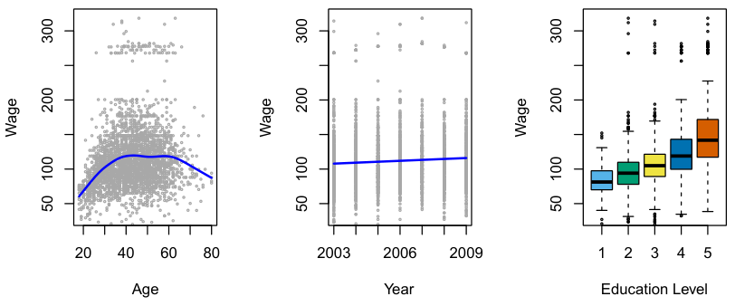
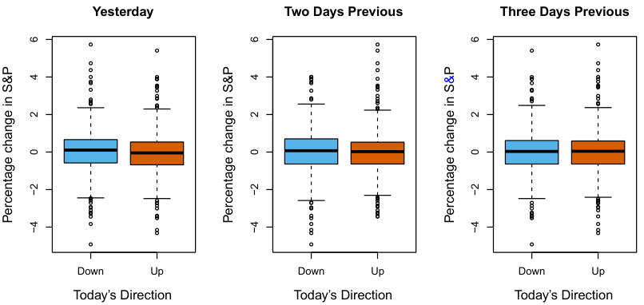
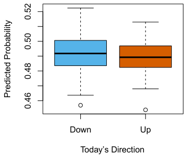
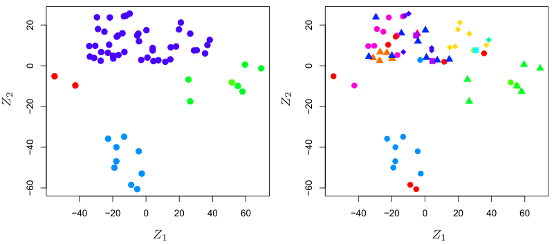

## 统计学习概述

**统计学习（statistical learning）** 是指一大类用于*理解数据*的工具。这些工具可分为**监督学习（supervised learning）** 和**无监督学习（unsupervised learning）**。概括地说，监督统计学习通过建立统计模型，根据一个或多个*输入（input）* 预测或估计一个*输出（output）*。这类问题广泛存在于商业、医学、天体物理学和公共政策等领域。无监督统计学习则只有输入，没有用于监督的输出；即便如此，我们仍然可以从这类数据中学习其中的关系和结构。为了说明统计学习的一些应用，下面简要介绍本书涉及的三个真实数据集。

### 工资数据（Wage Data）

在这个应用中，我们考察美国大西洋沿岸地区一组男性的工资及其相关因素，本书将这份数据称为 `Wage` 数据集。具体而言，我们希望了解雇员的年龄（`age`）、教育程度（`education`），以及日历年份（`year`）与其工资（`wage`）之间的关联（association）。例如，图1.1左图展示了数据集中每个人的工资与年龄的关系。图中显示，工资随年龄增加而上升，但大约在60岁之后又开始下降。蓝线给出了各个年龄下平均工资的估计，使这一趋势更加清楚。给定一名雇员的年龄，我们可以利用这条曲线*预测*他的工资。不过，图1.1也清楚表明，实际工资围绕这一平均值存在相当大的变异，因此，仅凭年龄不太可能准确预测某一位男性的工资。

**图1.1** `Wage` 数据包含美国大西洋中部沿岸地区男性的收入调查信息。*左图*：工资与年龄的关系。平均而言，工资随年龄增加而上升，直到约60岁时开始下降。*中图*：工资与年份的关系。2003年至2009年，平均工资缓慢而稳定地增加了约10,000美元。*右图*：展示工资与教育程度关系的**箱线图（boxplots）**，其中1表示最低教育程度（没有高中毕业文凭），5表示最高教育程度（研究生层次的高级学位）。平均而言，工资随教育程度提高而增加。图内文字：Wage＝工资，Age＝年龄，Year＝年份，Education Level＝教育程度；原有刻度及水平编码保持不变。

我们还掌握每名雇员的教育程度，以及取得这份工资的年份。图1.1中图和右图分别展示了工资与年份、教育程度的关系，表明这两个因素都与工资相关。2003年至2009年，工资大致呈线性（即直线）增长，增加了约10,000美元，但相对于数据中的变异而言，这一增长幅度很小。教育程度较高的人，工资通常也更高：教育程度最低（1）的男性，其工资往往明显低于教育程度最高（5）的男性。显然，要尽可能准确地预测某一位男性的工资，应当综合考虑他的年龄、教育程度和年份。第3章将讨论**线性回归（linear regression）**，它可以用来预测这个数据集中的工资。理想情况下，预测工资时还应考虑工资与年龄之间的非线性关系（non-linear relationship）。第7章将讨论一类解决这一问题的方法。

### 股票市场数据

`Wage` 数据中的任务，是预测一个**连续的（continuous）** 或**定量的（quantitative）** 输出值。这通常称为**回归（regression）** 问题。但在某些情形下，我们可能希望预测一个非数值取值，也就是一个**类别型的（categorical）** 或**定性的（qualitative）** 输出。例如，第4章将考察一个股票市场数据集，它包含2001年至2005年这5年间标准普尔500（Standard & Poor’s 500，S&P）股票指数的每日变动。本书将它称为 `Smarket` 数据。目标是利用此前5天该指数的百分比变化，预测某一天指数会*上涨*还是*下跌*。这里的统计学习问题不涉及预测数值，而是预测某一天的股市表现属于 `Up`（上涨）类别还是 `Down`（下跌）类别。这称为**分类（classification）** 问题。如果一个模型能准确预测市场的涨跌方向，就会非常有用！

**图1.2** *左图*：按市场当日上涨或下跌分组，展示前一天S&P指数百分比变化的箱线图，数据来自 `Smarket`。*中图和右图*：与左图相同，但分别展示此前第2天和第3天的百分比变化。图内文字：Yesterday＝昨天，Two Days Previous＝此前第2天，Three Days Previous＝此前第3天，Today’s Direction＝当日涨跌方向，Percentage change in S&P＝S&P指数的百分比变化，Down＝下跌，Up＝上涨。

图1.2左图包含两个箱线图，展示股票指数前一天的百分比变化：一个对应于次日市场上涨的648天，另一个对应于市场下跌的602天。两幅箱线图看上去几乎相同，表明没有一种简单策略，可以根据昨天S&P指数的变动预测今天的收益率。另外两幅图展示了距今天2天和3天的百分比变化，其箱线图同样表明，过去与当前的收益率之间关联很小。当然，缺乏明显规律是意料之中的：如果连续几天的收益率之间存在很强的相关性，就能采用一种简单的交易策略，从市场中获利。尽管如此，第4章仍将使用几种不同的统计学习方法探索这份数据。有意思的是，数据中隐约存在一些微弱趋势，表明至少在这5年间，大约有60%的情况下可以正确预测市场的涨跌方向（图1.3）。

### 基因表达数据（Gene Expression Data）

前两个应用展示的都是同时具有输入变量和输出变量的数据集。还有另一类重要问题：我们只观测到输入变量，却没有相应的输出。例如，在市场营销中，我们可能掌握许多现有客户或潜在客户的人口统计学信息，希望根据观测到的特征将人们分组，从而了解哪些类型的客户彼此相似。这称为**聚类（clustering）** 问题。与前面的例子不同，这里并不试图预测输出变量。

**图1.3** 我们在 `Smarket` 数据中对应2001–2004年的子集上拟合了一个**二次判别分析（quadratic discriminant analysis）** 模型，并利用2005年的数据预测股市下跌的概率。平均而言，市场实际下跌的那些天，其预测下跌概率更高。根据这些结果，可以在60%的情况下正确预测市场的涨跌方向。图内文字：Today’s Direction＝当日涨跌方向，Predicted Probability＝预测概率，Down＝下跌，Up＝上涨。

第12章专门讨论在没有自然对应的输出变量时，如何使用统计学习方法。我们将考察 `NCI60` 数据集，它包含64个癌症**细胞系（cell lines）**，每个细胞系有6,830个基因表达测量值。我们关注的不是预测某个特定输出变量，而是根据基因表达测量值，判断这些细胞系中是否存在若干组，也就是*簇*。这个问题很难回答，部分原因在于每个细胞系都有数千个基因表达测量值，难以将数据可视化。

图1.4左图通过仅用两个数$Z_1$和$Z_2$表示这64个细胞系中的每一个，来解决这一问题。这两个数是数据的前两个**主成分（principal components）**，将每个细胞系的6,830个表达测量值概括为两个数，也就是两个维度。虽然这种**降维（dimension reduction）** 很可能损失了一些信息，但现在我们能够从图形上检查数据是否存在聚类。确定簇的数目通常很困难。不过，图1.4左图表明至少存在四组细胞系，我们用不同颜色表示了它们。

在这个特定数据集中，这些细胞系实际上对应14种不同的癌症。（不过，绘制图1.4左图时并未使用这一信息。）图1.4右图与左图相同，只是用不同颜色的符号区分14种癌症。图中清楚地表明，在这种二维表示中，属于同一癌症类型的细胞系往往彼此靠近。此外，虽然生成左图时没有使用癌症类型信息，所得的聚类与右图中观察到的某些实际癌症类型仍有一定相似性。这为聚类分析的准确性提供了一些独立验证。

**图1.4** *左图*：`NCI60` 基因表达数据集在二维空间$Z_1$和$Z_2$中的表示。每个点对应64个细胞系中的一个。这些细胞系看起来分成四组，我们用不同颜色表示。*右图*：与左图相同，但用不同颜色的符号分别表示14种不同的癌症。对应同一癌症类型的细胞系，在二维空间中往往彼此靠近。图内坐标轴$Z_1$、$Z_2$及数值刻度保持原样。

## 统计学习简史

虽然*统计学习*这个术语相当新，但这一领域赖以建立的许多概念早已出现。19世纪初，最小二乘法（least squares）问世，形成了如今所谓线性回归的最早形式。这一方法最初成功应用于天文学问题。线性回归用于预测定量数值，例如个人薪资。为了预测定性取值，例如患者存活还是死亡，或者股市上涨还是下跌，人们在1936年提出了**线性判别分析（linear discriminant analysis）**。20世纪40年代，多位研究者提出了另一种方法，即**逻辑回归（logistic regression）**。20世纪70年代初，**广义线性模型（generalized linear model）** 这一术语出现，用来描述一整类统计学习方法，其中线性回归和逻辑回归都是特例。

到20世纪70年代末，已经有了更多从数据中学习的技术。不过，这些技术几乎全是*线性*方法，因为当时拟合非线性关系在计算上十分困难。到了20世纪80年代，计算技术终于取得了足够的进展，非线性方法所需的计算不再难以承受。20世纪80年代中期，人们提出了**分类树和回归树（classification and regression trees）**，紧接着又提出了**广义加性模型（generalized additive models）**。**神经网络（neural networks）** 在20世纪80年代开始流行，**支持向量机（support vector machines）** 则在20世纪90年代出现。

此后，统计学习逐渐成为统计学中的一个新分支，着重研究监督和无监督建模及预测。近年来，统计学习的进步也体现在功能强大、使用相对方便的软件越来越容易获得，例如广受欢迎且可以免费使用的Python系统。这有望继续推动这一领域转变：从主要由统计学家和计算机科学家使用、开发的一组技术，转变为更广泛群体不可或缺的工具。

## 关于本书

Hastie、Tibshirani和Friedman所著的《统计学习基础》（*The Elements of Statistical Learning*，ESL）于2001年首次出版。此后，它成为统计机器学习基础方面的重要参考书。这本书之所以成功，一方面在于它全面、细致地介绍了统计学习中的许多重要主题，另一方面在于，相较许多高阶统计学教材，它适合更广泛的读者。不过，ESL获得成功的最重要原因，还是它切合了时代需求。这本书出版时，人们对统计学习领域的兴趣正开始迅速增长。ESL是最早以通俗而全面的方式介绍这一主题的著作之一。

自ESL初版问世以来，统计学习领域不断蓬勃发展。这种扩展体现在两个方面。最明显的是，人们提出了新的、改进的统计学习方法，用于回答众多领域中的各种科学问题。与此同时，统计学习的受众也在扩大。20世纪90年代，计算能力的提高使许多非统计专业人士对这一领域产生了浓厚兴趣，他们希望使用前沿统计工具分析自己的数据。然而，这些方法的技术性很强，使用者仍主要限于统计学、计算机科学及相关领域的专家；他们接受过相应训练，也有时间理解和实现这些方法。

近年来，新的、改进的软件包显著减轻了实现许多统计学习方法的负担。同时，从商业、医疗到遗传学、社会科学及其他领域，人们越来越认识到，统计学习是一种具有重要实际用途的有力工具。因此，这一领域已经从主要受到学术界关注的研究方向，发展为拥有庞大潜在受众的主流学科。随着海量数据及其分析软件越来越容易获得，这一趋势势必还会继续。

《统计学习导论》（*An Introduction to Statistical Learning*，ISL）的目的，是促进统计学习从学术领域走向主流。本书无意取代ESL；无论是所讨论方法的数量，还是探讨的深度，ESL都要全面得多。对于需要理解统计学习方法背后技术细节的专业人士——例如拥有统计学、机器学习或相关领域研究生学位的人——我们认为ESL是一本重要的配套读物。但统计学习技术的使用者已经扩展到兴趣和背景更加广泛的人群。因此，有必要提供一本技术细节较少、更加易读的ESL式教材。

多年来的教学使我们发现，这些主题不仅能引起工商管理、生物学和计算机科学等不同领域硕士、博士研究生的兴趣，也能吸引偏重定量分析的高年级本科生。对于这样一个背景多样的群体，理解各类方法的模型、直观思想及优缺点十分重要。但对这些读者来说，统计学习方法背后的许多技术细节，例如优化算法（optimization algorithms）和理论性质，并不是最关心的内容。我们认为，即使不深入理解这些方面，他们仍能成为有判断力的方法使用者，并运用统计学习工具为自己选择的领域作出贡献。

ISL基于以下四个前提。

1. *许多统计学习方法不仅适用于统计科学，还与广泛的学术及非学术领域有关，并且十分有用。* 我们相信，许多当今的统计学习方法，应当也将会像线性回归这样的经典方法一样，广泛地被人们掌握和使用。因此，我们没有试图讨论所有可能的方法——这本来就是不可能完成的任务——而是集中介绍我们认为适用范围最广的方法。

2. *不应将统计学习看作一系列黑箱（black boxes）。* 没有哪一种方法能在所有可能的应用中都表现出色。如果不了解箱子内部的各个齿轮及其相互作用，就无法选出最合适的箱子。因此，我们力求仔细说明所讨论的每种方法背后的模型、直观思想、假设及权衡。

3. *虽然了解每个齿轮的作用很重要，但并不需要具备构造箱内整台机器的本领！* 因此，我们尽量少讨论拟合程序和理论性质的技术细节。我们假定读者熟悉基本数学概念，但不要求读者拥有数学科学的研究生学位。例如，我们几乎完全避免使用矩阵代数（matrix algebra）；即使对矩阵（matrices）和向量（vectors）没有深入了解，也可以理解全书。

4. *我们假定读者有兴趣将统计学习方法应用于现实问题。* 为了帮助读者做到这一点，也为了说明所讨论技术的用途，我们在每章中都安排了一节计算机实验。在每个实验中，我们带领读者逐步完成该章方法的一项实际应用。我们讲授这些内容时，大约用三分之一的课堂时间完成实验，并发现实验极为有用。许多不太偏重计算的学生，起初对实验感到畏惧，但在一学季或一学期的学习过程中，逐渐掌握了操作方法。

    本书最初出版时（2013年，第二版于2021年出版），计算机实验使用R语言。此后，读者对以Python实现统计学习中重要技术的需求日益增长，因此，这个版本的实验使用Python。可用的Python软件包数量正在迅速增长；查看各实验开头的导入语句，就能看到我们经过仔细挑选，采用了最合适的软件包。我们还在自己的 `ISLP` 包中提供了一些额外代码和功能。不过，ISL中的实验都是独立完整的；如果读者希望使用其他软件，或不想将所讨论的方法应用于现实问题，也可以跳过这些实验。

## 本书适合哪些读者？

本书面向所有希望运用现代统计方法，根据数据进行建模和预测的读者。其中既包括科学家、工程师、**数据分析师（data analysts）**、**数据科学家（data scientists）** 和**量化分析师（quants）**，也包括技术背景较少、拥有社会科学或商科等非定量领域学位的读者。我们希望读者至少修过一门初等统计学课程。具有线性回归基础也会有所帮助，但并非必需，因为第3章会回顾线性回归背后的关键概念。本书的数学要求不高，不需要深入掌握矩阵运算。本书也介绍Python入门知识。以前接触过MATLAB或R等编程语言会有帮助，但同样不是必要条件。

本教材第一版曾用于教授商科、经济学、计算机科学、生物学、地球科学、心理学，以及自然科学和社会科学许多其他领域的硕士和博士研究生。它也曾用于教授已经修过线性回归课程的高年级本科生。对于数学要求更严格、以ESL为主要教材的课程，ISL可以作为补充教材，用来讲授各类方法的计算实现。

## 符号与简单矩阵代数

为教材选择符号总是一件困难的事。我们基本沿用ESL的符号约定。

我们用$n$表示样本（sample）中不同数据点或观测的数目，用$p$表示可用于作出预测的变量数目。例如，`Wage`数据集包含3,000个人的11个变量，因此有$n=3{,}000$个观测和$p=11$个变量，例如`year`、`age`、`race`等。注意，本书始终用彩色字体标示变量名，例如`Variable Name`。在某些例子中，$p$可能很大，达到数千甚至数百万的量级；例如，在现代生物学数据或网络广告数据的分析中，这种情况就相当常见。

一般来说，我们用$x_{ij}$表示第$i$个观测的第$j$个变量的值，其中$i=1,2,\ldots,n$，$j=1,2,\ldots,p$。本书始终用$i$索引样本或观测（从1到$n$），用$j$索引变量（从1到$p$）。令$\mathbf X$为一个$n\times p$的*矩阵*，其第$(i,j)$个元素为$x_{ij}$，即

$$
\mathbf X=
\begin{pmatrix}
x_{11}&x_{12}&\ldots&x_{1p}\\
x_{21}&x_{22}&\ldots&x_{2p}\\
\vdots&\vdots&\ddots&\vdots\\
x_{n1}&x_{n2}&\ldots&x_{np}
\end{pmatrix}.
$$

对于不熟悉矩阵的读者，可以把$\mathbf X$想象成一张有$n$行、$p$列数字的电子表格。

有时，我们关注$\mathbf X$的各行，将它们记为$x_1,x_2,\ldots,x_n$。这里，$x_i$是一个长度为$p$的*向量*，包含第$i$个观测的$p$个变量的测量值，即

$$
x_i=
\begin{pmatrix}
x_{i1}\\
x_{i2}\\
\vdots\\
x_{ip}
\end{pmatrix}.
\tag{1.1}
$$

（向量默认以列的形式表示。）例如，在`Wage`数据中，$x_i$是长度为11的向量，包含第$i$个人的`year`、`age`、`race`等取值。有时，我们关注的则是$\mathbf X$的各列，将它们记为$\mathbf x_1,\mathbf x_2,\ldots,\mathbf x_p$。每一列都是长度为$n$的向量，即

$$
\mathbf x_j=
\begin{pmatrix}
x_{1j}\\
x_{2j}\\
\vdots\\
x_{nj}
\end{pmatrix}.
$$

例如，在`Wage`数据中，$\mathbf x_1$包含`year`的$n=3{,}000$个取值。用这种记号，矩阵$\mathbf X$可以写成

$$
\mathbf X=\begin{pmatrix}\mathbf x_1&\mathbf x_2&\cdots&\mathbf x_p\end{pmatrix},
$$

或者

$$
\mathbf X=
\begin{pmatrix}
x_1^T\\
x_2^T\\
\vdots\\
x_n^T
\end{pmatrix}.
$$

上标$T$表示矩阵或向量的**转置（transpose）**。例如，

$$
\mathbf X^T=
\begin{pmatrix}
x_{11}&x_{21}&\ldots&x_{n1}\\
x_{12}&x_{22}&\ldots&x_{n2}\\
\vdots&\vdots&\ddots&\vdots\\
x_{1p}&x_{2p}&\ldots&x_{np}
\end{pmatrix},
$$

而

$$
x_i^T=\begin{pmatrix}x_{i1}&x_{i2}&\cdots&x_{ip}\end{pmatrix}.
$$

我们用$y_i$表示希望预测的变量（例如`wage`）的第$i$个观测。因此，全部$n$个观测可以写成向量形式：

$$
\mathbf y=
\begin{pmatrix}
y_1\\
y_2\\
\vdots\\
y_n
\end{pmatrix}.
$$

于是，观测到的数据由$\{(x_1,y_1),(x_2,y_2),\ldots,(x_n,y_n)\}$组成，其中每个$x_i$都是长度为$p$的向量。（如果$p=1$，那么$x_i$就是一个**标量（scalar）**。）

本书始终用*小写粗体*表示长度为$n$的向量，例如

$$
\mathbf a=
\begin{pmatrix}
a_1\\
a_2\\
\vdots\\
a_n
\end{pmatrix}.
$$

而长度不为$n$的向量，例如式（1.1）中长度为$p$的**特征向量（feature vector）**，则用*小写普通字体*表示，例如$a$。标量也用*小写普通字体*表示，例如$a$。这两种小写普通字体的用法偶尔可能造成歧义，届时我们会明确说明所指的是哪一种。矩阵用*大写粗体*表示，例如$\mathbf A$。随机变量无论维数如何，都用*大写普通字体*表示，例如$A$。

有时，我们需要标明某个对象的维数。用$a\in\mathbb R$表示对象是一个标量，用$a\in\mathbb R^k$表示它是长度为$k$的向量；如果长度为$n$，则写作$\mathbf a\in\mathbb R^n$。用$\mathbf A\in\mathbb R^{r\times s}$表示对象是一个$r\times s$矩阵。

我们尽可能避免使用矩阵代数，但在少数情形中，完全避开矩阵代数反而会使表述过于繁琐。在这些少数情形下，理解两个矩阵相乘的概念很重要。假设$\mathbf A\in\mathbb R^{r\times d}$，$\mathbf B\in\mathbb R^{d\times s}$，则$\mathbf A$与$\mathbf B$的乘积记为$\mathbf{AB}$。计算$\mathbf{AB}$的第$(i,j)$个元素时，将$\mathbf A$第$i$行的每个元素与$\mathbf B$第$j$列的对应元素相乘，再把乘积相加，即$(\mathbf{AB})_{ij}=\sum_{k=1}^{d}a_{ik}b_{kj}$。例如，考虑

$$
\mathbf A=\begin{pmatrix}1&2\\3&4\end{pmatrix}
\qquad\text{以及}\qquad
\mathbf B=\begin{pmatrix}5&6\\7&8\end{pmatrix}.
$$

那么

$$
\mathbf{AB}=
\begin{pmatrix}1&2\\3&4\end{pmatrix}
\begin{pmatrix}5&6\\7&8\end{pmatrix}
=
\begin{pmatrix}
1\times5+2\times7&1\times6+2\times8\\
3\times5+4\times7&3\times6+4\times8
\end{pmatrix}
=
\begin{pmatrix}19&22\\43&50\end{pmatrix}.
$$

注意，这一运算得到的是一个$r\times s$矩阵。只有当$\mathbf A$的列数与$\mathbf B$的行数相同时，才能计算$\mathbf{AB}$。

## 本书的组织结构

第2章介绍统计学习的基本术语和概念，还介绍了**K近邻分类器（K-nearest neighbor classifier）**。这是一种非常简单的方法，却在许多问题上有着出人意料的良好表现。第3章和第4章讨论用于回归和分类的经典线性方法。其中，第3章回顾线性回归，它是所有回归方法的基本起点。第4章讨论两种最重要的经典分类方法：逻辑回归和线性判别分析。

在各种统计学习情形中，一个核心问题都是为具体应用选择最佳方法。因此，第5章介绍**交叉验证（cross-validation）** 和**自助法（bootstrap）**，可以用它们估计若干种不同方法的准确性，从而选出最佳方法。

近年来，统计学习领域的大量研究集中在非线性方法上。但是，线性方法在可解释性方面往往比非线性方法更有优势，有时在准确性方面也是如此。因此，第6章讨论多种经典及较新的线性方法，它们有可能改进标准线性回归。这些方法包括**逐步选择（stepwise selection）**、**岭回归（ridge regression）**、**主成分回归（principal components regression）** 以及**套索法（lasso）**。

后面的章节将进入非线性统计学习的领域。第7章先介绍几种适用于单个输入变量问题的非线性方法，再说明如何用它们拟合具有多个输入的非线性加性模型。第8章研究**基于树的方法（tree-based methods）**，包括**装袋法（bagging）**、**提升法（boosting）** 和**随机森林（random forests）**。第9章讨论支持向量机，这是一组既可进行线性分类、也可进行非线性分类的方法。第10章介绍**深度学习（deep learning）**，它是一种用于非线性回归和分类的方法，近年来受到广泛关注。第11章探讨**生存分析（survival analysis）**，这种回归方法专门用于输出变量存在**删失（censored）**、即未被完全观测的情形。

第12章讨论只有输入变量、没有输出变量的无监督情形，具体介绍**主成分分析（principal components analysis）**、**K均值聚类（K-means clustering）** 和**层次聚类（hierarchical clustering）**。最后，第13章讨论非常重要的**多重假设检验（multiple hypothesis testing）** 主题。

每章末尾都有一个或多个Python实验小节，系统地演示本章各种方法的应用。这些实验展示不同方法的优缺点，也为实现各种方法所需的语法提供了有用的参考。读者可以按自己的进度完成实验，也可以在课堂环境中，以小组活动的形式集中完成实验。每个Python实验给出的结果，都是我们撰写本书时运行实验所获得的结果。然而，Python不断发布新版本，实验调用的包也会随时间更新。因此，未来读者亲自运行实验时，所得结果可能不再与实验小节中展示的结果完全一致。必要时，我们会在本书网站上发布实验的更新。

| 名称          | 说明                              |
| ----------- | ------------------------------- |
| Auto        | 汽车的燃油经济性、马力及其他信息。               |
| Bikeshare   | 华盛顿特区某共享单车项目每小时的使用情况。           |
| Boston      | 波士顿人口普查区的房屋价值及其他信息。             |
| BrainCancer | 确诊脑癌患者的生存时间。                    |
| Caravan     | 曾被推介旅行拖车保险的个人信息。                |
| Carseats    | 400家商店的汽车座椅销售信息。                |
| College     | 美国高校的人口统计特征、学费等信息。              |
| Credit      | 400位客户的信用卡欠款信息。                 |
| Default     | 某信用卡公司的客户违约记录。                  |
| Fund        | 2,000位对冲基金经理在50个月中的收益率。         |
| Hitters     | 棒球运动员的比赛记录和薪资。                  |
| Khan        | 四种癌症类型的基因表达测量值。                 |
| NCI60       | 64个癌症细胞系的基因表达测量值。               |
| NYSE        | 纽约证券交易所的收益率、波动率和成交量。            |
| OJ          | Citrus Hill和Minute Maid橙汁的销售信息。 |
| Portfolio   | 金融资产的历史取值，用于投资组合配置。             |
| Publication | 244项临床试验发表所需的时间。                |
| Smarket     | 标准普尔500指数在5年中的每日百分比收益率。         |
| USArrests   | 美国50个州每10万居民的犯罪统计。              |
| Wage        | 美国中大西洋地区男性的收入调查数据。              |
| Weekly      | 21年中的1,089个每周股票市场收益率。           |

**表1.1** 完成本书实验和习题所需的数据集。除`USArrests`以外，所有数据集都可从`ISLP`包获得；`USArrests`属于R基础发行版，但也可以从Python中访问。

我们用符号标记包含更具挑战性概念的小节或习题。不希望深入探讨这些内容，或缺少相应数学背景的读者，可以跳过它们。

## 实验和习题使用的数据集

本书用市场营销、金融、生物学等领域的实际应用来说明统计学习方法。`ISLP`包包含完成本书实验和习题所需的多个数据集。另有一个数据集属于R基础发行版，即`USArrests`数据；12.5.1节将说明如何从Python中访问它。表1.1汇总了完成实验和习题所需的数据集。其中少数数据集也以文本文件的形式放在本书网站上，供第2章使用。

## 本书网站

本书的网站为

[www.statlearning.com](https://www.statlearning.com)

网站提供多种资源，包括本书配套的Python包以及一些额外的数据集。

## 致谢

本书有几幅图取自ESL，即图6.7、图8.3和图12.14。其余图均为ISL的R版本绘制，唯一的例外是图13.10：由于绘制该图所用的Python软件不同，其呈现也有所不同。
