## 2.1 什么是统计学习？

为了说明为什么要研究统计学习，我们先看一个简单的例子。假设我们是统计顾问，受客户委托研究某种产品的广告与销售量之间的关联。`Advertising`数据集包含该产品在200个不同市场的销售量，以及各市场投放在电视、广播和报纸这三类媒体上的广告预算。图2.1展示了这些数据。客户无法直接增加产品的销售量，但可以控制三类媒体各自的广告支出。因此，如果我们确定广告与销售量存在关联，就可以指导客户调整广告预算，从而间接增加销售量。换句话说，我们希望建立一个准确的模型，根据三类媒体的预算预测销售量。

在这里，广告预算是输入变量，销售量是输出变量。输入变量通常用符号$X$表示，并用下标加以区分。例如，$X_1$可以表示电视广告预算，$X_2$表示广播广告预算，$X_3$表示报纸广告预算。输入有多种名称，如预测变量（predictors）、自变量（independent variables）、特征（features），有时也简称变量。输出变量——在本例中就是销售量——通常称为响应（response）或因变量（dependent variable），一般用符号$Y$表示。本书会交替使用这些术语。

更一般地，假设我们观测到一个定量响应（quantitative response）$Y$和$p$个不同的预测变量$X_1,X_2,\ldots,X_p$。我们假定$Y$与$X=(X_1,X_2,\ldots,X_p)$之间存在某种关系，可以写成如下十分一般的形式：

$$
Y=f(X)+\epsilon.\tag{2.1}
$$


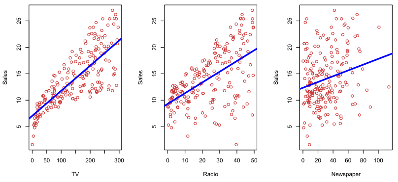

**图2.1** `Advertising`数据集。图中展示了200个不同市场的产品销售量（单位：千件）与电视、广播及报纸广告预算（单位：千美元）。每幅图都给出了用销售量对相应广告变量进行简单最小二乘拟合的结果，这将在第3章介绍。也就是说，每条蓝线分别表示一个简单模型，可根据电视、广播或报纸的广告预算来预测销售量。图内：Sales＝销售量，TV＝电视，Radio＝广播，Newspaper＝报纸。

这里，$f$是一个由$X_1,\ldots,X_p$决定的固定但未知的函数，$\epsilon$是随机误差项（random error term），它独立于$X$，且均值为零。在这一表述中，$f$代表$X$所提供的关于$Y$的系统性信息。

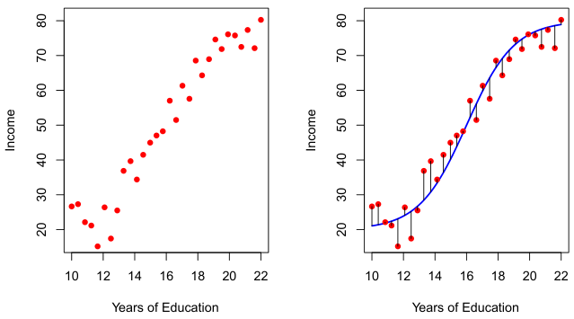

**图2.2** `Income`数据集。**左图：** 红点是30人的收入观测值（单位：千美元）及其受教育年限。**右图：** 蓝色曲线表示收入与受教育年限之间真实的潜在关系，这个关系通常是未知的；在本例中，因为数据是模拟生成的，所以我们知道它。黑线表示每个观测所对应的误差。某些误差为正，即观测点位于蓝色曲线上方；另一些误差为负，即观测点位于曲线下方。总体而言，这些误差的平均值约为零。图内：Income＝收入，Years of Education＝受教育年限。

再看一个例子。图2.2左图绘出了`Income`数据集中30人的收入与受教育年限。图形表明，也许可以利用受教育年限预测收入。不过，将输入变量与输出变量联系起来的函数$f$通常是未知的。

在实际中，我们必须根据观测到的数据点估计$f$。由于`Income`是模拟数据，我们知道$f$，图2.2右图中的蓝色曲线就是它。图中竖直线段表示误差项$\epsilon$，它们既可能为正，也可能为负。可以看到，部分观测点位于蓝色曲线之上，部分位于其下；总体而言，这些误差的平均值约为零。

一般来说，函数$f$可能涉及不止一个输入变量。图2.3根据受教育年限和资历（seniority）绘出了收入。在这里，$f$是一个二维曲面，必须根据观测数据加以估计。

从本质上说，统计学习就是一组估计$f$的方法。本章将概述估计$f$时涉及的若干关键理论概念，并介绍一些评估所得估计结果的工具。

### 2.1.1 为什么估计$f$？


我们希望估计$f$，主要有两个原因：预测（prediction）和推断（inference）。下面分别讨论。

#### 预测

在许多情况下，输入$X$很容易获得，但输出$Y$不容易得到。由于误差项的平均值为零，我们可以用下式预测$Y$：

$$
\hat Y=\hat f(X),\tag{2.2}
$$

其中，$\hat f$表示我们对$f$的估计，$\hat Y$表示由此得到的$Y$的预测值。在这里，$\hat f$通常被视为一个黑箱：只要它能准确预测$Y$，我们一般并不关心$\hat f$的具体形式。

例如，假设$X_1,\ldots,X_p$是患者血液样本的一些特征，很容易在实验室中测量；$Y$是表示患者对某种药物发生严重不良反应风险的变量。很自然，我们希望用$X$预测$Y$，这样就可以避免给不良反应风险较高的患者使用这种药物，也就是那些$Y$估计值较高的患者。

用$\hat Y$预测$Y$的准确性取决于两个量，我们将其称为可约误差（reducible error）和不可约误差（irreducible error）。一般来说，$\hat f$不会完美地估计$f$，这种不准确会引入一些误差。这部分误差是可约的，因为我们有可能采用最合适的统计学习方法来估计$f$，从而提高$\hat f$的准确性。然而，即使能够完美估计$f$，使估计的响应成为$\hat Y=f(X)$，预测仍然会存在误差！这是因为$Y$还取决于$\epsilon$，而根据定义，$\epsilon$无法用$X$来预测。因此，与$\epsilon$有关的变异也会影响预测的准确性。这称为不可约误差，因为无论我们将$f$估计得多好，都无法减小$\epsilon$引入的误差。

为什么不可约误差大于零呢？$\epsilon$中可能包含对预测$Y$有用、但没有测量的变量；由于没有测量这些变量，$f$就无法利用它们进行预测。


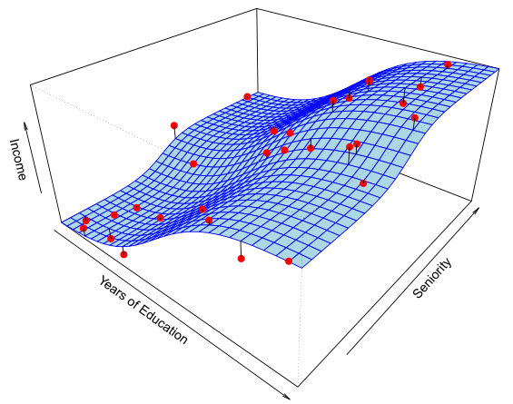

**图2.3** `Income`数据集中收入与受教育年限及资历的函数关系。蓝色曲面表示收入与受教育年限和资历之间真实的潜在关系；因为数据是模拟生成的，所以这个关系已知。红点表示30人的观测值。图内：Income＝收入，Years of Education＝受教育年限，Seniority＝资历。

此外，$\epsilon$还可能包含无法测量的变异。例如，患者发生不良反应的风险可能随日期而变化，这既可能源于药品本身的生产差异，也可能源于患者当天的整体状态。

考虑一个给定的估计$\hat f$和一组给定的预测变量$X$，由此得到预测$\hat Y=\hat f(X)$。假定$\hat f$和$X$都固定，那么变异只来自$\epsilon$。在这种情况下，可以证明：

$$
\begin{aligned}
\mathrm E(Y-\hat Y)^2
&=\mathrm E[f(X)+\epsilon-\hat f(X)]^2\\
&=\underbrace{[f(X)-\hat f(X)]^2}_{\text{可约}}
+\underbrace{\mathrm{Var}(\epsilon)}_{\text{不可约}},
\end{aligned}\tag{2.3}
$$

其中，$\mathrm E(Y-\hat Y)^2$表示预测值与真实值$Y$之间差的平方的平均值，即期望值（expected value）；$\mathrm{Var}(\epsilon)$表示误差项$\epsilon$的方差（variance）。

本书将重点介绍如何估计$f$，以尽量减小可约误差。需要注意，不可约误差为$Y$预测的准确性设定了一个上限。这个上限几乎总是未知的。

#### 推断

我们常常希望了解$Y$与$X_1,\ldots,X_p$之间的关联。在这种情况下，我们希望估计$f$，但不一定是为了预测$Y$。此时不能将$\hat f$视为黑箱，因为我们需要知道它的具体形式。我们可能希望回答以下问题：

- **哪些预测变量与响应相关联？** 通常，现有预测变量中只有一小部分与$Y$有较强的关联。对于某些应用，从大量候选变量中找出少数重要的预测变量，可能非常有用。
- **响应与每个预测变量是什么关系？** 某些预测变量可能与$Y$呈正向关系，也就是说，预测变量较大时，$Y$往往也较大。另一些预测变量则可能与$Y$呈相反的关系。取决于$f$的复杂程度，响应与某个给定预测变量的关系，还可能依赖其他预测变量的取值。
- **$Y$与每个预测变量之间的关系，能否用线性方程充分概括，还是更为复杂？** 历史上，大多数估计$f$的方法都采用线性形式。在某些情况下，这种假设是合理的，甚至是理想的。但真实关系往往更复杂，此时，线性模型可能无法准确表示输入变量与输出变量之间的关系。

本书将介绍许多例子，其中有些以预测为目的，有些以推断为目的，还有些兼顾两者。

例如，考虑一家准备开展直邮营销活动的公司。公司希望根据每个人的人口统计变量观测值，识别哪些人可能对寄来的营销材料作出积极回应。在这里，人口统计变量是预测变量，而对营销活动的回应——积极或消极——是结果。公司无意深入理解每个预测变量与响应之间的关系，只希望利用这些预测变量准确预测响应。这是为了预测而建模的例子。

再看图2.1所示的`Advertising`数据。我们可能希望回答这样的问题：

- 哪些媒体与销售量相关联？
- 哪些媒体带来的销售量增幅最大？或者，
- 电视广告支出增加给定金额时，相伴的销售量增幅有多大？

这属于推断的范畴。另一个例子是，根据价格、商店位置、折扣幅度、竞争产品价格等变量，建立客户可能购买何种产品品牌的模型。在这里，我们真正最关心的可能是每个变量与购买概率之间的关联。例如，产品价格与销售量的关联有多强？这是为了推断而建模的例子。

最后，有些建模可以同时服务于预测和推断。例如，在房地产领域，我们可能希望将房屋价值与犯罪率、土地用途分区、距河流的距离、空气质量、学校、社区收入水平、房屋面积等输入联系起来。

此时，我们可能关心每个输入变量与房价之间的关联。例如，能够看到河景，会让房屋价值增加多少？这是一个推断问题。也可能只关心根据房屋特征预测其价值：这套房屋被低估了，还是被高估了？这是一个预测问题。

根据最终目标是预测、推断还是兼顾两者，适合用来估计$f$的方法也会有所不同。例如，线性模型（linear model）能够提供相对简单且容易解释的推断，但其预测可能不如其他一些方法准确。另一方面，本书后续章节将介绍的一些高度非线性的方法，有可能对$Y$给出相当准确的预测，但代价是模型更难解释，推断也更具挑战。

### 2.1.2 如何估计$f$？

本书将探索许多估计$f$的线性和非线性方法。不过，这些方法通常具有一些共同特征。本节先概述这些特征。我们始终假定已经观测到$n$个不同的数据点。例如，图2.2中有$n=30$个数据点。这些观测称为训练数据（training data），因为我们会用它们训练我们的方法，也就是教它如何估计$f$。用$x_{ij}$表示第$i$个观测的第$j$个预测变量（即输入）的取值，其中$i=1,2,\ldots,n$，$j=1,2,\ldots,p$。相应地，用$y_i$表示第$i$个观测的响应变量。这样，训练数据就是$\{(x_1,y_1),(x_2,y_2),\ldots,(x_n,y_n)\}$，其中$x_i=(x_{i1},x_{i2},\ldots,x_{ip})^T$。

我们的目标是对训练数据应用统计学习方法，估计未知函数$f$。换句话说，希望找到一个函数$\hat f$，使任意观测$(X,Y)$都满足$Y\approx\hat f(X)$。大体而言，大多数用于这一任务的统计学习方法都可以分为参数方法（parametric）和非参数方法（non-parametric）两类。下面简要介绍。

#### 参数方法

参数方法基于模型，分两个步骤进行。

1. 首先，对$f$的函数形式，也就是形状，作出假设。例如，一个十分简单的假设是$f$关于$X$是线性的：

    $$
    f(X)=\beta_0+\beta_1X_1+\beta_2X_2+\cdots+\beta_pX_p.\tag{2.4}
    $$

    这是一个线性模型，第3章将详细讨论。一旦假定$f$是线性的，估计$f$的问题就大为简化。我们不必估计一个形式完全任意的$p$维函数$f(X)$，只需估计$p+1$个系数（coefficient）$\beta_0,\beta_1,\ldots,\beta_p$。


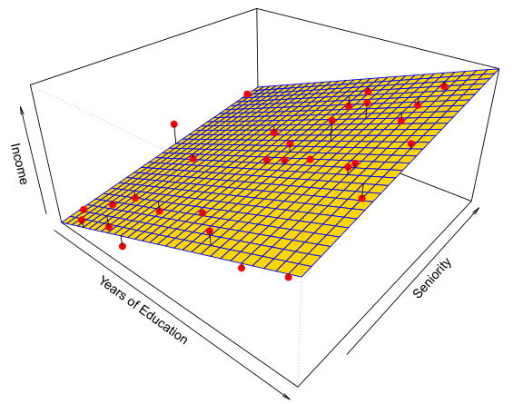

**图2.4** 用最小二乘法对图2.3中的`Income`数据拟合线性模型。红色表示观测点，黄色平面表示数据的最小二乘拟合。图内：Income＝收入，Years of Education＝受教育年限，Seniority＝资历。

2. 选定模型后，需要一种利用训练数据拟合（fit）或训练（train）模型的程序。对于线性模型(2.4)，我们需要估计参数（parameter）$\beta_0,\beta_1,\ldots,\beta_p$。也就是说，希望找出这些参数的取值，使得

    $$
    Y\approx\beta_0+\beta_1X_1+\beta_2X_2+\cdots+\beta_pX_p.
    $$

    拟合模型(2.4)最常用的方法称为（普通）最小二乘法，第3章将予以介绍。不过，最小二乘法只是拟合线性模型的许多方法之一。第6章将讨论估计式(2.4)中参数的其他方法。

刚才介绍的这种基于模型的方法称为参数方法，因为它将估计$f$的问题转化成估计一组参数的问题。为$f$假定一个参数形式，可以简化估计问题：一般来说，估计一组参数，例如线性模型(2.4)中的$\beta_0,\beta_1,\ldots,\beta_p$，要比拟合一个形式完全任意的函数$f$容易得多。参数方法的潜在缺点是，我们选择的模型通常与$f$真实而未知的形式不一致。如果选定的模型与真实的$f$相差过远，估计结果就会很差。我们可以尝试选择灵活的（flexible）模型来解决这一问题，使其能够拟合$f$的多种可能形式。但一般而言，拟合更灵活的模型需要估计更多参数。这些更复杂的模型可能导致一种称为过拟合（overfitting）的现象，其本质是过于紧密地追随数据中的误差或噪声（noise）。本书将多次讨论这些问题。

图2.4给出了将参数方法用于图2.3中`Income`数据的例子。我们拟合了如下形式的线性模型：

$$
\mathtt{income}\approx\beta_0+\beta_1\times\mathtt{education}+\beta_2\times\mathtt{seniority}.
$$


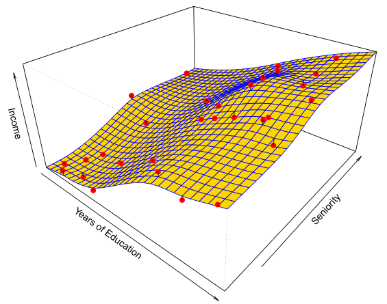

**图2.5** 对图2.3中的`Income`数据进行平滑的薄板样条（thin-plate spline）拟合，结果以黄色表示；观测点以红色表示。第7章将讨论样条。图内：Income＝收入，Years of Education＝受教育年限，Seniority＝资历。

由于我们假定响应与两个预测变量之间存在线性关系，整个拟合问题就归结为估计$\beta_0$、$\beta_1$和$\beta_2$，这里采用最小二乘线性回归。比较图2.3和图2.4可以看到，图2.4的线性拟合并不完全正确：真实的$f$具有一定的弯曲程度，而线性拟合未能捕捉到。不过，线性拟合似乎仍较好地捕捉到了受教育年限（`years of education`）与收入（`income`）之间的正向关系，以及资历（`seniority`）与收入之间稍弱一些的正向关系。对于如此少的观测，这可能已经是我们能做到的最好结果了。

#### 非参数方法

非参数方法不明确假设$f$的函数形式，而是寻求这样一个$f$的估计：既尽量靠近数据点，又不至于过于粗糙或曲折。这类方法相对于参数方法可能具有一个重要优势：由于避免为$f$假定特定的函数形式，它们有可能准确拟合$f$更广泛的可能形状。任何参数方法都有这样一种风险：用来估计$f$的函数形式与真实的$f$相差很大，导致模型无法很好地拟合数据。相比之下，非参数方法基本上不对$f$的形式作假设，因此完全避开了这种风险。但非参数方法也有一个主要缺点：由于没有将估计$f$的问题化为估计少量参数，要想准确估计$f$，就需要非常多的观测，其数量远多于参数方法通常所需的观测数。

图2.5展示了用非参数方法拟合`Income`数据的例子。这里用薄板样条估计$f$。这种方法不对$f$强加任何预先指定的模型，而是在保持拟合结果——也就是图2.5中的黄色曲面——平滑的前提下，尽可能贴近观测数据，得到$f$的估计。


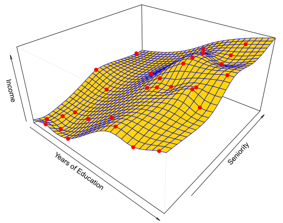

**图2.6** 对图2.3中的`Income`数据进行粗糙的薄板样条拟合。该拟合在训练数据上的误差为零。图内：Income＝收入，Years of Education＝受教育年限，Seniority＝资历。

在本例中，非参数拟合对图2.3所示真实$f$的估计相当准确。拟合薄板样条时，数据分析者必须选择平滑程度。图2.6采用同一种薄板样条方法，但选择较低的平滑程度，允许拟合曲面更为粗糙。所得估计完美地拟合了观测数据！然而，图2.6中的样条拟合，比图2.3中的真实函数$f$起伏大得多。这就是前面讨论过的数据过拟合现象。这样的结果并不理想，因为对于原训练数据之外的新观测，它无法准确估计响应。第5章将讨论选择适当平滑程度的方法，第7章将讨论样条。

如上所述，统计学习中的参数方法和非参数方法各有优缺点。本书将探索这两类方法。

### 2.1.3 预测准确性（prediction accuracy）与模型可解释性（model interpretability）的权衡


本书考察的许多方法中，有些灵活性（flexibility）较低，或者说限制较多，意思是它们只能用相对有限的一组形状来估计$f$。例如，线性回归是一种相对不灵活的方法，因为它只能生成线性函数，例如图2.1中的直线或图2.4中的平面。另一些方法则灵活得多，例如图2.5和图2.6中的薄板样条，因为它们能用更广泛的可能形状来估计$f$。


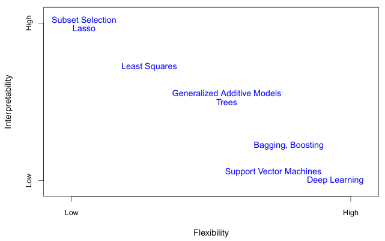

**图2.7** 用不同的统计学习方法展示灵活性与可解释性之间的权衡。一般来说，方法的灵活性越高，可解释性越低。图内：Flexibility＝灵活性，Interpretability＝可解释性，Low／High＝低／高；Subset Selection＝子集选择，Lasso＝套索法，Least Squares＝最小二乘法，Generalized Additive Models＝广义加性模型，Trees＝树，Bagging／Boosting＝装袋法／提升法，Support Vector Machines＝支持向量机，Deep Learning＝深度学习。

人们很自然会问：*既然有非常灵活的方法，为什么还要选择限制更多的方法？* 我们可能出于几个原因偏好限制更多的模型。如果主要关心推断，那么限制较多的模型要容易解释得多。例如，以推断为目标时，线性模型可能是一个不错的选择，因为它使我们比较容易理解$Y$与$X_1,X_2,\ldots,X_p$之间的关系。相比之下，非常灵活的方法，例如第7章介绍并在图2.5和图2.6中展示的样条，以及第8章介绍的提升法，可能会得到极为复杂的$f$的估计，以至于很难理解单个预测变量与响应之间有何关联。

图2.7展示了本书部分方法在灵活性与可解释性之间的权衡。第3章介绍的最小二乘线性回归相对不灵活，但相当容易解释。第6章介绍的套索法以线性模型(2.4)为基础，但采用另一种拟合程序来估计系数$\beta_0,\beta_1,\ldots,\beta_p$。这种新程序在估计系数时施加了更多限制，并将其中一些系数设为恰好等于零。因此，从这个意义上说，套索法比线性回归更不灵活。它也比线性回归更容易解释，因为在最终模型中，响应变量只与预测变量的一个较小子集有关，即系数估计值非零的那些预测变量。第7章介绍的广义加性模型（GAM）则扩展线性模型(2.4)，允许某些非线性关系。因此，GAM比线性回归更灵活，但也稍难解释，因为每个预测变量与响应之间的关系现在用一条曲线建模。最后，第8、9、10章介绍的完全非线性的方法，如装袋法、提升法、采用非线性核的支持向量机，以及神经网络（深度学习），都高度灵活，也更难解释。

我们已经看到，以推断为目标时，采用简单而相对不灵活的统计学习方法具有明显优势。但在某些情况下，我们只关心预测，根本不在意预测模型的可解释性。例如，要开发一种预测股票价格的算法，我们唯一的要求可能就是预测准确，并不关心可解释性。此时，似乎应当选用可用模型中最灵活的一个。然而，令人意外的是，情况并非总是如此！采用灵活性较低的方法，我们往往反而能得到更准确的预测。这一现象乍看有悖直觉，其原因与高度灵活的方法可能发生过拟合有关。图2.6已经给出了一个过拟合的例子。2.2节以及本书其他部分将进一步讨论这一十分重要的概念。

### 2.1.4 监督学习与无监督学习

大多数统计学习问题可以归入两类之一：监督学习或无监督学习。本章目前讨论的例子都属于监督学习。对于预测变量测量值的每个观测$x_i$，$i=1,\ldots,n$，都有相应的响应测量值$y_i$。我们希望拟合一个将响应与预测变量联系起来的模型，以便准确预测未来观测的响应（预测），或更好地理解响应与预测变量之间的关系（推断）。许多经典统计学习方法，如线性回归和逻辑回归（第4章），以及GAM、提升法和支持向量机等较新的方法，都用于监督学习。本书绝大部分内容讨论的都是这一情形。

相比之下，无监督学习描述的是一种更具挑战性的情形：对于每个观测$i=1,\ldots,n$，我们观测到一个测量值向量$x_i$，但没有对应的响应$y_i$。由于没有可供预测的响应变量，就无法拟合线性回归模型。在这里，我们在某种意义上是在摸索前行；之所以称为“无监督”，是因为没有响应变量来指导分析。那么，可以进行怎样的统计分析呢？我们可以尝试理解变量之间或观测之间的关系。在这种情况下，可以采用的统计学习工具之一是聚类分析（cluster analysis），也就是聚类。聚类分析的目标，是根据$x_1,\ldots,x_n$确定观测是否可以分成相对清晰的组。例如，在一项市场细分研究中，我们可能观测到潜在客户的多个特征（变量），如邮政编码、家庭收入和购物习惯。我们可能认为，客户可以分成不同的组，例如高消费群体和低消费群体。如果能够获得每位客户消费模式的信息，就可以进行监督分析。但是，这些信息并不可得，也就是说，我们不知道每位潜在客户是否属于高消费群体。此时，可以尝试根据已经测量的变量对客户聚类，识别不同的潜在客户群体。


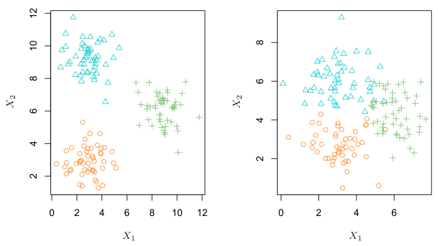

**图2.8** 一个包含三个群体的聚类数据集。每个群体以不同颜色的符号表示。**左图：**三个群体彼此清楚分离，此时聚类方法应当能够成功识别出这三个群体。**右图：**群体之间存在一定重叠，聚类任务因而更具挑战。图内横、纵轴分别为$X_1$和$X_2$。

识别这些群体可能很有价值，因为不同群体在某些受关注的属性上可能有所不同，例如消费习惯。

图2.8简单展示了聚类问题。图中绘出了150个观测，每个观测都有两个变量$X_1$和$X_2$的测量值，并属于三个不同群体中的一个。为了便于说明，我们用不同颜色和符号画出各群体的成员。但在实际中，群体归属是未知的，目标正是确定每个观测属于哪个群体。在图2.8左图中，这项任务相对容易，因为各群体分离得很清楚。右图则展示了更具挑战性的情形，群体之间有所重叠。我们不能指望聚类方法将所有重叠的数据点都分配到其正确的群体（蓝色、绿色或橙色）。

图2.8中的例子只有两个变量，因此只需目视检查观测的散点图，就能识别聚类。但在实际中，我们经常遇到变量远多于两个的数据集。此时，很难方便地画出这些观测。例如，如果数据集中有$p$个变量，就可以画出$p(p-1)/2$幅不同的散点图，仅靠目视检查来识别聚类便不可行。因此，自动聚类方法很重要。第12章将讨论聚类及其他无监督学习方法。

许多问题很自然地属于监督学习或无监督学习。不过，有时一种分析应当归入哪一类，并没有那么明确。例如，假设我们有$n$个观测，其中$m$个观测（$m<n$）既有预测变量的测量值，也有响应的测量值。

其余$n-m$个观测只有预测变量的测量值，没有响应的测量值。如果测量预测变量相对便宜，而收集相应响应的成本高得多，就可能出现这种情形。我们称之为半监督学习（semi-supervised learning）问题。在这里，我们希望采用一种统计学习方法，既能利用有响应测量值的$m$个观测，也能利用没有响应测量值的$n-m$个观测。尽管这个主题很有意思，但它超出了本书的范围。

### 2.1.5 回归问题与分类问题

变量可以分为定量的和定性的（也称类别型的）。定量变量取数值，例如一个人的年龄、身高或收入，房屋价值以及股票价格。相比之下，定性变量取值于$K$个不同的类或类别。例如，婚姻状况（已婚或未婚）、所购买产品的品牌（品牌A、B或C）、是否债务违约（是或否），以及癌症诊断结果（急性髓系白血病〔Acute Myelogenous Leukemia〕、急性淋巴细胞白血病〔Acute Lymphoblastic Leukemia〕或无白血病），都属于定性变量。我们通常将响应为定量变量的问题称为回归问题，而将响应为定性变量的问题称为分类问题。不过，两者的界限并非总是如此鲜明。最小二乘线性回归（第3章）用于定量响应；逻辑回归（第4章）通常用于定性响应，而且通常是两个类别，也就是二元的（binary）响应。因此，尽管名称中有“回归”，逻辑回归却是一种分类方法。但由于它估计的是类别概率，也可以将它视为一种回归方法。有些统计方法，如$K$近邻（第2、4章）和提升法（第8章），既适用于定量响应，也适用于定性响应。

我们通常根据响应是定量还是定性来选择统计学习方法。例如，响应为定量变量时可能采用线性回归，为定性变量时则可能采用逻辑回归。不过，预测变量是定性还是定量，一般被认为没那么重要。只要在分析前对定性预测变量进行适当编码，本书介绍的大多数统计学习方法都不受预测变量类型的限制。第3章将讨论这一点。

## 2.2 评估模型准确性

本书的一个主要目标，是向读者介绍种类广泛的统计学习方法，其范围远远超出标准线性回归。为什么需要介绍这么多不同的统计学习方法，而不是只介绍一种最好的方法呢？*统计学中没有免费的午餐*：在所有可能的数据集上，没有任何一种方法始终优于其余所有方法。对于某个数据集，一种特定方法可能表现最好，但对于一个相似却不完全相同的数据集，另一种方法可能表现更好。

因此，对任意给定的数据集，判断哪种方法能得到最好的结果，是一项重要任务。在实际开展统计学习时，选择最佳方法可能是最具挑战性的环节之一。

本节讨论为特定数据集选择统计学习方法时涉及的一些最重要的概念。随着本书内容的展开，我们将说明如何在实践中应用这里介绍的概念。

### 2.2.1 衡量拟合质量

为了评估统计学习方法在给定数据集上的表现，我们需要用某种方式，衡量其预测与实际观测数据的吻合程度。也就是说，对于某次观测，需要量化其预测响应值与真实响应值的接近程度。在回归问题中，最常用的度量是**均方误差（mean squared error，MSE）**，定义为

$$
\mathrm{MSE}=\frac{1}{n}\sum_{i=1}^{n}(y_i-\hat f(x_i))^2, \tag{2.5}
$$

其中，$\hat f(x_i)$ 是 $\hat f$ 对第 $i$ 次观测给出的预测。如果预测响应与真实响应十分接近，MSE就会很小；如果一些观测的预测响应与真实响应相差很大，MSE就会很大。

式(2.5)中的MSE使用拟合模型时所用的训练数据计算，因此，更准确的名称应当是**训练MSE（training MSE）**。不过，一般而言，我们真正关心的并不是方法在训练数据上的表现，而是将方法应用于先前未见过的**测试数据（test data）** 时，得到的预测有多准确。为什么我们关心这一点呢？假设我们希望开发一种算法，根据股票以往的收益率预测股价。我们可以使用过去6个月的股票收益率训练这种方法。但我们真正关心的并不是它对上周股价的预测有多好，而是它对明天或下个月股价的预测有多好。类似地，假设我们掌握了一些患者的临床测量值，例如体重、血压、身高、年龄和疾病家族史，以及每位患者是否患有糖尿病的信息。我们可以用这些患者的数据训练一种统计学习方法，根据临床测量值预测糖尿病风险。在实践中，我们希望这种方法能根据未来患者的临床测量值，准确预测其糖尿病风险。至于这种方法能否准确预测训练模型所用患者的糖尿病风险，我们并不十分关心，因为我们已经知道其中哪些患者患有糖尿病。

用更数学化的语言表述，假设我们用训练观测 $\{(x_1,y_1),(x_2,y_2),\ldots,(x_n,y_n)\}$ 拟合统计学习方法，得到估计 $\hat f$。随后，我们可以计算 $\hat f(x_1),\hat f(x_2),\ldots,\hat f(x_n)$。


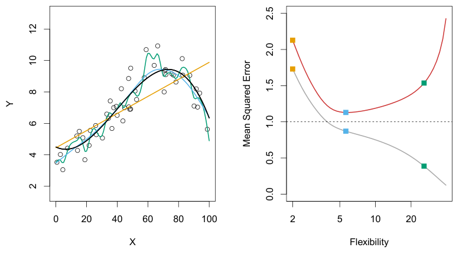

**图2.9** 左：由黑色曲线所示的 $f$ 模拟生成的数据。图中给出 $f$ 的三种估计：线性回归直线（橙色曲线），以及两条平滑样条（smoothing spline）拟合曲线（蓝色和绿色曲线）。右：训练MSE（灰色曲线）、测试MSE（红色曲线），以及所有方法所能达到的最低测试MSE（虚线）。方形标记表示左图中三种拟合所对应的训练MSE和测试MSE。图内文字：Mean Squared Error＝均方误差；Flexibility＝灵活性；$X$、$Y$ 保持原符号。

如果这些预测分别近似等于 $y_1,y_2,\ldots,y_n$，那么式(2.5)给出的训练MSE就很小。然而，我们真正关心的不是 $\hat f(x_i)\approx y_i$ 是否成立，而是 $\hat f(x_0)$ 是否近似等于 $y_0$；这里的 $(x_0,y_0)$ 是*先前未见过、也未用于训练统计学习方法的测试观测*。我们希望选择使**测试MSE（test MSE）** 最低的方法，而不是训练MSE最低的方法。换言之，如果有大量测试观测，我们就可以计算

$$
\operatorname{Ave}(y_0-\hat f(x_0))^2, \tag{2.6}
$$

即这些测试观测 $(x_0,y_0)$ 的平均预测平方误差。我们希望选择使这个量尽可能小的模型。

那么，如何选择使测试MSE最小的方法呢？在某些情况下，我们可能拥有一个测试数据集，也就是说，有一组没有用于训练统计学习方法的观测。这时，只需在测试观测上计算式(2.6)，然后选择测试MSE最小的学习方法即可。但如果没有可用的测试观测呢？在这种情况下，人们可能会想到，直接选择使训练MSE，即式(2.5)，最小的统计学习方法。由于训练MSE与测试MSE似乎密切相关，这种做法看起来或许合理。遗憾的是，这种策略存在一个根本问题：训练MSE最低的方法，并不保证也有最低的测试MSE。大致来说，问题在于，许多统计方法专门以训练集MSE最小为目标来估计系数。对于这些方法，训练集MSE可以相当小，测试MSE却往往大得多。

图2.9用一个简单例子说明了这一现象。在图2.9左图中，我们根据式(2.1)生成观测，其中真实的 $f$ 由黑色曲线给出。

橙色、蓝色和绿色曲线展示了灵活性依次增加的方法得到的三种可能的 $f$ 的估计。橙色直线是线性回归拟合，其灵活性相对较低。蓝色和绿色曲线由平滑程度不同的平滑样条得到；第7章将讨论平滑样条。显然，随着灵活性提高，曲线与观测数据的拟合更加紧密。绿色曲线的灵活性最高，与数据吻合得很好；然而，它过于曲折，对真实 $f$（黑色曲线）的拟合反而很差。通过调整平滑样条拟合的灵活性，我们可以对这组数据得到许多不同的拟合。

现在来看图2.9右图。灰色曲线展示了多种平滑样条的平均训练MSE随灵活性变化的情况；更正式地说，是随**自由度（degrees of freedom）** 变化的情况。自由度是概括曲线灵活性的一个量，第7章将作更完整的讨论。橙色、蓝色和绿色方形标记表示左图中对应曲线的MSE。约束更多、因而更平滑的曲线，比曲折的曲线具有更少的自由度。请注意，在图2.9中，线性回归处于约束最多的一端，自由度为2。随着灵活性增加，训练MSE单调下降。在本例中，真实 $f$ 是非线性的，因此橙色线性拟合的灵活性不足，不能很好地估计 $f$。绿色曲线对应左图三条拟合曲线中灵活性最高的一条，因此在这三种方法中，其训练MSE最低。

在本例中，我们知道真实函数 $f$，因此还可以在一个非常大的测试集上，计算测试MSE随灵活性变化的情况。（当然，一般情况下 $f$ 是未知的，因此无法这样做。）图2.9右图用红色曲线表示测试MSE。与训练MSE一样，随着灵活性提高，测试MSE起初也会下降。然而，到某个程度后，测试MSE趋于平缓，接着又开始上升。因此，橙色和绿色曲线都有较高的测试MSE。蓝色曲线使测试MSE最小；这并不令人意外，因为从图2.9左图直观来看，它似乎对 $f$ 的估计最好。水平虚线表示式(2.3)中的不可约误差 $\operatorname{Var}(\epsilon)$，对应所有可能方法所能达到的最低测试MSE。因此，蓝色曲线所代表的平滑样条已接近最优。

在图2.9右图中，随着统计学习方法的灵活性提高，可以看到训练MSE单调下降，而测试MSE呈U形。这是统计学习的一项基本性质，无论具体面对哪个数据集，也无论使用哪一种统计方法，都是如此。随着模型灵活性提高，训练MSE会下降，测试MSE却未必下降。当一种方法得到较小的训练MSE，却得到较大的测试MSE时，我们称其对数据发生了**过拟合**。之所以如此，是因为统计学习过程过于努力地寻找训练数据中的模式，可能捕捉到一些仅由随机因素造成、并非反映未知函数 $f$ 真实性质的模式。对训练数据过拟合时，测试MSE会非常大，因为方法在训练数据中找到的所谓模式，在测试数据中根本不存在。

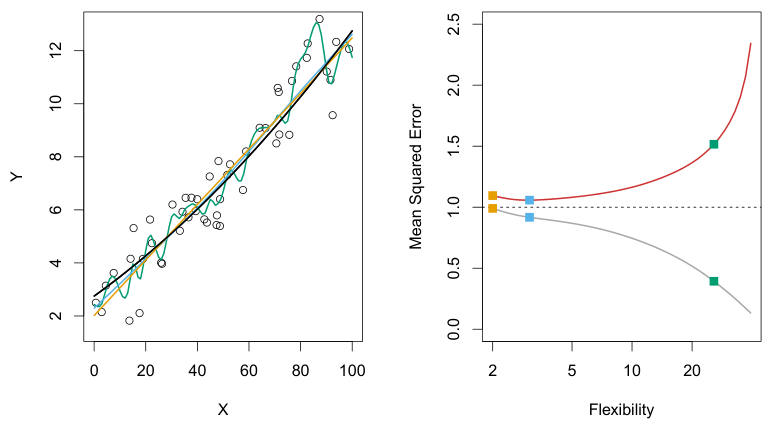

**图2.10** 其余细节同图2.9，但使用了一个更接近线性的真实 $f$。在这种情况下，线性回归能非常好地拟合数据。图内文字：Mean Squared Error＝均方误差；Flexibility＝灵活性；$X$、$Y$ 保持原符号。

请注意，无论是否发生过拟合，我们几乎总会预期训练MSE小于测试MSE，因为大多数统计学习方法都会直接或间接地使训练MSE最小。过拟合特指这样的情况：如果采用灵活性较低的模型，本可以得到更小的测试MSE。

图2.10给出了另一个例子，其中真实 $f$ 近似为线性函数。同样可以看到，随着模型灵活性提高，训练MSE单调下降，测试MSE呈U形。不过，由于真实函数接近线性，测试MSE只略微下降便又开始上升，因此橙色最小二乘拟合明显优于灵活性很高的绿色曲线。最后，图2.11展示了 $f$ 高度非线性的例子。训练MSE与测试MSE曲线仍呈现相同的总体模式，但这时，两条曲线都先快速下降，随后测试MSE才开始缓慢上升。

在实践中，计算训练MSE通常相对容易，但估计测试MSE要困难得多，因为通常没有可用的测试数据。如前面三个例子所示，在不同数据集上，测试MSE最小的模型所对应的灵活性可能相差很大。本书将讨论多种可在实践中用于估计这一最小值位置的方法。一种重要方法是交叉验证（第5章），它利用训练数据估计测试MSE。

### 2.2.2 偏差—方差权衡（The Bias-Variance Trade-Off）

测试MSE曲线（图2.9–2.11）中出现的U形，实际上源于统计学习方法中两种相互竞争的性质。

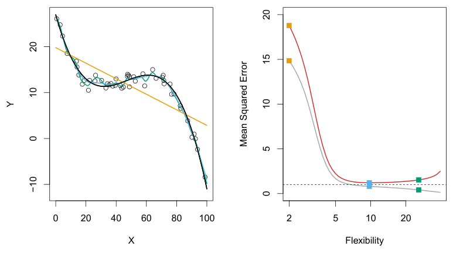

**图2.11** 其余细节同图2.9，但使用了一个远离线性的 $f$。在这种情况下，线性回归对数据的拟合很差。图内文字：Mean Squared Error＝均方误差；Flexibility＝灵活性；$X$、$Y$ 保持原符号。

虽然数学证明超出了本书的范围，但可以证明：对于给定的 $x_0$，期望测试MSE总可以分解为三个基本量之和：$\hat f(x_0)$ 的方差、$\hat f(x_0)$ 的**偏差（bias）** 的平方，以及误差项 $\epsilon$ 的方差。即

$$
E\left(y_0-\hat f(x_0)\right)^2
=\operatorname{Var}(\hat f(x_0))+[\operatorname{Bias}(\hat f(x_0))]^2+\operatorname{Var}(\epsilon). \tag{2.7}
$$

这里，记号 $E\left(y_0-\hat f(x_0)\right)^2$ 定义了在 $x_0$ 处的**期望测试MSE（expected test MSE）**：如果使用大量不同的训练集反复估计 $f$，并将每次估计都在 $x_0$ 处测试，就会得到这些测试MSE的平均值。将 $E\left(y_0-\hat f(x_0)\right)^2$ 对测试集中 $x_0$ 的所有可能取值求平均，就可以计算总体的期望测试MSE。

式(2.7)告诉我们，为了使期望测试误差最小，需要选择一种同时达到*低方差*和*低偏差*的统计学习方法。请注意，方差本身是非负量，偏差平方也非负。因此，期望测试MSE绝不可能低于式(2.3)中的不可约误差 $\operatorname{Var}(\epsilon)$。

统计学习方法的方差和偏差究竟指什么？方差指的是：如果换用另一个训练数据集进行估计，$\hat f$ 会发生多大变化。由于统计学习方法是用训练数据拟合的，不同的训练数据集会产生不同的 $\hat f$。理想情况下，不同训练集得到的 $f$ 的估计不应相差太大。但如果一种方法的方差很高，训练数据中的微小变化就可能导致 $\hat f$ 发生很大变化。一般来说，灵活性更高的统计方法具有更高的方差。请看图2.9中的绿色和橙色曲线。灵活的绿色曲线紧紧跟随观测，其方差很高，因为只要改变其中任何一个数据点，就可能使估计 $\hat f$ 发生很大变化。

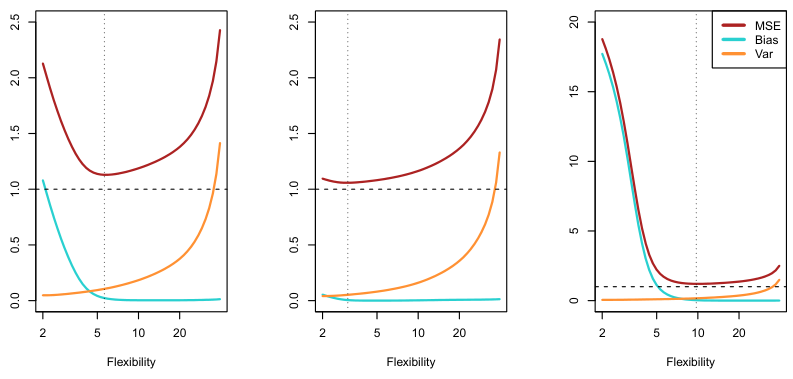

**图2.12** 图2.9–2.11中三个数据集所对应的偏差平方（蓝色曲线）、方差（橙色曲线）、$\operatorname{Var}(\epsilon)$（虚线）和测试MSE（红色曲线）。竖直点线表示测试MSE最小时所对应的灵活性。图内文字：Flexibility＝灵活性；MSE＝均方误差；Bias＝偏差（此图曲线表示偏差平方）；Var＝方差。

相比之下，橙色最小二乘直线的灵活性相对较低，方差也较低，因为移动任何一条观测，很可能只会使直线的位置稍作改变。

另一方面，偏差指的是：用一个简单得多的模型去近似一个可能极其复杂的现实问题，由此引入的误差。例如，线性回归假设 $Y$ 与 $X_1,X_2,\ldots,X_p$ 之间存在线性关系。现实问题不太可能真的具有如此简单的线性关系，因此进行线性回归，无疑会使 $f$ 的估计存在一定偏差。在图2.11中，真实 $f$ 明显是非线性的，因此，无论给定多少训练观测，都不可能使用线性回归得到准确的估计。换言之，在这个例子中，线性回归会产生较高的偏差。然而，在图2.10中，真实 $f$ 非常接近线性，因此只要数据足够，线性回归就应当能够给出准确的估计。一般而言，更灵活的方法会产生更低的偏差。

通常，随着所用方法的灵活性提高，方差会增加，偏差会减小。这两个量的相对变化速度，决定了测试MSE上升还是下降。当我们提高一类方法的灵活性时，起初偏差的下降通常快于方差的上升。因此，期望测试MSE会下降。但到某个程度后，继续提高灵活性对偏差的影响已经很小，却开始大幅增加方差。这时，测试MSE就会上升。请注意，我们在图2.9–2.11的右图中看到的，正是测试MSE先下降、后上升的模式。

图2.12的三幅图，用图2.9–2.11中的例子说明了式(2.7)。每幅图中的蓝色实线表示不同灵活性下的偏差平方，橙色曲线表示方差。水平虚线表示不可约误差 $\operatorname{Var}(\epsilon)$。最后，对应于测试集MSE的红色曲线，是这三个量的总和。

在这三种情况下，随着方法的灵活性提高，方差都会增加，偏差都会减小。但是，三个数据集中，最优测试MSE所对应的灵活性差异很大，因为每个数据集中偏差平方与方差的变化速度不同。在图2.12左图中，偏差起初快速下降，导致期望测试MSE在一开始大幅下降。另一方面，在图2.12中图中，真实 $f$ 接近线性，因此随着灵活性提高，偏差只略有下降，测试MSE也只略微下降，随后便随着方差增加而迅速上升。最后，在图2.12右图中，由于真实 $f$ 高度非线性，随着灵活性提高，偏差大幅下降。同时，方差随灵活性提高却增加得很少。因此，测试MSE先明显下降，随后随着模型灵活性进一步提高而略有上升。

式(2.7)给出、图2.12展示的偏差、方差与测试MSE之间的关系，称为**偏差—方差权衡**。统计学习方法要在测试集上表现良好，既需要低方差，也需要低偏差平方。之所以称为权衡，是因为我们很容易得到偏差极低但方差很高的方法，例如画一条经过每一个训练观测的曲线；也很容易得到方差极低但偏差很高的方法，例如用一条水平直线拟合数据。挑战在于找到一种方差与偏差平方都很低的方法。这种权衡是本书反复讨论的最重要主题之一。

在现实情形中，$f$ 是无法观测的，通常不可能直接计算统计学习方法的测试MSE、偏差或方差。尽管如此，我们仍应始终牢记偏差—方差权衡。本书会探讨一些灵活性极高、因而基本上可以消除偏差的方法。但这并不保证它们一定优于线性回归这样简单得多的方法。举一个极端的例子，假设真实 $f$ 是线性的。这时线性回归没有偏差，更灵活的方法很难与之竞争。相反，如果真实 $f$ 高度非线性，而且我们拥有充足的训练观测，那么采用灵活性很高的方法，可能会取得更好的效果，如图2.11所示。第5章将讨论交叉验证，即利用训练数据估计测试MSE的方法。

### 2.2.3 分类问题

到目前为止，我们对模型准确性的讨论一直集中在回归问题上。不过，前面遇到的许多概念，例如偏差—方差权衡，只需根据 $y_i$ 不再是定量变量这一事实作一些调整，就可以用于分类问题。假设我们希望根据训练观测 $\{(x_1,y_1),\ldots,(x_n,y_n)\}$ 估计 $f$，但现在 $y_1,\ldots,y_n$ 是定性变量。量化估计 $\hat f$ 的准确性时，最常用的方式是训练**错误率（error rate）**，即将估计 $\hat f$ 应用于训练观测时，所犯错误的比例：


$$
\frac{1}{n}\sum_{i=1}^{n}I(y_i\ne\hat y_i). \tag{2.8}
$$

这里，$\hat y_i$ 是利用 $\hat f$ 为第 $i$ 次观测预测的类别标签。$I(y_i\ne\hat y_i)$ 是一个**指示变量（indicator variable）**：当 $y_i\ne\hat y_i$ 时等于1，当 $y_i=\hat y_i$ 时等于0。如果 $I(y_i\ne\hat y_i)=0$，说明分类方法正确地对第 $i$ 次观测进行了分类；否则，就发生了误分类。因此，式(2.8)计算的是分类错误的比例。

式(2.8)称为**训练错误率（training error rate）**，因为它是根据训练分类器所用的数据计算的。与回归问题一样，我们最关心的是将分类器应用于没有参与训练的测试观测时，产生的错误率。对于一组形如 $(x_0,y_0)$ 的测试观测，其**测试错误率（test error rate）**为

$$
\operatorname{Ave}\left(I(y_0\ne\hat y_0)\right), \tag{2.9}
$$

其中，$\hat y_0$ 是将分类器应用于预测变量为 $x_0$ 的测试观测后，得到的预测类别标签。一个*好的*分类器，应当使式(2.9)中的测试误差最小。

#### 贝叶斯分类器（The Bayes Classifier）

可以证明（尽管证明超出了本书的范围），一个非常简单的分类器就能够使式(2.9)给出的测试错误率平均而言达到最小：*根据每条观测的预测变量取值，将其分配给最有可能的类别*。换言之，只需将预测变量向量为 $x_0$ 的测试观测分配到使下式最大的类别 $j$：

$$
\Pr(Y=j\mid X=x_0). \tag{2.10}
$$

请注意，式(2.10)是一个**条件概率（conditional probability）**：在观测到的预测变量向量为 $x_0$ 的条件下，$Y=j$ 的概率。这个非常简单的分类器称为**贝叶斯分类器**。在只有两个可能响应值的二分类问题中，比如类别1和类别2，当 $\Pr(Y=1\mid X=x_0)>0.5$ 时，贝叶斯分类器预测类别1，否则预测类别2。

图2.13给出了一个模拟数据集的例子，它位于由预测变量 $X_1$ 和 $X_2$ 构成的二维空间中。橙色和蓝色圆圈表示分别属于两个不同类别的训练观测。对于 $X_1$ 和 $X_2$ 的每一组取值，响应属于橙色或蓝色类别的概率各不相同。因为这些是模拟数据，我们知道数据是如何生成的，因此可以计算 $X_1$ 和 $X_2$ 每一组取值下的条件概率。橙色阴影区域表示 $\Pr(Y=\text{orange}\mid X)$ 大于50%的点的集合，蓝色阴影区域则表示这一概率低于50%的点的集合。紫色虚线表示概率恰好为50%的点，称为**贝叶斯决策边界（Bayes decision boundary）**。贝叶斯分类器的预测由贝叶斯决策边界决定：落在边界橙色一侧的观测会被分配到橙色类别，同样，落在边界蓝色一侧的观测会被分配到蓝色类别。


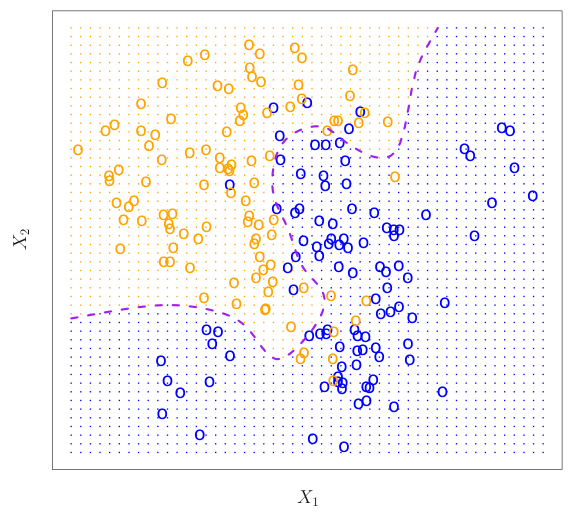

**图2.13** 一个由两组观测组成的模拟数据集，每组100条观测，分别用蓝色和橙色表示。紫色虚线表示贝叶斯决策边界。橙色背景网格表示测试观测会被分配到橙色类别的区域，蓝色背景网格表示测试观测会被分配到蓝色类别的区域。图内 $X_1$、$X_2$ 保持原符号。

贝叶斯分类器能够达到可能的最低测试错误率，称为**贝叶斯错误率（Bayes error rate）**。由于贝叶斯分类器总是选择使式(2.10)最大的类别，在 $X=x_0$ 处的错误率便是 $1-\max_j\Pr(Y=j\mid X=x_0)$。一般而言，总体贝叶斯错误率为

$$
1-E\left(\max_j\Pr(Y=j\mid X)\right), \tag{2.11}
$$

其中，期望对 $X$ 的所有可能取值下的概率求平均。对于这里的模拟数据，贝叶斯错误率为0.133。它大于0，因为两个类别在真实总体中存在重叠，这意味着对于某些 $x_0$，有 $\max_j\Pr(Y=j\mid X=x_0)<1$。贝叶斯错误率与前面讨论的不可约误差相类似。

#### K近邻

从理论上说，我们总希望使用贝叶斯分类器预测定性响应。但对于真实数据，我们并不知道给定 $X$ 时 $Y$ 的**条件分布（conditional distribution）**，因此无法计算贝叶斯分类器。所以，贝叶斯分类器是一个无法达到的金标准，用来与其他方法进行比较。许多方法尝试估计给定 $X$ 时 $Y$ 的条件分布，然后将给定观测分配到*估计*概率最高的类别。其中一种方法就是K近邻（KNN）分类器。

给定一个正整数 $K$ 和一个测试观测 $x_0$，KNN分类器首先找出训练数据中距离 $x_0$ 最近的 $K$ 个点，用 $\mathcal N_0$ 表示。随后，将类别 $j$ 的条件概率估计为 $\mathcal N_0$ 中响应值等于 $j$ 的点所占的比例：

$$
\Pr(Y=j\mid X=x_0)=\frac{1}{K}\sum_{i\in\mathcal N_0}I(y_i=j). \tag{2.12}
$$

最后，KNN将测试观测 $x_0$ 分配给式(2.12)中概率最大的类别。

图2.14给出了KNN方法的示例。左图画出一个由6条蓝色观测和6条橙色观测组成的小训练数据集。我们的目标是对黑色叉号标出的点作出预测。假设选择 $K=3$，KNN首先找出距离叉号最近的3条观测。图中的圆圈表示这个邻域，其中有2个蓝点和1个橙点，因而蓝色类别和橙色类别的估计概率分别为 $2/3$ 和 $1/3$。所以，KNN会预测黑色叉号属于蓝色类别。在图2.14右图中，我们对 $X_1$ 和 $X_2$ 的所有可能取值应用 $K=3$ 的KNN方法，并画出了相应的KNN决策边界。

尽管KNN方法十分简单，却往往能构建出与最优贝叶斯分类器十分接近、令人惊讶的分类器。图2.15展示了对图2.13中较大的模拟数据集应用 $K=10$ 时的KNN决策边界。请注意，虽然KNN分类器不知道真实分布，其决策边界却与贝叶斯分类器十分接近。KNN的测试错误率为0.1363，接近贝叶斯错误率0.1304。

$K$ 的选择会对得到的KNN分类器产生巨大影响。图2.16展示了对图2.13中的模拟数据分别使用 $K=1$ 和 $K=100$ 得到的两种KNN拟合。当 $K=1$ 时，决策边界过于灵活，在数据中找到了与贝叶斯决策边界不相符的模式。这对应一个偏差低、方差却很高的分类器。随着 $K$ 增大，方法的灵活性越来越低，产生的决策边界也接近线性。这对应一个低方差、高偏差的分类器。对这个模拟数据集，无论 $K=1$ 还是 $K=100$，预测都不好：测试错误率分别为0.1695和0.1925。

与回归问题一样，训练错误率和测试错误率之间并没有很强的关系。当 $K=1$ 时，KNN的训练错误率为0，测试错误率却可能相当高。一般来说，随着分类方法的灵活性提高，训练错误率会下降，测试错误率却未必下降。图2.17画出了KNN的测试误差和训练误差随 $1/K$ 变化的情况。随着 $1/K$ 增大，方法变得更加灵活。与回归问题一样，随着灵活性提高，训练错误率持续下降。但测试误差呈现出典型的U形：起初下降（大约在 $K=10$ 时达到最小值），随后在方法过于灵活、发生过拟合时又重新上升。

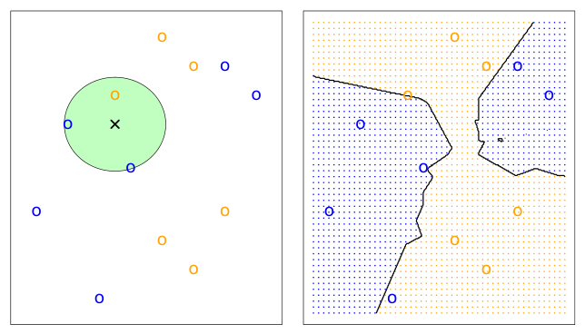

**图2.14** 用一个包含6条蓝色观测和6条橙色观测的简单情形，说明 $K=3$ 的KNN方法。左：需要预测其类别标签的测试观测用黑色叉号表示。找到距离这一测试观测最近的3个点，并预测该测试观测属于其中出现最多的类别；在本例中，就是蓝色类别。右：黑色曲线表示本例的KNN决策边界。蓝色网格表示测试观测会被分配到蓝色类别的区域，橙色网格表示测试观测会被分配到橙色类别的区域。

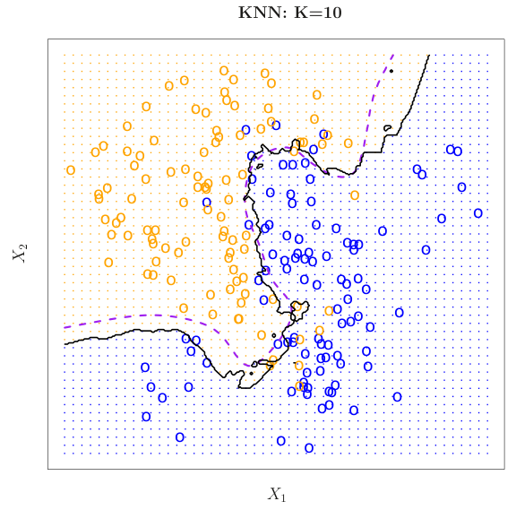

**图2.15** 黑色曲线表示在图2.13的数据上使用 $K=10$ 得到的KNN决策边界。紫色虚线表示贝叶斯决策边界。KNN与贝叶斯决策边界非常相似。图内文字：KNN: K=10＝$K=10$ 的KNN；$X_1$、$X_2$ 保持原符号。

无论在回归还是分类问题中，选择适当的灵活性，都是统计学习方法取得成功的关键。偏差—方差权衡，以及由此产生的U形测试误差曲线，会使这项任务变得困难。在第5章中，我们将再次讨论这个主题，讨论估计测试错误率的各种方法，并据此为给定统计学习方法选择最优的灵活性。


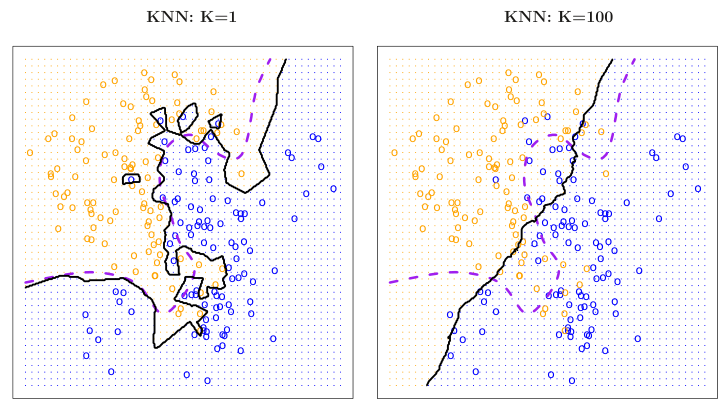

**图2.16** 对比在图2.13的数据上使用 $K=1$ 和 $K=100$ 得到的KNN决策边界（黑色实线）。当 $K=1$ 时，决策边界过于灵活；当 $K=100$ 时，灵活性又不足。紫色虚线表示贝叶斯决策边界。图内文字：KNN: K=1＝$K=1$ 的KNN；KNN: K=100＝$K=100$ 的KNN。

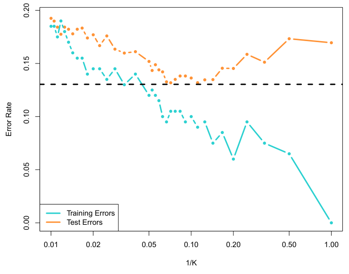

**图2.17** 在图2.13的数据上，随着灵活性提高（以对数尺度上的 $1/K$ 衡量），或者等价地，随着近邻数 $K$ 减小，KNN训练错误率（蓝色，200条观测）和测试错误率（橙色，5,000条观测）的变化。黑色虚线表示贝叶斯错误率。曲线的起伏是由于训练数据集规模较小。图内文字：Error Rate＝错误率；Training Errors＝训练误差；Test Errors＝测试误差；$1/K$ 保持原式。

## 2.3 实验：Python入门

### 2.3.1 开始使用

运行本书的实验需要具备两项条件：

1. 已安装Python3；这是本书实验所使用的Python版本。
2. 可以使用Jupyter。它是一种很受欢迎的Python界面，通过一种称为笔记本（notebook）的文件来运行代码。

可按照[anaconda.com](https://anaconda.com)提供的说明下载并安装Python3。

使用Jupyter有多种方式，以下列举几种：

1. 使用Google的Colaboratory服务：[colab.research.google.com/](https://colab.research.google.com/)。
2. 使用JupyterHub，网址为[jupyter.org/hub](https://jupyter.org/hub)。
3. 自行安装jupyter，安装说明见[jupyter.org/install](https://jupyter.org/install)。

有关如何让Python和Jupyter在你的计算机上运行的最新信息，请参阅本书网站[statlearning.com](https://statlearning.com)上的Python资源页面。

你需要安装ISLP软件包；本书提供的数据集和定制函数都可通过它获取。在macOS或Linux终端中输入`pip install ISLP`；该命令也会安装实验所需的大多数其他软件包。Python资源页面提供了ISLP文档网站的链接。

要运行本次实验，请从Python资源页面下载`Ch2-statlearn-lab.ipynb`文件，然后在命令行中运行以下代码：`jupyter lab Ch2-statlearn-lab.ipynb`。

如果使用Windows，可以从开始菜单进入anaconda，再按照其中的链接操作。例如，要安装ISLP并运行本次实验，可以在anaconda shell中运行上面相同的代码。

### 2.3.2 基本命令

本次实验将介绍一些简单的Python命令。若想了解有关Python的一般知识，可参阅[docs.python.org/3/tutorial/](https://docs.python.org/3/tutorial/)上的教程。

与大多数编程语言一样，Python使用函数（function）执行操作。要运行一个名为`fun`的函数，可输入`fun(input1,input2)`，其中输入（也称参数，argument）`input1`和`input2`告诉Python如何运行该函数。函数可以接收任意数量的输入。例如，`print()`函数会把所有参数的文本表示输出到控制台。

In[1]:

```python
print('fit a model with', 11, 'variables')
```

```python
fit a model with 11 variables
```

以下命令提供关于`print()`函数的信息。

In[2]:

```python
print?
```

在Python中，两个整数相加很直观。

In[3]:

```python
3 + 5
```

Out[3]:

```text
8
```

Python使用字符串（string）处理文本数据。例如，`"hello"`和`'hello'`都是字符串，可以用加号`+`把它们连接起来。

In[4]:

```python
"hello" + " " + "world"
```

Out[4]:

```python
'hello world'
```

字符串实际上是一种序列（sequence）；序列是有序对象集合的统称。最重要的三种序列类型是列表、元组（tuple）和字符串。下面介绍列表。

以下命令让Python把数字3、4和5组合起来，并保存为名为`x`的列表（list）。输入`x`，就会返回这个列表。

In[5]:

```python
x = [3, 4, 5]
x
```

Out[5]:

```python
[3, 4, 5]
```

注意，这里使用方括号`[]`构造列表。

我们经常需要把两组数相加。尝试以下代码似乎合情合理，但它并不会得到预期结果。

In[6]:

```python
y = [4, 9, 7]
x + y
```

Out[6]:

```python
[3, 4, 5, 4, 9, 7]
```

这个结果可能有些出人意料：Python为什么没有把两个列表中对应位置的元素逐一相加呢？在Python中，列表可以容纳任意对象，而列表的加法采用拼接（concatenation）方式。事实上，前面输入`"hello" + " " + "world"`时，看到的就是拼接操作。

这个例子说明，Python是一种通用编程语言。Python许多专门用于数据处理的功能来自其他软件包，尤其是numpy和pandas。下一节将介绍numpy软件包。有关numpy的更多信息，见[docs.scipy.org/doc/numpy/user/quickstart.html](https://docs.scipy.org/doc/numpy/user/quickstart.html)。

### 2.3.3 数值Python入门

如前所述，本书使用numpy库（library），也称软件包（package），所提供的功能。软件包是一组模块的集合，这些模块不一定包含在Python的基础发行版中。numpy这个名称是numerical Python（数值Python）的缩写。

要使用numpy，首先必须导入（import）它。

In[7]:

```python
import numpy as np
```

上一行把numpy模块（module）命名为`np`，用这个缩写便于后续引用。

在numpy中，数组（array）是多维数值集合的通称。我们使用`np.array()`函数定义`x`和`y`，这两个对象都是一维数组，即向量。

In[8]:

```python
x = np.array([3, 4, 5])
y = np.array([4, 9, 7])
```

注意，如果之前没有运行`import numpy as np`命令，调用上一段中的`np.array()`函数就会报错。`np.array()`这种写法表示，调用的函数属于numpy软件包，而我们已将该软件包缩写为`np`。

由于`x`和`y`是用`np.array()`定义的，把它们相加便会得到合乎预期的结果。可以与上一节不使用numpy、直接将两个列表相加时的结果比较。

In[9]:

```python
x + y
```

Out[9]:

```python
array([ 7, 13, 12])
```

在numpy中，矩阵通常用二维数组表示，向量则用一维数组表示。<sup><a href="#ch02-fn1" id="ch02-fnref1">1</a></sup>可以按以下方式创建二维数组。

<aside class="footnote" id="ch02-fn1"><a href="#ch02-fnref1">1</a> 虽然也可以用`np.matrix()`创建矩阵，但本书所有实验都使用`np.array()`。</aside>

In[10]:

```python
x = np.array([[1, 2], [3, 4]])
x
```

Out[10]:

```python
array([[1, 2],
       [3, 4]])
```

对象`x`有若干属性（attribute），即与它关联的对象。要访问`x`的某个属性，可输入`x.attribute`，将`attribute`替换为该属性的名称。例如，以下代码访问`x`的`ndim`属性。

In[11]:

```python
x.ndim
```

Out[11]:

```text
2
```

这个输出说明`x`是二维数组。同样，`x.dtype`是对象`x`的数据类型（data type）属性。它表明`x`由64位整数组成：

In[12]:

```python
x.dtype
```

Out[12]:

```text
dtype('int64')
```

`x`为什么由整数组成呢？这是因为创建`x`时，传入`np.array()`函数的全都是整数。如果传入任何小数，得到的就会是由浮点数（floating point number，即实数值的数）组成的数组。

In[13]:

```python
np.array([[1, 2], [3.0, 4]]).dtype
```

Out[13]:

```text
dtype('float64')
```

输入`fun?`，Python就会显示函数`fun`的文档（如果存在）。可以对`np.array()`试一试。

In[14]:

```python
np.array?
```

文档说明，可以向`np.array()`传入`dtype`参数来创建浮点数数组。

In[15]:

```python
np.array([[1, 2], [3, 4]], float).dtype
```

Out[15]:

```text
dtype('float64')
```

数组`x`是二维的。查看它的`shape`属性，就能知道行数和列数。

In[16]:

```python
x.shape
```

Out[16]:

```text
(2, 2)
```

方法（method）是与某个对象关联的函数。例如，对于数组`x`，表达式`x.sum()`使用数组的`sum()`方法，把其中所有元素相加。调用`x.sum()`时，会自动把`x`作为第一个参数传给它的`sum()`方法。

In[17]:

```python
x = np.array([1, 2, 3, 4])
x.sum()
```

Out[17]:

```text
10
```

也可以把`x`作为参数传给`np.sum()`函数，求出`x`中所有元素的和。

In[18]:

```python
x = np.array([1, 2, 3, 4])
np.sum(x)
```

Out[18]:

```text
10
```

再举一个例子，`reshape()`方法返回一个新数组，其中的元素与`x`相同，但形状不同。调用`reshape()`时，需要传入一个元组，

这里是`(2, 3)`。这个元组指定我们要创建一个有2行、3列的二维数组。<sup><a href="#ch02-fn2" id="ch02-fnref2">2</a></sup>

<aside class="footnote" id="ch02-fn2"><a href="#ch02-fnref2">2</a> 与列表一样，元组也表示一组对象构成的序列。为什么需要不止一种创建序列的方式呢？元组和列表有若干差异，其中最重要的一点可能是：元组的元素不能修改，而列表的元素可以修改。</aside>

以下`print`函数中的`\n`字符用于换行。

In[19]:

```python
x = np.array([1, 2, 3, 4, 5, 6])
print('beginning x:\n', x)
x_reshape = x.reshape((2, 3))
print('reshaped x:\n', x_reshape)
```

```python
beginning x:
 [1 2 3 4 5 6]
reshaped x:
 [[1 2 3]
 [4 5 6]]
```

上面的输出表明，numpy数组按逐行排列的序列表示。这称为行优先顺序（row-major ordering），与列优先顺序（column-major ordering）相对。

Python（因此也包括numpy）使用从0开始的索引（0-based indexing）。这意味着，要访问`x_reshape`左上角的元素，应输入`x_reshape[0,0]`。

In[20]:

```python
x_reshape[0, 0]
```

Out[20]:

```text
1
```

同样，`x_reshape[1,2]`返回`x_reshape`第2行、第3列的元素。

In[21]:

```python
x_reshape[1, 2]
```

Out[21]:

```text
6
```

类似地，`x[2]`返回`x`的第3个元素。

现在修改`x_reshape`左上角的元素。令人意外的是，`x`的第1个元素也被修改了！

In[22]:

```python
print('x before we modify x_reshape:\n', x)
print('x_reshape before we modify x_reshape:\n', x_reshape)
x_reshape[0, 0] = 5
print('x_reshape after we modify its top left element:\n',
    x_reshape)
print('x after we modify top left element of x_reshape:\n', x)
```

Out[22]:

```python
x before we modify x_reshape:
 [1 2 3 4 5 6]
x_reshape before we modify x_reshape:
 [[1 2 3]
 [4 5 6]]
x_reshape after we modify its top left element:
 [[5 2 3]

 [4 5 6]]
x after we modify top left element of x_reshape:
 [5 2 3 4 5 6]
```

修改`x_reshape`也会修改`x`，因为这两个对象占用内存中的同一片空间。

刚才我们看到，数组的元素可以修改。那么，元组也可以修改吗？答案是否定的；尝试修改元组会引发异常（exception），也就是错误。

In[23]:

```python
my_tuple = (3, 4, 5)
my_tuple[0] = 2
```

```python
TypeError: 'tuple' object does not support item assignment
```

下面简要介绍几个实用的数组属性。数组的`shape`属性包含其各维度的大小，始终是一个元组。`ndim`属性给出维数，`T`则给出转置。

In[24]:

```python
x_reshape.shape, x_reshape.ndim, x_reshape.T
```

Out[24]:

```text
((2, 3),
 2,
 array([[5, 4],
        [2, 5],
        [3, 6]]))
```

注意，三个单独的输出`(2,3)`、`2`和`array([[5, 4],[2, 5], [3,6]])`本身又作为一个元组输出。

我们经常需要对数组应用函数。例如，可以使用`np.sqrt()`函数计算各元素的平方根：

In[25]:

```python
np.sqrt(x)
```

Out[25]:

```text
array([2.24, 1.41, 1.73, 2., 2.24, 2.45])
```

也可以计算各元素的平方：

In[26]:

```python
x**2
```

Out[26]:

```text
array([25, 4, 9, 16, 25, 36])
```

使用同样的记号，将幂从2改为1/2，也能计算平方根。

In[27]:

```python
x**0.5
```

Out[27]:

```text
array([2.24, 1.41, 1.73, 2., 2.24, 2.45])
```

本书经常需要生成随机数据。`np.random.normal()`函数生成由正态随机变量（normal random variables）构成的向量。调用`np.random.normal?`查看帮助页面，可以进一步了解这个函数。帮助页面的第一行为`normal(loc=0.0, scale=1.0, size=None)`。这一签名（signature）行说明该函数的参数

为`loc`、`scale`和`size`。这些都是关键字参数（keyword argument），意味着传入函数时可以按名称指定，顺序任意。<sup><a href="#ch02-fn3" id="ch02-fnref3">3</a></sup>默认情况下，这个函数生成均值（`loc`）为0、标准差（standard deviation，`scale`）为1的正态随机变量；此外，除非更改传给`size`的参数，否则只生成一个正态随机变量。

<aside class="footnote" id="ch02-fn3"><a href="#ch02-fnref3">3</a> Python也使用位置参数（positional argument）。位置参数不需要使用关键字。例如，输入`np.sum?`，可以看到`a`是位置参数；也就是说，函数把收到的第一个未命名参数视为需要求和的数组。相比之下，`axis`和`dtype`是关键字参数：它们传入`np.sum()`时的位置并不重要。</aside>

现在从$N(0,1)$分布生成50个相互独立的随机变量。

In[28]:

```python
x = np.random.normal(size=50)
x
```

Out[28]:

```text
array([-1.19,  0.41,  0.9 , -0.44, -0.9 , -0.38,  0.13,  1.87,
       -0.35,  1.16,  0.79, -0.97, -1.21,  0.06, -1.62, -0.6 ,
       -0.77, -2.12,  0.38, -1.22, -0.06, -1.97, -1.74, -0.56,
        1.7 , -0.95,  0.56,  0.35,  0.87,  0.88, -1.66, -0.32,
       -0.3 , -1.36,  0.92, -0.31,  1.28, -1.94,  1.07,  0.07,
        0.79, -0.46,  2.19, -0.27, -0.64,  0.85,  0.13,  0.46,
       -0.09,  0.7 ])
```

对`x`的每个元素加上一个独立的$N(50,1)$随机变量，创建数组`y`。

In[29]:

```python
y = x + np.random.normal(loc=50, scale=1, size=50)
```

`np.corrcoef()`函数计算`x`和`y`的相关矩阵（correlation matrix）。非对角线元素给出`x`与`y`之间的相关系数（correlation）。

In[30]:

```python
np.corrcoef(x, y)
```

Out[30]:

```text
array([[1.  , 0.69],
       [0.69, 1.  ]])
```

如果你正在自己的Jupyter笔记本中跟着操作，可能已经注意到，运行刚才几条命令时得到了不同的结果。具体而言，每次调用`np.random.normal()`都会得到不同的答案，如下例所示。

In[31]:

```python
print(np.random.normal(scale=5, size=2))
print(np.random.normal(scale=5, size=2))
```

Out[31]:

```text
[4.28 2.59]
[4.62 -2.54]
```

为了确保代码每次运行都给出完全相同的结果，可以使用`np.random.default_rng()`函数设置随机种子（random seed）。这个函数接收一个由用户指定的任意整数参数。如果在生成随机数据之前设置随机种子，那么重新运行代码时就会得到相同的结果。对象`rng`基本上具备`np.random`中的所有随机数生成方法。

因此，要生成正态分布数据，可以使用`rng.normal()`。

In[32]:

```python
rng = np.random.default_rng(1303)
print(rng.normal(scale=5, size=2))
rng2 = np.random.default_rng(1303)
print(rng2.normal(scale=5, size=2))
```

Out[32]:

```text
[4.09  -1.07 ]
[4.09  -1.07 ]
```

在本书所有实验中，只要在numpy内进行涉及随机量的计算，就使用`np.random.default_rng()`。原则上，这应当使读者能够精确复现书中给出的结果。不过，随着numpy新版本的发布，实验输出与numpy的实际输出之间可能会出现一些细微差别。

`np.mean()`、`np.var()`和`np.std()`函数分别用于计算数组的均值、方差和标准差。这些函数也可以作为数组的方法使用。

In[33]:

```python
rng = np.random.default_rng(3)
y = rng.standard_normal(10)
np.mean(y), y.mean()
```

Out[33]:

```text
(-0.11, -0.11)
```

In[34]:

```python
np.var(y), y.var(), np.mean((y - y.mean())**2)
```

Out[34]:

```text
(2.72, 2.72, 2.72)
```

注意，`np.var()`默认除以样本量$n$，而不是$n-1$；请参阅`np.var?`中的`ddof`参数。

In[35]:

```python
np.sqrt(np.var(y)), np.std(y)
```

Out[35]:

```text
(1.65, 1.65)
```

`np.mean()`、`np.var()`和`np.std()`函数也可以作用于矩阵的行和列。为此，我们构造一个由$N(0,1)$随机变量组成的$10\times3$矩阵，并考虑计算各行的和。

In[36]:

```python
X = rng.standard_normal((10, 3))
X
```

Out[36]:

```text
array([[ 0.23, -0.35, -0.28],
       [-0.67, -1.06, -0.39],
       [ 0.48, -0.24,  0.96],
       [-0.2 ,  0.02,  1.55],
       [ 0.55, -0.51, -0.18],
       [ 0.54,  1.94, -0.27],
       [-0.24,  1.  , -0.89],
       [-0.29,  0.88,  0.58],
       [ 0.09,  0.67, -2.83],
       [ 1.02, -0.96, -1.67]])
```

由于数组采用行优先顺序，第一个轴，即`axis=0`，对应于行。把这个参数传给对象`X`的`mean()`方法。

In[37]:

```python
X.mean(axis=0)
```

Out[37]:

```text
array([0.15, 0.14, -0.34])
```

下面的写法得到相同结果。

In[38]:

```python
X.mean(0)
```

Out[38]:

```text
array([0.15, 0.14, -0.34])
```

### 2.3.4 绘图

Python通常使用matplotlib库绘图。不过，Python最初并非为数据分析而设计，因此绘图不是这门语言自带的基本概念。我们将使用`matplotlib.pyplot`中的`subplots()`函数，创建图形及用于绘制数据的绘图区。有关Python绘图的更多示例，可访问[matplotlib.org/stable/gallery/](https://matplotlib.org/stable/gallery/)。

在matplotlib中，一幅图由图形（figure）和一个或多个绘图区（axes）组成。图形可以看作一块空白画布，在上面显示一幅或多幅图：它就是整个绘图窗口。绘图区包含每幅图的重要信息，例如$x$轴和$y$轴的标签、标题等。（注意，在matplotlib中，axes一词不是axis的复数：绘图区包含的信息远不止$x$轴和$y$轴。）

首先从matplotlib导入`subplots()`函数。之后创建图形时，我们都会使用这个函数。它返回一个长度为2的元组，其中包含一个图形对象和相应的绘图区对象。通常会传入`figsize`作为关键字参数。创建绘图区后，用它的`plot()`方法尝试绘制第一幅图。输入`ax.plot?`可了解更多信息。

In[39]:

```python
from matplotlib.pyplot import subplots
fig, ax = subplots(figsize=(8, 8))
x = rng.standard_normal(100)
y = rng.standard_normal(100)
ax.plot(x, y);
```

这里需要说明，`subplots()`返回的长度为2的元组，已被解包（unpacking）为两个独立变量`fig`和`ax`。通常更倾向于使用解包，而不是下面这种等效但稍显冗长的代码：

In[40]:

```python
output = subplots(figsize=(8, 8))
fig = output[0]
ax = output[1]
```

可以看到，前面的单元格生成了折线图，这是默认图形。要创建散点图，可以向`ax.plot()`再传入一个参数，指定用圆圈显示各个点。

In[41]:

```python
fig, ax = subplots(figsize=(8, 8))
ax.plot(x, y, 'o');
```

这个附加参数取不同的值，可以生成不同颜色的线条和不同的线型。

也可以改用`ax.scatter()`函数创建散点图。

In[42]:

```python
fig, ax = subplots(figsize=(8, 8))
ax.scatter(x, y, marker='o');
```

注意，以上代码块的最后一行都以分号结尾。这样可以阻止`ax.plot(x, y)`把文本打印到笔记本中，但并不会阻止图形的生成。如果省略末尾的分号，就会得到以下输出：

In[43]:

```python
fig, ax = subplots(figsize=(8, 8))
ax.scatter(x, y, marker='o')
```

Out[43]:

```text
<matplotlib.collections.PathCollection at 0x7fb3d9c8f310 >
Figure(432x288)
```

下文中，只要输出的文本与当前讨论无关，就会在末尾使用分号。

要为图形添加标签，可以使用`ax`的`set_xlabel()`、`set_ylabel()`和`set_title()`方法。

In[44]:

```python
fig, ax = subplots(figsize=(8, 8))
ax.scatter(x, y, marker='o')
ax.set_xlabel("this is the x-axis")
ax.set_ylabel("this is the y-axis")
ax.set_title("Plot of X vs Y");
```

由于能够访问图形对象`fig`本身，我们可以修改图形的某些方面，然后重新显示。这里把尺寸从`(8, 8)`改为`(12, 3)`。

```python
fig.set_size_inches(12,3)
fig
```

有时需要在一个图形中创建多幅图，可以向`subplots()`传入额外参数来实现。下面在一个由`figsize`参数决定尺寸的图形中，创建一个$2\times3$的子图网格。这种情况下，各子图的绘图区之间往往存在某种关联。例如，所有子图可能共用一个$x$轴。向`subplots()`传入关键字参数`sharex=True`，它就能自动处理这种情况。下面的`axes`对象是一个数组，指向图形中的不同子图。

In[45]:

```python
fig, axes = subplots(nrows=2,
                     ncols=3,
                     figsize=(15, 5))
```

现在在第1行、第2列绘制使用`'o'`的散点图，在第2行、第3列绘制使用`'+'`的散点图。

In[46]:

```python
axes[0,1].plot(x, y, 'o')
axes[1,2].scatter(x, y, marker='+')
fig
```

输入`subplots?`可进一步了解`subplots()`。

要保存`fig`的输出，可调用它的`savefig()`方法。参数`dpi`表示每英寸点数（dots per inch），用于决定图形的像素尺寸。

In[47]:

```python
fig.savefig("Figure.png", dpi=400)
fig.savefig("Figure.pdf", dpi=200);
```

可以继续逐步更新、修改`fig`；例如，更改$x$轴范围，再次保存图形，甚至重新显示。

In[48]:

```python
axes[0,1].set_xlim([-1,1])
fig.savefig("Figure_updated.jpg")
fig
```

下面创建一些更复杂的图形。`ax.contour()`方法生成类似地形图的等高线图（contour plot），用于表示三维数据。它接收三个参数：

- 一组$x$值构成的向量（第1维）；
- 一组$y$值构成的向量（第2维）；
- 一个矩阵，其元素是每对`(x,y)`坐标对应的$z$值（第3维）。

创建`x`和`y`时，使用命令`np.linspace(a, b, n)`。它返回一个由$n$个数构成的向量，从$a$开始，到$b$结束。

In[49]:

```python
fig, ax = subplots(figsize=(8, 8))
x = np.linspace(-np.pi, np.pi, 50)
y = x
f = np.multiply.outer(np.cos(y), 1 / (1 + x**2))
ax.contour(x, y, f);
```

向图中添加更多等高线层级，可以提高分辨率。

In[50]:

```python
fig, ax = subplots(figsize=(8, 8))
ax.contour(x, y, f, levels=45);
```

要精细调整`ax.contour()`函数的输出，可输入`?plt.contour`查阅帮助文件。

`ax.imshow()`方法与`ax.contour()`类似，但它生成的是颜色由$z$值决定的彩色编码图。这种图称为热图（heatmap），有时用于绘制天气预报中的温度。

In[51]:

```python
fig, ax = subplots(figsize=(8, 8))
ax.imshow(f);
```

### 2.3.5 序列与切片记法

如上所示，`np.linspace()`函数可用于创建数值序列。

In[52]:

```python
seq1 = np.linspace(0, 10, 11)
seq1
```

Out[52]:

```text
array([ 0.,  1.,  2.,  3.,  4.,  5.,  6.,  7.,  8.,  9., 10.])
```

`np.arange()`函数返回一个以`step`为间隔的数值序列。如果不指定`step`，则使用默认值1。下面创建一个从0开始、到10结束的序列。

In[53]:

```python
seq2 = np.arange(0, 10)
seq2
```

Out[53]:

```text
array([0, 1, 2, 3, 4, 5, 6, 7, 8, 9])
```

上面为什么没有输出10呢？这与Python中的切片（slice）记法有关。切片记法用于索引列表、元组和数组等序列。假设要取出一个字符串的第4至第6个字符（包括第6个），可以使用索引记法`[3:6]`取得这个字符串的切片。

In[54]:

```python
"hello world"[3:6]
```

Out[54]:

```text
'lo '
```

在上面的代码块中，`3:6`用于`[]`内部时，是`slice(3,6)`的简写。

In[55]:

```python
"hello world"[slice(3,6)]
```

Out[55]:

```text
'lo '
```

你可能以为`slice(3,6)`会输出字符串的第4至第7个字符（记住，Python的索引从0开始），但它实际输出的是第4至第6个字符。这也解释了为什么前面的`np.arange(0, 10)`只输出0到9这些整数。有关创建切片时的实用选项，请参阅`slice?`文档。

### 2.3.6 数据索引

首先创建一个二维numpy数组。

In[56]:

```python
A = np.array(np.arange(16)).reshape((4, 4))
A
```

Out[56]:

```text
array([[ 0,  1,  2,  3],
        [ 4,  5,  6,  7],
        [ 8,  9, 10, 11],
        [12, 13, 14, 15]])
```

输入`A[1,2]`，就能取出第2行、第3列的元素。（与前面一样，Python的索引从0开始。）

In[57]:

```python
A[1,2]
```

Out[57]:

```text
6
```

左方括号`[`后的第1个数表示行，第2个数表示列。

#### 行、列与子矩阵的索引

要一次选择多行，可以传入一个列表来指定要选择的行。例如，`[1,3]`会取出第2行和第4行：

In[58]:

```python
A[[1,3]]
```

Out[58]:

```text
array([[ 4,  5,  6,  7],
        [12, 13, 14, 15]])
```

要选择第1列和第3列，可把`[0,2]`作为方括号中的第2个参数传入。这时还需要提供第1个参数`:`，用于选择所有行。

In[59]:

```python
A[:,[0,2]]
```

Out[59]:

```text
array([[ 0,  2],
        [ 4,  6],
        [ 8, 10],
        [12, 14]])
```

现在假设要选择由第2行、第4行与第1列、第3列组成的子矩阵。这时索引就稍微复杂一些。很自然会尝试用列表取出所需的行和列：

In[60]:

```python
A[[1,3],[0,2]]
```

Out[60]:

```text
array([ 4, 14])
```

咦，这是怎么回事？得到的是长度为2的一维数组，与下面的结果完全相同：

In[61]:

```python
np.array([A[1,0],A[3,2]])
```

Out[61]:

```text
array([ 4, 14])
```

同样，下面的代码也无法取出由第2行、第4行与第1列、第3列、第4列组成的子矩阵：

In[62]:

```python
A[[1,3],[0,2,3]]
```

```text
IndexError: shape mismatch: indexing arrays could not be broadcast
    together with shapes (2,) (3,)
```

可以看出问题所在：当传入两个索引列表时，numpy会将它们解释为一系列元素对应的成对$i,j$索引，因此两个列表的长度必须相同。但这并不是我们的意图，因为我们要取出的是子矩阵。

一种简单做法如下：先通过选择`A`的部分行创建子矩阵，然后立即选择这个子矩阵的部分列，进一步得到所需子矩阵。

In[63]:

```python
A[[1,3]][:,[0,2]]
```

Out[63]:

```text
array([[ 4,  6],
        [12, 14]])
```

也有更高效的方式得到相同结果。

便捷函数（convenience function）`np.ix_()`先创建一个中间网格（mesh）对象，使我们能够用列表取出子矩阵。

In[64]:

```python
idx = np.ix_([1,3],[0,2,3])
A[idx]
```

Out[64]:

```text
array([[ 4,  6,  7],
        [12, 14, 15]])
```

还可以使用切片，高效地选取矩阵的子集。切片`1:4:2`取得序列的第2个和第4个元素，切片`0:3:2`则取得第1个和第3个元素（切片序列中的第3项是步长）。

In[65]:

```python
A[1:4:2,0:3:2]
```

Out[65]:

```text
array([[ 4,  6],
        [12, 14]])
```

为什么用切片可以直接取出子矩阵，用列表却不行呢？这是因为它们属于不同的Python类型，numpy对它们的处理方式不同。切片可用于从字符串、列表、元组等任意序列中取出对象，而用列表进行索引的适用范围更受限制。

#### 布尔索引

在numpy中，布尔值（Boolean）这种类型只能取`True`或`False`（也分别表示为1和0）。下一行创建一个用布尔值表示的全0向量，其长度等于`A`第1个维度的大小。

In[66]:

```python
keep_rows = np.zeros(A.shape[0], bool)
keep_rows
```

Out[66]:

```text
array([False,  False, False,  False])
```

现在把其中两个元素设为`True`。

In[67]:

```python
keep_rows[[1,3]] = True
keep_rows
```

Out[67]:

```text
array([False,  True, False,  True])
```

注意，如果把`keep_rows`的元素看作整数，它们与`np.array([0,1,0,1])`中的值相同。下面用`==`验证两者是否相等。`==`运算作用于两个数组时，会逐元素进行比较。

In[68]:

```python
np.all(keep_rows == np.array([0,1,0,1]))
```

Out[68]:

```text
True
```

（这里，`np.all()`函数检查了数组的所有元素是否均为`True`。类似的函数`np.any()`可用于检查数组中是否有任何元素为`True`。）

不过，尽管按照`==`的比较结果，`np.array([0,1,0,1])`与`keep_rows`相等，但它们索引的却是不同的行！前者会依次取出`A`的第1行、第2行、第1行和第2行。

In[69]:

```python
A[np.array([0,1,0,1])]
```

Out[69]:

```text
array([[0, 1, 2, 3],
       [4, 5, 6, 7],
       [0, 1, 2, 3],
       [4, 5, 6, 7]])
```

相比之下，`keep_rows`只取出`A`的第2行和第4行，也就是布尔值等于`TRUE`的行。

In[70]:

```python
A[keep_rows]
```

Out[70]:

```text
array([[ 4,  5,  6,  7],
       [12, 13, 14, 15]])
```

这个例子说明，numpy对布尔值与整数的处理方式不同。

再次使用`np.ix_()`函数，创建一个包含第2行、第4行与第1列、第3列、第4列的网格。这次将该函数应用于布尔值，而不是列表。

In[71]:

```python
keep_cols = np.zeros(A.shape[1], bool)
keep_cols[[0, 2, 3]] = True
idx_bool = np.ix_(keep_rows, keep_cols)
A[idx_bool]
```

Out[71]:

```text
array([[ 4,  6, 7],
       [12, 14, 15]])
```

在`np.ix_()`的参数中，还可以混合使用列表与布尔值数组：

In[72]:

```python
idx_mixed = np.ix_([1,3], keep_cols)
A[idx_mixed]
```

Out[72]:

```text
array([[ 4,  6, 7],
       [12, 14, 15]])
```

有关numpy索引的更多细节，请参阅前面提到的numpy教程。

### 2.3.7 加载数据

数据集往往包含不同类型的数据，行或列也可能各有名称。因此，通常最好用数据框（data frame）来存储。可以把数据框看作一组等长数组组成的序列；每个数组就是一列。把不同数组中对应位置的元素组合起来，就形成一行。pandas库可用于创建和操作数据框对象。

#### 读入数据集

大多数分析的第一步，是将数据集导入Python。尝试加载数据集之前，必须确保Python知道到哪里寻找存放数据的文件。如果文件与这个笔记本文件位于同一位置，就已准备就绪。否则，可使用`os.chdir()`命令更改目录。（调用`os.chdir()`之前，需要先调用`import os`。）

首先读入本书网站提供的`Auto.csv`。这是一个以逗号分隔的文件，可使用`pd.read_csv()`读入：

In[73]:

```python
import pandas as pd
Auto = pd.read_csv('Auto.csv')
Auto
```

本书网站还提供这个数据集的空白字符分隔版本，名为`Auto.data`，可按以下方式读入：

In[74]:

```python
Auto = pd.read_csv('Auto.data', delim_whitespace=True)
```

`Auto.csv`和`Auto.data`都只是文本文件。把数据加载到Python之前，最好先用文本编辑器或Microsoft Excel等其他软件查看文件内容。

现在查看`Auto`中对应于变量`horsepower`的列：

In[75]:

```python
Auto['horsepower']
```

Out[75]:

```text
0      130.0
1      165.0
2      150.0
3      150.0
4      140.0
       ...
392    86.00
393    52.00
394    84.00
395    79.00
396    82.00
Name: horsepower , Length: 397, dtype: object
```

可以看到，这一列的`dtype`为`object`。原来，读入数据时，`horsepower`列的所有值都被解释为字符串。查看其中互不相同的值，就能找到原因。

In[76]:

```python
np.unique(Auto['horsepower'])
```

为节省篇幅，上一代码块的输出已省略。问题出在取值`?`上：它被用来编码缺失值。

要解决这个问题，必须向`pd.read_csv()`提供名为`na_values`的参数。这样，文件中的每个`?`都会被替换为`np.nan`，它表示“非数值”（not a number）：

In[77]:

```python
Auto = pd.read_csv('Auto.data',
                   na_values=['?'],
                   delim_whitespace=True)
Auto['horsepower'].sum()
```

Out[77]:

```text
40952.0
```

`Auto.shape`属性告诉我们，这个数据集有397个观测，即397行，以及9个变量，即9列。

In[78]:

```python
Auto.shape
```

Out[78]:

```text
(397, 9)
```

处理缺失数据有多种方式。这里，由于只有5行含有缺失观测，我们选择直接用`Auto.dropna()`方法删除这些行。

In[79]:

```python
Auto_new = Auto.dropna()
Auto_new.shape
```

Out[79]:

```text
(392, 9)
```

#### 选择行和列的基础

可以用`Auto.columns`查看变量名。

In[80]:

```python
Auto = Auto_new # overwrite the previous value
Auto.columns
```

Out[80]:

```text
Index(['mpg', 'cylinders', 'displacement', 'horsepower',
       'weight', 'acceleration', 'year', 'origin', 'name'],
       dtype='object')
```

访问数据框的行和列，与访问数组的行和列相似，但并不完全相同。回忆一下，`[]`方法的第1个参数总是作用于数组的行。同样，向`[]`方法传入切片，会创建一个由该切片决定所选行的数据框：

In[81]:

```python
Auto[:3]
```

Out[81]:

```text
      mpg   cylinders   displacement   horsepower   weight    ...
0    18.0           8          307.0        130.0   3504.0    ...
1    15.0           8          350.0        165.0   3693.0    ...
2    18.0           8          318.0        150.0   3436.0    ...
```

类似地，也可以用布尔值数组选择行的子集：

In[82]:

```python
idx_80 = Auto['year'] > 80
Auto[idx_80]
```

不过，如果向`[]`方法传入字符串列表，就会得到包含相应列的数据框。

In[83]:

```python
Auto[['mpg', 'horsepower']]
```

Out[83]:

```text
        mpg     horsepower
0       18.0    130.0
1       15.0    165.0
2       18.0    150.0
3       16.0    150.0
4       17.0    140.0
...     ...     ...
392     27.0    86.0
393     44.0    52.0
394     32.0    84.0
395     28.0    79.0
396     31.0    82.0
392 rows x 2 columns
```

由于加载数据框时没有指定索引（index）列，各行用0到396的整数作为标签。

In[84]:

```python
Auto.index
```

Out[84]:

```text
Int64Index([  0,   1,   2,   3,   4,   5,   6,   7,   8,   9,
            ...
            387, 388, 389, 390, 391, 392, 393, 394, 395, 396],
           dtype='int64', length=392)
```

可以使用`set_index()`方法，以`Auto['name']`的内容重新命名各行。

In[85]:

```python
Auto_re = Auto.set_index('name')
Auto_re
```

Out[85]:

```text
                             mpg   cylinders   displacement   ...
                     name

chevrolet chevelle malibu   18.0           8          307.0   ...
         buick skylark 32   15.0           8          350.0   ...
       plymouth satellite   18.0           8          318.0   ...
            amc rebel sst   16.0           8          304.0   ...
```

In[86]:

```python
Auto_re.columns
```

Out[86]:

```text
Index(['mpg', 'cylinders', 'displacement', 'horsepower',
       'weight', 'acceleration', 'year', 'origin'],
      dtype='object')
```

可以看到，`'name'`这一列已经不存在。

索引设为`name`后，就可以使用`Auto`的`loc[]`方法，按`name`访问数据框的行：

In[87]:

```python
rows = ['amc rebel sst', 'ford torino']
Auto_re.loc[rows]
```

Out[87]:

```text
                 mpg   cylinders   displacement horsepower   ...
         name
amc rebel sst   16.0           8          304.0      150.0   ...
  ford torino   17.0           8          302.0      140.0   ...
```

除了使用索引名称，还可以用`iloc[]`方法取出`Auto`的第4行和第5行：

In[88]:

```python
Auto_re.iloc[[3,4]]
```

也可以用它取出`Auto_re`的第1列、第3列和第4列：

In[89]:

```python
Auto_re.iloc[:,[0,2,3]]
```

一次调用`iloc[]`，就能同时取出第4行、第5行与第1列、第3列、第4列：

In[90]:

```python
Auto_re.iloc[[3,4],[0,2,3]]
```

Out[90]:

```text
                 mpg   displacement   horsepower
         name
amc rebel sst   16.0          304.0        150.0
  ford torino   17.0          302.0        140.0
```

索引项不必互不相同：数据框中有多辆汽车都叫`ford galaxie 500`。

In[91]:

```python
Auto_re.loc['ford galaxie 500', ['mpg', 'origin']]
```

Out[91]:

```text
                     mpg    origin
            name
ford galaxie 500    15.0         1
ford galaxie 500    14.0         1
ford galaxie 500    14.0         1
```

#### 选择行和列的更多方法

现在假设要创建一个数据框，其中包含`year`大于80的汽车，也就是1980年以后生产的汽车的`weight`和`origin`。为此，首先创建一个用于索引行的布尔值数组。`loc[]`方法不仅允许字符串，也允许布尔值：

In[92]:

```python
idx_80 = Auto_re['year'] > 80
Auto_re.loc[idx_80, ['weight', 'origin']]
```

要写得更简洁，可以使用一种称为lambda的匿名函数（anonymous function）：

In[93]:

```python
Auto_re.loc[lambda df: df['year'] > 80, ['weight', 'origin']]
```

`lambda`调用创建的函数只接收一个参数，这里是`df`，并返回`df['year']>80`。由于该函数是在数据框`Auto_re`的`loc[]`方法内部创建的，传入的参数就是这个数据框。

再举一个使用`lambda`的例子：假设要找出1980年以后生产、每加仑行驶里程超过30英里的所有汽车：

In[94]:

```python
Auto_re.loc[lambda df: (df['year'] > 80) & (df['mpg'] > 30),
            ['weight', 'origin']
           ]
```

符号`&`执行逐元素的“与”（and）运算。再举一个例子，假设要取出所有`displacement`小于300的Ford和Datsun汽车。利用数据框`index`属性的`str.contains()`方法，检查每个`name`项是否包含字符串`ford`或`datsun`：

In[95]:

```python
Auto_re.loc[lambda df: (df['displacement'] < 300)
                       & (df.index.str.contains('ford')
                       | df.index.str.contains('datsun')),
            ['weight', 'origin']
           ]
```

这里，符号`|`执行逐元素的“或”（or）运算。

总之，有一套强大的操作可用于索引数据框的行和列。基于整数的查询使用`iloc[]`方法；根据字符串和布尔值进行选择时，使用`loc[]`方法；用函数筛选行时，则使用`loc[]`方法，并把函数（通常是`lambda`）放在行参数的位置。

### 2.3.8 for循环（For Loops）

`for`循环是许多语言中的标准工具：它改变代码中的不同取值，并反复执行某一段代码。例如，假设我们遍历一个列表中的元素，并计算它们的总和。

In[96]:

```python
total = 0
for value in [3,2,19]:
    total += value
print('Total is: {0}'.format(total))
```

```text
Total is: 24
```

含有`for`语句的那一行下面，缩进的代码会针对`for`语句所指定序列中的每一个值执行一次。当单元格结束，或者遇到与最初的`for`语句处于相同缩进层级的代码时，循环便结束了。可以看到，上面用于打印总和的最后一行只在`for`循环终止后执行一次。增加缩进层级，就可以嵌套循环。

In[97]:

```python
total = 0
for value in [2,3,19]:
    for weight in [3, 2, 1]:
        total += value * weight
print('Total is: {0}'.format(total))
```

```text
Total is: 144
```

上面，我们对`value`与`weight`的每一种组合求了和。我们还使用了Python中的增量记法（increment notation）：表达式`a += b`等价于`a = a + b`。除了书写方便，在计算量很大的任务中，这种写法还可能节省时间，因为不必显式创建中间值`a+b`。

另一种也许更常见的任务，是对`(value, weight)`成对求和。例如，一个随机变量可能取2、3或19，对应概率分别为0.2、0.3和0.5；要计算它的平均值，我们就会计算加权和。这类任务通常可以借助`zip()`函数完成，它会遍历一个元组序列。

In[98]:

```python
total = 0
for value, weight in zip([2,3,19],
                         [0.2,0.3,0.5]):
    total += weight * value
print('Weighted average is: {0}'.format(total))
```

```text
Weighted average is: 10.8
```

#### 字符串格式化（String Formatting）

上面的代码还打印了一个字符串，用来显示总和。不过，`total`对象是一个整数，而不是字符串。将某个值插入字符串是一项常见任务；Python中一些强大的字符串格式化工具使这项工作变得很简单。许多数据清理任务都需要操作字符串，并通过程序生成字符串。

例如，我们可能想遍历一个数据框的各列，打印每列缺失值所占的百分比。下面创建一个数据框`D`，使各列中20%的条目缺失，即将其设为`np.nan`。我们先使用`rng.standard_normal()`，从均值为0、方差为1的正态分布生成`D`中的值，再用`rng.choice()`覆盖其中一些随机选中的条目。

In[99]:

```python
rng = np.random.default_rng(1)
A = rng.standard_normal((127, 5))
M = rng.choice([0, np.nan], p=[0.8,0.2], size=A.shape)
A += M
D = pd.DataFrame(A, columns=['food',
                           'bar',
                           'pickle',
                           'snack',
                           'popcorn'])
D[:3]
```

Out[99]:

```text
       food       bar    pickle     snack   popcorn
0  0.345584  0.821618  0.330437 -1.303157       NaN
1       NaN -0.536953  0.581118  0.364572  0.294132
2       NaN  0.546713       NaN -0.162910 -0.482119
```

In[100]:

```python
for col in D.columns:
    template = 'Column "{0}" has {1:.2%} missing values'
    print(template.format(col,
                          np.isnan(D[col]).mean()))
```

```text
Column "food" has 16.54% missing values
Column "bar" has 25.98% missing values
Column "pickle" has 29.13% missing values
Column "snack" has 21.26% missing values
Column "popcorn" has 22.83% missing values
```

可以看到，`template.format()`方法需要两个参数，对应`{0}`和`{1:.2%}`，后者还包含一些格式信息。具体来说，它要求将第二个参数表示为保留两位小数的百分数。

参考文档[docs.python.org/3/library/string.html](https://docs.python.org/3/library/string.html)还提供了许多有用且更复杂的例子。

### 2.3.9 更多图形与数值汇总

我们可以使用`ax.plot()`或`ax.scatter()`函数展示定量变量。不过，直接输入变量名会产生错误消息，因为Python不知道应当到`Auto`数据集中查找这些变量。

In[101]:

```python
fig, ax = subplots(figsize=(8, 8))
ax.plot(horsepower, mpg, 'o');
```

```text
NameError: name 'horsepower' is not defined
```

直接访问这些列就可以解决这一问题：

In[102]:

```python
fig, ax = subplots(figsize=(8, 8))
ax.plot(Auto['horsepower'], Auto['mpg'], 'o');
```

或者，我们可以通过调用`Auto.plot()`使用`plot()`方法。使用这一方法时，可以按名称访问变量。数据框的绘图方法会返回一个我们已熟悉的对象：绘图区。我们可以像之前一样，用它更新图形：

In[103]:

```python
ax = Auto.plot.scatter('horsepower', 'mpg');
ax.set_title('Horsepower vs. MPG')
```

如果想保存包含某个绘图区的图形，可以通过访问`figure`属性找到相应的图形：

In[104]:

```python
fig = ax.figure
fig.savefig('horsepower_mpg.png');
```

我们还可以指定让数据框在某个特定的绘图区对象中绘图。此时，相应的`plot()`方法会返回我们作为参数传入、并已修改的绘图区。注意，当我们请求一维的子图网格时，`axes`对象同样是一维的。下面将散点图放在同一图形中一行三个子图的中间位置。

In[105]:

```python
fig, axes = subplots(ncols=3, figsize=(15, 5))
Auto.plot.scatter('horsepower', 'mpg', ax=axes[1]);
```

另外，数据框的列也可以作为属性来访问：试着输入`Auto.horsepower`。

现在考虑`cylinders`变量。输入`Auto.cylinders.dtype`会发现，它被视为定量变量。不过，这个变量只有少数几种可能的取值，因此我们可能希望将它视为定性变量。下面用`Auto.cylinders`的类别版本替换`cylinders`列。`pd.Series()`函数的名称源于`pandas`经常用于时间序列应用这一事实。

In[106]:

```python
Auto.cylinders = pd.Series(Auto.cylinders, dtype='category')
Auto.cylinders.dtype
```

现在`cylinders`是定性变量，我们可以使用`boxplot()`方法展示它。

In[107]:

```python
fig, ax = subplots(figsize=(8, 8))
Auto.boxplot('mpg', by='cylinders', ax=ax);
```

`hist()`方法可用于绘制直方图。

In[108]:

```python
fig, ax = subplots(figsize=(8, 8))
Auto.hist('mpg', ax=ax);
```

可以改变条形的颜色和分箱数：

In[109]:

```python
fig, ax = subplots(figsize=(8, 8))
Auto.hist('mpg', color='red', bins=12, ax=ax);
```

更多绘图选项见`Auto.hist?`。

我们可以使用`pd.plotting.scatter_matrix()`函数创建散点图矩阵（scatterplot matrix），以可视化数据框各列之间所有两两关系。

In[110]:

```python
pd.plotting.scatter_matrix(Auto);
```

也可以只为其中一部分变量生成散点图。

In[111]:

```python
pd.plotting.scatter_matrix(Auto[['mpg',
                               'displacement',
                               'weight']]);
```

`describe()`方法会为数据框中的每一列生成数值汇总。

In[112]:

```python
Auto[['mpg', 'weight']].describe()
```

我们也可以只对单独一列进行汇总。

In[113]:

```python
Auto['cylinders'].describe()
Auto['mpg'].describe()
```

要退出Jupyter，请选择`File / Close and Halt`。

## 2.4 习题

### 概念题

1. 对于(a)至(d)中的每一种情况，指出我们通常预期灵活的统计学习方法会比不灵活的方法表现得更好还是更差，并说明理由。

    (a) 样本量 $n$ 极大，预测变量个数 $p$ 很小。

    (b) 预测变量个数 $p$ 极大，观测数 $n$ 很小。

    (c) 预测变量与响应变量之间的关系具有很强的非线性。

    (d) 误差项的方差，即 $\sigma^2=\operatorname{Var}(\epsilon)$，极高。

2. 说明以下每一种情形属于分类问题还是回归问题，并指出我们最关心的是推断还是预测。最后，给出 $n$ 和 $p$。

    (a) 我们收集美国500家最大企业的一组数据。对每一家企业，记录利润、员工人数、所属行业以及首席执行官（CEO）的薪酬。我们希望了解哪些因素会影响CEO的薪酬。

    (b) 我们正在考虑推出一款新产品，希望知道它会成功还是失败。我们收集了20款此前推出的类似产品的数据。对每一款产品，记录了其成功或失败、产品定价、营销预算、竞争产品的价格，以及其他十个变量。

    (c) 我们希望根据全球股票市场的每周变化，预测美元/欧元汇率的百分比变化。因此，我们收集2012年全年的每周数据。对每一周，记录美元/欧元汇率的百分比变化，以及美国、英国和德国市场各自的百分比变化。

3. 现在重新考察偏差—方差分解。

    (a) 当统计学习方法从较不灵活变得越来越灵活时，在同一幅图中画出典型的偏差平方、方差、训练误差、测试误差以及贝叶斯误差（或不可约误差）曲线的示意图。$x$ 轴应表示方法的灵活程度，$y$ 轴应表示各条曲线的数值。图中应有五条曲线，务必为每一条标注名称。

    (b) 解释这五条曲线为什么会呈现(a)中所画的形状。

4. 现在，请思考统计学习的一些现实应用。

    (a) 描述三个分类可能有用的现实应用。说明其中的响应变量和预测变量。每个应用的目标是推断还是预测？请解释你的答案。

    (b) 描述三个回归可能有用的现实应用。说明其中的响应变量和预测变量。每个应用的目标是推断还是预测？请解释你的答案。

    (c) 描述三个聚类分析可能有用的现实应用。

5. 在回归或分类中，与较不灵活的方法相比，非常灵活的方法有哪些优点和缺点？在什么情况下，更灵活的方法可能优于较不灵活的方法？又在什么时候，较不灵活的方法可能更合适？

6. 说明参数统计学习方法与非参数统计学习方法之间的区别。在回归或分类中，与非参数方法相比，参数方法有哪些优点？它有哪些缺点？

7. 下表给出一个训练数据集，其中包含六个观测、三个预测变量和一个定性响应变量。

    | 观测 | $X_1$ | $X_2$ | $X_3$ | $Y$ |
    |---:|---:|---:|---:|---|
    | 1 | 0 | 3 | 0 | Red |
    | 2 | 2 | 0 | 0 | Red |
    | 3 | 0 | 1 | 3 | Red |
    | 4 | 0 | 1 | 2 | Green |
    | 5 | −1 | 0 | 1 | Green |
    | 6 | 1 | 1 | 1 | Red |

    假设我们希望使用这个数据集，通过 $K$ 近邻法预测 $X_1=X_2=X_3=0$ 时的 $Y$。

    (a) 计算每个观测与测试点 $X_1=X_2=X_3=0$ 之间的欧几里得距离（Euclidean distance）。

    (b) 当 $K=1$ 时，我们的预测是什么？为什么？

    (c) 当 $K=3$ 时，我们的预测是什么？为什么？

    (d) 如果这个问题中的贝叶斯决策边界具有很强的非线性，那么我们预期 $K$ 的最佳值会较大还是较小？为什么？

### 应用题

8. 本题涉及`College`数据集，可在本书网站上的`College.csv`文件中找到。它包含美国777所不同大学与学院的若干变量。这些变量为：

    - `Private`：公立/私立指示变量。
    - `Apps`：收到的申请数。
    - `Accept`：获录取的申请人数。
    - `Enroll`：新入学学生数。
    - `Top10perc`：高中成绩位于班级前10%的新生。
    - `Top25perc`：高中成绩位于班级前25%的新生。
    - `F.Undergrad`：全日制本科生数。
    - `P.Undergrad`：非全日制本科生数。
    - `Outstate`：州外学生学费。
    - `Room.Board`：食宿费用。
    - `Books`：预计书籍费用。
    - `Personal`：预计个人支出。
    - `PhD`：拥有博士学位的教师百分比。
    - `Terminal`：拥有最高学位（terminal degree）的教师百分比。
    - `S.F.Ratio`：学生人数与教师人数之比。
    - `perc.alumni`：捐款校友的百分比。
    - `Expend`：生均教学支出。
    - `Grad.Rate`：毕业率。

    在将数据读入Python之前，可以先用Excel或文本编辑器查看。

    (a) 使用`pd.read_csv()`函数将数据读入Python，将载入的数据命名为`college`。确保工作目录设置为数据所在的正确位置。

    (b) 新建一个只包含代码`college`的单元格并运行，查看笔记本中使用的数据。你应当会注意到，第一列只是各大学的名称，列名类似于`Unnamed: 0`。我们其实不希望`pandas`将这一列当作数据。不过，保留这些名称可能有助于后续操作。尝试以下命令，并同样查看所得的数据框：

        ```python
        college2 = pd.read_csv('College.csv', index_col=0)
        college3 = college.rename({'Unnamed: 0': 'College'},
                                 axis=1)
        college3 = college3.set_index('College')
        ```

        <div id="book-p66-24a" class="source-page-marker">原书第66页 · PDF第76页</div>

        这样就将文件中的第一列用作数据框的索引。这意味着，`pandas`已为每一行赋予对应大学的名称。现在你应当看到，第一列数据是`Private`。注意，大学名称显示在表格左侧。上面还引入了一种新的Python对象：字典（dictionary），它由`(key, value)`对指定。使用下面的语句保留修改后的数据：

        ```python
        college = college3
        ```

    (c) 使用`describe()`方法，对数据集中的变量生成数值汇总。

    (d) 使用`pd.plotting.scatter_matrix()`函数，为前面几列`[Top10perc, Apps, Enroll]`生成散点图矩阵。回顾一下，对于数据框`A`中的列名列表`C`，可以使用`A[C]`来引用这些列。

    (e) 使用`college`的`boxplot()`方法，按`Private`分组，绘制`Outstate`的并排箱线图。

    (f) 根据来自高中班级前10%的学生比例是否超过50%，将`Top10perc`变量分箱为两组，从而创建一个新的定性变量，命名为`Elite`。

        ```python
        college['Elite'] = pd.cut(college['Top10perc'],
                                  [0,0.5,1],
                                  labels=['No', 'Yes'])
        ```

        使用`college['Elite']`的`value_counts()`方法，查看有多少所精英大学。最后，再次使用`boxplot()`方法，按`Elite`分组，绘制`Outstate`的并排箱线图。

    (g) 使用`college`的`plot.hist()`方法，为几个定量变量绘制直方图，并尝试不同的分箱数。命令`plt.subplots(2, 2)`可能会有帮助：它将绘图窗口分为四个区域，以便同时绘制四幅图。改变参数还可以将屏幕划分为其他组合。

    (h) 继续探索这些数据，并简要总结你的发现。

9. 本题涉及实验中研究过的`Auto`数据集。请确保已从数据中删除缺失值。

    (a) 哪些预测变量是定量变量，哪些是定性变量？

    (b) 每个定量预测变量的取值范围是多少？可以使用`numpy`中的`min()`和`max()`方法回答这一问题。

    (c) 每个定量预测变量的均值和标准差是多少？

    (d) 现在删除第10至第85个观测。对于剩余的数据子集，每个预测变量的取值范围、均值和标准差是多少？

    (e) 使用完整数据集，通过散点图或你选择的其他工具，以图形方式考察预测变量。绘制一些突出显示预测变量之间关系的图形，并评论你的发现。

    (f) 假设我们希望根据其他变量预测燃油里程（`mpg`）。从所画的图来看，是否有其他变量可能有助于预测`mpg`？请说明理由。

10. 本题涉及`Boston`住房数据集。

    (a) 首先载入`Boston`数据集，它是`ISLP`库的一部分。

    (b) 这个数据集有多少行？多少列？行和列分别表示什么？

    (c) 为这个数据集中的预测变量（列）绘制一些两两散点图。描述你的发现。

    (d) 是否有预测变量与人均犯罪率相关联？如果有，请解释这种关系。

    (e) 波士顿的某些郊区是否表现出特别高的犯罪率？税率呢？学生与教师人数之比呢？评论各预测变量的取值范围。

    (f) 数据集中有多少个郊区与查尔斯河相邻？

    (g) 这个数据集中各城镇的学生与教师人数之比的中位数是多少？

    (h) 波士顿哪个郊区的自有住房价值中位数最低？该郊区其他预测变量的取值是多少？这些值与各预测变量的总体取值范围相比如何？评论你的发现。

    (i) 这个数据集中有多少个郊区平均每套住宅超过七个房间？超过八个房间的有多少？评论那些平均每套住宅超过八个房间的郊区。
