本章介绍线性回归 (Linear Regression)。这是一种十分简单的监督学习（supervised learning）方法，尤其适合用于预测定量响应（quantitative response）。线性回归由来已久，无数教材都以它为主题。与本书后续章节介绍的一些较新的统计学习（statistical learning）方法相比，它或许显得有些平淡，但它至今仍是一种实用且应用广泛的统计学习方法。此外，线性回归也是学习较新方法的良好起点：正如我们将在后续章节中看到的，许多看似复杂精巧的统计学习方法，都可以视为线性回归的推广或扩展。因此，在学习更复杂的学习方法之前，充分理解线性回归有着极其重要的意义。本章将回顾线性回归模型背后的一些核心思想，以及拟合（fit）这一模型时最常用的最小二乘法（least squares approach）。

回顾第 2 章的 `Advertising` 数据。图 2.1 展示了某种产品的销售量（`sales`，单位为千件）如何随电视（`TV`）、广播（`radio`）和报纸（`newspaper`）这三种媒体的广告预算（单位为千美元）而变化。假设我们作为统计顾问，需要根据这些数据，为明年制定一份能够取得较高产品销售量的营销计划。为了提出这样的建议，哪些信息会有帮助？下面列出了一些值得回答的重要问题。

1. **广告预算与销售量之间是否存在关系？**

   我们首先应当判断，数据是否提供了广告支出与销售量存在关联（association）的证据。如果证据很弱，那么也许可以说，根本不该在广告上花钱！


2. **广告预算与销售量之间的关系有多强？**

   假定广告与销售量之间确实存在关系，我们希望知道这种关系的强度。知道广告预算后，是否就能获得大量有关产品销售量的信息？

3. **哪些媒体与销售量有关联？**

   电视、广播和报纸这三种媒体都与销售量有关联，还是只有其中一种或两种有关联？要回答这个问题，我们必须找到一种方法：在三种媒体都投入了广告费用的情况下，分别辨别出每种媒体对销售量的贡献。

4. **每种媒体与销售量之间的关联有多大？**

   在某一种媒体上每多投入 1 美元广告费用，销售量会增加多少？我们能多准确地预测这一增量？

5. **我们能多准确地预测未来的销售量？**

   给定电视、广播或报纸广告的任意投入水平，我们对销售量的预测是多少？这一预测有多准确？

6. **这种关系是线性的吗？**

   如果各类媒体的广告支出与销售量之间近似呈直线关系，那么线性回归就是合适的工具。如果不是，我们仍有可能对预测变量（predictor）或响应（response）作变换（transform），从而使用线性回归。

7. **不同广告媒体之间是否存在协同作用？**

   例如，在电视和广播广告上各投入 50,000 美元，所对应的销售量，可能会高于将 100,000 美元全部投入电视或全部投入广播广告的情形。在营销领域，这称为协同效应（synergy effect）；在统计学中，则称为交互效应（interaction effect）。

事实上，线性回归可以用来回答上述每一个问题。我们将先在一般情境下讨论这些问题，然后在第 3.4 节中回到这里的具体情境。

## 3.1　简单线性回归（Simple Linear Regression）

简单线性回归正如其名，是一种非常直观的方法：根据单个预测变量 $X$ 来预测定量响应 $Y$。它假设 $X$ 与 $Y$ 之间近似存在线性关系（linear relationship）。用数学形式，可以将这种线性关系写为

$$
Y \approx \beta_0 + \beta_1 X. \tag{3.1}
$$

这里的“$\approx$”可以理解为“可近似建模为”。我们有时会将式（3.1）表述为：将 $Y$ 对 $X$ 作回归（regressing $Y$ on $X$，也写作 $Y$ onto $X$）。

例如，$X$ 可以表示电视广告投入（`TV`），$Y$ 可以表示销售量（`sales`）。于是，我们可以通过拟合以下模型，将 `sales` 对 `TV` 作回归：

$$
\mathtt{sales} \approx \beta_0 + \beta_1 \times \mathtt{TV}.
$$

在式（3.1）中，$\beta_0$ 和 $\beta_1$ 是两个未知常数，分别表示线性模型中的截距（intercept）和斜率（slope）。$\beta_0$ 和 $\beta_1$ 统称为模型的系数（coefficient）或参数（parameter）。利用训练数据（training data）得到模型系数的估计值（estimate）$\hat{\beta}_0$ 和 $\hat{\beta}_1$ 后，我们就可以针对给定的电视广告投入 $x$，通过下式预测未来的销售量：

$$
\hat{y} = \hat{\beta}_0 + \hat{\beta}_1 x, \tag{3.2}
$$

其中，$\hat{y}$ 表示在 $X=x$ 时对 $Y$ 的预测。这里用帽子符号（hat symbol）“ˆ”表示未知参数或系数的估计值，也用它表示响应的预测值。

### 3.1.1　估计系数

在实际应用中，$\beta_0$ 和 $\beta_1$ 都是未知的。因此，在使用式（3.1）进行预测之前，我们必须先用数据估计这些系数。设

$$
(x_1,y_1),\ (x_2,y_2),\ldots,\ (x_n,y_n)
$$

表示 $n$ 组成对观测（observation pairs），每一组都由 $X$ 的一个测量值和 $Y$ 的一个测量值组成。在 `Advertising` 的例子中，数据集（data set）包含 $n=200$ 个不同市场的电视广告预算和产品销售量。（回顾图 2.1，其中展示了这些数据。）我们的目标是得到系数估计值 $\hat{\beta}_0$ 和 $\hat{\beta}_1$，使线性模型（3.1）能够很好地拟合已有数据，也就是说，对 $i=1,\ldots,n$，都有 $y_i \approx \hat{\beta}_0+\hat{\beta}_1x_i$。换句话说，我们希望找到一个截距 $\hat{\beta}_0$ 和一个斜率 $\hat{\beta}_1$，使相应的直线尽可能接近这 $n=200$ 个数据点（data point）。衡量“接近程度”的方法有很多，但其中最常用的方法，是使最小二乘准则（least squares criterion）达到最小；本章采用的就是这种方法。第 6 章将讨论其他方法。

令 $\hat{y}_i=\hat{\beta}_0+\hat{\beta}_1x_i$ 表示根据 $X$ 的第 $i$ 个取值对 $Y$ 所作的预测。那么，$e_i=y_i-\hat{y}_i$ 就表示第 $i$ 个残差（residual），即第 $i$ 个响应观测值与线性模型对它的预测值之差。我们将残差平方和（residual sum of squares，RSS）定义为

$$
\mathrm{RSS}=e_1^2+e_2^2+\cdots+e_n^2,
$$

也可以等价地写为

$$
\mathrm{RSS}=(y_1-\hat{\beta}_0-\hat{\beta}_1x_1)^2
+(y_2-\hat{\beta}_0-\hat{\beta}_1x_2)^2
+\cdots+(y_n-\hat{\beta}_0-\hat{\beta}_1x_n)^2. \tag{3.3}
$$

最小二乘法选择使 RSS 最小的 $\hat{\beta}_0$ 和 $\hat{\beta}_1$。利用微积分可以证明，使其达到最小值的解为

$$
\begin{aligned}
\hat{\beta}_1
&=\frac{\sum_{i=1}^{n}(x_i-\bar{x})(y_i-\bar{y})}
{\sum_{i=1}^{n}(x_i-\bar{x})^2},\\
\hat{\beta}_0&=\bar{y}-\hat{\beta}_1\bar{x},
\end{aligned}
\tag{3.4}
$$

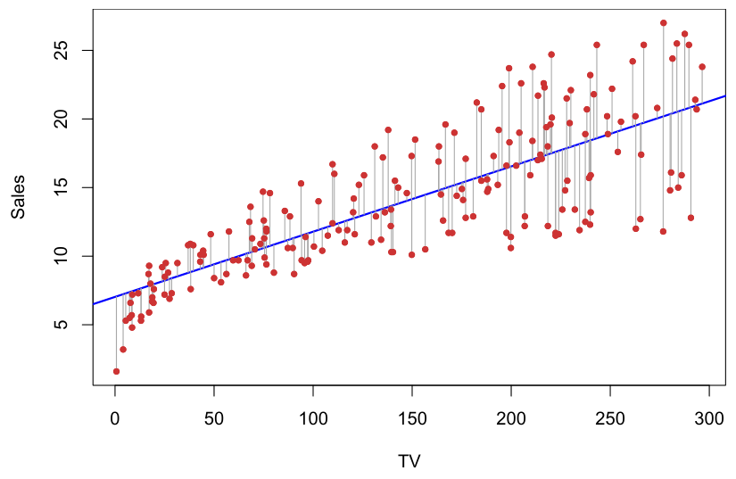

**图 3.1。** 图中给出了 `Advertising` 数据中 `sales` 对 `TV` 回归的最小二乘拟合（least squares fit）。这一拟合通过使残差平方和最小而得到。每条灰色线段代表一个残差。在这个例子中，线性拟合把握住了这种关系的主要特征，不过在图的左侧，它高估了所呈现的趋势。

> 图内标签对照：`TV` 为电视广告预算（单位为千美元）；`Sales` 为销售量（单位为千件）。原图的标签、刻度、颜色及数据点均保留。

其中，$\bar{y}\equiv\frac{1}{n}\sum_{i=1}^{n}y_i$ 和 $\bar{x}\equiv\frac{1}{n}\sum_{i=1}^{n}x_i$ 是样本均值（sample means）。换句话说，式（3.4）给出了简单线性回归的最小二乘系数估计值（least squares coefficient estimates）。

图 3.1 展示了对 `Advertising` 数据进行简单线性回归的拟合结果，其中 $\hat{\beta}_0=7.03$，$\hat{\beta}_1=0.0475$。换句话说，根据这一近似，电视广告支出每增加 1,000 美元，对应的产品销售量大约增加 47.5 件。图 3.2 使用同一广告数据，以 `sales` 为响应、`TV` 为预测变量，计算了多组 $\beta_0$ 和 $\beta_1$ 取值所对应的 RSS。在两幅图中，红点都表示由式（3.4）给出的那一对最小二乘估计值 $(\hat{\beta}_0,\hat{\beta}_1)$。显然，这组取值使 RSS 达到最小。

### 3.1.2　评估系数估计值的准确性

回顾式（2.1），我们假设 $X$ 与 $Y$ 之间的真实关系为 $Y=f(X)+\epsilon$，其中 $f$ 是某个未知函数，$\epsilon$ 是均值为零的随机误差项（random error term）。如果用线性函数（linear function）近似 $f$，就可以将这种关系写成

$$
Y=\beta_0+\beta_1X+\epsilon. \tag{3.5}
$$

这里，$\beta_0$ 是截距项，也就是 $X=0$ 时 $Y$ 的期望值（expected value）；$\beta_1$ 是斜率，也就是 $X$ 每增加一个单位时，$Y$ 相应的平均增量。误差项概括了这个简单模型未能涵盖的各种因素：真实关系很可能不是线性的；可能存在其他变量，引起 $Y$ 的变化；还可能存在测量误差（measurement error）。我们通常假设误差项与 $X$ 相互独立（independent）。

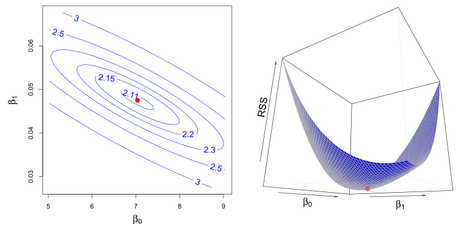

**图 3.2。** 以 `sales` 为响应、`TV` 为预测变量，绘制 `Advertising` 数据的 RSS 等高线图（contour plot）和三维图（three-dimensional plot）。红点对应式（3.4）给出的最小二乘估计值 $\hat{\beta}_0$ 和 $\hat{\beta}_1$。

> 图内标签对照：`RSS` 为残差平方和；$\beta_0$ 为截距，$\beta_1$ 为斜率。原图中的数值刻度与等高线标注均保留。

式（3.5）给出的模型定义了总体回归直线（population regression line），它是对 $X$ 与 $Y$ 之间真实关系的最佳线性近似。[^1] 最小二乘回归系数估计值（3.4）则确定了式（3.2）所表示的最小二乘直线（least squares line）。图 3.3 的左图通过一个简单的模拟例子展示了这两条直线。我们随机生成了 100 个 $X$ 值，再根据模型

$$
Y=2+3X+\epsilon, \tag{3.6}
$$

生成 100 个对应的 $Y$ 值，其中 $\epsilon$ 从均值为零的正态分布（normal distribution）中生成。图 3.3 左图中的红线表示真实关系 $f(X)=2+3X$，蓝线则表示根据观测数据得到的最小二乘估计。对于真实数据，其真实关系通常是未知的，但我们总可以利用式（3.4）给出的系数估计值计算出最小二乘直线。换句话说，在实际应用中，我们能够获得一组观测值（observations），并据此计算最小二乘直线；然而，总体回归直线是无法观测到的。在图 3.3 的右图中，我们根据式（3.6）给出的模型生成了十个不同的数据集，并绘制了相应的十条最小二乘直线。请注意，由同一个真实模型生成的不同数据集，会得到略有差异的最小二乘直线，但那条无法观测到的总体回归直线始终不变。

乍看之下，总体回归直线与最小二乘直线的区别可能显得微妙而令人困惑。我们只有一个数据集，那么，用两条不同的直线描述预测变量与响应之间的关系，究竟意味着什么？从根本上说，这两条直线的概念，自然地延伸了统计学中的一种常规做法：利用样本（sample）中的信息，估计一个大总体（population）的特征。例如，假设我们希望了解

[^1]: 线性假设（assumption of linearity）常常是一个有用的工作模型（working model）。不过，尽管许多教材可能会这样告诉我们，我们很少真的相信真实关系是线性的。

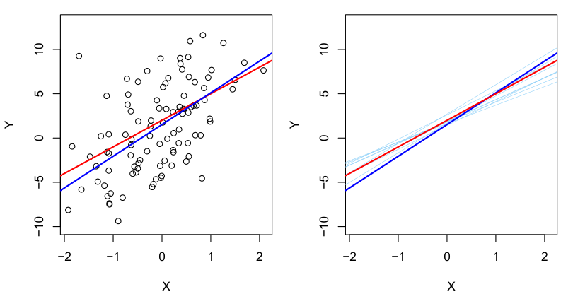

**图 3.3。** 一个模拟数据集。左图：红线表示真实关系 $f(X)=2+3X$，即总体回归直线。蓝线为最小二乘直线，它是根据图中黑色观测点得到的 $f(X)$ 的最小二乘估计。右图：总体回归直线仍以红色表示，最小二乘直线以深蓝色表示。浅蓝色表示十条最小二乘直线，每条都根据一组独立的随机观测值计算得到。各条最小二乘直线互不相同，但平均而言，它们相当接近总体回归直线。

某个随机变量（random variable）$Y$ 的总体均值（population mean）$\mu$。遗憾的是，$\mu$ 未知，但我们可以获得来自 $Y$ 的 $n$ 个观测值 $y_1,\ldots,y_n$，并用它们估计 $\mu$。一个合理的估计值是 $\hat{\mu}=\bar{y}$，其中 $\bar{y}=\frac{1}{n}\sum_{i=1}^n y_i$ 为样本均值。样本均值和总体均值并不相同，但一般来说，样本均值能够很好地估计总体均值。同样，线性回归中的未知系数 $\beta_0$ 和 $\beta_1$ 定义了总体回归直线。我们试图用式（3.4）给出的 $\hat{\beta}_0$ 和 $\hat{\beta}_1$ 来估计这些未知系数。这些系数估计值定义了最小二乘直线。

从偏差（bias）的概念来看，将线性回归与随机变量均值的估计作类比，是恰当的。如果用样本均值 $\hat{\mu}$ 估计 $\mu$，这一估计就是无偏的（unbiased），意思是平均而言，我们期望 $\hat{\mu}$ 等于 $\mu$。这究竟意味着什么？它意味着：对于某一组具体的观测值 $y_1,\ldots,y_n$，$\hat{\mu}$ 可能高估 $\mu$；对于另一组观测值，$\hat{\mu}$ 又可能低估 $\mu$。但如果我们能从大量观测数据集得到大量 $\mu$ 的估计值，再对它们取平均，这个平均值就会恰好等于 $\mu$。因此，无偏估计量（unbiased estimator）不会系统性地高估或低估真实参数。式（3.4）给出的最小二乘系数估计也具有无偏性：如果根据某个特定数据集估计 $\beta_0$ 和 $\beta_1$，所得估计值不会恰好等于 $\beta_0$ 和 $\beta_1$。但如果能对大量数据集得到的估计值取平均，其平均值就会准确地落在真实值上！事实上，从图 3.3 的右图可以看到，将许多条分别根据不同数据集估计出的最小二乘直线取平均，所得结果与真实的总体回归直线相当接近。

继续以估计随机变量 $Y$ 的总体均值 $\mu$ 作类比，自然会产生这样一个问题：样本均值 $\hat{\mu}$ 作为 $\mu$ 的估计值，究竟有多准确？我们已经知道，对许多数据集得到的 $\hat{\mu}$ 取平均，结果会非常接近 $\mu$；但单个估计值 $\hat{\mu}$ 可能大幅低估或高估 $\mu$。那么，单个 $\hat{\mu}$ 会偏离多远？通常，我们通过计算 $\hat{\mu}$ 的标准误（standard error）来回答，记为 $\mathrm{SE}(\hat{\mu})$。我们有如下熟知的公式：

$$
\mathrm{Var}(\hat{\mu})=\mathrm{SE}(\hat{\mu})^2=\frac{\sigma^2}{n},\tag{3.7}
$$

其中，$\sigma$ 是 $Y$ 的各个实现值 $y_i$ 的标准差（standard deviation）。[^2] 粗略地说，标准误告诉我们，估计值 $\hat{\mu}$ 与 $\mu$ 的实际值平均相差多少。式（3.7）还说明，这种偏离如何随 $n$ 缩小：观测值越多，$\hat{\mu}$ 的标准误越小。同理，我们也可以问，$\hat{\beta}_0$ 和 $\hat{\beta}_1$ 与真实值 $\beta_0$ 和 $\beta_1$ 有多接近。计算 $\hat{\beta}_0$ 和 $\hat{\beta}_1$ 的标准误时，使用下式：

$$
\mathrm{SE}(\hat{\beta}_0)^2=\sigma^2\left[\frac{1}{n}+\frac{\bar{x}^2}{\sum_{i=1}^n(x_i-\bar{x})^2}\right],
\qquad
\mathrm{SE}(\hat{\beta}_1)^2=\frac{\sigma^2}{\sum_{i=1}^n(x_i-\bar{x})^2},\tag{3.8}
$$

其中，$\sigma^2=\mathrm{Var}(\epsilon)$。要使这些公式严格成立，需要假设各个观测值的误差 $\epsilon_i$ 具有相同的方差（variance）$\sigma^2$，且彼此不相关（uncorrelated）。图 3.1 显然并不满足这一条件，但这些公式仍能给出良好的近似。注意，当各 $x_i$ 更加分散时，公式中的 $\mathrm{SE}(\hat{\beta}_1)$ 会更小；直观地说，在这种情况下，我们有更多依据来估计斜率。还可以看到，如果 $\bar{x}=0$，则 $\mathrm{SE}(\hat{\beta}_0)$ 与 $\mathrm{SE}(\hat{\mu})$ 相同（此时 $\hat{\beta}_0$ 等于 $\bar{y}$）。一般来说，$\sigma^2$ 未知，但可以根据数据估计。$\sigma$ 的这一估计称为残差标准误（residual standard error），由公式 $\mathrm{RSE}=\sqrt{\mathrm{RSS}/(n-2)}$ 给出。严格地说，当 $\sigma^2$ 是由数据估计得到时，应写作 $\widehat{\mathrm{SE}}(\hat{\beta}_1)$，表明这里进行过估计；但为简化记号，我们省略这个额外的帽子符号。

标准误可用于计算置信区间（confidence interval）。95% 置信区间定义为一个取值范围，这个范围以 95% 的概率包含参数的未知真值。区间的上下限根据数据样本计算得到。95% 置信区间具有这样的性质：如果反复抽取样本，并为每个样本构造置信区间，那么其中 95% 的区间会包含参数的未知真值。在线性回归中，$\beta_1$ 的 95% 置信区间近似为

$$
\hat{\beta}_1\pm2\cdot\mathrm{SE}(\hat{\beta}_1).\tag{3.9}
$$

[^2]: 该公式成立的条件是这 $n$ 个观测值互不相关。

也就是说，区间

$$
\left[\hat{\beta}_1-2\cdot\mathrm{SE}(\hat{\beta}_1),\ \hat{\beta}_1+2\cdot\mathrm{SE}(\hat{\beta}_1)\right]\tag{3.10}
$$

包含 $\beta_1$ 真值的概率约为 95%。[^3] 同样，$\beta_0$ 的置信区间近似为

$$
\hat{\beta}_0\pm2\cdot\mathrm{SE}(\hat{\beta}_0).\tag{3.11}
$$

对于广告数据，$\beta_0$ 的 95% 置信区间为 $[6.130,7.935]$，$\beta_1$ 的 95% 置信区间为 $[0.042,0.053]$。因此，我们可以得出结论：在没有任何广告投入时，平均销售量会落在 6,130 至 7,935 件之间。此外，电视广告支出每增加 1,000 美元，平均销售量会增加 42 至 53 件。

标准误还可用于对系数进行假设检验（hypothesis test）。最常见的检验，是检验原假设（null hypothesis）

$$
H_0:\ X\text{ 与 }Y\text{ 之间不存在关系}\tag{3.12}
$$

与之相对的备择假设（alternative hypothesis）为

$$
H_a:\ X\text{ 与 }Y\text{ 之间存在某种关系}.\tag{3.13}
$$

数学上，这对应于检验

$$
H_0:\ \beta_1=0
\qquad\text{与}\qquad
H_a:\ \beta_1\ne0,
$$

因为当 $\beta_1=0$ 时，模型（3.5）化为 $Y=\beta_0+\epsilon$，$X$ 与 $Y$ 不再有关联。检验原假设时，我们需要判断，作为 $\beta_1$ 估计值的 $\hat{\beta}_1$ 是否离零足够远，以至于我们能够确信 $\beta_1$ 非零。多远才算足够远？这当然取决于 $\hat{\beta}_1$ 的准确性，也就是取决于 $\mathrm{SE}(\hat{\beta}_1)$。如果 $\mathrm{SE}(\hat{\beta}_1)$ 很小，即使 $\hat{\beta}_1$ 的取值较小，也可能提供 $\beta_1\ne0$ 的强有力证据，进而说明 $X$ 与 $Y$ 之间存在关系。相反，如果 $\mathrm{SE}(\hat{\beta}_1)$ 很大，那么 $\hat{\beta}_1$ 的绝对值必须足够大，才能使我们拒绝原假设。实际中，我们计算 $t$ 统计量（$t$-statistic）：

$$
t=\frac{\hat{\beta}_1-0}{\mathrm{SE}(\hat{\beta}_1)},\tag{3.14}
$$

[^3]: 这里使用“近似”有几个原因。式（3.10）依赖误差服从高斯分布（Gaussian distribution）的假设。此外，$\mathrm{SE}(\hat{\beta}_1)$ 前面的系数 2 会随线性回归中的观测数 $n$ 略有变化。准确地说，式（3.10）中的 2 应替换为自由度（degrees of freedom）为 $n-2$ 的 $t$ 分布（$t$-distribution）的 97.5% 分位数（quantile）。本章后面将介绍如何在 R 中精确计算 95% 置信区间。


| | 系数 | 标准误 | $t$ 统计量 | $p$ 值 |
|---|---:|---:|---:|---:|
| `Intercept` | 7.0325 | 0.4578 | 15.36 | $<0.0001$ |
| `TV` | 0.0475 | 0.0027 | 17.67 | $<0.0001$ |

**表 3.1。** 对 `Advertising` 数据，以电视广告预算为预测变量、产品售出件数为响应的最小二乘回归模型系数。电视广告预算每增加 1,000 美元，对应销售量约增加 50 件。（回顾：`sales` 变量以千件为单位，`TV` 变量以千美元为单位。）

式（3.14）衡量 $\hat{\beta}_1$ 距离 0 有多少个标准差。如果 $X$ 与 $Y$ 之间确实没有关系，那么我们预期式（3.14）服从自由度为 $n-2$ 的 $t$ 分布。$t$ 分布呈钟形，当 $n$ 大于约 30 时，它与标准正态分布（standard normal distribution）十分相似。因此，在假设 $\beta_1=0$ 的条件下，很容易计算观测到绝对值等于或大于 $|t|$ 的数值的概率。我们把这个概率称为 $p$ 值（$p$-value）。粗略地说，$p$ 值可以这样理解：如果预测变量和响应之间实际上不存在关联，那么，仅仅由于偶然性而观测到如此明显关联的可能性很小，就会得到较小的 $p$ 值。因此，看到较小的 $p$ 值时，我们便可以推断预测变量与响应之间存在关联。当 $p$ 值足够小时，我们拒绝原假设，也就是认为 $X$ 与 $Y$ 之间存在关系。拒绝原假设时，常用的 $p$ 值阈值为 5% 或 1%；第 13 章会更详细地讨论这一主题。当 $n=30$ 时，这两个阈值分别对应式（3.14）中约为 2 和 2.75 的 $t$ 统计量。

表 3.1 给出了 `Advertising` 数据中，以电视广告预算预测产品售出件数的最小二乘模型的详细结果。注意，$\hat{\beta}_0$ 和 $\hat{\beta}_1$ 相对于各自的标准误都很大，因此 $t$ 统计量也很大；如果 $H_0$ 成立，出现这类数值的概率几乎为零。由此可以得出 $\beta_0\ne0$ 且 $\beta_1\ne0$。[^4]

[^4]: 表 3.1 中，截距的较小 $p$ 值说明可以拒绝原假设 $\beta_0=0$；`TV` 的较小 $p$ 值说明可以拒绝原假设 $\beta_1=0$。拒绝后一个原假设，可以得出 `TV` 与 `sales` 存在关系；拒绝前一个原假设，可以得出没有电视广告支出时，销售量仍非零。

### 3.1.3　评估模型的准确性

当我们拒绝原假设（3.12）、支持备择假设（3.13）之后，自然希望量化模型对数据的拟合程度。线性回归拟合的质量，通常用两个相互关联的量来评估：残差标准误（RSE）和 $R^2$ 统计量（$R^2$ statistic）。

| 统计量 | 数值 |
|---|---:|
| 残差标准误 | 3.26 |
| $R^2$ | 0.612 |
| $F$ 统计量 | 312.1 |

**表 3.2。** 对 `Advertising` 数据，以电视广告预算预测产品售出件数的最小二乘模型的更多信息。

表 3.2 给出了产品售出件数对电视广告预算作线性回归的 RSE、$R^2$ 统计量和 $F$ 统计量（$F$-statistic，将在第 3.2.2 节介绍）。

#### 残差标准误

回顾模型（3.5），每个观测值都对应一个误差项 $\epsilon$。由于这些误差项的存在，即使我们知道真实回归直线，也就是即使 $\beta_0$ 和 $\beta_1$ 已知，仍无法根据 $X$ 完美地预测 $Y$。RSE 是 $\epsilon$ 的标准差的估计值。粗略地说，它表示响应偏离真实回归直线的平均程度。其计算公式为

$$
\mathrm{RSE}=\sqrt{\frac{1}{n-2}\mathrm{RSS}}
=\sqrt{\frac{1}{n-2}\sum_{i=1}^n(y_i-\hat{y}_i)^2}.\tag{3.15}
$$

注意，RSS 已在第 3.1.1 节定义，公式为

$$
\mathrm{RSS}=\sum_{i=1}^n(y_i-\hat{y}_i)^2.\tag{3.16}
$$

对于广告数据，从表 3.2 的线性回归输出可以看到，RSE 为 3.26。换句话说，各个市场的实际销售量平均偏离真实回归直线约 3,260 件。也可以这样理解：即使模型正确，而且未知系数 $\beta_0$ 和 $\beta_1$ 的真值已被准确获知，任何根据电视广告投入作出的销售量预测，平均仍会相差约 3,260 件。当然，3,260 件是否是可以接受的预测误差，取决于具体问题。在广告数据集中，各市场的平均销售量约为 14,000 件，因此相对误差为 $3,260/14,000=23\%$。

RSE 可用来衡量模型（3.5）对数据的失拟（lack of fit）程度。如果模型得到的预测值非常接近真实结果，即对 $i=1,\ldots,n$ 都有 $\hat{y}_i\approx y_i$，那么式（3.15）就会很小，我们可以认为模型对数据的拟合很好。另一方面，如果一个或多个观测的 $\hat{y}_i$ 与 $y_i$ 相差很远，RSE 就可能相当大，表明模型拟合较差。

#### $R^2$ 统计量

RSE 给出了模型（3.5）对数据失拟程度的一种绝对度量。但是，它与 $Y$ 使用相同的单位，因此什么样的 RSE 才算好，往往并不明确。


$R^2$ 统计量提供了另一种拟合度量。它采用比例的形式，即所解释的方差比例，因此取值始终介于 0 与 1 之间，不受 $Y$ 的尺度影响。

计算 $R^2$ 时，使用公式

$$
R^2=\frac{\mathrm{TSS}-\mathrm{RSS}}{\mathrm{TSS}}=1-\frac{\mathrm{RSS}}{\mathrm{TSS}}.\tag{3.17}
$$

其中，$\mathrm{TSS}=\sum(y_i-\bar{y})^2$ 为总平方和（total sum of squares），RSS 由式（3.16）定义。TSS 衡量响应 $Y$ 的总变异，可以理解为回归之前响应本身所具有的变异程度。相比之下，RSS 衡量进行回归后仍未被解释的变异。因此，$\mathrm{TSS}-\mathrm{RSS}$ 衡量回归所解释（或消除）的响应变异，而 $R^2$ 衡量能够用 $X$ 解释的 $Y$ 变异所占的比例。$R^2$ 接近 1，说明回归解释了响应中很大比例的变异；接近 0，则说明回归没有解释多少变异。这可能是因为线性模型不正确，也可能是因为误差方差 $\sigma^2$ 较大，或者两者兼有。表 3.2 中的 $R^2$ 为 0.61，因此，`sales` 中略低于三分之二的变异，可以通过它对 `TV` 的线性回归来解释。

与 RSE（3.15）相比，$R^2$ 统计量（3.17）在解释上有一个优点：它始终介于 0 与 1 之间。但什么样的 $R^2$ 才算好，仍然可能难以判断，而且通常取决于应用情境。例如，在某些物理学问题中，我们可能知道数据确实来自一个残差很小的线性模型。这时，预期的 $R^2$ 应极其接近 1；明显偏小的 $R^2$ 可能意味着产生这些数据的实验存在严重问题。另一方面，在生物学、心理学、营销学等领域的典型应用中，线性模型（3.5）至多只是对数据的极粗略近似，而其他未测量因素造成的残差往往很大。在这种情况下，预测变量可能只能解释响应方差中很小的一部分，远低于 0.1 的 $R^2$ 也许反而更符合实际！

$R^2$ 统计量衡量 $X$ 与 $Y$ 的线性关系。回顾相关（correlation）的定义：

$$
\mathrm{Cor}(X,Y)=\frac{\sum_{i=1}^n(x_i-\bar{x})(y_i-\bar{y})}{\sqrt{\sum_{i=1}^n(x_i-\bar{x})^2}\sqrt{\sum_{i=1}^n(y_i-\bar{y})^2}},\tag{3.18}
$$

它同样衡量 $X$ 与 $Y$ 之间的线性关系。[^5] 这提示我们，也许可以用 $r=\mathrm{Cor}(X,Y)$ 代替 $R^2$，评估线性模型的拟合情况。事实上，可以证明，在简单线性回归中，$R^2=r^2$。

[^5]: 实际上，式（3.18）右侧是样本相关，因此更严谨的写法应为 $\widehat{\mathrm{Cor}}(X,Y)$；不过，为简化记号，我们省略帽子符号。

**`sales` 对 `radio` 的简单回归**

| | 系数 | 标准误 | $t$ 统计量 | $p$ 值 |
|---|---:|---:|---:|---:|
| `Intercept` | 9.312 | 0.563 | 16.54 | $<0.0001$ |
| `radio` | 0.203 | 0.020 | 9.92 | $<0.0001$ |

**`sales` 对 `newspaper` 的简单回归**

| | 系数 | 标准误 | $t$ 统计量 | $p$ 值 |
|---|---:|---:|---:|---:|
| `Intercept` | 12.351 | 0.621 | 19.88 | $<0.0001$ |
| `newspaper` | 0.055 | 0.017 | 3.30 | 0.00115 |

**表 3.3。** `Advertising` 数据的其他简单线性回归模型。上表为产品售出件数对广播广告预算作简单线性回归的系数；下表为产品售出件数对报纸广告预算作简单线性回归的系数。广播广告支出每增加 1,000 美元，对应平均销售量约增加 203 件；报纸广告支出增加同样金额，对应平均销售量约增加 55 件。（注意：`sales` 变量以千件为单位，`radio` 和 `newspaper` 变量以千美元为单位。）

换句话说，相关系数的平方与 $R^2$ 统计量相同。不过，下一节将讨论多元线性回归（multiple linear regression）问题，即同时使用多个预测变量来预测响应。预测变量与响应之间相关性的概念，不能直接扩展到这种情境，因为相关衡量的是一对变量之间的关联，而非更多变量之间的关联。我们将看到，$R^2$ 可以发挥这一作用。

## 3.2　多元线性回归

简单线性回归是一种根据单个预测变量预测响应的实用方法。但实际中，我们往往有不止一个预测变量。例如，对于 `Advertising` 数据，我们已经考察了 `sales` 与电视广告投入的关系。我们还掌握了广播和报纸广告支出的数据，可能希望知道，这两种媒体是否也与销售量有关联。如何扩展广告数据的分析，将这两个额外的预测变量纳入其中？

一种选择是分别拟合三个简单线性回归，每个都使用不同的广告媒体作为预测变量。例如，可以拟合一个简单线性回归，根据广播广告支出预测销售量，结果见表 3.3 的上表。我们发现，广播广告支出每增加 1,000 美元，对应销售量约增加 203 件。表 3.3 的下表列出了 `sales` 对报纸广告预算作简单线性回归的最小二乘系数。报纸广告预算每增加 1,000 美元，对应销售量约增加 55 件。

不过，对每个预测变量分别拟合简单线性回归模型，并不能完全令人满意。首先，给定三种广告媒体的预算后，该如何得到一个统一的销售量预测并不清楚，因为每项预算都对应一个单独的回归方程。其次，每个回归方程在估计系数时，都忽略了其他两种媒体。我们很快就会看到，如果数据集中这 200 个市场的媒体预算彼此相关，那么，这种做法对各媒体预算与销售量关联的估计，就可能具有很大的误导性。

更好的方法是扩展简单线性回归模型（3.5），使其能够直接容纳多个预测变量。为此，可以在同一个模型中，为每个预测变量分别设置一个斜率系数。一般来说，假设有 $p$ 个不同的预测变量，则多元线性回归模型为

$$
Y=\beta_0+\beta_1X_1+\beta_2X_2+\cdots+\beta_pX_p+\epsilon,\tag{3.19}
$$

其中，$X_j$ 表示第 $j$ 个预测变量，$\beta_j$ 则量化该变量与响应之间的关联。我们将 $\beta_j$ 解释为：**在保持其他所有预测变量不变的条件下**，$X_j$ 每增加一个单位时，$Y$ 所受到的平均影响。在广告例子中，式（3.19）变为

$$
\mathtt{sales}=\beta_0+\beta_1\times\mathtt{TV}+\beta_2\times\mathtt{radio}+\beta_3\times\mathtt{newspaper}+\epsilon.\tag{3.20}
$$

### 3.2.1　估计回归系数

与简单线性回归一样，式（3.19）中的回归系数 $\beta_0,\beta_1,\ldots,\beta_p$ 都是未知的，必须进行估计。得到估计值 $\hat{\beta}_0,\hat{\beta}_1,\ldots,\hat{\beta}_p$ 后，就可以用下式预测：

$$
\hat{y}=\hat{\beta}_0+\hat{\beta}_1x_1+\hat{\beta}_2x_2+\cdots+\hat{\beta}_px_p.\tag{3.21}
$$

参数估计仍采用简单线性回归中介绍过的最小二乘法。我们选择 $\beta_0,\beta_1,\ldots,\beta_p$，使残差平方和最小：

$$
\begin{aligned}
\mathrm{RSS}&=\sum_{i=1}^n(y_i-\hat{y}_i)^2\\
&=\sum_{i=1}^n(y_i-\hat{\beta}_0-\hat{\beta}_1x_{i1}-\hat{\beta}_2x_{i2}-\cdots-\hat{\beta}_px_{ip})^2.
\end{aligned}\tag{3.22}
$$

使式（3.22）达到最小的 $\hat{\beta}_0,\hat{\beta}_1,\ldots,\hat{\beta}_p$，就是多元最小二乘回归系数估计值。与式（3.4）给出的简单线性回归估计不同，多元回归系数估计的形式略为复杂，用矩阵代数（matrix algebra）表示最为方便。因此，这里不再给出具体表达式。任何统计软件包都可以计算这些系数估计值，本章后面将介绍如何在 R 中完成这一计算。图 3.4 展示了对一个含 $p=2$ 个预测变量的示例数据集作最小二乘拟合的例子。

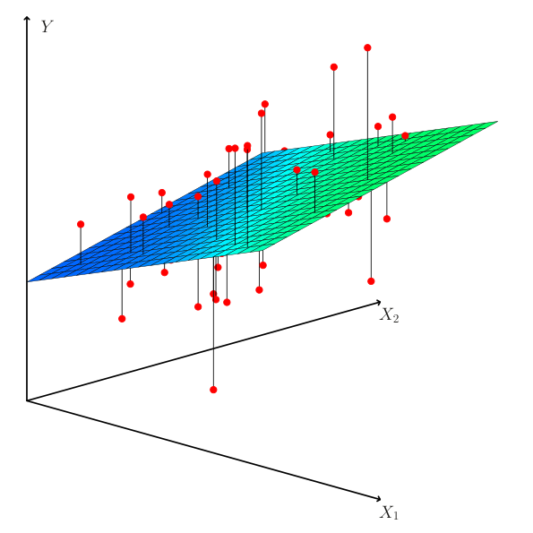

**图 3.4。** 在含两个预测变量和一个响应的三维情境中，最小二乘回归直线变成一个平面。这个平面的选择，使每个观测点（红色）到平面的竖直距离的平方和最小。

表 3.4 给出了 `Advertising` 数据中，用 `TV`、`radio` 和 `newspaper` 广告预算预测产品销售量的多元回归系数估计。可以这样解释这些结果：对于给定的电视和报纸广告投入，广播广告支出每增加 1,000 美元，对应产品销售量约增加 189 件。将这些系数估计与表 3.1 和表 3.3 比较，可以看到，多元回归中 `TV` 和 `radio` 的系数估计，与简单线性回归的系数估计十分相似。然而，表 3.3 中 `newspaper` 的回归系数估计显著（significant）非零，而在多元回归模型中，`newspaper` 的系数估计接近零，对应的 $p$ 值约为 0.86，不再显著。这说明简单回归和多元回归的系数可能有很大差别。原因在于：简单回归中的斜率表示忽略 `TV` 和 `radio` 等其他预测变量时，报纸广告支出每增加 1,000 美元所对应的产品销售量平均增量；多元回归中的 `newspaper` 系数则表示，**在保持 `TV` 和 `radio` 不变时**，报纸广告支出每增加 1,000 美元所对应的产品销售量平均增量。

多元回归提示 `sales` 与 `newspaper` 没有关系，而简单线性回归却得出相反结论，这合理吗？

|             |     系数 |    标准误 | $t$ 统计量 |     $p$ 值 |
| ----------- | -----: | -----: | ------: | --------: |
| `Intercept` |  2.939 | 0.3119 |    9.42 | $<0.0001$ |
| `TV`        |  0.046 | 0.0014 |   32.81 | $<0.0001$ |
| `radio`     |  0.189 | 0.0086 |   21.89 | $<0.0001$ |
| `newspaper` | −0.001 | 0.0059 |   −0.18 |    0.8599 |

**表 3.4。** 对 `Advertising` 数据，以 `TV`、`radio` 和 `newspaper` 广告预算预测产品售出件数的多元线性回归最小二乘系数估计值。

| | `TV` | `radio` | `newspaper` | `sales` |
|---|---:|---:|---:|---:|
| `TV` | 1.0000 | 0.0548 | 0.0567 | 0.7822 |
| `radio` | | 1.0000 | 0.3541 | 0.5762 |
| `newspaper` | | | 1.0000 | 0.2283 |
| `sales` | | | | 1.0000 |

**表 3.5。** `Advertising` 数据中 `TV`、`radio`、`newspaper` 和 `sales` 的相关矩阵（correlation matrix）。

事实上，这是合理的。考察表 3.5 中三个预测变量与响应变量的相关矩阵，可以看到，`radio` 与 `newspaper` 的相关为 0.35。这说明，报纸广告投入较高的市场，广播广告投入往往也较高。现在假定多元回归是正确的：报纸广告与销售量没有关联，而广播广告与销售量有关联。那么，广播广告投入较多的市场，销售量往往较高；而相关矩阵表明，在这些市场，报纸广告投入往往也较高。因此，在只考察 `sales` 与 `newspaper` 的简单线性回归中，我们会看到，较高的 `newspaper` 往往对应较高的 `sales`，即使报纸广告与销售量并无直接关联。于是，报纸广告就成为广播广告的替代指标（surrogate）；广播广告与销售量关联的“功劳”，被记在了报纸广告头上。

这种略显反直觉的结果，在现实生活中十分常见。不妨用一个荒诞的例子来说明：收集某个海滨社区一段时间的数据，将鲨鱼袭击次数对冰淇淋销售量作回归，就会看到正向关系，类似于 `sales` 与 `newspaper` 之间的关系。当然，（至少目前）还没有人建议，为减少鲨鱼袭击而在海滩禁止销售冰淇淋。实际上，较高气温会吸引更多人去海滩，进而增加冰淇淋销售量，也增加鲨鱼袭击次数。如果将鲨鱼袭击次数同时对冰淇淋销售量和气温作多元回归，就会发现，控制气温后，冰淇淋销售量不再是显著的预测变量；这也符合直觉。

### 3.2.2　几个重要问题

进行多元线性回归时，我们通常希望回答几个重要问题。

1. 在预测变量 $X_1,X_2,\ldots,X_p$ 中，是否至少有一个对预测响应有用？
2. 是所有预测变量都有助于解释 $Y$，还是只有其中一个子集有用？
3. 模型对数据的拟合有多好？
4. 给定一组预测变量取值，应预测怎样的响应值？这一预测有多准确？

下面依次讨论这些问题。

#### 一：响应与预测变量之间是否存在关系？

回顾简单线性回归，为判断响应与预测变量之间是否存在关系，只需检查 $\beta_1$ 是否等于零。在有 $p$ 个预测变量的多元回归中，我们需要问的是：这些回归系数是否全部为零，即是否有 $\beta_1=\beta_2=\cdots=\beta_p=0$。与简单线性回归一样，用假设检验回答这个问题。我们检验原假设

$$
H_0:\ \beta_1=\beta_2=\cdots=\beta_p=0
$$

与之相对的备择假设为

$$
H_a:\ \text{至少有一个 }\beta_j\text{ 非零}.
$$

这一检验通过计算 $F$ 统计量完成：

$$
F=\frac{(\mathrm{TSS}-\mathrm{RSS})/p}{\mathrm{RSS}/(n-p-1)},\tag{3.23}
$$

其中，与简单线性回归一样，$\mathrm{TSS}=\sum(y_i-\bar{y})^2$，$\mathrm{RSS}=\sum(y_i-\hat{y}_i)^2$。如果线性模型的假设正确，可以证明

$$
E\{\mathrm{RSS}/(n-p-1)\}=\sigma^2,
$$

而且在 $H_0$ 成立时，

$$
E\{(\mathrm{TSS}-\mathrm{RSS})/p\}=\sigma^2.
$$

因此，当响应与预测变量之间没有关系时，预期 $F$ 统计量应接近 1。反之，如果 $H_a$ 成立，则 $E\{(\mathrm{TSS}-\mathrm{RSS})/p\}>\sigma^2$，所以预期 $F$ 大于 1。

表 3.6 给出了将 `sales` 对 `radio`、`TV` 和 `newspaper` 作多元线性回归所得到的 $F$ 统计量。该例中，$F$ 统计量为 570，远大于 1，因此提供了反对原假设 $H_0$ 的有力证据。换句话说，较大的 $F$ 统计量表明，至少有一种广告媒体一定与销售量有关。但如果 $F$ 统计量更接近 1 呢？它必须多大，才能使我们拒绝 $H_0$、认为两者存在关系？

| 统计量     |    数值 |
| ------- | ----: |
| 残差标准误   |  1.69 |
| $R^2$   | 0.897 |
| $F$ 统计量 |   570 |

**表 3.6。** `Advertising` 数据中，以 `TV`、`newspaper` 和 `radio` 广告预算预测产品售出件数的最小二乘模型的更多信息。该模型的其他信息已在表 3.4 中给出。

答案取决于 $n$ 和 $p$。当 $n$ 很大时，$F$ 统计量即使只略大于 1，也可能提供反对 $H_0$ 的证据。相反，当 $n$ 较小时，需要更大的 $F$ 统计量才能拒绝 $H_0$。当 $H_0$ 成立，且误差 $\epsilon_i$ 服从正态分布时，$F$ 统计量服从 $F$ 分布（$F$-distribution）。[^6] 对于任意给定的 $n$ 和 $p$，任何统计软件包都可以利用这一分布，计算 $F$ 统计量对应的 $p$ 值。根据该 $p$ 值，就可以决定是否拒绝 $H_0$。对于广告数据，表 3.6 中 $F$ 统计量对应的 $p$ 值基本为零，因此，我们有极强的证据表明，至少一种媒体与销售量增加有关联。

式（3.23）检验的是所有系数均为零的原假设。有时，我们想检验某个包含 $q$ 个系数的特定子集是否均为零，对应的原假设为

$$
H_0:\ \beta_{p-q+1}=\beta_{p-q+2}=\cdots=\beta_p=0,
$$

为方便起见，这里把准备删去的变量放在列表末尾。这时，另拟合一个模型，使用除最后 $q$ 个变量之外的所有变量。假设该模型的残差平方和为 $\mathrm{RSS}_0$，则相应的 $F$ 统计量为

$$
F=\frac{(\mathrm{RSS}_0-\mathrm{RSS})/q}{\mathrm{RSS}/(n-p-1)}.\tag{3.24}
$$

注意，表 3.4 为每个预测变量都给出了 $t$ 统计量和 $p$ 值。它们提供的信息是：在控制其他预测变量后，这个预测变量是否与响应有关。事实上，这些检验分别与这样一个 $F$ 检验完全等价：[^7] 从模型中只删去该变量，其余变量全部保留，即式（3.24）中 $q=1$ 的情况。因此，它反映的是将该变量加入模型所产生的部分效应（partial effect）。例如，前面讨论过，这些 $p$ 值表明 `TV` 和 `radio` 与 `sales` 有关；但在保持 `TV` 和 `radio` 不变时，没有证据说明 `newspaper` 与 `sales` 有关联。

既然有每个变量各自的 $p$ 值，为什么还需要考察整体的 $F$ 统计量？毕竟，只要有一个变量的 $p$ 值很小，似乎就说明至少有一个预测变量与响应有关。然而，这一逻辑有缺陷，尤其是在预测变量数目 $p$ 很大时。

[^6]: 即使误差不服从正态分布，只要样本量 $n$ 足够大，$F$ 统计量也近似服从 $F$ 分布。

[^7]: 每个 $t$ 统计量的平方，就是对应的 $F$ 统计量。

例如，设 $p=100$，且 $H_0:\beta_1=\beta_2=\cdots=\beta_p=0$ 成立，即没有任何变量真正与响应有关。这时，各变量对应的 $p$ 值（如表 3.4 中的那一类）会有约 5% 仅因偶然而低于 0.05。换句话说，即使预测变量与响应之间没有任何真实关联，我们仍预期会看到约五个较小的 $p$ 值。[^8] 事实上，仅因偶然而观测到至少一个低于 0.05 的 $p$ 值，很有可能发生！因此，如果用各自的 $t$ 统计量及其对应 $p$ 值，判断变量与响应之间是否存在任何关联，就很有可能错误地认为存在关系。不过，$F$ 统计量没有这个问题，因为它考虑了预测变量的数目。因此，如果 $H_0$ 成立，无论预测变量有多少、观测值有多少，$F$ 统计量产生低于 0.05 的 $p$ 值的概率都只有 5%。

当 $p$ 相对较小，尤其是明显小于 $n$ 时，可以用 $F$ 统计量检验预测变量与响应之间是否存在任何关联。但有时，我们拥有大量变量。如果 $p>n$，需要估计的系数 $\beta_j$ 比可用于估计它们的观测值还多。这时，我们甚至无法用最小二乘法拟合多元线性回归模型，因此不能使用 $F$ 统计量，本章目前介绍的多数其他概念也不再适用。当 $p$ 较大时，可以使用下一部分介绍的某些方法，例如前向选择（forward selection）。第 6 章将更详细地讨论这种高维（high-dimensional）情境。

#### 二：确定重要变量

如前所述，多元回归分析的第一步，是计算 $F$ 统计量并检查对应的 $p$ 值。如果据此认为至少有一个预测变量与响应有关，自然就会想知道，究竟是哪几个变量在发挥作用！我们可以查看表 3.4 那样的各变量 $p$ 值，但前面已经讨论过，如果 $p$ 很大，就可能产生一些错误发现；第 13 章还会深入讨论这一点。

有可能所有预测变量都与响应有关，但更常见的情况是，响应只与其中一部分预测变量有关。确定哪些预测变量与响应有关，进而拟合仅包含这些变量的单个模型，这项任务称为变量选择（variable selection）。第 6 章将详细研究变量选择问题，这里只简要概述几种经典方法。

理想情况下，我们希望尝试许多不同模型，每个模型包含不同的预测变量子集，并由此进行变量选择。例如，$p=2$ 时，可以考虑四个模型：（1）不包含任何变量；（2）只包含 $X_1$；（3）只包含 $X_2$；（4）同时包含 $X_1$ 和 $X_2$。

[^8]: 这与多重检验（multiple testing）这一重要概念有关；它是第 13 章的重点。

随后，我们可以从考察过的所有模型中选出最佳模型。如何判断哪个模型最好？可以使用多种统计量衡量模型质量，包括 Mallow 的 $C_p$（Mallow’s $C_p$）、赤池信息准则（Akaike information criterion，AIC）、贝叶斯信息准则（Bayesian information criterion，BIC）和调整后的 $R^2$（adjusted $R^2$）。第 6 章会进一步介绍它们。还可以绘制残差等各种模型输出，寻找其中的规律，以判断哪个模型最好。

遗憾的是，$p$ 个变量的子集对应的模型共有 $2^p$ 个。即使 $p$ 只是中等大小，也无法尝试所有可能的预测变量子集。例如，$p=2$ 时，只需考虑 $2^2=4$ 个模型；但 $p=30$ 时，就需要考虑 $2^{30}=1,073,741,824$ 个模型！这不切实际。因此，除非 $p$ 很小，否则不能穷举所有 $2^p$ 个模型，而需要自动、高效地选择一组较少的候选模型。有三种经典方法：

- **前向选择。** 从空模型（null model）开始，即只含截距、不含预测变量的模型。然后拟合 $p$ 个简单线性回归，把使 RSS 最小的变量加入空模型。接着，再加入一个变量，使新的二变量模型的 RSS 最小。重复这一过程，直到满足某个停止规则。
- **后向选择（backward selection）。** 从包含所有变量的模型开始，删去 $p$ 值最大的变量，也就是统计上最不显著的变量。拟合新的、包含 $p-1$ 个变量的模型，再删去其中 $p$ 值最大的变量。如此反复，直到满足停止规则。例如，可以在所有剩余变量的 $p$ 值均低于某个阈值时停止。
- **混合选择（mixed selection）。** 结合前向选择和后向选择。从不含任何变量的模型开始，像前向选择一样加入使拟合最好的变量，接着逐个加入更多变量。当然，正如 `Advertising` 例子所示，当新的预测变量加入模型时，已有变量的 $p$ 值可能变大。因此，如果任何一步中，模型内某个变量的 $p$ 值超过某一阈值，就将它删去。持续交替进行前向和后向步骤，直到模型中所有变量的 $p$ 值都足够小，而模型外的变量即使被加入，其 $p$ 值也会较大。

当 $p>n$ 时，不能采用后向选择，而前向选择始终可以使用。前向选择是一种贪心（greedy）方法，早期纳入的变量，后来可能变得多余。混合选择可以弥补这一问题。

#### 三：模型拟合

最常用的两种模型拟合数值度量是 RSE 和 $R^2$，后者表示被解释的方差比例。它们的计算和解释方式，与简单线性回归相同。

回顾简单回归，$R^2$ 等于响应与预测变量之间相关系数的平方。在多元线性回归中，它等于 $\mathrm{Cor}(Y,\hat{Y})^2$，即响应与拟合线性模型之间相关系数的平方。事实上，这个拟合线性模型有一个性质：在所有可能的线性模型中，它使这一相关最大。

$R^2$ 接近 1，说明模型解释了响应变量中很大一部分方差。例如，表 3.6 中，对 `Advertising` 数据同时用三种广告媒体预测 `sales` 的模型，$R^2$ 为 0.8972；而只用 `TV` 和 `radio` 预测 `sales` 的模型，$R^2$ 为 0.89719。换句话说，在已经包含 `TV` 和 `radio` 的模型中再纳入报纸广告，会使 $R^2$ 略有增加，尽管表 3.4 中报纸广告的 $p$ 值并不显著。事实上，向模型中加入更多变量，$R^2$ 总会增加，即使这些变量与响应的关联很弱。这是因为，增加一个变量总会使训练数据上的残差平方和下降，但测试数据（testing data）上的残差平方和未必如此。因此，同样根据训练数据计算的 $R^2$ 必然增加。在只含 `TV` 和 `radio` 的模型中加入报纸广告，$R^2$ 只增加了极少量，这进一步表明，可以将 `newspaper` 从模型中删除。实质上，`newspaper` 并未真正改善模型对训练样本的拟合，纳入它反而可能因过拟合（overfitting），使模型在独立测试样本上表现较差。

相比之下，只用 `TV` 作预测变量的模型，其 $R^2$ 为 0.61（表 3.2）。加入 `radio` 后，$R^2$ 明显改善。这表明，同时用电视和广播广告支出预测销售量，明显优于只用电视广告。还可以检查仅含 `TV` 和 `radio` 的模型中 `radio` 系数的 $p$ 值，进一步量化这种改善。

只含 `TV` 和 `radio` 的模型，其 RSE 为 1.681；再加入 `newspaper` 的模型，其 RSE 为 1.686（表 3.6）。相比之下，只含 `TV` 的模型，其 RSE 为 3.26（表 3.2）。这印证了前面的结论：在训练数据上，同时用电视和广播广告支出预测销售量，远比只用电视广告支出准确。此外，既然已用 `TV` 和 `radio` 作预测变量，就没有必要再使用 `newspaper`。细心的读者可能会问：既然加入 `newspaper` 后 RSS 必然下降，RSE 为什么反而会上升？一般来说，RSE 的定义为

$$
\mathrm{RSE}=\sqrt{\frac{1}{n-p-1}\mathrm{RSS}},\tag{3.25}
$$

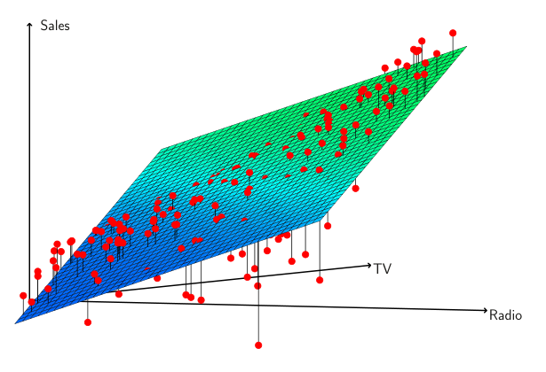

**图 3.5。** `Advertising` 数据中，以 `TV` 和 `radio` 为预测变量对 `sales` 进行线性回归拟合。从残差的分布形态，可以看出数据中存在明显的非线性关系（non-linear relationship）。正残差，即平面上方可见的那些残差，往往沿 45 度直线分布；在这条线上，电视和广播广告预算均等分配。负残差大多不可见，它们往往远离这条线，对应预算分配更不均衡的情况。

对于简单线性回归，式（3.25）就简化为式（3.15）。因此，如果 RSS 的下降相对于 $p$ 的增加较小，包含更多变量的模型反而可能具有更大的 RSE。

除了考察刚才讨论的 RSE 和 $R^2$，绘制数据图也很有帮助。图形概览能够揭示数值统计量看不出的模型问题。例如，图 3.5 给出了 `TV`、`radio` 与 `sales` 的三维图。有些观测点在最小二乘回归平面上方，有些在下方。具体来说，当广告资金大部分只用于电视或只用于广播时，线性模型似乎高估了销售量；当预算分配给这两种媒体时，它又低估了销售量。这种明显的非线性规律提示，不同广告媒体之间存在协同效应或交互效应：将媒体结合使用，比只使用某一种媒体更能促进销售量增加。第 3.3.2 节将讨论如何利用交互项（interaction term）扩展线性模型，以容纳这类协同效应。

#### 四：预测

拟合多元回归模型后，很容易根据预测变量 $X_1,X_2,\ldots,X_p$ 的一组取值，利用式（3.21）预测响应 $Y$。不过，这种预测涉及三类不确定性。

1. 系数估计值 $\hat{\beta}_0,\hat{\beta}_1,\ldots,\hat{\beta}_p$ 是对 $\beta_0,\beta_1,\ldots,\beta_p$ 的估计。也就是说，最小二乘平面（least squares plane）

   $$
   \hat{Y}=\hat{\beta}_0+\hat{\beta}_1X_1+\cdots+\hat{\beta}_pX_p
   $$

   只是对真实总体回归平面（population regression plane）

   $$
   f(X)=\beta_0+\beta_1X_1+\cdots+\beta_pX_p
   $$

   的估计。系数估计的不准确，与第 2 章介绍的可约误差（reducible error）有关。我们可以计算置信区间，以判断 $\hat{Y}$ 与 $f(X)$ 有多接近。

2. 当然，在实际中，用线性模型表示 $f(X)$ 几乎总是在近似现实，因此还存在另一种可能缩小的误差来源，称为模型偏差（model bias）。所以，使用线性模型时，我们实际上估计的是真实曲面的最佳线性近似。不过，这里先忽略这种差异，按线性模型正确来处理。

3. 即使知道 $f(X)$，也就是即使知道 $\beta_0,\beta_1,\ldots,\beta_p$ 的真值，仍无法完美地预测响应，因为模型（3.20）中有随机误差 $\epsilon$。第 2 章将它称为不可约误差（irreducible error）。那么，$Y$ 会偏离 $\hat{Y}$ 多少？我们用预测区间（prediction interval）回答。预测区间总比置信区间宽，因为它既包含对 $f(X)$ 的估计误差，即可约误差，也包含单个点会偏离总体回归平面多少的不确定性，即不可约误差。

我们用置信区间量化大量城市的**平均销售量**的不确定性。例如，假定每个城市都投入 100,000 美元电视广告和 20,000 美元广播广告，则 95% 置信区间为 $[10,985,11,528]$。其含义是，这样构造的区间中，95% 会包含 $f(X)$ 的真值。[^9] 另一方面，预测区间用于量化**某个特定城市**销售量的不确定性。如果该城市投入 100,000 美元电视广告和 20,000 美元广播广告，则 95% 预测区间为 $[7,930,14,580]$。其含义是，这样构造的区间中，95% 会包含该城市 $Y$ 的真值。注意，两个区间都以 11,256 为中心，但预测区间明显更宽。这反映出，与许多地区的平均销售量相比，某个特定城市的销售量具有更大的不确定性。

[^9]: 换句话说，如果收集大量与 `Advertising` 类似的数据集，并根据每个数据集构造平均销售量的置信区间（给定 100,000 美元电视广告和 20,000 美元广播广告），那么其中 95% 的置信区间会包含平均销售量的真值。

## 3.3 回归模型中的其他考虑

### 3.3.1 定性预测变量（Qualitative Predictors）

到目前为止，我们一直假设线性回归模型中的所有变量都是定量的。但实际情况并非总是如此；有些预测变量往往是定性的。

例如，图 3.6 所示的 `Credit` 数据集记录了若干信用卡持有人的变量。响应变量为 `balance`（每个人的平均信用卡欠款），定量预测变量包括 `age`（年龄）、`cards`（信用卡数量）、`education`（受教育年限）、`income`（收入，以千美元计）、`limit`（信用额度）和 `rating`（信用评级）。图 3.6 的每个面板都是一对变量的散点图，变量由相应的行标签和列标签标明。例如，“Balance”右侧紧邻的散点图展示的是 `balance` 与 `age` 的关系，而“Age”右侧紧邻的图对应的是 `age` 与 `cards` 的关系。除了这些定量变量，还有四个定性变量：`own`（是否拥有住房）、`student`（是否为学生）、`status`（婚姻状况）和 `region`（地区，取值为 East、West 或 South）。

#### 只有两个水平的预测变量

假设我们想研究拥有住房者与未拥有住房者的信用卡欠款有何差别，暂且忽略其他变量。如果一个定性预测变量，也称为因子（factor），只有两个水平（level），即只有两个可能取值，那么将它纳入回归模型非常简单。只需构造一个取两个数值的指示变量（indicator variable），也称为虚拟变量（dummy variable）。<sup><a href="#fn10" id="fnref10">10</a></sup>例如，根据 `own` 变量，可以构造如下形式的新变量：

$$
x_i=\begin{cases}
1 & \text{第 }i\text{ 个人拥有住房},\\
0 & \text{第 }i\text{ 个人未拥有住房}.
\end{cases}\tag{3.26}
$$

将这个变量作为回归方程中的预测变量，就得到模型

$$
y_i=\beta_0+\beta_1x_i+\epsilon_i=
\begin{cases}
\beta_0+\beta_1+\epsilon_i & \text{第 }i\text{ 个人拥有住房},\\
\beta_0+\epsilon_i & \text{第 }i\text{ 个人未拥有住房}.
\end{cases}\tag{3.27}
$$

现在，$\beta_0$ 可以解释为未拥有住房者的平均信用卡欠款，$\beta_0+\beta_1$ 是拥有住房者的平均信用卡欠款，而 $\beta_1$ 是拥有住房者与未拥有住房者之间平均信用卡欠款的差额。

表 3.7 给出了模型 (3.27) 的系数估计值及其他相关信息。估计未拥有住房者的平均信用卡欠款为 509.80 美元，而拥有住房者的欠款比他们多 19.73 美元，总计为 $509.80+19.73=529.53$ 美元。不过，

<aside class="footnote" id="fn10"><a href="#fnref10">10</a> 在机器学习领域，通过构造虚拟变量来处理定性预测变量称为“独热编码（one-hot encoding）”。</aside>


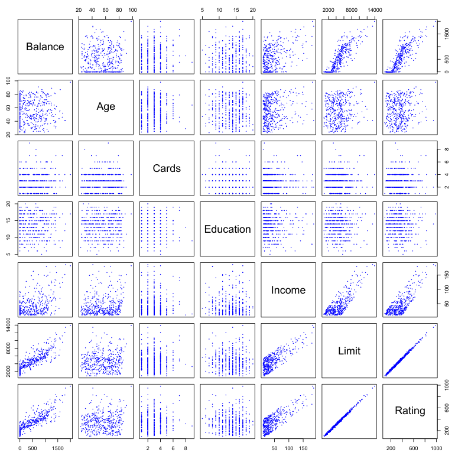

**图 3.6** `Credit` 数据集包含若干潜在客户的 `balance`、`age`、`cards`、`education`、`income`、`limit` 和 `rating` 信息。

图内标签对照：Balance＝信用卡欠款；Age＝年龄；Cards＝信用卡数量；Education＝受教育年限；Income＝收入；Limit＝信用额度；Rating＝信用评级。

我们注意到，虚拟变量的 $p$ 值很高。这表明，没有统计证据支持平均信用卡欠款因是否拥有住房而存在差别。

在 (3.27) 中，将拥有住房者编码为 1、未拥有住房者编码为 0，是任意作出的选择。这不会影响回归拟合结果，但会改变系数的解释。如果将未拥有住房者编码为 1、拥有住房者编码为 0，那么 $\beta_0$ 和 $\beta_1$ 的估计值将分别为 529.53 和 $-19.73$，由此得到未拥有住房者的信用卡欠款预测值仍为 $529.53-19.73=509.80$ 美元，拥有住房者的预测值为 529.53 美元。或者，也可以不采用 0/1 编码，而构造虚拟变量

$$
x_i=\begin{cases}
1 & \text{第 }i\text{ 个人拥有住房},\\
-1 & \text{第 }i\text{ 个人未拥有住房},
\end{cases}
$$

并在回归方程中使用这个变量。这将得到模型

$$
y_i=\beta_0+\beta_1x_i+\epsilon_i=
\begin{cases}
\beta_0+\beta_1+\epsilon_i & \text{第 }i\text{ 个人拥有住房},\\
\beta_0-\beta_1+\epsilon_i & \text{第 }i\text{ 个人未拥有住房}.
\end{cases}
$$

| 项           |     系数 |   标准误 | $t$ 统计量 |     $p$ 值 |
| ----------- | -----: | ----: | ------: | --------: |
| `Intercept` | 509.80 | 33.13 |  15.389 | $<0.0001$ |
| `own[Yes]`  |  19.73 | 46.05 |   0.429 |    0.6690 |

**表 3.7** 在 `Credit` 数据集中，将 `balance` 对 `own` 回归得到的最小二乘系数估计值。线性模型见 (3.27)，即按照 (3.26) 将是否拥有住房编码为虚拟变量。

此时，$\beta_0$ 可以解释为总体平均信用卡欠款（忽略是否拥有住房的效应），而 $\beta_1$ 表示拥有住房者和未拥有住房者的信用卡欠款分别高于和低于该平均值的数额。<sup><a href="#fn11" id="fnref11">11</a></sup>在本例中，$\beta_0$ 的估计值为 519.665 美元，恰好位于未拥有住房者平均值 509.80 美元与拥有住房者平均值 529.53 美元的中间。$\beta_1$ 的估计值为 9.865 美元，等于两组平均差额 19.73 美元的一半。需要注意的是，无论采用哪种编码方案，拥有住房者与未拥有住房者的最终信用卡欠款预测值都完全相同。差别只在于如何解释系数。

<aside class="footnote" id="fn11"><a href="#fnref11">11</a> 严格地说，$\beta_0$ 是拥有住房者平均欠款与未拥有住房者平均欠款之和的一半。因此，只有当两组人数相等时，$\beta_0$ 才恰好等于总体平均值。</aside>

#### 有两个以上水平的定性预测变量

当一个定性预测变量有两个以上的水平时，单个虚拟变量无法表示所有可能取值。这时，可以构造更多虚拟变量。例如，对于 `region` 变量，我们构造两个虚拟变量。第一个可以是

$$
x_{i1}=\begin{cases}
1 & \text{第 }i\text{ 个人来自 South},\\
0 & \text{第 }i\text{ 个人不来自 South},
\end{cases}\tag{3.28}
$$

第二个可以是

$$
x_{i2}=\begin{cases}
1 & \text{第 }i\text{ 个人来自 West},\\
0 & \text{第 }i\text{ 个人不来自 West}.
\end{cases}\tag{3.29}
$$

然后，将这两个变量都用于回归方程，得到模型

$$
y_i=\beta_0+\beta_1x_{i1}+\beta_2x_{i2}+\epsilon_i=
\begin{cases}
\beta_0+\beta_1+\epsilon_i & \text{第 }i\text{ 个人来自 South},\\
\beta_0+\beta_2+\epsilon_i & \text{第 }i\text{ 个人来自 West},\\
\beta_0+\epsilon_i & \text{第 }i\text{ 个人来自 East}.
\end{cases}\tag{3.30}
$$

现在，$\beta_0$ 可以解释为 East 地区人群的平均信用卡欠款，$\beta_1$ 是 South 与 East 地区人群的平均欠款之差，$\beta_2$ 是 West 与 East 地区人群的平均欠款之差。虚拟变量的个数总比水平数少一个。没有对应虚拟变量的那个水平——本例中为 East——称为基准水平（baseline）。

| 项               |       系数 |   标准误 |  $t$ 统计量 |     $p$ 值 |
| --------------- | -------: | ----: | -------: | --------: |
| `Intercept`     |   531.00 | 46.32 |   11.464 | $<0.0001$ |
| `region[South]` | $-12.50$ | 56.68 | $-0.221$ |    0.8260 |
| `region[West]`  | $-18.69$ | 65.02 | $-0.287$ |    0.7740 |

**表 3.8** 在 `Credit` 数据集中，将 `balance` 对 `region` 回归得到的最小二乘系数估计值。线性模型见 (3.30)，即通过 (3.28) 和 (3.29) 两个虚拟变量对 `region` 编码。

从表 3.8 可知，基准水平 East 的 `balance` 估计值为 531.00 美元。估计 South 地区人群的欠款比 East 地区少 18.69 美元，而 West 地区人群的欠款比 East 地区少 12.50 美元。不过，两个虚拟变量系数估计值对应的 $p$ 值都很大，表明没有统计证据支持 South 与 East 之间或 West 与 East 之间的平均信用卡欠款存在真实差异。<sup><a href="#fn12" id="fnref12">12</a></sup>同样，选哪个水平作为基准类别是任意的，无论如何选择，各组的最终预测值都相同。但系数及其 $p$ 值确实取决于虚拟变量的编码方式。我们可以不依赖单个系数，而使用 $F$ 检验来检验 $H_0:\beta_1=\beta_2=0$；该检验不依赖编码方式。这个 $F$ 检验的 $p$ 值为 0.96，表明我们不能拒绝 `balance` 与 `region` 之间没有关系的原假设。

<aside class="footnote" id="fn12"><a href="#fnref12">12</a> 理论上，South 与 West 之间仍可能存在差异，尽管这里的数据并未显示出这样的差异。</aside>

采用这种虚拟变量方法，可以方便地同时纳入定量和定性预测变量。例如，若要同时用定量变量 `income` 和定性变量 `student` 对 `balance` 进行回归，只需为 `student` 构造一个虚拟变量，然后以 `income` 和这个虚拟变量作为信用卡欠款的预测变量，拟合多元回归模型。

除了这里采用的虚拟变量方法，还有许多其他定性变量编码方式。这些方法会得到等价的模型拟合结果，但系数及其解释不同；它们旨在衡量特定的对比（contrast）。这一主题超出了本书的范围。

### 3.3.2 线性模型的扩展

标准线性回归模型 (3.19) 的结果易于解释，而且在许多实际问题上表现很好。不过，它作出了若干限制很强的假设，而这些假设在实践中往往并不成立。其中两个最重要的假设是：预测变量与响应之间的关系具有可加性（additivity）和线性（linearity）。可加性假设意味着，预测变量 $X_j$ 与响应 $Y$ 之间的关联不依赖于其他预测变量的取值。线性假设则意味着，无论 $X_j$ 取何值，$X_j$ 每变化一个单位所伴随的响应 $Y$ 的变化量都是恒定的。在后续章节中，我们将考察一些能够放宽这两个

假设的复杂方法。这里先简要介绍扩展线性模型的一些常见经典方法。

#### 去掉可加性假设

在前面对 `Advertising` 数据的分析中，我们得出结论：`TV` 和 `radio` 似乎都与 `sales` 相关联。这一结论所依据的线性模型假定，增加某一种媒体的广告投入对 `sales` 的效应，独立于其他媒体的广告投入。例如，线性模型 (3.20) 表明，无论 `radio` 上投入多少，`TV` 每增加一个单位所伴随的 `sales` 平均增量始终为 $\beta_1$。

不过，这个简单模型可能并不正确。假设在广播广告上投入资金实际上会增强电视广告的效果，那么 `TV` 的斜率项就应该随 `radio` 的增加而增大。这种情况下，若总预算固定为 100,000 美元，将一半投入 `radio`、另一半投入 `TV`，可能比把全部预算投入 `TV` 或 `radio` 带来更大的 `sales` 增长。这在营销学中称为协同效应，在统计学中称为交互效应。图 3.5 表明，广告数据中可能存在这种效应。注意，当 `TV` 或 `radio` 中任意一个的投入较低时，实际 `sales` 低于线性模型的预测值；但当广告投入分配给两种媒体时，模型又往往低估 `sales`。

考虑包含两个变量的标准线性回归模型：

$$
Y=\beta_0+\beta_1X_1+\beta_2X_2+\epsilon.
$$

根据这个模型，$X_1$ 增加一个单位，伴随的是 $Y$ 平均增加 $\beta_1$ 个单位。注意，$X_2$ 的存在并不改变这一结论，也就是说，无论 $X_2$ 取何值，$X_1$ 增加一个单位都伴随 $Y$ 增加 $\beta_1$ 个单位。扩展这一模型的一种方法是加入第三个预测变量，称为交互项（interaction term），通过计算 $X_1$ 与 $X_2$ 的乘积来构造。由此得到模型

$$
Y=\beta_0+\beta_1X_1+\beta_2X_2+\beta_3X_1X_2+\epsilon.\tag{3.31}
$$

加入这个交互项为什么能够放宽可加性假设？注意，(3.31) 可以改写为

$$
\begin{aligned}
Y&=\beta_0+(\beta_1+\beta_3X_2)X_1+\beta_2X_2+\epsilon\\
&=\beta_0+\widetilde{\beta}_1X_1+\beta_2X_2+\epsilon,
\end{aligned}\tag{3.32}
$$

其中 $\widetilde{\beta}_1=\beta_1+\beta_3X_2$。由于 $\widetilde{\beta}_1$ 现在是 $X_2$ 的函数，$X_1$ 与 $Y$ 之间的关联便不再恒定：$X_2$ 的取值发生变化，就会改变 $X_1$ 与 $Y$ 之间的关联。同理，$X_1$ 的取值发生变化，也会改变 $X_2$ 与 $Y$ 之间的关联。

例如，假设我们想研究一家工厂的生产能力，希望根据生产线数量 `lines` 和工人总数 `workers` 来预测产量 `units`。增加生产线数量的效应很可能

| 项                   |     系数 |   标准误 | $t$ 统计量 |     $p$ 值 |
| ------------------- | -----: | ----: | ------: | --------: |
| `Intercept`         | 6.7502 | 0.248 |   27.23 | $<0.0001$ |
| `TV`                | 0.0191 | 0.002 |   12.70 | $<0.0001$ |
| `radio`             | 0.0289 | 0.009 |    3.24 |    0.0014 |
| `TV`$\times$`radio` | 0.0011 | 0.000 |   20.73 | $<0.0001$ |

**表 3.9** 对于 `Advertising` 数据，按照 (3.33) 将 `sales` 对 `TV`、`radio` 及其交互项回归所得到的最小二乘系数估计值。

取决于工人数，因为如果没有工人操作生产线，增加生产线也不会提高产量。因此，在预测 `units` 的线性模型中加入 `lines` 与 `workers` 的交互项应当是合适的。假设拟合模型后得到

$$
\begin{aligned}
\mathtt{units}&\approx 1.2+3.4\times\mathtt{lines}+0.22\times\mathtt{workers}+1.4\times(\mathtt{lines}\times\mathtt{workers})\\
&=1.2+(3.4+1.4\times\mathtt{workers})\times\mathtt{lines}+0.22\times\mathtt{workers}.
\end{aligned}
$$

换句话说，每增加一条生产线，产量就会增加 $3.4+1.4\times\mathtt{workers}$。因此，`workers` 越多，`lines` 的效应就越强。

现在回到 `Advertising` 的例子。使用 `radio`、`TV` 及二者的交互项预测 `sales` 的线性模型为

$$
\begin{aligned}
\mathtt{sales}&=\beta_0+\beta_1\times\mathtt{TV}+\beta_2\times\mathtt{radio}+\beta_3\times(\mathtt{radio}\times\mathtt{TV})+\epsilon\\
&=\beta_0+(\beta_1+\beta_3\times\mathtt{radio})\times\mathtt{TV}+\beta_2\times\mathtt{radio}+\epsilon.
\end{aligned}\tag{3.33}
$$

我们可以将 $\beta_3$ 解释为：广播广告每增加一个单位，电视广告的效果所增加的量；反过来也一样。拟合模型 (3.33) 得到的系数见表 3.9。

表 3.9 的结果强烈表明，包含交互项的模型优于仅含主效应（main effect）的模型。交互项 `TV`$\times$`radio` 的 $p$ 值极低，为 $H_a:\beta_3\ne0$ 提供了有力证据。换句话说，真实关系显然不具有可加性。模型 (3.33) 的 $R^2$ 为 96.8%，而只使用 `TV` 和 `radio`、不含交互项的模型，其 $R^2$ 仅为 89.7%。这意味着，拟合可加模型后 `sales` 中仍未得到解释的变异，有 $(96.8-89.7)/(100-89.7)=69\%$ 被交互项解释了。表 3.9 的系数估计值表明，电视广告增加 1,000 美元，伴随的销售量增长为 $(\hat\beta_1+\hat\beta_3\times\mathtt{radio})\times1{,}000=19+1.1\times\mathtt{radio}$ 件；广播广告增加 1,000 美元，伴随的销售量增长则为 $(\hat\beta_2+\hat\beta_3\times\mathtt{TV})\times1{,}000=29+1.1\times\mathtt{TV}$ 件。

本例中，`TV`、`radio` 及其交互项的 $p$ 值都达到统计显著性（表 3.9），因此显然应该将这三个变量全部纳入模型。然而，有时交互项的 $p$ 值很小，对应主效应（本例中为 `TV` 和 `radio`）的 $p$ 值却并不小。层级原则（hierarchical principle）指出，如果在模型中纳入一个交互项，

就应该同时纳入对应的主效应，即使它们的系数所对应的 $p$ 值并不显著。换句话说，如果 $X_1$ 与 $X_2$ 的交互作用似乎很重要，那么即使它们系数估计值的 $p$ 值很大，也应将 $X_1$ 和 $X_2$ 都纳入模型。这条原则的理由是，如果 $X_1\times X_2$ 与响应有关，那么 $X_1$ 或 $X_2$ 的系数是否恰好为零就不那么重要了。此外，$X_1\times X_2$ 通常与 $X_1$、$X_2$ 相关，因此将它们排除往往会改变交互项的含义。

在上一个例子中，我们考察了两个定量变量 `TV` 和 `radio` 的交互作用。然而，交互作用的概念同样适用于定性变量，以及定量与定性变量的组合。事实上，定性变量与定量变量之间的交互作用有一个很直观的解释。考虑 3.3.1 节的 `Credit` 数据集，假设希望用 `income`（定量变量）和 `student`（定性变量）预测 `balance`。没有交互项时，模型为

$$
\begin{aligned}
\mathtt{balance}_i&\approx\beta_0+\beta_1\times\mathtt{income}_i+
\begin{cases}
\beta_2 & \text{第 }i\text{ 个人是学生},\\
0 & \text{第 }i\text{ 个人不是学生}
\end{cases}\\
&=\beta_1\times\mathtt{income}_i+
\begin{cases}
\beta_0+\beta_2 & \text{第 }i\text{ 个人是学生},\\
\beta_0 & \text{第 }i\text{ 个人不是学生}.
\end{cases}
\end{aligned}\tag{3.34}
$$

注意，这相当于为数据拟合两条平行直线，学生与非学生各一条。两条直线的截距不同，分别为 $\beta_0+\beta_2$ 和 $\beta_0$，但斜率相同，都为 $\beta_1$。图 3.7 左图展示了这一点。直线平行意味着，`income` 每增加一个单位对 `balance` 的平均效应，不依赖于这个人是否为学生。这可能是模型的一项严重局限，因为实际上收入变化对学生与非学生信用卡欠款的效应可能很不一样。

可以通过加入一个交互变量来解决这一局限，这个变量由 `income` 与 `student` 的虚拟变量相乘得到。此时模型变为

$$
\begin{aligned}
\mathtt{balance}_i&\approx\beta_0+\beta_1\times\mathtt{income}_i+
\begin{cases}
\beta_2+\beta_3\times\mathtt{income}_i & \text{是学生},\\
0 & \text{不是学生}
\end{cases}\\
&=\begin{cases}
(\beta_0+\beta_2)+(\beta_1+\beta_3)\times\mathtt{income}_i & \text{是学生},\\
\beta_0+\beta_1\times\mathtt{income}_i & \text{不是学生}.
\end{cases}
\end{aligned}\tag{3.35}
$$

学生与非学生仍各有一条不同的回归直线。但现在两条回归直线不仅截距不同，分别为 $\beta_0+\beta_2$ 和 $\beta_0$，斜率也不同，分别为 $\beta_1+\beta_3$ 和 $\beta_1$。这样就允许收入变化对学生与非学生的信用卡欠款产生不同效应。图 3.7 右图

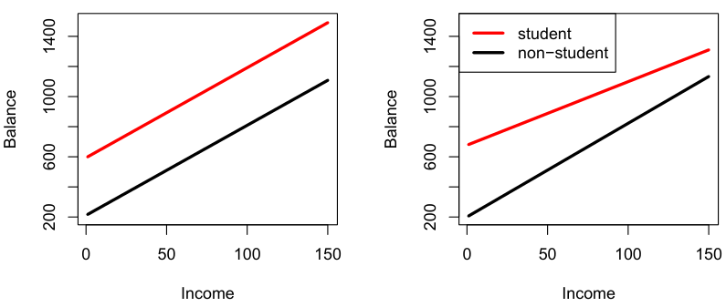

**图 3.7** 对于 `Credit` 数据，图中给出分别使用 `income` 预测学生与非学生 `balance` 的最小二乘直线。左图：拟合模型 (3.34)，`income` 与 `student` 之间没有交互项。右图：拟合模型 (3.35)，其中含有 `income` 与 `student` 的交互项。

图内标签对照：Income＝收入；Balance＝信用卡欠款；student＝学生；non-student＝非学生。

展示了模型 (3.35) 对学生与非学生的 `income` 和 `balance` 之间关系的估计。我们注意到，学生对应的斜率小于非学生的斜率。这表明，相比非学生，学生收入增加时所伴随的信用卡欠款增幅较小。

#### 非线性关系（Non-linear Relationships）

如前所述，线性回归模型 (3.19) 假设响应与预测变量之间存在线性关系。但在有些情况下，真实关系可能是非线性的。这里介绍一种直接扩展线性模型以适应非线性关系的简单方法，即多项式回归（polynomial regression）。后续章节将介绍更复杂的方法，用于在更一般的情形下进行非线性拟合。

考虑图 3.8，其中展示了 `Auto` 数据集中若干汽车的 `mpg`（每加仑燃油可行驶的英里数）与 `horsepower`（马力）之间的关系。橙色直线表示线性回归拟合结果。`mpg` 与 `horsepower` 之间有明显关联，但这种关系显然是非线性的：数据呈现出曲线关系。要在线性模型中纳入非线性关联，一种简单的方法是加入预测变量的变换形式。例如，图 3.8 的数据点似乎呈现二次曲线（quadratic）的形状，因此如下模型

$$
\mathtt{mpg}=\beta_0+\beta_1\times\mathtt{horsepower}+\beta_2\times\mathtt{horsepower}^2+\epsilon\tag{3.36}
$$

可能拟合得更好。式 (3.36) 利用 `horsepower` 的非线性函数预测 `mpg`，*但它仍然是线性模型！*也就是说，(3.36) 只是一个令 $X_1=\mathtt{horsepower}$、$X_2=\mathtt{horsepower}^2$ 的多元线性回归模型。因此，可以使用标准线性回归软件估计 $\beta_0$、$\beta_1$ 和 $\beta_2$，从而得到非线性拟合结果。图 3.8 的蓝色曲线展示了所得的二次拟合。

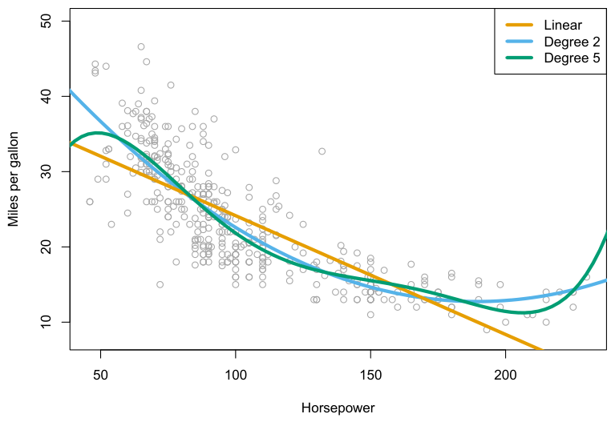

**图 3.8** `Auto` 数据集。图中展示了若干汽车的 `mpg` 与 `horsepower`。橙色直线是线性回归拟合结果。蓝色曲线是含有 $\mathtt{horsepower}^2$ 的线性回归模型的拟合结果。绿色曲线是包含 `horsepower` 直至五次的全部多项式项的线性回归模型的拟合结果。

图内标签对照：Horsepower＝马力；Miles per gallon＝每加仑燃油行驶英里数；Linear＝线性；Degree 2＝二次；Degree 5＝五次。

| 项 | 系数 | 标准误 | $t$ 统计量 | $p$ 值 |
| --- | ---: | ---: | ---: | ---: |
| `Intercept` | 56.9001 | 1.8004 | 31.6 | $<0.0001$ |
| `horsepower` | $-0.4662$ | 0.0311 | $-15.0$ | $<0.0001$ |
| $\mathtt{horsepower}^2$ | 0.0012 | 0.0001 | 10.1 | $<0.0001$ |

**表 3.10** 对于 `Auto` 数据集，将 `mpg` 对 `horsepower` 和 $\mathtt{horsepower}^2$ 回归所得到的最小二乘系数估计值。

二次拟合似乎明显优于仅包含一次项时的拟合。二次拟合的 $R^2$ 为 0.688，而线性拟合为 0.606；表 3.10 中二次项的 $p$ 值也高度显著。

既然加入 $\mathtt{horsepower}^2$ 能使模型改善这么多，为什么不加入 $\mathtt{horsepower}^3$、$\mathtt{horsepower}^4$，甚至 $\mathtt{horsepower}^5$ 呢？图 3.8 的绿色曲线展示了在模型 (3.36) 中加入直至五次的所有多项式项后得到的拟合结果。所得曲线似乎出现了不必要的起伏，也就是说，还不清楚加入这些额外项是否真的改善了对数据的拟合。

刚才介绍的这种扩展线性模型以适应非线性关系的方法称为多项式回归，因为我们在回归模型中纳入了预测变量的多项式函数。第 7 章将进一步探讨这种方法，以及线性模型的其他非线性扩展。

### 3.3.3 可能出现的问题

对某个数据集拟合线性回归模型时，可能遇到许多问题。其中最常见的有：

1. 响应与预测变量之间的关系是非线性的。
2. 误差项相关。
3. 误差项的方差不恒定。
4. 离群点（outlier）。
5. 高杠杆点（high-leverage point）。
6. 共线性（collinearity）。

在实践中，识别并解决这些问题既是一门科学，也是一门艺术。无数书籍已用大量篇幅讨论这个主题。由于线性回归模型并非本书的主要关注点，这里只简要概述一些要点。

#### 1. 数据的非线性

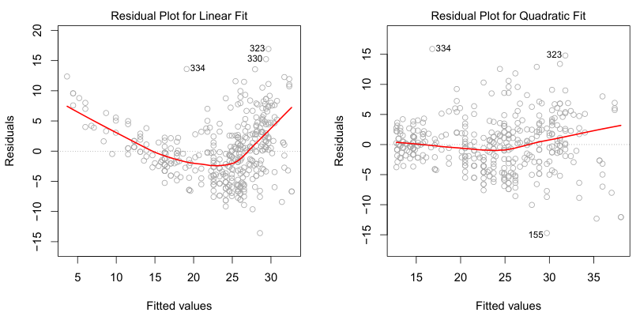

**图 3.9** `Auto` 数据集中残差与预测值（或拟合值，fitted value）的关系图。每幅图中的红线是对残差的平滑拟合（smooth fit），用于帮助识别趋势。左图：将 `mpg` 对 `horsepower` 作线性回归。残差中明显的模式表明数据存在非线性。右图：将 `mpg` 对 `horsepower` 和 $\mathtt{horsepower}^2$ 作线性回归。残差中几乎没有明显模式。

图内标签对照：Residual Plot for Linear Fit＝线性拟合的残差图；Residual Plot for Quadratic Fit＝二次拟合的残差图；Fitted values＝拟合值；Residuals＝残差。

线性回归模型假设预测变量与响应之间存在直线关系。如果真实关系远非线性，那么从拟合结果得出的结论几乎都值得怀疑。此外，模型的预测准确性也可能大幅下降。

残差图（residual plot）是识别非线性的一种有用图形工具。对于简单线性回归模型，可以将残差

$e_i=y_i-\hat y_i$ 对预测变量 $x_i$ 作图。对于多元回归模型，由于有多个预测变量，我们改为将残差对预测值（或拟合值）$\hat y_i$ 作图。理想情况下，残差图应当不呈现任何可辨认的模式。若存在某种模式，可能表明线性模型的某个方面有问题。

图 3.9 左图展示了图 3.8 中 `Auto` 数据上将 `mpg` 对 `horsepower` 作线性回归的残差图。红线是对残差的平滑拟合，旨在帮助识别趋势。残差呈现出明显的 U 形，为数据中存在非线性提供了强烈证据。相比之下，图 3.9 右图展示的是含二次项的模型 (3.36) 的残差图。残差似乎没有明显模式，表明二次项改善了对数据的拟合。

如果残差图表明数据中存在非线性关联，一种简单的处理办法是在回归模型中使用预测变量的非线性变换，例如 $\log X$、$\sqrt X$ 和 $X^2$。本书后续章节将讨论解决这一问题的其他更复杂的非线性方法。

#### 2. 误差项的相关性

线性回归模型的一个重要假设是，误差项 $\epsilon_1,\epsilon_2,\ldots,\epsilon_n$ 互不相关。这是什么意思？例如，如果误差互不相关，那么知道 $\epsilon_i$ 为正，对于判断 $\epsilon_{i+1}$ 的正负几乎没有帮助。回归系数估计值或拟合值的标准误，都是基于误差项互不相关这一假设计算的。如果误差项实际上存在相关性，估计得到的标准误就往往会低估真实的标准误。因此，置信区间和预测区间都会比应有的宽度更窄。例如，一个 95% 置信区间实际包含参数真值的概率，可能远低于 0.95。此外，模型的 $p$ 值也会比应有值更小，这可能导致我们错误地断定某个参数具有统计显著性。也就是说，如果误差项相关，我们可能会对模型产生缺乏依据的信心。

举一个极端例子，假设我们不小心将数据复制了一遍，导致观测及误差项两两完全相同。如果忽略这一点，计算标准误时就会仿佛拥有大小为 $2n$ 的样本，而实际上只有 $n$ 个样本。使用这 $2n$ 个样本得到的参数估计值与使用 $n$ 个样本时相同，但置信区间宽度却会缩小到原来的 $1/\sqrt2$！

误差项之间为什么可能存在相关性？这种相关性常见于时间序列（time series）数据，即在离散时间点测量得到的观测。在许多情况下，相邻时间点观测的误差会呈正相关。要判断给定数据集是否存在这种情况，可以将模型的残差按时间作图。如果误差互不相关，残差应当不呈现可辨认的


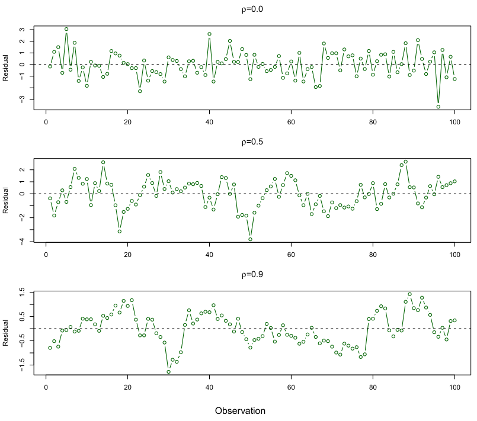

**图 3.10** 模拟时间序列数据集的残差图。生成这些数据时，相邻时间点误差项的相关系数 $\rho$ 设为不同值。

图内标签对照：Residual＝残差；Observation＝观测序号。三幅图从上到下分别为 $\rho=0.0$、$0.5$ 和 $0.9$。

模式。反之，如果误差项呈正相关，我们可能看到残差出现跟随现象（tracking），即相邻残差的值比较相近。图 3.10 展示了这种情况。上图是对误差互不相关的数据拟合线性回归后得到的残差，看不出与时间有关的趋势。相比之下，下图的数据集中相邻误差的相关系数为 0.9。现在残差中呈现出清晰的模式：相邻残差往往取相近的值。最后，中图展示了更为适中的情形，其中残差的相关系数为 0.5。仍可见跟随现象，但模式不那么明显。

已有许多方法可以恰当地处理时间序列数据中误差项的相关性。在时间序列之外，误差项也可能相关。例如，考虑一项根据体重预测身高的研究。如果部分研究对象属于同一家庭、有相同饮食，或接触了相同环境因素，误差互不相关的假设就可能不成立。一般而言，误差互不相关这一假设对于线性回归及其他统计方法都极为重要，而良好的实验设计对于降低这种相关性发生的风险至关重要。


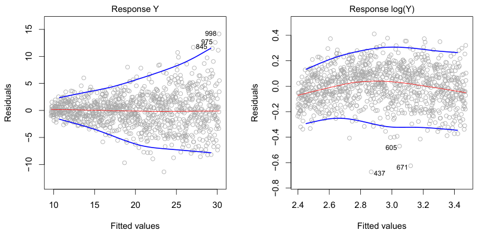

**图 3.11** 残差图。每幅图的红线都是对残差的平滑拟合，用于帮助识别趋势。蓝线沿残差的外侧分位数延伸，以突出模式。左图：漏斗形状表明存在异方差性（heteroscedasticity）。右图：对响应作对数变换后，不再有异方差性的迹象。

图内标签对照：Response Y＝响应 $Y$；Response log(Y)＝响应 $\log(Y)$；Fitted values＝拟合值；Residuals＝残差。

#### 3. 误差项方差不恒定

线性回归模型的另一个重要假设是，误差项的方差恒定，即 $\operatorname{Var}(\epsilon_i)=\sigma^2$。线性模型的标准误、置信区间和假设检验都依赖这一假设。

遗憾的是，误差项的方差不恒定的情况很常见。例如，误差项的方差可能随响应取值增大而增大。残差图中出现漏斗形状，可以用来识别误差方差不恒定，即异方差性。图 3.11 左图就是一个例子，残差的幅度往往随拟合值的增大而增大。遇到这个问题时，一种可能的解决办法是使用 $\log Y$ 或 $\sqrt Y$ 这样的凹函数（concave function）变换响应 $Y$。这种变换对较大的响应值压缩更多，从而减轻异方差性。图 3.11 右图展示了用 $\log Y$ 变换响应后的残差图。此时残差看起来具有恒定方差，不过数据中似乎存在轻微的非线性关系。

有时，我们对每个响应的方差有较充分的了解。例如，第 $i$ 个响应可能是 $n_i$ 个原始观测的平均值。如果这些原始观测互不相关，方差均为 $\sigma^2$，那么它们平均值的方差为 $\sigma_i^2=\sigma^2/n_i$。在这种情况下，一种简单的补救办法是用加权最小二乘法（weighted least squares）拟合模型，令权重与方差的倒数成正比，即本例中取 $w_i=n_i$。大多数线性回归软件都允许为观测指定权重。

#### 4. 离群点

离群点是指其 $y_i$ 与模型预测值相差很远的

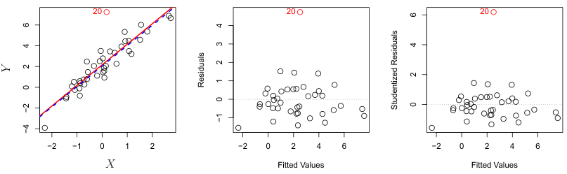

**图 3.12** 左图：红线为最小二乘回归直线，蓝线为移除离群点后的回归直线。中图：残差图清晰地识别出了离群点。右图：离群点的学生化残差（studentized residual）为 6；通常我们预期取值位于 $-3$ 与 3 之间。

图内标签对照：Fitted Values＝拟合值；Residuals＝残差；Studentized Residuals＝学生化残差；$X$、$Y$ 保留原符号。

数据点。离群点可能由多种原因造成，例如在数据收集过程中错误地记录了一次观测。

图 3.12 左图的红点（第 20 个观测）展示了一个典型离群点。红色实线是最小二乘回归拟合结果，蓝色虚线则是移除离群点后的最小二乘拟合结果。本例中，移除离群点对最小二乘直线几乎没有影响：斜率基本不变，截距仅有微小下降。如果一个离群点的预测变量取值并不异常，那么它对最小二乘拟合的影响通常很小。不过，即使离群点对最小二乘拟合没有多大影响，仍可能造成其他问题。例如，本例中将离群点纳入回归时，RSE 为 1.09，而移除它后仅为 0.77。由于所有置信区间和 $p$ 值的计算都要用到 RSE，单个数据点造成的这种大幅增加可能影响对拟合结果的解释。同样，纳入该离群点会使 $R^2$ 从 0.892 降至 0.805。

残差图可以用于识别离群点。本例中，图 3.12 中图的残差图清楚地显示了离群点。但在实践中，往往很难判断残差要多大才应将该点视为离群点。为解决这个问题，可以不对残差本身作图，而对学生化残差作图：将每个残差 $e_i$ 除以其估计标准误，就得到学生化残差。学生化残差绝对值大于 3 的观测可能是离群点。图 3.12 右图中，离群点的学生化残差超过 6，而其他所有观测的学生化残差都位于 $-2$ 与 2 之间。

如果认为离群点源于数据收集或记录错误，一种解决办法是直接移除这个观测。但这样做必须谨慎，因为离群点也可能表明模型存在缺陷，例如遗漏了某个预测变量。

#### 5. 高杠杆点

刚才我们看到，离群点是指在给定预测变量 $x_i$ 的情况下，响应 $y_i$ 异常的观测。相比之下，高杠杆观测的异常之处在于 $x_i$ 的取值。例如，图 3.13 左图中的第 41 个观测

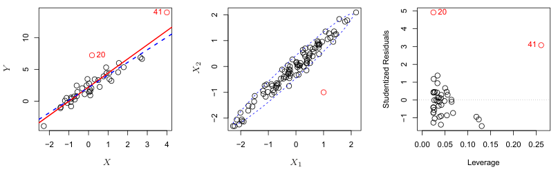

**图 3.13** 左图：第 41 个观测是高杠杆点，第 20 个则不是。红线为使用全部数据的拟合结果，蓝线为移除第 41 个观测后的拟合结果。中图：红色观测的 $X_1$ 取值和 $X_2$ 取值单独来看都不异常，但它仍然位于数据主体之外，因此具有高杠杆。右图：第 41 个观测同时具有较高杠杆和较大残差。

图内标签对照：Leverage＝杠杆值；Studentized Residuals＝学生化残差；$X$、$Y$、$X_1$ 和 $X_2$ 保留原符号。

具有高杠杆，因为这个观测的预测变量取值相对于其他观测较大。（注意，图 3.13 的数据与图 3.12 相同，只是多了一个高杠杆观测。）红色实线是对这些数据的最小二乘拟合，蓝色虚线是移除第 41 个观测后的拟合结果。比较图 3.12 和图 3.13 的左图可见，移除高杠杆观测对最小二乘直线的影响，远大于移除离群点的影响。事实上，高杠杆观测往往对估计的回归直线有相当大的影响。如果最小二乘直线受到仅仅几个观测的强烈影响，就值得警惕，因为这些点一旦有问题，整个拟合结果都可能失效。因此，识别高杠杆观测很重要。

在简单线性回归中，高杠杆观测比较容易识别：只需寻找预测变量取值超出观测通常范围的数据点。但在包含许多预测变量的多元线性回归中，一个观测的每个预测变量取值可能都处于正常范围之内，然而从整组预测变量来看却异常。图 3.13 中图展示了一个有两个预测变量 $X_1$ 和 $X_2$ 的数据集。多数观测的预测变量取值位于蓝色虚线椭圆内，但红色观测远在这个范围之外。可是，它的 $X_1$ 和 $X_2$ 取值单独来看都不异常。因此，如果只检查 $X_1$ 或只检查 $X_2$，就会漏掉这个高杠杆点。在预测变量超过两个的多元回归中，这个问题更为突出，因为此时没有简单的方法可以同时画出数据的所有维度。

为了量化一个观测的杠杆程度，我们计算杠杆统计量（leverage statistic）。这个统计量较大，表明对应观测具有高杠杆。对于简单线性回归，

$$
h_i=\frac1n+\frac{(x_i-\bar x)^2}{\sum_{i'=1}^{n}(x_{i'}-\bar x)^2}.\tag{3.37}
$$


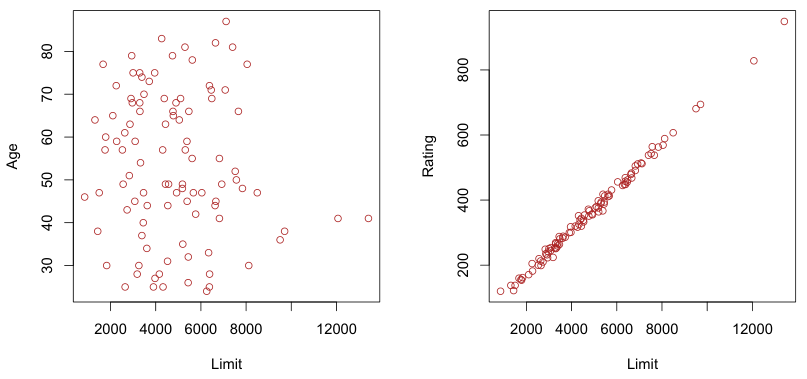

**图 3.14** `Credit` 数据集的观测散点图。左图：`age` 与 `limit` 的关系，这两个变量不共线。右图：`rating` 与 `limit` 的关系，存在高度共线性。

图内标签对照：Limit＝信用额度；Age＝年龄；Rating＝信用评级。

由这个公式可以清楚地看出，$x_i$ 距离 $\bar x$ 越远，$h_i$ 越大。$h_i$ 可以简单地扩展到多个预测变量的情形，但这里不给出公式。杠杆统计量 $h_i$ 始终位于 $1/n$ 与 1 之间，所有观测的平均杠杆值始终等于 $(p+1)/n$。因此，如果某个观测的杠杆统计量远大于 $(p+1)/n$，我们就可能怀疑它是高杠杆点。

图 3.13 右图针对左图的数据，将学生化残差对 $h_i$ 作图。第 41 个观测十分突出，既有很高的杠杆统计量，也有很大的学生化残差。换句话说，它既是离群点，也是高杠杆观测。这是一种尤其危险的组合！这幅图还揭示了图 3.12 中第 20 个观测对最小二乘拟合影响相对较小的原因：它的杠杆值低。

#### 6. 共线性

共线性是指两个或更多预测变量之间密切相关的情形。图 3.14 使用 `Credit` 数据集说明这一概念。图 3.14 左图的两个预测变量 `limit` 和 `age` 似乎没有明显关系。相比之下，右图的预测变量 `limit` 和 `rating` 高度相关，我们称它们共线。共线性的存在会给回归带来问题，因为此时很难区分共线变量各自对响应的效应。换句话说，由于 `limit` 和 `rating` 往往同时增大或同时减小，很难确定它们分别与响应 `balance` 有怎样的关联。

图 3.15 展示了共线性可能导致的一些困难。左图是将 `balance` 对 `limit` 和 `age` 回归时，各种可能的系数估计值所对应的 RSS (3.22) 等高线图。每个椭圆代表一组


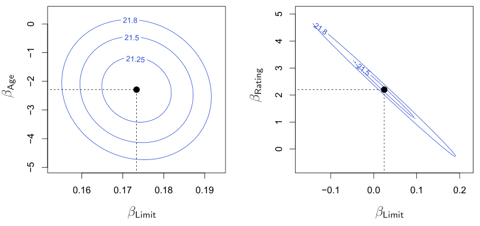

**图 3.15** 在 `Credit` 数据集的不同回归中，RSS 作为参数 $\beta$ 的函数的等高线图。每幅图的黑点表示 RSS 最小时的系数值。左图：将 `balance` 对 `age` 和 `limit` 回归时的 RSS 等高线图，最小值的位置很明确。右图：将 `balance` 对 `rating` 和 `limit` 回归时的 RSS 等高线图。由于存在共线性，许多不同的系数对 $(\beta_{\mathrm{Limit}},\beta_{\mathrm{Rating}})$ 都对应相近的 RSS。

图内标签对照：$\beta_{\mathrm{Limit}}$＝`limit` 的系数；$\beta_{\mathrm{Age}}$＝`age` 的系数；$\beta_{\mathrm{Rating}}$＝`rating` 的系数。图内等高线数值保持原样。

具有相同 RSS 的系数，越靠近中心的椭圆对应的 RSS 越小。黑点及相应的虚线表示使 RSS 达到最小的系数估计值，换句话说，就是最小二乘估计值。`limit` 和 `age` 的坐标轴范围经过设置，包含了最小二乘估计值两侧各四个标准误范围内的可能系数估计值。因此，图中涵盖了系数的所有合理取值。例如，可以看出，真实的 `limit` 系数几乎肯定在 0.15 与 0.20 之间。

相比之下，图 3.15 右图展示了将 `balance` 对 `limit` 和 `rating` 回归时，不同可能系数估计值所对应的 RSS 等高线图；我们已经知道，这两个变量高度共线。此时，等高线沿一条狭窄的谷地延伸，有很大一片范围内的系数估计值能够得到相同的 RSS。因此，数据中很小的变化，就可能使 RSS 最小的那对系数，也就是最小二乘估计值，移动到这条谷地的任意位置。这使系数估计值具有很大的不确定性。注意，此时 `limit` 系数的刻度范围大约从 $-0.2$ 到 0.2，宽度是与 `age` 一起回归时 `limit` 系数合理取值范围的八倍。有趣的是，尽管现在 `limit` 和 `rating` 的系数各自具有更大的不确定性，但它们几乎肯定会落在这条等高线谷地的某处。例如，我们不会预期 `limit` 和 `rating` 的系数真值分别为 $-0.1$ 和 1，尽管单独看每个系数，这样的取值都算合理。

由于共线性降低了回归系数估计的准确性，它会使 $\hat\beta_j$ 的标准误增大。回顾一下，每个预测变量的 $t$ 统计量，是用 $\hat\beta_j$ 除以它的

| 模型 | 项 | 系数 | 标准误 | $t$ 统计量 | $p$ 值 |
| --- | --- | ---: | ---: | ---: | ---: |
| 模型 1 | `Intercept` | $-173.411$ | 43.828 | $-3.957$ | $<0.0001$ |
| 模型 1 | `age` | $-2.292$ | 0.672 | $-3.407$ | 0.0007 |
| 模型 1 | `limit` | 0.173 | 0.005 | 34.496 | $<0.0001$ |
| 模型 2 | `Intercept` | $-377.537$ | 45.254 | $-8.343$ | $<0.0001$ |
| 模型 2 | `rating` | 2.202 | 0.952 | 2.312 | 0.0213 |
| 模型 2 | `limit` | 0.025 | 0.064 | 0.384 | 0.7012 |

**表 3.11** `Credit` 数据集上两个多元回归模型的结果。模型 1 将 `balance` 对 `age` 和 `limit` 回归，模型 2 将 `balance` 对 `rating` 和 `limit` 回归。由于共线性，第二个回归中 $\hat\beta_{\mathtt{limit}}$ 的标准误增至原来的 12 倍。

标准误得到的。因此，共线性使 $t$ 统计量减小。这样一来，在存在共线性时，我们可能无法拒绝 $H_0:\beta_j=0$。这意味着，共线性降低了假设检验的功效（power），即正确检出非零系数的概率。

表 3.11 比较了分别拟合两个多元回归模型得到的系数估计值。第一个模型将 `balance` 对 `age` 和 `limit` 回归，第二个模型将 `balance` 对 `rating` 和 `limit` 回归。在第一个回归中，`age` 和 `limit` 都高度显著，$p$ 值很小。在第二个回归中，`limit` 与 `rating` 的共线性使 `limit` 系数估计值的标准误增至原来的 12 倍，$p$ 值增至 0.701。换句话说，共线性的存在掩盖了 `limit` 变量的重要性。为了避免这种情况，拟合模型时应当识别并处理潜在的共线性问题。

检测共线性的一种简单方法是检查预测变量的相关矩阵（correlation matrix）。矩阵中某个元素的绝对值很大，表示有一对变量高度相关，因此数据中存在共线性问题。遗憾的是，并非所有共线性问题都能通过检查相关矩阵发现：即使没有任意一对变量表现出特别高的相关性，三个或更多变量之间仍可能存在共线性。我们将这种情况称为多重共线性（multicollinearity）。评估多重共线性时，比检查相关矩阵更好的方法是计算方差膨胀因子（variance inflation factor，VIF）。VIF 是拟合完整模型时 $\hat\beta_j$ 的方差，与只用该预测变量拟合时 $\hat\beta_j$ 的方差之比。VIF 的最小可能值为 1，表示完全没有共线性。在实践中，预测变量之间通常会有少量共线性。按经验，VIF 超过 5 或 10 时，表明共线性已达到可能造成问题的程度。每个变量的 VIF 可以用下式计算：

$$
\operatorname{VIF}(\hat\beta_j)=\frac{1}{1-R^2_{X_j\mid X_{-j}}},
$$

其中，$R^2_{X_j\mid X_{-j}}$ 是将 $X_j$ 对其他全部预测变量回归所得到的 $R^2$。如果 $R^2_{X_j\mid X_{-j}}$ 接近 1，就存在共线性，因此 VIF 会很大。

在 `Credit` 数据中，将 `balance` 对 `age`、`rating` 和 `limit` 回归后，这些预测变量的 VIF 分别为 1.01、160.67 和 160.59。正如我们所怀疑的，数据中存在很严重的共线性！

遇到共线性问题时，有两种简单的解决办法。第一种是从回归中去掉一个有问题的变量。这样做通常不会明显损害回归拟合结果，因为共线性的存在意味着，在已有其他变量的情况下，这个变量所提供的响应信息是冗余的。例如，将 `balance` 对 `age` 和 `limit` 回归，不纳入预测变量 `rating`，得到的 VIF 就接近最小可能值 1，而 $R^2$ 仅从 0.754 降至 0.75。因此，从预测变量中去掉 `rating`，就有效解决了共线性问题，且没有损害拟合效果。第二种办法是将共线变量合并为一个预测变量。例如，可以先对 `limit` 和 `rating` 进行标准化（standardization），再取它们的平均值，构造一个衡量信用状况的新变量。

## 3.4 营销计划

现在，我们简要回顾本章开头针对 Advertising 数据集提出的七个问题。

1. **销售量与广告预算之间是否存在关系？**

   可以像式（3.20）那样，以 TV、radio 和 newspaper 为预测变量，对 sales 拟合多元回归模型，并检验假设 $H_0:\beta_{\mathrm{TV}}=\beta_{\mathrm{radio}}=\beta_{\mathrm{newspaper}}=0$，从而回答这一问题。3.2.2 节说明了如何利用 $F$ 统计量来判断是否应当拒绝这个原假设。在本例中，表 3.6 中 $F$ 统计量对应的 $p$ 值极低，清楚地表明广告与销售量之间存在关系。

2. **这种关系有多强？**

   3.1.3 节讨论了衡量模型准确性的两个指标。首先，RSE 估计响应偏离总体回归直线的标准差。对于 Advertising 数据集，RSE 为 1.69 个单位，而响应的均值为 14.022，因此相对误差约为 12%。其次，$R^2$ 统计量表示预测变量能够解释的响应变异所占的百分比。这些预测变量解释了 sales 方差的近 90%。表 3.6 给出了 RSE 和 $R^2$ 统计量。

3. **哪些媒体与销售量相关联？**

   要回答这个问题，可以检查各预测变量的 $t$ 统计量对应的 $p$ 值（3.1.2 节）。在表 3.4 的多元线性回归中，TV 和 radio 的 $p$ 值很低，而 newspaper 的 $p$ 值并不低。这表明，只有 TV 和 radio 与 sales 有关。第 6 章将更详细地探讨这个问题。


4. **各种媒体与销售量的关联有多大？**

   3.1.2 节说明，可以利用 $\hat\beta_j$ 的标准误为 $\beta_j$ 构造置信区间。对于 Advertising 数据集，可以利用表 3.4 的结果，在以三种媒体预算为预测变量的多元回归模型中，计算各系数的 95% 置信区间。这些区间分别为：TV 的 $(0.043,0.049)$、radio 的 $(0.172,0.206)$，以及 newspaper 的 $(-0.013,0.011)$。TV 和 radio 的置信区间都很窄，而且远离零，这为这些媒体与 sales 有关提供了证据。newspaper 的区间却包含零，说明在给定 TV 和 radio 的取值后，该变量并不具有统计显著性。

   3.3.3 节说明，共线性会使标准误很大。newspaper 对应的置信区间如此之宽，会不会是共线性造成的？TV、radio 和 newspaper 的 VIF 值分别为 1.005、1.145 和 1.145，表明没有证据显示存在共线性。

   为了分别评估每种媒体与销售量的关联，可以单独进行三次简单线性回归，结果见表 3.1 和表 3.3。有证据表明，TV 与 sales 之间、radio 与 sales 之间都存在极强的关联。在不考虑 TV 和 radio 取值时，也有证据表明 newspaper 与 sales 之间存在较弱的关联。

5. **我们能以多高的准确性预测未来的销售量？**

   可以利用式（3.21）预测响应。这一估计的准确性取决于，我们希望预测的是单个响应 $Y=f(X)+\epsilon$，还是平均响应 $f(X)$（3.2.2 节）。前者使用预测区间，后者使用置信区间。预测区间总会比置信区间更宽，因为它还考虑了不可约误差 $\epsilon$ 所带来的不确定性。

6. **这种关系是线性的吗？**

   3.3.3 节说明，可以利用残差图识别非线性。如果关系是线性的，残差图中就不应呈现任何模式。对于 Advertising 数据集，图 3.5 显示出一种非线性效应；这种效应也可以通过残差图观察到。3.3.2 节讨论了如何在线性回归模型中加入预测变量的变换，以适应非线性关系。

7. **广告媒体之间是否存在协同作用？**

   标准线性回归模型假设预测变量与响应之间具有可加关系。可加模型容易解释，因为每个预测变量与响应的关联都不受其他预测变量取值的影响。然而，对某些数据集而言，可加性假设可能并不符合实际。3.3.2 节说明了如何在回归模型中加入交互项，以适应非可加关系。

   交互项对应的 $p$ 值较小，表明存在这类关系。图 3.5 提示，Advertising 数据集中的关系可能并不可加。在模型中加入交互项后，$R^2$ 从约 90% 大幅提高到近 97%。

## 3.5 线性回归与 $K$ 近邻法的比较

如第 2 章所述，线性回归是一种参数方法（parametric approach），因为它假设 $f(X)$ 具有线性函数形式。参数方法有几个优点。它们通常容易拟合，因为只需估计少量系数。在线性回归中，系数具有简单的解释，而且很容易进行统计显著性检验。不过，参数方法也有缺点：这类方法本身就对 $f(X)$ 的形式作出了较强的假设。如果指定的函数形式与真实形式相差很大，而我们的目标又是提高预测准确性，那么参数方法的表现就会很差。例如，假定 $X$ 与 $Y$ 之间为线性关系，而真实关系却远非线性，所得模型对数据的拟合就会很差，据此得出的任何结论也都值得怀疑。

非参数方法（non-parametric methods）不明确假设 $f(X)$ 的参数形式，因此为回归提供了另一种更灵活的途径。本书将讨论多种非参数方法。这里考虑其中最简单、也最广为人知的方法之一：$K$ 近邻回归（$K$-nearest neighbors regression，KNN 回归）。KNN 回归与第 2 章讨论的 KNN 分类器密切相关。给定 $K$ 值和预测点 $x_0$，KNN 回归首先找出距离 $x_0$ 最近的 $K$ 个训练观测，将它们记为 $\mathcal N_0$。然后，用 $\mathcal N_0$ 中全部训练响应的平均值来估计 $f(x_0)$。换言之，

$$
\hat f(x_0)=\frac{1}{K}\sum_{x_i\in\mathcal N_0}y_i.
$$

图 3.16 展示了在一个含有 $p=2$ 个预测变量的数据集上得到的两种 KNN 拟合。左图为 $K=1$ 的拟合，右图对应 $K=9$。当 $K=1$ 时，KNN 拟合完全插值（interpolate）训练观测，因此呈阶梯函数（step function）的形式。$K=9$ 时，KNN 拟合仍为阶梯函数，但对九个观测取平均后，预测值保持不变的区域要小得多，因此拟合也更平滑。一般而言，最优 $K$ 值取决于第 2 章介绍的偏差—方差权衡（bias-variance tradeoff）。较小的 $K$ 值会给出最灵活的拟合，其偏差较低、方差却较高。这种方差源于：某一区域中的预测完全依赖于一个观测。


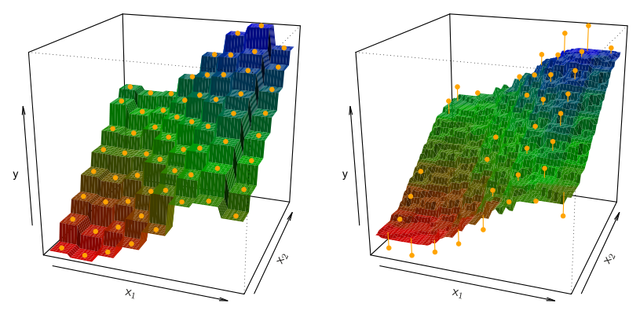

**图 3.16** 在含有 64 个观测（橙色点）的二维数据集上，利用 KNN 回归得到的 $\hat f(X)$。**左：** $K=1$ 得到粗糙的阶梯函数拟合。**右：** $K=9$ 得到平滑得多的拟合。

较大的 $K$ 值会给出更平滑、变异更小的拟合：某一区域中的预测是若干数据点的平均值，所以改变一个观测所产生的影响较小。然而，平滑也可能掩盖 $f(X)$ 中的某些结构，从而引入偏差。第 5 章将介绍几种估计测试误差率的方法。这些方法可用于确定 KNN 回归中最优的 $K$ 值。

在什么情况下，最小二乘线性回归这样的参数方法会优于 KNN 回归这样的非参数方法？答案很简单：**如果选定的参数形式接近 $f$ 的真实形式，参数方法就会优于非参数方法。** 图 3.17 给出了一个例子，其中的数据由一维线性回归模型生成。黑色实线表示 $f(X)$，蓝色曲线分别对应 $K=1$ 和 $K=9$ 的 KNN 拟合。在这个例子中，$K=1$ 的预测波动过大，而更平滑的 $K=9$ 拟合则接近 $f(X)$ 得多。不过，由于真实关系是线性的，非参数方法很难与线性回归相竞争：非参数方法付出了方差增大的代价，却没有通过偏差的降低获得补偿。图 3.18 左图中的蓝色虚线表示对同一数据的线性回归拟合，它几乎完美。图 3.18 右图显示，对于这组数据，线性回归优于 KNN。绿色实线表示 KNN 的测试集均方误差（mean squared error，MSE）随 $1/K$ 的变化。KNN 的误差明显高于黑色虚线，后者为线性回归的测试 MSE。当 $K$ 值较大时，KNN 在 MSE 上只比最小二乘回归略差；当 $K$ 较小时，其表现则差得多。

在实际中，$X$ 与 $Y$ 的真实关系很少恰好是线性的。图 3.19 考察了随着 $X$ 与 $Y$ 关系的非线性程度增加，最小二乘回归与 KNN 的相对表现。上排的真实关系接近线性。在这种情况下，$K$ 值较小时，线性回归的测试 MSE 仍优于 KNN。

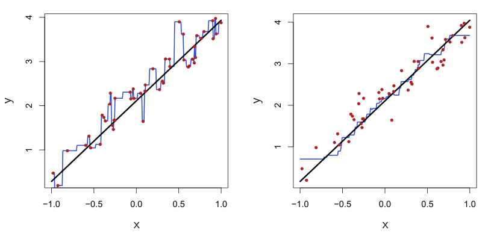

**图 3.17** 在含有 50 个观测的一维数据集上，利用 KNN 回归得到的 $\hat f(X)$。黑色实线表示真实关系。**左：** 蓝色曲线对应 $K=1$，对训练数据进行插值（即直接穿过各数据点）。**右：** 蓝色曲线对应 $K=9$，拟合更平滑。

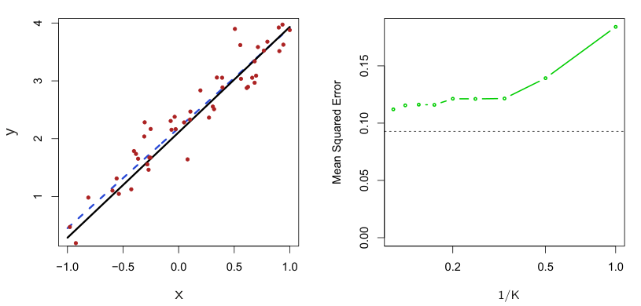

**图 3.18** 对图 3.17 所示的同一数据集作进一步考察。**左：** 蓝色虚线为数据的最小二乘拟合。由于 $f(X)$ 实际上是线性的（黑线），最小二乘回归直线对 $f(X)$ 给出了很好的估计。**右：** 水平虚线表示最小二乘法的测试集 MSE，绿色实线表示 KNN 的 MSE 随 $1/K$ 的变化（横轴使用对数尺度）。由于 $f(X)$ 实际上是线性的，线性回归的测试 MSE 低于 KNN 回归。对 KNN 回归而言，$K$ 值很大时效果最好，对应的 $1/K$ 值较小。图中 Mean Squared Error 表示均方误差。

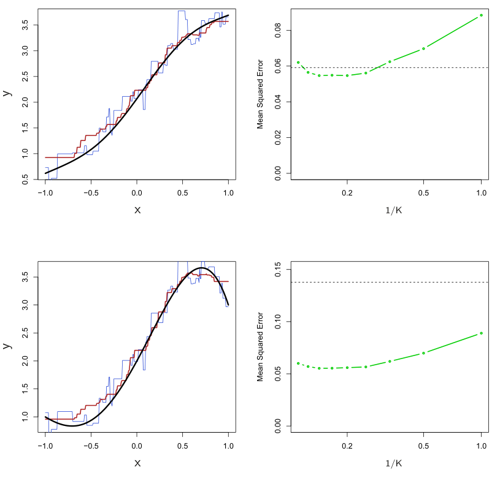

**图 3.19** **左上：** 当 $X$ 与 $Y$ 之间的关系略呈非线性（黑色实线）时，分别展示 $K=1$（蓝色）和 $K=9$（红色）的 KNN 拟合。**右上：** 对略呈非线性的数据，展示最小二乘回归的测试集 MSE（黑色水平线），以及 KNN 在不同 $1/K$ 值下的测试集 MSE（绿色）。**左下和右下：** 与上排相同，但 $X$ 与 $Y$ 之间的关系具有很强的非线性。图中 Mean Squared Error 表示均方误差。

不过，当 $K\geq4$ 时，KNN 优于线性回归。第二排的关系偏离线性更明显。在这种情况下，所有 $K$ 值下的 KNN 都明显优于线性回归。注意，随着非线性程度增加，非参数 KNN 方法的测试集 MSE 变化很小，而线性回归的测试集 MSE 却大幅增加。

图 3.18 和图 3.19 展示的情况是：关系为线性时，KNN 略逊于线性回归；关系为非线性时，KNN 却远优于线性回归。在真实关系未知的实际问题中，我们或许会认为应当优先采用 KNN，因为真实关系若为线性，它最多只比线性回归稍差；真实关系若为非线性，它却可能给出好得多的结果。但实际上，即使真实关系高度非线性，KNN 的结果仍可能不如线性回归。尤其要注意，图 3.18 和图 3.19 展示的都是仅含 $p=1$ 个预测变量的情形。

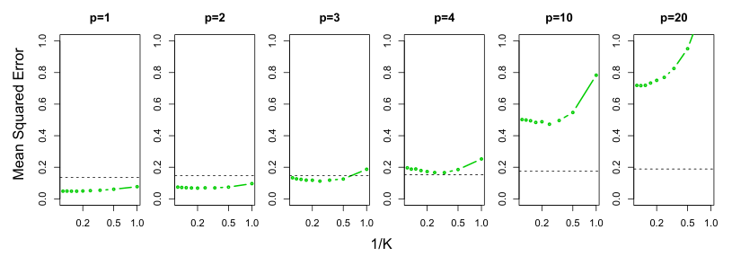

**图 3.20** 随着变量个数 $p$ 增加，线性回归（黑色虚线）与 KNN（绿色曲线）的测试 MSE。真实函数与图 3.19 下排相同，是第一个变量的非线性函数，与新增变量无关。存在这些额外噪声变量时，线性回归的表现缓慢变差，而随着 $p$ 增加，KNN 的表现下降得快得多。图中 Mean Squared Error 表示均方误差。

在更高维的情形中，KNN 的表现往往不如线性回归。

图 3.20 考虑了与图 3.19 第二排相同的强非线性关系，只是额外加入了与响应无关的噪声预测变量。当 $p=1$ 或 $p=2$ 时，KNN 优于线性回归。但当 $p=3$ 时，两者互有优劣；当 $p\geq4$ 时，线性回归优于 KNN。事实上，维数增加只使线性回归的测试集 MSE 略有恶化，却使 KNN 的 MSE 增加到原来的十倍以上。随维数增加而表现下降，是 KNN 的一个常见问题，其原因是：在更高维空间中，样本量实际上相当于减少了。这个数据集有 50 个训练观测；当 $p=1$ 时，这些信息足以准确估计 $f(X)$。然而，将 50 个观测分散在 $p=20$ 维空间中，就会出现这样的现象：一个给定观测附近没有邻居。这就是所谓的维数灾难（curse of dimensionality）。也就是说，$p$ 很大时，在 $p$ 维空间中，距离给定测试观测 $x_0$ 最近的 $K$ 个观测也可能离 $x_0$ 很远，导致对 $f(x_0)$ 的预测很差，KNN 拟合也因此很差。一般而言，每个预测变量所对应的观测数较少时，参数方法往往优于非参数方法。

即使维数较低，从可解释性的角度出发，我们也可能更偏好线性回归。如果 KNN 的测试 MSE 仅比线性回归略低，我们可能愿意牺牲少许预测准确性，以换取一个简单的模型：它只需几个系数就能描述，而且能够给出 $p$ 值。

## 3.6 实验：线性回归

### 3.6.1 导入包


我们在顶层导入通常使用的库。

In [1]:

```python
import numpy as np
import pandas as pd
from matplotlib.pyplot import subplots
```

#### 新导入的对象

本实验会陆续介绍新的函数和库。不过，我们先在这里导入它们，以突出这些是本实验中新出现的代码对象。将导入语句放在笔记本靠前的位置，可以提高代码的可读性：只需浏览开头几行，就知道使用了哪些库。

In [2]:

```python
import statsmodels.api as sm
```

下面用到这些函数时，我们会提供相关的详细说明。

除了导入整个模块，也可以只从给定模块导入少量对象。这有助于保持命名空间（namespace）整洁。我们会用到 statsmodels 包中的几个特定对象，在这里将它们导入。

In [3]:

```python
from statsmodels.stats.outliers_influence \
    import variance_inflation_factor as VIF
from statsmodels.stats.anova import anova_lm
```

上面的一条导入语句较长，因此插入了续行符 `\`，以便阅读。

我们还会使用 ISLP 包中专为本书实验编写的一些函数。

In [4]:

```python
from ISLP import load_data
from ISLP.models import (ModelSpec as MS,
                         summarize,
                         poly)
```

#### 查看对象和命名空间

函数 `dir()` 返回命名空间中的对象列表。

In [5]:

```python
dir()
```

Out[5]:

```text
['In',
 'MS',
 '_',
 '__',
 '___',
 '__builtin__',
 '__builtins__',
 ...
```


```text
 'poly',
 'quit',
 'sm',
 'summarize']
```

这个列表展示了 Python 在顶层能找到的全部对象。其中，`__builtins__` 之类的对象包含对 `print()` 等内置函数的引用。

每个 Python 对象也都有自己的命名空间，同样可以用 `dir()` 查看。其中既包含对象的属性（attribute），也包含与它相关的方法（method）。例如，数组的列表中会出现 `'sum'`。

In [6]:

```python
A = np.array([3,5,11])
dir(A)
```

Out[6]:

```text
 ...
 'strides',
 'sum',
 'swapaxes',
 ...
```

这说明对象 `A.sum` 存在。这里它是一个方法，可以用来计算数组 `A` 的元素之和；输入 `A.sum?` 即可查看说明。

In [7]:

```python
A.sum()
```

Out[7]:

```text
19
```

### 3.6.2 简单线性回归


本节将使用 `ISLP.models` 中的 `ModelSpec()` 变换来构造模型矩阵（model matrix），也称设计矩阵（design matrix）。

我们使用 ISLP 包中的 Boston 房价数据集。Boston 数据集记录了波士顿周边 506 个街区的 medv（房屋价值中位数）。我们将利用 13 个预测变量建立回归模型，以预测 medv；这些预测变量包括 rmvar（每套房屋的平均房间数）、age（1940 年之前建成的自有住房比例）和 lstat（社会经济地位较低的家庭所占百分比）等。我们将使用 statsmodels 完成这项任务，这是一个实现了几种常用回归方法的 Python 包。

ISLP 包提供了一个简单的数据加载函数 `load_data()`：

In [8]:

```python
Boston = load_data("Boston")
Boston.columns
```

Out[8]:

```text
Index(['crim', 'zn', 'indus', 'chas', 'nox', 'rm', 'age', 'dis',
       'rad', 'tax', 'ptratio', 'black', 'lstat', 'medv'],
      dtype='object')
```

输入 `Boston?`，可以进一步了解这些数据。

首先使用 `sm.OLS()` 函数拟合简单线性回归模型。响应为 medv，唯一的预测变量为 lstat。对于这个模型，可以手动构造模型矩阵。

In [9]:

```python
X = pd.DataFrame({'intercept': np.ones(Boston.shape[0]),
                  'lstat': Boston['lstat']})
X[:4]
```

Out[9]:

```text
   intercept  lstat
0        1.0   4.98
1        1.0   9.14
2        1.0   4.03
3        1.0   2.94
```

提取响应，然后拟合模型。

In [10]:

```python
y = Boston['medv']
model = sm.OLS(y, X)
results = model.fit()
```

注意，`sm.OLS()` 本身并不拟合模型，而是指定模型；随后由 `model.fit()` 真正完成拟合。

ISLP 中的函数 `summarize()` 会生成一个简表，列出参数估计值、标准误、$t$ 统计量和 $p$ 值。这个函数只接受一个参数，例如这里 `fit` 方法返回的对象 `results`，并返回上述汇总结果。

In [11]:

```python
summarize(results)
```

Out[11]:

```text
              coef  std err       t  P>|t|
intercept  34.5538    0.563  61.415    0.0
lstat      -0.9500    0.039 -24.528    0.0
```

在介绍处理已拟合模型的其他方法之前，先概述一个更实用、更通用的模型矩阵 `X` 构造框架。

#### 使用变换：拟合与变换

上面的模型只有一个预测变量，因此构造 `X` 很直接。实际中，我们经常拟合包含多个预测变量的模型，通常从数组或数据框中选取这些变量。我们可能希望在拟合模型之前变换变量、指定变量之间的交互，或者将某些变量展开为一组变量（例如多项式）。sklearn 包为这类任务提供了一个特定概念：变换对象（transform）。它是一个以某些参数为输入而创建的对象，主要有两个方法：`fit()` 和 `transform()`。

通过 ISLP 库中的变换 `ModelSpec()`，我们提供了一种指定模型并构造模型矩阵的通用方法。`ModelSpec()`（在开头导入时改名为 `MS()`）会创建变换对象，然后使用 `transform()` 和 `fit()` 这两个方法构造相应的模型矩阵。

我们先用 Boston 数据框中仅含 lstat 这一个预测变量的简单回归模型来介绍这一过程；在本实验及本书其他实验中，还会反复将其用于更复杂的任务。本例中，通过表达式 `design = MS(['lstat'])` 创建变换对象。

`fit()` 方法接收原始数组，并可能按照变换对象的设定进行一些初步计算。例如，它可能计算用于中心化和缩放的均值与标准差。`transform()` 方法将拟合得到的变换应用于数据数组，生成模型矩阵。

In [12]:

```python
design = MS(['lstat'])
design = design.fit(Boston)
X = design.transform(Boston)
X[:4]
```

Out[12]:

```text
   intercept  lstat
0        1.0   4.98
1        1.0   9.14
2        1.0   4.03
3        1.0   2.94
```

在这个简单例子中，`fit()` 方法做的事情很少：只检查 `design` 中指定的变量 `'lstat'` 是否存在于 Boston 中。随后，`transform()` 构造一个包含两列的模型矩阵：一列为截距，另一列为变量 lstat。

这两个操作可以通过 `fit_transform()` 方法合并。

In [13]:

```python
design = MS(['lstat'])
X = design.fit_transform(Boston)
X[:4]
```

Out[13]:

```text
   intercept  lstat
0        1.0   4.98
1        1.0   9.14
2        1.0   4.03
3        1.0   2.94
```

注意，与上一个将两步分开执行的代码块一样，`fit()` 操作会改变 `design` 对象。在拟合包含交互和变换的更复杂模型时，这条处理流程的作用会更加清楚。

现在回到已经拟合的回归模型。`results` 对象有若干可用于推断的方法。我们已经介绍了用于显示拟合关键信息的函数 `summarize()`。如果需要完整而详尽的拟合汇总，可以使用 `summary()` 方法（这里不展示输出）。

In [14]:

```python
results.summary()
```

还可以通过 `results` 的 `params` 属性提取拟合得到的系数。

In [15]:

```python
results.params
```

Out[15]:

```text
intercept    34.553841
lstat        -0.950049
dtype: float64
```

对于给定的 lstat 值，`get_prediction()` 方法可以给出 medv 的预测值，以及预测的置信区间和预测区间。

首先创建一个新的数据框；在这里，它只包含变量 lstat，以及我们希望进行预测的各个 lstat 值。然后使用 `design` 的 `transform()` 方法创建相应的模型矩阵。

In [16]:

```python
new_df = pd.DataFrame({'lstat':[5, 10, 15]})
newX = design.transform(new_df)
newX
```

Out[16]:

```text
   intercept  lstat
0        1.0      5
1        1.0     10
2        1.0     15
```

接着计算 `newX` 处的预测值，并提取 `predicted_mean` 属性进行查看。

In [17]:

```python
new_predictions = results.get_prediction(newX);
new_predictions.predicted_mean
```

Out[17]:

```text
array([29.80359411, 25.05334734, 20.30310057])
```

可以为预测值生成置信区间。

In [18]:

```python
new_predictions.conf_int(alpha=0.05)
```

Out[18]:

```text
array([[29.00741194, 30.59977628],
       [24.47413202, 25.63256267],
       [19.73158815, 20.87461299]])
```

设置 `obs=True`，即可计算预测区间：

In [19]:

```python
new_predictions.conf_int(obs=True, alpha=0.05)
```

Out[19]:

```text
array([[17.56567478, 42.04151344],
       [12.82762635, 37.27906833],
       [ 8.0777421 , 32.52845905]])
```

例如，lstat 为 10 时，对应的 95% 置信区间为 $(24.47,25.63)$，95% 预测区间为 $(12.82,37.28)$。正如预期，置信区间和预测区间都以同一点为中心（lstat 等于 10 时，medv 的预测值为 25.05），但后者要宽得多。

接下来用 `DataFrame.plot.scatter()` 绘制 medv 与 lstat 的散点图，并在图上添加回归直线。

#### 定义函数

ISLP 包中已有一个在现有图形上添加直线的函数，不过，我们借此机会定义自己的第一个函数来完成这件事。

In [20]:

```python
def abline(ax, b, m):
    "Add a line with slope m and intercept b to ax"
    xlim = ax.get_xlim()
    ylim = [m * xlim[0] + b, m * xlim[1] + b]
    ax.plot(xlim, ylim)
```

上面的代码展示了几点。首先是定义函数的语法：`def funcname(...)`。函数有 `ax`、`b`、`m` 三个参数，其中 `ax` 是现有图形的坐标轴对象，`b` 是所需直线的截距，`m` 是斜率。还可以加入额外的可选参数，将其他绘图选项传递给 `ax.plot`，如下所示：

In [21]:

```python
def abline(ax, b, m, *args, **kwargs):
    "Add a line with slope m and intercept b to ax"
    xlim = ax.get_xlim()
    ylim = [m * xlim[0] + b, m * xlim[1] + b]
    ax.plot(xlim, ylim, *args, **kwargs)
```

加入 `*args` 后，`abline` 就可以接受任意数量的非命名参数；`*kwargs` 则允许向 `abline` 传入任意数量的命名参数（例如 `linewidth=3`）。在这个函数中，我们将这些参数原样传递给上面的 `ax.plot`。有兴趣进一步了解函数的读者，可以参阅 `docs.python.org/tutorial` 中关于定义函数的部分。

现在用这个新函数，为 medv 对 lstat 的散点图添加回归直线。

In [22]:

```python
ax = Boston.plot.scatter('lstat', 'medv')
abline(ax,
       results.params[0],
       results.params[1],
       'r--',
       linewidth=3)
```

因此，最终对 `ax.plot()` 的调用为 `ax.plot(xlim, ylim, 'r--', linewidth=3)`。我们用参数 `'r--'` 画出红色虚线，并加入参数将线宽设为 3。图中有一些证据表明，lstat 与 medv 的关系存在非线性。本实验稍后会探讨这个问题。

如前所述，已有函数 `ax.axline()` 可以在图上添加直线；不过，学会编写这样的函数，能让我们创建表达力更强的图形。

接下来检查一些诊断图，其中几种已在 3.3.3 节讨论过。可以从 `results` 对象的属性中获取拟合值和残差。描述回归模型的各种影响度量，则通过 `get_influence()` 方法计算。由于不需要 `subplots()` 返回的第一个值 `fig`，下面只将第二个返回值赋给 `ax`。

In [23]:

```python
ax = subplots(figsize=(8,8))[1]
```

```python
ax.scatter(results.fittedvalues, results.resid)
ax.set_xlabel('Fitted value')
ax.set_ylabel('Residual')
ax.axhline(0, c='k', ls='--');
```

使用 `ax.axhline()` 方法在 0 处添加一条水平参考线，指定其颜色为黑色（`c='k'`）、线型为虚线（`ls='--'`）。

根据残差图（未展示），有一些证据表明关系存在非线性。无论预测变量个数是多少，都可以利用 `get_influence()` 方法返回对象的 `hat_matrix_diag` 属性计算杠杆统计量。

In [24]:

```python
infl = results.get_influence()
ax = subplots(figsize=(8,8))[1]
ax.scatter(np.arange(X.shape[0]), infl.hat_matrix_diag)
ax.set_xlabel('Index')
ax.set_ylabel('Leverage')
np.argmax(infl.hat_matrix_diag)
```

Out[24]:

```text
374
```

函数 `np.argmax()` 返回数组中最大元素的索引，也可以指定沿数组的某个轴计算。这里是在整个数组中寻找最大值，以确定哪个观测的杠杆统计量最大。

### 3.6.3 多元线性回归

为了用最小二乘法拟合多元线性回归模型，再次使用 `ModelSpec()` 变换来构造所需的模型矩阵和响应。`ModelSpec()` 可以接受相当一般的参数，但这里提供一个列名列表就足够了。我们先考虑以 lstat 和 age 这两个变量进行拟合。

In [25]:

```python
X = MS(['lstat', 'age']).fit_transform(Boston)
model1 = sm.OLS(y, X)
results1 = model1.fit()
summarize(results1)
```

Out[25]:

```text
              coef  std err        t  P>|t|
intercept  33.2228    0.731   45.458  0.000
lstat      -1.0321    0.048  -21.416  0.000
age         0.0345    0.012    2.826  0.005
```

注意，第一行用一个简洁的表达式概括了 `X` 的构造过程。

Boston 数据集包含 12 个变量，如果为了使用全部预测变量进行回归而逐一输入它们，会很繁琐。可以改用下面的简写：

In [26]:

```python
terms = Boston.columns.drop('medv')
terms
```

Out[26]:

```text
Index(['crim', 'zn', 'indus', 'chas', 'nox', 'rm', 'age', 'dis',
       'rad', 'tax', 'ptratio', 'lstat'],
      dtype='object')
```

现在可以使用同一个模型矩阵构造工具，以 `terms` 中的全部变量拟合模型。

In [27]:

```python
X = MS(terms).fit_transform(Boston)
model = sm.OLS(y, X)
results = model.fit()
summarize(results)
```

Out[27]:

```text
              coef  std err        t  P>|t|
intercept  41.6173    4.936    8.431  0.000
crim       -0.1214    0.033   -3.678  0.000
zn          0.0470    0.014    3.384  0.001
indus       0.0135    0.062    0.217  0.829
chas        2.8400    0.870    3.264  0.001
nox       -18.7580    3.851   -4.870  0.000
rm          3.6581    0.420    8.705  0.000
age         0.0036    0.013    0.271  0.787
dis        -1.4908    0.202   -7.394  0.000
rad         0.2894    0.067    4.325  0.000
tax        -0.0127    0.004   -3.337  0.001
ptratio    -0.9375    0.132   -7.091  0.000
lstat      -0.5520    0.051  -10.897  0.000
```

如果想使用除某一个变量之外的全部变量进行回归，该怎么办？例如，上面的回归输出中，age 的 $p$ 值很高，所以可能希望排除这个预测变量再做回归。以下语法会使用除 age 之外的全部预测变量进行回归（未展示输出）。

In [28]:

```python
minus_age = Boston.columns.drop(['medv', 'age'])
Xma = MS(minus_age).fit_transform(Boston)
model1 = sm.OLS(y, Xma)
summarize(model1.fit())
```

### 3.6.4 多元回归的拟合优度

可以按名称访问 `results` 的各个组成部分（`dir(results)` 会显示可用的内容）。因此，`results.rsquared` 给出 $R^2$，`np.sqrt(results.scale)` 给出 RSE。

方差膨胀因子（3.3.3 节）有时可用于评估回归模型的模型矩阵中共线性的影响。我们将计算多元回归拟合的 VIF，并借此介绍列表推导式（list comprehension）的概念。

#### 列表推导式

我们经常会遇到一串对象，希望对它们作变换，以便完成其他任务。下面计算 `X` 矩阵中每个特征的 VIF，并生成一个数据框，其索引与 `X` 的列相对应。列表推导式通常可以简化这类任务。

列表推导式是构造 Python 对象列表的一种简单而强大的方式。Python 还支持字典推导式和生成器推导式，不过这些超出了这里的讨论范围。来看一个例子：使用函数 `variance_inflation_factor()`，计算模型矩阵 `X` 中每个变量的 VIF。

In [29]:

```python
vals = [VIF(X, i)
        for i in range(1, X.shape[1])]
vif = pd.DataFrame({'vif':vals},
                   index=X.columns[1:])
vif
```

Out[29]:

```text
           vif
crim     1.767
zn       2.298
indus    3.987
chas     1.071
nox      4.369
rm       1.913
age      3.088
dis      3.954
rad      7.445
tax      9.002
ptratio  1.797
lstat    2.871
```

函数 `VIF()` 接受两个参数：一个数据框或数组，以及变量的列索引。上面的代码逐列即时调用 `VIF()`。我们排除了第 0 列（截距），因为它不是关注的对象。本例中的 VIF 并没有什么特别引人注意的地方。

上面的对象 `vals` 也可以用以下 `for` 循环构造：

In [30]:

```python
vals = []
for i in range(1, X.values.shape[1]):
    vals.append(VIF(X.values, i))
```

列表推导式让我们能够以更直接的方式完成这种重复操作。

### 3.6.5 交互项

使用 `ModelSpec()`，很容易在线性模型中加入交互项。加入元组 `("lstat","age")`，就会告诉模型矩阵构造工具加入 lstat 与 age 之间的交互项。

In [31]:

```python
X = MS(['lstat',
        'age',
        ('lstat', 'age')]).fit_transform(Boston)
model2 = sm.OLS(y, X)
summarize(model2.fit())
```

Out[31]:

```text
              coef  std err        t  P>|t|
intercept  36.0885    1.470   24.553  0.000
lstat      -1.3921    0.167   -8.313  0.000
age        -0.0007    0.020   -0.036  0.971
lstat:age   0.0042    0.002    2.244  0.025
```

### 3.6.6 预测变量的非线性变换


模型矩阵构造工具所能包含的项，不限于列名和交互项。例如，ISLP 提供的 `poly()` 函数可以指定：将表示其第一个参数的多项式函数的各列加入模型矩阵。

In [32]:

```python
X = MS([poly('lstat', degree=2), 'age']).fit_transform(Boston)
model3 = sm.OLS(y, X)
results3 = model3.fit()
summarize(results3)
```

Out[32]:

```text
                              coef  std err        t  P>|t|
intercept                  17.7151    0.781   22.681  0.000
poly(lstat, degree=2)[0]  -179.2279    6.733  -26.620  0.000
poly(lstat, degree=2)[1]    72.9908    5.482   13.315  0.000
age                         0.0703    0.011    6.471  0.000
```

二次项（上面第三行）对应的 $p$ 值实际上接近零，表明它能够改善模型。

默认情况下，`poly()` 会创建一个用于加入模型矩阵的基矩阵（basis matrix），其各列为正交多项式（orthogonal polynomials），这种设计有助于使最小二乘计算保持稳定。<sup><a href="#fn13" id="fnref13">13</a></sup> 如果在上面对 `poly()` 的调用中加入参数 `raw=True`，基矩阵就只由 lstat 和 `lstat**2` 组成。由于这两种基都表示二次多项式，因此拟合值不会改变，改变的只是多项式系数。另外，默认情况下，`poly()` 创建的列不包含截距列，因为 `MS()` 会自动添加截距。

<aside class="footnote" id="fn13"><a href="#fnref13">13</a> 实际上，`poly()` 是独立函数 `Poly()` 的封装；真正负责构造模型矩阵的是 `Poly()`。</aside>

使用 `anova_lm()` 函数，可以进一步量化二次拟合优于线性拟合的程度。

In [33]:

```python
anova_lm(results1, results3)
```

Out[33]:

```text
   df_resid       ssr  df_diff  ss_diff       F    Pr(>F)
0     503.0  19168.13      0.0      NaN     NaN       NaN
1     502.0  14165.61      1.0  5002.52  177.28  7.47e-35
```

这里，`results1` 表示包含预测变量 lstat 和 age 的线性子模型，而 `results3` 对应上面那个更大的模型，其中包含 lstat 的二次项。`anova_lm()` 函数通过假设检验比较两个模型。原假设是：较大模型中的二次项并非必需；备择假设是：较大的模型更优。这里，$F$ 统计量为 177.28，对应的 $p$ 值为零。在本例中，$F$ 统计量等于 `results3` 线性模型汇总中二次项的 $t$ 统计量的平方，这是因为这两个嵌套模型（nested models）只相差一个自由度。

这为 lstat 的二次多项式能够改善线性模型提供了非常清楚的证据。这并不意外，因为前面已经看到 medv 与 lstat 的关系存在非线性的证据。

函数 `anova_lm()` 可以接受两个以上的嵌套模型作为输入，此时会依次比较每一对相邻模型。这也解释了上面第一行为什么出现 NaN：第一个模型前面没有可供比较的模型。

In [34]:

```python
ax = subplots(figsize=(8,8))[1]
ax.scatter(results3.fittedvalues, results3.resid)
ax.set_xlabel('Fitted value')
ax.set_ylabel('Residual')
ax.axhline(0, c='k', ls='--')
```

可以看到，模型加入二次项后，残差中几乎没有可辨认的模式。要得到三次或更高次的多项式拟合，只需改变 `poly()` 的 `degree` 参数。

### 3.6.7 定性预测变量

这里使用 ISLP 包中的 Carseats 数据集。我们将根据若干预测变量，尝试预测 400 个地点的 Sales（儿童汽车安全座椅销售量）。

In [35]:

```python
Carseats = load_data('Carseats')
Carseats.columns
```

Out[35]:

```text
Index(['Sales', 'CompPrice', 'Income', 'Advertising',
       'Population', 'Price', 'ShelveLoc', 'Age', 'Education',
       'Urban', 'US'],
      dtype='object')
```

Carseats 数据包含 ShelveLoc 这样的定性预测变量。ShelveLoc 表示货架位置的好坏，也就是商店中用于陈列汽车安全座椅的位置。预测变量 ShelveLoc 有三个可能的取值：Bad、Medium 和 Good。对于 ShelveLoc 这样的定性变量，`ModelSpec()` 会自动生成虚拟变量。这些变量通常称为该分类特征的独热编码（one-hot encoding）。这些列相加为一，因此，为了避免与截距产生共线性，需要去掉第一列。下面可以看到，`ShelveLoc[Bad]` 这一列已被删除，因为 Bad 是 ShelveLoc 的第一个水平。接下来拟合一个包含若干交互项的多元回归模型。

In [36]:

```python
allvars = list(Carseats.columns.drop('Sales'))
y = Carseats['Sales']
final = allvars + [('Income', 'Advertising'),
                  ('Price', 'Age')]
X = MS(final).fit_transform(Carseats)
model = sm.OLS(y, X)
summarize(model.fit())
```

Out[36]:

```text
                       coef  std err        t  P>|t|
intercept            6.5756    1.009    6.519  0.000
CompPrice            0.0929    0.004   22.567  0.000
Income               0.0109    0.003    4.183  0.000
Advertising          0.0702    0.023    3.107  0.002
Population           0.0002    0.000    0.433  0.665
Price               -0.1008    0.007  -13.549  0.000
ShelveLoc[Good]       4.8487    0.153   31.724  0.000
ShelveLoc[Medium]     1.9533    0.126   15.531  0.000
Age                 -0.0579    0.016   -3.633  0.000
Education           -0.0209    0.020   -1.063  0.288
Urban[Yes]           0.1402    0.112    1.247  0.213
US[Yes]             -0.1576    0.149   -1.058  0.291
Income:Advertising   0.0008    0.000    2.698  0.007
Price:Age            0.0001    0.000    0.801  0.424
```

上面第一行将 `allvars` 转为列表，以便在两行之后加入交互项。模型矩阵构造工具创建了虚拟变量 `ShelveLoc[Good]`：货架位置好时取值为 1，否则为 0；还创建了虚拟变量 `ShelveLoc[Medium]`：货架位置中等时为 1，否则为 0。货架位置差时，这两个虚拟变量都为零。回归输出中 `ShelveLoc[Good]` 的系数为正，说明好的货架位置与较高的销售量相关联（相对于差的位置）。`ShelveLoc[Medium]` 的正系数较小，表明中等货架位置的销售量高于差的位置，但低于好的位置。

## 3.7 习题

### 概念题

**1.** 描述表 3.4 中各个 $p$ 值所对应的原假设。解释根据这些 $p$ 值可以得出什么结论。解释时应围绕 `sales`、`TV`、`radio` 和 `newspaper` 展开，而不是围绕线性模型的系数展开。

**2.** 仔细解释 KNN 分类器与 KNN 回归方法之间的区别。

**3.** 假设我们有一个包含五个预测变量的数据集：$X_1=\mathrm{GPA}$，$X_2=\mathrm{IQ}$，$X_3=\mathrm{Level}$（大学为 1，高中为 0），$X_4$ 为 GPA 与 IQ 的交互，$X_5$ 为 GPA 与 Level 的交互。响应变量是毕业后的起薪（单位：千美元）。假设我们用最小二乘法拟合模型，得到 $\hat\beta_0=50$、$\hat\beta_1=20$、$\hat\beta_2=0.07$、$\hat\beta_3=35$、$\hat\beta_4=0.01$、$\hat\beta_5=-10$。

**(a)** 以下哪项正确？为什么？

- **i.** 在 IQ 和 GPA 给定的情况下，高中毕业生的平均收入高于大学毕业生。
- **ii.** 在 IQ 和 GPA 给定的情况下，大学毕业生的平均收入高于高中毕业生。
- **iii.** 在 IQ 和 GPA 给定的情况下，只要 GPA 足够高，高中毕业生的平均收入就高于大学毕业生。
- **iv.** 在 IQ 和 GPA 给定的情况下，只要 GPA 足够高，大学毕业生的平均收入就高于高中毕业生。

**(b)** 预测一名 IQ 为 110、GPA 为 4.0 的大学毕业生的薪资。

**(c)** 判断正误：“由于 GPA/IQ 交互项的系数很小，因此几乎没有证据表明存在交互效应。”说明理由。

**4.** 我收集了一组数据（$n=100$ 个观测），其中包含一个预测变量和一个定量响应。随后，我对这些数据拟合了一个线性回归模型，又单独拟合了一个三次回归（cubic regression）模型，即 $Y=\beta_0+\beta_1X+\beta_2X^2+\beta_3X^3+\epsilon$。

**(a)** 假设 $X$ 与 $Y$ 之间的真实关系是线性的，即 $Y=\beta_0+\beta_1X+\epsilon$。考虑线性回归的训练残差平方和（RSS），以及三次回归的训练 RSS。我们是否预期其中一个小于另一个，预期二者相同，还是信息不足，无法判断？说明理由。

**(b)** 将训练 RSS 换成测试 RSS，回答 (a)。

**(c)** 假设 $X$ 与 $Y$ 之间的真实关系不是线性的，但我们不知道它偏离线性关系的程度。考虑线性回归的训练 RSS，以及三次回归的训练 RSS。我们是否预期其中一个小于另一个，预期二者相同，还是信息不足，无法判断？说明理由。

**(d)** 将训练 RSS 换成测试 RSS，回答 (c)。

**5.** 考虑进行不含截距的线性回归所得到的拟合值。在这种情形下，第 $i$ 个拟合值的形式为

$$
\hat y_i=x_i\hat\beta,
$$

其中

$$
\hat\beta=\left(\sum_{i=1}^{n}x_i y_i\right)\bigg/\left(\sum_{i'=1}^{n}x_{i'}^2\right).
\tag{3.38}
$$

证明我们可以写成

$$
\hat y_i=\sum_{i'=1}^{n}a_{i'}y_{i'}.
$$

$a_{i'}$ 是什么？

*注：这一结果说明，线性回归得到的拟合值是响应值的线性组合（linear combination）。*

**6.** 利用式 (3.4)，说明在简单线性回归中，最小二乘直线总是经过点 $(\bar x,\bar y)$。

**7.**  正文指出，在进行 $Y$ 对 $X$ 的简单线性回归时，$R^2$ 统计量（式 (3.17)）等于 $X$ 与 $Y$ 的相关系数（式 (3.18)）的平方。证明这一结论。为简便起见，可以假设 $\bar x=\bar y=0$。

### 应用题


**8.** 本题使用 `Auto` 数据集进行简单线性回归。

**(a)** 使用 `sm.OLS()` 函数，以 `mpg` 为响应变量、`horsepower` 为预测变量，进行简单线性回归。使用 `summarize()` 函数打印结果。讨论输出结果，例如：

- **i.** 预测变量与响应变量之间是否存在关系？
- **ii.** 预测变量与响应变量之间的关系有多强？
- **iii.** 预测变量与响应变量之间是正向关系还是负向关系？
- **iv.** 当 `horsepower` 为 98 时，预测的 `mpg` 是多少？相应的 95% 置信区间和预测区间是什么？

**(b)** 在新的坐标轴对象 `ax` 中，绘制响应变量与预测变量的关系图。使用 `ax.axline()` 方法或本章实验中定义的 `abline()` 函数，显示最小二乘回归直线。

**(c)** 按本章实验中的说明，为最小二乘回归拟合绘制一些诊断图。讨论从中观察到的拟合问题。

**9.** 本题使用 `Auto` 数据集进行多元线性回归。

**(a)** 绘制一个包含数据集中所有变量的散点图矩阵。

**(b)** 使用 `DataFrame.corr()` 方法，计算变量之间的相关系数矩阵。

**(c)** 使用 `sm.OLS()` 函数，以 `mpg` 为响应变量，以除 `name` 之外的所有其他变量为预测变量，进行多元线性回归。使用 `summarize()` 函数打印结果。讨论输出结果，例如：

- **i.** 预测变量与响应变量之间是否存在关系？使用 `statsmodels` 中的 `anova_lm()` 函数回答这个问题。
- **ii.** 哪些预测变量似乎与响应变量具有统计显著的关系？
- **iii.** `year` 变量的系数说明了什么？

**(d)** 按本章实验中的说明，为线性回归拟合绘制一些诊断图。讨论从中观察到的拟合问题。残差图是否显示出异常大的离群点？杠杆值图是否识别出了杠杆值异常高的观测？

**(e)** 按本章实验中的说明，拟合一些包含交互的模型。是否有交互看起来具有统计显著性？

**(f)** 尝试对变量进行几种不同的变换，例如 $\log(X)$、$\sqrt{X}$、$X^2$。讨论你的发现。

**10.** 请使用 `Carseats` 数据集回答本题。

**(a)** 拟合一个多元回归模型，使用 `Price`、`Urban` 和 `US` 预测 `Sales`。

**(b)** 解释模型中每一个系数的含义。注意，模型中的某些变量是定性变量！

**(c)** 将模型写成方程形式，注意正确处理定性变量。

**(d)** 对哪些预测变量，你可以拒绝原假设 $H_0:\beta_j=0$？

**(e)** 根据上一问的回答，拟合一个规模更小的模型，只保留有证据表明与结果相关联的预测变量。

**(f)** (a) 和 (e) 中的模型对数据的拟合效果如何？

**(g)** 使用 (e) 中的模型，求系数的 95% 置信区间。

**(h)** (e) 中的模型是否有证据表明存在离群点或高杠杆值观测？

**11.** 本题考察不含截距的简单线性回归中，原假设 $H_0:\beta=0$ 所对应的 $t$ 统计量。首先，按如下方式生成预测变量 `x` 和响应变量 `y`。

```python
rng = np.random.default_rng(1)
x = rng.normal(size=100)
y = 2 * x + rng.normal(size=100)
```

**(a)** 进行 `y` 对 `x` 的简单线性回归，*不含截距*。报告系数估计值 $\hat\beta$、该系数估计值的标准误，以及原假设 $H_0:\beta=0$ 所对应的 $t$ 统计量和 $p$ 值。讨论这些结果。（向 `ModelSpec()` 传入关键字参数 `intercept=False`，即可进行不含截距的回归。）

**(b)** 现在进行 `x` 对 `y` 的简单线性回归，不含截距，并报告系数估计值、其标准误，以及原假设 $H_0:\beta=0$ 所对应的 $t$ 统计量和 $p$ 值。讨论这些结果。

**(c)** (a) 和 (b) 中得到的结果之间有什么关系？

**(d)**  对于不含截距的 $Y$ 对 $X$ 的回归，$H_0:\beta=0$ 对应的 $t$ 统计量的形式为 $\hat\beta/\operatorname{SE}(\hat\beta)$，其中 $\hat\beta$ 由式 (3.38) 给出，并且

$$
\operatorname{SE}(\hat\beta)=\sqrt{\frac{\sum_{i=1}^{n}(y_i-x_i\hat\beta)^2}{(n-1)\sum_{i'=1}^{n}x_{i'}^2}}.
$$

（这些公式与 3.1.1 节和 3.1.2 节给出的公式略有不同，因为这里进行的是不含截距的回归。）通过代数推导证明，并在 R 中进行数值验证，说明 $t$ 统计量可以写成

$$
\frac{(\sqrt{n-1})\sum_{i=1}^{n}x_i y_i}{\sqrt{\left(\sum_{i=1}^{n}x_i^2\right)\left(\sum_{i'=1}^{n}y_{i'}^2\right)-\left(\sum_{i'=1}^{n}x_{i'}y_{i'}\right)^2}}.
$$

**(e)** 利用 (d) 的结果，说明 `y` 对 `x` 回归的 $t$ 统计量，与 `x` 对 `y` 回归的 $t$ 统计量相同。

**(f)** 在 R 中说明：当回归*包含截距*时，`y` 对 `x` 回归中 $H_0:\beta_1=0$ 对应的 $t$ 统计量，与 `x` 对 `y` 回归中相应的 $t$ 统计量相同。

**12.** 本题涉及不含截距的简单线性回归。

**(a)** 回顾式 (3.38)：它给出了不含截距的 $Y$ 对 $X$ 线性回归的系数估计值 $\hat\beta$。在什么情况下，$X$ 对 $Y$ 回归的系数估计值，与 $Y$ 对 $X$ 回归的系数估计值相同？

**(b)** 在 Python 中生成一个包含 $n=100$ 个观测的例子，使 $X$ 对 $Y$ 回归的系数估计值*不同于* $Y$ 对 $X$ 回归的系数估计值。

**(c)** 在 Python 中生成一个包含 $n=100$ 个观测的例子，使 $X$ 对 $Y$ 回归的系数估计值*等于* $Y$ 对 $X$ 回归的系数估计值。

**13.** 本题将创建一些模拟数据，并对这些数据拟合简单线性回归模型。开始 (a) 之前，务必使用默认随机数生成器（default random number generator），并将种子设为 1，以保证结果一致。

**(a)** 使用随机数生成器的 `normal()` 方法，创建一个向量 `x`，其中包含从 $N(0,1)$ 分布抽取的 100 个观测。它代表一个特征 $X$。

**(b)** 使用 `normal()` 方法，创建一个向量 `eps`，其中包含从 $N(0,0.25)$ 分布抽取的 100 个观测；这是一个均值为零、方差为 0.25 的正态分布。

**(c)** 使用 `x` 和 `eps`，根据以下模型生成向量 `y`：

$$
Y=-1+0.5X+\epsilon.
\tag{3.39}
$$

向量 `y` 的长度是多少？这个线性模型中的 $\beta_0$ 和 $\beta_1$ 分别是多少？

**(d)** 绘制散点图，显示 `x` 与 `y` 之间的关系。讨论你观察到的现象。

**(e)** 拟合一个最小二乘线性模型，使用 `x` 预测 `y`。讨论得到的模型。$\hat\beta_0$ 和 $\hat\beta_1$ 与 $\beta_0$ 和 $\beta_1$ 相比如何？

**(f)** 在 (d) 得到的散点图上显示最小二乘直线。用另一种颜色在图上画出总体回归直线。使用坐标轴对象的 `legend()` 方法创建适当的图例。

**(g)** 现在拟合一个多项式回归模型，使用 `x` 和 $\mathtt{x}^2$ 预测 `y`。是否有证据表明二次项改善了模型拟合？解释你的回答。

**(h)** 修改数据生成过程，使数据中的噪声*更少*，然后重复 (a)–(f)。模型 (3.39) 应保持不变。可以通过减小 (b) 中用于生成误差项 $\epsilon$ 的正态分布方差来实现。描述你的结果。

**(i)** 修改数据生成过程，使数据中的噪声*更多*，然后重复 (a)–(f)。模型 (3.39) 应保持不变。可以通过增大 (b) 中用于生成误差项 $\epsilon$ 的正态分布方差来实现。描述你的结果。

**(j)** 基于原始数据集、噪声更多的数据集和噪声更少的数据集，$\beta_0$ 和 $\beta_1$ 的置信区间分别是什么？讨论你的结果。

**14.** 本题关注共线性问题。

**(a)** 在 Python 中执行以下命令：

```python
rng = np.random.default_rng(10)
x1 = rng.uniform(0, 1, size=100)
x2 = 0.5 * x1 + rng.normal(size=100) / 10
y = 2 + 2 * x1 + 0.3 * x2 + rng.normal(size=100)
```

最后一行相当于创建一个线性模型，其中 `y` 是 `x1` 和 `x2` 的函数。写出这个线性模型的形式。回归系数分别是多少？

**(b)** `x1` 与 `x2` 之间的相关系数是多少？绘制散点图，显示这两个变量之间的关系。

**(c)** 使用这些数据拟合最小二乘回归，以 `x1` 和 `x2` 预测 `y`。描述得到的结果。$\hat\beta_0$、$\hat\beta_1$ 和 $\hat\beta_2$ 分别是多少？它们与真实的 $\beta_0$、$\beta_1$ 和 $\beta_2$ 有什么关系？你能否拒绝原假设 $H_0:\beta_1=0$？对于原假设 $H_0:\beta_2=0$ 呢？

**(d)** 现在拟合最小二乘回归，只使用 `x1` 预测 `y`。讨论你的结果。你能否拒绝原假设 $H_0:\beta_1=0$？

**(e)** 现在拟合最小二乘回归，只使用 `x2` 预测 `y`。讨论你的结果。你能否拒绝原假设 $H_0:\beta_1=0$？

**(f)** (c)–(e) 得到的结果是否相互矛盾？解释你的回答。

**(g)** 假设我们又获得了一个观测，但不幸的是，这个观测的测量有误。使用 `np.concatenate()` 函数，将这一额外观测分别添加到 `x1`、`x2` 和 `y` 中。

```python
x1 = np.concatenate([x1, [0.1]])
x2 = np.concatenate([x2, [0.8]])
y = np.concatenate([y, [6]])
```

使用这些新数据，重新拟合 (c)–(e) 中的线性模型。这个新观测对每个模型有什么影响？在各个模型中，该观测是离群点、高杠杆值点，还是两者都是？解释你的回答。

**15.** 本题使用本章实验中见过的 `Boston` 数据集。现在，我们尝试使用数据集中的其他变量来预测人均犯罪率。换句话说，人均犯罪率是响应变量，其他变量是预测变量。

**(a)** 对每一个预测变量，分别拟合一个简单线性回归模型来预测响应变量。描述你的结果。在其中哪些模型中，预测变量与响应变量之间存在统计显著的关联？绘制一些图来支持你的判断。

**(b)** 拟合一个多元回归模型，使用所有预测变量来预测响应变量。描述你的结果。对哪些预测变量，我们可以拒绝原假设 $H_0:\beta_j=0$？

**(c)** (a) 与 (b) 中的结果相比如何？绘制一幅图，横轴显示 (a) 中的单变量回归系数，纵轴显示 (b) 中的多元回归系数。也就是说，每个预测变量在图中对应一个点，其简单线性回归模型中的系数显示在横轴上，多元线性回归模型中的系数估计值显示在纵轴上。

**(d)** 是否有证据表明，某些预测变量与响应变量之间存在非线性关联？为回答这一问题，对每个预测变量 $X$，拟合以下形式的模型：

$$
Y=\beta_0+\beta_1X+\beta_2X^2+\beta_3X^3+\epsilon.
$$
