第 3 章讨论的线性回归模型假设响应变量 $Y$ 是定量的 （quantitative）。但在许多情形中，响应变量是定性的 （qualitative）。例如，眼睛颜色就是定性变量。定性变量也常被称为类别型变量（categorical variable）；本书将这两种说法交替使用。本章研究预测定性响应的方法，这一过程称为分类。预测一个观测的定性响应，也可以说是对该观测进行分类，因为这相当于将它分配到某个类别（category，或 class）。另一方面，分类方法通常先预测某个观测属于定性变量各个类别的概率，再据此进行分类。从这个意义上说，它们的行为也类似于回归方法。

现如今，已有很多可用于预测定性响应的分类技术，也就是分类器（classifier）。第 2.1.5 节和第 2.2.3 节曾简要介绍过其中一些。本章讨论几种广泛使用的分类器：逻辑回归（logistic regression）、线性判别分析（linear discriminant analysis）、二次判别分析（quadratic discriminant analysis）、朴素贝叶斯（naive Bayes）和 K 近邻（K-nearest neighbors）。对逻辑回归的讨论，也将作为介绍广义线性模型（generalized linear models），尤其是泊松回归（Poisson regression）的起点。后续章节会讨论计算量更大的分类方法，包括广义加性模型（generalized additive models，第 7 章），树、随机森林（random forests）和提升法（boosting，第 8 章），以及支持向量机（support vector machines，第 9 章）。


>**译者注**：逻辑回归(logisitic regression)在其他教材中又被命名为**对数几率回归**
## 4.1　分类概述

分类问题十分常见，甚至可能比回归问题更加普遍。下面是几个例子。

1. 一个人带着一组症状来到急诊室，而这些症状可能由三种疾病中的任何一种引起。他究竟患的是哪一种？
2. 一家网上银行需要根据用户的 IP 地址、过去的交易记录等信息，判断网站上正在进行的一笔交易是否涉及欺诈。
3. 一位生物学家掌握了若干患有和未患有某种疾病的人的 DNA 序列数据，希望确定哪些 DNA 突变是有害的（会致病），哪些不是。

与回归情境一样，在分类问题中，也有一组训练观测 $(x_1,y_1),\ldots,(x_n,y_n)$，可用于构建分类器。我们希望分类器不仅在训练数据上表现良好，也能在未参与训练的测试观测上表现良好。

本章用模拟的 `Default` 数据集说明分类的概念。我们希望根据一个人的年收入和信用卡月度欠款，预测其信用卡还款是否会违约（default）。数据见图 4.1。左图展示了 10,000 人中一部分人的年收入和信用卡月度欠款：在某个月发生违约的人用橙色表示，未违约的人用蓝色表示。（总体违约率约为 3%，因此图中只画出了一部分未违约者。）可以看到，违约者的信用卡欠款往往高于未违约者。图 4.1 的中图和右图各展示一组箱线图（boxplot）：前者按照二元（binary）变量 `default` 分组，展示 `balance` 的分布；后者对 `income` 作同样的展示。本章将学习构建模型，根据任意给定的 `balance`（$X_1$）和 `income`（$X_2$）预测 `default`（$Y$）。由于 $Y$ 并非定量变量，第 3 章的简单线性回归模型并不适合；第 4.2 节将进一步说明。

图 4.1 中，预测变量 `balance` 与响应 `default` 之间的关系十分明显。在多数实际应用中，预测变量与响应的关系远没有这么强。不过，为说明本章的分类方法，我们选用了一个两者关系略有夸大的例子。
## 4.2　为什么不用线性回归？

前面说过，线性回归不适用于定性响应 (qualitative response)。为什么呢？

假设我们希望根据急诊患者的症状预测她的病情。在这个简化例子中，有三种可能诊断：卒中（`stroke`）、药物过量（`drug overdose`）和癫痫发作（`epileptic seizure`）。我们可以考虑把这些取值编码（coding）成定量响应变量 $Y$：

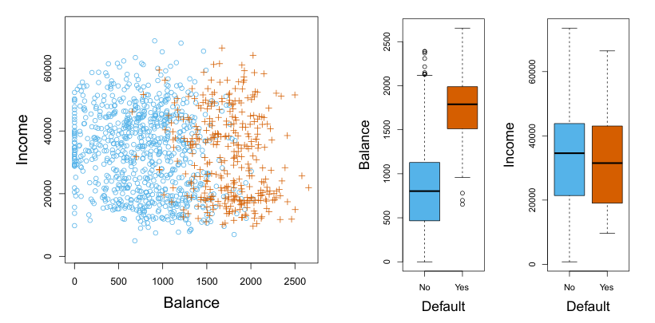

**图 4.1。** `Default` 数据集。左图：若干人的年收入和信用卡月度欠款。信用卡还款发生违约的人用橙色表示，未违约的人用蓝色表示。中图：按违约状态分组的 `balance` 箱线图。右图：按违约状态分组的 `income` 箱线图。

> 图内标签对照：`Balance` 为信用卡欠款，`Income` 为收入，`Default` 为违约状态；`No` 表示未违约，`Yes` 表示违约。原图标签、颜色与数值刻度保留。

$$
Y=\begin{cases}
1 & \text{若为 stroke};\\
2 & \text{若为 drug overdose};\\
3 & \text{若为 epileptic seizure}.
\end{cases}
$$

使用这种编码，就可以通过最小二乘法拟合线性回归模型，根据一组预测变量 $X_1,\ldots,X_p$ 预测 $Y$。遗憾的是，这种编码人为规定了结果的顺序：把药物过量置于卒中和癫痫发作之间，并规定卒中与药物过量的差别，等同于药物过量与癫痫发作的差别。实际中，并没有理由必须如此。例如，下面的编码也同样合理：

$$
Y=\begin{cases}
1 & \text{若为 epileptic seizure};\\
2 & \text{若为 stroke};\\
3 & \text{若为 drug overdose},
\end{cases}
$$

但它意味着这三种病情之间存在完全不同的关系。这些编码会产生根本不同的线性模型，最终对测试观测给出不同的预测结果。

如果响应的取值确实具有自然顺序，例如轻度、中度和重度，而且我们认为轻度与中度之间的差距，类似于中度与重度之间的差距，那么用 1、2、3 编码就是合理的。遗憾的是，一般来说，并不存在一种自然的方法，将有两个以上水平的定性响应转换成可直接用于线性回归的定量响应。

对于二元（两个水平）定性响应，情况要好一些。例如，患者病情可能只有卒中和药物过量两种可能。这时，可以使用第 3.3.1 节的虚拟变量方法，将响应编码为

$$
Y=\begin{cases}
0 & \text{若为 stroke};\\
1 & \text{若为 drug overdose}.
\end{cases}
$$

随后对这个二元响应拟合线性回归：若 $\hat{Y}>0.5$，则预测为药物过量，否则预测为卒中。在二元情形中，不难证明，即使将上述编码反过来，线性回归给出的最终预测仍然相同。

对于上述采用 0/1 编码的二元响应，使用最小二乘回归并非完全没有道理：可以证明，在这一特殊情形中，线性回归得到的 $X\hat{\beta}$ 实际上是对 $\Pr(\mathtt{drug\ overdose}\mid X)$ 的估计。然而，线性回归给出的某些估计值可能超出 $[0,1]$ 区间（见图 4.2），因此难以解释为概率！尽管如此，这些预测值仍能提供一种排序，也可以视为粗略的概率估计。有意思的是，用线性回归预测二元响应时，所得分类结果与第 4.4 节将介绍的线性判别分析（LDA）方法相同。

综上，至少有两个理由说明，不宜直接用回归方法做分类：（a）回归方法无法处理有两个以上类别的定性响应；（b）即使只有两个类别，回归方法也无法给出有意义的 $\Pr(Y\mid X)$ 估计。因此，最好使用真正适合定性响应的分类方法。下一节介绍的逻辑回归适用于二元定性响应；后续各节则会介绍适用于两个或更多类别的分类方法。

## 4.3 逻辑回归

再来看 `Default` 数据集，其中响应变量 `default` 只有 `Yes` 和 `No` 两个类别。逻辑回归并不直接对响应 $Y$ 建模，而是对 $Y$ 属于某一特定类别的概率建模。

对于 `Default` 数据，逻辑回归所建模的是违约概率。例如，给定 `balance` 时的违约概率可以写成

$$
\Pr(\texttt{default}=\texttt{Yes}\mid\texttt{balance}).
$$

$\Pr(\texttt{default}=\texttt{Yes}\mid\texttt{balance})$ 的值介于0与1之间，我们将其简记为 $p(\texttt{balance})$。这样，对于任意给定的 `balance` 值，就可以预测 `default`。例如，对于所有满足 $p(\texttt{balance})>0.5$ 的个体，可以预测其 `default = Yes`。


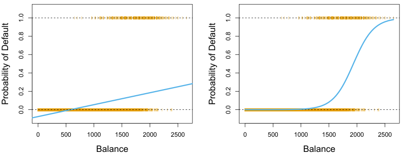

**图4.2** 使用 `Default` 数据进行分类。**左图：** 线性回归估计的违约概率，其中一些估计概率竟为负值！橙色短线表示 `default`（`No` 或 `Yes`）对应的0/1编码值。**右图：** 逻辑回归预测的违约概率，所有概率都介于0与1之间。图内文字：Balance＝欠款；Probability of Default＝违约概率。

如果一家公司希望在识别存在违约风险的个体时更为谨慎，也可以选用较低的阈值，例如 $p(\texttt{balance})>0.1$。

### 4.3.1 逻辑模型（The Logistic Model）

应当如何描述 $p(X)=\Pr(Y=1\mid X)$ 与 $X$ 之间的关系？（为方便起见，我们对响应采用通用的0/1编码。）在第4.2节中，我们考虑过用线性回归模型表示这些概率：

$$
p(X)=\beta_0+\beta_1X. \tag{4.1}
$$

如果用这种方法根据 `balance` 预测 `default=Yes`，就会得到图4.2左图所示的模型。这里可以看出它的问题：当欠款接近零时，预测的违约概率为负；如果对极高的欠款作预测，所得数值又会大于1。这些预测不合情理，因为无论信用卡欠款是多少，真实的违约概率都必须介于0与1之间。这并非信用卡违约数据所特有的问题。只要对编码为0或1的二元响应拟合一条直线，原则上总能找到某些 $X$ 值，使预测的 $p(X)<0$；也能找到另一些 $X$ 值，使 $p(X)>1$（除非 $X$ 的取值范围受到限制）。

为避免这一问题，必须用一个对所有 $X$ 值都能给出0到1之间输出的函数来描述 $p(X)$。满足这一条件的函数有很多。在逻辑回归中，我们采用**逻辑函数（logistic function）**：

$$
p(X)=\frac{e^{\beta_0+\beta_1X}}{1+e^{\beta_0+\beta_1X}}. \tag{4.2}
$$

拟合模型(4.2)时，我们使用一种称为**极大似然（maximum likelihood）**的方法，下一小节将介绍这种方法。图4.2右图展示了对 `Default` 数据拟合逻辑回归模型的结果。


可以看到，欠款较低时，预测的违约概率接近零，却绝不会低于零；欠款较高时，预测概率接近1，却绝不会超过1。逻辑函数总会产生这种S形曲线，因此，无论 $X$ 取何值，都能得到合理的预测。还可以看到，相比左图中的线性回归模型，逻辑模型更能刻画概率的变化范围。两种模型的平均拟合概率均为0.0333（对训练数据取平均），与数据集中违约者的总体比例相同。

对式(4.2)作简单变形，可得

$$
\frac{p(X)}{1-p(X)}=e^{\beta_0+\beta_1X}. \tag{4.3}
$$

$p(X)/[1-p(X)]$ 称为**几率（odds）**，可以取0到 $\infty$ 之间的任意值。几率接近0和接近 $\infty$，分别对应很低和很高的违约概率。例如，几率为 $1/4$ 的人中，平均每5人就有1人违约，因为 $p(X)=0.2$ 对应的几率为 $\frac{0.2}{1-0.2}=1/4$。同样，几率为9的人中，平均每10人就有9人违约，因为 $p(X)=0.9$ 对应的几率为 $\frac{0.9}{1-0.9}=9$。在赛马中，传统上使用几率而非概率，因为几率与正确的投注策略联系得更为自然。

对式(4.3)两边取对数，得到

$$
\log\left(\frac{p(X)}{1-p(X)}\right)=\beta_0+\beta_1X. \tag{4.4}
$$

左边称为**对数几率（log odds）**，也称 **logit**。可见，逻辑回归模型(4.2)的logit是 $X$ 的线性函数。

回顾第3章，在线性回归模型中，$\beta_1$ 表示 $X$ 增加一个单位时，$Y$ 的平均变化量。而在逻辑回归模型中，$X$ 增加一个单位，会使对数几率改变 $\beta_1$，见式(4.4)；等价地，会使几率乘以 $e^{\beta_1}$，见式(4.3)。不过，由于式(4.2)中 $p(X)$ 与 $X$ 并非直线关系，$\beta_1$ 并不等于 $X$ 增加一个单位时 $p(X)$ 的变化量。$X$ 改变一个单位所引起的 $p(X)$ 变化，取决于 $X$ 的当前值。但无论 $X$ 的值如何，若 $\beta_1$ 为正，$X$ 增大会伴随 $p(X)$ 增大；若 $\beta_1$ 为负，$X$ 增大会伴随 $p(X)$ 减小。观察图4.2右图，也能看出 $p(X)$ 与 $X$ 并非直线关系，而且 $X$ 每变化一个单位时 $p(X)$ 的变化率取决于 $X$ 的当前值。

### 4.3.2 估计回归系数

式(4.2)中的系数 $\beta_0$ 和 $\beta_1$ 未知，必须利用现有训练数据来估计。第3章采用最小二乘法估计未知的线性回归系数。虽然也可以用（非线性）最小二乘法拟合模型(4.4)，但通常更倾向于使用极大似然这一更通用的方法，因为它具有更好的统计性质。

用极大似然拟合逻辑回归模型的基本直觉如下：寻找 $\beta_0$ 和 $\beta_1$ 的估计值，使利用式(4.2)得到的每个人的预测违约概率 $\hat p(x_i)$ 尽可能符合其实际观测到的违约状态。换言之，我们希望找到 $\hat\beta_0$ 和 $\hat\beta_1$，将它们代入式(4.2)的 $p(X)$ 模型后，对所有违约者得到接近1的数值，对所有未违约者得到接近0的数值。这一直觉可以用一个称为**似然函数（likelihood function）**的数学表达式来形式化：

$$
\ell(\beta_0,\beta_1)=\prod_{i:y_i=1}p(x_i)\prod_{i':y_{i'}=0}\left(1-p(x_{i'})\right). \tag{4.5}
$$

估计值 $\hat\beta_0$ 和 $\hat\beta_1$ 被选为使该似然函数达到最大值的取值。

极大似然是一种非常通用的方法，本书将要研究的许多非线性模型都用它来拟合。在线性回归情形下，最小二乘法实际上是极大似然的一个特例。极大似然的数学细节超出了本书范围。不过，一般而言，逻辑回归和其他模型都可以使用R等统计软件轻松拟合，因此我们不必关注极大似然拟合过程的细节。

表4.1给出了对 `Default` 数据拟合逻辑回归模型、用 `balance` 预测 `default=Yes` 概率所得的系数估计值及相关信息。可以看到，$\hat\beta_1=0.0055$；这表明 `balance` 增大与违约概率上升有关。更准确地说，`balance` 每增加一个单位，违约的对数几率就增加0.0055个单位。

表4.1中的逻辑回归输出，在许多方面都与第3章的线性回归输出类似。例如，可以计算系数估计的标准误，以衡量估计的准确程度。表4.1中的 **$z$ 统计量（z-statistic）**，所起的作用与线性回归输出中的 $t$ 统计量相同，例如第77页表3.1中的 $t$ 统计量。具体而言，与 $\beta_1$ 对应的 $z$ 统计量等于 $\hat\beta_1/\operatorname{SE}(\hat\beta_1)$，因此，$z$ 统计量的绝对值较大，意味着有证据反对原假设 $H_0:\beta_1=0$。这一原假设意味着 $p(X)=\frac{e^{\beta_0}}{1+e^{\beta_0}}$；换言之，违约概率不依赖于 `balance`。由于表4.1中 `balance` 对应的 $p$ 值极小，我们可以拒绝 $H_0$。也就是说，可以得出结论：`balance` 与违约概率之间确实存在关联。表4.1中的截距估计通常不是我们关注的重点；它的主要作用，是调整平均拟合概率，使其等于数据中1的比例（这里就是总体违约率）。

### 4.3.3 作出预测

得到系数估计后，就能计算任意给定信用卡欠款对应的违约概率。例如，使用表4.1的系数估计值，我们可以预测欠款为1,000美元的个体的违约概率。

| | 系数 | 标准误 | $z$ 统计量 | $p$ 值 |
|---|---:|---:|---:|---:|
| `Intercept` | −10.6513 | 0.3612 | −29.5 | <0.0001 |
| `balance` | 0.0055 | 0.0002 | 24.9 | <0.0001 |

**表4.1** 对 `Default` 数据使用 `balance` 预测违约概率的逻辑回归模型的系数估计。`balance` 每增加一个单位，违约的对数几率就增加0.0055个单位。

| | 系数 | 标准误 | $z$ 统计量 | $p$ 值 |
|---|---:|---:|---:|---:|
| `Intercept` | −3.5041 | 0.0707 | −49.55 | <0.0001 |
| `student[Yes]` | 0.4049 | 0.1150 | 3.52 | 0.0004 |

**表4.2** 对 `Default` 数据使用学生身份预测违约概率的逻辑回归模型的系数估计。学生身份编码为一个虚拟变量：学生取1，非学生取0；表中以变量 `student[Yes]` 表示。

欠款为1,000美元时，预测概率为

$$
\hat p(X)=\frac{e^{\hat\beta_0+\hat\beta_1X}}{1+e^{\hat\beta_0+\hat\beta_1X}}
=\frac{e^{-10.6513+0.0055\times1,000}}{1+e^{-10.6513+0.0055\times1,000}}=0.00576,
$$

低于1%。相比之下，欠款为2,000美元的个体，其预测违约概率高得多，等于0.586，即58.6%。

通过第3.3.1节介绍的虚拟变量方法，也可以在逻辑回归模型中使用定性预测变量。例如，`Default` 数据集包含定性变量 `student`。要拟合以学生身份作为预测变量的模型，只需建立一个学生取1、非学生取0的虚拟变量。表4.2给出了根据学生身份预测违约概率的逻辑回归模型。虚拟变量对应的系数为正，相关的 $p$ 值在统计上显著。这表明学生的违约概率往往高于非学生：

$$
\widehat{\Pr}(\texttt{default}=\texttt{Yes}\mid\texttt{student}=\texttt{Yes})
=\frac{e^{-3.5041+0.4049\times1}}{1+e^{-3.5041+0.4049\times1}}=0.0431,
$$

$$
\widehat{\Pr}(\texttt{default}=\texttt{Yes}\mid\texttt{student}=\texttt{No})
=\frac{e^{-3.5041+0.4049\times0}}{1+e^{-3.5041+0.4049\times0}}=0.0292.
$$

### 4.3.4 多元逻辑回归（Multiple Logistic Regression）

现在考虑使用多个预测变量来预测二元响应的问题。类似于第3章从简单线性回归扩展到多元线性回归，我们可以将式(4.4)推广为

$$
\log\left(\frac{p(X)}{1-p(X)}\right)=\beta_0+\beta_1X_1+\cdots+\beta_pX_p, \tag{4.6}
$$

其中 $X=(X_1,\ldots,X_p)$ 表示 $p$ 个预测变量。式(4.6)可以改写为

$$
p(X)=\frac{e^{\beta_0+\beta_1X_1+\cdots+\beta_pX_p}}{1+e^{\beta_0+\beta_1X_1+\cdots+\beta_pX_p}}. \tag{4.7}
$$


| | 系数 | 标准误 | $z$ 统计量 | $p$ 值 |
|---|---:|---:|---:|---:|
| `Intercept` | −10.8690 | 0.4923 | −22.08 | <0.0001 |
| `balance` | 0.0057 | 0.0002 | 24.74 | <0.0001 |
| `income` | 0.0030 | 0.0082 | 0.37 | 0.7115 |
| `student[Yes]` | −0.6468 | 0.2362 | −2.74 | 0.0062 |

**表4.3** 对 `Default` 数据使用 `balance`、`income` 和学生身份预测违约概率的逻辑回归模型的系数估计。学生身份编码为虚拟变量 `student[Yes]`：学生取1，非学生取0。拟合此模型时，`income` 以千美元为单位。

与第4.3.2节一样，我们用极大似然法估计 $\beta_0,\beta_1,\ldots,\beta_p$。

表4.3给出了使用 `balance`、`income`（单位为千美元）和学生身份预测违约概率的逻辑回归模型的系数估计。这里有一个令人意外的结果：`balance` 和学生身份虚拟变量对应的 $p$ 值都很小，表明这两个变量各自都与违约概率有关。然而，虚拟变量的系数为负，说明学生比非学生更不容易违约。相比之下，表4.2中该虚拟变量的系数却为正。为什么在表4.2中，学生身份与违约概率上升有关，而在表4.3中，却与违约概率下降有关？图4.3左图直观展示了这个看似矛盾的现象。橙色和蓝色实线分别表示学生和非学生的平均违约率随信用卡欠款的变化。多元逻辑回归中 `student` 的系数为负，表明**在 `balance` 和 `income` 保持不变时，学生比非学生更不容易违约**。事实上，从图4.3左图可以看出，对每一个 `balance` 值，学生的违约率都不高于非学生。不过，图底部附近的水平虚线给出了在所有 `balance` 和 `income` 值上取平均的学生与非学生违约率，却显示出相反的效应：学生的总体违约率高于非学生。因此，表4.2所示的单预测变量逻辑回归输出中，`student` 的系数为正。

图4.3右图解释了这种差异。变量 `student` 与 `balance` 相关。学生的负债通常较高，而负债较高又与较高的违约概率有关。换言之，学生更可能持有较高的信用卡欠款；从图4.3左图已经知道，这通常与较高的违约率有关。因此，虽然某个欠款给定的学生，往往比欠款相同的非学生违约概率更低，但由于学生整体上倾向于持有更多信用卡欠款，学生的总体违约率反而高于非学生。对于要决定向谁提供信贷的信用卡公司，这一区别很重要：如果无法获得学生的信用卡欠款信息，那么学生的风险比非学生高。

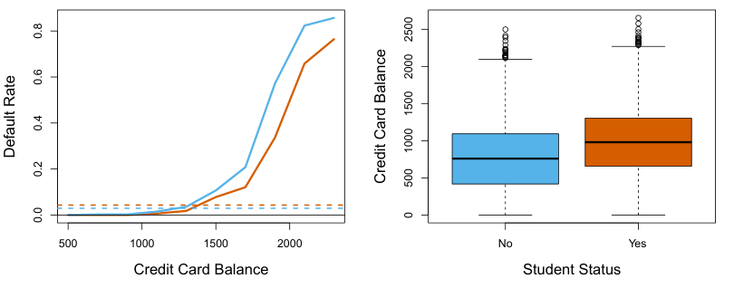

**图4.3** `Default` 数据中的混杂（confounding）。**左图：** 学生（橙色）和非学生（蓝色）的违约率。实线表示违约率随 `balance` 的变化，水平虚线表示总体违约率。**右图：** 学生（橙色）和非学生（蓝色）的 `balance` 箱线图。图内文字：Credit Card Balance＝信用卡欠款；Default Rate＝违约率；Student Status＝学生身份；No＝非学生；Yes＝学生。

然而，与**信用卡欠款相同**的非学生相比，这名学生的风险却更低！

这个简单的例子说明，当其他预测变量也可能相关时，仅使用一个预测变量进行回归，会有风险，也存在微妙之处。与线性回归的情形一样，使用一个预测变量得到的结果，可能与使用多个预测变量得到的结果很不相同，尤其是在预测变量之间存在相关性时。一般而言，图4.3所示的现象称为**混杂**。

把表4.3中的回归系数估计值代入式(4.7)，即可作出预测。例如，一名信用卡欠款为1,500美元、收入为40,000美元的学生，其估计违约概率为

$$
\hat p(X)=\frac{e^{-10.869+0.00574\times1,500+0.003\times40-0.6468\times1}}{1+e^{-10.869+0.00574\times1,500+0.003\times40-0.6468\times1}}=0.058. \tag{4.8}
$$

欠款和收入相同的非学生，其估计违约概率为

$$
\hat p(X)=\frac{e^{-10.869+0.00574\times1,500+0.003\times40-0.6468\times0}}{1+e^{-10.869+0.00574\times1,500+0.003\times40-0.6468\times0}}=0.105. \tag{4.9}
$$

（这里把表4.3中 `income` 的系数估计值乘以40，而不是40,000，因为该表中的模型以1,000美元为 `income` 的计量单位进行拟合。）

### 4.3.5 多项逻辑回归（Multinomial Logistic Regression）

有时，我们希望对类别数超过两个的响应变量进行分类。例如，第4.2节急诊室的例子包含三类病情：卒中（`stroke`）、药物过量（`drug overdose`）和癫痫发作（`epileptic seizure`）。然而，本节此前介绍的逻辑回归方法只允许响应变量具有 $K=2$ 个类别。

实际上，二分类逻辑回归可以扩展到 $K>2$ 个类别的情形，这种扩展有时称为**多项逻辑回归**。为此，先选取一个类别作为基准；不失一般性，我们选择第 $K$ 类。然后用下面的模型代替式(4.7)：对于 $k=1,\ldots,K-1$，

$$
\Pr(Y=k\mid X=x)=\frac{e^{\beta_{k0}+\beta_{k1}x_1+\cdots+\beta_{kp}x_p}}{1+\sum_{l=1}^{K-1}e^{\beta_{l0}+\beta_{l1}x_1+\cdots+\beta_{lp}x_p}}, \tag{4.10}
$$

而

$$
\Pr(Y=K\mid X=x)=\frac{1}{1+\sum_{l=1}^{K-1}e^{\beta_{l0}+\beta_{l1}x_1+\cdots+\beta_{lp}x_p}}. \tag{4.11}
$$

不难证明，对于 $k=1,\ldots,K-1$，

$$
\log\left(\frac{\Pr(Y=k\mid X=x)}{\Pr(Y=K\mid X=x)}\right)=\beta_{k0}+\beta_{k1}x_1+\cdots+\beta_{kp}x_p. \tag{4.12}
$$

注意，式(4.12)与式(4.6)十分相似。式(4.12)再次表明，任意两个类别之间的对数几率都是特征（features）的线性函数。

在式(4.10)–(4.12)中，把第 $K$ 类选为基准并不影响关键结果。例如，要将急诊病例分为 `stroke`、`drug overdose` 和 `epileptic seizure` 三类，假设拟合两个多项逻辑回归模型：一个以 `stroke` 为基准，另一个以 `drug overdose` 为基准。由于基准选择不同，两个模型的系数估计会有差异，但拟合值（预测）、任意两个类别之间的对数几率，以及模型的其他关键输出都保持相同。

不过，解释多项逻辑回归模型的系数时必须谨慎，因为系数的含义与所选基准有关。例如，若将 `epileptic seizure` 设为基准，那么 $\beta_{\texttt{stroke}0}$ 就可以解释为在 $x_1=\cdots=x_p=0$ 时，`stroke` 相对于 `epileptic seizure` 的对数几率。此外，$X_j$ 每增加一个单位，`stroke` 相对于 `epileptic seizure` 的对数几率便增加 $\beta_{\texttt{stroke}j}$。换一种说法，如果 $X_j$ 增加一个单位，那么

$$
\frac{\Pr(Y=\texttt{stroke}\mid X=x)}{\Pr(Y=\texttt{epileptic seizure}\mid X=x)}
$$

就会乘以 $e^{\beta_{\texttt{stroke}j}}$。

下面简要介绍多项逻辑回归的另一种编码，称为 **softmax编码（softmax coding）**。就拟合值、任意两个类别间的对数几率和模型的其他关键输出保持相同这一意义而言，softmax编码与刚才介绍的编码等价。但softmax编码在机器学习文献的一些领域中使用广泛（第10章还会再次出现），因此值得了解。在softmax编码中，不再选取一个基准类别，而是对全部 $K$ 个类别作对称处理，并假设对于 $k=1,\ldots,K$，

$$
\Pr(Y=k\mid X=x)=\frac{e^{\beta_{k0}+\beta_{k1}x_1+\cdots+\beta_{kp}x_p}}{\sum_{l=1}^{K}e^{\beta_{l0}+\beta_{l1}x_1+\cdots+\beta_{lp}x_p}}. \tag{4.13}
$$

因此，实际估计的是全部 $K$ 个类别的系数，而非仅估计 $K-1$ 个类别的系数。由式(4.13)不难看出，第 $k$ 类与第 $k'$ 类之间的对数几率比为

$$
\log\left(\frac{\Pr(Y=k\mid X=x)}{\Pr(Y=k'\mid X=x)}\right)
=(\beta_{k0}-\beta_{k'0})+(\beta_{k1}-\beta_{k'1})x_1+\cdots+(\beta_{kp}-\beta_{k'p})x_p. \tag{4.14}
$$

## 4.4 用于分类的生成模型（Generative Models for Classification）

逻辑回归利用逻辑函数直接对 $\Pr(Y=k\mid X=x)$ 建模；当响应有两个类别时，逻辑函数由式（4.7）给出。用统计学术语来说，我们对给定预测变量 $X$ 时响应 $Y$ 的条件分布（conditional distribution）建模。现在考虑另一种估计这些概率的方法，它采取的途径更为间接。在这种新方法中，我们分别对每个响应类别内（即 $Y$ 的每个取值下）预测变量 $X$ 的分布建模，再利用贝叶斯定理（Bayes’ theorem）将其转换成 $\Pr(Y=k\mid X=x)$ 的估计值。如果假设每一类中的 $X$ 都服从正态分布，得到的模型在形式上与逻辑回归十分相似。

既然已有逻辑回归，为什么还需要其他方法？原因有几个：

- 当两个类别之间分离程度很大时，逻辑回归模型的参数估计值会出人意料地不稳定。本节介绍的方法没有这个问题。
- 如果每个类别内预测变量 $X$ 的分布近似正态，且样本量较小，本节的方法可能比逻辑回归更准确。
- 本节的方法可以自然地推广到响应类别多于两个的情形。（在响应类别多于两个时，也可以使用4.3.5节的多项逻辑回归。）

假设我们希望把一个观测分到 $K$ 个类别中的某一类，其中 $K\geq2$。换言之，定性响应变量 $Y$ 可以取 $K$ 个互不相同且没有顺序的值。用 $\pi_k$ 表示随机选取的一个观测来自第 $k$ 类的总体概率，或先验概率（prior probability）。用 $f_k(X)\equiv\Pr(X\mid Y=k)$<sup><a href="#ch04-fn1" id="ch04-fnref1">1</a></sup> 表示第 $k$ 类观测的 $X$ 的密度函数（density function）。也就是说，如果第 $k$ 类观测满足 $X\approx x$ 的概率较高，$f_k(x)$ 就较大；如果第 $k$ 类观测几乎不可能满足 $X\approx x$，$f_k(x)$ 就较小。贝叶斯定理给出

> <a href="#ch04-fnref1">1</a> 严格来说，这个定义只在 $X$ 是定性随机变量时才正确。如果 $X$ 是定量变量，那么 $f_k(x)\,dx$ 对应于 $X$ 落在 $x$ 周围一个微小区域 $dx$ 内的概率。

$$
\Pr(Y=k\mid X=x)=\frac{\pi_k f_k(x)}{\sum_{l=1}^{K}\pi_l f_l(x)}. \tag{4.15}
$$

沿用此前的记号，我们将其简记为 $p_k(x)=\Pr(Y=k\mid X=x)$。这是观测 $X=x$ 属于第 $k$ 类的后验概率（posterior probability），也就是给定该观测的预测变量取值后，它属于第 $k$ 类的概率。

式（4.15）表明，我们不必像4.3.1节那样直接计算后验概率 $p_k(x)$，而可以把 $\pi_k$ 和 $f_k(x)$ 的估计值代入式（4.15）。一般而言，如果手中有来自总体的随机样本，估计 $\pi_k$ 很容易：只需计算训练观测中属于第 $k$ 类的比例。然而，估计密度函数 $f_k(x)$ 则困难得多。我们将看到，为了估计 $f_k(x)$，通常需要作一些简化假设。

第2章已介绍，贝叶斯分类器（Bayes classifier）把观测 $x$ 分到 $p_k(x)$ 最大的类别，它在所有分类器中具有最低的可能错误率。（当然，这只有在式（4.15）的各项都正确指定时才成立。）因此，只要能找到估计 $f_k(x)$ 的办法，就可以把估计值代入式（4.15），从而近似贝叶斯分类器。

以下几节讨论三种分类器，它们在式（4.15）中使用不同的 $f_k(x)$ 估计值来近似贝叶斯分类器：线性判别分析、二次判别分析和朴素贝叶斯。

### 4.4.1 $p=1$ 时的线性判别分析

暂时假设 $p=1$，即只有一个预测变量。我们希望得到 $f_k(x)$ 的估计值，将其代入式（4.15）来估计 $p_k(x)$，然后把观测分到 $p_k(x)$ 最大的类别。为了估计 $f_k(x)$，先对它的形式作一些假设。

具体来说，假设 $f_k(x)$ 为正态密度，也称高斯密度。在一维情形中，正态密度的形式为

$$
f_k(x)=\frac{1}{\sqrt{2\pi}\sigma_k}\exp\left(-\frac{1}{2\sigma_k^2}(x-\mu_k)^2\right), \tag{4.16}
$$

其中 $\mu_k$ 和 $\sigma_k^2$ 是第 $k$ 类的均值和方差参数。暂且进一步假设 $\sigma_1^2=\cdots=\sigma_K^2$，即 $K$ 个类别具有共同的方差项，为简便起见记作 $\sigma^2$。将式（4.16）代入式（4.15），得到

$$
p_k(x)=\frac{\pi_k\dfrac{1}{\sqrt{2\pi}\sigma}\exp\left(-\dfrac{1}{2\sigma^2}(x-\mu_k)^2\right)}{\sum_{l=1}^{K}\pi_l\dfrac{1}{\sqrt{2\pi}\sigma}\exp\left(-\dfrac{1}{2\sigma^2}(x-\mu_l)^2\right)}. \tag{4.17}
$$

（注意，式（4.17）中的 $\pi_k$ 是观测属于第 $k$ 类的先验概率，不要与数学常数 $\pi\approx3.14159$ 混淆。）贝叶斯分类器<sup><a href="#ch04-fn2" id="ch04-fnref2">2</a></sup> 将观测 $X=x$ 分到式（4.17）最大的类别。

> <a href="#ch04-fnref2">2</a> 回顾一下，贝叶斯分类器把观测分到 $p_k(x)$ 最大的类别。它不同于式（4.15）的贝叶斯定理；后者使我们能够转换条件分布。


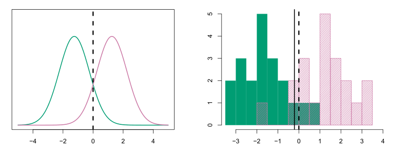

**图4.4** 左：两个一维正态密度函数。竖直虚线表示贝叶斯决策边界。右：从两个类别中各抽取20个观测，以直方图展示。贝叶斯决策边界仍用竖直虚线表示，竖直实线表示根据训练数据估计的LDA决策边界。

对式（4.17）取对数并整理各项，不难证明<sup><a href="#ch04-fn3" id="ch04-fnref3">3</a></sup>，上述规则等价于把观测分到下式最大的类别：

$$
\delta_k(x)=x\cdot\frac{\mu_k}{\sigma^2}-\frac{\mu_k^2}{2\sigma^2}+\log(\pi_k). \tag{4.18}
$$

例如，如果 $K=2$ 且 $\pi_1=\pi_2$，那么当 $2x(\mu_1-\mu_2)>\mu_1^2-\mu_2^2$ 时，贝叶斯分类器把观测分到第1类，否则分到第2类。贝叶斯决策边界（Bayes decision boundary）是满足 $\delta_1(x)=\delta_2(x)$ 的点；可以证明，这等价于

$$
x=\frac{\mu_1^2-\mu_2^2}{2(\mu_1-\mu_2)}=\frac{\mu_1+\mu_2}{2}. \tag{4.19}
$$

图4.4左图给出一个例子。图中的两个正态密度函数 $f_1(x)$ 和 $f_2(x)$ 分别代表两个不同的类别。它们的均值和方差参数为 $\mu_1=-1.25$、$\mu_2=1.25$，以及 $\sigma_1^2=\sigma_2^2=1$。两个密度相互重叠，因此，即使给定 $X=x$，观测所属的类别仍有一定的不确定性。如果假设一个观测来自两个类别的可能性相同，即 $\pi_1=\pi_2=0.5$，那么由式（4.19）可知，贝叶斯分类器在 $x<0$ 时将观测分到第1类，否则分到第2类。注意，此处能计算出贝叶斯分类器，是因为我们知道每个类别内的 $X$ 都来自高斯分布，并且知道所有相关参数。在现实情形中，我们无法计算出贝叶斯分类器。

实际应用中，即便十分确信每个类别内的 $X$ 都来自高斯分布，要使用贝叶斯分类器，仍须估计参数 $\mu_1,\ldots,\mu_K$、$\pi_1,\ldots,\pi_K$ 以及 $\sigma^2$。线性判别分析（LDA）把 $\pi_k$、$\mu_k$ 和 $\sigma^2$ 的估计值代入式（4.18），以此近似贝叶斯分类器。

> <aside class="footnote" id="ch04-fn3"><a href="#ch04-fnref3">3</a> 见本章末的习题2。</aside>

具体使用以下估计值：

$$
\begin{aligned}
\hat\mu_k&=\frac{1}{n_k}\sum_{i:y_i=k}x_i,\\
\hat\sigma^2&=\frac{1}{n-K}\sum_{k=1}^{K}\sum_{i:y_i=k}(x_i-\hat\mu_k)^2,
\end{aligned}\tag{4.20}
$$

其中，$n$ 是训练观测总数，$n_k$ 是第 $k$ 类的训练观测数。$\mu_k$ 的估计值就是第 $k$ 类全部训练观测的平均值，而 $\hat\sigma^2$ 可以看作 $K$ 个类别样本方差的加权平均。有时，我们知道类别归属概率 $\pi_1,\ldots,\pi_K$，可以直接使用这些值。没有其他信息时，LDA用训练观测中属于第 $k$ 类的比例来估计 $\pi_k$。也就是说，

$$
\hat\pi_k=n_k/n. \tag{4.21}
$$

LDA分类器把式（4.20）和式（4.21）的估计值代入式（4.18），并把观测 $X=x$ 分到下式最大的类别：

$$
\hat\delta_k(x)=x\cdot\frac{\hat\mu_k}{\hat\sigma^2}-\frac{\hat\mu_k^2}{2\hat\sigma^2}+\log(\hat\pi_k). \tag{4.22}
$$

分类器名称中的“线性”一词源于这样一个事实：式（4.22）中的判别函数（discriminant function）$\hat\delta_k(x)$ 是 $x$ 的线性函数，而不是 $x$ 的更复杂函数。

图4.4右图展示了从每个类别各随机抽取20个观测所得的直方图。实施LDA时，先用式（4.20）和式（4.21）估计 $\pi_k$、$\mu_k$ 和 $\sigma^2$，再计算按式（4.22）最大者进行分类所产生的决策边界，以黑色实线表示。这条线左边的所有点都分到绿色类别，右边的点则分到紫色类别。本例中，$n_1=n_2=20$，因此 $\hat\pi_1=\hat\pi_2$。所以，决策边界恰好位于两个类别样本均值的中点 $(\hat\mu_1+\hat\mu_2)/2$。图中LDA决策边界略微偏在最优贝叶斯决策边界的左侧；后者为 $(\mu_1+\mu_2)/2=0$。LDA分类器在这组数据上表现如何？由于数据是模拟生成的，我们可以产生大量测试观测，计算贝叶斯错误率和LDA测试错误率，二者分别为10.6%和11.1%。换言之，LDA分类器的错误率仅比最低可能错误率高0.5%！这表明LDA在该数据集上表现相当好。

再强调一次，LDA分类器假设每个类别中的观测均来自正态分布，各类具有各自的均值及共同的方差 $\sigma^2$，然后把这些参数的估计值代入贝叶斯分类器。在4.4.3节，我们将放宽这些假设，允许第 $k$ 类观测具有该类特有的方差 $\sigma_k^2$。

### 4.4.2 $p>1$ 时的线性判别分析


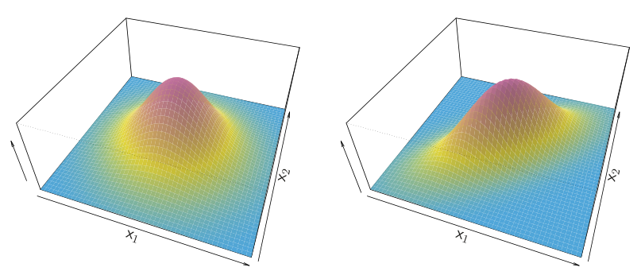

**图4.5** 两个 $p=2$ 的多元高斯密度函数。左：两个预测变量不相关。右：两个变量的相关系数为0.7。

现在把LDA分类器推广到多个预测变量的情形。为此，假设 $X=(X_1,X_2,\ldots,X_p)$ 来自多元高斯分布（multivariate Gaussian distribution），也称多元正态分布（multivariate normal distribution），各类具有各自的均值向量和共同的协方差矩阵（covariance matrix）。先简要回顾这个分布。

多元高斯分布假设每个预测变量各自服从式（4.16）的一维正态分布，每对预测变量之间存在一定的相关。图4.5展示了两个 $p=2$ 的多元高斯分布例子。曲面上某一点的高度表示 $X_1$ 和 $X_2$ 同时落在该点周围一个微小区域内的概率。在任一图中，沿 $X_1$ 轴或 $X_2$ 轴切开曲面，截面都具有一维正态分布的形状。图4.5左图的例子满足 $\operatorname{Var}(X_1)=\operatorname{Var}(X_2)$ 且 $\operatorname{Cor}(X_1,X_2)=0$，曲面具有典型的钟形。不过，如果预测变量相关或方差不同，钟形就会发生形变，如图4.5右图所示。这时，钟形的底部是椭圆形，而非圆形。若一个 $p$ 维随机变量 $X$ 服从多元高斯分布，就记为 $X\sim N(\mu,\boldsymbol\Sigma)$。这里 $E(X)=\mu$ 是 $X$ 的均值（一个有 $p$ 个分量的向量），$\operatorname{Cov}(X)=\boldsymbol\Sigma$ 是 $X$ 的 $p\times p$ 协方差矩阵。多元高斯密度的正式定义为

$$
f(x)=\frac{1}{(2\pi)^{p/2}|\boldsymbol\Sigma|^{1/2}}\exp\left(-\frac12(x-\mu)^T\boldsymbol\Sigma^{-1}(x-\mu)\right). \tag{4.23}
$$

当预测变量数 $p>1$ 时，LDA分类器假设第 $k$ 类观测来自多元高斯分布 $N(\mu_k,\boldsymbol\Sigma)$，其中 $\mu_k$ 是该类的均值向量，$\boldsymbol\Sigma$ 是所有 $K$ 个类别共有的协方差矩阵。把第 $k$ 类的密度函数 $f_k(X=x)$ 代入式（4.15）并稍作代数运算，可以发现，贝叶斯分类器把观测 $X=x$ 分到式（4.24）最大的类别。


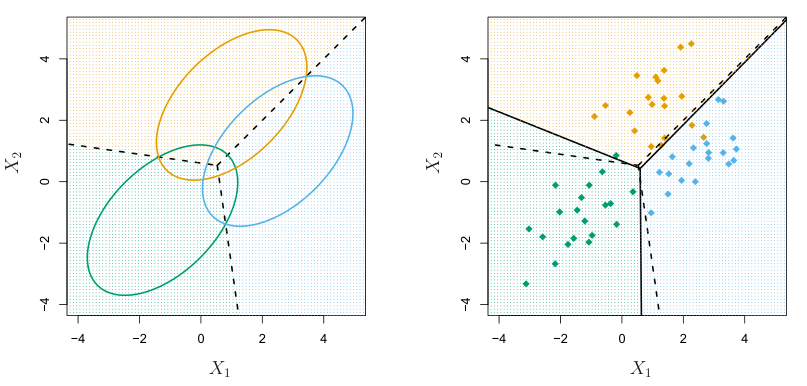

**图4.6** 三分类的例子。每类观测都来自 $p=2$ 的多元高斯分布，具有该类特有的均值向量和共同的协方差矩阵。左：三个椭圆分别包含对应类别95%的概率。虚线是贝叶斯决策边界。右：从每类各生成20个观测，相应的LDA决策边界用黑色实线表示。贝叶斯决策边界仍用虚线表示。

$$
\delta_k(x)=x^T\boldsymbol\Sigma^{-1}\mu_k-\frac12\mu_k^T\boldsymbol\Sigma^{-1}\mu_k+\log\pi_k. \tag{4.24}
$$

这就是式（4.18）的向量／矩阵版本。

图4.6左图给出一个例子，其中三个高斯类别大小相同，各自具有不同的均值向量，但共有一个协方差矩阵。三个椭圆分别表示包含对应类别95%概率的区域。虚线为贝叶斯决策边界。换言之，它们表示满足 $\delta_k(x)=\delta_l(x)$ 的 $x$ 值的集合，即对于 $k\ne l$，

$$
x^T\boldsymbol\Sigma^{-1}\mu_k-\frac12\mu_k^T\boldsymbol\Sigma^{-1}\mu_k
=x^T\boldsymbol\Sigma^{-1}\mu_l-\frac12\mu_l^T\boldsymbol\Sigma^{-1}\mu_l. \tag{4.25}
$$

（式（4.24）中的 $\log\pi_k$ 项消失了，因为三个类别的训练观测数相同，即每类的 $\pi_k$ 相同。）注意，贝叶斯决策边界由三条线表示，因为三个类别之间共有三对类别。也就是说，一条贝叶斯决策边界将第1类与第2类分开，一条将第1类与第3类分开，另一条将第2类与第3类分开。这三条贝叶斯决策边界把预测变量空间划分为三个区域。贝叶斯分类器根据观测所在的区域进行分类。

我们仍需估计未知参数 $\mu_1,\ldots,\mu_K$、$\pi_1,\ldots,\pi_K$ 以及 $\boldsymbol\Sigma$，公式与一维情形的式（4.20）类似。为了给新观测 $X=x$ 分类，LDA把这些估计值代入式（4.24），得到 $\hat\delta_k(x)$，再分到 $\hat\delta_k(x)$ 最大的类别。注意，式（4.24）中的 $\delta_k(x)$ 是 $x$ 的线性函数；也就是说，LDA决策规则只通过 $x$ 各分量的线性组合依赖于 $x$。

| 预测违约状态 | 真实：否 | 真实：是 | 合计 |
|---|---:|---:|---:|
| 否 | 9644 | 252 | 9896 |
| 是 | 23 | 81 | 104 |
| 合计 | 9667 | 333 | 10000 |

**表4.4** 混淆矩阵比较了LDA对 `Default` 数据集中10,000个训练观测的预测与真实违约状态。矩阵对角线上的元素对应违约状态预测正确的个体，非对角线元素对应误分类的个体。LDA错误预测了23名未违约者和252名违约者。

如前所述，这就是LDA名称中“线性”一词的由来。

图4.6右图展示了从三个类别中各抽取的20个观测，以及用黑色实线表示的LDA决策边界。总体而言，LDA决策边界很接近用虚线表示的贝叶斯决策边界。贝叶斯分类器和LDA分类器的测试错误率分别为0.0746和0.0770。这表明LDA在这组数据上表现良好。

我们可以对 `Default` 数据使用LDA，根据信用卡欠款和学生身份预测某人是否会违约。<sup><a href="#ch04-fn4" id="ch04-fnref4">4</a></sup> 用10,000个训练样本拟合的LDA模型，其训练错误率为2.75%。这个错误率听起来很低，但须注意两点。

- 首先，训练错误率通常低于测试错误率，而后者才是我们真正关心的量。换言之，如果用这个分类器预测一批新个体是否违约，其表现可能会差一些。这是因为我们专门调整了模型参数，使它在训练数据上表现良好。参数数目 $p$ 与样本数 $n$ 的比值越高，过拟合的影响通常就越大。对于这里的数据，我们预计这不会成为问题，因为 $p=2$，$n=10{,}000$。
- 其次，训练样本中只有3.33%的个体违约。因此，一个简单但毫无用处的分类器，无论某人的信用卡欠款和学生身份如何，始终预测其不会违约，也能得到3.33%的错误率。换言之，这种平凡的空分类器（null classifier）的错误率仅略高于LDA的训练集错误率。

实际应用中，这样的二分类器可能犯两类错误：把违约者错误地分到未违约类别，或者把未违约者错误地分到违约类别。

> <a href="#ch04-fnref4">4</a> 细心的读者会注意到，学生身份是定性变量，因此这个例子显然违反了LDA的正态性假设！不过，如本例所示，LDA对于偏离模型假设的情况往往具有相当强的稳健性。4.4.4节讨论的朴素贝叶斯提供了LDA之外的另一种选择，它不假设预测变量服从正态分布。

我们往往希望知道，实际犯的是哪一类错误。混淆矩阵（confusion matrix）可以方便地展示这些信息，表4.4给出了 `Default` 数据的例子。表中可见，LDA共预测104人会违约，其中81人实际违约，23人没有违约。因此，9,667名未违约者中，只有23人被误分类。这个错误率看起来很低！然而，333名违约者中，LDA漏掉了252人，即75.7%。因此，虽然总体错误率较低，但违约者中的错误率很高。对于试图识别高风险个体的信用卡公司而言，违约者中的错误率高达 $252/333=75.7\%$，很可能无法接受。

各类别的分类表现，在医学与生物学中也很重要。这些领域用敏感度（sensitivity）与特异度（specificity）描述分类器或筛查检验的表现。本例的敏感度是实际违约者中被识别出来的百分比，为24.3%；特异度是未违约者中被正确识别的百分比，为 $(1-23/9667)=99.8\%$。

为什么LDA在识别违约客户时表现如此糟糕？换言之，为什么敏感度这么低？如前所述，LDA试图近似贝叶斯分类器，而贝叶斯分类器在所有分类器中具有最低的总体错误率。也就是说，贝叶斯分类器让误分类观测的总数尽可能少，而不区分错误来自哪个类别。有些错误是把未违约客户分到违约类，有些则是把违约客户分到未违约类。然而，信用卡公司可能尤其希望避免错分将会违约的个体；错分不会违约的个体虽然也应避免，问题却相对较小。接下来将看到，可以修改LDA，使分类器更符合信用卡公司的需要。

贝叶斯分类器把观测分到后验概率 $p_k(X)$ 最大的类别。在二分类情况下，这等价于在满足下式时把观测分到违约类：

$$
\Pr(\mathtt{default}=\mathtt{Yes}\mid X=x)>0.5. \tag{4.26}
$$

因此，贝叶斯分类器以及由此延伸的LDA，以50%作为违约后验概率的阈值，将观测分到违约类。不过，如果关心的是对实际违约者作出错误预测的问题，就可以考虑降低这个阈值。例如，可以把违约后验概率高于20%的所有客户归为违约类。换言之，不再以式（4.26）作为归入违约类的条件，而改为

$$
\Pr(\mathtt{default}=\mathtt{Yes}\mid X=x)>0.2. \tag{4.27}
$$

这种做法得到的错误率见表4.5。现在，LDA预测430人会违约。333名实际违约者中，除了138人（即41.4%）外，其余全部预测正确。相比采用50%阈值时75.7%的错误率，这是很大的改善。

| 预测违约状态 | 真实：否 | 真实：是 | 合计 |
|---|---:|---:|---:|
| 否 | 9432 | 138 | 9570 |
| 是 | 235 | 195 | 430 |
| 合计 | 9667 | 333 | 10000 |

**表4.5** 混淆矩阵比较了LDA对 `Default` 数据集中10,000个训练观测的预测与真实违约状态。这里修改了阈值：只要某人的违约后验概率超过20%，就预测其会违约。

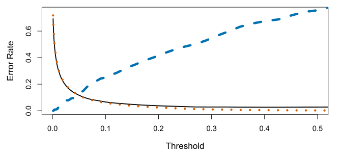

**图4.7** `Default` 数据集的错误率随分类所用后验概率阈值的变化。黑色实线表示总体错误率；蓝色虚线表示违约客户中被误分类的比例；橙色点线表示未违约客户中的错误比例。横轴Threshold＝阈值，纵轴Error Rate＝错误率。

不过，这一改善有其代价：现在有235名未违约者被误分类。因此，总体错误率略升至3.73%。但信用卡公司可能认为，为更准确地识别真正会违约的人，总体错误率的这点增加是值得付出的微小代价。

图4.7展示了修改违约后验概率阈值所产生的权衡。图中给出了各种错误率随阈值的变化。采用式（4.26）中的0.5阈值时，总体错误率（黑色实线）最小。这是预料之中的，因为贝叶斯分类器采用的阈值就是0.5，而且我们知道它具有最低的总体错误率。然而，采用0.5阈值时，违约者中的错误率很高（蓝色虚线）。随着阈值降低，违约者中的错误率持续下降，但未违约者中的错误率上升。怎样决定哪个阈值最好？这个决定必须基于领域知识，例如与违约损失有关的详细信息。

ROC曲线（ROC curve）是一种常用图形，可同时展示所有可能阈值下的两类错误。“ROC”这一名称沿用自通信理论，是receiver operating characteristics（受试者工作特征）的缩写。图4.8展示了LDA分类器在训练数据上的ROC曲线。将所有可能阈值下的表现汇总后，分类器的总体表现可以用ROC曲线下面积（area under the ROC curve，AUC）表示。


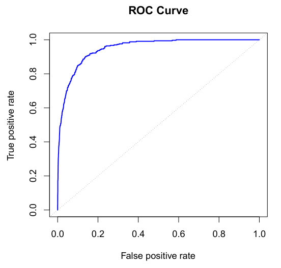

**图4.8** LDA分类器在 `Default` 数据上的ROC曲线。改变违约后验概率的阈值时，曲线描绘了两类错误的变化；图中没有标出实际阈值。真阳性率（true positive rate）就是敏感度，表示在给定阈值下被正确识别的违约者比例。假阳性率（false positive rate）等于1减特异度，表示在同一阈值下被错误归为违约者的未违约者比例。理想的ROC曲线紧贴左上角，表示真阳性率高、假阳性率低。点线代表“无信息”分类器；如果学生身份和信用卡欠款与违约概率没有关联，我们预期就会得到这条线。横轴False positive rate＝假阳性率，纵轴True positive rate＝真阳性率。

理想的ROC曲线紧贴左上角，因此AUC越大，分类器越好。这组数据的AUC为0.95，接近最大值1.0，因此可以认为表现很好。对于表现不优于随机猜测的分类器，在一个未用于模型训练的独立测试集上评估时，预期AUC为0.5。ROC曲线考虑了所有可能阈值，因此适合比较不同分类器。事实上，4.3.4节对这组数据拟合的逻辑回归模型，其ROC曲线与这里LDA模型的曲线几乎无法区分，因此不再展示。

如上所述，改变分类器阈值会改变真阳性率和假阳性率；它们也分别称为分类器的敏感度和1减特异度。这里的术语繁多，几乎令人眼花缭乱，因此下面作一个汇总。表4.6给出了将分类器（或诊断检验）应用于一个总体时可能出现的结果。为与流行病学文献衔接，我们用“+”表示试图检出的“患病”状态，用“−”表示“未患病”状态。为与经典假设检验文献衔接，则把“−”看作原假设，把“+”看作备择（非原）假设。

| 预测类别 | 真实类别：−或原假设 | 真实类别：+或非原假设 | 合计 |
|---|---|---|---|
| −或原假设 | 真阴性（true negative，TN） | 假阴性（false negative，FN） | $N^*$ |
| +或非原假设 | 假阳性（false positive，FP） | 真阳性（true positive，TP） | $P^*$ |
| 合计 | $N$ | $P$ | |

**表4.6** 将分类器或诊断检验应用于一个总体时可能出现的结果。

| 名称 | 定义 | 同义表述 |
|---|---|---|
| 假阳性率 | $\mathrm{FP}/N$ | I类错误（Type I error），$1-\text{特异度}$ |
| 真阳性率 | $\mathrm{TP}/P$ | $1-\text{II类错误}$（Type II error），功效，敏感度，召回率（recall） |
| 阳性预测值（positive predictive value） | $\mathrm{TP}/P^*$ | 精确率（precision），$1-\text{错误发现比例}$（false discovery proportion） |
| 阴性预测值（negative predictive value） | $\mathrm{TN}/N^*$ | |

**表4.7** 分类与诊断检验的重要指标，由表4.6中的数量推导而得。

在 `Default` 数据的语境中，“+”表示违约者，“−”表示未违约者。

表4.7列出这一语境中许多常用的表现指标。假阳性率和真阳性率的分母是各类在总体中的实际人数；阳性预测值和阴性预测值的分母则是预测为对应类别的总人数。

### 4.4.3 二次判别分析

如前所述，LDA假设每类观测来自多元高斯分布，各类具有各自的均值向量，所有 $K$ 个类别共用一个协方差矩阵。二次判别分析（QDA）提供了另一种方法。与LDA一样，QDA分类器也假设每类观测来自高斯分布，并把参数估计值代入贝叶斯定理进行预测。不过，QDA与LDA不同，它假设每个类别有自己的协方差矩阵。也就是说，假设第 $k$ 类观测满足 $X\sim N(\mu_k,\boldsymbol\Sigma_k)$，其中 $\boldsymbol\Sigma_k$ 是第 $k$ 类的协方差矩阵。在此假设下，贝叶斯分类器把观测 $X=x$ 分到下式最大的类别：

$$
\begin{aligned}
\delta_k(x)
&=-\frac12(x-\mu_k)^T\boldsymbol\Sigma_k^{-1}(x-\mu_k)-\frac12\log|\boldsymbol\Sigma_k|+\log\pi_k\\
&=-\frac12 x^T\boldsymbol\Sigma_k^{-1}x+x^T\boldsymbol\Sigma_k^{-1}\mu_k-\frac12\mu_k^T\boldsymbol\Sigma_k^{-1}\mu_k-\frac12\log|\boldsymbol\Sigma_k|+\log\pi_k.
\end{aligned}\tag{4.28}
$$

因此，QDA分类器把 $\boldsymbol\Sigma_k$、$\mu_k$ 和 $\pi_k$ 的估计值代入式（4.28），然后将观测 $X=x$ 分到该式最大的类别。与式（4.24）不同，式（4.28）是 $x$ 的二次函数。这就是QDA名称的由来。

是否假设 $K$ 个类别共享一个协方差矩阵，为什么很重要？换言之，为什么有时更倾向于LDA，有时更倾向于QDA？答案在于偏差—方差权衡。

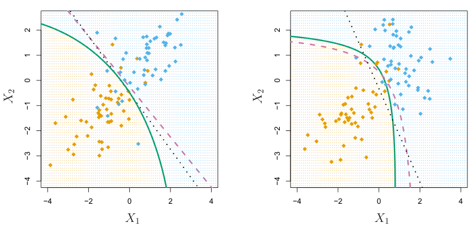

**图4.9** 左：在 $\boldsymbol\Sigma_1=\boldsymbol\Sigma_2$ 的二分类问题中，贝叶斯（紫色虚线）、LDA（黑色点线）和QDA（绿色实线）的决策边界。底色表示QDA决策规则。由于贝叶斯决策边界是线性的，LDA比QDA对它的近似更准确。右：其他设置与左图相同，但 $\boldsymbol\Sigma_1\ne\boldsymbol\Sigma_2$。由于贝叶斯决策边界是非线性的，QDA比LDA对它的近似更准确。

当有 $p$ 个预测变量时，估计一个协方差矩阵需要估计 $p(p+1)/2$ 个参数。QDA为每个类别分别估计协方差矩阵，共需 $Kp(p+1)/2$ 个参数。若有50个预测变量，参数数目就是1,275的某个倍数，数量相当大。如果改为假设 $K$ 个类别共享同一个协方差矩阵，LDA模型就成为 $x$ 的线性函数，意味着有 $Kp$ 个线性系数需要估计。因此，LDA分类器的灵活性远低于QDA，方差也显著较低。这可能改善预测表现。但这里存在权衡：如果LDA关于 $K$ 个类别共用一个协方差矩阵的假设与事实相差很大，它就可能具有很大的偏差。粗略地说，当训练观测相对较少、降低方差至关重要时，LDA通常比QDA更有希望表现良好。相反，如果训练集非常大，分类器的方差不再是主要顾虑，或者 $K$ 个类别共用一个协方差矩阵的假设显然站不住脚，则推荐使用QDA。

图4.9展示了LDA与QDA在两种情形下的表现。左图中，两个高斯类别内 $X_1$ 与 $X_2$ 的相关系数均为0.7。因此，贝叶斯决策边界是线性的，LDA决策边界能准确地近似它。QDA决策边界较差，因为它的方差更大，却没有相应的偏差下降作为补偿。右图则展示另一种情况：橙色类别中两个变量的相关系数为0.7，蓝色类别中为−0.7。此时贝叶斯决策边界是二次的，因此QDA比LDA更能准确地近似这一边界。

### 4.4.4 朴素贝叶斯

前面几节利用贝叶斯定理（4.15）建立了LDA和QDA分类器。这里再从贝叶斯定理出发，引出常用的朴素贝叶斯分类器。

回顾一下，贝叶斯定理（4.15）用 $\pi_1,\ldots,\pi_K$ 和 $f_1(x),\ldots,f_K(x)$ 表示后验概率 $p_k(x)=\Pr(Y=k\mid X=x)$。要在实际应用中使用式（4.15），需要估计 $\pi_1,\ldots,\pi_K$ 和 $f_1(x),\ldots,f_K(x)$。如前几节所见，估计先验概率 $\pi_1,\ldots,\pi_K$ 通常很直接：例如，对 $k=1,\ldots,K$，可以用训练观测中属于第 $k$ 类的比例作为 $\hat\pi_k$。

然而，估计 $f_1(x),\ldots,f_K(x)$ 就更为微妙。对于 $k=1,\ldots,K$，$f_k(x)$ 是第 $k$ 类观测的 $p$ 维密度函数。一般而言，估计 $p$ 维密度函数很困难。在LDA中，我们作出一个很强的假设，大幅简化了这项工作：假设 $f_k$ 是多元正态随机变量的密度函数，各类具有各自的均值 $\mu_k$ 和共同的协方差矩阵 $\boldsymbol\Sigma$。QDA则假设 $f_k$ 是均值为 $\mu_k$、协方差矩阵为 $\boldsymbol\Sigma_k$ 的多元正态随机变量的密度函数，均值与协方差均依类别而异。通过这些很强的假设，就能把估计 $K$ 个 $p$ 维密度函数这一十分困难的问题，替换为简单得多的问题：估计 $K$ 个 $p$ 维均值向量，以及一个（LDA）或 $K$ 个（QDA）$p\times p$ 协方差矩阵。

朴素贝叶斯分类器采取另一条途径来估计 $f_1(x),\ldots,f_K(x)$。我们不假设这些函数属于某一特定分布族（例如多元正态），而只作出一个假设：

> **在第 $k$ 类内部，$p$ 个预测变量相互独立。**

用数学语言表述，就是对于 $k=1,\ldots,K$，

$$
f_k(x)=f_{k1}(x_1)\times f_{k2}(x_2)\times\cdots\times f_{kp}(x_p), \tag{4.29}
$$

其中 $f_{kj}$ 是第 $k$ 类观测中第 $j$ 个预测变量的密度函数。

为什么这个假设如此有力？本质上，估计 $p$ 维密度函数的难点在于：不仅要考虑每个预测变量的边际分布（marginal distribution），即单独看这个预测变量时的分布，还要考虑预测变量的联合分布（joint distribution），即不同预测变量之间的关联。对于多元正态分布，不同预测变量间的关联由协方差矩阵的非对角元素概括。但一般情况下，这种关联很难刻画，估计起来更是极其困难。假设每类内部的 $p$ 个协变量（covariates）相互独立，就完全不必再顾虑这 $p$ 个预测变量之间的关联，因为我们直接假设它们没有关联！

我们真的相信朴素贝叶斯关于每类内部 $p$ 个协变量相互独立的假设吗？大多数情况下，并不相信。不过，即便这个建模假设只是为了方便，它往往仍能带来相当不错的结果，尤其是相对于 $p$ 而言 $n$ 不够大、无法有效估计每类内部预测变量联合分布的情形。

事实上，由于估计联合分布需要极大量的数据，朴素贝叶斯在许多情形下都是一个好选择。其本质是：朴素贝叶斯假设引入了一些偏差，但降低了方差；通过偏差—方差权衡，得到一个在实际应用中表现相当好的分类器。

作出朴素贝叶斯假设后，将式（4.29）代入式（4.15），可得后验概率的表达式：

$$
\Pr(Y=k\mid X=x)=\frac{\pi_k\times f_{k1}(x_1)\times f_{k2}(x_2)\times\cdots\times f_{kp}(x_p)}{\sum_{l=1}^{K}\pi_l\times f_{l1}(x_1)\times f_{l2}(x_2)\times\cdots\times f_{lp}(x_p)}, \tag{4.30}
$$

其中 $k=1,\ldots,K$。

利用训练数据 $x_{1j},\ldots,x_{nj}$ 估计一维密度函数 $f_{kj}$，有几种选择。

- 如果 $X_j$ 是定量变量，可以假设 $X_j\mid Y=k\sim N(\mu_{jk},\sigma_{jk}^2)$。换言之，假设每类内部的第 $j$ 个预测变量来自一元正态分布。这听起来与QDA有些相似，但有一个关键区别：这里假设预测变量相互独立。这相当于在QDA上再加一个假设，即每类的协方差矩阵都是对角矩阵。
- 如果 $X_j$ 是定量变量，另一种选择是对 $f_{kj}$ 作非参数估计。一个非常简单的办法，是为每类内部第 $j$ 个预测变量的观测绘制直方图，再用第 $k$ 类训练观测中与 $x_j$ 落入同一直方图分箱的比例，估计 $f_{kj}(x_j)$。也可以使用核密度估计量（kernel density estimator），本质上就是直方图的平滑版本。
- 如果 $X_j$ 是定性变量，只需在各类中统计第 $j$ 个预测变量各取值所对应的训练观测比例。例如，假设 $X_j\in\{1,2,3\}$，第 $k$ 类中有100个观测；其中第 $j$ 个预测变量分别有32、55和13个观测取1、2和3，则可将 $f_{kj}$ 估计为

$$
\hat f_{kj}(x_j)=
\begin{cases}
0.32 & x_j=1,\\
0.55 & x_j=2,\\
0.13 & x_j=3.
\end{cases}
$$

现在用一个简单示例考察朴素贝叶斯分类器，设预测变量数 $p=3$，类别数 $K=2$。前两个预测变量为定量变量，第三个是具有三个水平的定性变量。进一步假设 $\hat\pi_1=\hat\pi_2=0.5$。图4.10展示了 $k=1,2$ 和 $j=1,2,3$ 时的估计密度函数 $\hat f_{kj}$。现在假设要对新观测 $x^*=(0.4,1.5,1)^T$ 分类。


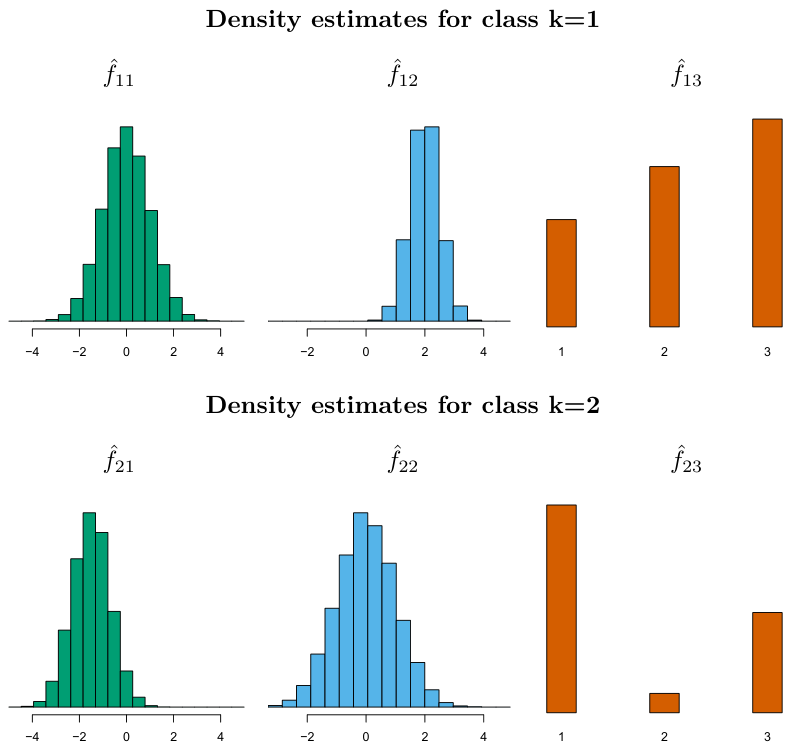

**图4.10** 在4.4.4节的简单示例中，生成的数据有 $p=3$ 个预测变量和 $K=2$ 个类别。前两个预测变量为定量变量，第三个是具有三个水平的定性变量。图中展示了每个类别内三个预测变量各自的估计密度。若两个类别的先验概率相等，观测 $x^*=(0.4,1.5,1)^T$ 属于第1类的后验概率为94.4%。图中上、下两行分别为第 $k=1$ 类和第 $k=2$ 类的密度估计（Density estimates for class）。

| 预测违约状态 | 真实：否 | 真实：是 | 合计 |
|---|---:|---:|---:|
| 否 | 9621 | 244 | 9865 |
| 是 | 46 | 89 | 135 |
| 合计 | 9667 | 333 | 10000 |

**表4.8** 朴素贝叶斯对 `Default` 数据集中10,000个训练观测的预测与真实违约状态的比较。对于满足 $P(Y=\mathtt{default}\mid X=x)>0.5$ 的观测，预测其会违约。

在这个例子中，$\hat f_{11}(0.4)=0.368$、$\hat f_{12}(1.5)=0.484$、$\hat f_{13}(1)=0.226$，以及 $\hat f_{21}(0.4)=0.030$、$\hat f_{22}(1.5)=0.130$、$\hat f_{23}(1)=0.616$。将这些估计值代入式（4.30），得到后验概率估计值 $\Pr(Y=1\mid X=x^*)=0.944$ 和 $\Pr(Y=2\mid X=x^*)=0.056$。

表4.8给出了将朴素贝叶斯分类器应用于 `Default` 数据集所得的混淆矩阵：当违约后验概率，即 $P(Y=\mathtt{default}\mid X=x)$，超过0.5时，预测其会违约。与表4.4中的LDA结果相比，两种方法各有优劣。LDA的总体错误率略低，但朴素贝叶斯能正确预测更高比例的实际违约者。

| 预测违约状态 | 真实：否 | 真实：是 | 合计 |
|---|---:|---:|---:|
| 否 | 9339 | 130 | 9469 |
| 是 | 328 | 203 | 531 |
| 合计 | 9667 | 333 | 10000 |

**表4.9** 朴素贝叶斯对 `Default` 数据集中10,000个训练观测的预测与真实违约状态的比较。对于满足 $P(Y=\mathtt{default}\mid X=x)>0.2$ 的观测，预测其会违约。

在这里的朴素贝叶斯实现中，假设每个定量预测变量都来自高斯分布（当然，还假设每个类别内各预测变量相互独立）。

与LDA一样，我们很容易调整预测违约的概率阈值。例如，表4.9给出了在 $P(Y=\mathtt{default}\mid X=x)>0.2$ 时预测违约所得的混淆矩阵。与采用相同阈值的LDA（表4.5）相比，结果仍然各有优劣：朴素贝叶斯的错误率更高，但能正确预测接近三分之二的实际违约者。

在这个例子中，朴素贝叶斯未能明确胜过LDA，并不太令人意外：这个数据集有 $n=10{,}000$、$p=2$，因此朴素贝叶斯假设带来的方差降低未必值得。当 $p$ 更大或 $n$ 更小、降低方差十分重要时，我们预期使用朴素贝叶斯会比LDA或QDA带来更大的收益。

## 4.5 分类方法的比较

### 4.5.1 解析比较

现在从解析（也就是数学）的角度比较LDA、QDA、朴素贝叶斯和逻辑回归。考虑具有 $K$ 个类别的情形，把观测分到 $\Pr(Y=k\mid X=x)$ 最大的类别。等价地，可以把第 $K$ 类设为基准类别，将观测分到下面这个量最大的类别，其中 $k=1,\ldots,K$：

$$
\log\left(\frac{\Pr(Y=k\mid X=x)}{\Pr(Y=K\mid X=x)}\right). \tag{4.31}
$$

考察每种方法中式（4.31）的具体形式，就能清楚地理解它们的异同。

首先，对于LDA，利用贝叶斯定理（4.15），再结合“每类内部的预测变量来自式（4.23）的多元正态密度，各类具有各自的均值和共同的协方差矩阵”这一假设，可以证明

$$
\begin{aligned}
\log\left(\frac{\Pr(Y=k\mid X=x)}{\Pr(Y=K\mid X=x)}\right)
&=\log\left(\frac{\pi_k f_k(x)}{\pi_K f_K(x)}\right)\\
&=\log\left(\frac{\pi_k\exp\left(-\frac12(x-\mu_k)^T\boldsymbol\Sigma^{-1}(x-\mu_k)\right)}{\pi_K\exp\left(-\frac12(x-\mu_K)^T\boldsymbol\Sigma^{-1}(x-\mu_K)\right)}\right)\\
&=\log\left(\frac{\pi_k}{\pi_K}\right)-\frac12(x-\mu_k)^T\boldsymbol\Sigma^{-1}(x-\mu_k)\\
&\qquad+\frac12(x-\mu_K)^T\boldsymbol\Sigma^{-1}(x-\mu_K)\\
&=\log\left(\frac{\pi_k}{\pi_K}\right)-\frac12(\mu_k+\mu_K)^T\boldsymbol\Sigma^{-1}(\mu_k-\mu_K)\\
&\qquad+x^T\boldsymbol\Sigma^{-1}(\mu_k-\mu_K)\\
&=a_k+\sum_{j=1}^{p}b_{kj}x_j,
\end{aligned}\tag{4.32}
$$

其中 $a_k=\log(\pi_k/\pi_K)-\frac12(\mu_k+\mu_K)^T\boldsymbol\Sigma^{-1}(\mu_k-\mu_K)$，$b_{kj}$ 是 $\boldsymbol\Sigma^{-1}(\mu_k-\mu_K)$ 的第 $j$ 个分量。因此，与逻辑回归一样，LDA也假设后验概率的对数几率是 $x$ 的线性函数。

经过类似计算，QDA中的式（4.31）变为

$$
\log\left(\frac{\Pr(Y=k\mid X=x)}{\Pr(Y=K\mid X=x)}\right)
=a_k+\sum_{j=1}^{p}b_{kj}x_j+\sum_{j=1}^{p}\sum_{l=1}^{p}c_{kjl}x_jx_l, \tag{4.33}
$$

其中 $a_k$、$b_{kj}$ 和 $c_{kjl}$ 是 $\pi_k$、$\pi_K$、$\mu_k$、$\mu_K$、$\boldsymbol\Sigma_k$ 和 $\boldsymbol\Sigma_K$ 的函数。再次呼应其名称，QDA假设后验概率的对数几率是 $x$ 的二次函数。

最后，考察朴素贝叶斯中的式（4.31）。回顾一下，在这一方法中，$f_k(x)$ 被建模为 $p$ 个一维函数 $f_{kj}(x_j)$（$j=1,\ldots,p$）的乘积。因此，

$$
\begin{aligned}
\log\left(\frac{\Pr(Y=k\mid X=x)}{\Pr(Y=K\mid X=x)}\right)
&=\log\left(\frac{\pi_k f_k(x)}{\pi_K f_K(x)}\right)\\
&=\log\left(\frac{\pi_k\prod_{j=1}^{p}f_{kj}(x_j)}{\pi_K\prod_{j=1}^{p}f_{Kj}(x_j)}\right)\\
&=\log\left(\frac{\pi_k}{\pi_K}\right)+\sum_{j=1}^{p}\log\left(\frac{f_{kj}(x_j)}{f_{Kj}(x_j)}\right)\\
&=a_k+\sum_{j=1}^{p}g_{kj}(x_j),
\end{aligned}\tag{4.34}
$$

其中 $a_k=\log(\pi_k/\pi_K)$，$g_{kj}(x_j)=\log\big(f_{kj}(x_j)/f_{Kj}(x_j)\big)$。所以，式（4.34）的右侧具有广义加性模型的形式，第7章会进一步讨论这一主题。

考察式（4.32）、（4.33）和（4.34），可对LDA、QDA和朴素贝叶斯作出以下观察：

- LDA是QDA的一个特例，其中所有 $j=1,\ldots,p$、$l=1,\ldots,p$、$k=1,\ldots,K$ 对应的 $c_{kjl}=0$。（当然，这并不令人意外，因为LDA就是对QDA施加 $\boldsymbol\Sigma_1=\cdots=\boldsymbol\Sigma_K=\boldsymbol\Sigma$ 约束的版本。）
- 任何具有线性决策边界的分类器，都是朴素贝叶斯在 $g_{kj}(x_j)=b_{kj}x_j$ 时的特例。特别地，这意味着LDA是朴素贝叶斯的一个特例！从本章前面对两种方法的介绍中，这一点完全不明显，因为它们作出了很不一样的假设：LDA假设特征服从正态分布，各类别共享相同的类内协方差矩阵；朴素贝叶斯则假设特征独立。
- 如果用一维高斯分布 $N(\mu_{kj},\sigma_j^2)$ 对朴素贝叶斯分类器中的 $f_{kj}(x_j)$ 建模，则会得到 $g_{kj}(x_j)=b_{kj}x_j$，其中 $b_{kj}=(\mu_{kj}-\mu_{Kj})/\sigma_j^2$。在这种情况下，朴素贝叶斯实际上是LDA的一个特例：$\boldsymbol\Sigma$ 被限制为一个对角矩阵，其第 $j$ 个对角元素等于 $\sigma_j^2$。
- QDA与朴素贝叶斯互不为对方的特例。朴素贝叶斯可以得到更灵活的拟合，因为 $g_{kj}(x_j)$ 可以任意选择。不过，它被限制为纯可加的拟合：在式（4.34）中，对于 $j\ne l$，$x_j$ 的函数与 $x_l$ 的函数相加，这些项却从不相乘。QDA则包含形如 $c_{kjl}x_jx_l$ 的乘积项。因此，当预测变量之间的交互作用对区分类别十分重要时，QDA有可能更准确。

这些方法中，没有哪一种始终优于其他方法：在任何情形下，方法的选择都取决于 $K$ 个类别各自内部预测变量的真实分布，以及其他因素，例如 $n$ 和 $p$ 的取值。后者与偏差—方差权衡有关。

逻辑回归又与这些结论有何联系？回顾式（4.12），多项逻辑回归的形式为

$$
\log\left(\frac{\Pr(Y=k\mid X=x)}{\Pr(Y=K\mid X=x)}\right)=\beta_{k0}+\sum_{j=1}^{p}\beta_{kj}x_j.
$$

它与LDA的线性形式（4.32）完全相同：在两种情况下，$\log\big(\Pr(Y=k\mid X=x)/\Pr(Y=K\mid X=x)\big)$ 都是预测变量的线性函数。在LDA中，假设 $X_1,\ldots,X_p$ 在每个类别内服从正态分布，据此得到 $\pi_k$、$\pi_K$、$\mu_k$、$\mu_K$ 和 $\boldsymbol\Sigma$ 的估计值；线性函数中的系数就是这些估计值的函数。相比之下，逻辑回归选择使似然函数（4.5）最大的系数。因此，当正态性假设近似成立时，我们预期LDA优于逻辑回归；该假设不成立时，则预期逻辑回归表现更好。

最后简要讨论第2章介绍的K近邻（KNN）。回顾一下，KNN采取的方法与本章其他分类器完全不同。要对观测 $X=x$ 作出预测，先找到最接近 $x$ 的那些训练观测，再把 $X$ 分到这些观测中人数最多的类别。因此，KNN是一种完全非参数的方法，不对决策边界的形状作任何假设。关于KNN，可以作出以下观察：

- 由于KNN完全非参数，当决策边界高度非线性时，只要 $n$ 很大、$p$ 很小，我们就预期它优于LDA与逻辑回归。
- 要准确分类，KNN需要相对于预测变量数而言很多的观测，即 $n$ 远大于 $p$。这是因为KNN是非参数方法，往往在降低偏差的同时引入很大的方差。
- 如果决策边界非线性，但 $n$ 只处于中等规模，或者 $p$ 并不很小，QDA可能比KNN更合适。这是因为QDA既能提供非线性决策边界，又能利用参数形式，因此相对于KNN，用较小的样本量就能实现准确分类。
- 与逻辑回归不同，KNN不能告诉我们哪些预测变量重要：它不会给出表4.3那样的系数表。

### 4.5.2 实证比较

现在比较逻辑回归、LDA、QDA、朴素贝叶斯和KNN的实证（实际）表现。我们从六种不同情形生成数据，每种情形都涉及一个二分类问题。其中三种情形的贝叶斯决策边界是线性的，其余情形则是非线性的。针对每种情形，生成100个随机训练数据集。在每个训练集上，分别用每种方法拟合数据，并在一个很大的测试集上计算相应的测试错误率。线性情形的结果见图4.11，非线性情形的结果见图4.12。KNN需要选择近邻数 $K$（不要与本章前面各节表示类别数的 $K$ 混淆）。我们使用两个 $K$ 值进行KNN：一个是 $K=1$；另一个通过交叉验证（cross-validation）自动选择，这种方法将在第5章进一步讨论。应用朴素贝叶斯时，假设每类内部的特征具有一元高斯密度（当然，特征之间也假定相互独立，因为这正是朴素贝叶斯的关键特征）。

这六种情形都具有 $p=2$ 个定量预测变量。具体设置如下。

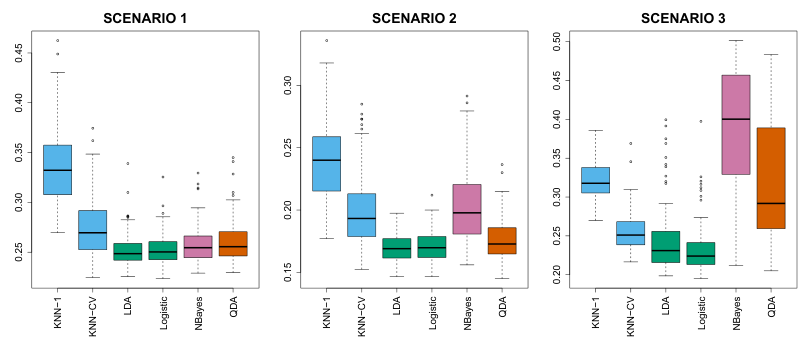

**图4.11** 正文所述各线性情形下测试错误率的箱线图。SCENARIO 1–3分别为情形1–3；KNN−1表示 $K=1$ 的KNN，KNN−CV表示通过交叉验证选择 $K$ 的KNN，Logistic为逻辑回归，NBayes为朴素贝叶斯。

**情形1：** 两个类别中各有20个训练观测。每类内部的观测为不相关的正态随机变量，两个类别的均值不同。图4.11左图表明，LDA在这种情形下表现良好，这符合预期，因为这里恰好采用了LDA所假设的模型。逻辑回归的表现也相当好，因为它假设决策边界为线性。KNN表现较差，因为它付出的方差代价没有得到偏差下降的补偿。QDA也不如LDA，因为它拟合了一个灵活性超出必要程度的分类器。朴素贝叶斯略优于QDA，因为预测变量相互独立的朴素贝叶斯假设在这里是正确的。

**情形2：** 其他设置与情形1相同，但每类内部两个预测变量的相关系数为−0.5。图4.11中图显示，大多数方法的表现与上一种情形相似。明显的例外是朴素贝叶斯，它在这里表现很差，因为预测变量相互独立的假设被违反了。

**情形3：** 与上一种情形一样，每类内部的预测变量有较强的负相关。不过，这次从 $t$ 分布生成 $X_1$ 和 $X_2$，每类有50个观测。$t$ 分布与正态分布形状相似，但更倾向于产生极端点，即更多远离均值的点。在这种情形下，决策边界仍然是线性的，因此符合逻辑回归框架。但观测并非来自正态分布，所以这一设置违反了LDA的假设。图4.11右图显示，逻辑回归优于LDA，但这两种方法都优于其他方法。特别是，非正态性使QDA的结果显著恶化。朴素贝叶斯则因独立性假设被违反而表现很差。

**情形4：** 数据来自正态分布，第1类中预测变量的相关系数为0.5，第2类中为−0.5。这一设置符合QDA假设，产生二次决策边界。图4.12左图显示，QDA优于其他所有方法。


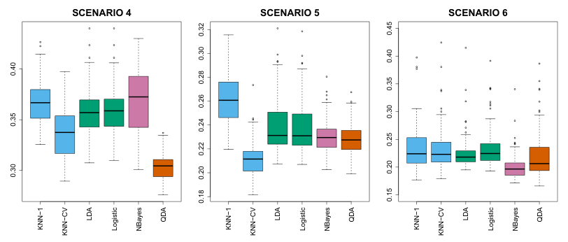

**图4.12** 正文所述各非线性情形下测试错误率的箱线图。SCENARIO 4–6分别为情形4–6；方法标签与图4.11相同。

预测变量相互独立的朴素贝叶斯假设被违反，因此朴素贝叶斯表现较差。

**情形5：** 数据来自预测变量不相关的正态分布。随后，对预测变量的一个复杂非线性函数应用逻辑函数，并据此抽取响应值。图4.12中图显示，QDA和朴素贝叶斯的结果都略优于线性方法，而灵活性高得多的KNN-CV方法表现最好。但 $K=1$ 的KNN却在所有方法中表现最差。这说明，即便数据呈现复杂的非线性关系，如果平滑程度选择不当，KNN这样的非参数方法仍可能给出较差结果。

**情形6：** 观测来自正态分布，每个类别有不同的对角协方差矩阵。不过，样本量非常小：每类仅有 $n=6$ 个观测。朴素贝叶斯表现很好，因为它的假设得到满足。由于协方差矩阵不同，真实决策边界是非线性的，所以LDA和逻辑回归表现较差。QDA略逊于朴素贝叶斯，因为样本量很小，在估计每类内部预测变量间的相关时，QDA引入了过大的方差。KNN的表现也受到极小样本量的影响。

这六个例子说明，没有哪种方法会在所有情况下都优于其他方法。真实决策边界为线性时，LDA和逻辑回归往往表现良好；边界具有中等程度的非线性时，QDA或朴素贝叶斯可能给出更好结果；如果决策边界复杂得多，KNN这样的非参数方法则可能更优。不过，必须谨慎选择非参数方法的平滑程度。下一章将考察一些方法，用来选择适当的平滑程度，以及更一般地选择总体表现最好的方法。

最后，回顾第3章：在回归问题中，可以把预测变量变换后再进行回归，以处理预测变量与响应之间的非线性关系。分类问题也可以采用类似做法。

例如，可以把 $X^2$、$X^3$ 甚至 $X^4$ 也作为预测变量，得到更灵活的逻辑回归。这可能改善，也可能无法改善逻辑回归的表现，取决于灵活性增加所带来的方差上升，能否被足够大的偏差下降抵消。对LDA也可以作同样处理。如果向LDA中加入所有可能的二次项与交叉乘积项，模型的形式就会与QDA相同，只是参数估计值不同。这个办法让我们可以在LDA和QDA模型之间作出折中。

## 4.6 广义线性模型

在第3章中，我们假设响应 $Y$ 是定量的，并探讨了用最小二乘线性回归预测 $Y$。而本章到目前为止，一直假设 $Y$ 是定性的。不过，有时会遇到 $Y$ 既非定性、也非定量的情形，此时第3章的线性回归和本章介绍的分类方法都不适用。

以 `Bikeshare` 数据集为具体例子。响应 `bikers` 是华盛顿特区某共享单车项目每小时的使用人数。这个响应值既非定性、也非定量，而是取非负整数值，即**计数（counts）**。我们将考虑使用以下协变量预测 `bikers`：`mnth`（月份）、`hr`（一天中的小时，取0至23）、`workingday`（一个指示变量，既非周末也非节假日时等于1）、`temp`（以摄氏温度为基础的归一化温度，normalized temperature），以及 `weathersit`（一个定性变量，具有四种可能取值：晴朗；有雾或多云；小雨或小雪；大雨或大雪）。

在以下分析中，我们把 `mnth`、`hr` 和 `weathersit` 都视为定性变量。

### 4.6.1 对Bikeshare数据进行线性回归

首先，考虑使用线性回归预测 `bikers`。结果见表4.10。

| | 系数 | 标准误 | $t$ 统计量 | $p$ 值 |
|---|---:|---:|---:|---:|
| `Intercept` | 73.60 | 5.13 | 14.34 | 0.00 |
| `workingday` | 1.27 | 1.78 | 0.71 | 0.48 |
| `temp` | 157.21 | 10.26 | 15.32 | 0.00 |
| `weathersit[cloudy/misty]` | -12.89 | 1.96 | -6.56 | 0.00 |
| `weathersit[light rain/snow]` | -66.49 | 2.97 | -22.43 | 0.00 |
| `weathersit[heavy rain/snow]` | -109.75 | 76.67 | -1.43 | 0.15 |

**表4.10** 对 `Bikeshare` 数据拟合最小二乘线性模型以预测 `bikers` 的结果。由于篇幅限制，表中省略了预测变量 `mnth` 和 `hr`，其系数可见图4.13。定性变量 `weathersit` 的基准水平对应晴朗天气。

例如，天气从晴朗变为多云，平均每小时使用人数就会减少12.89人；如果天气进一步恶化为雨雪天气，则平均每小时又会减少53.60人。图4.13展示了 `mnth` 和 `hr` 对应的系数。

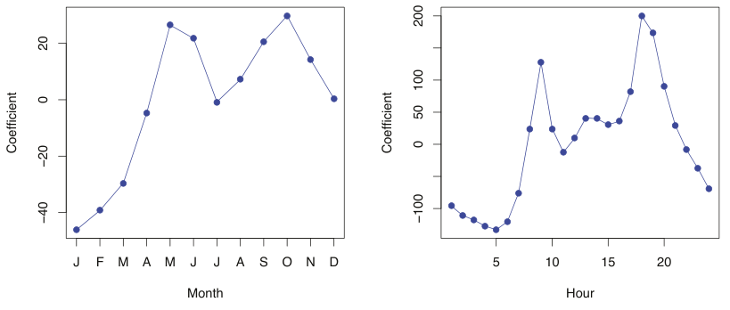

**图4.13** 对 `Bikeshare` 数据集拟合最小二乘线性回归模型，以预测 `bikers`。**左图：** 各月份对应的系数。春秋两季使用量最高，冬季最低。**右图：** 一天中各小时对应的系数。通勤高峰时段使用量最高，夜间最低。图内文字：Month＝月份；Hour＝小时；Coefficient＝系数；J、F、M、A、M、J、J、A、S、O、N、D依次表示1月至12月。

可以看到，共享单车的使用量在春秋两季最高，冬季最低。此外，在早晚高峰附近（上午9点和下午6点）使用量最大，夜间最低。因此，乍看起来，对 `Bikeshare` 数据集拟合线性回归模型，似乎能得到合理而直观的结果。

但进一步仔细检查，就会发现一些问题。例如，`Bikeshare` 数据集中9.6%的拟合值为负：也就是说，在数据中9.6%的小时里，线性回归模型预测的使用人数为负。这使我们怀疑该模型能否对这些数据作出有意义的预测，也让人担心回归模型的系数估计、置信区间及其他输出是否准确。

此外，有理由认为，当 `bikers` 的期望较小时，其方差也应较小。例如，在12月一场暴风雪期间的凌晨2点，预计只有极少数人会使用单车，而且在这种条件下，使用人数的方差也应很小。数据证实了这一点：12月、1月和2月凌晨1点至4点的雨天，平均使用人数为5.05，标准差为3.73。相比之下，4月、5月和6月上午7点至10点的晴天，平均使用人数为243.59，标准差为131.7。图4.14左图展示了这种均值与方差的关系。这严重违反了线性模型的假设，即 $Y=\sum_{j=1}^{p}X_j\beta_j+\epsilon$，其中 $\epsilon$ 是均值为零的误差项，其方差 $\sigma^2$ 为常数，而非协变量的函数。因此，数据的异方差性使线性回归模型的适用性受到质疑。

最后，响应 `bikers` 取整数值。然而，在线性模型中，$Y=\beta_0+\sum_{j=1}^{p}X_j\beta_j+\epsilon$，其中 $\epsilon$ 是连续取值的误差项。这意味着，在线性模型中，响应 $Y$ 必然连续取值（定量）。因此，响应 `bikers` 的整数特性说明，线性回归模型对于该数据集并不完全令人满意。


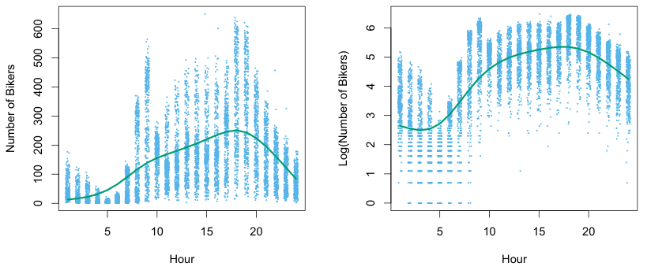

**图4.14** **左图：** `Bikeshare` 数据集中的单车使用人数绘于 $y$ 轴，一天中的小时绘于 $x$ 轴。为便于观察，对数据点施加了抖动（jitter）。大体上，平均使用人数越多，使用人数的方差也越大。绿色曲线是平滑样条（smoothing spline）的拟合结果。**右图：** $y$ 轴改为使用人数的对数。图内文字：Hour＝小时；Number of Bikers＝单车使用人数；Log(Number of Bikers)＝单车使用人数的对数。

对 `Bikeshare` 数据拟合线性回归模型时出现的一些问题，可以通过变换响应来克服。例如，可以拟合模型

$$
\log(Y)=\sum_{j=1}^{p}X_j\beta_j+\epsilon.
$$

如图4.14右图所示，变换响应可以避免出现负的预测值，并在很大程度上消除原始数据中的异方差性。然而，这一方法并不完全令人满意，因为预测和推断针对的是响应的对数，而非响应本身。这会给解释带来困难，例如：“$X_j$ 每增加一个单位，$Y$ 的对数的均值就增加 $\beta_j$。”此外，当响应可能取0时，便不能对响应作对数变换。因此，虽然对变换后的响应拟合线性模型，对某些计数数据集可能足够适用，但这种方法往往仍不尽如人意。下一小节将介绍，泊松回归模型能为这一任务提供更自然、简洁的方法。

### 4.6.2 对Bikeshare数据进行泊松回归


为克服线性回归在分析 `Bikeshare` 数据时的不足，我们将使用另一种方法，称为**泊松回归（Poisson regression）**。在介绍泊松回归之前，必须先介绍**泊松分布（Poisson distribution）**。

假设随机变量 $Y$ 取非负整数值，即 $Y\in\{0,1,2,\ldots\}$。若 $Y$ 服从泊松分布，则

$$
\Pr(Y=k)=\frac{e^{-\lambda}\lambda^k}{k!}\quad\text{对于 }k=0,1,2,\ldots. \tag{4.35}
$$

这里，$\lambda>0$ 是 $Y$ 的期望，即 $\operatorname{E}(Y)$。而且，$\lambda$ 也等于 $Y$ 的方差，即 $\lambda=\operatorname{E}(Y)=\operatorname{Var}(Y)$。这意味着，若 $Y$ 服从泊松分布，其均值越大，方差也越大。（式(4.35)中的记号 $k!$ 读作“$k$ 的阶乘（factorial）”，定义为 $k!=k\times(k-1)\times(k-2)\times\cdots\times3\times2\times1$。）

泊松分布通常用于对计数建模。这是一个自然的选择，原因有很多，其中之一就是计数与泊松分布一样，都取非负整数值。为了解如何在实践中使用泊松分布，令 $Y$ 表示一年中某个月份、某种天气条件下、一天中某一小时内共享单车项目的使用人数。可以用均值 $\operatorname{E}(Y)=\lambda=5$ 的泊松分布对 $Y$ 建模。这意味着，该小时内没有使用者的概率为 $\Pr(Y=0)=\frac{e^{-5}5^0}{0!}=e^{-5}=0.0067$（按约定 $0!=1$）。恰有一名使用者的概率为 $\Pr(Y=1)=\frac{e^{-5}5^1}{1!}=5e^{-5}=0.034$，有两名使用者的概率为 $\Pr(Y=2)=\frac{e^{-5}5^2}{2!}=0.084$，依此类推。

当然，在实际中，我们预期共享单车项目的平均使用人数 $\lambda=\operatorname{E}(Y)$ 会随小时、月份、天气条件等因素而变化。因此，不应只用均值固定为 $\lambda=5$ 之类的泊松分布来描述使用人数 $Y$，而应允许均值随协变量变化。具体而言，我们考虑如下均值模型；现在将 $\lambda=\operatorname{E}(Y)$ 写为 $\lambda(X_1,\ldots,X_p)$，以强调它是协变量 $X_1,\ldots,X_p$ 的函数：

$$
\log(\lambda(X_1,\ldots,X_p))=\beta_0+\beta_1X_1+\cdots+\beta_pX_p \tag{4.36}
$$

或等价地，

$$
\lambda(X_1,\ldots,X_p)=e^{\beta_0+\beta_1X_1+\cdots+\beta_pX_p}. \tag{4.37}
$$

这里，$\beta_0,\beta_1,\ldots,\beta_p$ 是待估计的参数。式(4.35)和式(4.36)共同定义了泊松回归模型。注意，在式(4.36)中，我们令 $\lambda(X_1,\ldots,X_p)$ **的对数**是 $X_1,\ldots,X_p$ 的线性函数，而不是令 $\lambda(X_1,\ldots,X_p)$ 本身为线性函数；这样就能保证，不论协变量取何值，$\lambda(X_1,\ldots,X_p)$ 都为非负值。

估计系数 $\beta_0,\beta_1,\ldots,\beta_p$ 时，采用第4.3.2节拟合逻辑回归所用的极大似然法。具体而言，给定来自泊松回归模型的 $n$ 个独立观测，似然为

$$
\ell(\beta_0,\beta_1,\ldots,\beta_p)=\prod_{i=1}^{n}\frac{e^{-\lambda(x_i)}\lambda(x_i)^{y_i}}{y_i!}, \tag{4.38}
$$

由式(4.37)，$\lambda(x_i)=e^{\beta_0+\beta_1x_{i1}+\cdots+\beta_px_{ip}}$。我们估计出使似然 $\ell(\beta_0,\beta_1,\ldots,\beta_p)$ 最大的系数，即使观测数据出现的可能性尽量大的系数。

现在对 `Bikeshare` 数据拟合泊松回归模型，结果见表4.11和图4.15。从定性上看，这些结果与第4.6.1节的线性回归结果相似。

| | 系数 | 标准误 | $z$ 统计量 | $p$ 值 |
|---|---:|---:|---:|---:|
| `Intercept` | 4.12 | 0.01 | 683.96 | 0.00 |
| `workingday` | 0.01 | 0.00 | 7.5 | 0.00 |
| `temp` | 0.79 | 0.01 | 68.43 | 0.00 |
| `weathersit[cloudy/misty]` | -0.08 | 0.00 | -34.53 | 0.00 |
| `weathersit[light rain/snow]` | -0.58 | 0.00 | -141.91 | 0.00 |
| `weathersit[heavy rain/snow]` | -0.93 | 0.17 | -5.55 | 0.00 |

**表4.11** 对 `Bikeshare` 数据拟合泊松回归模型以预测 `bikers` 的结果。由于篇幅限制，表中省略了预测变量 `mnth` 和 `hr`，其系数可见图4.15。定性变量 `weathersit` 的基准对应晴朗天气。

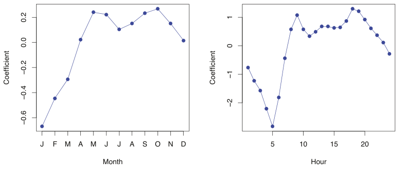

**图4.15** 对 `Bikeshare` 数据集拟合泊松回归模型，以预测 `bikers`。**左图：** 各月份对应的系数。春秋两季使用量最高，冬季最低。**右图：** 一天中各小时对应的系数。通勤高峰时段使用量最高，夜间最低。图内文字：Month＝月份；Hour＝小时；Coefficient＝系数；J、F、M、A、M、J、J、A、S、O、N、D依次表示1月至12月。

同样可以看到，共享单车的使用量在春秋两季以及早晚高峰最高，在冬季和凌晨最低。此外，使用量随温度升高而增加，随天气恶化而减少。有意思的是，`workingday` 对应的系数在泊松回归模型中具有统计显著性，在线性回归模型中却不显著。

泊松回归模型与线性回归模型之间，有以下几个重要区别：

- **解释：** 解释泊松回归模型的系数时，必须仔细考察式(4.37)。它表明，$X_j$ 每增加一个单位，$\operatorname{E}(Y)=\lambda$ 就会乘以 $\exp(\beta_j)$。例如，天气从晴朗变为多云，会使平均单车使用量乘以 $\exp(-0.08)=0.923$，也就是说，多云天气的平均使用人数只有晴天的92.3%。如果天气进一步恶化并开始下雨，平均使用量又会乘以 $\exp(-0.5)=0.607$，即雨天的平均使用人数只有多云天气的60.7%。

- **均值与方差的关系：** 如前所述，泊松模型中有 $\lambda=\operatorname{E}(Y)=\operatorname{Var}(Y)$。因此，用泊松回归描述单车使用量，隐含地假设某个小时的平均使用量，等于该小时使用量的方差。相比之下，在线性回归模型中，使用量的方差始终为常数。回顾图4.14，在 `Bikeshare` 数据中，适宜骑行时，使用量的均值**和**方差都远高于不适宜骑行时。因此，泊松回归模型能够处理 `Bikeshare` 数据中所见的均值与方差关系，而线性回归模型做不到这一点。<sup><a href="#ch04-fn5" id="ch04-fnref5">5</a></sup>

> <a href="#ch04-fnref5">5</a> 事实上，`Bikeshare` 数据的方差似乎远大于均值，这种情况称为**过度离散（overdispersion）**。这会使表4.11中的 $Z$ 值被夸大。更严谨的分析应当考虑过度离散，以得到更准确的 $Z$ 值。处理这一问题的方法有很多，但超出了本书的范围。

- **非负拟合值：** 泊松回归模型不会给出负的预测值，因为泊松模型本身就只允许非负值，见式(4.35)。相比之下，对 `Bikeshare` 数据拟合线性回归时，近10%的预测值为负。

### 4.6.3 更一般的广义线性模型


至此，我们已经讨论了三类回归模型：线性回归、逻辑回归和泊松回归。这些方法具有一些共同特征：

1. 每一种方法都使用预测变量 $X_1,\ldots,X_p$ 来预测响应 $Y$。我们假设，在给定 $X_1,\ldots,X_p$ 的条件下，$Y$ 属于某个分布族。对于线性回归，通常假设 $Y$ 服从高斯分布，即正态分布；对于逻辑回归，假设 $Y$ 服从**伯努利分布（Bernoulli distribution）**；对于泊松回归，假设 $Y$ 服从泊松分布。

2. 每一种方法都将 $Y$ 的均值建模为预测变量的函数。在线性回归中，$Y$ 的均值为

$$
\operatorname{E}(Y\mid X_1,\ldots,X_p)=\beta_0+\beta_1X_1+\cdots+\beta_pX_p, \tag{4.39}
$$

即预测变量的线性函数。对于逻辑回归，均值则为

$$
\begin{aligned}
\operatorname{E}(Y\mid X_1,\ldots,X_p)&=\Pr(Y=1\mid X_1,\ldots,X_p)\\
&=\frac{e^{\beta_0+\beta_1X_1+\cdots+\beta_pX_p}}{1+e^{\beta_0+\beta_1X_1+\cdots+\beta_pX_p}},
\end{aligned} \tag{4.40}
$$

而对于泊松回归，均值为

$$
\operatorname{E}(Y\mid X_1,\ldots,X_p)=\lambda(X_1,\ldots,X_p)=e^{\beta_0+\beta_1X_1+\cdots+\beta_pX_p}. \tag{4.41}
$$

式(4.39)–(4.41)可以使用**连接函数（link function）** $\eta$ 来表示。

连接函数对 $\operatorname{E}(Y\mid X_1,\ldots,X_p)$ 作变换，使变换后的均值成为预测变量的线性函数，即

$$
\eta(\operatorname{E}(Y\mid X_1,\ldots,X_p))=\beta_0+\beta_1X_1+\cdots+\beta_pX_p. \tag{4.42}
$$

线性回归、逻辑回归和泊松回归的连接函数分别为 $\eta(\mu)=\mu$、$\eta(\mu)=\log(\mu/(1-\mu))$ 和 $\eta(\mu)=\log(\mu)$。

高斯分布、伯努利分布和泊松分布，都属于一个更广泛的分布类别，称为**指数族（exponential family）**。这个分布族中其他广为人知的成员，还包括**指数分布（exponential distribution）**、**伽马分布（Gamma distribution）**和**负二项分布（negative binomial distribution）**。一般来说，我们可以假设响应 $Y$ 来自指数族中的某个特定分布，再对响应的均值作变换，使其通过式(4.42)成为预测变量的线性函数，从而进行回归。遵循这一通用框架的回归方法，都称为**广义线性模型（generalized linear model，GLM）**。因此，线性回归、逻辑回归和泊松回归就是三个GLM的例子。这里未作介绍的其他例子，还包括**伽马回归（Gamma regression）**和**负二项回归（negative binomial regression）**。

## 4.7 实验：逻辑回归、LDA、QDA和KNN

### 4.7.1 股票市场数据

本实验将考察 `ISLP` 库中的 `Smarket` 数据。这一数据集记录了从2001年初到2005年末共1,250个交易日的标准普尔500（S&P 500）股票指数百分比收益率。对每个日期，我们记录了此前五个交易日各自的百分比收益率，变量名为 `Lag1` 至 `Lag5`。此外，还记录了 `Volume`（前一天的股票成交量，以十亿股为单位）、`Today`（当天的百分比收益率）和 `Direction`（当天市场上涨 `Up` 或下跌 `Down`）。

首先在顶层导入所需的库；这些导入语句都已在前面的实验中出现。

In [1]:

```python
import numpy as np
import pandas as pd
from matplotlib.pyplot import subplots
import statsmodels.api as sm
from ISLP import load_data
from ISLP.models import (ModelSpec as MS,
                         summarize)
```

我们也将本实验需要新增的导入语句集中列在这里。

In [2]:

```python
from ISLP import confusion_table
from ISLP.models import contrast
from sklearn.discriminant_analysis import \
     (LinearDiscriminantAnalysis as LDA,
      QuadraticDiscriminantAnalysis as QDA)
from sklearn.naive_bayes import GaussianNB
from sklearn.neighbors import KNeighborsClassifier
from sklearn.preprocessing import StandardScaler
from sklearn.model_selection import train_test_split
from sklearn.linear_model import LogisticRegression
```

现在可以载入 `Smarket` 数据了。

In [3]:

```python
Smarket = load_data('Smarket')
Smarket
```

这会给出一份截断的数据列表，此处不再展示。我们可以查看变量名。

In [4]:

```python
Smarket.columns
```

Out[4]:

```text
Index(['Year', 'Lag1', 'Lag2', 'Lag3', 'Lag4', 'Lag5', 'Volume',
       'Today', 'Direction'],
      dtype='object')
```

使用数据框的 `corr()` 方法可以计算相关矩阵，所得矩阵包含所有变量两两之间的相关系数。（此处省略输出。）由于 `Direction` 是定性变量，`pandas` 库不会报告它的相关系数。

In [5]:

```python
Smarket.corr()
```

不出所料，滞后收益率变量与当天收益率之间的相关系数都接近零。唯一较明显的相关关系存在于 `Year` 和 `Volume` 之间。将数据绘图后可以看到，`Volume` 随时间增加。换言之，从2001年到2005年，每日平均股票成交量有所上升。

In [6]:

```python
Smarket.plot(y='Volume');
```

### 4.7.2 逻辑回归

接下来，我们拟合逻辑回归模型，用 `Lag1` 至 `Lag5` 和 `Volume` 来预测 `Direction`。`sm.GLM()` 函数用于拟合广义线性模型，这类模型包含逻辑回归。也可以使用 `sm.Logit()` 函数直接拟合逻辑回归模型。`sm.GLM()` 的语法与 `sm.OLS()` 相似，不过需要传入参数 `family=sm.families.Binomial()`，以告知 `statsmodels` 拟合逻辑回归，而非其他类型的广义线性模型。

In [7]:

```python
allvars = Smarket.columns.drop(['Today', 'Direction', 'Year'])
design = MS(allvars)
X = design.fit_transform(Smarket)
y = Smarket.Direction == 'Up'
glm = sm.GLM(y,
             X,
             family=sm.families.Binomial())
results = glm.fit()
summarize(results)
```

Out[7]:

```text
             coef    std err       z    P>|z|
intercept -0.1260      0.241  -0.523    0.601
Lag1      -0.0731      0.050  -1.457    0.145
Lag2      -0.0423      0.050  -0.845    0.398
Lag3       0.0111      0.050   0.222    0.824
Lag4       0.0094      0.050   0.187    0.851
Lag5       0.0103      0.050   0.208    0.835
Volume     0.1354      0.158   0.855    0.392
```

这里最小的 $p$ 值对应 `Lag1`。这一预测变量的系数为负，提示如果昨天市场收益率为正，那么今天上涨的可能性会较低。不过，其 $p$ 值为0.15，仍然较大，因此没有明确证据表明 `Lag1` 与 `Direction` 之间存在真实关联。

使用 `results` 的 `params` 属性，可以只提取这一拟合模型的系数。

In [8]:

```python
results.params
```

Out[8]:

```text
intercept   -0.126000
Lag1        -0.073074
Lag2        -0.042301
Lag3         0.011085
Lag4         0.009359
Lag5         0.010313
Volume       0.135441
dtype: float64
```

同样，可以使用 `pvalues` 属性提取各系数的 $p$ 值（此处不展示结果）。

In [9]:

```python
results.pvalues
```

给定预测变量的取值后，可以使用 `results` 的 `predict()` 方法预测市场上涨的概率。该方法返回概率尺度上的预测值。如果没有向 `predict()` 函数提供数据集，就会对拟合逻辑回归模型时使用的训练数据计算概率。与线性回归一样，如有需要，也可以传入符合设计矩阵形式的可选参数 `exog`。这里仅打印前十个概率。

In [10]:

```python
probs = results.predict()
probs[:10]
```

Out[10]:

```text
array([0.5070841, 0.4814679, 0.4811388, 0.5152223, 0.5107812,
       0.5069565, 0.4926509, 0.5092292, 0.5176135, 0.4888378])
```

为了预测某一天市场上涨还是下跌，必须将这些预测概率转换为类别标签 `Up` 或 `Down`。下面两条命令根据市场上涨的预测概率大于还是小于0.5，创建一个类别预测向量。

In [11]:

```python
labels = np.array(['Down']*1250)
labels[probs>0.5] = "Up"
```

`ISLP` 包中的 `confusion_table()` 函数可以汇总这些预测，显示正确分类和错误分类的观测各有多少。这个函数由 `sklearn.metrics` 模块中的类似函数改编而来，对所得矩阵进行了转置，并添加了行标签和列标签。`confusion_table()` 的第一个参数是预测标签，第二个参数是真实标签。

In [12]:

```python
confusion_table(labels, Smarket.Direction)
```

Out[12]:

```text
    Truth  Down   Up
Predicted
     Down   145  141
       Up   457  507
```

混淆矩阵的对角线元素表示正确预测，非对角线元素表示错误预测。因此，模型正确预测了507个上涨日和145个下跌日，共有 $507+145=652$ 次正确预测。`np.mean()` 函数可以计算预测正确的天数所占比例。这里，逻辑回归正确预测市场走势的比例为52.2%。

In [13]:

```python
(507+145)/1250, np.mean(labels == Smarket.Direction)
```

Out[13]:

```text
(0.5216, 0.5216)
```

乍看之下，逻辑回归模型似乎比随机猜测略好。但这一结果会产生误导，因为我们在同一组1,250个观测上训练并测试了模型。换言之，$100-52.2=47.8\%$ 是训练错误率。正如前面所见，训练错误率往往过于乐观，倾向于低估测试错误率。为了更好地评估这里的逻辑回归模型的准确性，可以使用一部分数据拟合模型，然后考察它对留出数据（held out data）的预测效果。这样得到的错误率更符合实际，因为在实践中，我们关心的是模型对未来那些市场走势尚不明朗的日子的表现，而不是对用于拟合模型的数据的表现。

实施这一策略时，首先创建一个布尔向量（Boolean vector），标识2001年至2004年的观测。然后利用该向量，将2005年的观测构成留出数据集。

In [14]:

```python
train = (Smarket.Year < 2005)
Smarket_train = Smarket.loc[train]
Smarket_test = Smarket.loc[~train]
Smarket_test.shape
```

Out[14]:

```text
(252, 9)
```

对象 `train` 是一个包含1,250个元素的向量，与数据集中的观测一一对应。对应2005年之前观测的元素设为 `True`，对应2005年观测的元素设为 `False`。因此，`train` 是一个布尔数组，因为其元素为 `True` 和 `False`。使用数据框的 `loc` 方法，可以通过布尔数组提取行或列的子集。

例如，命令 `Smarket.loc[train]` 会提取股票市场数据集中仅对应2005年之前日期的子矩阵，因为这些日期对应的 `train` 元素为 `True`。符号 `~` 可以对布尔向量的所有元素取反。也就是说，`~train` 与 `train` 类似，但 `train` 中为 `True` 的元素在 `~train` 中变为 `False`，反之亦然。因此，`Smarket.loc[~train]` 得到股票市场数据框的一个行子集，仅包含 `train` 为 `False` 的观测。上面的输出表明，这样的观测有252个。

现在，仅使用2005年之前的观测子集拟合逻辑回归模型。然后，对测试集中的每一天，也就是2005年的每一天，求得股票市场上涨的预测概率。

In [15]:

```python
X_train, X_test = X.loc[train], X.loc[~train]
y_train, y_test = y.loc[train], y.loc[~train]
glm_train = sm.GLM(y_train,
                   X_train,
                   family=sm.families.Binomial())
results = glm_train.fit()
probs = results.predict(exog=X_test)
```

注意，我们在两个完全分离的数据集上训练和测试模型：训练只使用2005年之前的日期，测试只使用2005年的日期。

最后，将2005年的预测结果与这一时期市场的实际走势进行比较。首先保存测试标签和训练标签（请记住，`y_test` 是二元的）。

In [16]:

```python
D = Smarket.Direction
L_train, L_test = D.loc[train], D.loc[~train]
```

现在，以50%为阈值，将拟合概率转换为预测标签。

In [17]:

```python
labels = np.array(['Down']*252)
labels[probs>0.5] = 'Up'
confusion_table(labels, L_test)
```

Out[17]:

```text
    Truth  Down  Up
Predicted
     Down    77  97
       Up    34  44
```

测试准确率约为48%，错误率约为52%。

In [18]:

```python
np.mean(labels == L_test), np.mean(labels != L_test)
```

Out[18]:

```text
(0.4802, 0.5198)
```

符号 `!=` 表示“不等于”，因此最后一条命令计算的是测试集错误率。结果相当令人失望：测试错误率为52%，甚至比随机猜测还差！当然，这一结果也并不十分意外，因为通常不会期望能够根据过去几天的收益率预测未来的市场表现。（毕竟，如果真能做到，本书作者就会去大发其财，而不是编写统计学教材了。）

回想一下，逻辑回归模型中所有预测变量的 $p$ 值都不太令人信服；其中最小的 $p$ 值虽然也不很小，但对应的是 `Lag1`。或许，去掉那些看起来无助于预测 `Direction` 的变量，可以得到更有效的模型。毕竟，使用与响应无关的预测变量往往会使测试错误率恶化，因为这些变量增加了方差，却没有相应地降低偏差，因此去掉它们可能带来改善。下面，我们仅使用在原逻辑回归模型中看起来预测能力最强的 `Lag1` 和 `Lag2`，重新拟合逻辑回归。

In [19]:

```python
model = MS(['Lag1', 'Lag2']).fit(Smarket)
X = model.transform(Smarket)
X_train, X_test = X.loc[train], X.loc[~train] 
glm_train = sm.GLM(y_train,
                   X_train,
                   family=sm.families.Binomial())
results = glm_train.fit()
probs = results.predict(exog=X_test)
labels = np.array(['Down']*252)
labels[probs>0.5] = 'Up'
confusion_table(labels, L_test)
```

Out[19]:

```text
    Truth  Down   Up
Predicted
     Down    35   35
       Up    76  106
```

我们来评估总体准确率，以及在逻辑回归预测上涨的那些日子中的准确率。

In [20]:

```python
(35+106)/252,106/(106+76)
```

Out[20]:

```text
(0.5595, 0.5824)
```

现在结果似乎好了一些：56%的每日走势得到了正确预测。这里还有一点需要注意：如果采用一个简单得多的策略，每天都预测市场上涨，同样也会有56%的预测正确！因此，就总体错误率而言，逻辑回归并不比这种简单方法更好。不过，混淆矩阵表明，在逻辑回归预测市场上涨的日子里，其准确率为58%。这提示了一种可能的交易策略：在模型预测市场上涨的日子买入，在预测下跌的日子避免交易。当然，还需要更仔细地调查，这一微小改善究竟是真实存在，还是仅由随机偶然性造成。

假设我们想预测 `Lag1` 和 `Lag2` 取特定值时的收益情况。具体而言，希望预测 `Lag1` 和 `Lag2` 分别为1.2和1.1的某一天，以及分别为1.5和 $-0.8$ 的某一天的 `Direction`。使用 `predict()` 函数即可完成。

In [21]:

```python
newdata = pd.DataFrame({'Lag1':[1.2, 1.5],
                       'Lag2':[1.1, -0.8]});
newX = model.transform(newdata)
results.predict(newX)
```

Out[21]:

```text
0    0.4791
1    0.4961
dtype: float64
```

### 4.7.3 线性判别分析

首先，使用 `LinearDiscriminantAnalysis()` 函数对 `Smarket` 数据进行LDA；这里将该函数简写为 `LDA()`。我们仅使用2005年之前的观测拟合模型。

In [22]:

```python
lda = LDA(store_covariance=True)
```

由于 `LDA` 估计器会自动添加截距，应删除 `X_train` 和 `X_test` 中对应截距的列。此外，可以直接使用标签，而不必使用布尔向量 `y_train`。

In [23]:

```python
X_train, X_test = [M.drop(columns=['intercept'])
                   for M in [X_train, X_test]]
lda.fit(X_train, L_train)
```

Out[23]:

```text
LinearDiscriminantAnalysis(store_covariance=True)
```

这里使用了3.6.4节介绍的列表推导式。上面第一行的右侧是一个长度为2的列表。这是因为代码 `for M in [X_train, X_test]` 遍历的是一个长度为2的列表。虽然这里遍历的是列表，但列表推导式也适用于遍历任何可迭代对象（iterable object）。随后，对遍历中的每个元素应用 `drop()` 方法，并将结果收集到一个列表中。等号左侧告诉Python将这个长度为2的列表解包（unpack），把其中的元素分别赋给变量 `X_train` 和 `X_test`。当然，这会覆盖 `X_train` 和 `X_test` 原先的值。

拟合模型后，可以通过 `means_` 属性提取两个类别中的均值。这些值是各类别内每个预测变量的平均值，LDA将它们用作 $\mu_k$ 的估计值。结果提示：在市场上涨的日子，前两天的收益率往往为负；在市场下跌的日子，之前几天的收益率往往为正。

In [24]:

```python
lda.means_
```

Out[24]:

```text
array([[ 0.04,  0.03],
       [-0.04, -0.03]])
```

估计的先验概率存储在 `priors_` 属性中。`sklearn` 包通常使用末尾的下划线 `_`，表示通过 `fit()` 方法估计得到的量。查看 `classes_` 属性，就能确定每个条目对应哪个标签。

In [25]:

```python
lda.classes_
```

Out[25]:

```text
array(['Down', 'Up'], dtype='<U4')
```

LDA的输出表明，$\hat\pi_{\mathrm{Down}}=0.492$，$\hat\pi_{\mathrm{Up}}=0.508$。

In [26]:

```python
lda.priors_
```

Out[26]:

```text
array([0.492, 0.508])
```

线性判别向量（linear discriminant vector）可以在 `scalings_` 属性中找到：

In [27]:

```python
lda.scalings_
```

Out[27]:

```text
array([[-0.642],
       [-0.513]])
```

这些数值给出了构成LDA决策规则所用的 `Lag1` 和 `Lag2` 的线性组合。换言之，它们就是式(4.24)中 $X=x$ 的各元素的乘数。如果 $-0.64\times\mathtt{Lag1}-0.51\times\mathtt{Lag2}$ 较大，LDA分类器就预测市场上涨；如果较小，就预测市场下跌。

In [28]:

```python
lda_pred = lda.predict(X_test)
```

正如比较分类方法时（4.5节）所见，LDA与逻辑回归的预测几乎完全相同。

In [29]:

```python
confusion_table(lda_pred, L_test)
```

Out[29]:

```text
    Truth   Down   Up
Predicted
     Down     35   35
       Up     76  106
```

我们也可以估计训练集中每个数据点属于各类别的概率。对属于类别1的后验概率应用50%的阈值，就能重现 `lda_pred` 中的预测。

In [30]:

```python
lda_prob = lda.predict_proba(X_test)
np.all(
       np.where(lda_prob[:,1] >= 0.5, 'Up','Down') == lda_pred
       )
```

Out[30]:

```text
True
```

上面使用了 `np.where()` 函数来创建数组：在 `lda_prob` 的第二列（`'Up'` 的估计后验概率）大于0.5的索引位置，数组取值为 `'Up'`。对于类别数多于两个的问题，将后验概率最高的类别选为标签：

In [31]:

```python
np.all(
       [lda.classes_[i] for i in np.argmax(lda_prob, 1)] ==
           lda_pred
       )
```

Out[31]:

```text
True
```

如果想采用50%以外的后验概率阈值来预测，也很容易做到。例如，假设只有在十分确信当天市场确实会下跌时，我们才希望预测下跌。

比如，可以要求后验概率至少达到90%。检查 `classes_` 属性后，我们知道 `lda_prob` 的第一列对应标签 `Down`，因此这里使用列索引0，而不是上面使用的1。

In [32]:

```python
np.sum(lda_prob[:,0] > 0.9)
```

Out[32]:

```text
0
```

2005年没有任何一天满足这一阈值！实际上，2005年全年中，下跌的最大后验概率为52.02%。

上面的LDA分类器是本实验使用的第一个来自 `sklearn` 库的分类器。我们还将使用该库中的其他几种对象。这些对象遵循共同的结构，能够简化交叉验证（cross-validation）等任务；第5章将介绍交叉验证。具体而言，这些方法先创建一个不涉及任何数据的通用分类器，然后通过 `fit()` 方法在数据上拟合该分类器，始终通过 `predict()` 方法生成预测。先实例化分类器，再进行拟合，最后生成预测，是 `sklearn` 明确采用的设计方式。这样的统一性使分类器便于复制，从而可以在不同的数据上拟合，例如交叉验证中产生的不同训练集。这种标准模式也使工作流程的构建方式具有可预期性。

### 4.7.4 二次判别分析

现在对 `Smarket` 数据拟合QDA模型。`sklearn` 包通过 `QuadraticDiscriminantAnalysis()` 实现QDA，这里将它简写为 `QDA()`。语法与 `LDA()` 非常相似。

In [33]:

```python
qda = QDA(store_covariance=True)
qda.fit(X_train, L_train)
```

Out[33]:

```text
QuadraticDiscriminantAnalysis(store_covariance=True)
```

`QDA()` 函数同样会计算 `means_` 和 `priors_`。

In [34]:

```python
qda.means_, qda.priors_
```

Out[34]:

```text
(array([[ 0.04279022,  0.03389409],
        [-0.03954635, -0.03132544]]),
 array([0.49198397, 0.50801603]))
```

`QDA()` 分类器会为每个类别估计一个协方差矩阵。下面是第一个类别的估计协方差矩阵：

In [35]:

```python
qda.covariance_[0]
```

Out[35]:

```text
array([[ 1.50662277, -0.03924806],
       [-0.03924806,  1.53559498]])
```

输出包含各组均值，但不包含线性判别式的系数，因为QDA分类器涉及的是预测变量的二次函数，而不是线性函数。`predict()` 函数的用法与LDA完全相同。

In [36]:

```python
qda_pred = qda.predict(X_test)
confusion_table(qda_pred, L_test)
```

Out[36]:

```text
    Truth   Down   Up
Predicted
     Down     30   20
       Up     81  121
```

有趣的是，虽然拟合模型时没有使用2005年的数据，QDA的预测准确率仍接近60%。

In [37]:

```python
np.mean(qda_pred == L_test)
```

Out[37]:

```text
0.599
```

股票市场数据素以难以准确建模著称，因此这样的准确率相当出色。这提示，QDA假设的二次形式，可能比LDA和逻辑回归假设的线性形式更准确地刻画真实关系。不过，在下注认定这种方法能够持续战胜市场之前，我们建议先用更大的测试集评估其表现！

### 4.7.5 朴素贝叶斯

接下来，对 `Smarket` 数据拟合朴素贝叶斯模型。语法与 `LDA()` 和 `QDA()` 相似。默认情况下，朴素贝叶斯分类器的这一实现 `GaussianNB()` 使用高斯分布对每个定量特征建模。不过，也可以使用核密度方法估计分布。

In [38]:

```python
NB = GaussianNB()
NB.fit(X_train, L_train)
```

Out[38]:

```text
GaussianNB()
```

类别存储在 `classes_` 中。

In [39]:

```python
NB.classes_
```

Out[39]:

```text
array(['Down', 'Up'], dtype='<U4')
```

类别的先验概率存储在 `class_prior_` 属性中。

In [40]:

```python
NB.class_prior_
```

Out[40]:

```text
array([0.49, 0.51])
```

特征的参数可以在 `theta_` 和 `var_` 属性中找到。行数等于类别数，列数等于特征数。下面可以看到，在 `Down` 类别中，特征 `Lag1` 的均值为0.043。

In [41]:

```python
NB.theta_
```

Out[41]:

```text
array([[ 0.043,  0.034],
       [-0.040, -0.031]])
```

它的方差为1.503。

In [42]:

```python
NB.var_
```

Out[42]:

```text
array([[1.503, 1.532],
       [1.514, 1.487]])
```

如何知道这些属性的名称？可以使用 `NB?`（或 `?NB`）。

我们可以很容易地验证均值的计算结果：

In [43]:

```python
X_train[L_train == 'Down'].mean()
```

Out[43]:

```text
Lag1    0.042790
Lag2    0.033894
dtype: float64
```

方差也可以用类似方式验证：

In [44]:

```python
X_train[L_train == 'Down'].var(ddof=0)
```

Out[44]:

```text
Lag1    1.503554
Lag2    1.532467
dtype: float64
```

`GaussianNB()` 函数使用分母为 $n$ 的公式计算方差。<a id="ch04-fnref6" href="#ch04-fn6"><sup>6</sup></a> 由于 `NB()` 是 `sklearn` 库中的分类器，预测时的语法与上面的 `LDA()` 和 `QDA()` 相同。

<sup>6</sup> 对于 $n$ 个观测 $x_1,\ldots,x_n$，计算样本方差有两种公式：$\frac{1}{n}\sum_{i=1}^{n}(x_i-\bar x)^2$ 和 $\frac{1}{n-1}\sum_{i=1}^{n}(x_i-\bar x)^2$，其中 $\bar x$ 是样本均值。在大多数情况下，这一区别并不重要。

In [45]:

```python
nb_labels = NB.predict(X_test)
confusion_table(nb_labels, L_test)
```

Out[45]:

```text
    Truth   Down   Up
Predicted
     Down     29   20
       Up     82  121
```

朴素贝叶斯在这些数据上表现良好，预测准确率超过59%。它略逊于QDA，但明显优于LDA。

与LDA一样，`predict_proba()` 方法估计每个观测属于特定类别的概率。

In [46]:

```python
NB.predict_proba(X_test)[:5]
```

Out[46]:

```text
array([[0.4873, 0.5127],
       [0.4762, 0.5238],
       [0.4653, 0.5347],
       [0.4748, 0.5252],
       [0.4902, 0.5098]])
```

### 4.7.6 K近邻

现在使用 `KNeighborsClassifier()` 函数进行KNN分析。

这一函数的工作方式与此前遇到的其他模型拟合函数相似。

与LDA和QDA一样，使用 `fit` 方法拟合分类器，再使用 `fit()` 返回对象的 `predict` 方法生成新的预测。

In [47]:

```python
knn1 = KNeighborsClassifier(n_neighbors=1)
knn1.fit(X_train, L_train)
knn1_pred = knn1.predict(X_test)
confusion_table(knn1_pred, L_test)
```

Out[47]:

```text
    Truth   Down  Up
Predicted
     Down     43  58
       Up     68  83
```

使用 $K=1$ 的结果并不好，只有50%的观测得到了正确预测。当然，也可能是 $K=1$ 导致对数据的拟合过于灵活。

In [48]:

```python
(83+43)/252, np.mean(knn1_pred == L_test)
```

Out[48]:

```text
(0.5, 0.5)
```

下面用 $K=3$ 重复分析。

In [49]:

```python
knn3 = KNeighborsClassifier(n_neighbors=3)
knn3_pred = knn3.fit(X_train, L_train).predict(X_test)
np.mean(knn3_pred == L_test)
```

Out[49]:

```text
0.532
```

结果略有改善，但继续增大 $K$ 并没有进一步改善。看来，对这些数据以及这一训练集与测试集的划分，目前考察过的方法中，QDA给出的结果最好。

KNN在 `Smarket` 数据上的表现不佳，但它常常能给出出色的结果。例如，我们将把KNN方法应用于 `ISLP` 库中的 `Caravan` 数据集。这一数据集包含5,822个人的85个预测变量，用于衡量人口统计学特征。响应变量 `Purchase` 表示某个人是否购买了旅行拖车保险。在这个数据集中，仅有6%的人购买了旅行拖车保险。

In [50]:

```python
Caravan = load_data('Caravan')
Purchase = Caravan.Purchase
Purchase.value_counts()
```

Out[50]:

```text
No     5474
Yes     348
Name: Purchase, dtype: int64
```

`value_counts()` 方法接受一个 `pd.Series` 或 `pd.DataFrame`，返回一个 `pd.Series`，其中给出每个不同元素对应的计数。这里 `Purchase` 仅有 `Yes` 和 `No` 两种取值，该方法返回这两种取值各有多少个。

In [51]:

```python
348 / 5822
```

Out[51]:

```text
0.0598
```

特征包括除 `Purchase` 以外的所有列。

In [52]:

```python
feature_df = Caravan.drop(columns=['Purchase'])
```

KNN分类器通过寻找与给定测试观测最近的观测，来预测其类别，因此变量的尺度非常重要。尺度较大的变量对观测之间距离的影响，以及由此对KNN分类器的影响，都会远大于尺度较小的变量。例如，设想某个数据集包含两个变量 `salary` 和 `age`，分别以美元和年计量。对KNN而言，工资相差1,000美元所产生的差异，远大于年龄相差50年。因此，`salary` 会主导KNN分类结果，而 `age` 几乎不起作用。这与我们的直觉相反：相较于50年的年龄差异，1,000美元的工资差异相当小。此外，尺度对KNN分类器的重要性还会带来另一个问题：如果工资改用日元计量，或年龄改用分钟计量，分类结果就会与分别采用美元和年时大不相同。

解决这一问题的一个好办法是将数据标准化，使所有变量的均值为0、标准差为1。这样，所有变量便处于可比较的尺度上。这可以通过 `StandardScaler()` 变换实现。

In [53]:

```python
scaler = StandardScaler(with_mean=True,
                        with_std=True,
                        copy=True)
```

参数 `with_mean` 表示是否减去均值，`with_std` 表示是否对各列缩放，使其标准差为1。最后，参数 `copy=True` 表示始终复制数据，而不是尽可能在原位置进行计算。

可以先拟合这个变换，再将其应用于任意数据。下面第一行计算缩放所需的参数，并将它们存储在 `scaler` 中；第二行才实际构造标准化后的特征集。

In [54]:

```python
scaler.fit(feature_df)
X_std = scaler.transform(feature_df)
```

现在，下面的 `feature_std` 中每一列的标准差均为1，均值均为0。

In [55]:

```python
feature_std = pd.DataFrame(
                 X_std,
                 columns=feature_df.columns);
feature_std.std()
```

Out[55]:

```text
MOSTYPE     1.000086
MAANTHUI    1.000086
MGEMOMV     1.000086
MGEMLEEF    1.000086
MOSHOOFD    1.000086
               ...
AZEILPL     1.000086
APLEZIER    1.000086
AFIETS      1.000086
AINBOED     1.000086
ABYSTAND    1.000086
Length: 85, dtype: float64
```

注意，这里的标准差并不恰好为1；原因仍然是，有些程序使用 $1/n$ 的方差约定（这里是 `scaler()`），另一些则使用 $1/(n-1)$（`std()` 方法）。见第183页的脚注。在这个例子中，只要所有变量处于同一尺度，这一区别就没有影响。

现在使用 `train_test_split()` 函数，将观测划分为含1,000个观测的测试集，以及由其余观测构成的训练集。参数 `random_state=0` 确保每次重新运行代码时，得到的划分都相同。

In [56]:

```python
(X_train,
 X_test,
 y_train,
 y_test) = train_test_split(feature_std,
                            Purchase,
                            test_size=1000,
                            random_state=0)
```

`?train_test_split` 显示，非关键字参数可以是长度（`shape[0]`）相同的列表、数组、`pandas` 数据框等，因此它们都可以通过索引访问（indexable）。这里的参数是数据框 `feature_std` 和响应变量 `Purchase`。我们在训练数据上拟合 $K=1$ 的KNN模型，并在测试数据上评估其表现。

In [57]:

```python
knn1 = KNeighborsClassifier(n_neighbors=1)
knn1_pred = knn1.fit(X_train, y_train).predict(X_test)
np.mean(y_test != knn1_pred), np.mean(y_test != "No")
```

Out[57]:

```text
(0.111, 0.067)
```

KNN在1,000个测试观测上的错误率约为11%。乍看起来，这似乎相当不错。不过，由于只有略多于6%的客户购买了保险，无论预测变量取何值，只要始终预测 `No`，就能把错误率降到接近6%！这称为空模型错误率（null rate）。

假设向某个人推销保险需要付出不可忽略的成本，例如，销售人员可能必须拜访每位潜在客户。如果公司随机选择一些客户推销保险，成功率就只有6%；考虑到相关成本，这可能低得难以接受。因此，公司希望只向可能购买保险的客户推销。在这种情况下，总体错误率并非关注的重点；我们关心的是，在被预测会购买保险的人中，实际购买者所占的比例。

In [58]:

```python
confusion_table(knn1_pred, y_test)
```

Out[58]:

```text
    Truth   No  Yes
Predicted
       No  880   58
      Yes   53    9
```

结果表明，在那些被预测会购买保险的客户中，$K=1$ 的KNN远胜于随机猜测。在这62位客户中，有9位实际购买了保险，占14.5%。这一比例是随机猜测所能达到水平的两倍。

In [59]:

```python
9/(53+9)
```

Out[59]:

```text
0.145
```

#### 调节参数

KNN中的近邻数量称为调节参数（tuning parameter），也称为超参数（hyperparameter）。事先并不知道应采用什么值，因此有必要考察这些参数变化时，分类器在测试数据上的表现。这可以通过2.3.8节介绍的 `for` 循环实现。这里将近邻数量从1变到5，利用 `for` 循环考察分类器在被预测会购买保险的人群中的准确率：

In [60]:

```python
for K in range(1,6):
    knn = KNeighborsClassifier(n_neighbors=K)
    knn_pred = knn.fit(X_train, y_train).predict(X_test)
    C = confusion_table(knn_pred, y_test)
    templ = ('K={0:d}: # predicted to rent: {1:>2},' +
             ' # who did rent {2:d}, accuracy {3:.1%}')
    pred = C.loc['Yes'].sum()
    did_rent = C.loc['Yes','Yes']
    print(templ.format(
          K,
          pred,
          did_rent,
          did_rent / pred))
```

```text
K=1: # predicted to rent: 62,# who did rent 9, accuracy 14.5%
K=2: # predicted to rent:  6,# who did rent 1, accuracy 16.7%
K=3: # predicted to rent: 20,# who did rent 3, accuracy 15.0%
K=4: # predicted to rent:  3,# who did rent 0, accuracy 0.0%
K=5: # predicted to rent:  7,# who did rent 1, accuracy 14.3%
```

可以看到结果存在一定变化；`K=4` 时的数值与其他情况差别很大。

#### 与逻辑回归比较

作为比较，也可以对这些数据拟合逻辑回归模型。这同样可以通过 `sklearn` 完成，但默认情况下，它拟合的模型类似于逻辑回归的岭回归（ridge regression）版本；第6章将介绍岭回归。通过适当设置下面的参数 `C`，可以改变这一行为。其默认值为1，但将其设为一个非常大的数时，算法就会收敛到与上面讨论的普通（未经正则化的）逻辑回归估计器相同的解。

与 `statsmodels` 包相比，`sklearn` 较少关注推断，更侧重分类。因此，`statsmodels` 中的 `summary` 方法，以及我们通过 `summarize` 提供的简化版本，通常并不适用于 `sklearn` 中的分类器。

In [61]:

```python
logit = LogisticRegression(C=1e10, solver='liblinear')
logit.fit(X_train, y_train)
logit_pred = logit.predict_proba(X_test)
logit_labels = np.where(logit_pred[:,1] > 5, 'Yes', 'No')
confusion_table(logit_labels, y_test)
```

Out[61]:

```text
    Truth   No  Yes
Predicted
       No  933   67
      Yes    0    0
```

上面使用参数 `solver='liblinear'`，是为了避免默认求解器发出算法未收敛的警告。

如果将分类器的预测概率阈值设为0.5，就会出现一个问题：没有任何测试观测被预测会购买保险。不过，我们并非一定要采用0.5的阈值。如果改为只要预测购买概率超过0.25，就预测会购买，结果会好得多：预测有29个人购买保险，其中约31%的人确实购买。这几乎是随机猜测的五倍！

In [62]:

```python
logit_labels = np.where(logit_pred[:,1]>0.25, 'Yes', 'No')
confusion_table(logit_labels, y_test)
```

Out[62]:

```text
    Truth   No  Yes
Predicted
       No  913   58
      Yes   20    9
```

In [63]:

```python
9/(20+9)
```

Out[63]:

```text
0.310
```

### 4.7.7 对Bikeshare数据进行线性回归和泊松回归

这里按照4.6节的介绍，对 `Bikeshare` 数据拟合线性回归模型和泊松回归模型。响应变量 `bikers` 衡量2010—2012年间华盛顿特区每小时的自行车租借量。

In [64]:

```python
Bike = load_data('Bikeshare')
```

先查看这个数据框的维度和变量名。

In [65]:

```python
Bike.shape, Bike.columns
```

Out[65]:

```text
((8645, 15),
 Index(['season', 'mnth', 'day', 'hr', 'holiday', 'weekday',
        'workingday', 'weathersit', 'temp', 'atemp', 'hum',
        'windspeed', 'casual', 'registered', 'bikers'],
       dtype='object'))
```

#### 线性回归

首先对这些数据拟合线性回归模型。

In [66]:

```python
X = MS(['mnth',
        'hr',
        'workingday',
        'temp',
        'weathersit']).fit_transform(Bike)
Y = Bike['bikers']
M_lm = sm.OLS(Y, X).fit()
summarize(M_lm)
```

Out[66]:

```text
                 coef  std err       t  P>|t|
intercept    -68.6317    5.307 -12.932  0.000
mnth[Feb]      6.8452    4.287   1.597  0.110
mnth[March]   16.5514    4.301   3.848  0.000
mnth[April]   41.4249    4.972   8.331  0.000
mnth[May]     72.5571    5.641  12.862  0.000
mnth[June]    67.8187    6.544  10.364  0.000
mnth[July]    45.3245    7.081   6.401  0.000
mnth[Aug]     53.2430    6.640   8.019  0.000
mnth[Sept]    66.6783    5.925  11.254  0.000
mnth[Oct]     75.8343    4.950  15.319  0.000
mnth[Nov]     60.3100    4.610  13.083  0.000
mnth[Dec]     46.4577    4.271  10.878  0.000
hr[1]        -14.5793    5.699  -2.558  0.011
hr[2]        -21.5791    5.733  -3.764  0.000
hr[3]        -31.1408    5.778  -5.389  0.000
.....        .......    .....   .....  .....
```

`hr` 有24个水平，总共会有40行，因此这里截断了汇总结果。在 `M_lm` 中，第一个水平 `hr[0]` 和 `mnth[Jan]` 被视为基准水平，所以没有给出它们的系数估计值：这实际上将它们的系数估计值设为0，其他所有水平都相对于这些基准来衡量。例如，`Feb` 的系数6.845意味着，在其他所有变量保持不变时，2月的骑行人数平均比1月多约7人。同样，3月比1月多约16.5人。

4.6.1节的结果对变量 `hr` 和 `mnth` 采用了稍有不同的编码方式，如下所示：

In [67]:

```python
hr_encode = contrast('hr', 'sum')
mnth_encode = contrast('mnth', 'sum')
```

重新拟合：

In [68]:

```python
X2 = MS([mnth_encode,
         hr_encode,
         'workingday',
         'temp',
         'weathersit']).fit_transform(Bike)
M2_lm = sm.OLS(Y, X2).fit()
S2 = summarize(M2_lm)
S2
```

Out[68]:

```text
                 coef  std err       t  P>|t|
intercept     73.5974    5.132  14.340  0.000
mnth[Jan]    -46.0871    4.085 -11.281  0.000
mnth[Feb]    -39.2419    3.539 -11.088  0.000
mnth[March]  -29.5357    3.155  -9.361  0.000
mnth[April]   -4.6622    2.741  -1.701  0.089
mnth[May]     26.4700    2.851   9.285  0.000
mnth[June]    21.7317    3.465   6.272  0.000
mnth[July]    -0.7626    3.908  -0.195  0.845
mnth[Aug]      7.1560    3.535   2.024  0.043
mnth[Sept]    20.5912    3.046   6.761  0.000
mnth[Oct]     29.7472    2.700  11.019  0.000
mnth[Nov]     14.2229    2.860   4.972  0.000
hr[0]        -96.1420    3.955 -24.307  0.000
hr[1]       -110.7213    3.966 -27.916  0.000
hr[2]       -117.7212    4.016 -29.310  0.000
.....        .......    .....  ......  .....
```

这两种编码有何区别？在 `M2_lm` 中，除了 `hr` 的水平23和 `mnth` 的水平 `Dec` 之外，其他水平都给出了系数估计值。需要理解的是，`M2_lm` 中 `mnth` 最后一个水平的系数估计值虽然没有报告，却并不为0，而是等于其他所有水平的系数估计值之和的相反数。同样，`M2_lm` 中 `hr` 最后一个水平的系数估计值，也是其他所有水平系数估计值之和的相反数。这意味着，在 `M2_lm` 中，`hr` 和 `mnth` 各自所有水平的系数之和始终为0，因此可以将这些系数解释为相对于平均水平的差异。例如，1月的系数为 $-46.087$，表示其他所有变量保持不变时，1月的骑行人数通常比全年平均水平少46人。

需要认识到，只要根据所用编码正确解释模型输出，编码方式的选择实际上并无影响。例如，可以看到，无论采用哪种编码，线性模型的预测都相同：

In [69]:

```python
np.sum((M_lm.fittedvalues - M2_lm.fittedvalues)**2)
```

Out[69]:

```text
1.53e-20
```

差值的平方和为0。也可以用 `np.allclose()` 函数看到这一点：

In [70]:

```python
np.allclose(M_lm.fittedvalues, M2_lm.fittedvalues)
```

Out[70]:

```text
True
```

为了重现图4.13左图，必须先得到与 `mnth` 对应的系数估计值。1月至11月的系数可以直接从 `M2_lm` 对象中获得。12月的系数必须显式计算为其他月份系数之和的相反数。首先从 `M2_lm` 的系数中提取所有月份系数。

In [71]:

```python
coef_month = S2[S2.index.str.contains('mnth')]['coef']
coef_month
```

Out[71]:

```text
mnth[Jan]     -46.0871
mnth[Feb]     -39.2419
mnth[March]   -29.5357
mnth[April]    -4.6622
mnth[May]      26.4700
mnth[June]     21.7317
mnth[July]     -0.7626
mnth[Aug]       7.1560
mnth[Sept]     20.5912
mnth[Oct]      29.7472
mnth[Nov]      14.2229
Name: coef, dtype: float64
```

接下来添加 `Dec`，取值为其他所有月份系数之和的相反数。

In [72]:

```python
months = Bike['mnth'].dtype.categories
coef_month = pd.concat([
                       coef_month,
                       pd.Series([-coef_month.sum()],
                                  index=['mnth[Dec]'
                                 ])
                       ])
coef_month
```

Out[72]:

```text
mnth[Jan]     -46.0871
mnth[Feb]     -39.2419
mnth[March]   -29.5357
mnth[April]    -4.6622
mnth[May]      26.4700
mnth[June]     21.7317
mnth[July]     -0.7626
mnth[Aug]       7.1560
mnth[Sept]     20.5912
mnth[Oct]      29.7472
mnth[Nov]      14.2229
mnth[Dec]       0.3705
Name: coef, dtype: float64
```

最后，为了让图形更简洁，只使用每个月份名称的首字母，也就是索引中每个标签的第6个字符。

In [73]:

```python
fig_month, ax_month = subplots(figsize=(8,8))
x_month = np.arange(coef_month.shape[0])
ax_month.plot(x_month, coef_month, marker='o', ms=10)
ax_month.set_xticks(x_month)
ax_month.set_xticklabels([l[5] for l in coef_month.index], fontsize
    =20)
ax_month.set_xlabel('Month', fontsize=20)
ax_month.set_ylabel('Coefficient', fontsize=20);
```

重现图4.13右图的过程类似。

In [74]:

```python
coef_hr = S2[S2.index.str.contains('hr')]['coef']
coef_hr = coef_hr.reindex(['hr[{0}]'.format(h) for h in range(23)])
coef_hr = pd.concat([coef_hr,
                    pd.Series([-coef_hr.sum()], index=['hr[23]'])
                   ])
```

现在绘制小时对应的图形。

In [75]:

```python
fig_hr, ax_hr = subplots(figsize=(8,8))
x_hr = np.arange(coef_hr.shape[0])
ax_hr.plot(x_hr, coef_hr, marker='o', ms=10)
ax_hr.set_xticks(x_hr[::2])
ax_hr.set_xticklabels(range(24)[::2], fontsize=20)
ax_hr.set_xlabel('Hour', fontsize=20)
ax_hr.set_ylabel('Coefficient', fontsize=20);
```

#### 泊松回归

现在改为对 `Bikeshare` 数据拟合泊松回归模型。需要改动的地方很少，只需在使用 `sm.GLM()` 函数时指定泊松分布族：

In [76]:

```python
M_pois = sm.GLM(Y, X2, family=sm.families.Poisson()).fit()
```

可以将与 `mnth` 和 `hr` 对应的系数绘图，以重现图4.15。首先按照前面的方式补全这些系数。

In [77]:

```python
S_pois = summarize(M_pois)
coef_month = S_pois[S_pois.index.str.contains('mnth')]['coef']
coef_month = pd.concat([coef_month,
                        pd.Series([-coef_month.sum()],
                                   index=['mnth[Dec]'])])
coef_hr = S_pois[S_pois.index.str.contains('hr')]['coef']
coef_hr = pd.concat([coef_hr,
                    pd.Series([-coef_hr.sum()],
                    index=['hr[23]'])])
```

绘图方式与前面相同。

In [78]:

```python
fig_pois, (ax_month, ax_hr) = subplots(1, 2, figsize=(16,8))
ax_month.plot(x_month, coef_month, marker='o', ms=10)
ax_month.set_xticks(x_month)
ax_month.set_xticklabels([l[5] for l in coef_month.index], fontsize
    =20)
ax_month.set_xlabel('Month', fontsize=20)
ax_month.set_ylabel('Coefficient', fontsize=20)
ax_hr.plot(x_hr, coef_hr, marker='o', ms=10)
ax_hr.set_xticklabels(range(24)[::2], fontsize=20)
ax_hr.set_xlabel('Hour', fontsize=20)
ax_hr.set_ylabel('Coefficient', fontsize=20);
```

接下来比较两个模型的拟合值。对于线性回归和泊松回归，拟合值都存储在 `fit()` 方法返回结果的 `fittedvalues` 属性中。线性预测子（linear predictor）存储在属性 `lin_pred` 中。

In [79]:

```python
fig, ax = subplots(figsize=(8, 8))
ax.scatter(M2_lm.fittedvalues,
           M_pois.fittedvalues,
           s=20)
ax.set_xlabel('Linear Regression Fit', fontsize=20)
ax.set_ylabel('Poisson Regression Fit', fontsize=20)
ax.axline([0,0], c='black', linewidth=3,
          linestyle='--', slope=1);
```

泊松回归模型的预测与线性模型的预测相关，但前者始终非负。因此，当骑行人数很低或很高时，泊松回归的预测往往高于线性模型的预测。

本节使用 `sm.GLM()` 函数，并设置参数 `family=sm.families.Poisson()`，拟合了泊松回归模型。在本实验前面，我们曾使用 `sm.GLM()` 函数并设置 `family=sm.families.Binomial()`，进行逻辑回归。为 `family` 参数选择其他取值，可以拟合其他类型的广义线性模型。例如，`family=sm.families.Gamma()` 会拟合伽马回归模型。

## 4.8 习题

### 概念题

**1.** 运用少量代数运算，证明式 (4.2) 与式 (4.3) 等价。换言之，逻辑回归模型的逻辑函数表示与 logit 表示是等价的。

**2.** 正文指出，将观测分到使式 (4.17) 取值最大的类别，等价于将其分到使式 (4.18) 取值最大的类别。证明这一点。换言之，在假设第 $k$ 类中的观测来自 $N(\mu_k,\sigma^2)$ 分布时，贝叶斯分类器会把观测分到使判别函数取值最大的类别。

**3.** 本题讨论 QDA 模型。在该模型中，每一类的观测均来自正态分布，而各类有各自的均值向量和协方差矩阵。我们考虑 $p=1$ 的简单情形，即只有一个特征。

假设共有 $K$ 个类别；如果某个观测属于第 $k$ 类，那么 $X$ 来自一维正态分布，即 $X\sim N(\mu_k,\sigma_k^2)$。一维正态分布的密度函数已在式 (4.16) 中给出。证明在这种情况下，贝叶斯分类器不是线性的。说明它实际上是二次的。

*提示：本题应沿用 4.4.1 节的论证过程，但不作 $\sigma_1^2=\cdots=\sigma_K^2$ 这一假设。*

**4.**  当特征数 $p$ 很大时，KNN 以及其他局部方法的表现往往会变差。这些方法在预测某个测试观测时，只使用靠近该测试观测的观测。这种现象称为维数灾难 (curse of dimensionality)，它与非参数方法在 $p$ 很大时往往表现不佳这一事实有关。下面我们来考察这一现象。

**(a)** 假设我们有一组观测，每个观测都测量了 $p=1$ 个特征 $X$。我们假设 $X$ 在 $[0,1]$ 上服从均匀分布（uniform distribution），即均匀地分布在该区间中。每个观测都有一个对应的响应值。假设要预测某个测试观测的响应，我们只使用与该测试观测最接近、且位于 $X$ 取值范围的 $10\%$ 区间内的观测。例如，要预测 $X=0.6$ 的测试观测的响应，我们会使用 $[0.55,0.65]$ 范围内的观测。平均而言，我们会使用全部可用观测的多大比例来进行预测？

**(b)** 现在假设我们有一组观测，每个观测都测量了 $p=2$ 个特征 $X_1$ 和 $X_2$。我们假设 $(X_1,X_2)$ 均匀分布在 $[0,1]\times[0,1]$ 上。要预测某个测试观测的响应，我们只使用在 $X_1$ 和 $X_2$ 上都与该测试观测最接近、且分别位于各自取值范围的 $10\%$ 区间内的观测。例如，要预测 $X_1=0.6$ 且 $X_2=0.35$ 的测试观测的响应，我们会使用 $X_1$ 在 $[0.55,0.65]$ 范围内、且 $X_2$ 在 $[0.3,0.4]$ 范围内的观测。平均而言，我们会使用全部可用观测的多大比例来进行预测？

**(c)** 现在假设我们有一组包含 $p=100$ 个特征的观测。观测在每个特征上仍均匀分布，各特征的取值范围仍为 0 到 1。要预测某个测试观测的响应，我们使用在每个特征上都与该测试观测最接近、且位于该特征取值范围的 $10\%$ 区间内的观测。我们会使用全部可用观测的多大比例来进行预测？

**(d)** 利用 (a)–(c) 的答案，说明在 $p$ 很大时，KNN 的一个缺点是：任何给定测试观测“附近”的训练观测都很少。

**(e)** 现在假设，为预测某个测试观测，我们以它为中心构造一个 $p$ 维超立方体（hypercube），使其中平均包含 $10\%$ 的训练观测。当 $p=1$、2 和 100 时，这个超立方体每条边的长度分别是多少？讨论你的答案。

*注：超立方体是将立方体推广到任意维数后得到的图形。当 $p=1$ 时，超立方体就是一条线段；当 $p=2$ 时，它是一个正方形；当 $p=100$ 时，它是一个 100 维立方体。*

**5.** 下面考察 LDA 与 QDA 的差异。

**(a)** 如果贝叶斯决策边界是线性的，我们预期 LDA 与 QDA 哪个在训练集上表现更好？在测试集上呢？

**(b)** 如果贝叶斯决策边界是非线性的，我们预期 LDA 与 QDA 哪个在训练集上表现更好？在测试集上呢？

**(c)** 一般而言，随着样本量 $n$ 增加，我们预期 QDA 相对于 LDA 的测试预测准确率会提高、下降，还是保持不变？为什么？

**(d)** 判断正误：“即使某个问题的贝叶斯决策边界是线性的，使用 QDA 也很可能比使用 LDA 得到更低的测试错误率，因为 QDA 足够灵活，能够对线性决策边界建模。”说明理由。

**6.** 假设我们收集了一门统计学课程中一组学生的数据，变量为 $X_1=$ 学习时长、$X_2=$ 本科 GPA，以及 $Y=$ 是否获得 A。我们拟合逻辑回归，得到系数估计值 $\hat\beta_0=-6$、$\hat\beta_1=0.05$、$\hat\beta_2=1$。

**(a)** 一名学生学习了 40 小时，本科 GPA 为 3.5。估计该学生在这门课中获得 A 的概率。

**(b)** (a) 中的学生需要学习多少小时，才有 $50\%$ 的概率在这门课中获得 A？

**7.** 假设我们希望根据 $X$，即去年的利润百分比，预测某只股票今年是否会派发股息（“Yes” 或 “No”）。我们考察了大量公司，发现派发过股息的公司的 $X$ 均值为 $\bar X=10$，而未派发股息的公司的均值为 $\bar X=0$。此外，这两组公司的 $X$ 方差均为 $\hat\sigma^2=36$。最后，$80\%$ 的公司派发过股息。假设 $X$ 服从正态分布，对于一家去年利润百分比为 $X=4$ 的公司，预测它今年派发股息的概率。

*提示：正态随机变量的密度函数为 $f(x)=\frac{1}{\sqrt{2\pi\sigma^2}}e^{-(x-\mu)^2/2\sigma^2}$。你需要使用贝叶斯定理。*

**8.** 假设我们将一个数据集划分为大小相同的训练集与测试集，然后尝试两种不同的分类方法。首先使用逻辑回归，在训练数据上的错误率为 $20\%$，在测试数据上的错误率为 $30\%$。随后使用 1 近邻方法（即 $K=1$），在训练集与测试集上取平均后，平均错误率为 $18\%$。根据这些结果，在对新观测进行分类时，我们应该优先选择哪种方法？为什么？

**9.** 本题讨论几率。

**(a)** 对于信用卡还款违约几率为 0.37 的人群，平均有多大比例实际上会违约？

**(b)** 假设某人信用卡还款违约的概率为 $16\%$。她违约的几率是多少？

**10.**  式 (4.32) 在 $p>1$ 的情形下推导了 $\log\left(\frac{\Pr(Y=k\mid X=x)}{\Pr(Y=K\mid X=x)}\right)$ 的表达式。在这种情形中，第 $k$ 类的均值 $\mu_k$ 是一个 $p$ 维向量，共同的协方差 $\boldsymbol\Sigma$ 是一个 $p\times p$ 矩阵。然而，在 $p=1$ 的情形下，式 (4.32) 的形式会更简单，因为均值 $\mu_1,\ldots,\mu_K$ 与方差 $\sigma^2$ 都是标量。在这个更简单的情形下，重复式 (4.32) 中的计算，用 $\pi_k$、$\pi_K$、$\mu_k$、$\mu_K$ 和 $\sigma^2$ 写出 $a_k$ 与 $b_{kj}$ 的表达式。

**11.**  推导式 (4.33) 中 $a_k$、$b_{kj}$ 和 $b_{kjl}$ 的具体形式。答案中应包含 $\pi_k$、$\pi_K$、$\mu_k$、$\mu_K$、$\boldsymbol\Sigma_k$ 和 $\boldsymbol\Sigma_K$。

**12.** 假设你希望将一个观测 $X\in\mathbb R$ 分为苹果和橙子两类。你拟合了一个逻辑回归模型，得到

$$
\widehat{\Pr}(Y=\texttt{orange}\mid X=x)=
\frac{\exp(\hat\beta_0+\hat\beta_1x)}{1+\exp(\hat\beta_0+\hat\beta_1x)}.
$$

你的朋友使用式 (4.13) 中的 softmax 表示，对同一组数据拟合逻辑回归模型，得到

$$
\begin{aligned}
&\widehat{\Pr}(Y=\texttt{orange}\mid X=x)\\
&\quad=\frac{\exp(\hat\alpha_{\texttt{orange}0}+\hat\alpha_{\texttt{orange}1}x)}
{\exp(\hat\alpha_{\texttt{orange}0}+\hat\alpha_{\texttt{orange}1}x)+\exp(\hat\alpha_{\texttt{apple}0}+\hat\alpha_{\texttt{apple}1}x)}.
\end{aligned}
$$

**(a)** 在你的模型中，`orange` 相对于 `apple` 的对数几率是多少？

**(b)** 在你朋友的模型中，`orange` 相对于 `apple` 的对数几率是多少？

**(c)** 假设在你的模型中，$\hat\beta_0=2$、$\hat\beta_1=-1$。你朋友的模型中的系数估计值是什么？请尽可能具体。

**(d)** 现在假设你与你的朋友在另一个数据集上拟合相同的两个模型。这次，你的朋友得到的系数估计值为 $\hat\alpha_{\texttt{orange}0}=1.2$、$\hat\alpha_{\texttt{orange}1}=-2$、$\hat\alpha_{\texttt{orange}0}=3$、$\hat\alpha_{\texttt{orange}1}=0.6$。你的模型中的系数估计值是什么？

**(e)** 最后，假设你将 (d) 中的两个模型应用到包含 2,000 个测试观测的数据集上。你预期你的模型所预测的类别标签与朋友模型所预测的类别标签一致的比例是多少？解释你的答案。

### 应用题

**13.** 本题使用 `ISLP` 包中的 `Weekly` 数据集作答。该数据集在性质上与本章实验中的 `Smarket` 数据集类似，但它包含的是从 1990 年初到 2010 年末这 21 年间的 1,089 条周收益率。

**(a)** 对 `Weekly` 数据给出一些数值汇总与图形汇总。数据中是否呈现出某些模式？

**(b)** 使用完整数据集进行逻辑回归，以 `Direction` 为响应，以五个滞后变量和 `Volume` 为预测变量。使用 `summary` 函数打印结果。是否有预测变量看起来在统计上显著？如果有，是哪些？

**(c)** 计算混淆矩阵与总体预测正确率。解释混淆矩阵揭示了逻辑回归会犯哪些类型的错误。

**(d)** 现在，以 1990 年至 2008 年期间的数据作为训练数据，仅用 `Lag2` 作为预测变量，拟合逻辑回归模型。对留出数据（held-out data，即 2009 年和 2010 年的数据）计算混淆矩阵与总体预测正确率。

**(e)** 使用 LDA 重复 (d)。

**(f)** 使用 QDA 重复 (d)。

**(g)** 使用 $K=1$ 的 KNN 重复 (d)。

**(h)** 使用朴素贝叶斯重复 (d)。

**(i)** 在这些数据上，哪种方法看起来能得到最好的结果？

**(j)** 对每一种方法，尝试不同的预测变量组合，包括可能的变换与交互。报告在留出数据上看起来能得到最好结果的变量、方法及对应的混淆矩阵。注意，你还应该尝试 KNN 分类器中 $K$ 的不同取值。

**14.** 本题将根据 `Auto` 数据集建立一个模型，预测给定汽车每加仑燃油可行驶的里程是高还是低。

**(a)** 创建一个二元变量 `mpg01`：若 `mpg` 的值高于其中位数，则取值为 1；若 `mpg` 的值低于其中位数，则取值为 0。可以使用数据框的 `median()` 方法计算中位数。注意，通过赋值向数据框中添加一列 `mpg01` 可能会有所帮助。假设数据框已存为 `Auto`，可以按如下方式完成：

```python
Auto['mpg01'] = mpg01
```

**(b)** 用图形探索数据，考察 `mpg01` 与其他特征之间的关联。哪些其他特征看起来最可能有助于预测 `mpg01`？散点图与箱线图可能有助于回答这个问题。描述你的发现。

**(c)** 将数据划分为训练集与测试集。

**(d)** 在训练数据上进行 LDA，使用 (b) 中看起来与 `mpg01` 关联最强的变量来预测 `mpg01`。所得模型的测试误差是多少？

**(e)** 在训练数据上进行 QDA，使用 (b) 中看起来与 `mpg01` 关联最强的变量来预测 `mpg01`。所得模型的测试误差是多少？

**(f)** 在训练数据上进行逻辑回归，使用 (b) 中看起来与 `mpg01` 关联最强的变量来预测 `mpg01`。所得模型的测试误差是多少？

**(g)** 在训练数据上使用朴素贝叶斯，使用 (b) 中看起来与 `mpg01` 关联最强的变量来预测 `mpg01`。所得模型的测试误差是多少？

**(h)** 在训练数据上使用 KNN，尝试 $K$ 的若干取值来预测 `mpg01`。只使用 (b) 中看起来与 `mpg01` 关联最强的变量。你得到的测试误差分别是多少？哪个 $K$ 值看起来在这个数据集上表现最好？

**15.** 本题涉及编写函数。

**(a)** 编写一个函数 `Power()`，打印 2 的 3 次方的结果。换言之，你的函数应计算 $2^3$ 并打印结果。

*提示：`x**a` 表示将 `x` 提升到 `a` 次幂。使用 `print()` 函数显示结果。*

**(b)** 创建一个新函数 `Power2()`，使其能够接收任意两个数 `x` 和 `a`，并打印 `x**a` 的值。可以用下面这一行作为函数的开头：

```python
def Power2(x, a):
```

例如，你应该能够通过在命令行输入

```python
Power2(3, 8)
```

来调用这个函数。这应当输出 $3^8$ 的值，即 6,561。

**(c)** 使用刚编写的 `Power2()` 函数，计算 $10^3$、$8^{17}$ 和 $13^{13}$。

**(d)** 现在创建一个新函数 `Power3()`，将结果 `x**a` 作为 Python 对象返回，而不是仅将其打印到屏幕上。也就是说，如果你在函数内部将 `x**a` 的值存入一个名为 `result` 的对象，那么只需使用下面这一行即可返回该结果：

```python
    return result
```

注意，上面这行应当是函数的最后一行，并且应缩进 4 个空格。

**(e)** 现在，使用 `Power3()` 函数绘制 $f(x)=x^2$ 的图形。$x$ 轴应显示从 1 到 10 的一系列整数，$y$ 轴应显示 $x^2$。为坐标轴添加恰当的标签，并为图形拟定恰当的标题。考虑将 $x$ 轴、$y$ 轴或两个轴都设为对数刻度（log-scale）。可以使用所绘图形的坐标轴对象的 `ax.set_xscale()` 和 `ax.set_yscale()` 方法来实现。

**(f)** 创建一个函数 `PlotPower()`，对于固定的 `a` 和一系列 `x` 值，可以绘制以 `x` 为横轴、`x**a` 为纵轴的图形。例如，如果调用

```python
PlotPower(np.arange(1, 11), 3)
```

那么应当生成一个图形：$x$ 轴取值为 $1,2,\ldots,10$，$y$ 轴取值为 $1^3,2^3,\ldots,10^3$。

**16.** 使用 `Boston` 数据集拟合分类模型，预测某个郊区的犯罪率高于还是低于中位数。使用预测变量的不同子集，尝试逻辑回归、LDA、朴素贝叶斯和 KNN 模型。描述你的发现。

*提示：你需要使用 `Boston` 数据集中已有的变量，自行创建响应变量。*
