重抽样方法是现代统计学中不可或缺的工具。这类方法从训练集中反复抽取样本，并在每个样本上重新拟合所关注的模型，以获取有关拟合模型的更多信息。例如，要估计线性回归拟合结果的变异程度，可以从训练数据中反复抽取不同的样本，对每个新样本分别拟合线性回归，再考察所得拟合结果之间的差异有多大。通过这种方法，可以获得一些仅用原始训练样本拟合一次模型所无法得到的信息。

重抽样方法的计算成本可能很高，因为它需要使用训练数据的不同子集，多次拟合同一种统计方法。不过，随着近年来计算能力的进步，重抽样方法的计算需求通常已不至于难以承受。本章讨论两种最常用的重抽样方法：交叉验证和**自助法（bootstrap）**。这两种方法都是许多统计学习过程在实际应用中的重要工具。例如，可以使用交叉验证估计某种统计学习方法的测试误差，以评估它的表现，或选择适当的灵活程度。评估模型表现的过程称为**模型评估（model assessment）**，而为模型选择适当灵活程度的过程称为**模型选择（model selection）**。自助法用途多样，最常用于衡量某个参数估计值或某种统计学习方法的准确程度。

## 5.1 交叉验证

第2章讨论了测试误差率与训练误差率之间的区别。测试误差是指，使用某种统计学习方法预测一个新观测的响应时所产生的平均误差；这里的新观测，是指没有用于训练该方法的测量结果。对于一个给定的数据集，如果某种统计学习方法能得到较低的测试误差，那么使用它就有依据。如果有一个专门的测试集，就很容易计算测试误差。遗憾的是，通常并没有这样的测试集。相比之下，只需将统计学习方法应用于训练时使用的观测，就能轻松计算训练误差。不过，正如第2章所见，训练误差率往往与测试误差率相差很大，尤其是前者可能严重低估后者。

当没有一个足够大的专门测试集，无法直接估计测试误差率时，可以使用多种技术，利用现有训练数据来估计这一数值。一些方法对训练误差率作数学调整，以估计测试误差率；第6章将讨论这类方法。本节则考察另一类方法：在拟合过程中留出一部分训练观测，再将统计学习方法应用于这些留出的观测，据此估计测试误差率。

为简便起见，第5.1.1–5.1.4节假设我们关注的是定量响应的回归问题。第5.1.5节再考虑定性响应的分类问题。我们将看到，无论响应是定量还是定性，关键概念都相同。

### 5.1.1 验证集法（The Validation Set Approach）

假设我们希望估计：在一组观测上拟合某种统计学习方法后，它的测试误差是多少。图5.1所示的**验证集法**是完成这一任务的一种简单策略。它将现有观测随机分成两部分：训练集，以及**验证集（validation set）**，后者也称为**留出集（hold-out set）**。在训练集上拟合模型，再用拟合好的模型预测验证集各观测的响应。由此得到的验证集误差率，就能提供测试误差率的估计；对于定量响应，通常用均方误差(Mean Squared Error, MSE)来衡量这一误差。

下面用 `Auto` 数据集说明验证集法。回顾第3章，`mpg` 与 `horsepower` 之间似乎存在非线性关系，而且，用 `horsepower` 和 $\texttt{horsepower}^2$ 预测 `mpg`，比仅使用线性项的模型效果更好。自然会问，三次或更高次的拟合是否能得到更好的结果？第3章通过查看线性回归中三次项及更高次多项式项对应的 $p$ 值，回答了这个问题。不过，也可以使用验证集法来回答。


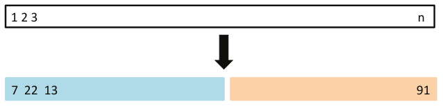

**图5.1** 验证集法示意图。将 $n$ 个观测随机分为训练集（蓝色，其中包括第7、22、13个观测等）和验证集（米色，其中包括第91个观测等）。在训练集上拟合统计学习方法，并在验证集上评估其表现。

我们将392个观测随机分成两组：训练集包含196个数据点，验证集包含剩余196个观测。在训练样本上拟合不同的回归模型，再在验证样本上评估表现，并用MSE衡量验证集误差；所得的验证集误差率见图5.2左图。二次拟合的验证集MSE明显小于线性拟合；但三次拟合的验证集MSE，实际上略大于二次拟合。这说明，相比仅使用二次项，在回归中加入三次项并不能改善预测。

回顾一下，为绘制图5.2左图，我们将数据集随机分成了训练集和验证集两部分。如果重新随机划分样本，会得到稍有不同的测试MSE估计。作为说明，图5.2右图展示了 `Auto` 数据的十条验证集MSE曲线，分别来自将观测随机分为训练集和验证集的十种不同划分。十条曲线都表明，包含二次项的模型，其验证集MSE明显小于仅含线性项的模型。此外，十条曲线也都表明，在模型中加入三次或更高次多项式项，收益不大。不过，对于所考察的十个回归模型中的每一个，这十条曲线都会给出不同的测试MSE估计，而且它们对哪个模型的验证集MSE最小，并没有一致的结论。考虑到这些曲线之间的变异，我们能较有把握得出的结论，只是线性拟合不适合这些数据。

验证集法概念简单，也容易实现，但有两个潜在缺点：

1. 如图5.2右图所示，验证集给出的测试误差率估计可能有很大变异，取决于哪些观测被分入训练集，哪些被分入验证集。
2. 在验证集法中，只有一部分观测，即被分入训练集而非验证集的观测，用于拟合模型。由于统计方法在观测较少的训练数据上往往表现较差，因此，验证集误差率可能倾向于高估用整个数据集拟合模型时的测试误差率。

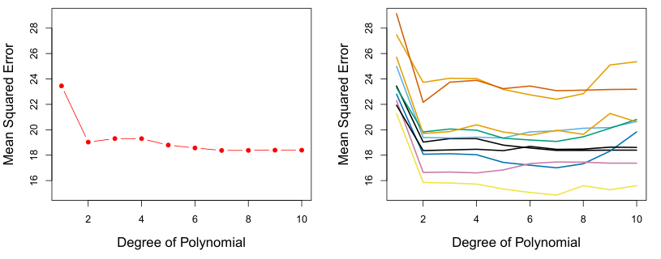

**图5.2** 对 `Auto` 数据集使用验证集法，估计用 `horsepower` 的多项式函数预测 `mpg` 所产生的测试误差。**左图：** 对一次训练集与验证集划分得到的验证误差估计。**右图：** 将验证过程重复十次，每次使用不同的随机划分，将观测分成训练集和验证集。这说明了该方法所得测试MSE估计的变异程度。图内文字：Degree of Polynomial＝多项式次数；Mean Squared Error＝均方误差。

以下几个小节将介绍交叉验证，它是对验证集法的改进，能够处理这两个问题。

### 5.1.2 留一交叉验证（Leave-One-Out Cross-Validation）

**留一交叉验证（LOOCV)** 与第5.1.1节的验证集法密切相关，但它试图克服后者的缺点。

与验证集法一样，LOOCV也将观测分成两部分。不过，它不再构造大小相近的两个子集，而是仅用一个观测 $(x_1,y_1)$ 作为验证集，其余观测 $\{(x_2,y_2),\ldots,(x_n,y_n)\}$ 构成训练集。在这 $n-1$ 个训练观测上拟合统计学习方法，再利用被排除观测的 $x_1$ 值，对其作出预测 $\hat y_1$。由于 $(x_1,y_1)$ 没有参与拟合，$\operatorname{MSE}_1=(y_1-\hat y_1)^2$ 就提供了测试误差的一个近似无偏估计。不过，尽管 $\operatorname{MSE}_1$ 对测试误差是无偏的，它并不是一个好的估计，因为它仅基于单个观测 $(x_1,y_1)$，变异很大。

可以重复这一过程：选用 $(x_2,y_2)$ 作为验证数据，在其余 $n-1$ 个观测 $\{(x_1,y_1),(x_3,y_3),\ldots,(x_n,y_n)\}$ 上训练统计学习方法，并计算 $\operatorname{MSE}_2=(y_2-\hat y_2)^2$。将这一方法重复 $n$ 次，得到 $n$ 个平方误差 $\operatorname{MSE}_1,\ldots,\operatorname{MSE}_n$。测试MSE的LOOCV估计，就是这 $n$ 个测试误差估计值的平均值：

$$
\operatorname{CV}_{(n)}=\frac{1}{n}\sum_{i=1}^{n}\operatorname{MSE}_i. \tag{5.1}
$$


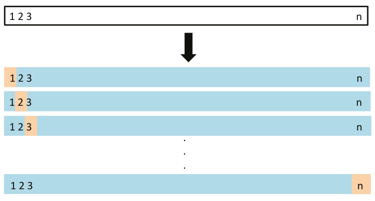

**图5.3** LOOCV示意图。将 $n$ 个数据点反复分为两部分：训练集（蓝色）包含除一个观测之外的全部观测，验证集（米色）仅包含被排除的那个观测。将所得的 $n$ 个MSE取平均，便可估计测试误差。第一个训练集包含除第1个观测以外的所有观测，第二个训练集包含除第2个观测以外的所有观测，依此类推。

图5.3示意了LOOCV的过程。

相比验证集法，LOOCV有两个主要优点。首先，它的偏差小得多。在LOOCV中，我们反复使用含 $n-1$ 个观测的训练集拟合统计学习方法，其观测数几乎与整个数据集相同。而在验证集法中，训练集大小通常只有原始数据集的一半。因此，LOOCV对测试误差率的高估，通常没有验证集法那么严重。其次，验证集法由于训练集与验证集的随机划分，每次重复应用都会产生不同结果；而多次进行LOOCV，总会得到相同的结果，因为其训练集与验证集的划分没有随机性。

我们对 `Auto` 数据使用LOOCV，估计用 `horsepower` 的多项式函数预测 `mpg` 的线性回归模型的测试集MSE。结果见图5.4左图。

LOOCV的计算成本可能很高，因为必须拟合模型 $n$ 次。当 $n$ 很大，而且每个模型的拟合速度又较慢时，这会非常耗时。不过，对于最小二乘线性回归或多项式回归，有一个巧妙的捷径，可以使LOOCV的计算成本与只拟合一次模型相同！下面的公式成立：

$$
\operatorname{CV}_{(n)}=\frac{1}{n}\sum_{i=1}^{n}\left(\frac{y_i-\hat y_i}{1-h_i}\right)^2, \tag{5.2}
$$


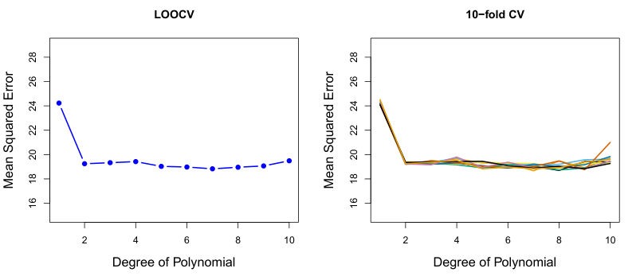

**图5.4** 对 `Auto` 数据使用交叉验证，估计用 `horsepower` 的多项式函数预测 `mpg` 所产生的测试误差。**左图：** LOOCV误差曲线。**右图：** 独立运行九次10折CV，每次将数据随机分为十部分，使用不同的随机划分。图中显示了这九条略有差异的CV误差曲线。图内文字：LOOCV＝留一交叉验证；10-fold CV＝10折交叉验证；Degree of Polynomial＝多项式次数；Mean Squared Error＝均方误差。

式(5.2)中，$\hat y_i$ 是原始最小二乘拟合中的第 $i$ 个拟合值，$h_i$ 是第105页式(3.37)定义的杠杆统计量。<sup><a href="#ch05-fn1" id="ch05-fnref1">1</a></sup> 该式与通常的MSE类似，只是第 $i$ 个残差除以了 $1-h_i$。杠杆值介于 $1/n$ 与1之间，反映一个观测对自身拟合值的影响程度。因此，在这一公式中，高杠杆点的残差被恰当地放大，使等式成立。

<aside class="footnote" id="ch05-fn1"><a href="#ch05-fnref1">1</a> 对于多元线性回归，杠杆统计量的形式比式(3.37)略复杂，但式(5.2)仍然成立。</aside>

LOOCV是一种非常通用的方法，能够用于任何预测建模。例如，可以将它用于逻辑回归、线性判别分析，或后续章节讨论的任何方法。不过，巧妙的公式(5.2)一般并不成立；在这种情况下，仍需重新拟合模型 $n$ 次。

### 5.1.3 k折交叉验证（k-Fold Cross-Validation）

LOOCV的另一种选择是 **$k$ 折交叉验证（$k$-fold CV）**。这种方法将观测随机分成大小近似相等的 $k$ 组，也称为 **$k$ 折（folds）**。把第一折作为验证集，在其余 $k-1$ 折上拟合模型，再在被留出的那一折观测上计算均方误差 $\operatorname{MSE}_1$。将这一过程重复 $k$ 次，每次用不同的一组观测作为验证集。这样便得到 $k$ 个测试误差估计值 $\operatorname{MSE}_1,\operatorname{MSE}_2,\ldots,\operatorname{MSE}_k$。将这些值取平均，即可得到 $k$ 折CV估计：

$$
\operatorname{CV}_{(k)}=\frac{1}{k}\sum_{i=1}^{k}\operatorname{MSE}_i. \tag{5.3}
$$

图5.5展示了 $k$ 折CV方法。


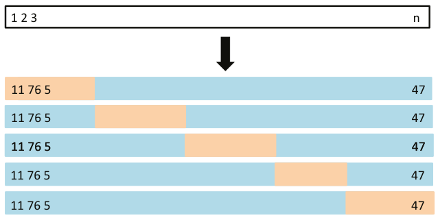

**图5.5** 5折CV示意图。将 $n$ 个观测随机分成五个互不重叠的组。每个五分之一的子集依次作为验证集（米色），其余观测作为训练集（蓝色）。对所得五个MSE估计值取平均，即可估计测试误差。

不难看出，LOOCV就是 $k=n$ 时的 $k$ 折CV特例。在实践中，通常采用 $k=5$ 或 $k=10$ 进行 $k$ 折CV。与 $k=n$ 相比，采用 $k=5$ 或 $k=10$ 有什么好处？最明显的优势是计算量。LOOCV需要将统计学习方法拟合 $n$ 次，计算成本可能很高；只有用最小二乘法拟合的线性模型是个例外，此时可以使用式(5.2)。不过，交叉验证是一种非常通用的方法，几乎适用于任何统计学习方法。有些统计学习方法的拟合计算量很大，因此，LOOCV可能带来计算上的困难，尤其是在 $n$ 极大时。相比之下，10折CV只需将学习方法拟合十次，可能就可行得多。如第5.1.4节将介绍的，5折或10折CV还可能具有计算量以外的优势，这涉及偏差—方差权衡。

图5.4右图给出了 `Auto` 数据的九组不同的10折CV估计，每组都来自将观测随机分成十折的一种不同划分。可以看到，观测划分为十折的方式有所不同，CV估计也因此存在一定变异。但这种变异，通常远小于验证集法所得测试误差估计的变异，后者见图5.2右图。

分析真实数据时，我们并不知道真实的测试MSE，因此难以判断交叉验证估计的准确程度。不过，研究模拟数据时，可以计算真实测试MSE，从而评估交叉验证结果的准确性。图5.6展示了对第2章图2.9–2.11的模拟数据集应用平滑样条后，所得的交叉验证估计与真实测试误差率。蓝色表示真实测试MSE，黑色虚线与橙色实线分别表示LOOCV和10折CV的估计。在三幅图中，两种交叉验证估计都非常接近。


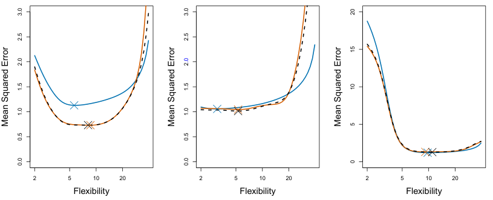

**图5.6** 图2.9（左）、图2.10（中）和图2.11（右）中模拟数据集的真实测试MSE及其估计。蓝色表示真实测试MSE，黑色虚线表示LOOCV估计，橙色表示10折CV估计。叉号标示各条MSE曲线的最小值。图内文字：Flexibility＝灵活程度；Mean Squared Error＝均方误差。

图5.6右图中，真实测试MSE与交叉验证曲线几乎完全重合。中图中，灵活程度较低时，两组曲线相近；灵活程度较高时，CV曲线则高估了测试集MSE。左图中，CV曲线总体形状正确，却低估了真实测试MSE。

进行交叉验证时，我们的目标可能是判断某种统计学习方法在独立数据上的预期表现；此时，测试MSE的具体估计值就是所关注的对象。但有时，我们只关心估计的测试MSE曲线中最小值所在的位置。这是因为，我们可能正在对多种统计学习方法，或某一种方法的不同灵活程度进行交叉验证，以找出测试误差最低的方法。对于这一目的，估计的测试MSE曲线中最小点的位置很重要，而测试MSE估计值本身的具体数值并不重要。从图5.6可见，尽管CV曲线有时会低估真实测试MSE，但所有CV曲线都能近似找出正确的灵活程度，也就是测试MSE最小时对应的灵活程度。

### 5.1.4 k折交叉验证的偏差—方差权衡

第5.1.3节提到，在 $k<n$ 时，$k$ 折CV相比LOOCV具有计算量上的优势。不过，撇开计算问题，$k$ 折CV还有一个不太明显、却可能更重要的优点：它往往能比LOOCV更准确地估计测试误差率。这与偏差—方差权衡有关。

第5.1.1节提到，验证集法可能高估测试误差率，因为该方法用于拟合统计学习模型的训练集，只包含整个数据集一半的观测。沿着这一思路，不难看出LOOCV能给出测试误差的近似无偏估计。

这是因为，每个训练集都包含 $n-1$ 个观测，几乎与完整数据集中的观测数相同。而采用例如 $k=5$ 或 $k=10$ 的 $k$ 折CV，会产生介于两者之间的偏差，因为每个训练集大约包含 $(k-1)n/k$ 个观测：少于LOOCV，却明显多于验证集法。因此，从减小偏差的角度看，LOOCV显然优于 $k$ 折CV。

然而，在一个估计过程中，偏差并不是唯一需要关注的因素，还必须考虑方差。实际上，LOOCV的方差高于 $k<n$ 时的 $k$ 折CV。为什么会这样？进行LOOCV时，实际上是在对 $n$ 个拟合模型的输出取平均，而每个模型都是在几乎相同的一组观测上训练的，因此这些输出之间具有很强的正相关。相比之下，进行 $k<n$ 的 $k$ 折CV时，我们对 $k$ 个拟合模型的输出取平均；各模型的训练集重叠较少，因此其输出之间的相关性也较低。多个高度相关量的均值，其方差高于相关程度较低的多个量的均值。因此，LOOCV得到的测试误差估计，其方差往往高于 $k$ 折CV得到的测试误差估计。

由此可见，$k$ 折交叉验证中 $k$ 的选择涉及偏差—方差权衡。综合这些考虑，通常采用 $k=5$ 或 $k=10$ 进行 $k$ 折交叉验证，因为经验表明，这两个取值所得到的测试误差率估计，既没有过高的偏差，也没有很大的方差。

### 5.1.5 分类问题中的交叉验证

本章此前一直用定量结果 $Y$ 的回归问题说明交叉验证，并使用MSE衡量测试误差。不过，当 $Y$ 是定性的、需要进行分类时，交叉验证同样非常有用。其过程与本章前面的描述相同，只是不再用MSE衡量测试误差，而是使用被误分类的观测数量。例如，在分类问题中，LOOCV错误率为

$$
\operatorname{CV}_{(n)}=\frac{1}{n}\sum_{i=1}^{n}\operatorname{Err}_i, \tag{5.4}
$$

其中 $\operatorname{Err}_i=I(y_i\ne\hat y_i)$。$k$ 折CV错误率和验证集错误率也以类似方式定义。

作为例子，我们对图2.13所示的二维分类数据拟合不同的逻辑回归模型。图5.7左上图中，黑色实线表示对该数据集拟合标准逻辑回归模型所估计的决策边界。由于这些数据来自模拟，可以计算真实测试错误率，其值为0.201，明显高于0.133的贝叶斯错误率。

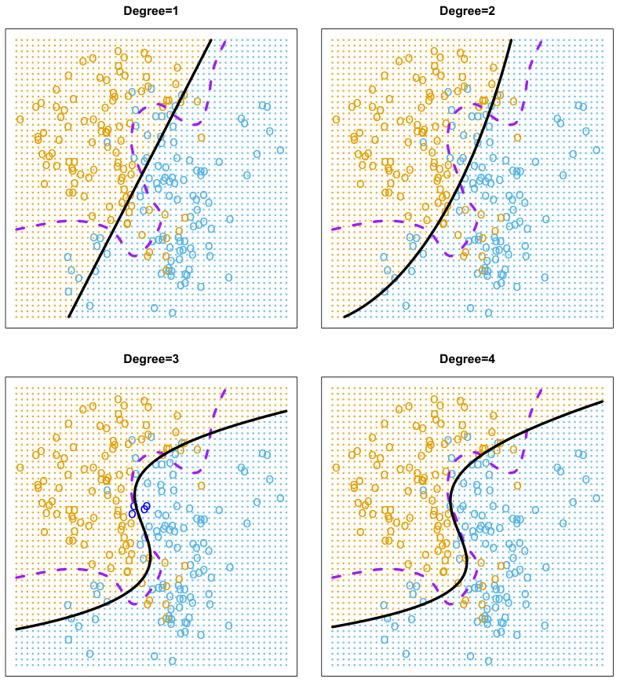

**图5.7** 对图2.13中的二维分类数据进行逻辑回归拟合。紫色虚线表示贝叶斯决策边界。线性、二次、三次和四次（次数1–4）逻辑回归所估计的决策边界用黑色表示。四种逻辑回归拟合的测试错误率依次为0.201、0.197、0.160和0.162，贝叶斯错误率则为0.133。图内文字：Degree＝多项式次数。

显然，在这种情形下，逻辑回归没有足够的灵活性来刻画贝叶斯决策边界。可以像第3.3.2节在回归问题中所做的那样，使用预测变量的多项式函数，轻松地扩展逻辑回归，从而得到非线性决策边界。例如，可以拟合如下二次逻辑回归模型：

$$
\log\left(\frac{p}{1-p}\right)=\beta_0+\beta_1X_1+\beta_2X_1^2+\beta_3X_2+\beta_4X_2^2. \tag{5.5}
$$

图5.7右上图展示了相应的决策边界，此时边界已变为曲线。不过，测试错误率只略有改善，降至0.197。图5.7左下图则有明显更大的改进：这里拟合的逻辑回归模型使用了预测变量的三次多项式，测试错误率降至0.160。


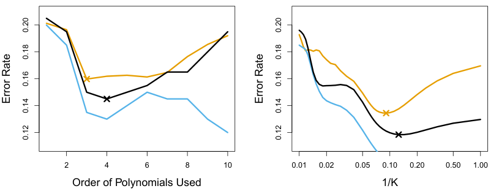

**图5.8** 图5.7所示二维分类数据的测试错误（棕色）、训练错误（蓝色）和10折CV错误（黑色）。**左图：** 使用预测变量多项式函数的逻辑回归，$x$ 轴表示所用多项式的次数。**右图：** 采用不同 $K$ 值的KNN分类器，$K$ 为所用近邻的数量。图内文字：Order of Polynomials Used＝所用多项式次数；Error Rate＝错误率；$1/K$ 保持原样。

进一步使用四次多项式（图5.7右下图），测试误差又略有增加。

在实践中，对于真实数据，贝叶斯决策边界和测试错误率都是未知的。那么，应当如何在图5.7展示的四种逻辑回归模型之间作选择？我们可以使用交叉验证。图5.8左图的黑线表示对数据拟合十个逻辑回归模型所得到的10折CV错误率；这些模型使用预测变量的多项式函数，最高到十次。真实测试错误用棕色表示，训练错误用蓝色表示。如前所见，随着拟合的灵活程度增加，训练错误往往会减少。（图中表明，训练错误率并没有严格单调下降，但总体上有随模型复杂程度增加而下降的趋势。）相比之下，测试错误呈典型的U形。10折CV错误率能较好地近似测试错误率。虽然它略微低估了错误率，但在使用四次多项式时达到最小值，与测试曲线在三次多项式时达到的最小值十分接近。事实上，四次多项式很可能也有良好的测试集表现，因为三次、四次、五次和六次多项式的真实测试错误率近似相同。

图5.8右图对KNN分类方法绘制了相同的三条曲线，表示它们随 $K$ 值的变化。这里，$K$ 表示KNN分类器所用的近邻数量，而非CV所用的折数。同样，随着方法的灵活程度提高，训练错误率不断降低，因此不能用它来选择最优的 $K$。尽管交叉验证错误曲线略微低估了测试错误率，它的最小值仍出现在非常接近最佳 $K$ 值的位置。

## 5.2 自助法（The Bootstrap）

自助法是一种适用范围广、功能强大的统计工具，可以量化给定估计量或统计学习方法的不确定性。举一个简单的例子，自助法可以用来估计线性回归拟合中系数的标准误。在线性回归这一具体情形中，这种做法并没有特别大的用处，因为正如第3章所见，R等常用统计软件会自动输出这些标准误。不过，自助法的强大之处在于，它可以方便地应用于多种统计学习方法；对于其中一些方法，变异程度的度量很难通过其他途径获得，统计软件也不会自动输出。

本节用一个简单的示例来说明自助法：在一个简单模型下，确定最佳的投资资金分配方案。在第5.3节中，我们将探讨如何用自助法评估线性模型拟合中回归系数的变异程度。

假设我们要将一笔固定金额的资金投资于两种金融资产，它们的收益分别为 $X$ 和 $Y$，其中 $X$ 和 $Y$ 都是随机量。我们把比例为 $\alpha$ 的资金投入 $X$，其余 $1-\alpha$ 投入 $Y$。由于这两种资产的收益都存在变异，我们希望选择 $\alpha$，使投资的总风险（即方差）最小。换句话说，我们要使 $\operatorname{Var}(\alpha X+(1-\alpha)Y)$ 最小。可以证明，使风险最小的取值为

$$
\alpha=\frac{\sigma_Y^2-\sigma_{XY}}{\sigma_X^2+\sigma_Y^2-2\sigma_{XY}}, \tag{5.6}
$$

其中，$\sigma_X^2=\operatorname{Var}(X)$，$\sigma_Y^2=\operatorname{Var}(Y)$，$\sigma_{XY}=\operatorname{Cov}(X,Y)$。

在现实中，$\sigma_X^2$、$\sigma_Y^2$ 和 $\sigma_{XY}$ 都是未知的。利用包含 $X$ 和 $Y$ 过去测量值的数据集，可以计算这些量的估计值 $\hat{\sigma}_X^2$、$\hat{\sigma}_Y^2$ 和 $\hat{\sigma}_{XY}$。然后，就可以用下式估计使投资方差最小的 $\alpha$ 值：

$$
\hat{\alpha}=\frac{\hat{\sigma}_Y^2-\hat{\sigma}_{XY}}{\hat{\sigma}_X^2+\hat{\sigma}_Y^2-2\hat{\sigma}_{XY}}. \tag{5.7}
$$

图5.9用模拟数据集展示了这种估计 $\alpha$ 的方法。在每个面板中，我们都模拟了投资 $X$ 和 $Y$ 的100组成对收益值。利用这些收益值估计 $\sigma_X^2$、$\sigma_Y^2$ 和 $\sigma_{XY}$，再将估计值代入式(5.7)，得到 $\alpha$ 的估计值。各个模拟数据集所得的 $\hat{\alpha}$ 值介于0.532与0.657之间。

我们自然会希望量化 $\alpha$ 估计值的准确性。为了估计 $\hat{\alpha}$ 的标准差，我们将以下过程重复了1,000次：模拟 $X$ 和 $Y$ 的100组成对观测，再利用式(5.7)估计 $\alpha$。这样便得到 $\alpha$ 的1,000个估计值，记为 $\hat{\alpha}_1,\hat{\alpha}_2,\ldots,\hat{\alpha}_{1,000}$。图5.10左图给出了这些估计值的直方图。在模拟中，参数设为 $\sigma_X^2=1$、$\sigma_Y^2=1.25$、$\sigma_{XY}=0.5$，因此我们知道 $\alpha$ 的真实值为0.6。直方图中的竖直实线标出了这一数值。


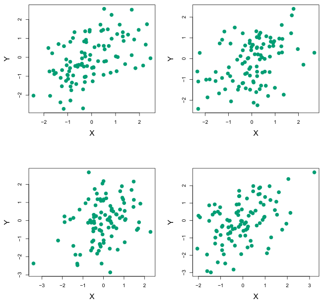

**图5.9** 每个面板都展示了投资 $X$ 和 $Y$ 的100组模拟收益值。按从左到右、从上到下的顺序，所得的 $\alpha$ 估计值分别为0.576、0.532、0.657和0.651。

$\alpha$ 的全部1,000个估计值的均值为

$$
\bar{\alpha}=\frac{1}{1000}\sum_{r=1}^{1000}\hat{\alpha}_r=0.5996,
$$

与 $\alpha=0.6$ 非常接近，而这些估计值的标准差为

$$
\sqrt{\frac{1}{1000-1}\sum_{r=1}^{1000}(\hat{\alpha}_r-\bar{\alpha})^2}=0.083.
$$

这使我们能够很好地了解 $\hat{\alpha}$ 的准确性：$\operatorname{SE}(\hat{\alpha})\approx0.083$。因此，粗略地说，对于从总体中抽取的一个随机样本，我们预期 $\hat{\alpha}$ 与 $\alpha$ 的差距平均约为0.08。

然而在实际中，不能用上述过程估计 $\operatorname{SE}(\hat{\alpha})$，因为对于真实数据，我们无法从原总体中生成新的样本。不过，自助法让我们能够用计算机模拟获取新样本集的过程，从而在不获取额外样本的情况下，估计 $\hat{\alpha}$ 的变异程度。具体而言，我们反复**从原始数据集中**抽取观测，得到不同的数据集，而不再反复从总体中获取相互独立的数据集。

图5.11用一个仅包含 $n=3$ 条观测的简单数据集来说明这种方法。我们将这个数据集记为 $Z$，从中随机抽取 $n$ 条观测，生成一个自助数据集（bootstrap data set）。


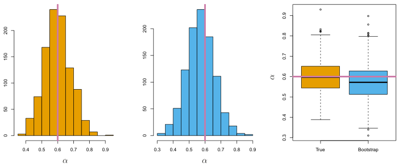

**图5.10** **左图：** 从真实总体中生成1,000个模拟数据集，所得 $\alpha$ 估计值的直方图。**中图：** 从单个数据集中抽取1,000个自助样本，所得 $\alpha$ 估计值的直方图。**右图：** 用箱线图展示左图和中图中的 $\alpha$ 估计值。每个面板中的粉色线都表示 $\alpha$ 的真实值。图内文字：True＝真实总体；Bootstrap＝自助法。

将这个自助数据集记为 $Z^{*1}$。抽样采用**有放回（with replacement）** 的方式，也就是说，同一条观测可以在自助数据集中出现不止一次。在这个例子中，$Z^{*1}$ 包含两次第3条观测、一次第1条观测，而第2条观测一次也没有出现。注意，如果一条观测被纳入 $Z^{*1}$，那么它的 $X$ 值和 $Y$ 值都会一同纳入。利用 $Z^{*1}$，可以得到 $\alpha$ 的一个新的自助估计值（bootstrap estimate），记为 $\hat{\alpha}^{*1}$。取一个较大的 $B$，将这一过程重复 $B$ 次，便得到 $B$ 个不同的自助数据集 $Z^{*1},Z^{*2},\ldots,Z^{*B}$，以及对应的 $B$ 个 $\alpha$ 估计值 $\hat{\alpha}^{*1},\hat{\alpha}^{*2},\ldots,\hat{\alpha}^{*B}$。这些自助估计值的标准误可用下式计算：

$$
\operatorname{SE}_B(\hat{\alpha})=\sqrt{\frac{1}{B-1}\sum_{r=1}^{B}\left(\hat{\alpha}^{*r}-\frac{1}{B}\sum_{r'=1}^{B}\hat{\alpha}^{*r'}\right)^2}. \tag{5.8}
$$

它可作为根据原始数据集得到的 $\hat{\alpha}$ 的标准误估计值。

图5.10中图展示了自助法的结果：图中是 $\alpha$ 的1,000个自助估计值的直方图，每个估计值都是用一个不同的自助数据集计算得到的。中图仅基于单个数据集构建，因此也可以用真实数据绘制。注意，这一直方图与左图非常相似。左图是一个理想情形下的直方图，其中的 $\alpha$ 估计值来自真实总体生成的1,000个模拟数据集。特别是，式(5.8)给出的标准误自助估计值 $\operatorname{SE}(\hat{\alpha})$ 为0.087，与利用1,000个模拟数据集得到的估计值0.083非常接近。右图则以另一种方式展示了中图和左图的信息：用箱线图展示从真实总体中生成1,000个模拟数据集所得的 $\alpha$ 估计值，以及自助法所得的 $\alpha$ 估计值。两幅箱线图同样具有相近的离散程度，说明自助法能够有效地估计 $\hat{\alpha}$ 的变异程度。


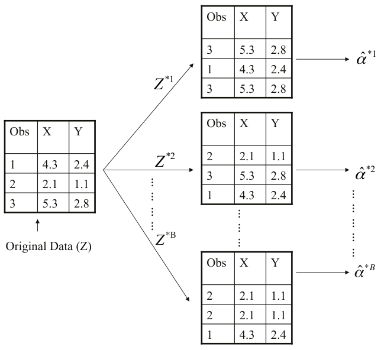

**图5.11** 在一个包含 $n=3$ 条观测的小样本上，用图示说明自助法。每个自助数据集都包含从原始数据集中有放回抽取的 $n$ 条观测。每个自助数据集都用于计算 $\alpha$ 的一个估计值。图内文字：Original Data ($Z$)＝原始数据（$Z$）；Obs＝观测编号。

## 5.3 实验：交叉验证与自助法

本实验将探讨本章介绍的重抽样技术。其中一些命令在你的计算机上可能需要运行一段时间。

我们仍然先在顶层集中导入大部分所需的库。

In [1]:

```python
import numpy as np
import statsmodels.api as sm
from ISLP import load_data
from ISLP.models import (ModelSpec as MS,
                         summarize,
                         poly)
from sklearn.model_selection import train_test_split
```

本实验还需要几项新的导入。

In [2]:

```python
from functools import partial
from sklearn.model_selection import \
     (cross_validate,
      KFold,
      ShuffleSplit)
from sklearn.base import clone
from ISLP.models import sklearn_sm
```

### 5.3.1 验证集法

我们将用验证集法，估计对 `Auto` 数据集拟合各种线性模型所得到的测试错误率。

使用 `train_test_split()` 函数将数据划分为训练集和验证集。数据共有392个观测，因此通过参数 `test_size=196`，将其划分为两个大小均为196的集合。进行这类包含随机成分的操作时，通常最好设置随机种子，以便日后能够精确复现所得结果。这里使用参数 `random_state=0` 设置划分器的随机种子。

In [3]:

```python
Auto = load_data('Auto')
Auto_train, Auto_valid = train_test_split(Auto,
                                         test_size=196,
                                         random_state=0)
```

现在可以仅用训练集 `Auto_train` 中的观测拟合线性回归。

In [4]:

```python
hp_mm = MS(['horsepower'])
X_train = hp_mm.fit_transform(Auto_train)
y_train = Auto_train['mpg']
model = sm.OLS(y_train, X_train)
results = model.fit()
```

接下来，使用验证数据集为这个模型构造模型矩阵，并将其传入 `results` 的 `predict()` 方法。我们还计算模型的验证MSE。

In [5]:

```python
X_valid = hp_mm.transform(Auto_valid)
y_valid = Auto_valid['mpg']
valid_pred = results.predict(X_valid)
np.mean((y_valid - valid_pred)**2)
```

Out[5]:

```text
23.6166
```

因此，线性回归拟合的验证MSE估计值为23.62。

我们也可以估计更高次多项式回归的验证误差。首先给出函数 `evalMSE()`，它接收模型字符串、训练集和测试集，并返回测试集上的MSE。

In [6]:

```python
def evalMSE(terms,
            response,
            train,
            test):

    mm = MS(terms)
    X_train = mm.fit_transform(train)
    y_train = train[response]

    X_test = mm.transform(test)
    y_test = test[response]
    results = sm.OLS(y_train, X_train).fit()
    test_pred = results.predict(X_test)

    return np.mean((y_test - test_pred)**2)
```

下面使用这个函数，估计线性、二次和三次拟合的验证MSE。这里使用 `enumerate()` 函数：在 `for` 循环迭代时，它会同时给出对象的值及其索引。

In [7]:

```python
MSE = np.zeros(3)
for idx, degree in enumerate(range(1, 4)):
    MSE[idx] = evalMSE([poly('horsepower', degree)],
                       'mpg',
                       Auto_train,
                       Auto_valid)
MSE
```

Out[7]:

```text
array([23.62, 18.76, 18.80])
```

这三个错误率分别为23.62、18.76和18.80。如果改用另一种训练集／验证集划分，那么验证集上的误差预期也会有所不同。

In [8]:

```python
Auto_train, Auto_valid = train_test_split(Auto,
                                         test_size=196,
                                         random_state=3)
MSE = np.zeros(3)
for idx, degree in enumerate(range(1, 4)):
    MSE[idx] = evalMSE([poly('horsepower', degree)],
                       'mpg',
                       Auto_train,
                       Auto_valid)
MSE
```

Out[8]:

```text
array([20.76, 16.95, 16.97])
```

采用这次训练集和验证集的划分后，含线性项、二次项和三次项的模型，其验证集错误率分别为20.76、16.95和16.97。

这些结果与我们先前的发现一致：用 `horsepower` 的二次函数预测 `mpg`，表现优于仅使用 `horsepower` 线性函数的模型；没有证据表明，使用 `horsepower` 的三次函数能够带来改善。

### 5.3.2 交叉验证

理论上，任何广义线性模型都可以计算交叉验证估计值。不过，在实践中，用Python进行交叉验证最简单的办法是使用 `sklearn`，而它的接口或API与我们一直用来拟合GLM的 `statsmodels` 不同。

这是数据科学家经常遇到的问题：“我有一个完成任务 $A$ 的函数，需要把它传入一个完成任务 $B$ 的工具，以便计算 $B(A(D))$，其中 $D$ 是我的数据。”当 $A$ 和 $B$ 无法直接衔接时，就需要使用**包装器（wrapper）**。

在 `ISLP` 包中，我们提供了包装器 `sklearn_sm()`，使我们能够方便地将 `sklearn` 的交叉验证工具用于由 `statsmodels` 拟合的模型。

`sklearn_sm()` 类的第一个参数是一个来自 `statsmodels` 的模型。它还可以接收两个可选参数：`model_str` 用于指定公式，`model_args` 则应是一个字典，包含拟合模型时使用的其他参数。例如，拟合逻辑回归模型时，必须指定 `family` 参数；可以通过 `model_args={'family':sm.families.Binomial()}` 传入。

下面演示包装器的用法。

In [9]:

```python
hp_model = sklearn_sm(sm.OLS,
                      MS(['horsepower']))
X, Y = Auto.drop(columns=['mpg']), Auto['mpg']
cv_results = cross_validate(hp_model,
                            X,
                            Y,
                            cv=Auto.shape[0])
cv_err = np.mean(cv_results['test_score'])
cv_err
```

Out[9]:

```text
24.2315
```

`cross_validate()` 的参数包括：一个具有适当 `fit()`、`predict()` 和 `score()` 方法的对象、特征数组 `X`，以及响应 `Y`。我们还向 `cross_validate()` 传入了额外参数 `cv`；将它指定为整数 $K$，就会进行 $K$ 折交叉验证。这里给出的值等于观测总数，因此进行的是留一交叉验证（LOOCV）。`cross_validate()` 函数返回一个包含若干组成部分的字典；这里我们只需要交叉验证的测试评分（MSE），估计值为24.23。

对于复杂程度逐渐增加的多项式拟合，可以重复上述过程。为使这一过程自动完成，我们再次使用 `for` 循环，依次拟合1次到5次多项式回归，计算相应的交叉验证误差，并将其存入向量 `cv_error` 的第 $i$ 个元素。`for` 循环中的变量 `d` 对应多项式的次数。首先初始化这个向量。这条命令可能需要几秒钟才能运行完毕。

In [10]:

```python
cv_error = np.zeros(5)
H = np.array(Auto['horsepower'])
M = sklearn_sm(sm.OLS)
for i, d in enumerate(range(1,6)):
    X = np.power.outer(H, np.arange(d+1))
    M_CV = cross_validate(M,
                          X,
                          Y,
                          cv=Auto.shape[0])
    cv_error[i] = np.mean(M_CV['test_score'])
cv_error
```

Out[10]:

```text
array([24.2315, 19.2482, 19.3350, 19.4244, 19.0332])
```

与图5.4一样，测试MSE的估计值从线性拟合到二次拟合明显下降，但使用更高次多项式没有带来明显改善。

上面介绍了 `np.power()` 函数的 `outer()` 方法。`outer()` 方法适用于接收两个参数的运算，例如 `add()`、`min()` 或 `power()`。它以两个数组为参数，对分别来自两个数组的每一对元素进行该运算，从而构造一个更大的数组。

In [11]:

```python
A = np.array([3, 5, 9])
B = np.array([2, 4])
np.add.outer(A, B)
```

Out[11]:

```text
array([[ 5,  7],
       [ 7,  9],
       [11, 13]])
```

上面的CV例子使用了 $K=n$，当然也可以使用 $K<n$。代码与上面非常相似，而且运行速度快得多。这里用 `KFold()` 将数据随机划分为 $K=10$ 组。我们使用 `random_state` 设置随机种子，并初始化向量 `cv_error`，用来存储1次到5次多项式拟合所对应的CV误差。

In [12]:

```python
cv_error = np.zeros(5)
cv = KFold(n_splits=10,
           shuffle=True,
           random_state=0) # use same splits for each degree
for i, d in enumerate(range(1,6)):
    X = np.power.outer(H, np.arange(d+1))
    M_CV = cross_validate(M,
                          X,
                          Y,
                          cv=cv)
    cv_error[i] = np.mean(M_CV['test_score'])
cv_error
```

Out[12]:

```text
array([24.2077, 19.1853, 19.2763, 19.4785, 19.1372])
```

可以看到，计算时间比LOOCV短得多。（原则上，对于最小二乘线性模型，由于有LOOCV公式(5.2)可用，LOOCV的计算应当比 $K$ 折CV更快；但是，通用的 `cross_validate()` 函数没有使用这个公式。）我们仍然几乎看不到证据表明，使用三次或更高次多项式项，能比简单的二次拟合获得更低的测试误差。

`cross_validate()` 函数很灵活，可以将不同的划分机制作为参数传入。例如，使用 `ShuffleSplit()` 函数实现验证集法，与实现 $K$ 折交叉验证一样方便。

In [13]:

```python
validation = ShuffleSplit(n_splits=1,
                          test_size=196,
                          random_state=0)
results = cross_validate(hp_model,
                         Auto.drop(['mpg'], axis=1),
                         Auto['mpg'],
                         cv=validation);
results['test_score']
```

Out[13]:

```text
array([23.6166])
```

运行以下代码，可以估计测试误差的变异程度。

In [14]:

```python
validation = ShuffleSplit(n_splits=10,
                          test_size=196,
                          random_state=0)
results = cross_validate(hp_model,
                         Auto.drop(['mpg'], axis=1),
                         Auto['mpg'],
                         cv=validation)
results['test_score'].mean(), results['test_score'].std()
```

Out[14]:

```text
(23.8022, 1.4218)
```

需要注意，这个标准差不能有效估计平均测试评分或各次评分的抽样变异，因为随机选取的训练样本彼此重叠，由此产生了相关性。但它确实能让我们了解，选取不同随机折所引入的蒙特卡洛变异（Monte Carlo variation）有多大。

### 5.3.3 自助法

我们将用5.2节的简单例子，以及一个估计 `Auto` 数据集上线性回归模型准确性的例子，说明自助法的使用。

#### 估计所关心统计量的准确性

自助法的一大优点是几乎适用于所有情形，而且不需要复杂的数学计算。虽然Python中已有多种自助法实现，但用它估计标准误十分简单，因此下面将针对数据存储在数据框中的情形，编写我们自己的函数。

首先用一个简单的例子说明自助法。5.2节介绍了 `ISLP` 包中的 `Portfolio` 数据集。这里的目标是估计公式(5.7)中参数 $\alpha$ 的抽样方差。我们将创建函数 `alpha_func()`，它接收一个假定具有 `X`、`Y` 两列的数据框 `D`，以及一个向量 `idx`，后者指定用哪些观测估计 $\alpha$。函数随后输出基于所选观测得到的 $\alpha$ 估计值。

In [15]:

```python
Portfolio = load_data('Portfolio')
def alpha_func(D, idx):
    cov_ = np.cov(D[['X','Y']].loc[idx], rowvar=False)
    return ((cov_[1,1] - cov_[0,1]) /
            (cov_[0,0]+cov_[1,1]-2*cov_[0,1]))
```

这个函数将最小方差公式(5.7)应用于参数 `idx` 所索引的观测，返回 $\alpha$ 的估计值。例如，下面这条命令使用全部100个观测估计 $\alpha$。

In [16]:

```python
alpha_func(Portfolio, range(100))
```

Out[16]:

```text
0.5758
```

接下来，从 `range(100)` 中有放回地随机选取100个观测。这相当于构造一个新的自助数据集，并基于这个新数据集重新计算 $\hat{\alpha}$。

In [17]:

```python
rng = np.random.default_rng(0)
alpha_func(Portfolio,
           rng.choice(100,
                      100,
                      replace=True))
```

Out[17]:

```text
0.6074
```

将这一过程推广，就能构造简单函数 `boot_SE()`，为仅以数据框为参数的任意函数计算自助标准误。

In [18]:

```python
def boot_SE(func,
             D,
             n=None,
             B=1000,
             seed=0):
    rng = np.random.default_rng(seed)
    first_, second_ = 0, 0
    n = n or D.shape[0]
    for _ in range(B):
        idx = rng.choice(D.index,
                         n,
                         replace=True)
        value = func(D, idx)
        first_ += value
        second_ += value**2
    return np.sqrt(second_ / B - (first_ / B)**2)
```

注意，`for _ in range(B)` 使用 `_` 作为循环变量。当计数器的值不重要，只需要保证循环执行 `B` 次时，经常采用这种写法。

下面使用这个函数，通过 $B=1{,}000$ 次自助重复抽样，评估 $\alpha$ 估计值的准确性。

In [19]:

```python
alpha_SE = boot_SE(alpha_func,
                    Portfolio,
                    B=1000,
                    seed=0)
alpha_SE
```

Out[19]:

```text
0.0912
```

最后的输出表明，$\operatorname{SE}(\hat{\alpha})$ 的自助法估计值为0.0912。

#### 估计线性回归模型的准确性

自助法可用于评估统计学习方法所得系数估计值和预测值的变异程度。

这里，我们将用自助法评估 $\beta_0$ 和 $\beta_1$ 估计值的变异程度；它们分别是用 `Auto` 数据集中的 `horsepower` 预测 `mpg` 的线性回归模型的截距项和斜率项。我们将把自助法所得估计值，与使用3.1.2节介绍的 $\operatorname{SE}(\hat{\beta}_0)$ 和 $\operatorname{SE}(\hat{\beta}_1)$ 公式得到的估计值作比较。

要使用 `boot_SE()`，必须编写一个仅接收数据框 `D` 和索引 `idx` 的函数，作为它的第一个参数。但这里希望对一个由模型公式和数据所指定的回归模型进行自助抽样。下面通过几个简单步骤展示如何实现。

首先编写一个对回归模型进行自助抽样的通用函数 `boot_OLS()`，它接收一个公式，用来定义相应的回归。我们用 `clone()` 函数复制这个公式，以便在新的数据框上重新拟合。这意味着，所有派生特征，例如 `poly()` 定义的特征（很快就会见到），都会在重抽样得到的数据框上重新拟合。

In [20]:

```python
def boot_OLS(model_matrix, response, D, idx):
    D_ = D.loc[idx]
    Y_ = D_[response]
    X_ = clone(model_matrix).fit_transform(D_)
    return sm.OLS(Y_, X_).fit().params
```

这个函数还不完全符合 `boot_SE()` 对第一个参数的要求。指定模型的前两个参数在自助抽样过程中不会改变，我们希望将它们*固定*下来。`functools` 模块中的 `partial()` 函数恰好能做到这一点：它接收一个函数作为参数，并从左侧开始固定该函数的部分参数。这里用它固定 `boot_OLS()` 中指定模型公式的前两个参数。

In [21]:

```python
hp_func = partial(boot_OLS, MS(['horsepower']), 'mpg')
```

输入 `hp_func?`，可以看到它有两个参数 `D` 和 `idx`；它是前两个参数已固定的 `boot_OLS()` 版本，因此非常适合作为 `boot_SE()` 的第一个参数。

现在，可以使用 `hp_func()`，从观测中有放回地随机抽样，得到截距项和斜率项的自助法估计值。首先用10个自助样本演示它的用途。

In [22]:

```python
rng = np.random.default_rng(0)
np.array([hp_func(Auto,
                  rng.choice(392,
                             392,
                             replace=True)) for _ in range(10)])
```

Out[22]:

```text
array([[39.8806, -0.1568],
       [38.733 , -0.147 ],
       [38.3173, -0.1444],
       [39.9145, -0.1578],
       [39.4335, -0.1507],
       [40.3663, -0.1591],
       [39.6233, -0.1545],
       [39.0581, -0.1495],
       [38.6669, -0.1452],
       [39.6428, -0.1556]])
```

接下来，使用 `boot_SE()` 函数，根据截距项和斜率项的1,000个自助法估计值计算标准误。

In [23]:

```python
hp_se = boot_SE(hp_func,
                Auto,
                B=1000,
                seed=10)
hp_se
```

Out[23]:

```text
intercept     0.8488
horsepower    0.0074
dtype: float64
```

这表明，$\operatorname{SE}(\hat{\beta}_0)$ 的自助法估计值为0.85，$\operatorname{SE}(\hat{\beta}_1)$ 的自助法估计值为0.0074。如3.1.2节所述，可以使用标准公式计算线性模型中回归系数的标准误。使用 `ISLP.sm` 中的 `summarize()` 函数即可得到这些结果。

In [24]:

```python
hp_model.fit(Auto, Auto['mpg'])
model_se = summarize(hp_model.results_)['std err']
model_se
```

Out[24]:

```text
intercept     0.717
horsepower    0.006
Name: std err, dtype: float64
```

使用3.1.2节的公式，得到 $\hat{\beta}_0$ 和 $\hat{\beta}_1$ 的标准误估计值：截距为0.717，斜率为0.006。有意思的是，它们与自助法得到的估计值有些不同。这是否说明自助法有问题？事实上，这恰好说明相反的情况。回想一下，第75页式(3.8)给出的标准公式依赖某些假设。例如，公式依赖未知参数 $\sigma^2$，即噪声方差。我们随后用RSS估计 $\sigma^2$。虽然标准误公式本身不要求线性模型正确，但 $\sigma^2$ 的估计却依赖这一点。从第99页图3.8可以看到，数据中存在非线性关系，因此线性拟合的残差会被放大，$\hat{\sigma}^2$ 也会随之增大。其次，标准公式假设 $x_i$ 固定，所有变异都来自误差 $\epsilon_i$ 的变化；这一假设多少有些不切实际。自助法不依赖上述任何假设，因此，它对 $\hat{\beta}_0$ 和 $\hat{\beta}_1$ 标准误的估计，可能比 `sm.OLS` 的结果更准确。

下面对数据拟合二次模型，分别计算自助标准误估计值和标准线性回归估计值。由于这个模型能很好地拟合数据（图3.8），此时 $\operatorname{SE}(\hat{\beta}_0)$、$\operatorname{SE}(\hat{\beta}_1)$ 和 $\operatorname{SE}(\hat{\beta}_2)$ 的自助法估计值与标准估计值更加接近。

In [25]:

```python
quad_model = MS([poly('horsepower', 2, raw=True)])
quad_func = partial(boot_OLS,
                     quad_model,
                     'mpg')
boot_SE(quad_func, Auto, B=1000)
```

Out[25]:

```text
intercept                             2.067840
poly(horsepower, 2, raw=True)[0]        0.033019
poly(horsepower, 2, raw=True)[1]        0.000120
dtype: float64
```

我们将这些结果与使用 `sm.OLS()` 计算的标准误作比较。

In [26]:

```python
M = sm.OLS(Auto['mpg'],
            quad_model.fit_transform(Auto))
summarize(M.fit())['std err']
```

Out[26]:

```text
intercept                             1.800
poly(horsepower, 2, raw=True)[0]        0.031
poly(horsepower, 2, raw=True)[1]        0.000
Name: std err, dtype: float64
```

## 5.4 习题

### 概念题

**1.** 运用方差的基本统计性质以及一元微积分，推导式 (5.6)。换言之，证明式 (5.6) 给出的 $\alpha$ 确实使 $\operatorname{Var}(\alpha X+(1-\alpha)Y)$ 取得最小值。

**2.** 下面推导某个给定观测出现在自助样本中的概率。假设我们从一组含有 $n$ 个观测的数据中抽取一个自助样本。

**(a)** 自助样本中的第一个观测不是原样本中第 $j$ 个观测的概率是多少？说明理由。

**(b)** 自助样本中的第二个观测不是原样本中第 $j$ 个观测的概率是多少？

**(c)** 说明第 $j$ 个观测不在自助样本中的概率为 $(1-1/n)^n$。

**(d)** 当 $n=5$ 时，第 $j$ 个观测出现在自助样本中的概率是多少？

**(e)** 当 $n=100$ 时，第 $j$ 个观测出现在自助样本中的概率是多少？

**(f)** 当 $n=10{,}000$ 时，第 $j$ 个观测出现在自助样本中的概率是多少？

**(g)** 绘制一幅图，展示当 $n$ 取 1 到 100,000 之间的每个整数时，第 $j$ 个观测出现在自助样本中的概率。讨论你观察到的现象。

**(h)** 下面用数值方法考察一个大小为 $n=100$ 的自助样本包含第 $j$ 个观测的概率。这里 $j=4$。首先使用 `np.empty()` 函数创建一个数组 `store`，其中的值随后将被覆盖。接着，

反复创建自助样本，每次记录第五个观测是否包含在该自助样本中。

```python
rng = np.random.default_rng(10)
store = np.empty(10000)
for i in range(10000):
    store[i] = np.sum(rng.choice(100, replace=True) == 4)
         > 0
np.mean(store)
```

讨论得到的结果。

**3.** 下面回顾 $k$ 折交叉验证。

**(a)** 解释如何实施 $k$ 折交叉验证。

**(b)** 与下列方法相比，$k$ 折交叉验证各有哪些优点和缺点？

**i.** 验证集法。

**ii.** LOOCV。

**4.** 假设我们使用某种统计学习方法，在预测变量 $X$ 的一个特定取值处，对响应 $Y$ 作出预测。详细描述如何估计这一预测值的标准差。

### 应用题

**5.** 在第4章中，我们在 `Default` 数据集上，使用逻辑回归根据 `income` 和 `balance` 预测违约概率。下面使用验证集法估计这一逻辑回归模型的测试误差。开始分析前，不要忘记设置随机种子。

**(a)** 拟合一个逻辑回归模型，使用 `income` 和 `balance` 预测 `default`。

**(b)** 使用验证集法估计该模型的测试误差。为此，必须完成下列步骤：

**i.** 将样本集划分为训练集与验证集。

**ii.** 仅使用训练观测拟合一个多元逻辑回归模型。

**iii.** 计算验证集中每个人违约的后验概率，从而预测其违约状态。如果后验概率大于 0.5，则将此人分到 `default` 类别。

**iv.** 计算验证集误差，即验证集中被错误分类的观测所占的比例。

**(c)** 重复 (b) 中的过程三次，每次以不同的方式将观测划分为训练集与验证集。讨论得到的结果。

**(d)** 现在考虑一个使用 `income`、`balance` 以及表示 `student` 的虚拟变量来预测违约概率的逻辑回归模型。使用验证集法估计该模型的测试误差。讨论加入表示 `student` 的虚拟变量是否降低了测试错误率。

**6.** 我们继续在 `Default` 数据集上，使用逻辑回归模型根据 `income` 和 `balance` 预测违约概率。具体而言，下面将用两种不同的方法，估计 `income` 和 `balance` 的逻辑回归系数的标准误：(1) 使用自助法；(2) 使用 `sm.GLM()` 函数中计算标准误的标准公式。开始分析前，不要忘记设置随机种子。

**(a)** 使用 `summarize()` 和 `sm.GLM()` 函数，确定同时包含 `income` 和 `balance` 这两个预测变量的多元逻辑回归模型中，这两个变量所对应系数的标准误估计值。

**(b)** 编写一个函数 `boot_fn()`，输入为 `Default` 数据集以及观测的索引，输出为多元逻辑回归模型中 `income` 和 `balance` 的系数估计值。

**(c)** 参照实验中的自助法示例，使用你的 `boot_fn()` 函数估计 `income` 和 `balance` 的逻辑回归系数的标准误。

**(d)** 讨论使用 `sm.GLM()` 函数与使用自助法得到的标准误估计值。

**7.** 在 5.1.2 节与 5.1.3 节中，我们看到可以使用 `cross_validate()` 函数计算 LOOCV 测试误差估计值。另一种做法是，在 `for` 循环中，仅使用 `sm.GLM()` 以及拟合后模型的 `predict()` 方法来计算这些量。下面采用这种做法，在 `Weekly` 数据集上计算一个简单逻辑回归模型的 LOOCV 误差。回顾一下，在分类问题中，LOOCV 误差由式 (5.4) 给出。

**(a)** 拟合一个逻辑回归模型，使用 `Lag1` 和 `Lag2` 预测 `Direction`。

**(b)** 使用除第一个观测以外的所有观测，拟合一个逻辑回归模型，使用 `Lag1` 和 `Lag2` 预测 `Direction`。

**(c)** 使用 (b) 中的模型预测第一个观测的涨跌方向。具体做法是，如果 $P(\texttt{Direction}=\texttt{"Up"}\mid\texttt{Lag1},\texttt{Lag2})>0.5$，就预测第一个观测为上涨。这个观测是否被正确分类？

**(d)** 编写一个从 $i=1$ 到 $i=n$ 的 `for` 循环，其中 $n$ 是数据集中的观测数。该循环应执行下列各步：

**i.** 使用除第 $i$ 个观测以外的所有观测，拟合一个逻辑回归模型，使用 `Lag1` 和 `Lag2` 预测 `Direction`。

**ii.** 计算第 $i$ 个观测对应的市场上涨的后验概率。

**iii.** 使用第 $i$ 个观测的后验概率，预测市场是否上涨。

**iv.** 判断对第 $i$ 个观测的涨跌方向是否预测错误。如果预测错误，则记为 1；否则记为 0。

**(e)** 对 (d)iv 中得到的 $n$ 个数取平均值，得到测试误差的 LOOCV 估计值。讨论结果。

**8.** 下面对一个模拟数据集进行交叉验证。

**(a)** 按照下列方式生成一个模拟数据集：

```python
rng = np.random.default_rng(1)
x = rng.normal(size=100)
y = x - 2 * x**2 + rng.normal(size=100)
```

在这个数据集中，$n$ 是多少，$p$ 又是多少？用方程写出生成这些数据所用的模型。

**(b)** 绘制 $X$ 与 $Y$ 的散点图。讨论你的发现。

**(c)** 设置一个随机种子，然后计算用最小二乘法拟合下列四个模型所得到的 LOOCV 误差：

**i.** $Y=\beta_0+\beta_1X+\epsilon$

**ii.** $Y=\beta_0+\beta_1X+\beta_2X^2+\epsilon$

**iii.** $Y=\beta_0+\beta_1X+\beta_2X^2+\beta_3X^3+\epsilon$

**iv.** $Y=\beta_0+\beta_1X+\beta_2X^2+\beta_3X^3+\beta_4X^4+\epsilon$。

注意，使用 `data.frame()` 函数创建一个同时包含 $X$ 和 $Y$ 的数据集，可能会有所帮助。

**(d)** 使用另一个随机种子重复 (c)，并报告结果。你的结果与 (c) 中得到的结果相同吗？为什么？

**(e)** (c) 中哪个模型的 LOOCV 误差最小？这是否符合你的预期？解释你的答案。

**(f)** 讨论用最小二乘法拟合 (c) 中各个模型时，所得系数估计值的统计显著性。这些结果是否与根据交叉验证结果得出的结论一致？

**9.** 下面考察 `ISLP` 库中的 `Boston` 房价数据集。

**(a)** 根据该数据集，给出 `medv` 的总体均值的一个估计值，记为 $\hat\mu$。

**(b)** 给出 $\hat\mu$ 的标准误的一个估计值。解释这一结果。

*提示：用样本标准差除以观测数的平方根，就可以计算样本均值的标准误。*

**(c)** 现在使用自助法估计 $\hat\mu$ 的标准误。与 (b) 中的答案相比如何？

**(d)** 根据 (c) 中的自助法估计值，给出 `medv` 均值的一个 $95\%$ 置信区间。将它与使用 `Boston['medv'].std()` 以及两倍标准误准则 (3.9) 得到的结果进行比较。

*提示：可以使用公式 $[\hat\mu-2\operatorname{SE}(\hat\mu),\hat\mu+2\operatorname{SE}(\hat\mu)]$ 近似计算一个 $95\%$ 置信区间。*

**(e)** 根据该数据集，给出总体中 `medv` 中位数的一个估计值 $\hat\mu_{med}$。

**(f)** 现在我们想估计 $\hat\mu_{med}$ 的标准误。遗憾的是，没有计算中位数标准误的简单公式。请改用自助法估计中位数的标准误。讨论你的发现。

**(g)** 根据该数据集，给出波士顿各人口普查区的 `medv` 的第10百分位数（tenth percentile）的一个估计值，记为 $\hat\mu_{0.1}$。（可以使用 `np.percentile()` 函数。）

**(h)** 使用自助法估计 $\hat\mu_{0.1}$ 的标准误。讨论你的发现。
