在回归问题中，通常使用标准线性模型

$$
Y=\beta_0+\beta_1X_1+\cdots+\beta_pX_p+\epsilon \tag{6.1}
$$

描述响应 $Y$ 与一组变量 $X_1,X_2,\ldots,X_p$ 之间的关系。第3章已经介绍，通常使用最小二乘法拟合这一模型。

在后续章节中，我们将考虑扩展线性模型框架的一些方法。第7章推广式(6.1)，使其能够描述非线性但仍具有可加性的关系；第8章和第10章则考虑更一般的非线性模型。不过，线性模型在推断方面有明显优势，而且在实际问题中，与非线性方法相比，它往往也具有出人意料的竞争力。因此，在进入非线性领域之前，本章先讨论如何用其他拟合过程代替普通的最小二乘拟合，从而改进简单的线性模型。

为什么要使用其他拟合过程来代替最小二乘法？我们将看到，这些替代方法能够提高**预测准确性（prediction accuracy）** 和**模型可解释性（model interpretability）**。

- **预测准确性：** 只要响应与预测变量之间的真实关系近似线性，最小二乘估计的偏差就会较小。如果 $n\gg p$，即观测数 $n$ 远大于变量数 $p$，最小二乘估计的方差通常也会较小，因此在测试观测上表现良好。但如果 $n$ 并不比 $p$ 大很多，最小二乘拟合可能有很大变异，导致过拟合，从而无法很好地预测未用于模型训练的未来观测。若 $p>n$，最小二乘系数估计更不再唯一，而是存在无穷多个解。这些最小二乘解在训练数据上的误差都为零，但由于方差极高，在测试集上通常表现很差。<sup><a href="#ch06-fn1" id="ch06-fnref1">1</a></sup> 通过约束系数估计值，或将其向零收缩，往往可以在偏差仅略微增加的代价下，大幅减小方差。这可以显著提高对未参与模型训练的观测的响应预测准确性。

<aside class="footnote" id="ch06-fn1"><a href="#ch06-fnref1">1</a> 当 $p\gg n$ 时，系数平方和最小的那个最小二乘解，有时能够表现得相当好。更详细的讨论见第10.8节。</aside>

- **模型可解释性：** 多元回归模型中的一些变量，甚至许多变量，实际上常常与响应无关。纳入这些无关变量会给模型带来不必要的复杂性。移除它们，也就是把对应的系数估计值设为零，可以得到更容易解释的模型。然而，最小二乘法几乎不可能得到恰好等于零的系数估计。本章将介绍一些自动进行**特征选择（feature selection）** 或变量选择的方法，也就是从多元回归模型中排除无关变量。

除了用最小二乘法拟合式(6.1)，还有许多经典或现代的替代方法。本章讨论三类重要方法。

- **子集选择（subset selection）：** 从 $p$ 个预测变量中，找出一个我们认为与响应有关的子集，再对这一较小的变量集合使用最小二乘法拟合模型。
- **收缩（shrinkage）：** 拟合包含全部 $p$ 个预测变量的模型，但与最小二乘估计相比，将系数估计值向零收缩。这种收缩也称为正则化（regularization），具有减小方差的作用。根据所采用的收缩方式，一些系数可能被估计为恰好等于零。因此，收缩方法也能进行变量选择。
- **降维（dimension reduction）：** 将 $p$ 个预测变量投影到一个 $M$ 维子空间，其中 $M<p$。具体做法是计算这些变量的 $M$ 个不同线性组合，即投影，再把这 $M$ 个投影作为预测变量，用最小二乘法拟合线性回归模型。

以下各节将更详细地介绍这些方法及其优缺点。虽然本章讨论的是对第3章回归线性模型的扩展和修改，但相同的概念也适用于其他方法，例如第4章介绍的分类模型。

## 6.1 子集选择

本节考虑从预测变量中选择子集的一些方法，包括最佳子集选择和逐步模型选择过程。

### 6.1.1 最佳子集选择（Best Subset Selection）

进行**最佳子集选择**时，对 $p$ 个预测变量的每一种可能组合，分别拟合一个最小二乘回归。也就是说，拟合全部 $p$ 个恰好包含一个预测变量的模型、全部 $\binom{p}{2}=p(p-1)/2$ 个恰好包含两个预测变量的模型，依此类推。随后考察所有这些模型，找出其中最好的一个。

从最佳子集选择所考察的 $2^p$ 种可能模型中选出最优模型，并非简单的任务。通常将其分为两个阶段，如算法6.1所述。

<div class="algorithm" id="algorithm-6-1">

**算法6.1　最佳子集选择**

1. 令 $\mathcal{M}_0$ 表示不含任何预测变量的空模型。这个模型对每个观测都预测为样本均值。
2. 对于 $k=1,2,\ldots,p$：

   **(a)** 拟合全部 $\binom{p}{k}$ 个恰好包含 $k$ 个预测变量的模型。

   **(b)** 从这 $\binom{p}{k}$ 个模型中选出最好的一个，记为 $\mathcal{M}_k$。这里“最好”定义为RSS最小，等价地，也就是 $R^2$ 最大。

3. 根据验证集上的预测误差、$C_p$（AIC）、BIC或调整后的 $R^2$，从 $\mathcal{M}_0,\ldots,\mathcal{M}_p$ 中选出一个最优模型；也可以使用交叉验证法。

</div>

算法6.1的第2步针对每一种子集大小，找出在训练数据上最好的模型，从而将问题从 $2^p$ 个候选模型缩减为 $p+1$ 个候选模型。在图6.1中，这些模型构成红色标示的下边界。

接下来，只需从这 $p+1$ 个候选项中选出一个最优模型。但这一步必须谨慎，因为随着模型中纳入的特征数增加，这 $p+1$ 个模型的RSS会单调减小，$R^2$ 则会单调增大。因此，如果根据这些统计量选择最优模型，最终总会得到包含全部变量的模型。问题在于，较小的RSS或较大的 $R^2$ 只说明模型的训练误差较低，而我们希望选择的是测试误差较低的模型。（正如第2章图2.9–2.11所示，训练误差通常比测试误差小得多；训练误差低，绝不保证测试误差低。）因此，第3步根据验证集误差、$C_p$、BIC或调整后的 $R^2$，在 $\mathcal{M}_0,\mathcal{M}_1,\ldots,\mathcal{M}_p$ 中作出选择。如果用交叉验证来选择最优模型，就在每个训练折上重复第2步，再对验证误差取平均，选出最佳的 $k$ 值。


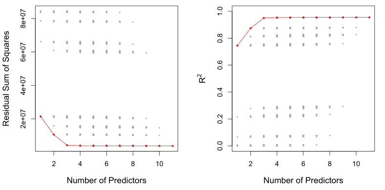

**图6.1** 对 `Credit` 数据集中十个预测变量的各个可能子集模型，分别绘出RSS和 $R^2$。红色边界表示在给定预测变量个数时，按RSS和 $R^2$ 选出的最佳模型。虽然数据集只有十个预测变量，$x$ 轴 (Number of Predictors, 预测变量个数) 却从1到11，因为其中一个变量是有三个取值的类别型变量，需要建立两个虚拟变量。

对于选定的 $k$，最终交付的是在完整训练集上拟合的模型 $\mathcal{M}_k$。第6.1.3节将讨论这些方法。

图6.1给出了最佳子集选择的一个应用。每个点都对应一个最小二乘回归模型，使用的是第3章介绍的 `Credit` 数据集中10个预测变量的某个不同子集。这里，变量 `region` 是有三个水平的定性变量，因此用两个虚拟变量表示；在本例中，这两个虚拟变量分别参与选择。因此，总共有11个可能纳入模型的变量。图中按变量个数绘出了每个模型的RSS和 $R^2$ 统计量。红色曲线连接了每种模型大小下，按RSS或 $R^2$ 选出的最佳模型。正如预期，变量数增加时，这些指标不断改善；不过，从包含三个变量的模型开始，再加入更多预测变量，对RSS和 $R^2$ 的改善已经很小。

虽然这里用最小二乘回归介绍最佳子集选择，但相同思想也适用于其他模型，例如逻辑回归。对于逻辑回归，算法6.1第2步不再用RSS为模型排序，而是使用**偏差统计量（deviance）**。对于更广泛的一类模型，它起着类似RSS的作用。偏差统计量等于最大化后的对数似然乘以−2；数值越小，拟合越好。

最佳子集选择简单直观，但受到计算能力的限制。随着 $p$ 增大，需要考虑的模型数会迅速增加。一般而言，由 $p$ 个预测变量的各个子集构成的模型共有 $2^p$ 个。因此，$p=10$ 时，约有1,000个候选模型；$p=20$ 时，则超过一百万个！

因此，即使使用速度极快的现代计算机，当 $p$ 大于大约40时，最佳子集选择在计算上也变得不可行。有一些称为**分支定界（branch-and-bound）** 的计算捷径，可以排除部分候选项，但随着 $p$ 增大，它们也有局限，而且只适用于最小二乘线性回归。接下来介绍计算效率更高的替代方法。

### 6.1.2 逐步选择（Stepwise Selection）

由于计算量的限制，最佳子集选择无法用于 $p$ 很大的情形。当 $p$ 较大时，它还可能遇到统计方面的问题。搜索空间越大，就越容易找到在训练数据上看起来很好、却可能对未来数据毫无预测能力的模型。因此，庞大的搜索空间可能导致过拟合，使系数估计的方差很大。

出于这两方面的原因，只考察范围小得多的一组模型的逐步方法，是最佳子集选择的一种有吸引力的替代方案。

#### 前向逐步选择（Forward Stepwise Selection）

前向逐步选择是最佳子集选择的一种计算效率较高的替代方法。最佳子集选择要考虑 $p$ 个预测变量的全部子集所构成的 $2^p$ 个可能模型，而前向逐步选择考察的模型少得多。它从不含任何预测变量的模型开始，每次加入一个预测变量，直到全部预测变量都进入模型。具体而言，每一步都加入那个能使拟合得到最大额外改善的变量。算法6.2给出了更正式的过程。

<div class="algorithm" id="algorithm-6-2">

**算法6.2　前向逐步选择**

1. 令 $\mathcal{M}_0$ 表示不含任何预测变量的空模型。
2. 对于 $k=0,\ldots,p-1$：

   **(a)** 考虑全部 $p-k$ 个模型；每个模型都在 $\mathcal{M}_k$ 的预测变量基础上，再增加一个预测变量。

   **(b)** 从这 $p-k$ 个模型中选出最好的一个，记为 $\mathcal{M}_{k+1}$。这里“最好”定义为RSS最小或 $R^2$ 最大。

3. 根据验证集上的预测误差、$C_p$（AIC）、BIC或调整后的 $R^2$，从 $\mathcal{M}_0,\ldots,\mathcal{M}_p$ 中选出一个最优模型；也可以使用交叉验证法。

</div>

最佳子集选择需要拟合 $2^p$ 个模型。前向逐步选择则拟合一个空模型，并在第 $k$ 次迭代时拟合 $p-k$ 个模型，其中 $k=0,\ldots,p-1$，总共为 $1+\sum_{k=0}^{p-1}(p-k)=1+p(p+1)/2$ 个模型。这一差别很大。

| 变量个数 | 最佳子集选择 | 前向逐步选择 |
|---|---|---|
| 1 | `rating` | `rating` |
| 2 | `rating, income` | `rating, income` |
| 3 | `rating, income, student` | `rating, income, student` |
| 4 | `cards, income, student, limit` | `rating, income, student, limit` |

**表6.1** 对 `Credit` 数据集进行最佳子集选择和前向逐步选择时，最先选出的四个模型。前三个模型相同，第四个模型不同。

当 $p=20$ 时，最佳子集选择需要拟合1,048,576个模型，而前向逐步选择只需拟合211个模型。<sup><a href="#ch06-fn2" id="ch06-fnref2">2</a></sup>

<aside class="footnote" id="ch06-fn2"><a href="#ch06-fnref2">2</a> 虽然前向逐步选择考察 $p(p+1)/2+1$ 个模型，但它在模型空间中进行的是有引导的搜索，因此实际考虑的有效模型空间所包含的模型数，远多于 $p(p+1)/2+1$。</aside>

算法6.2的第2(b)步，需要在向 $\mathcal{M}_k$ 额外加入一个预测变量的 $p-k$ 个模型中，找出最好的模型。只需选择RSS最小或 $R^2$ 最大的模型即可。但第3步需要在变量数不同的一组模型中找出最好的一个，这更有挑战性，将在第6.1.3节讨论。

前向逐步选择相对于最佳子集选择的计算优势显而易见。虽然它在实践中往往表现良好，却不能保证从 $p$ 个预测变量的全部子集模型，即 $2^p$ 个模型中，找到最好的那个。例如，假设某个数据集有 $p=3$ 个预测变量，最好的单变量模型包含 $X_1$，最好的双变量模型却包含 $X_2$ 和 $X_3$。此时，前向逐步选择就无法选出最好的双变量模型，因为 $\mathcal{M}_1$ 包含 $X_1$，所以 $\mathcal{M}_2$ 也必须包含 $X_1$，再加上一个其他变量。

表6.1列出了对 `Credit` 数据集进行最佳子集选择和前向逐步选择时，最先选出的四个模型，说明了这一现象。两种方法都选择 `rating` 作为最佳单变量模型，再分别加入 `income` 和 `student`，得到双变量和三变量模型。但最佳子集选择在四变量模型中用 `cards` 替换了 `rating`，而前向逐步选择必须在四变量模型中保留 `rating`。在这个例子中，图6.1表明三变量模型与四变量模型的RSS差别不大，因此这两个四变量模型很可能都足以适用。

前向逐步选择甚至可以用于 $n<p$ 的高维情形。不过，此时只能构造子模型 $\mathcal{M}_0,\ldots,\mathcal{M}_{n-1}$，因为每个子模型都用最小二乘法拟合，而当 $p\ge n$ 时，最小二乘法无法给出唯一解。
#### 后向逐步选择（Backward Stepwise Selection）

与前向逐步选择一样，后向逐步选择也是最佳子集选择的一种高效替代方法。不过，它从包含全部 $p$ 个预测变量的完整最小二乘模型开始，再反复删除最没有用的预测变量，每次删除一个。算法6.3给出了详细过程。

<div class="algorithm" id="algorithm-6-3">

**算法6.3　后向逐步选择**

1. 令 $\mathcal{M}_p$ 表示包含全部 $p$ 个预测变量的完整模型。
2. 对于 $k=p,p-1,\ldots,1$：

   **(a)** 考虑全部 $k$ 个模型；每个模型都在 $\mathcal{M}_k$ 的预测变量中去掉一个，共保留 $k-1$ 个预测变量。

   **(b)** 从这 $k$ 个模型中选出最好的一个，记为 $\mathcal{M}_{k-1}$。这里“最好”定义为RSS最小或 $R^2$ 最大。

3. 根据验证集上的预测误差、$C_p$（AIC）、BIC或调整后的 $R^2$，从 $\mathcal{M}_0,\ldots,\mathcal{M}_p$ 中选出一个最优模型；也可以使用交叉验证法。

</div>

与前向逐步选择一样，后向选择只搜索 $1+p(p+1)/2$ 个模型，因此适用于 $p$ 太大、无法进行最佳子集选择的情形。<sup><a href="#ch06-fn3" id="ch06-fnref3">3</a></sup> 同样，后向逐步选择也不能保证找到由 $p$ 个预测变量的某个子集构成的最佳模型。

<aside class="footnote" id="ch06-fn3"><a href="#ch06-fnref3">3</a> 与前向逐步选择一样，后向逐步选择在模型空间中进行有引导的搜索，因此实际上考虑的模型远多于 $1+p(p+1)/2$ 个。</aside>

后向选择要求样本数 $n$ 大于变量数 $p$，这样才能拟合完整模型。相比之下，前向逐步选择甚至可以用于 $n<p$ 的情形，因此当 $p$ 很大时，它是唯一可行的子集选择方法。

#### 混合方法（Hybrid Approaches）

最佳子集选择、前向逐步选择和后向逐步选择通常会给出相似但并不完全相同的模型。另一种选择是将前向和后向逐步选择结合起来：与前向选择类似，依次向模型加入变量；但每加入一个新变量后，也可以删除那些已不能改善模型拟合的变量。这类方法试图在保留前向和后向逐步选择计算优势的同时，更接近最佳子集选择的结果。

### 6.1.3 选择最优模型

最佳子集选择、前向选择和后向选择都会产生一组模型，每个模型都包含 $p$ 个预测变量的一个子集。要使用这些方法，就需要判断哪个模型最好。

如第6.1.1节所述，包含全部预测变量的模型总会有最小的RSS和最大的 $R^2$，因为这些指标与训练误差有关。而我们希望选择的是测试误差较低的模型。这里已经可以看出，正如第2章所示，训练误差可能无法很好地估计测试误差。因此，RSS和 $R^2$ 不适合用于在预测变量数不同的一组模型中选择最优模型。

要按测试误差选择最优模型，就需要估计测试误差。常见的做法有两种：

1. 调整训练误差，校正过拟合带来的偏差，从而间接估计测试误差。
2. 使用第5章讨论的验证集法或交叉验证法，直接估计测试误差。

下面分别考察这两类方法。

#### Cp、AIC、BIC与调整后的R²

第2章说明，训练集MSE通常低估测试MSE。（回顾一下，$\operatorname{MSE}=\operatorname{RSS}/n$。）这是因为，用最小二乘法对训练数据拟合模型时，回归系数就是专门按训练RSS尽可能小来估计的，而不是使测试RSS最小。尤其是，随着模型纳入更多变量，训练误差会减小，测试误差却不一定。因此，不能使用训练集RSS和训练集 $R^2$，在变量数不同的一组模型中作选择。

不过，有多种技术可以根据模型大小调整训练误差，从而在变量数不同的一组模型中作选择。下面考察四种方法：$C_p$、赤池信息准则（AIC）、贝叶斯信息准则（BIC）和调整后的 $R^2$。图6.2给出了对 `Credit` 数据进行最佳子集选择后，每种大小的最佳模型所对应的 $C_p$、BIC和调整后的 $R^2$。

对于包含 $d$ 个预测变量的最小二乘拟合模型，测试MSE的 $C_p$ 估计为

$$
C_p=\frac{1}{n}\left(\operatorname{RSS}+2d\hat\sigma^2\right), \tag{6.2}
$$

其中，$\hat\sigma^2$ 是式(6.1)中每个响应测量对应的误差 $\epsilon$ 的方差估计值。<sup><a href="#ch06-fn4" id="ch06-fnref4">4</a></sup> 通常用包含全部预测变量的完整模型估计 $\hat\sigma^2$。本质上，$C_p$ 统计量在训练RSS上加了一个 $2d\hat\sigma^2$ 的**惩罚项（penalty）**，以校正训练误差倾向于低估测试误差这一事实。显然，模型的预测变量越多，惩罚项就越大，目的是校正训练RSS相应的下降。

<aside class="footnote" id="ch06-fn4"><a href="#ch06-fnref4">4</a> Mallow的 $C_p$ 有时定义为 $C_p'=\operatorname{RSS}/\hat\sigma^2+2d-n$。这与上文的定义等价，因为 $C_p=\frac{1}{n}\hat\sigma^2(C_p'+n)$，所以 $C_p$ 最小的模型也有最小的 $C_p'$。</aside>


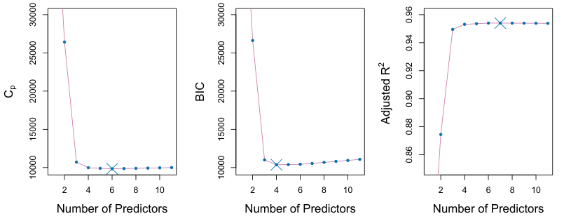

**图6.2** `Credit` 数据集中每种大小的最佳模型（图6.1中的下边界）所对应的 $C_p$、BIC和调整后的 $R^2$。$C_p$ 和BIC是测试MSE的估计值。中图显示，当选入四个变量之后，BIC所估计的测试误差开始上升；另外两幅图在包含四个变量之后则相当平坦。图内文字：Number of Predictors＝预测变量个数；Adjusted $R^2$＝调整后的 $R^2$；$C_p$ 与BIC保持原样。

虽然证明超出了本书范围，但可以证明：如果式(6.2)中的 $\hat\sigma^2$ 是 $\sigma^2$ 的无偏估计，那么 $C_p$ 就是测试MSE的无偏估计。因此，测试误差较低的模型往往有较小的 $C_p$ 值；在一组模型中作选择时，就选择 $C_p$ 最小的模型。在图6.2中，$C_p$ 选择了包含 `income`、`limit`、`rating`、`cards`、`age` 和 `student` 的六变量模型。

AIC准则适用于通过极大似然拟合的一大类模型。对于具有高斯误差的模型(6.1)，极大似然与最小二乘是相同的。此时，AIC为

$$
\operatorname{AIC}=\frac{1}{n}\left(\operatorname{RSS}+2d\hat\sigma^2\right),
$$

为简便起见，这里省略了无关常数。<sup><a href="#ch06-fn5" id="ch06-fnref5">5</a></sup> 因此，对于最小二乘模型，$C_p$ 和AIC相互成比例，所以图6.2只展示了 $C_p$。

<aside class="footnote" id="ch06-fn5"><a href="#ch06-fnref5">5</a> 最小二乘回归的AIC有两个公式。这里给出的公式需要一个 $\sigma^2$ 的表达式，我们使用包含全部预测变量的完整模型来获得它。第二个公式适用于 $\sigma^2$ 未知、且我们不想显式估计它的情形；其中使用 $\log(\operatorname{RSS})$ 项代替RSS项。这两个公式的详细推导超出了本书范围。</aside>

BIC是从贝叶斯观点推导出来的，但最终形式也与 $C_p$（以及AIC）相似。对于包含 $d$ 个预测变量的最小二乘模型，略去无关常数后，BIC为

$$
\operatorname{BIC}=\frac{1}{n}\left(\operatorname{RSS}+\log(n)d\hat\sigma^2\right). \tag{6.3}
$$

与 $C_p$ 一样，测试误差较低的模型往往有较小的BIC值，因此通常选择BIC值最小的模型。注意，BIC用 $\log(n)d\hat\sigma^2$ 代替了 $C_p$ 中的 $2d\hat\sigma^2$，其中 $n$ 是观测数。由于当 $n>7$ 时 $\log n>2$，

BIC通常对变量较多的模型施加更重的惩罚，因此选择的模型比 $C_p$ 更小。图6.2表明，`Credit` 数据集确实如此：BIC选择的模型只包含 `income`、`limit`、`cards` 和 `student` 四个预测变量。在这个例子中，各条曲线都很平坦，因此四变量模型与六变量模型的准确性似乎没有太大差别。

调整后的 $R^2$ 统计量是另一种常用方法，可以在变量数不同的一组模型中进行选择。回顾第3章，通常的 $R^2$ 定义为 $1-\operatorname{RSS}/\operatorname{TSS}$，其中 $\operatorname{TSS}=\sum(y_i-\bar y)^2$ 是响应的总平方和。由于模型加入更多变量时RSS总会下降，$R^2$ 就总会随之增大。对于包含 $d$ 个变量的最小二乘模型，调整后的 $R^2$ 统计量计算如下：

$$
\text{Adjusted }R^2=1-\frac{\operatorname{RSS}/(n-d-1)}{\operatorname{TSS}/(n-1)}. \tag{6.4}
$$

$C_p$、AIC和BIC的值越小，表示模型的测试误差越低；调整后的 $R^2$ 则是值越大，表示模型的测试误差越小。最大化调整后的 $R^2$ 等价于最小化 $\frac{\operatorname{RSS}}{n-d-1}$。虽然RSS总会随模型变量数的增加而减小，但由于分母中含有 $d$，$\frac{\operatorname{RSS}}{n-d-1}$ 既可能增大，也可能减小。

调整后的 $R^2$ 背后的直观想法是：一旦模型已经包含所有正确的变量，再加入额外的噪声变量，只会使RSS略微下降。由于加入噪声变量会使 $d$ 增大，这类变量会使 $\frac{\operatorname{RSS}}{n-d-1}$ 增大，从而使调整后的 $R^2$ 减小。因此，从理论上说，调整后的 $R^2$ 最大的模型将只包含正确变量，而不包含噪声变量。通常的 $R^2$ 统计量不会因模型加入不必要的变量而付出代价，调整后的 $R^2$ 则会。图6.2给出了 `Credit` 数据集的调整后 $R^2$。用这个统计量会选择七变量模型，即在 $C_p$ 和AIC选出的模型中再加入 `own`。

$C_p$、AIC和BIC都有严格的理论依据，不过超出了本书范围。这些依据依赖于**渐近论证（asymptotic arguments）**，也就是样本量 $n$ 很大的情形。调整后的 $R^2$ 虽然很流行，也相当直观，但它的统计理论依据不如AIC、BIC和 $C_p$ 充分。所有这些指标都易于使用和计算。这里给出的是用最小二乘法拟合线性模型时的公式；AIC和BIC也可以为更一般的模型定义。

#### 验证与交叉验证

除了刚才讨论的方法，也可以使用第5章介绍的验证集法和交叉验证法，直接估计测试误差。我们可以对每个候选模型计算验证集误差或交叉验证误差，然后选择估计测试误差最小的模型。

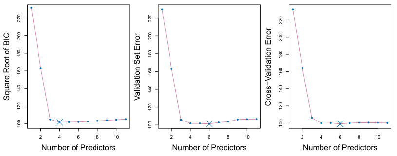

**图6.3** 对于 `Credit` 数据集，图中给出了包含 $d$ 个预测变量的最佳模型所对应的三个量，其中 $d$ 从1到11。按各个量选出的总体最佳模型用蓝色叉号标出。左：BIC的平方根。中：验证集误差。右：交叉验证误差。图内文字：Number of Predictors＝预测变量个数；Square Root of BIC＝BIC的平方根；Validation Set Error＝验证集误差；Cross-Validation Error＝交叉验证误差。

与AIC、BIC、$C_p$ 和调整后的 $R^2$ 相比，这一过程的优势是直接估计测试误差，并且对真实底层模型所作的假设更少。它还适用于更广泛的模型选择任务，包括模型自由度（例如模型中的预测变量数）难以明确界定，或误差方差 $\sigma^2$ 难以估计的情形。注意，使用交叉验证时，算法6.1—6.3中的模型序列 $\mathcal M_k$ 是对每个训练折分别确定的；对于每一种模型大小 $k$，再将所有折的验证误差取平均。例如，在最佳子集回归中，大小为 $k$ 的最佳子集 $\mathcal M_k$ 在各折之间可能不同。选定最佳大小 $k$ 后，再在完整数据集上找到该大小的最佳模型。

过去，对于许多 $p$ 较大和／或 $n$ 较大的问题，交叉验证的计算代价高得难以承受，因此AIC、BIC、$C_p$ 和调整后的 $R^2$ 是在一组模型中进行选择时更有吸引力的方法。如今计算机速度很快，交叉验证所需的计算几乎不再构成问题。因此，交叉验证是在多个候选模型中进行选择的一种很有吸引力的方法。

图6.3针对 `Credit` 数据中每个包含 $d$ 个变量的最佳模型，绘出了BIC、验证集误差和交叉验证误差随 $d$ 的变化。验证误差的计算方法是随机选取四分之三的观测作为训练集，其余观测作为验证集。交叉验证误差使用 $k=10$ 折计算。在这个例子中，验证集法和交叉验证法都选择了六变量模型。不过，这三种方法都表明，四变量、五变量和六变量模型的测试误差大致相同。

事实上，图6.3中图和右图中的估计测试误差曲线相当平坦。虽然三变量模型的估计测试误差明显低于二变量模型，但包含3到11个变量的模型，其估计测试误差都很接近。此外，如果我们

改变数据的训练集与验证集划分，重新使用验证集法，或者改变交叉验证的折划分，重新进行交叉验证，那么估计测试误差最低的具体模型肯定会改变。在这种情况下，可以使用**一标准误规则（one-standard-error rule）** 来选择模型：先计算每种模型大小所对应的估计测试MSE的标准误，然后，在估计测试误差与曲线最低点相差不超过一个标准误的模型中，选择最小的模型。这一规则的依据是：如果一组模型看起来表现差不多，那么我们不妨选择最简单的模型，也就是预测变量数最少的模型。在这里，无论对验证集法还是交叉验证法应用一标准误规则，都会选出三变量模型。

## 6.2 收缩方法（Shrinkage Methods）

第6.1节介绍的子集选择方法，用最小二乘法拟合只包含部分预测变量的线性模型。另一种做法是拟合包含全部 $p$ 个预测变量的模型，同时对系数估计值施加约束或进行正则化；等价地说，就是将系数估计值向零收缩。这样的约束为何能改善拟合，也许并不一目了然，但收缩系数估计值确实能够大幅降低其方差。将回归系数向零收缩的两种最著名的方法，是岭回归和套索法（lasso）。

### 6.2.1 岭回归（Ridge Regression）

回顾第3章，最小二乘拟合通过选取使下式最小的值，来估计 $\beta_0,\beta_1,\ldots,\beta_p$：

$$
\operatorname{RSS}=\sum_{i=1}^{n}\left(y_i-\beta_0-\sum_{j=1}^{p}\beta_jx_{ij}\right)^2.
$$

**岭回归**与最小二乘法非常相似，只是估计系数时最小化的量稍有不同。具体而言，岭回归系数估计值 $\hat\beta^R$ 是使下式最小的值：

$$
\sum_{i=1}^{n}\left(y_i-\beta_0-\sum_{j=1}^{p}\beta_jx_{ij}\right)^2+\lambda\sum_{j=1}^{p}\beta_j^2
=\operatorname{RSS}+\lambda\sum_{j=1}^{p}\beta_j^2, \tag{6.5}
$$

其中，$\lambda\geq 0$ 是需要另外确定的调节参数。式(6.5)在两项不同的准则之间进行权衡。与最小二乘法一样，岭回归通过减小RSS，寻找能很好地拟合数据的系数估计值。不过，第二项 $\lambda\sum_j\beta_j^2$ 称为**收缩惩罚项（shrinkage penalty）**；当 $\beta_1,\ldots,\beta_p$ 接近零时，这一项就较小，因此它会将 $\beta_j$ 的估计值向零收缩。调节参数 $\lambda$ 用来控制这两项对回归系数估计值的相对影响。

当 $\lambda=0$ 时，惩罚项不起作用，岭回归就会给出最小二乘估计值。然而，当 $\lambda\to\infty$ 时，收缩惩罚项的影响越来越大，岭回归系数估计值将趋近于零。最小二乘法只生成一组系数估计值，而岭回归对每个 $\lambda$ 值都会生成不同的一组系数估计值 $\hat\beta^R_\lambda$。选择合适的 $\lambda$ 值至关重要；我们将这一讨论留到第6.2.3节，届时会使用交叉验证。

注意，在式(6.5)中，收缩惩罚项作用于 $\beta_1,\ldots,\beta_p$，却不作用于截距 $\beta_0$。我们希望收缩每个变量与响应之间的估计关联，却不希望收缩截距，因为截距只是衡量 $x_{i1}=x_{i2}=\cdots=x_{ip}=0$ 时响应的均值。假定在进行岭回归之前，已将各变量——即数据矩阵 $\mathbf X$ 的各列——中心化，使其均值为零，那么截距估计值将为 $\hat\beta_0=\bar y=\sum_{i=1}^{n}y_i/n$。

#### 应用于Credit数据

图6.4展示了 `Credit` 数据集的岭回归系数估计值。左图中的每条曲线对应十个变量之一的岭回归系数估计值，并将其表示为 $\lambda$ 的函数。例如，黑色实线表示 `income` 的系数估计值如何随 $\lambda$ 变化。在图的最左端，$\lambda$ 基本为零，因此相应的岭回归系数估计值与通常的最小二乘估计值相同。但随着 $\lambda$ 增大，岭回归系数估计值逐渐向零收缩。当 $\lambda$ 极大时，所有岭回归系数估计值都基本为零；这对应于不包含任何预测变量的空模型。图中以不同颜色标出 `income`、`limit`、`rating` 和 `student`，因为这些变量的系数估计值通常远大于其他变量。虽然随着 $\lambda$ 增大，岭回归系数估计值总体上趋于减小，但个别系数，例如 `rating` 和 `income` 的系数，有时也会随 $\lambda$ 增大而增大。

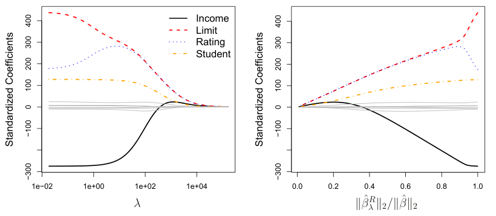

**图6.4** `Credit` 数据集的标准化岭回归系数，分别表示为 $\lambda$ 和 $\|\hat\beta^R_\lambda\|_2/\|\hat\beta\|_2$ 的函数。图内文字：Standardized Coefficients＝标准化系数；Income＝收入；Limit＝信用额度；Rating＝信用评级；Student＝学生身份。


图6.4右图展示的岭回归系数估计值与左图相同，不过横轴不再表示 $\lambda$，而是 $\|\hat\beta^R_\lambda\|_2/\|\hat\beta\|_2$，其中 $\hat\beta$ 表示最小二乘系数估计值组成的向量。记号 $\|\beta\|_2$ 表示向量的 **$\ell_2$ 范数（$\ell_2$ norm，读作“ell two”）**，其定义为 $\|\beta\|_2=\sqrt{\sum_{j=1}^{p}\beta_j^2}$。它衡量 $\beta$ 到零的距离。随着 $\lambda$ 增大，$\hat\beta^R_\lambda$ 的 $\ell_2$ 范数总会减小，$\|\hat\beta^R_\lambda\|_2/\|\hat\beta\|_2$ 也随之减小。后一比值的取值范围从1到0：$\lambda=0$ 时，岭回归系数估计值与最小二乘估计值相同，二者的 $\ell_2$ 范数也相同，比值为1；$\lambda=\infty$ 时，岭回归系数估计值是零向量，其 $\ell_2$ 范数为零，比值也为0。因此，可以把图6.4右图的横轴看作岭回归系数估计值向零收缩程度的体现；横轴值较小，表示系数已被收缩到非常接近零的位置。

第3章讨论的通常的最小二乘系数估计值具有**尺度等变性（scale equivariance）**：将 $X_j$ 乘以常数 $c$，只会使相应的最小二乘系数估计值乘以 $1/c$。换言之，无论如何改变第 $j$ 个预测变量的尺度，$X_j\hat\beta_j$ 都保持不变。相比之下，将某个预测变量乘以常数，可能会使岭回归系数估计值发生很大变化。例如，考虑以美元为单位的 `income` 变量。将收入改用千美元为单位也完全合理，这会使 `income` 的观测值缩小为原来的 $1/1{,}000$。由于岭回归表达式(6.5)中包含系数平方和项，这样的尺度变化并不会只是让 `income` 的岭回归系数估计值变为原来的1,000倍。也就是说，$X_j\hat\beta^R_{j,\lambda}$ 不仅取决于 $\lambda$ 的值，还取决于第 $j$ 个预测变量的尺度。事实上，$X_j\hat\beta^R_{j,\lambda}$ 的值甚至可能取决于其他预测变量的尺度！因此，最好先用下式将预测变量标准化，再应用岭回归，使所有预测变量处在相同的尺度上：

$$
\tilde x_{ij}=\frac{x_{ij}}{\sqrt{\frac{1}{n}\sum_{i=1}^{n}(x_{ij}-\bar x_j)^2}}. \tag{6.6}
$$

式(6.6)的分母是第 $j$ 个预测变量的估计标准差。因此，所有标准化后的预测变量的标准差都为1，最终的拟合结果也就不会取决于预测变量所采用的计量尺度。图6.4的纵轴展示的是标准化岭回归系数估计值，即使用标准化后的预测变量进行岭回归所得的系数估计值。

#### 岭回归为何优于最小二乘法？

岭回归相对于最小二乘法的优势，根源在于偏差—方差权衡。随着 $\lambda$ 增大，岭回归拟合的灵活程度降低，方差随之减小，而偏差增大。图6.5左图用一个包含 $p=45$ 个预测变量、$n=50$ 个观测的模拟数据集说明了这一点。


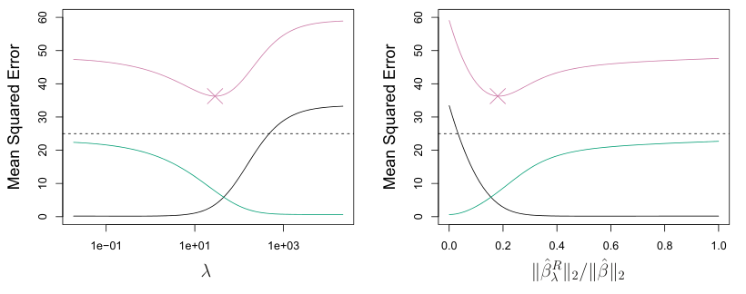

**图6.5** 在一个模拟数据集上，岭回归预测的偏差平方（黑色）、方差（绿色）与测试均方误差（紫色），分别表示为 $\lambda$ 和 $\|\hat\beta^R_\lambda\|_2/\|\hat\beta\|_2$ 的函数。水平虚线表示可能达到的最小MSE。紫色叉号标示MSE最小的岭回归模型。图内文字：Mean Squared Error＝均方误差。

图6.5左图的绿色曲线将岭回归预测的方差表示为 $\lambda$ 的函数。在最小二乘系数估计值处，也就是 $\lambda=0$ 的岭回归处，方差很大，但没有偏差。随着 $\lambda$ 增大，岭回归系数估计值的收缩大幅降低了预测的方差，代价是偏差略有增大。回顾一下，图中紫色的测试均方误差（MSE），与方差加偏差平方密切相关。在 $\lambda$ 增大到约10之前，方差迅速减小，而黑色曲线所表示的偏差几乎没有增加。因此，当 $\lambda$ 从0增大到10时，MSE大幅下降。超过这一点后，继续增大 $\lambda$ 所带来的方差下降趋缓，而系数收缩使其被明显低估，从而导致偏差大幅增加。MSE约在 $\lambda=30$ 时达到最小值。有意思的是，由于方差很大，$\lambda=0$ 时最小二乘拟合的MSE，几乎与 $\lambda=\infty$ 时所有系数估计值都为零的空模型一样高。然而，取一个居中的 $\lambda$ 值，MSE就会低得多。

图6.5右图展示了与左图相同的曲线，只是横轴改成了岭回归系数估计值的 $\ell_2$ 范数与最小二乘估计值的 $\ell_2$ 范数之比。此时从左向右看，拟合越来越灵活，因此偏差减小，而方差增大。

一般而言，当响应与预测变量之间的关系接近线性时，最小二乘估计值的偏差较小，但方差可能很大。这意味着，训练数据的微小变化就可能造成最小二乘系数估计值的巨大变化。尤其当变量个数 $p$ 几乎与观测数 $n$ 一样大时，如图6.5的例子，最小二乘估计值会非常不稳定。如果 $p>n$，最小二乘估计甚至没有唯一解；而岭回归仍然可以表现良好，以偏差的小幅增加换取方差的大幅下降。

因此，在最小二乘估计值方差很大的情况下，岭回归的效果最好。

与最佳子集选择相比，岭回归在计算上也有明显优势。最佳子集选择需要搜索 $2^p$ 个模型。如前所述，即使 $p$ 的大小适中，这样的搜索在计算上也可能不可行。相比之下，对任何固定的 $\lambda$ 值，岭回归都只拟合一个模型，而且拟合过程可以很快完成。事实上，可以证明，同时对所有 $\lambda$ 值求解式(6.5)所需的计算量，与用最小二乘法拟合一个模型的计算量几乎相同。

### 6.2.2 套索法

岭回归有一个明显的缺点。最佳子集选择、前向逐步选择和后向逐步选择通常会选出只包含部分变量的模型，而岭回归的最终模型却会包含全部 $p$ 个预测变量。式(6.5)中的惩罚项 $\lambda\sum\beta_j^2$ 会将所有系数向零收缩，却不会把其中任何一个系数恰好设为零（除非 $\lambda=\infty$）。这未必影响预测准确性，但当变量个数 $p$ 很大时，会给模型解释带来困难。例如，在 `Credit` 数据集中，最重要的变量似乎是 `income`、`limit`、`rating` 和 `student`，所以我们可能希望建立只包含这些预测变量的模型。然而，岭回归总会生成包含全部十个预测变量的模型。增大 $\lambda$ 值通常会减小系数的绝对值，却不会将任何变量排除在模型之外。

套索法是较晚提出的一种替代岭回归的方法，它克服了上述缺点。套索法系数 $\hat\beta^L_\lambda$ 使下式最小：

$$
\sum_{i=1}^{n}\left(y_i-\beta_0-\sum_{j=1}^{p}\beta_jx_{ij}\right)^2+\lambda\sum_{j=1}^{p}|\beta_j|
=\operatorname{RSS}+\lambda\sum_{j=1}^{p}|\beta_j|. \tag{6.7}
$$

比较式(6.7)与式(6.5)可见，套索法与岭回归的表达形式相似。唯一的区别是，岭回归惩罚项(6.5)中的 $\beta_j^2$，在套索法惩罚项(6.7)中被替换为 $|\beta_j|$。用统计学的术语说，套索法采用的是 $\ell_1$（读作“ell one”）惩罚项，而非 $\ell_2$ 惩罚项。系数向量 $\beta$ 的 **$\ell_1$ 范数（$\ell_1$ norm）** 为 $\|\beta\|_1=\sum|\beta_j|$。

与岭回归一样，套索法会将系数估计值向零收缩。不过，套索法的 $\ell_1$ 惩罚项会在调节参数 $\lambda$ 足够大时，迫使部分系数估计值恰好等于零。因此，套索法与最佳子集选择很相似，也会进行变量选择。由此，套索法生成的模型通常比岭回归模型更容易解释。我们说，套索法产生**稀疏（sparse）**模型，即只包含部分变量的模型。与岭回归一样，为套索法选择合适的 $\lambda$ 值至关重要；我们将这一讨论留到第6.2.3节，届时会使用交叉验证。


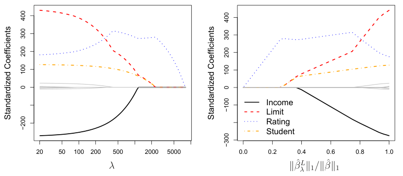

**图6.6** `Credit` 数据集的标准化套索法系数，分别表示为 $\lambda$ 和 $\|\hat\beta^L_\lambda\|_1/\|\hat\beta\|_1$ 的函数。图内文字：Standardized Coefficients＝标准化系数；Income＝收入；Limit＝信用额度；Rating＝信用评级；Student＝学生身份。

例如，考虑图6.6中的系数曲线，它们来自对 `Credit` 数据集应用套索法。当 $\lambda=0$ 时，套索法就是最小二乘拟合；当 $\lambda$ 足够大时，套索法给出所有系数估计值都等于零的空模型。然而，在这两个极端之间，岭回归与套索法模型却有很大差异。沿图6.6右图从左向右看，最初套索法生成的模型只包含 `rating` 这一个预测变量。随后，`student` 与 `limit` 几乎同时进入模型，紧接着是 `income`。最终，其余变量也进入模型。因此，视 $\lambda$ 的取值而定，套索法可以生成包含任意数量变量的模型。相比之下，岭回归总会将所有变量纳入模型，只是系数估计值的绝对大小取决于 $\lambda$。

#### 岭回归与套索法的另一种表达形式

可以证明，套索法与岭回归的系数估计值，分别是下列两个问题的解：

$$
\underset{\beta}{\operatorname{min}}\left\{\sum_{i=1}^{n}\left(y_i-\beta_0-\sum_{j=1}^{p}\beta_jx_{ij}\right)^2\right\}
\quad\text{约束为}\quad\sum_{j=1}^{p}|\beta_j|\leq s \tag{6.8}
$$

和

$$
\underset{\beta}{\operatorname{min}}\left\{\sum_{i=1}^{n}\left(y_i-\beta_0-\sum_{j=1}^{p}\beta_jx_{ij}\right)^2\right\}
\quad\text{约束为}\quad\sum_{j=1}^{p}\beta_j^2\leq s. \tag{6.9}
$$

也就是说，对每一个 $\lambda$ 值，都存在某个 $s$，使式(6.7)与式(6.8)给出相同的套索法系数估计值。类似地，对每一个 $\lambda$ 值，都存在一个对应的 $s$，使式(6.5)与式(6.9)给出相同的岭回归系数估计值。

当 $p=2$ 时，式(6.8)表明，在 $|\beta_1|+|\beta_2|\leq s$ 所定义的菱形区域内，套索法系数估计值对应的点具有最小RSS。类似地，在 $\beta_1^2+\beta_2^2\leq s$ 所定义的圆形区域内，岭回归估计值对应的点具有最小RSS。

我们可以这样理解式(6.8)：使用套索法时，我们试图寻找使RSS最小的一组系数估计值，同时要求 $\sum_{j=1}^{p}|\beta_j|$ 不超过给定的“预算” $s$。当 $s$ 极大时，这一预算的限制不强，所以系数估计值可以很大。事实上，如果 $s$ 大到足以容纳最小二乘解，那么式(6.8)就会给出最小二乘解。反之，如果 $s$ 很小，$\sum_{j=1}^{p}|\beta_j|$ 就必须很小，才不会超出预算。类似地，式(6.9)表明，使用岭回归时，我们寻找使RSS尽可能小的一组系数估计值，同时要求 $\sum_{j=1}^{p}\beta_j^2$ 不超过预算 $s$。

式(6.8)与式(6.9)揭示了套索法、岭回归与最佳子集选择之间的密切联系。考虑下列问题：

$$
\underset{\beta}{\operatorname{min}}\left\{\sum_{i=1}^{n}\left(y_i-\beta_0-\sum_{j=1}^{p}\beta_jx_{ij}\right)^2\right\}
\quad\text{约束为}\quad\sum_{j=1}^{p}I(\beta_j\neq 0)\leq s. \tag{6.10}
$$

这里，$I(\beta_j\neq 0)$ 是一个指示变量：若 $\beta_j\neq 0$，则取值为1，否则等于零。因此，式(6.10)就是在非零系数个数不超过 $s$ 的约束下，寻找使RSS尽可能小的一组系数估计值。问题(6.10)等价于最佳子集选择。遗憾的是，当 $p$ 很大时，式(6.10)在计算上无法求解，因为它需要考虑所有包含 $s$ 个预测变量的 $\binom{p}{s}$ 个模型。因此，可以将岭回归与套索法理解为最佳子集选择的可行替代方法：它们将式(6.10)中难以处理的预算形式，换成了容易求解得多的形式。当然，套索法与最佳子集选择的联系更紧密，因为当式(6.8)中的 $s$ 足够小时，套索法会进行特征选择，而岭回归不会。

#### 套索法的变量选择性质

为什么套索法与岭回归不同，能够产生恰好等于零的系数估计值？式(6.8)与式(6.9)可以帮助解释这一点。图6.7展示了这种情况。最小二乘解标记为 $\hat\beta$，蓝色菱形与圆形区域分别表示式(6.8)与式(6.9)中套索法和岭回归的约束。如果 $s$ 足够大，约束区域就会包含 $\hat\beta$，岭回归与套索法的估计值也就与最小二乘估计值相同。（这么大的 $s$ 值对应于式(6.5)与式(6.7)中的 $\lambda=0$。）然而，图6.7中的最小二乘估计值位于菱形与圆形区域之外，因此最小二乘估计值与套索法、岭回归估计值并不相同。

以 $\hat\beta$ 为中心的每条椭圆都表示一条**等高线（contour）**，即同一条椭圆上各点的RSS值相同。


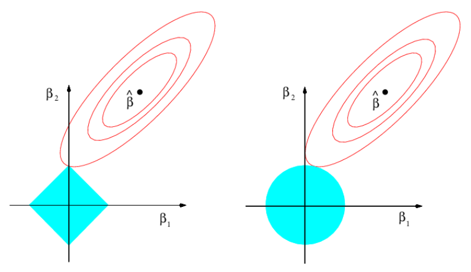

**图6.7** 套索法（左）与岭回归（右）的误差函数和约束函数的等高线。蓝色实心区域表示约束区域 $|\beta_1|+|\beta_2|\leq s$ 和 $\beta_1^2+\beta_2^2\leq s$，红色椭圆表示RSS的等高线。

当椭圆从最小二乘系数估计值处向外扩张时，RSS随之增大。式(6.8)与式(6.9)表明，椭圆首次接触约束区域的点，就是套索法与岭回归的系数估计值。由于岭回归的约束区域是没有尖角的圆形，这个接触点通常不会出现在坐标轴上，所以岭回归的系数估计值都会是非零值。然而，套索法的约束区域在每条坐标轴上都有尖角，因此椭圆常常会在坐标轴上与约束区域相交。一旦发生这种情况，就会有一个系数等于零。在更高维的情形下，许多系数估计值可能同时等于零。图6.7中的接触点位于 $\beta_1=0$ 处，因此所得模型只包含 $\beta_2$。

图6.7考虑的是 $p=2$ 的简单情形。当 $p=3$ 时，岭回归的约束区域变为球体，而套索法的约束区域变为多面体。当 $p>3$ 时，岭回归的约束区域变为超球体，套索法的约束区域变为多胞体。不过，图6.7展示的核心思想仍然成立。尤其是，当 $p>2$ 时，由于多面体或多胞体存在尖角，套索法仍然能够进行特征选择。

#### 比较套索法与岭回归

显然，套索法相对于岭回归有一个重要优势：它能够生成更简单、更容易解释、只包含部分预测变量的模型。不过，哪种方法的预测准确性更高？图6.8在与图6.5相同的模拟数据上应用套索法，展示了其方差、偏差平方与测试MSE。显然，套索法与岭回归的总体表现相似：随着 $\lambda$ 增大，方差减小，偏差增大。


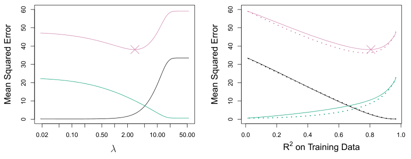

**图6.8** 左：在一个模拟数据集上，套索法的偏差平方（黑色）、方差（绿色）和测试MSE（紫色）。右：比较套索法（实线）与岭回归（点线）的偏差平方、方差和测试MSE。两者都以训练数据上的 $R^2$ 为横轴，作为统一的模型索引。两图中的叉号均标示MSE最小的套索法模型。图内文字：Mean Squared Error＝均方误差；$R^2$ on Training Data＝训练数据上的 $R^2$。

图6.8右图的点线表示岭回归拟合。这里，两种方法都以各自在训练数据上的 $R^2$ 为横轴。这是另一种有用的模型索引方式，可用于比较采用不同正则化形式的模型，正如此处所做的那样。在这个例子中，套索法与岭回归产生的偏差几乎相同。不过，岭回归的方差略低于套索法。因此，岭回归的最小MSE也略小于套索法。

然而，图6.8的数据在生成时，设定了所有45个预测变量都与响应相关；也就是说，真实系数 $\beta_1,\ldots,\beta_{45}$ 中没有一个等于零。套索法则隐含地假定，一部分系数的真实值确实为零。因此，在这种情形下，岭回归的预测误差优于套索法，并不令人意外。图6.9展示了类似的情形，只是此时响应仅为45个预测变量中2个的函数。现在，无论从偏差、方差还是MSE来看，套索法的表现都往往优于岭回归。

这两个例子表明，岭回归与套索法都不会在所有情况下优于另一种方法。一般而言，如果只有相对少数的预测变量具有较大的系数，其余预测变量的系数很小或等于零，那么可以预期套索法会表现得更好。如果响应是许多预测变量的函数，而且它们的系数大小大致相当，岭回归就会表现得更好。不过，对于真实数据集，我们无法事先知道究竟有多少个预测变量与响应相关。可以利用交叉验证等方法，来确定哪种方法更适合某个特定的数据集。

与岭回归一样，当最小二乘估计值的方差过高时，套索法可以用偏差的小幅增加换取方差的下降，从而生成更准确的预测。与岭回归不同，套索法能够进行变量选择，因此所得模型更容易解释。


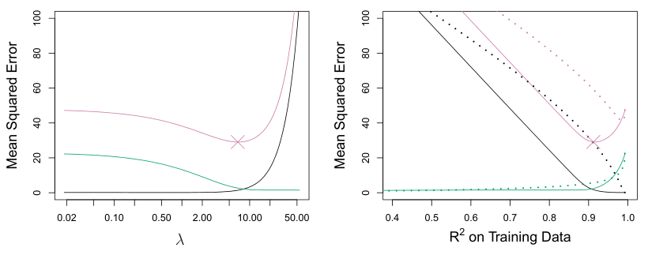

**图6.9** 左：套索法的偏差平方（黑色）、方差（绿色）和测试MSE（紫色）。模拟数据与图6.8相似，只是此时仅有两个预测变量与响应相关。右：比较套索法（实线）与岭回归（点线）的偏差平方、方差和测试MSE。两者都以训练数据上的 $R^2$ 为横轴，作为统一的模型索引。两图中的叉号均标示MSE最小的套索法模型。图内文字：Mean Squared Error＝均方误差；$R^2$ on Training Data＝训练数据上的 $R^2$。

岭回归与套索法模型都有非常高效的拟合算法；两种方法计算完整系数路径的工作量，都与进行一次最小二乘拟合大致相同。本章末尾的实验将进一步探讨这一点。

#### 岭回归与套索法的一个简单特例

为了更直观地理解岭回归与套索法的表现，考虑一个简单特例：$n=p$，且 $\mathbf X$ 是一个对角矩阵，对角线上的元素均为1，所有非对角线元素均为0。为进一步简化问题，再假定回归不包含截距。在这些假定下，通常的最小二乘问题便简化为寻找使下式最小的 $\beta_1,\ldots,\beta_p$：

$$
\sum_{j=1}^{p}(y_j-\beta_j)^2. \tag{6.11}
$$

此时，最小二乘解为

$$
\hat\beta_j=y_j.
$$

在这一情形下，岭回归就是寻找使下式最小的 $\beta_1,\ldots,\beta_p$：

$$
\sum_{j=1}^{p}(y_j-\beta_j)^2+\lambda\sum_{j=1}^{p}\beta_j^2. \tag{6.12}
$$

套索法则是寻找使下式最小的系数：

$$
\sum_{j=1}^{p}(y_j-\beta_j)^2+\lambda\sum_{j=1}^{p}|\beta_j|. \tag{6.13}
$$


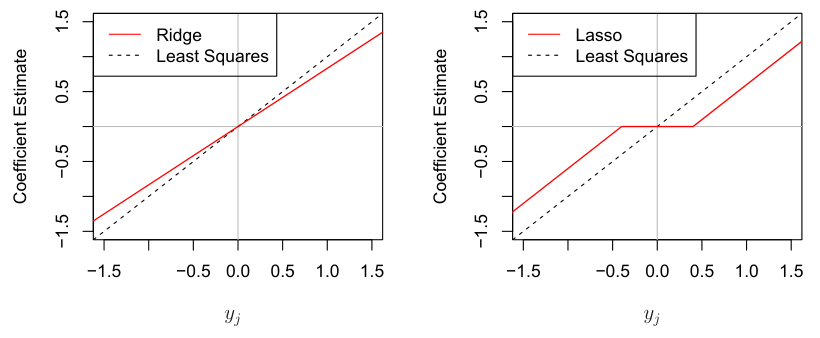

**图6.10** 在 $n=p$、$\mathbf X$ 为对角线上元素均为1的对角矩阵这一简单情形下，岭回归与套索法的系数估计值。左：相对于最小二乘估计值，岭回归系数估计值按比例向零收缩。右：套索法系数估计值通过软阈值处理向零收缩。图内文字：Coefficient Estimate＝系数估计值；Ridge＝岭回归；Lasso＝套索法；Least Squares＝最小二乘。

可以证明，在这一情形下，岭回归估计值为

$$
\hat\beta^R_j=y_j/(1+\lambda), \tag{6.14}
$$

而套索法估计值为

$$
\hat\beta^L_j=\begin{cases}
y_j-\lambda/2 & y_j>\lambda/2\text{ 时};\\
y_j+\lambda/2 & y_j<-\lambda/2\text{ 时};\\
0 & |y_j|\leq\lambda/2\text{ 时}.
\end{cases} \tag{6.15}
$$

图6.10展示了这一情形。可以看到，岭回归与套索法执行的是两种非常不同的收缩。岭回归将每个最小二乘系数估计值按相同的比例收缩。相比之下，套索法将每个最小二乘系数向零收缩一个固定的量 $\lambda/2$；绝对值小于 $\lambda/2$ 的最小二乘系数，会被完全收缩为零。套索法在这一简单情形下所做的收缩(6.15)，称为**软阈值处理（soft-thresholding）**。部分套索法系数被完全收缩为零，解释了套索法为何能够进行特征选择。

对于更一般的数据矩阵 $\mathbf X$，情况比图6.10所示的稍复杂一些，但主要思想仍然近似成立：岭回归大致按相同的比例收缩数据的每一个维度；套索法则大致将所有系数向零收缩相近的量，而足够小的系数会被完全收缩为零。

#### 岭回归与套索法的贝叶斯解释


下面说明如何从贝叶斯视角理解岭回归与套索法。回归的贝叶斯观点假定，系数向量 $\beta$ 具有某个**先验分布（prior distribution）**，记为 $p(\beta)$，其中 $\beta=(\beta_0,\beta_1,\ldots,\beta_p)^T$。数据的似然可以写成 $f(Y\mid X,\beta)$，其中 $X=(X_1,\ldots,X_p)$。


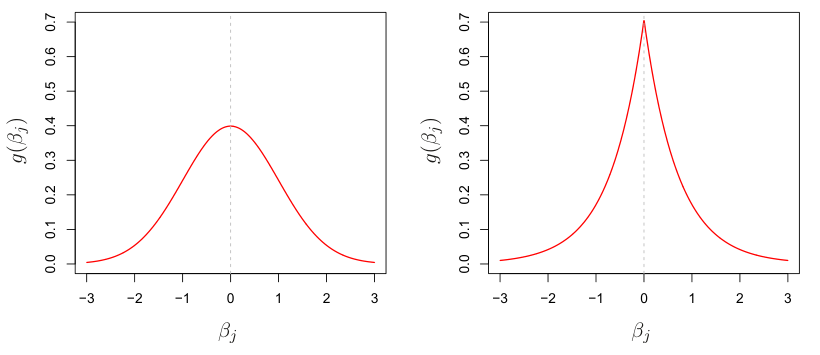

**图6.11** 左：在高斯先验下，岭回归是 $\beta$ 的后验众数。右：在双指数先验下，套索法是 $\beta$ 的后验众数。

将先验分布与似然相乘，就得到**后验分布（posterior distribution）**，其形式如下（忽略比例常数）：

$$
p(\beta\mid X,Y)\propto f(Y\mid X,\beta)p(\beta\mid X)=f(Y\mid X,\beta)p(\beta),
$$

其中，比例关系来自贝叶斯定理，等式则来自 $X$ 固定不变的假定。

我们假设通常的线性模型

$$
Y=\beta_0+X_1\beta_1+\cdots+X_p\beta_p+\epsilon,
$$

并假定误差相互独立，且来自正态分布。再假定对某个密度函数 $g$，有 $p(\beta)=\prod_{j=1}^{p}g(\beta_j)$。事实表明，选取 $g$ 的下列两个特例，就能自然地得到岭回归与套索法：

- 若 $g$ 为均值为零、标准差为 $\lambda$ 的某个函数的高斯分布，则 $\beta$ 的**后验众数（posterior mode）**——即给定数据后 $\beta$ 最可能的值——就是岭回归解。（事实上，岭回归解也是后验均值。）
- 若 $g$ 为均值为零、尺度参数为 $\lambda$ 的某个函数的**双指数（拉普拉斯）分布（double-exponential (Laplace) distribution）**，则 $\beta$ 的后验众数就是套索法解。（不过，套索法解并不是后验均值；事实上，后验均值也不会产生稀疏的系数向量。）

高斯先验与双指数先验如图6.11所示。因此，从贝叶斯观点看，只要假定带有正态误差的通常线性模型，并为 $\beta$ 设定一个简单的先验分布，就可以直接得到岭回归与套索法。注意，套索法的先验在零处具有陡峭的尖峰，而高斯分布在零处更平缓、更宽。因此，套索法事先预期许多系数会（恰好）为零，而岭回归则假定系数随机分布在零的周围。


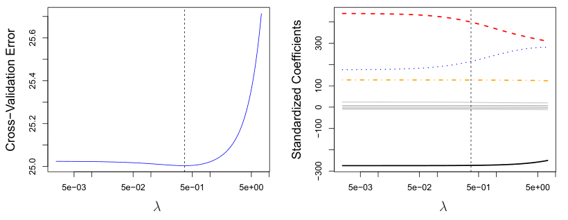

**图6.12** 左：对 `Credit` 数据集采用不同的 $\lambda$ 值进行岭回归所得的交叉验证误差。右：系数估计值随 $\lambda$ 的变化。竖直虚线标示交叉验证选出的 $\lambda$ 值。图内文字：Cross-Validation Error＝交叉验证误差；Standardized Coefficients＝标准化系数。

### 6.2.3 选择调节参数

正如第6.1节讨论的子集选择方法需要确定候选模型中哪一个最好，使用岭回归与套索法时，也需要一种方法来选择式(6.5)与式(6.7)中调节参数 $\lambda$ 的值，或者等价地，选择式(6.9)与式(6.8)中约束 $s$ 的值。交叉验证为这一问题提供了简单的解决办法。按照第5章所述，先选取一组网格化的 $\lambda$ 值，再计算每个 $\lambda$ 值对应的交叉验证误差。随后选出交叉验证误差最小的调节参数值。最后，使用全部可用观测和选出的调节参数值，重新拟合模型。

图6.12展示了对 `Credit` 数据集的岭回归拟合进行留一交叉验证后选出的 $\lambda$。竖直虚线标示所选的 $\lambda$ 值。这里选出的值相对较小，表明最优拟合相对于最小二乘解只进行了少量收缩。此外，误差曲线的凹陷并不十分明显，因此，相当宽的取值范围都能得到很相近的误差。在这种情况下，我们也许直接使用最小二乘解即可。

图6.13展示了对图6.9的稀疏模拟数据应用套索法拟合，并进行10折交叉验证的结果。左图展示交叉验证误差，右图展示系数估计值。竖直虚线标示交叉验证误差最小的位置。右图的两条彩色曲线代表与响应相关的两个预测变量，灰色曲线则代表与响应无关的预测变量；它们通常分别称为**信号变量（signal variables）** 和 **噪声变量（noise variables）**。套索法不仅正确地为这两个信号预测变量给出了大得多的系数估计值，而且最小交叉验证误差所对应的那组系数估计值中，只有信号变量的系数非零。因此，尽管这是一个颇具挑战的情形——有 $p=45$ 个变量，而观测数只有 $n=50$——交叉验证与套索法相结合，仍然正确识别出了模型中的两个信号变量。


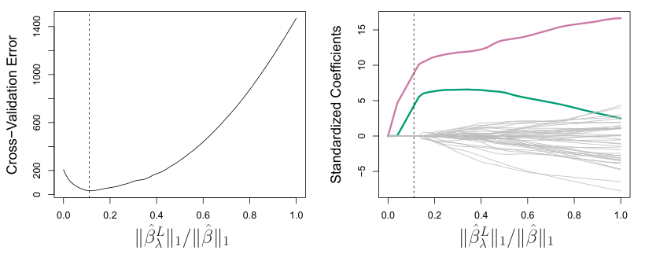

**图6.13** 左：对图6.9中的稀疏模拟数据集应用套索法，所得的10折交叉验证MSE。右：相应的套索法系数估计值。两个信号变量以彩色表示，噪声变量以灰色表示。竖直虚线标示交叉验证误差最小的套索法拟合。图内文字：Cross-Validation Error＝交叉验证误差；Standardized Coefficients＝标准化系数。

相比之下，图6.13右图最右端所展示的最小二乘解，只为这两个信号变量中的一个赋予了较大的系数估计值。

## 6.3 降维方法（Dimension Reduction Methods）

本章到目前为止讨论的方法，通过两种不同的方式控制方差：使用原始变量的一个子集，或将其系数向零收缩。这些方法都以原始预测变量 $X_1,X_2,\ldots,X_p$ 来定义。现在，我们探讨一类先对预测变量进行变换，再用变换后的变量拟合最小二乘模型的方法。我们将这些技术称为**降维**方法。

设 $Z_1,Z_2,\ldots,Z_M$ 表示原始 $p$ 个预测变量的 $M<p$ 个线性组合，即

$$
Z_m=\sum_{j=1}^{p}\phi_{jm}X_j \tag{6.16}
$$

其中，$\phi_{1m},\phi_{2m},\ldots,\phi_{pm}$ 是一些常数，$m=1,\ldots,M$。接着，可以用最小二乘法拟合线性回归模型

$$
y_i=\theta_0+\sum_{m=1}^{M}\theta_m z_{im}+\epsilon_i,\qquad i=1,\ldots,n, \tag{6.17}
$$

注意，式(6.17)中的回归系数为 $\theta_0,\theta_1,\ldots,\theta_M$。如果恰当地选择常数 $\phi_{1m},\phi_{2m},\ldots,\phi_{pm}$，那么这类降维方法的表现往往可以优于最小二乘回归。换句话说，用最小二乘法拟合式(6.17)，可能比用最小二乘法拟合式(6.1)得到更好的结果。

“降维”这一名称源于：该方法把估计 $p+1$ 个系数 $\beta_0,\beta_1,\ldots,\beta_p$ 的问题，简化为估计 $M+1$ 个系数 $\theta_0,\theta_1,\ldots,\theta_M$ 的问题，其中 $M<p$。换句话说，问题的维数从 $p+1$ 降到了 $M+1$。


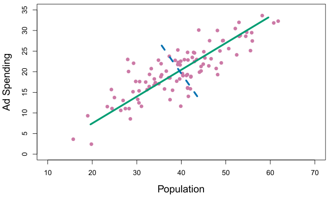

**图6.14** 紫色圆点表示100个不同城市的人口规模（`pop`）和广告支出（`ad`）。绿色实线表示第一主成分，蓝色虚线表示第二主成分。图内文字：Population＝人口规模；Ad Spending＝广告支出。

注意，由式(6.16)可得

$$
\sum_{m=1}^{M}\theta_m z_{im}
=\sum_{m=1}^{M}\theta_m\sum_{j=1}^{p}\phi_{jm}x_{ij}
=\sum_{j=1}^{p}\sum_{m=1}^{M}\theta_m\phi_{jm}x_{ij}
=\sum_{j=1}^{p}\beta_jx_{ij},
$$

其中

$$
\beta_j=\sum_{m=1}^{M}\theta_m\phi_{jm}. \tag{6.18}
$$

因此，式(6.17)可以看作式(6.1)所给出的原始线性回归模型的一个特例。降维对估计的系数 $\beta_j$ 施加了约束，因为它们现在必须具有式(6.18)的形式。这种对系数形式的约束可能使系数估计产生偏差。不过，当 $p$ 相对于 $n$ 较大时，选择 $M\ll p$ 可以明显降低拟合系数的方差。如果 $M=p$，且所有 $Z_m$ 都线性无关，那么式(6.18)就不施加任何约束。此时没有发生降维，因此拟合式(6.17)等价于对原始的 $p$ 个预测变量进行最小二乘拟合。

所有降维方法都分两步进行。首先，得到变换后的预测变量 $Z_1,Z_2,\ldots,Z_M$；其次，用这 $M$ 个预测变量拟合模型。不过，选择 $Z_1,Z_2,\ldots,Z_M$，或者等价地选择 $\phi_{jm}$，可以通过不同方式实现。本章将考虑两种方法：**主成分（principal components）** 和 **偏最小二乘（partial least squares）**。

### 6.3.1 主成分回归（Principal Components Regression）

**主成分分析（principal components analysis，PCA）** 是一种常用方法，用于从大量变量中提取一组低维特征。

第12章将更详细地讨论PCA作为无监督学习工具的应用。这里介绍它如何作为一种回归降维技术使用。

#### 主成分分析概述

PCA是一种降低 $n\times p$ 数据矩阵 $\mathbf{X}$ 维数的技术。数据的**第一主成分方向**，就是观测变异最大的方向。例如，图6.14展示了100个城市的人口规模（`pop`，单位为万人）以及某家公司在这些城市的广告支出（`ad`，单位为千美元）。<a id="ch06-fnref6" href="#ch06-fn6" class="footnote-ref">6</a> 绿色实线表示数据的第一主成分方向。直观上可以看出，数据沿这一方向的变异最大。也就是说，如果把这100个观测投影到这条直线上（如图6.15左图所示），所得投影观测的方差就会达到最大；把观测投影到任何其他直线上，所得投影观测的方差都会更小。将一个点投影到一条直线上，只需找出直线上距离该点最近的位置。

<aside id="ch06-fn6" class="footnote"><p><a href="#ch06-fnref6">6</a> 这个数据集不同于第3章讨论的 Advertising 数据集。 <a href="#ch06-fnref6" class="footnote-back">↩</a></p></aside>

图6.14以图形展示了第一主成分，但如何用数学形式概括它呢？其公式为

$$
Z_1=0.839\times(\mathrm{pop}-\overline{\mathrm{pop}})+0.544\times(\mathrm{ad}-\overline{\mathrm{ad}}). \tag{6.19}
$$

这里，$\phi_{11}=0.839$ 和 $\phi_{21}=0.544$ 是**主成分载荷（principal component loadings）**，它们定义了上述方向。在式(6.19)中，$\overline{\mathrm{pop}}$ 表示该数据集中所有 `pop` 值的均值，$\overline{\mathrm{ad}}$ 表示所有广告支出的均值。其思想是：在 `pop` 与 `ad` 所有满足 $\phi_{11}^2+\phi_{21}^2=1$ 的线性组合中，这个特定的线性组合具有最大的方差，即它使 $\operatorname{Var}(\phi_{11}\times(\mathrm{pop}-\overline{\mathrm{pop}})+\phi_{21}\times(\mathrm{ad}-\overline{\mathrm{ad}}))$ 达到最大。必须只考虑满足 $\phi_{11}^2+\phi_{21}^2=1$ 的线性组合，否则可以任意增大 $\phi_{11}$ 和 $\phi_{21}$，使方差无限增大。在式(6.19)中，两个载荷都为正且大小相近，因此 $Z_1$ 大致相当于这两个变量的一个平均值。

由于 $n=100$，`pop` 和 `ad` 都是长度为100的向量，式(6.19)中的 $Z_1$ 也是如此。例如，

$$
z_{i1}=0.839\times(\mathrm{pop}_i-\overline{\mathrm{pop}})+0.544\times(\mathrm{ad}_i-\overline{\mathrm{ad}}). \tag{6.20}
$$

$z_{11},\ldots,z_{n1}$ 的值称为**主成分得分（principal component scores）**，见图6.15右图。

PCA还有另一种解释：第一主成分向量定义了一条尽可能接近数据的直线。例如，在图6.14中，第一主成分直线使每个点到直线的垂直距离的平方和最小。图6.15左图用虚线段标出了这些距离，其中的叉号表示各个点在第一主成分直线上的投影。选择第一主成分，就是要使投影后的观测尽可能接近原始观测。


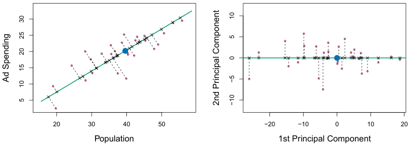

**图6.15** 广告数据的一个子集。蓝色圆点标出 `pop` 和 `ad` 预算的均值。**左图：** 绿色表示第一主成分方向。这是数据变异最大的维度，同时也定义了距离所有 $n$ 个观测最近的直线。黑色虚线段表示每个观测到主成分的距离。蓝点表示 $(\overline{\mathrm{pop}},\overline{\mathrm{ad}})$。**右图：** 将左图旋转，使第一主成分方向与 $x$ 轴重合。图内文字：Population＝人口规模；Ad Spending＝广告支出；1st Principal Component＝第一主成分；2nd Principal Component＝第二主成分。

图6.15右图将左图旋转，使第一主成分方向与 $x$ 轴重合。可以证明，式(6.20)给出的第 $i$ 个观测的第一主成分得分，就是第 $i$ 个叉号沿 $x$ 方向到零点的距离。例如，图6.15左图左下角的点具有较大的负主成分得分 $z_{i1}=-26.1$，而右上角的点具有较大的正得分 $z_{i1}=18.7$。这些得分可以直接用式(6.20)计算。

可以把主成分 $Z_1$ 的值看作一个数，用来概括各地的 `pop` 与 `ad` 预算。在这个例子中，如果 $z_{i1}=0.839\times(\mathrm{pop}_i-\overline{\mathrm{pop}})+0.544\times(\mathrm{ad}_i-\overline{\mathrm{ad}})<0$，就表示该城市的人口规模和广告支出都低于平均水平。正得分则表示相反的情况。用一个数能够在多大程度上同时表示 `pop` 和 `ad` 呢？在这个例子中，图6.14表明 `pop` 与 `ad` 之间近似存在线性关系，因此可以预期，用一个数来概括会有较好的效果。图6.16分别绘制了 $z_{i1}$ 与 `pop` 和 `ad` 的关系。<a id="ch06-fnref7" href="#ch06-fn7" class="footnote-ref">7</a> 图中显示，第一主成分与这两个特征之间都有很强的关系。换句话说，第一主成分似乎捕获了预测变量 `pop` 和 `ad` 所包含的大部分信息。

<aside id="ch06-fn7" class="footnote"><p><a href="#ch06-fnref7">7</a> 计算主成分之前，先对 `pop` 和 `ad` 都进行了标准化，这是一种常见做法。因此，图6.15和图6.16的横轴采用不同的尺度。 <a href="#ch06-fnref7" class="footnote-back">↩</a></p></aside>

到目前为止，我们一直着重讨论第一主成分。一般而言，最多可以构造 $p$ 个不同的主成分。


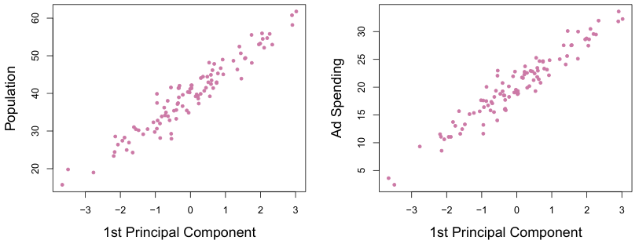

**图6.16** 第一主成分得分 $z_{i1}$ 分别与 `pop`、`ad` 的关系图。两者的关系都很强。图内文字：1st Principal Component＝第一主成分；Population＝人口规模；Ad Spending＝广告支出。

第二主成分 $Z_2$ 是变量的一个线性组合，它与 $Z_1$ 不相关，并且在这一约束下具有最大的方差。图6.14中的蓝色虚线表示第二主成分方向。可以证明，$Z_1$ 与 $Z_2$ 的相关为零这一条件，等价于两个方向必须**垂直（perpendicular）**，也就是**正交（orthogonal）**。第二主成分的公式为

$$
Z_2=0.544\times(\mathrm{pop}-\overline{\mathrm{pop}})-0.839\times(\mathrm{ad}-\overline{\mathrm{ad}}).
$$

由于广告数据有两个预测变量，前两个主成分就包含了 `pop` 和 `ad` 中的全部信息。不过，根据构造方式，第一主成分包含的信息最多。例如，在图6.15右图中，$z_{i1}$（横轴）的变异远大于 $z_{i2}$（纵轴）的变异。第二主成分得分更接近零，表明这个主成分捕获的信息少得多。图6.17进一步展示了 $z_{i2}$ 分别与 `pop` 和 `ad` 的关系。第二主成分与这两个预测变量几乎没有关系，这再次表明，在这个例子中，只需第一主成分就能准确地表示 `pop` 和 `ad` 预算。

对于广告例子这样的二维数据，最多只能构造两个主成分。但是，如果还有人口年龄、收入水平、受教育程度等其他预测变量，就可以构造更多主成分。它们会在与先前各主成分不相关的约束下，依次使方差达到最大。

#### 主成分回归方法

**主成分回归（principal components regression，PCR）** 方法先构造前 $M$ 个主成分 $Z_1,\ldots,Z_M$，然后将这些主成分作为预测变量，用最小二乘法拟合线性回归模型。其核心思想是：往往只需少数几个主成分，就足以解释数据中的大部分变异，以及数据与响应之间的关系。换句话说，我们假设 $X_1,\ldots,X_p$ 变异最大的方向，就是与 $Y$ 有关联的方向。


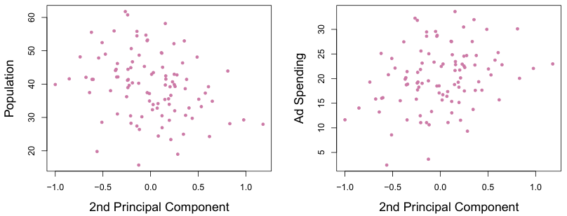

**图6.17** 第二主成分得分 $z_{i2}$ 分别与 `pop`、`ad` 的关系图。两者的关系都很弱。图内文字：2nd Principal Component＝第二主成分；Population＝人口规模；Ad Spending＝广告支出。

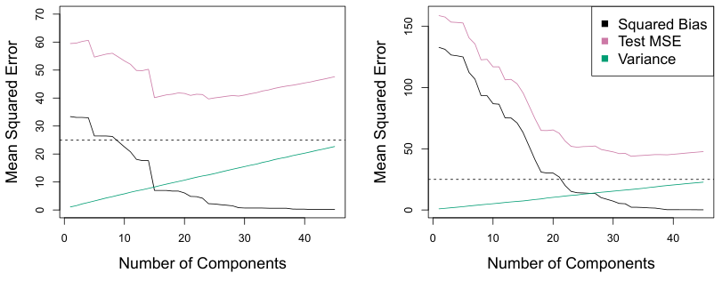

**图6.18** 对两个模拟数据集应用PCR。每幅图中的水平虚线表示不可约误差。**左图：** 图6.8中的模拟数据。**右图：** 图6.9中的模拟数据。图内文字：Number of Components＝主成分数量；Mean Squared Error＝均方误差；Squared Bias＝偏差平方；Test MSE＝测试MSE；Variance＝方差。

虽然不能保证上述假设成立，但它往往是足够合理的近似，能够得到良好的结果。

如果PCR的基本假设成立，那么对 $Z_1,\ldots,Z_M$ 拟合最小二乘模型，会比对 $X_1,\ldots,X_p$ 拟合最小二乘模型得到更好的结果。这是因为，数据中与响应有关的大部分或全部信息都包含在 $Z_1,\ldots,Z_M$ 中，而且只估计 $M\ll p$ 个系数可以减轻过拟合。在广告数据中，第一主成分解释了 `pop` 和 `ad` 两者的大部分方差，因此，只用这一个变量来预测某个感兴趣的响应（如 `sales`）的主成分回归，很可能会有相当好的表现。

图6.18展示了在图6.8和图6.9的模拟数据集上进行PCR拟合的结果。回顾一下，这两个数据集都使用 $n=50$ 个观测和 $p=45$ 个预测变量生成。不过，第一个数据集中的响应是所有预测变量的函数，而第二个数据集的响应只由其中两个预测变量生成。各条曲线都是 $M$ 的函数，其中 $M$ 是回归模型中用作预测变量的主成分数量。随着回归模型中使用的主成分增多，偏差减小，方差增大。


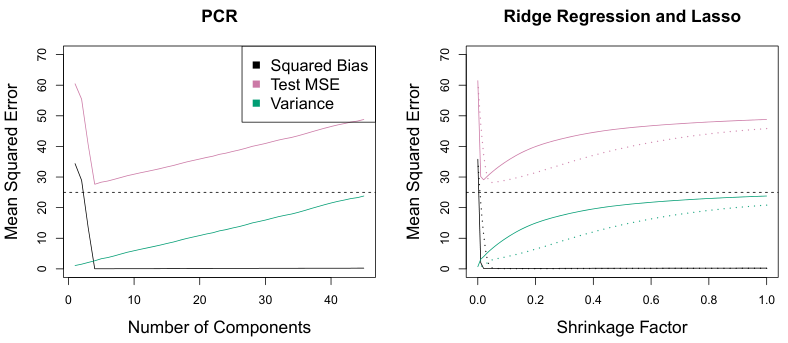

**图6.19** 对一个模拟数据集应用PCR、岭回归和套索法；该数据集的 $\mathbf{X}$ 的前五个主成分包含了有关响应 $Y$ 的全部信息。每幅图中的水平虚线表示不可约误差 $\operatorname{Var}(\epsilon)$。**左图：** PCR的结果。**右图：** 套索法（实线）和岭回归（点线）的结果。横轴表示系数估计值的收缩因子，定义为收缩后系数估计值的 $\ell_2$ 范数除以最小二乘估计值的 $\ell_2$ 范数。图内文字：PCR＝主成分回归；Ridge Regression and Lasso＝岭回归和套索法；Number of Components＝主成分数量；Shrinkage Factor＝收缩因子；Mean Squared Error＝均方误差；Squared Bias＝偏差平方；Test MSE＝测试MSE；Variance＝方差。

这使均方误差呈现典型的U形。当 $M=p=45$ 时，PCR就相当于用全部原始预测变量进行最小二乘拟合。图中表明，恰当地选择 $M$ 并进行PCR，能够比最小二乘法取得明显改善，尤其是在左图中。不过，考察图6.5、图6.8和图6.9中岭回归和套索法的结果，可以看出，在这个例子中PCR不及这两种收缩方法。

图6.18中PCR表现相对较差，是因为生成这些数据的方式使得需要很多主成分才能充分建模响应。相反，如果前几个主成分就足以捕获预测变量的大部分变异，以及它们与响应之间的关系，PCR往往会表现良好。图6.19左图展示了另一个模拟数据集的结果，这个数据集的设计更有利于PCR。这里生成的响应只依赖前五个主成分。此时，随着PCR中主成分数量 $M$ 的增加，偏差迅速降为零。均方误差在 $M=5$ 处出现了清楚的最小值。图6.19右图展示了岭回归和套索法在这些数据上的结果。这三种方法都比最小二乘法有明显改善。不过，PCR和岭回归的表现略优于套索法。

需要注意，尽管PCR提供了一种用 $M<p$ 个预测变量进行回归的简单方式，但它并不是特征选择方法。这是因为，回归中使用的 $M$ 个主成分，每一个都是全部 $p$ 个原始特征的线性组合。例如，在式(6.19)中，$Z_1$ 是 `pop` 与 `ad` 两者的线性组合。因此，虽然PCR在许多实际情形中往往表现良好，但它不会得到一个仅依赖少数原始特征的模型。


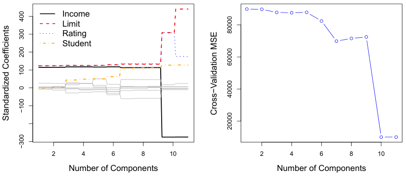

**图6.20** **左图：** Credit 数据集中，不同 $M$ 值对应的PCR标准化系数估计值。**右图：** 使用PCR得到的10折交叉验证MSE随 $M$ 的变化。图内文字：Number of Components＝主成分数量；Standardized Coefficients＝标准化系数；Cross-Validation MSE＝交叉验证MSE；Income＝收入；Limit＝信用额度；Rating＝信用评分；Student＝学生身份。

从这个意义上说，PCR与岭回归的关系比与套索法的关系更密切。事实上，可以证明PCR与岭回归之间有非常密切的联系。甚至可以把岭回归看作PCR的连续版本！<a id="ch06-fnref8" href="#ch06-fn8" class="footnote-ref">8</a>

<aside id="ch06-fn8" class="footnote"><p><a href="#ch06-fnref8">8</a> 更多细节参见 Hastie、Tibshirani 和 Friedman 所著《统计学习基础》（The Elements of Statistical Learning）第3.5节。 <a href="#ch06-fnref8" class="footnote-back">↩</a></p></aside>

在PCR中，主成分数量 $M$ 通常通过交叉验证选择。图6.20展示了将PCR应用于 Credit 数据集的结果；右图给出了交叉验证误差随 $M$ 的变化。在这些数据上，当主成分数量 $M=10$ 时，交叉验证误差最低；这几乎没有降维，因为 $M=11$ 的PCR就等价于直接进行最小二乘拟合。

进行PCR时，我们通常建议先用式(6.6)对每个预测变量进行标准化，再生成主成分。这种标准化可以确保所有变量处在相同的尺度上。如果不进行标准化，方差较大的变量往往会在得到的主成分中发挥更大的作用，而变量的测量尺度最终会影响PCR模型。不过，如果所有变量都用相同单位测量（例如千克或英寸），也可以选择不进行标准化。

### 6.3.2 偏最小二乘（Partial Least Squares）

刚才介绍的PCR方法，是寻找能够最好地表示预测变量 $X_1,\ldots,X_p$ 的线性组合，也就是方向。这些方向以无监督方式确定，因为在确定主成分方向时，并未借助响应 $Y$。也就是说，响应没有对主成分的确定过程提供监督。因此，PCR有一个缺点：不能保证最能解释预测变量的方向，也最适合用来预测响应。


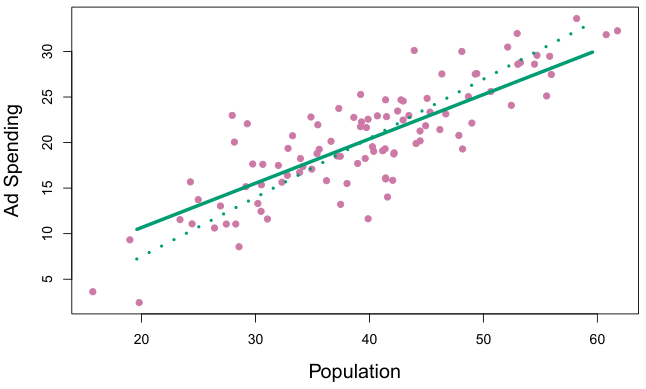

**图6.21** 广告数据的第一PLS方向（实线）与第一PCR方向（点线）。图内文字：Population＝人口规模；Ad Spending＝广告支出。

第12章将进一步讨论无监督方法。

现在介绍**偏最小二乘（PLS）**，它是PCR的一种监督替代方法。与PCR一样，PLS也是降维方法：先找出一组新特征 $Z_1,\ldots,Z_M$，它们是原始特征的线性组合，再用这 $M$ 个新特征通过最小二乘法拟合线性模型。不过，PLS与PCR不同，它以监督方式确定这些新特征；也就是说，它利用响应 $Y$，寻找既能很好地近似原始特征、又与响应有关的新特征。粗略地说，PLS方法试图寻找同时有助于解释响应和预测变量的方向。

下面说明如何计算第一PLS方向。对 $p$ 个预测变量进行标准化后，PLS将式(6.16)中的每个 $\phi_{j1}$ 设为 $Y$ 对 $X_j$ 进行简单线性回归所得的系数，从而计算第一方向 $Z_1$。可以证明，这个系数与 $Y$ 和 $X_j$ 之间的相关成正比。因此，在计算 $Z_1=\sum_{j=1}^{p}\phi_{j1}X_j$ 时，PLS赋予与响应关系最强的变量最大的权重。

图6.21展示了在一个合成数据集上应用PLS的例子，其中，响应为100个地区各自的销售量（Sales），两个预测变量分别为人口规模（Population Size）和广告支出（Advertising Spending）。绿色实线表示第一PLS方向，点线表示第一主成分方向。与PCA相比，PLS选出的方向在 `pop` 维度每变化一个单位时，`ad` 维度的变化较小。这表明，`pop` 与响应的相关强于 `ad`。PLS方向对预测变量的拟合不如PCA紧密，但它能更好地解释响应。

为了确定第二PLS方向，首先对每个变量调整掉 $Z_1$ 的作用：将每个变量对 $Z_1$ 回归，并取其残差。这些残差可以理解为尚未被第一PLS方向解释的剩余信息。然后，使用这些正交化后的数据计算 $Z_2$，方法与根据原始数据计算 $Z_1$ 完全相同。

这种迭代方法可以重复 $M$ 次，从而确定多个PLS成分 $Z_1,\ldots,Z_M$。最后，在这一过程结束时，与PCR完全一样，使用最小二乘法拟合线性模型，用 $Z_1,\ldots,Z_M$ 预测 $Y$。

与PCR一样，PLS中使用的偏最小二乘方向数量 $M$ 是一个调节参数，通常通过交叉验证选择。进行PLS之前，我们一般会对预测变量和响应都进行标准化。

PLS在化学计量学（chemometrics）领域很常用，该领域的许多变量来自数字化的光谱信号。在实际应用中，它的表现往往并不优于岭回归或PCR。虽然PLS的监督降维可以降低偏差，但也可能增大方差，因此，相对于PCR，PLS的整体收益会相互抵消。

## 6.4 高维情形下的考量

### 6.4.1 高维数据

大多数传统的回归与分类统计技术，都是针对观测数 $n$ 远大于特征数 $p$ 的**低维（low-dimensional）** 情形设计的。部分原因在于，统计学发展史上的大部分时期，需要使用统计方法的科学问题主要是低维问题。例如，考虑根据患者的年龄、性别和**体质指数（body mass index，BMI）** 建立模型，预测其血压。这里有三个预测变量；如果把截距也计入模型，则是四个。我们可能有数千名患者的血压、年龄、性别和BMI数据。因此，$n\gg p$，问题是低维的。（这里的维数指 $p$ 的大小。）

过去20年中，新技术改变了金融、营销和医学等众多领域的数据采集方式。如今，采集几乎不受数量限制的特征测量值已经十分常见，也就是 $p$ 非常大。虽然 $p$ 可以极大，但由于成本、样本可获得性或其他因素的限制，观测数 $n$ 往往有限。下面是两个例子：

1. 预测血压时，除了年龄、性别和BMI，还可以测量50万个**单核苷酸多态性（single nucleotide polymorphisms，SNPs）**，并将其纳入预测模型。这些是在人群中相对常见的单个DNA突变。此时，$n\approx200$，$p\approx500{,}000$。
2. 一位希望了解人们网上购物模式的营销分析师，可以将搜索引擎用户输入的所有搜索词都作为特征。这有时称为**词袋模型（bag-of-words model）**。这位研究者可能只能获得几百或几千名搜索引擎用户的搜索历史，这些用户同意向其分享自己的信息。对于某个用户，将 $p$ 个搜索词逐一记为出现(0)或未出现(1)，由此构成一个很长的二元特征向量。此时，$n\approx1{,}000$，而 $p$ 要大得多。

特征数多于观测数的数据集通常称为**高维（high-dimensional）** 数据集。最小二乘线性回归等经典方法不适用于这种情形。分析高维数据时出现的许多问题，本书前面已经讨论过，因为它们也适用于 $n>p$ 的情形，包括偏差—方差权衡的作用与过拟合的风险。这些问题始终值得关注；而当特征数相对于观测数非常大时，它们就尤其重要。

我们将高维情形定义为特征数 $p$ 大于观测数 $n$ 的情形。不过，下面讨论的考量当然也适用于 $p$ 略小于 $n$ 的情况；进行监督学习时，最好始终将其牢记在心。

### 6.4.2 高维情形下会出现什么问题？

为了说明当 $p>n$ 时，回归与分类为什么需要格外谨慎并采用专门技术，我们先考察将不适用于高维情形的统计技术直接用于这类数据时，会出现什么问题。这里以最小二乘回归为例，但同样的概念也适用于逻辑回归、线性判别分析和其他经典统计方法。

当特征数 $p$ 大于或等于观测数 $n$ 时，第3章介绍的最小二乘法就不能使用，或者更准确地说，**不应该**使用。原因很简单：不论特征与响应之间是否真的存在关系，最小二乘法都会给出一组系数估计，使数据被完全拟合，残差为零。

图6.22给出了一个例子，其中只有 $p=1$ 个特征（另加一个截距），分别考察20个观测和只有两个观测的情形。有20个观测时，$n>p$，最小二乘回归直线不会完全拟合数据，而是尽可能逼近这20个观测。相反，只有两个观测时，不论这两个观测的取值如何，回归直线都会精确地拟合数据。这会带来问题，因为这种完全拟合几乎肯定会导致对数据过拟合。换句话说，虽然在高维情形下可以完全拟合训练数据，但得到的线性模型在独立测试集上会表现得极差，因此并不是一个有用的模型。事实上，图6.22就展示了这一点：右图得到的最小二乘直线，如果用左图的观测组成测试集，其表现将很差。问题很简单：当 $p>n$ 或 $p\approx n$ 时，一条简单的最小二乘回归直线就已经过于灵活，因而会过拟合数据。

图6.23进一步说明了当特征数 $p$ 很大时，不加谨慎地使用最小二乘法的风险。这里模拟了 $n=20$ 个观测，分别使用1到20个特征进行回归，且每个特征都与响应完全无关。

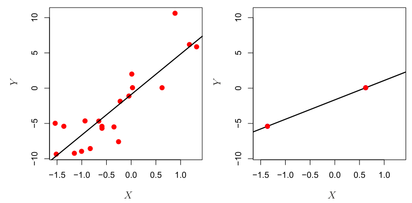

**图6.22** 左：低维情形下的最小二乘回归。右：$n=2$ 个观测、需要估计两个参数（一个截距和一个系数）时的最小二乘回归。图内坐标符号 $X$、$Y$ 保持原样。

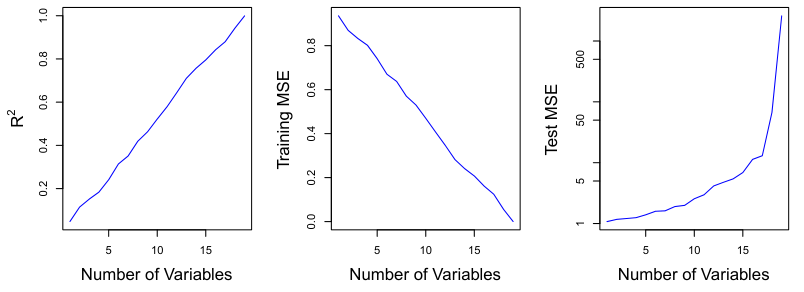

**图6.23** 在一个包含 $n=20$ 个训练观测的模拟例子中，向模型加入与结果完全无关的特征。左：随着纳入的特征增多，$R^2$ 增大到1。中：随着纳入的特征增多，训练集MSE减小到0。右：随着纳入的特征增多，测试集MSE增大。图内文字：Number of Variables＝变量个数；Training MSE＝训练MSE；Test MSE＝测试MSE；$R^2$ 保持原样。

如图所示，随着模型纳入的特征数增加，模型的 $R^2$ 增大到1，相应地，训练集MSE减小到0，**尽管这些特征与响应完全无关**。另一方面，随着模型纳入的特征数增加，独立测试集上的MSE会变得极大，因为加入额外预测变量会使系数估计的方差大幅增加。查看测试集MSE就会发现，最佳模型至多只包含少量变量。然而，如果只是不加仔细地查看 $R^2$ 或训练集MSE，就可能错误地认定，变量最多的模型才是最好的。这说明，分析包含大量变量的数据集时，必须格外谨慎，并且始终在独立测试集上评价模型表现。

第6.1.3节介绍了若干方法，通过调整训练集RSS或 $R^2$，将拟合最小二乘模型所用的变量数考虑在内。遗憾的是，$C_p$、AIC和BIC不适用于高维情形，因为这时估计 $\hat\sigma^2$ 存在问题。（例如，在这种情形下，第3章给出的 $\hat\sigma^2$ 公式会产生 $\hat\sigma^2=0$ 的估计。）同样，在高维情形下使用调整后的 $R^2$ 也会出现问题，因为很容易得到调整后的 $R^2$ 等于1的模型。显然，我们需要更适合高维情形的其他方法。

### 6.4.3 高维情形下的回归

本章介绍了许多方法，用于拟合灵活性较低的最小二乘模型，例如前向逐步选择、岭回归、套索法和主成分回归。这些方法在高维情形下进行回归时尤其有用。它们的基本做法是，采用比最小二乘法灵活性更低的拟合方法，从而避免过拟合。

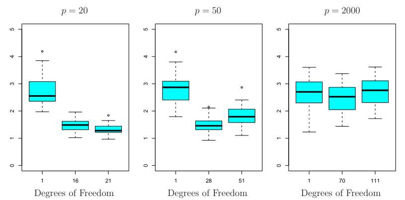

**图6.24** 对 $n=100$ 个观测和三种不同的特征数 $p$ 使用套索法。在 $p$ 个特征中，有20个与响应有关。箱线图展示了式(6.7)中的调节参数 $\lambda$ 取三个不同值时得到的测试MSE。为便于解释，图中标出的是自由度而非 $\lambda$；对于套索法，自由度就是估计得到的非零系数个数。当 $p=20$ 时，最弱的正则化得到最低的测试MSE。当 $p=50$ 时，较强的正则化得到最低的测试MSE。当 $p=2{,}000$ 时，不论正则化程度如何，套索法的表现都很差，因为2,000个特征中只有20个真正与结果有关。图内文字：Degrees of Freedom＝自由度；$p$ 的取值保持原样。

图6.24用一个简单的模拟例子展示了套索法的表现。这里有 $p=20$、50或2,000个特征，其中20个真正与结果有关。在 $n=100$ 个训练观测上使用套索法，并在独立测试集上评价均方误差。随着特征数增加，测试集误差增大。当 $p=20$ 时，式(6.7)中的 $\lambda$ 较小可获得最低的验证集误差；然而，当 $p$ 较大时，较大的 $\lambda$ 才能获得最低的验证集误差。

每幅箱线图都用得到的套索解的自由度，代替实际使用的 $\lambda$ 值；它就是套索解中非零系数估计的个数，也是套索拟合灵活性的一种度量。图6.24强调了三个要点：(1)正则化或收缩在高维问题中起着关键作用；(2)恰当地选择调节参数，对于良好的预测表现至关重要；(3)随着问题维数（即特征或预测变量的个数）增加，测试误差往往也会增加，除非新增特征确实与响应有关。

上述第三点实际上是高维数据分析中的一个关键原则，称为**维数灾难（curse of dimensionality）**。我们可能认为，用来拟合模型的特征数越多，拟合模型的质量也会越高。然而，比较图6.24的左图和右图就会发现，情况未必如此：在这个例子中，$p$ 从20增大到2,000时，测试集MSE几乎翻了一倍。一般来说，**加入确实与响应有关的额外信号特征，会改善拟合模型，表现为测试集误差下降**。然而，加入实际上与响应无关的噪声特征，则会使拟合模型变差，导致测试集误差上升。这是因为，噪声特征增加了问题的维数，加剧了过拟合的风险：由于它们在训练集上与响应存在偶然关联，可能被赋予非零系数；但它们没有降低测试集误差的潜在收益。因此，能够采集数千乃至数百万个特征测量值的新技术是一把双刃剑：如果这些特征确实与当前问题有关，就可能改善预测模型；如果无关，就会使结果变差。即使特征是相关的，拟合其系数所产生的方差，也可能超过它们带来的偏差下降。

### 6.4.4 解释高维情形下的结果

在高维情形下使用套索法、岭回归或其他回归方法时，必须非常谨慎地报告结果。第3章介绍了多重共线性，也就是回归中的变量可能彼此相关。在高维情形下，多重共线性问题十分严重：模型中的任一变量，都可以写成模型中所有其他变量的线性组合。这基本上意味着，我们永远无法确切知道哪些变量真正能够预测结果（如果确有这样的变量），也永远无法确定回归中应使用的最佳系数。我们至多只能希望，对那些与真正具有预测能力的变量相关的变量，赋予较大的回归系数。

例如，假设我们试图根据50万个SNP预测血压，而前向逐步选择表明，其中17个SNP可以在训练数据上得到一个良好的预测模型。若据此断言，这17个SNP预测血压的能力优于未纳入模型的其他SNP，就是错误的。很可能存在许多由17个SNP组成的集合，预测血压的效果与选出的模型一样好。如果获得一个独立数据集，并在其中进行前向逐步选择，很可能会得到包含另一组SNP的模型，这组SNP甚至可能与原先的一组完全没有重叠。这并不减损所得模型的价值。例如，这个模型可能在一组独立患者中非常有效地预测血压，对医生具有临床价值。但我们必须谨慎，避免夸大结果，并明确说明：我们找出的只是许多可能的血压预测模型之一，还必须在独立数据集上进一步验证。

在高维情形下报告误差和模型拟合程度的度量时，也必须格外小心。我们已经看到，当 $p>n$ 时，很容易得到一个残差为零、却毫无用处的模型。因此，在高维情形下，**绝不能**把训练数据上的误差平方和、$p$ 值、$R^2$ 统计量或其他传统拟合指标，作为模型拟合良好的证据。例如，正如图6.23所示，当 $p>n$ 时，很容易得到 $R^2=1$ 的模型。报告这一点，可能误导他人以为已经获得了一个统计上有效且有用的模型；事实上，这完全不能证明模型具有说服力。应当报告独立测试集上的结果，或交叉验证误差。例如，独立测试集上的MSE或 $R^2$ 是有效的模型拟合度量，而训练集上的MSE当然不是。

## 6.5 实验：线性模型与正则化方法

本实验将实现本章讨论的许多技术。我们先在顶层导入部分所需的库。

In [1]:

```python
import numpy as np
import pandas as pd
from matplotlib.pyplot import subplots
from statsmodels.api import OLS
import sklearn.model_selection as skm
import sklearn.linear_model as skl
from sklearn.preprocessing import StandardScaler
from ISLP import load_data
from ISLP.models import ModelSpec as MS
from functools import partial
```

我们再次把本实验需要的新导入集中列出。

In [2]:

```python
from sklearn.pipeline import Pipeline
from sklearn.decomposition import PCA
from sklearn.cross_decomposition import PLSRegression
from ISLP.models import \
     (Stepwise,
      sklearn_selected,
      sklearn_selection_path)
!pip install l0bnb
from l0bnb import fit_path
```

我们在这里即时安装了 `l0bnb` 包。注意，带有转义符的 `!pip install` 会作为一条单独的系统命令运行。

### 6.5.1 子集选择方法

这里实现的方法将模型限制为仅使用输入变量的一个子集，从而减少模型中的参数个数。

#### 前向选择

我们将对 `Hitters` 数据集应用前向选择法，希望根据与上一年比赛表现有关的各项统计量，预测棒球运动员的薪水 `Salary`。

首先注意到，一些运动员的 `Salary` 变量存在缺失值。`np.isnan()` 函数可用于识别缺失的观测。它返回一个与输入向量形状相同的数组：缺失元素对应 `True`，非缺失元素对应 `False`。然后可以使用 `sum()` 方法统计缺失元素的总数。

In [3]:

```python
Hitters = load_data('Hitters')
np.isnan(Hitters['Salary']).sum()
```

Out[3]:

```text
59
```

可以看到，59名运动员的 `Salary` 缺失。数据框的 `dropna()` 方法会移除任一变量存在缺失值的所有行（这是默认行为，参见 `Hitters.dropna?`）。

In [4]:

```python
Hitters = Hitters.dropna();
Hitters.shape
```

Out[4]:

```text
(263, 20)
```

我们先采用基于 $C_p$（6.2）的前向选择来选出最佳模型。`sklearn` 没有内置这一评分指标，因此我们自己定义一个函数来计算它，并将其用作评分函数（scorer）。默认情况下，`sklearn` 会尝试将评分最大化，所以我们的评分函数计算的是 $C_p$ 统计量的负值。

In [5]:

```python
def nCp(sigma2, estimator, X, Y):
    "Negative Cp statistic"
    n, p = X.shape
    Yhat = estimator.predict(X)
    RSS = np.sum((Y - Yhat)**2)
    return -(RSS + 2 * p * sigma2) / n
```

我们需要估计残差方差 $\sigma^2$，也就是上述评分函数的第一个参数。为此，使用全部变量拟合最大的模型，再根据它的MSE估计 $\sigma^2$。

In [6]:

```python
design = MS(Hitters.columns.drop('Salary')).fit(Hitters)
Y = np.array(Hitters['Salary'])
X = design.transform(Hitters)
sigma2 = OLS(Y,X).fit().scale
```

`sklearn_selected()` 函数要求评分函数只有三个参数，即上面 `nCp()` 定义中的最后三个参数。我们使用5.3.3节首次介绍的 `partial()` 函数，将第一个参数固定为 $\sigma^2$ 的估计值。

In [7]:

```python
neg_Cp = partial(nCp, sigma2)
```

现在可以把 `neg_Cp()` 用作模型选择的评分函数。

除了评分，还需要指定搜索策略。这通过 `ISLP.models` 包中的 `Stepwise()` 对象来完成。`Stepwise.first_peak()` 方法执行前向逐步选择，直到继续向模型中添加任何变量都无法改善评估评分为止。类似地，`Stepwise.fixed_steps()` 方法执行固定步数的逐步搜索。

In [8]:

```python
strategy = Stepwise.first_peak(design,
                               direction='forward',
                               max_terms=len(design.terms))
```

现在使用前向选择，拟合以 `Salary` 为响应变量的线性回归模型。为此，使用 `ISLP.models` 包中的 `sklearn_selected()` 函数。它接收一个 `statsmodels` 模型和一种搜索策略，并通过其 `fit` 方法选择模型。如果不指定 `scoring` 参数，默认使用MSE评分，因此全部19个变量都会被选中（输出未展示）。

In [9]:

```python
hitters_MSE = sklearn_selected(OLS,
                              strategy)
hitters_MSE.fit(Hitters, Y)
hitters_MSE.selected_state_
```

与预期一致，使用 `neg_Cp` 会得到更小的模型，只选中10个变量。

In [10]:

```python
hitters_Cp = sklearn_selected(OLS,
                             strategy,
                             scoring=neg_Cp)
hitters_Cp.fit(Hitters, Y)
hitters_Cp.selected_state_
```

Out[10]:

```text
('Assists',
 'AtBat',
 'CAtBat',
 'CRBI',
 'CRuns',
 'CWalks',
 'Division',
 'Hits',
 'PutOuts',
 'Walks')
```

#### 使用验证集法与交叉验证选择模型

除了使用 $C_p$，也可以尝试通过交叉验证，在前向选择过程中选出模型。为此，需要一种方法，既能保存前向选择找到的完整模型路径，又能使用其中每个模型进行预测。`ISLP.models` 中的 `sklearn_selection_path()` 估计器可以完成这项工作。`ISLP.models` 中的 `cross_val_predict()` 函数会计算路径上每个模型的交叉验证预测值，进而可以用这些预测值评估路径上的交叉验证MSE。

这里定义一种拟合完整前向选择路径的策略。虽然 `sklearn_selection_path()` 有多种参数可供选择，这里采用默认设置，即每一步都选择使RSS下降最多的模型。

In [11]:

```python
strategy = Stepwise.fixed_steps(design,
                                len(design.terms),
                                direction='forward')
full_path = sklearn_selection_path(OLS, strategy)
```

现在对 `Hitters` 数据拟合完整的前向选择路径，并计算拟合值。

In [12]:

```python
full_path.fit(Hitters, Y)
Yhat_in = full_path.predict(Hitters)
Yhat_in.shape
```

Out[12]:

```text
(263, 20)
```

这样得到一个拟合值数组，共有20步，包括空模型所拟合的均值。我们可以据此评估样本内MSE。与预期一致，每增加一步，样本内MSE都会改善，这说明必须使用验证集法或交叉验证来选择步数。我们将 $y$ 轴范围固定为50,000至250,000，以便与下文的交叉验证MSE、验证集MSE，以及岭回归、套索法和主成分回归等其他方法进行比较。

In [13]:

```python
mse_fig, ax = subplots(figsize=(8,8))
insample_mse = ((Yhat_in - Y[:,None])**2).mean(0)
n_steps = insample_mse.shape[0]
ax.plot(np.arange(n_steps),
        insample_mse,
        'k', # color black
        label='In-sample')
ax.set_ylabel('MSE',
              fontsize=20)
ax.set_xlabel('# steps of forward stepwise',
              fontsize=20)
ax.set_xticks(np.arange(n_steps)[::2])
ax.legend()
ax.set_ylim([50000,250000]);
```

注意上面 `Y[:,None]` 中的 `None` 表达式。它给一维数组 `Y` 增加了一个轴（维度），使 `Y` 能在从二维数组 `Yhat_in` 中相减时重复使用。

现在可以使用交叉验证，估计模型路径上的测试误差。模型拟合的所有环节，包括变量选择，都必须*只使用训练观测*。因此，对于给定的模型大小，判断哪个模型最优时，也必须*只使用每个训练折内的训练观测*。这一点细微却很重要。如果每一步都使用完整数据集来选择最佳子集，所得到的验证集误差和交叉验证误差就无法准确估计测试误差。

下面使用5折交叉验证计算交叉验证预测值。

In [14]:

```python
K = 5
kfold = skm.KFold(K,
                   random_state=0,
                   shuffle=True)
Yhat_cv = skm.cross_val_predict(full_path,
                               Hitters,
                               Y,
                               cv=kfold)
Yhat_cv.shape
```

Out[14]:

```text
(263, 20)
```

预测矩阵 `Yhat_cv` 与 `Yhat_in` 形状相同；区别在于，每行对应一个特定的样本索引，该行预测值来自未包含这一行的训练折所拟合的模型。

对于路径上的每个模型，我们计算各个交叉验证折的MSE。对这些值取平均，得到平均MSE，也可以用各个值粗略估计均值的标准误。<sup><a id="ch06-fnref9" href="#ch06-fn9">9</a></sup> 因此，必须知道每次交叉验证划分的测试索引。使用 `kfold` 的 `split()` 方法即可获得。由于上面固定了随机状态，无论划分哪个与 `Y` 行数相同的数组，得到的训练索引和测试索引都相同；不过，下面直接忽略训练索引。

<aside id="ch06-fn9" class="footnote"><p><a href="#ch06-fnref9">9</a> 这一估计较为粗略，因为五个误差估计基于彼此重叠的训练集，因此并不独立。</p></aside>

In [15]:

```python
cv_mse = []
for train_idx, test_idx in kfold.split(Y):
    errors = (Yhat_cv[test_idx] - Y[test_idx,None])**2
    cv_mse.append(errors.mean(0)) # column means
cv_mse = np.array(cv_mse).T
cv_mse.shape
```

Out[15]:

```text
(20, 5)
```

现在将交叉验证误差估计加入MSE图，包括五个折的平均误差，以及均值标准误的估计值。

In [16]:

```python
ax.errorbar(np.arange(n_steps),
            cv_mse.mean(1),
            cv_mse.std(1) / np.sqrt(K),
            label='Cross-validated',
            c='r') # color red
ax.set_ylim([50000,250000])
ax.legend()
mse_fig
```

若要使用验证集法重复上述过程，只需将 `cv` 参数改为验证集划分：把数据随机划分为测试集和训练集一次。我们选择20%的数据作为测试集，与5折交叉验证中每个测试集的大小相近。

In [17]:

```python
validation = skm.ShuffleSplit(n_splits=1,
                               test_size=0.2,
                               random_state=0)
for train_idx, test_idx in validation.split(Y):
    full_path.fit(Hitters.iloc[train_idx],
                  Y[train_idx])
    Yhat_val = full_path.predict(Hitters.iloc[test_idx])
    errors = (Yhat_val - Y[test_idx,None])**2
    validation_mse = errors.mean(0)
```

与样本内MSE的情况一样，验证集法不提供标准误。

In [18]:

```python
ax.plot(np.arange(n_steps),
        validation_mse,
        'b--', # color blue, broken line
        label='Validation')
ax.set_xticks(np.arange(n_steps)[::2])
ax.set_ylim([50000,250000])
ax.legend()
mse_fig
```

#### 最佳子集选择

前向逐步选择是一种*贪心*选择过程：每一步都向当前变量集合中增加一个变量。现在对 `Hitters` 数据应用最佳子集选择，对每一种子集大小搜索最佳的预测变量集合。

我们将使用名为 `l0bnb` 的包执行最佳子集选择。这个包并不将子集大小约束为某个给定值，而是把子集大小作为惩罚项，生成一条解路径。两者的区别虽然细微，却会在交叉验证时体现出来。

In [19]:

```python
D = design.fit_transform(Hitters)
D = D.drop('intercept', axis=1)
X = np.asarray(D)
```

这里去掉了对应截距的第一列，因为 `l0bnb` 会单独拟合截距。可以使用 `fit_path()` 函数得到一条路径。

In [20]:

```python
path = fit_path(X,
                Y,
                max_nonzeros=X.shape[1])
```

`fit_path()` 函数返回一个列表，其中包含拟合系数 `B`、截距 `B0`，以及与所用具体路径算法有关的其他一些属性。这些细节超出了本书的讨论范围。

In [21]:

```python
path[3]
```

Out[21]:

```text
{'B': array([0.      , 3.254844, 0.      , 0.      , 0.      ,
       0.      , 0.      , 0.      , 0.      , 0.      ,
       0.      , 0.677753, 0.      , 0.      , 0.      ,
       0.      , 0.      , 0.      , 0.      ]),
 'B0': -38.98216739555494,
 'lambda_0': 0.011416248027450194,
 'M': 0.5829861733382011,
 'Time_exceeded': False}
```

在上例中，路径的第四步在 `'B'` 中有两个非零系数，对应的惩罚参数 `lambda_0` 为0.114。我们可以用这一系列拟合结果在验证集上进行预测，并考察预测表现如何随 `lambda_0` 变化；也可以多做一些工作，使用交叉验证。

### 6.5.2 岭回归与套索法

我们将使用 `sklearn.linear_model` 包（下文简写为 `skl`），对 `Hitters` 数据拟合岭回归和套索法正则化线性模型。首先使用上一小节最佳子集回归中计算的模型矩阵 `X`（不含截距）。

#### 岭回归

我们将使用 `skl.ElasticNet()` 函数拟合岭回归和套索法。要拟合一条岭回归模型*路径*，可以使用 `skl.ElasticNet.path()`，它既可以拟合岭回归和套索法，也可以拟合两者的混合形式；岭回归对应 `l1_ratio=0`。在这些应用中，如果变量采用不同的度量单位，最好对 `X` 的各列做标准化。由于 `skl.ElasticNet()` 不进行归一化，需要我们自行处理。因为先做了标准化，要得到原始尺度上的系数估计值，就必须对系数估计值*撤销标准化*。式（6.5）和式（6.7）中的参数 $\lambda$ 在 `sklearn` 中称为 `alphas`。为了与本章其余内容一致，下文使用 `lambdas`。<sup><a id="ch06-fnref10" href="#ch06-fn10">10</a></sup>

<aside id="ch06-fn10" class="footnote"><p><a href="#ch06-fnref10">10</a> 本书出版时，像代码块[22]这样的岭回归拟合会产生本不应出现的收敛警告信息；我们预计，随着这个包逐渐成熟，这些警告会消失。</p></aside>

In [22]:

```python
Xs = X - X.mean(0)[None,:]
X_scale = X.std(0)
Xs = Xs / X_scale[None,:]
lambdas = 10**np.linspace(8, -2, 100) / Y.std()
soln_array = skl.ElasticNet.path(Xs,
                                Y,
                                l1_ratio=0.,
                                alphas=lambdas)[1]
soln_array.shape
```

Out[22]:

```text
(19, 100)
```

这里提取正则化路径（regularization path）上各个解所对应的系数数组。默认情况下，`skl.ElasticNet.path` 方法会自动选择一段 $\lambda$ 的取值范围，并沿着这一范围拟合路径；但当 `l1_ratio=0`、即进行岭回归时（正如此处），情况例外。<sup><a id="ch06-fnref11" href="#ch06-fn11">11</a></sup> 因此，这里选择从 $\lambda=10^8$ 到 $\lambda=10^{-2}$ 的一组网格值，并按 $y$ 的标准差缩放，再在这些值上运行该函数。这基本涵盖了从仅含截距的空模型到最小二乘拟合的全部情形。

<aside id="ch06-fn11" class="footnote"><p><a href="#ch06-fnref11">11</a> 原因较为技术性：除岭回归外，对于其他模型，都可以找到使所有系数均为零的最小 $\lambda$ 值；岭回归的这个值为 $\infty$。</p></aside>

每个 $\lambda$ 值都对应一个岭回归系数向量，可以通过 `soln_array` 的一列访问。在这里，`soln_array` 是一个 $19\times100$ 矩阵，有19行（每个预测变量一行）和100列（每个 $\lambda$ 值一列）。

为了便于查看和绘图，我们将这个矩阵转置，并转换为数据框。

In [23]:

```python
soln_path = pd.DataFrame(soln_array.T,
                         columns=D.columns,
                         index=-np.log(lambdas))
soln_path.index.name = 'negative log(lambda)'
soln_path
```

Out[23]:

```text
                   AtBat      Hits     HmRun      Runs  ...
   negative
log(lambda)
 -12.310855      0.000800  0.000889  0.000695  0.000851  ...
 -12.078271      0.001010  0.001122  0.000878  0.001074  ...
 -11.845686      0.001274  0.001416  0.001107  0.001355  ...
 -11.613102      0.001608  0.001787  0.001397  0.001710  ...
 -11.380518      0.002029  0.002255  0.001763  0.002158  ...
        ...           ...       ...       ...       ...  ...
100 rows × 19 columns
```

将路径画出来，就能直观了解系数如何随 $\lambda$ 变化。为了控制图例的位置，先在绘图方法中设置 `legend=False`，随后再通过 `ax` 的 `legend()` 方法添加图例。

In [24]:

```python
path_fig, ax = subplots(figsize=(8,8))
soln_path.plot(ax=ax, legend=False)
ax.set_xlabel('$-\log(\lambda)$', fontsize=20)
ax.set_ylabel('Standardized coefficients', fontsize=20)
ax.legend(loc='upper left');
```

（横轴标签使用了 `latex` 格式，以便正确显示希腊字母 $\lambda$。）我们预期，与较小的 $\lambda$ 值相比，采用较大的 $\lambda$ 值时，系数估计的 $\ell_2$ 范数会小得多。（回顾一下，$\ell_2$ 范数是各系数平方和的平方根。）下面显示第40步的系数，此时 $\lambda$ 为25.535。

In [25]:

```python
beta_hat = soln_path.loc[soln_path.index[39]]
lambdas[39], beta_hat
```

Out[25]:

```text
(25.535,
 AtBat          5.433750
 Hits           6.223582
 HmRun          4.585498
 Runs           5.880855
 RBI            6.195921
 Walks          6.277975
 Years          5.299767
 ...            ...
```

下面计算标准化系数的 $\ell_2$ 范数。

In [26]:

```python
np.linalg.norm(beta_hat)
```

Out[26]:

```text
24.17
```

作为对比，下面给出 $\lambda$ 为 `2.44e-01` 时的 $\ell_2$ 范数。注意，这个较小的 $\lambda$ 值对应的系数，其 $\ell_2$ 范数大得多。

In [27]:

```python
beta_hat = soln_path.loc[soln_path.index[59]]
lambdas[59], np.linalg.norm(beta_hat)
```

Out[27]:

```text
(0.2437, 160.4237)
```

上面先对 `X` 做了归一化，再使用 `Xs` 拟合岭回归模型。`sklearn` 中的 `Pipeline()` 对象提供了一种清晰的方法，将特征归一化与岭回归模型本身的拟合分开。

In [28]:

```python
ridge = skl.ElasticNet(alpha=lambdas[59], l1_ratio=0)
scaler = StandardScaler(with_mean=True, with_std=True)
pipe = Pipeline(steps=[('scaler', scaler), ('ridge', ridge)])
pipe.fit(X, Y)
```

下面可以看到，得到的 $\ell_2$ 范数与先前在标准化数据上的拟合结果相同。

In [29]:

```python
np.linalg.norm(ridge.coef_)
```

Out[29]:

```text
160.4237
```

注意，上面的 `pipe.fit(X, Y)` 操作改变了 `ridge` 对象，尤其是添加了此前并不存在的 `coef_` 等属性。

#### 估计岭回归的测试误差

要预先为岭回归选定一个 $\lambda$ 值，即使并非不可能，也十分困难。我们希望使用验证集法或交叉验证来选择调节参数。读者应该不会意外：`Pipeline()` 方法可以用于 `skm.cross_validate()`，既可以配合验证集法（即 `validation`），也可以配合 $k$ 折交叉验证。

我们固定划分器的随机状态，使所得结果可以复现。

In [30]:

```python
validation = skm.ShuffleSplit(n_splits=1,
                               test_size=0.5,
                               random_state=0)
ridge.alpha = 0.01
results = skm.cross_validate(ridge,
                             X,
                             Y,
                             scoring='neg_mean_squared_error',
                             cv=validation)
-results['test_score']
```

Out[30]:

```text
array([134214.0])
```

测试MSE为 `1.342e+05`。注意，如果只拟合一个仅含截距的模型，就会用训练观测的均值来预测每个测试观测。使用*非常大*的 $\lambda$ 值拟合岭回归模型，可以得到相同结果。注意，`1e10` 表示 $10^{10}$。

In [31]:

```python
ridge.alpha = 1e10
results = skm.cross_validate(ridge,
                             X,
                             Y,
                             scoring='neg_mean_squared_error',
                             cv=validation)
-results['test_score']
```

Out[31]:

```text
array([231788.32])
```

显然，选择 $\lambda=0.01$ 是任意的，因此我们将使用交叉验证或验证集法来选择调节参数 $\lambda$。`GridSearchCV()` 对象可通过穷举网格搜索来选择这类参数。

首先使用验证集法选择 $\lambda$。

In [32]:

```python
param_grid = {'ridge__alpha': lambdas}
grid = skm.GridSearchCV(pipe,
                        param_grid,
                        cv=validation,
                        scoring='neg_mean_squared_error')
grid.fit(X, Y)
grid.best_params_['ridge__alpha']
grid.best_estimator_
```

Out[32]:

```text
Pipeline(steps=[('scaler', StandardScaler()),
                ('ridge', ElasticNet(alpha=0.005899, l1_ratio=0))])
```

也可以使用5折交叉验证。

In [33]:

```python
grid = skm.GridSearchCV(pipe,
                        param_grid,
                        cv=kfold,
                        scoring='neg_mean_squared_error')
grid.fit(X, Y)
grid.best_params_['ridge__alpha']
grid.best_estimator_
```

回顾一下，我们在第271页设置了用于5折交叉验证的 `kfold` 对象。现在以 $-\log(\lambda)$ 为横轴，画出交叉验证MSE；从左到右，收缩程度逐渐减弱。

In [34]:

```python
ridge_fig, ax = subplots(figsize=(8,8))
ax.errorbar(-np.log(lambdas),
            -grid.cv_results_['mean_test_score'],
            yerr=grid.cv_results_['std_test_score'] / np.sqrt(K))
ax.set_ylim([50000,250000])
ax.set_xlabel('$-\log(\lambda)$', fontsize=20)
ax.set_ylabel('Cross-validated MSE', fontsize=20);
```

可以对不同的指标做交叉验证来选择参数。`skl.ElasticNet()` 的默认指标为测试 $R^2$。下面比较使用 $R^2$ 和MSE进行交叉验证的结果。

In [35]:

```python
grid_r2 = skm.GridSearchCV(pipe,
                           param_grid,
                           cv=kfold)
grid_r2.fit(X, Y)
```

最后，画出交叉验证 $R^2$ 的结果。

In [36]:

```python
r2_fig, ax = subplots(figsize=(8,8))
ax.errorbar(-np.log(lambdas),
            grid_r2.cv_results_['mean_test_score'],
            yerr=grid_r2.cv_results_['std_test_score'] / np.sqrt(K)
            )
ax.set_xlabel('$-\log(\lambda)$', fontsize=20)
ax.set_ylabel('Cross-validated $R^2$', fontsize=20);
```

#### 解路径的快速交叉验证

岭回归、套索法和弹性网（elastic net）都可以沿着一系列 $\lambda$ 值高效拟合，从而得到所谓的*解路径（solution path）*或*正则化路径*。因此，有专门的代码来拟合这样的路径，并通过交叉验证选择合适的 $\lambda$ 值。即使采用相同的数据划分，所得结果也不会与上面的 `grid` *完全*一致，因为 `grid` 会在每个折中分别对各个特征进行标准化，而下面的 `pipeCV` 只做一次标准化。不过，各折中的归一化相对稳定，因此结果相近。

In [37]:

```python
ridgeCV = skl.ElasticNetCV(alphas=lambdas,
                            l1_ratio=0,
                            cv=kfold)
pipeCV = Pipeline(steps=[('scaler', scaler),
                         ('ridge', ridgeCV)])
pipeCV.fit(X, Y)
```

再画一次交叉验证误差图，看看它与使用 `skm.GridSearchCV` 的结果是否相近。

In [38]:

```python
tuned_ridge = pipeCV.named_steps['ridge']
ridgeCV_fig, ax = subplots(figsize=(8,8))
ax.errorbar(-np.log(lambdas),
            tuned_ridge.mse_path_.mean(1),
            yerr=tuned_ridge.mse_path_.std(1) / np.sqrt(K))
ax.axvline(-np.log(tuned_ridge.alpha_), c='k', ls='--')
ax.set_ylim([50000,250000])
ax.set_xlabel('$-\log(\lambda)$', fontsize=20)
ax.set_ylabel('Cross-validated MSE', fontsize=20);
```

可以看到，使交叉验证误差最小的 $\lambda$ 值为 `1.19e-02`，可通过 `tuned_ridge.alpha_` 获得。这个 $\lambda$ 值对应的测试MSE是多少？

In [39]:

```python
np.min(tuned_ridge.mse_path_.mean(1))
```

Out[39]:

```text
115526.71
```

与使用 $\lambda=4$ 时得到的测试MSE相比，这又有了进一步改善。最后，`tuned_ridge.coef_` 保存了在这个 $\lambda$ 值下，用整个数据集拟合得到的系数。

In [40]:

```python
tuned_ridge.coef_
```

Out[40]:

```text
array([-222.80877051,  238.77246614,    3.21103754,   -2.93050845,
          3.64888723,  108.90953869,  -50.81896152, -105.15731984,
        122.00714801,   57.1859509 ,  210.35170348,  118.05683748,
       -150.21959435,   30.36634231,  -61.62459095,   77.73832472,
         40.07350744,  -25.02151514,  -13.68429544])
```

与预期一致，没有任何系数为零：岭回归不进行变量选择！

#### 评估交叉验证调参后的岭回归测试误差

通过交叉验证选择 $\lambda$ 后，会得到一个回归估计器，类似于第3章中拟合线性回归模型的情形。因此，估计它的测试误差是合理的。但这里遇到一个问题：交叉验证在选择 $\lambda$ 时已经*用到了*全部数据，因此没有额外数据可供估计测试误差。一种折中方法是先把数据划分为两个互不重叠的集合：训练集和测试集。然后在训练集上拟合经过交叉验证调参的岭回归，并在测试集上评估其表现。可以把这称为嵌套在验证集法中的交叉验证。在验证集法中，事先并没有理由一定要把数据对半划分。下面使用75%的数据训练，25%的数据测试，估计器采用通过5折交叉验证调参的岭回归。代码如下。

In [41]:

```python
outer_valid = skm.ShuffleSplit(n_splits=1,
                                test_size=0.25,
                                random_state=1)
inner_cv = skm.KFold(n_splits=5,
                      shuffle=True,
                      random_state=2)
ridgeCV = skl.ElasticNetCV(alphas=lambdas,
                            l1_ratio=0,
                            cv=inner_cv)
pipeCV = Pipeline(steps=[('scaler', scaler),
                         ('ridge', ridgeCV)]);
```

In [42]:

```python
results = skm.cross_validate(pipeCV,
                             X,
                             Y,
                             cv=outer_valid,
                             scoring='neg_mean_squared_error')
-results['test_score']
```

Out[42]:

```text
array([132393.84])
```

#### 套索法

我们已经看到，在 `Hitters` 数据集上，只要妥善选择 $\lambda$，岭回归就能优于最小二乘法和空模型。现在要问的是：套索法能否得到比岭回归更准确或更容易解释的模型？为了拟合套索模型，再次使用 `ElasticNetCV()` 函数，不过这次设置参数 `l1_ratio=1`。除此之外，步骤与拟合岭回归模型时相同。

In [43]:

```python
lassoCV = skl.ElasticNetCV(n_alphas=100,
                            l1_ratio=1,
                            cv=kfold)
pipeCV = Pipeline(steps=[('scaler', scaler),
                         ('lasso', lassoCV)])
pipeCV.fit(X, Y)
tuned_lasso = pipeCV.named_steps['lasso']
tuned_lasso.alpha_
```

Out[43]:

```text
3.147
```

In [44]:

```python
lambdas, soln_array = skl.Lasso.path(Xs,
                                     Y,
                                     l1_ratio=1,
                                     n_alphas=100)[:2]
soln_path = pd.DataFrame(soln_array.T,
                         columns=D.columns,
                         index=-np.log(lambdas))
```

从标准化系数的系数图可以看到，随着调节参数的选择不同，某些系数会恰好等于零。

In [45]:

```python
path_fig, ax = subplots(figsize=(8,8))
soln_path.plot(ax=ax, legend=False)
ax.legend(loc='upper left')
ax.set_xlabel('$-\log(\lambda)$', fontsize=20)
ax.set_ylabel('Standardized coefficiients', fontsize=20);
```

最小的交叉验证误差低于空模型和最小二乘法的测试集MSE，并且与通过交叉验证选择 $\lambda$ 的岭回归测试MSE 115526.71（第278页）非常接近。

In [46]:

```python
np.min(tuned_lasso.mse_path_.mean(1))
```

Out[46]:

```text
114690.73
```

再次画出交叉验证误差图。

In [47]:

```python
lassoCV_fig, ax = subplots(figsize=(8,8))
ax.errorbar(-np.log(tuned_lasso.alphas_),
            tuned_lasso.mse_path_.mean(1),
            yerr=tuned_lasso.mse_path_.std(1) / np.sqrt(K))
ax.axvline(-np.log(tuned_lasso.alpha_), c='k', ls='--')
ax.set_ylim([50000,250000])
ax.set_xlabel('$-\log(\lambda)$', fontsize=20)
ax.set_ylabel('Cross-validated MSE', fontsize=20);
```

不过，套索法相对于岭回归有一个很大的优势：得到的系数估计是稀疏的。这里可以看到，19个系数估计中有6个恰好为零。因此，通过交叉验证选择 $\lambda$ 的套索模型只包含13个变量。

In [48]:

```python
tuned_lasso.coef_
```

Out[48]:

```text
array([-210.01008773,  243.4550306 ,    0.        ,    0.        ,
          0.        ,   97.69397357,  -41.52283116,   -0.        ,
          0.        ,   39.62298193,  205.75273856,  124.55456561,
       -126.29986768,   15.70262427,  -59.50157967,   75.24590036,
         21.62698014,  -12.04423675,   -0.        ])
```

与岭回归一样，可以先把数据划分为测试集和训练集，再在训练集内部运行交叉验证，以评估经过交叉验证调参的套索模型的测试误差。这留给读者作为练习。

### 6.5.3 PCR与PLS回归

#### 主成分回归

可以使用 `sklearn.decomposition` 模块中的 `PCA()` 进行主成分回归（PCR）。现在将PCR应用于 `Hitters` 数据，用来预测 `Salary`。再次提醒，请按照6.5.1节所述，确保已经移除数据中的缺失值。

这里使用 `LinearRegression()` 拟合回归模型。注意，与6.5.1节前面使用的 `OLS()` 函数不同，它默认拟合截距。

In [49]:

```python
pca = PCA(n_components=2)
linreg = skl.LinearRegression()
pipe = Pipeline([('pca', pca),
                  ('linreg', linreg)])
pipe.fit(X, Y)
pipe.named_steps['linreg'].coef_
```

Out[49]:

```text
array([0.09846131, 0.4758765 ])
```

进行PCA时，数据是否经过*标准化*会影响结果。与前面的例子一样，可以在流水线中增加一步来完成标准化。

In [50]:

```python
pipe = Pipeline([('scaler', scaler),
                  ('pca', pca),
                  ('linreg', linreg)])
pipe.fit(X, Y)
pipe.named_steps['linreg'].coef_
```

Out[50]:

```text
array([106.36859204, -21.60350456])
```

当然，也可以使用 `skm.GridSearchCV`，通过交叉验证选择成分个数；此时设置参数搜索范围，使 `n_components` 发生变化。

In [51]:

```python
param_grid = {'pca__n_components': range(1, 20)}
grid = skm.GridSearchCV(pipe,
                        param_grid,
                        cv=kfold,
                        scoring='neg_mean_squared_error')
grid.fit(X, Y)
```

与其他方法一样，画出结果。

In [52]:

```python
pcr_fig, ax = subplots(figsize=(8,8))
n_comp = param_grid['pca__n_components']
ax.errorbar(n_comp,
            -grid.cv_results_['mean_test_score'],
            grid.cv_results_['std_test_score'] / np.sqrt(K))
ax.set_ylabel('Cross-validated MSE', fontsize=20)
ax.set_xlabel('# principal components', fontsize=20)
ax.set_xticks(n_comp[::2])
ax.set_ylim([50000,250000]);
```

可以看到，使用17个成分时，交叉验证误差最小。不过，从图中也可以看到，模型只包含一个成分时，交叉验证误差也大致相同。这说明，仅使用少量成分的模型可能就已足够。

这里给出了成分个数从1到19（含两端）时各自的交叉验证评分。如果设为 `n_components=0`，尝试只拟合截距，`PCA()` 方法会报错，因此我们还要使用相同的数据划分，计算仅含空模型时的MSE。

In [53]:

```python
Xn = np.zeros((X.shape[0], 1))
cv_null = skm.cross_validate(linreg,
                             Xn,
                             Y,
                             cv=kfold,
                             scoring='neg_mean_squared_error')
-cv_null['test_score'].mean()
```

Out[53]:

```text
204139.31
```

`PCA` 对象的 `explained_variance_ratio_` 属性给出了使用不同成分个数时，预测变量和响应变量中*被解释的方差百分比*。12.2节将更详细地讨论这一概念。

In [54]:

```python
pipe.named_steps['pca'].explained_variance_ratio_
```

Out[54]:

```text
array([0.3831424 , 0.21841076])
```

简要地说，可以将其理解为使用 $M$ 个主成分所捕获的预测变量信息量。例如，设置 $M=1$ 只能捕获38.31%的方差，而 $M=2$ 会额外捕获21.84%，合计捕获60.15%的方差。到 $M=6$ 时，这一比例增至88.63%。此后，增量继续减小，直到使用全部 $M=p=19$ 个成分，捕获全部100%的方差。

#### 偏最小二乘

偏最小二乘（PLS）由 `PLSRegression()` 函数实现。

In [55]:

```python
pls = PLSRegression(n_components=2,
                     scale=True)
pls.fit(X, Y)
```

与PCR一样，我们希望通过交叉验证来选择成分个数。

In [56]:

```python
param_grid = {'n_components':range(1, 20)}
grid = skm.GridSearchCV(pls,
                        param_grid,
                        cv=kfold,
                        scoring='neg_mean_squared_error')
grid.fit(X, Y)
```

与其他方法一样，画出MSE。

In [57]:

```python
pls_fig, ax = subplots(figsize=(8,8))
n_comp = param_grid['n_components']
ax.errorbar(n_comp,
            -grid.cv_results_['mean_test_score'],
            grid.cv_results_['std_test_score'] / np.sqrt(K))
ax.set_ylabel('Cross-validated MSE', fontsize=20)
ax.set_xlabel('# principal components', fontsize=20)
ax.set_xticks(n_comp[::2])
ax.set_ylim([50000,250000]);
```

成分个数为12时，交叉验证误差最小，不过它与成分个数少得多（例如2个或3个）时的结果相比，差异并不明显。

## 6.6 习题

### 概念题

**1.** 对同一个数据集分别进行最佳子集选择、前向逐步选择和后向逐步选择。每种方法都会得到 $p+1$ 个模型，分别包含 $0,1,2,\ldots,p$ 个预测变量。回答下列问题并解释理由。

**(a)** 三个包含 $k$ 个预测变量的模型中，哪个模型的训练RSS最小？

**(b)** 三个包含 $k$ 个预测变量的模型中，哪个模型的测试RSS最小？

**(c)** 判断下列说法是否正确。

**i.** 前向逐步选择得到的含 $k$ 个变量的模型，其预测变量是前向逐步选择得到的含 $k+1$ 个变量的模型的预测变量的子集。

**ii.** 后向逐步选择得到的含 $k$ 个变量的模型，其预测变量是后向逐步选择得到的含 $k+1$ 个变量的模型的预测变量的子集。

**iii.** 后向逐步选择得到的含 $k$ 个变量的模型，其预测变量是前向逐步选择得到的含 $k+1$ 个变量的模型的预测变量的子集。

**iv.** 前向逐步选择得到的含 $k$ 个变量的模型，其预测变量是后向逐步选择得到的含 $k+1$ 个变量的模型的预测变量的子集。

**v.** 最佳子集选择得到的含 $k$ 个变量的模型，其预测变量是最佳子集选择得到的含 $k+1$ 个变量的模型的预测变量的子集。

**2.** 在(a)至(c)中，指出i至iv中哪个选项正确，并说明理由。

**(a)** 与最小二乘法相比，套索法：

**i.** 更灵活，因此，当其偏差的增加小于方差的减少时，会提高预测准确性。

**ii.** 更灵活，因此，当其方差的增加小于偏差的减少时，会提高预测准确性。

**iii.** 灵活程度更低，因此，当其偏差的增加小于方差的减少时，会提高预测准确性。

**iv.** 灵活程度更低，因此，当其方差的增加小于偏差的减少时，会提高预测准确性。

**(b)** 针对岭回归相对于最小二乘法的情况，重复(a)。

**(c)** 针对非线性方法相对于最小二乘法的情况，重复(a)。

**3.** 假设对于某个给定的 $s$ 值，通过在约束条件下最小化下式，估计线性回归模型的回归系数：

$$
\sum_{i=1}^{n}\left(y_i-\beta_0-\sum_{j=1}^{p}\beta_jx_{ij}\right)^2
\qquad\text{约束条件为}\qquad
\sum_{j=1}^{p}|\beta_j|\leq s.
$$

在(a)至(e)中，指出i至v中哪个选项正确，并说明理由。

**(a)** 当 $s$ 从0开始增大时，训练RSS将：

**i.** 先增大，最终开始减小，呈倒U形。

**ii.** 先减小，最终开始增大，呈U形。

**iii.** 持续增大。

**iv.** 持续减小。

**v.** 保持不变。

**(b)** 针对测试RSS重复(a)。

**(c)** 针对方差重复(a)。

**(d)** 针对偏差（的平方）重复(a)。

**(e)** 针对不可约误差重复(a)。

**4.** 假设对于某个给定的 $\lambda$ 值，通过最小化下式，估计线性回归模型的回归系数：

$$
\sum_{i=1}^{n}\left(y_i-\beta_0-\sum_{j=1}^{p}\beta_jx_{ij}\right)^2
+\lambda\sum_{j=1}^{p}\beta_j^2.
$$

在(a)至(e)中，指出i至v中哪个选项正确，并说明理由。

**(a)** 当 $\lambda$ 从0开始增大时，训练RSS将：

**i.** 先增大，最终开始减小，呈倒U形。

**ii.** 先减小，最终开始增大，呈U形。

**iii.** 持续增大。

**iv.** 持续减小。

**v.** 保持不变。

**(b)** 针对测试RSS重复(a)。

**(c)** 针对方差重复(a)。

**(d)** 针对偏差（的平方）重复(a)。

**(e)** 针对不可约误差重复(a)。

**5.**  众所周知，岭回归倾向于给相关变量相近的系数值，而套索法可能给相关变量差别很大的系数值。下面在一个非常简单的情形中考察这一性质。

假设 $n=2$、$p=2$、$x_{11}=x_{12}$、$x_{21}=x_{22}$。进一步假设 $y_1+y_2=0$、$x_{11}+x_{21}=0$，且 $x_{12}+x_{22}=0$，因此最小二乘、岭回归或套索模型中的截距估计值均为零：$\hat{\beta}_0=0$。

**(a)** 写出这一情形下的岭回归优化问题。

**(b)** 论证在这一情形下，岭回归系数估计值满足 $\hat{\beta}_1=\hat{\beta}_2$。

**(c)** 写出这一情形下的套索法优化问题。

**(d)** 论证在这一情形下，套索法系数 $\hat{\beta}_1$ 和 $\hat{\beta}_2$ 不唯一。换句话说，(c)中的优化问题有许多可能的解。描述这些解。

**6.** 下面进一步探讨式(6.12)和式(6.13)。

**(a)** 考虑 $p=1$ 时的式(6.12)。选择某个 $y_1$ 和 $\lambda>0$，将式(6.12)绘制为 $\beta_1$ 的函数。图形应能验证，式(6.12)的解由式(6.14)给出。

**(b)** 考虑 $p=1$ 时的式(6.13)。选择某个 $y_1$ 和 $\lambda>0$，将式(6.13)绘制为 $\beta_1$ 的函数。图形应能验证，式(6.13)的解由式(6.15)给出。

**7.**  下面推导第6.2.2节讨论的套索法、岭回归与贝叶斯方法之间的联系。

**(a)** 假设 $y_i=\beta_0+\sum_{j=1}^{p}x_{ij}\beta_j+\epsilon_i$，其中 $\epsilon_1,\ldots,\epsilon_n$ 独立同分布于 $N(0,\sigma^2)$。写出数据的似然函数。

**(b)** 假设 $\boldsymbol{\beta}$ 的先验如下：$\beta_1,\ldots,\beta_p$ 独立同分布于均值为0、共同尺度参数为 $b$ 的双指数分布，即 $p(\beta)=\frac{1}{2b}\exp(-|\beta|/b)$。写出这一情形下 $\boldsymbol{\beta}$ 的后验分布。

**(c)** 论证套索法估计值是这一后验分布下 $\boldsymbol{\beta}$ 的众数。

**(d)** 现在假设 $\boldsymbol{\beta}$ 的先验如下：$\beta_1,\ldots,\beta_p$ 独立同分布于均值为零、方差为 $c$ 的正态分布。写出这一情形下 $\boldsymbol{\beta}$ 的后验分布。

**(e)** 论证岭回归估计值既是这一后验分布下 $\boldsymbol{\beta}$ 的众数，也是其均值。

### 应用题

**8.** 本题先生成模拟数据，再使用这些数据进行前向逐步选择和后向逐步选择。

**(a)** 创建一个随机数生成器，使用其 `normal()` 方法生成长度为 $n=100$ 的预测变量 $X$，以及长度为 $n=100$ 的噪声向量 $\epsilon$。

**(b)** 根据模型

$$
Y=\beta_0+\beta_1X+\beta_2X^2+\beta_3X^3+\epsilon,
$$

生成长度为 $n=100$ 的响应向量 $Y$，其中 $\beta_0$、$\beta_1$、$\beta_2$ 和 $\beta_3$ 是自行选定的常数。

**(c)** 使用前向逐步选择，从预测变量 $X,X^2,\ldots,X^{10}$ 中选择一个模型。根据 $C_p$ 得到的模型是什么？报告所得模型的系数。

**(d)** 使用后向逐步选择，重复(c)。你的答案与(c)的结果相比如何？

**(e)** 现在对模拟数据拟合套索模型，仍以 $X,X^2,\ldots,X^{10}$ 为预测变量。使用交叉验证选择最优的 $\lambda$ 值。绘制交叉验证误差随 $\lambda$ 变化的图形。报告所得的系数估计值，并讨论结果。

**(f)** 现在根据模型

$$
Y=\beta_0+\beta_7X^7+\epsilon,
$$

生成响应向量 $Y$，并进行前向逐步选择和套索法拟合。讨论所得结果。

**9.** 本题使用 College 数据集中的其他变量，预测收到的申请数量。

**(a)** 将数据集划分为训练集和测试集。

**(b)** 在训练集上用最小二乘法拟合线性模型，报告所得的测试误差。

**(c)** 在训练集上拟合岭回归模型，通过交叉验证选择 $\lambda$。报告所得的测试误差。

**(d)** 在训练集上拟合套索模型，通过交叉验证选择 $\lambda$。报告所得的测试误差，以及非零系数估计值的数量。

**(e)** 在训练集上拟合PCR模型，通过交叉验证选择 $M$。报告所得的测试误差，以及交叉验证选出的 $M$ 值。

**(f)** 在训练集上拟合PLS模型，通过交叉验证选择 $M$。报告所得的测试误差，以及交叉验证选出的 $M$ 值。

**(g)** 评论所得结果。对于大学收到的申请数量，我们能够预测得多准确？这五种方法产生的测试误差是否有很大差异？

**10.** 我们已经看到，随着模型使用的特征数量增加，训练误差必然减小，但测试误差未必如此。下面在模拟数据集中考察这一点。

**(a)** 生成一个具有 $p=20$ 个特征、$n=1{,}000$ 个观测的数据集，并根据模型

$$
Y=X\boldsymbol{\beta}+\epsilon,
$$

生成对应的定量响应向量，其中 $\boldsymbol{\beta}$ 的某些元素恰好等于零。

**(b)** 将数据集划分为包含100个观测的训练集和包含900个观测的测试集。

**(c)** 在训练集上进行最佳子集选择，并绘制每种规模的最佳模型对应的训练集MSE。

**(d)** 绘制每种规模的最佳模型对应的测试集MSE。

**(e)** 测试集MSE在哪一种模型规模下取得最小值？评论所得结果。如果它在仅含截距的模型或包含全部特征的模型处取得最小值，就尝试调整(a)中生成数据的方式，直到得到测试集MSE在某个中等模型规模下最小的情形。

**(f)** 测试集MSE最小的模型，与用来生成数据的真实模型相比如何？评论系数值。

**(g)** 针对一系列 $r$ 值，绘制 $\sqrt{\sum_{j=1}^{p}(\beta_j-\hat{\beta}_j^r)^2}$，其中 $\hat{\beta}_j^r$ 是包含 $r$ 个系数的最佳模型的第 $j$ 个系数估计值。评论观察到的现象。它与(d)中的测试MSE图相比如何？

**11.** 下面尝试预测 Boston 数据集中的人均犯罪率。

**(a)** 尝试本章探讨的一些回归方法，例如最佳子集选择、套索法、岭回归和PCR。展示并讨论你所考虑的各方法的结果。

**(b)** 提出一个在该数据集上似乎表现良好的模型（或一组模型），并说明理由。务必使用验证集误差、交叉验证或其他合理方式评估模型表现，而不是使用训练误差。

**(c)** 你选出的模型是否包含数据集中的全部特征？为什么？
