本书到目前为止主要讨论了线性模型。线性模型较容易描述和实现，在解释与推断方面也优于其他方法。然而，标准线性回归的预测能力可能有很大的局限。这是因为，线性假设几乎总是一种近似，有时还是一种很差的近似。第6章介绍了如何使用岭回归  (Ridge regression)、套索法 (Lasso)、主成分回归 (Principal component regression) 等技术改进最小二乘法。在那里，改进来自降低线性模型的复杂度，进而减小估计值的方差。但我们使用的仍然是线性模型，能够改进的程度终究有限！本章将放宽线性假设，同时尽可能保留可解释性。为此，我们既考察多项式回归、阶梯函数等对线性模型十分简单的扩展，也考察样条（splines）、局部回归（local regression）和广义加性模型等更复杂的方法。

- **多项式回归**通过添加额外的预测变量来扩展线性模型。这些变量由原始预测变量取幂得到。例如，三次回归使用 $X$、$X^2$ 和 $X^3$ 三个变量作为预测变量。这是一种对数据进行非线性拟合的简单方法。
- **阶梯函数**把一个变量的取值范围划分成 $K$ 个不同区域，从而产生一个定性变量。这相当于拟合一个分段常数函数。
- **回归样条（regression splines）** 比多项式和阶梯函数更灵活，实际上也是这两种方法的扩展。它将 $X$ 的取值范围划分成 $K$ 个不同区域，在每个区域内用一个多项式函数拟合数据。不过，这些多项式受到约束，要求它们在区域边界处平滑地连接起来；这些边界称为**结点（knots）**。只要把区间划分成足够多的区域，就能得到极其灵活的拟合。

- **平滑样条**与回归样条相似，但产生的情形略有不同。平滑样条通过在平滑性惩罚项的约束下，最小化残差平方和准则得到。
- **局部回归**与样条相似，但有一个重要区别：各个区域可以重叠，而且是以十分平滑的方式重叠。
- **广义加性模型**使我们能够将上述方法扩展到多个预测变量的情形。

第7.1—7.6节介绍若干方法，用来灵活地建模响应 $Y$ 与单个预测变量 $X$ 之间的关系。第7.7节将说明，如何将这些方法自然地结合起来，把响应 $Y$ 建模为多个预测变量 $X_1,\ldots,X_p$ 的函数。

## 7.1 多项式回归

以往，将线性回归扩展到预测变量与响应之间存在非线性关系的情形时，标准做法是将标准线性模型

$$
y_i=\beta_0+\beta_1x_i+\epsilon_i,
$$

替换为多项式函数

$$
y_i=\beta_0+\beta_1x_i+\beta_2x_i^2+\beta_3x_i^3+\cdots+\beta_dx_i^d+\epsilon_i, \tag{7.1}
$$

其中，$\epsilon_i$ 是误差项。这种方法称为多项式回归，第3.3.2节已经给过一个例子。只要次数 $d$ 足够大，多项式回归就能产生高度非线性的曲线。注意，式(7.1)中的系数很容易用最小二乘线性回归来估计，因为它只是一个以 $x_i,x_i^2,x_i^3,\ldots,x_i^d$ 为预测变量的标准线性模型。一般很少使用大于3或4的 $d$，因为 $d$ 很大时，多项式曲线可能过于灵活，呈现出十分奇怪的形状，在变量 $X$ 取值范围的边界附近尤其如此。

图7.1左图绘出了 `Wage` 数据集中 `wage` 与 `age` 的关系。这个数据集包含居住在美国大西洋中部沿岸地区的男性的收入和人口学信息。图中展示了用最小二乘法拟合四次多项式的结果（蓝色实线）。虽然这和其他线性回归模型一样，但这里单个系数并不是我们特别关心的对象。为了理解年龄与工资之间的关系，我们会在18到80岁之间由63个 `age` 值构成的网格上，考察整个拟合函数。


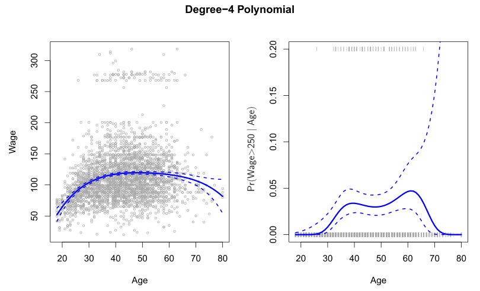

**图7.1** `Wage` 数据。左：蓝色实线是以 `age` 为预测变量、`wage`（单位为千美元）为响应变量的四次多项式，由最小二乘法拟合。虚线表示估计的95%置信区间。右：使用逻辑回归对二元事件 `wage>250` 建模，同样采用四次多项式。蓝色曲线表示拟合得到的工资超过250,000美元的后验概率，同时给出了估计的95%置信区间。图内文字：Degree-4 Polynomial＝四次多项式；Age＝年龄；Wage＝工资；$\Pr(\mathrm{Wage}>250\mid\mathrm{Age})$＝给定年龄时工资超过250（千美元）的概率。

图7.1的拟合曲线两侧各有一条虚线，它们是相差两倍标准误的曲线。下面看看这些曲线是如何得到的。假设我们已经计算了某个特定年龄值 $x_0$ 处的拟合值：

$$
\hat f(x_0)=\hat\beta_0+\hat\beta_1x_0+\hat\beta_2x_0^2+\hat\beta_3x_0^3+\hat\beta_4x_0^4. \tag{7.2}
$$

这个拟合值的方差，也就是 $\operatorname{Var}\hat f(x_0)$，是多少？最小二乘法会给出每个系数估计 $\hat\beta_j$ 的方差估计，以及各对系数估计之间的协方差。利用这些量，就能计算 $\hat f(x_0)$ 的估计方差。<sup><a href="#ch07-fn1" id="ch07-fnref1">1</a></sup> $\hat f(x_0)$ 的估计**逐点标准误（pointwise standard error）** 就是这个方差的平方根。在每个参考点 $x_0$ 处重复这一计算，再绘出拟合曲线，以及在拟合曲线两侧各相差两倍标准误的曲线。之所以绘制两倍标准误，是因为当误差项服从正态分布时，这对应于近似95%的置信区间。

<aside class="footnote" id="ch07-fn1"><a href="#ch07-fnref1">1</a> 若 $\hat{\mathbf C}$ 是各个 $\hat\beta_j$ 的 $5\times5$ 协方差矩阵，且 $\ell_0^T=(1,x_0,x_0^2,x_0^3,x_0^4)$，则 $\operatorname{Var}[\hat f(x_0)]=\ell_0^T\hat{\mathbf C}\ell_0$。</aside>

图7.1中的工资似乎来自两个不同的总体：一组是年收入超过250,000美元的高收入者，另一组是低收入者。将 `wage` 划分成这两组，就可以把它当作二元变量。然后，可以使用 `age` 的多项式函数作为预测变量，通过逻辑回归预测这一二元响应。

换句话说，我们拟合模型

$$
\Pr(y_i>250\mid x_i)=\frac{\exp(\beta_0+\beta_1x_i+\beta_2x_i^2+\cdots+\beta_dx_i^d)}{1+\exp(\beta_0+\beta_1x_i+\beta_2x_i^2+\cdots+\beta_dx_i^d)}. \tag{7.3}
$$

结果见图7.1右图。面板顶部和底部的灰色刻线分别表示高收入者和低收入者的年龄。蓝色实线表示拟合得到的成为高收入者的概率，它是年龄的函数。图中也给出了估计的95%置信区间。这里的置信区间相当宽，右侧尤其如此。尽管数据集的样本量不小（$n=3{,}000$），但高收入者只有79名，因此系数估计的方差较大，相应的置信区间也较宽。
## 7.2 阶梯函数

在线性模型中使用特征的多项式函数作为预测变量，相当于对 $X$ 的非线性函数施加了一种全局结构。为了避免施加这样的全局结构，我们可以改用阶梯函数：把 $X$ 的取值范围划分成若干**分箱区间（bins）**，并在每个区间内拟合一个不同的常数。这相当于把一个连续变量转化为一个**有序类别型变量（ordered categorical variable）**。

具体来说，在 $X$ 的取值范围内设置**切分点（cutpoints）** $c_1,c_2,\ldots,c_K$，然后构造 $K+1$ 个新变量：

$$
\begin{aligned}
C_0(X)&=I(X<c_1),\\
C_1(X)&=I(c_1\le X<c_2),\\
C_2(X)&=I(c_2\le X<c_3),\\
&\vdots\\
C_{K-1}(X)&=I(c_{K-1}\le X<c_K),\\
C_K(X)&=I(c_K\le X).
\end{aligned} \tag{7.4}
$$

其中，$I(\cdot)$ 是**指示函数（indicator function）**：条件成立时返回1，否则返回0。例如，若 $c_K\le X$，则 $I(c_K\le X)$ 等于1，否则等于0。这些变量有时称为虚拟变量。注意，对于任意 $X$，都有 $C_0(X)+C_1(X)+\cdots+C_K(X)=1$，因为 $X$ 必定恰好位于这 $K+1$ 个区间中的一个。然后，以 $C_1(X),C_2(X),\ldots,C_K(X)$ 为预测变量，使用最小二乘法拟合线性模型：<sup><a href="#ch07-fn2" id="ch07-fnref2">2</a></sup>

$$
y_i=\beta_0+\beta_1C_1(x_i)+\beta_2C_2(x_i)+\cdots+\beta_KC_K(x_i)+\epsilon_i. \tag{7.5}
$$

<aside class="footnote" id="ch07-fn2"><a href="#ch07-fnref2">2</a> 式(7.5)没有把 $C_0(X)$ 纳入预测变量，因为它与截距是冗余的。这与下面的情况类似：只要模型包含截距，就只需要两个虚拟变量来编码一个具有三个水平的定性变量。在式(7.5)中，选择排除 $C_0(X)$ 而不是其他某个 $C_k(X)$ 是任意的。另一种做法是纳入 $C_0(X),C_1(X),\ldots,C_K(X)$，同时排除截距。</aside>

对于给定的 $X$，$C_1,C_2,\ldots,C_K$ 至多只有一个非零。注意，当 $X<c_1$ 时，式(7.5)中的所有预测变量都为零，因此 $\beta_0$ 可以解释为 $X<c_1$ 时 $Y$ 的均值。相比之下，当 $c_j\le X<c_{j+1}$ 时，式(7.5)预测的响应为 $\beta_0+\beta_j$，因此 $\beta_j$ 表示 $X$ 处于 $c_j\le X<c_{j+1}$ 时，相对于 $X<c_1$，响应的平均增量。

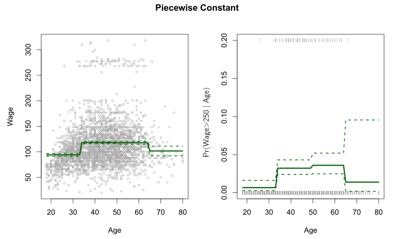

**图7.2** `Wage` 数据。左：实线表示以 `age` 的阶梯函数为预测变量，对 `wage`（单位为千美元）进行最小二乘回归所得到的拟合值。虚线表示估计的95%置信区间。右：使用逻辑回归对二元事件 `wage>250` 建模，同样使用 `age` 的阶梯函数。图中给出了拟合得到的工资超过250,000美元的后验概率，以及估计的95%置信区间。图内文字：Piecewise Constant＝分段常数；Age＝年龄；Wage＝工资；$\Pr(\mathrm{Wage}>250\mid\mathrm{Age})$＝给定年龄时工资超过250（千美元）的概率。

图7.2左图给出了对图7.1的 `Wage` 数据拟合阶梯函数的例子。我们还拟合了逻辑回归模型

$$
\Pr(y_i>250\mid x_i)=\frac{\exp(\beta_0+\beta_1C_1(x_i)+\cdots+\beta_KC_K(x_i))}{1+\exp(\beta_0+\beta_1C_1(x_i)+\cdots+\beta_KC_K(x_i))}, \tag{7.6}
$$

以根据年龄预测一个人成为高收入者的概率。图7.2右图展示了用这种方法拟合得到的后验概率。

遗憾的是，除非预测变量中存在自然的分界点，否则分段常数函数可能捕捉不到关键变化。例如，图7.2左图中的第一个分箱区间，明显没有捕捉到工资随年龄上升的趋势。尽管如此，阶梯函数方法在生物统计学、流行病学等学科中仍然十分流行。例如，常常用每5岁一组的年龄组来定义分箱区间。

## 7.3 基函数（Basis Functions）

多项式回归和分段常数回归模型，实际上都是基函数方法的特例。其想法是，准备一组可以应用于变量 $X$ 的函数或变换：$b_1(X),b_2(X),\ldots,b_K(X)$。

我们不再拟合关于 $X$ 的线性模型，而是拟合模型

$$
y_i=\beta_0+\beta_1b_1(x_i)+\beta_2b_2(x_i)+\beta_3b_3(x_i)+\cdots+\beta_Kb_K(x_i)+\epsilon_i. \tag{7.7}
$$

注意，基函数 $b_1(\cdot),b_2(\cdot),\ldots,b_K(\cdot)$ 是固定且已知的。也就是说，这些函数由我们事先选定。对于多项式回归，基函数是 $b_j(x_i)=x_i^j$；对于分段常数函数，基函数是 $b_j(x_i)=I(c_j\le x_i<c_{j+1})$。可以把式(7.7)看作以 $b_1(x_i),b_2(x_i),\ldots,b_K(x_i)$ 为预测变量的标准线性模型。因此，可以使用最小二乘法估计式(7.7)中未知的回归系数。这意味着，第3章讨论的所有线性模型推断工具，在这里都适用，例如系数估计的标准误，以及检验模型整体显著性的F统计量。

到目前为止，我们考虑了用多项式函数和分段常数函数作为基函数，但还可以作许多其他选择。例如，可以使用**小波（wavelets）** 或**傅里叶级数（Fourier series）** 来构造基函数。下一节将考察一种十分常用的基函数选择：回归样条。

## 7.4 回归样条

下面讨论一类灵活的基函数，它们扩展了我们刚刚介绍的多项式回归和分段常数回归方法。

### 7.4.1 分段多项式（Piecewise Polynomials）

分段多项式回归（piecewise polynomial regression）在$X$的不同区域分别拟合低次多项式，而不是在$X$的整个取值范围内拟合一个高次多项式。例如，分段三次多项式会拟合如下形式的三次回归模型：

$$
y_i=\beta_0+\beta_1x_i+\beta_2x_i^2+\beta_3x_i^3+\epsilon_i,
\tag{7.8}
$$

其中，系数$\beta_0$、$\beta_1$、$\beta_2$和$\beta_3$在$X$取值范围的不同部分可以不同。系数发生变化的位置称为结点。

例如，没有结点的分段三次多项式就是通常的三次多项式，也就是式(7.1)中$d=3$的情形。只有一个结点$c$的分段三次多项式具有如下形式：

$$
y_i=\begin{cases}
\beta_{01}+\beta_{11}x_i+\beta_{21}x_i^2+\beta_{31}x_i^3+\epsilon_i & \text{若 }x_i<c,\\
\beta_{02}+\beta_{12}x_i+\beta_{22}x_i^2+\beta_{32}x_i^3+\epsilon_i & \text{若 }x_i\geq c.
\end{cases}
$$

换句话说，我们对数据拟合两个不同的多项式函数：一个使用满足$x_i<c$的观测子集，另一个使用满足$x_i\geq c$的观测子集。第一个多项式函数的系数为$\beta_{01}$、$\beta_{11}$、$\beta_{21}$和$\beta_{31}$，第二个的系数为$\beta_{02}$、$\beta_{12}$、$\beta_{22}$和$\beta_{32}$。将最小二乘法用于原预测变量的简单函数，就可以分别拟合这两个多项式函数。

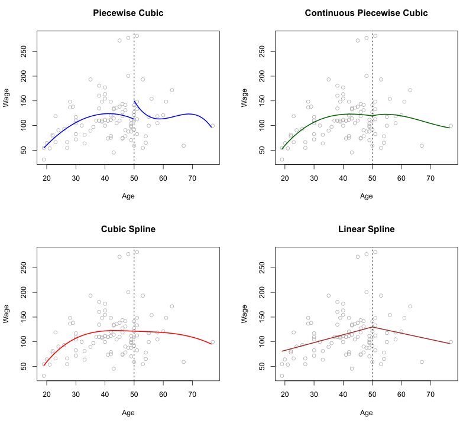

**图7.3** 对Wage数据的一个子集拟合不同的分段多项式，结点设在`age=50`处。**左上：**三次多项式不受约束。**右上：**约束三次多项式在`age=50`处连续。**左下：**约束三次多项式连续，且一阶、二阶导数（derivative）连续。**右下：**线性样条，约束其连续。

图内英文对照：Age＝年龄；Wage＝工资；Piecewise Cubic＝分段三次多项式；Continuous Piecewise Cubic＝连续的分段三次多项式；Cubic Spline＝三次样条；Linear Spline＝线性样条。

增加结点会使分段多项式更加灵活。一般来说，如果在$X$的取值范围内设置$K$个不同结点，就需要拟合$K+1$个不同的三次多项式。注意，并非一定要用三次多项式。例如，也可以拟合分段线性函数。实际上，7.2节中的分段常数函数就是0次分段多项式！

图7.3左上图对Wage数据的一个子集拟合了分段三次多项式，唯一的结点设在`age=50`处。我们立刻就能看到一个问题：这个函数不连续，看起来很不合理！由于每个多项式有四个参数，拟合这个分段多项式模型总共使用了八个自由度。

### 7.4.2 约束与样条（Constraints and Splines）

图7.3左上图看起来不对，是因为拟合曲线过于灵活。为解决这一问题，我们可以在拟合曲线必须连续的约束下拟合分段多项式。换句话说，在`age=50`处不能出现跳跃。图7.3右上图展示了这样的拟合结果。它比左上图更好，但V形连接仍显得不自然。

在左下图中，我们又加了两个约束：现在，分段多项式的一阶和二阶导数（derivative）在`age=50`处也都连续。也就是说，我们要求分段多项式在`age=50`处不仅连续，还要非常平滑。对分段三次多项式施加的每一个约束，都会降低所得分段多项式拟合的复杂程度，从而减少一个自由度。因此，左上图使用了八个自由度，而在左下图中，我们施加了三个约束，即函数连续、一阶导数连续和二阶导数连续，于是剩下五个自由度。左下图中的曲线称为三次样条（cubic spline）。<sup><a id="ch07-fnref3" href="#ch07-fn3">3</a></sup>一般来说，具有$K$个结点的三次样条总共使用$4+K$个自由度。

<aside class="footnote" id="ch07-fn3"><a href="#ch07-fnref3">3</a> 三次样条很受欢迎，因为大多数人的眼睛察觉不到结点处的不连续。</aside>

图7.3右下图是一个线性样条（linear spline），它在`age=50`处连续。$d$次样条的一般定义是：它是一个$d$次分段多项式，在每个结点处，直到$d-1$阶的导数都连续。因此，要得到线性样条，就在由结点划分的预测变量空间的每个区域中拟合一条直线，并要求各结点处连续。

图7.3中只在`age=50`处设置了一个结点。当然，我们可以增加结点，并在每个结点处施加连续性约束。

### 7.4.3 样条的基表示（The Spline Basis Representation）

上一小节介绍的回归样条可能显得有些复杂：怎样才能在函数本身（以及可能要求的前$d-1$阶导数）连续的约束下，拟合一个$d$次分段多项式呢？事实上，可以用基模型(7.7)来表示回归样条。对于具有$K$个结点的三次样条，只要适当选择基函数$b_1,b_2,\ldots,b_{K+3}$，就可以将其建模为

$$
y_i=\beta_0+\beta_1b_1(x_i)+\beta_2b_2(x_i)+\cdots+\beta_{K+3}b_{K+3}(x_i)+\epsilon_i,
\tag{7.9}
$$

然后用最小二乘法拟合模型(7.9)。

正如多项式有多种表示方式一样，在式(7.9)中选用不同的基函数，也可以得到三次样条的许多等价表示。用式(7.9)表示三次样条最直接的方法，是先取三次多项式的基，即$x$、$x^2$和$x^3$，然后为每个结点增加一个截断幂基（truncated power basis）函数。

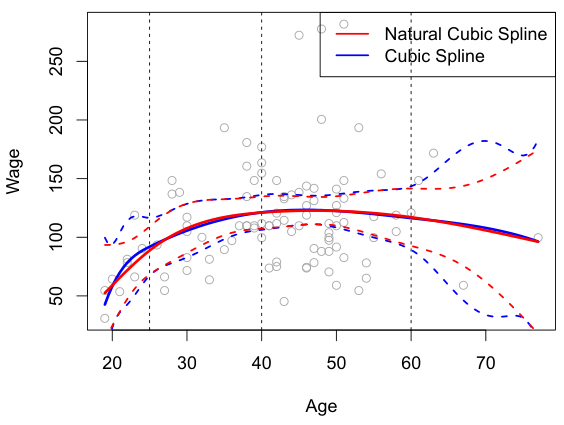

**图7.4** 对Wage数据的一个子集拟合具有三个结点的三次样条和自然三次样条（natural cubic spline）。虚线表示结点位置。

图内英文对照：Age＝年龄；Wage＝工资；Natural Cubic Spline＝自然三次样条；Cubic Spline＝三次样条。

截断幂基函数定义为

$$
h(x,\xi)=(x-\xi)_+^3=\begin{cases}
(x-\xi)^3 & \text{若 }x>\xi,\\
0 & \text{其他情况},
\end{cases}
\tag{7.10}
$$

其中$\xi$是结点。可以证明，在三次多项式模型(7.8)中增加一个形如$\beta_4h(x,\xi)$的项，只会使三阶导数在$\xi$处不连续；函数本身及其一阶、二阶导数在每个结点处仍然连续。

换句话说，要对一个数据集拟合具有$K$个结点的三次样条，只需进行含一个截距和$3+K$个预测变量的最小二乘回归。这些预测变量的形式为$X,X^2,X^3,h(X,\xi_1),h(X,\xi_2),\ldots,h(X,\xi_K)$，其中$\xi_1,\ldots,\xi_K$是结点。这相当于总共估计$K+4$个回归系数；因此，拟合具有$K$个结点的三次样条要使用$K+4$个自由度。

遗憾的是，样条在预测变量取值范围的两端可能具有很高的方差，也就是$X$取很小或很大值的地方。图7.4展示了对Wage数据进行的三结点拟合。可以看到，边界区域的置信带波动相当大。自然样条（natural spline）是在回归样条的基础上施加额外边界约束得到的：要求函数在边界处为线性，即在$X$小于最小结点或大于最大结点的区域中为线性。这一额外约束使自然样条在边界处通常能够产生更稳定的估计。图7.4还用红线画出了自然三次样条。注意，其对应的置信区间更窄。

### 7.4.4 选择结点的数量和位置

拟合样条时，应把结点放在哪里呢？回归样条在结点较多的区域最灵活，因为在这些区域中，多项式的系数可以迅速变化。因此，一种办法是在我们认为函数可能变化最剧烈的地方多放一些结点，在看起来较稳定的地方少放一些。这种办法可以取得良好效果，不过实践中通常采用均匀的方式设置结点。具体做法之一是指定所需的自由度，再让软件自动在数据等间隔的分位数处放置相应数量的结点。

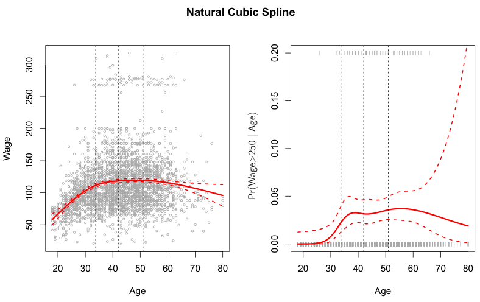

**图7.5** 对Wage数据拟合具有四个自由度的自然三次样条函数。**左：**用样条拟合`wage`（单位为千美元）关于`age`的函数。**右：**用逻辑回归将二元事件`wage>250`建模为`age`的函数。图中展示了工资超过250,000美元的拟合后验概率。虚线表示结点位置。

图内英文对照：Natural Cubic Spline＝自然三次样条；Age＝年龄；Wage＝工资；Pr(Wage>250 | Age)＝给定年龄时工资超过250千美元的概率。

图7.5展示了Wage数据中的一个例子。与图7.4一样，这里拟合了具有三个结点的自然三次样条，不过这次软件自动将结点放在`age`的第25、第50和第75百分位数处。这是通过指定四个自由度来实现的。为什么四个自由度对应三个内部结点（interior knots），其论证涉及一些技术细节。<sup><a id="ch07-fnref4" href="#ch07-fn4">4</a></sup>

<aside class="footnote" id="ch07-fn4"><a href="#ch07-fnref4">4</a> 实际上，算上两个边界结点（boundary knots），总共有五个结点。具有五个结点的三次样条有九个自由度。但自然三次样条在每个边界处都额外施加两个自然约束以保证线性，于是剩下$9-4=5$个自由度。这里面包含一个常数，它被吸收到截距中，所以我们将其计为四个自由度。</aside>

应该使用多少个结点，或者等价地说，样条应该包含多少个自由度呢？一种办法是尝试不同的结点数，看看哪一种得到的曲线看起来最好。稍微客观一些的方法是使用第5章和第6章讨论的交叉验证。采用这种方法时，我们先移除一部分数据，例如10%，再对剩余数据拟合具有某个结点数的样条，然后用该样条预测留出的那部分数据。多次重复这一过程，直到每个观测都恰好被留出一次，再计算总体的交叉验证RSS。

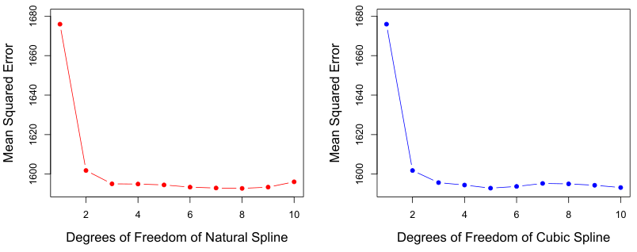

**图7.6** 在对Wage数据拟合样条时，用于选择自由度的十折交叉验证均方误差。响应变量为`wage`，预测变量为`age`。**左：** 自然三次样条。**右：** 三次样条。

图内英文对照：Mean Squared Error＝均方误差；Degrees of Freedom of Natural Spline＝自然样条的自由度；Degrees of Freedom of Cubic Spline＝三次样条的自由度。

对不同的结点数$K$都可以重复上述过程，然后选择使RSS最小的$K$值。

图7.6展示了用不同自由度的样条拟合Wage数据时得到的十折交叉验证均方误差。左图对应自然三次样条，右图对应三次样条。这两种方法产生的结果几乎相同，都清楚地表明一个自由度的拟合，也就是线性回归，并不充分。两条曲线都很快趋于平坦；看来，自然样条使用三个自由度、三次样条使用四个自由度，就已足够。

在7.7节中，我们会同时对多个变量拟合加性样条模型。这可能需要为每个变量选择自由度。在这种情况下，通常采用更务实的做法：把所有项的自由度都设为某个固定值，例如四。

### 7.4.5 与多项式回归的比较

图7.7在Wage数据集上比较了具有15个自由度的自然三次样条和15次多项式。多项式增加的灵活性在边界处产生了不理想的结果，而自然三次样条仍能合理地拟合数据。回归样条的结果常常优于多项式回归。这是因为，多项式必须使用很高的次数，也就是最高次单项式中的指数，例如$X^{15}$中的15，才能得到灵活的拟合；而样条通过增加结点数来提高灵活性，同时保持次数不变。通常，这种做法会得到更稳定的估计。样条还允许我们在函数$f$似乎变化较快的区域多放一些结点，从而增加灵活性，而在$f$似乎较稳定的区域少放一些结点。

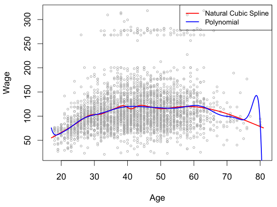

**图7.7** 在Wage数据集上，将具有15个自由度的自然三次样条与15次多项式进行比较。多项式可能出现剧烈波动，尤其是在取值范围的两端。

图内英文对照：Age＝年龄；Wage＝工资；Natural Cubic Spline＝自然三次样条；Polynomial＝多项式。

## 7.5 平滑样条

上一节讨论了回归样条：先指定一组结点，生成一系列基函数，再用最小二乘法估计样条系数。下面介绍一种有所不同、但同样会产生样条的方法。

### 7.5.1 平滑样条概述

对一组数据拟合平滑曲线时，我们真正希望找到的是某个能够很好地拟合观测数据的函数，比如$g(x)$；也就是说，希望$\operatorname{RSS}=\sum_{i=1}^n(y_i-g(x_i))^2$很小。不过，这样做有一个问题。如果不对$g(x_i)$施加任何约束，只要选择一个对所有$y_i$进行插值的$g$，就总能让RSS等于零。这样的函数会严重过拟合数据，因为它太灵活了。我们真正想要的是一个既能使RSS较小、同时又平滑的函数$g$。

怎样保证$g$平滑呢？有多种办法。一个自然的思路是寻找使下式最小的函数$g$：

$$
\sum_{i=1}^n(y_i-g(x_i))^2+\lambda\int g''(t)^2\,dt,
\tag{7.11}
$$

其中$\lambda$是非负的调节参数。使式(7.11)最小的函数$g$称为平滑样条。

式(7.11)是什么意思呢？它采用了第6章讨论岭回归和套索法时遇到的“损失＋惩罚项”形式。其中，$\sum_{i=1}^n(y_i-g(x_i))^2$是损失函数（loss function），促使$g$较好地拟合数据；$\lambda\int g''(t)^2\,dt$则是惩罚项，用来惩罚$g$的波动。符号$g''(t)$表示函数$g$的二阶导数。一阶导数$g'(t)$衡量函数在$t$处的斜率，二阶导数则对应于斜率变化的程度。

因此，大体上可以把函数的二阶导数看成对其粗糙程度（roughness）的度量：如果$g(t)$在$t$附近起伏剧烈，二阶导数的绝对值就很大；否则就接近零。（直线的二阶导数为零；注意，直线是完全平滑的。）符号$\int$表示积分（integral），可以把它看成对$t$的整个取值范围求和。换句话说，$\int g''(t)^2\,dt$只是对函数$g'(t)$在整个取值范围内总变化程度的一种度量。如果$g$非常平滑，那么$g'(t)$就近似为常数，$\int g''(t)^2\,dt$也会很小。相反，如果$g$起伏剧烈、变化不定，那么$g'(t)$会有较大变化，$\int g''(t)^2\,dt$也会很大。因此，式(7.11)中的$\lambda\int g''(t)^2\,dt$促使$g$保持平滑。$\lambda$越大，$g$就越平滑。

当$\lambda=0$时，式(7.11)中的惩罚项不起作用，函数$g$便会起伏剧烈，并对训练观测进行精确插值。当$\lambda\to\infty$时，$g$会完全平滑，也就是一条尽可能贴近训练点的直线。实际上，此时$g$就是线性最小二乘直线，因为式(7.11)的损失函数相当于最小化残差平方和。当$\lambda$取中间值时，$g$会近似训练观测，同时保有一定的平滑性。可见，$\lambda$控制着平滑样条的偏差—方差权衡。

可以证明，使式(7.11)最小的函数$g(x)$具有一些特殊性质：它是一个分段三次多项式，在$x_1,\ldots,x_n$的每个不同取值处设置结点，并且一阶、二阶导数在每个结点处连续。此外，在最外侧两个结点之外的区域中，它是线性的。换句话说，使式(7.11)最小的函数$g(x)$是一个在$x_1,\ldots,x_n$处设有结点的自然三次样条！不过，它并不等同于采用7.4.3节所述基函数方法、在$x_1,\ldots,x_n$处设置结点后得到的自然三次样条，而是这种自然三次样条经过收缩后的版本；式(7.11)中调节参数$\lambda$的取值控制着收缩程度。

### 7.5.2 选择平滑参数（smoothing parameter）$\lambda$

我们已经看到，平滑样条就是在$x_i$的每个不同取值处设置结点的自然三次样条。由于每个数据点处都有一个结点，会带来很大的灵活性，平滑样条的自由度似乎会过多。不过，调节参数$\lambda$控制着平滑样条的粗糙程度，因此也控制着它的有效自由度（effective degrees of freedom）。可以证明，当$\lambda$从0增大到$\infty$时，记作$df_\lambda$的有效自由度会从$n$降到2。

对于平滑样条，为什么讨论有效自由度，而不直接讨论自由度呢？通常，自由度指自由参数的个数，例如拟合多项式或三次样条时的系数个数。虽然平滑样条有$n$个参数，因此名义上有$n$个自由度，但这$n$个参数受到了很强的约束或收缩。因此，$df_\lambda$衡量的是平滑样条的灵活性：它越大，平滑样条就越灵活，偏差越低、方差越高。有效自由度的定义涉及一些技术细节。我们可以写成

$$
\hat{\mathbf g}_\lambda=\mathbf S_\lambda\mathbf y,
\tag{7.12}
$$

其中，$\hat{\mathbf g}_\lambda$是给定$\lambda$取值时式(7.11)的解，也就是一个$n$维向量，包含了平滑样条在训练点$x_1,\ldots,x_n$处的拟合值。式(7.12)表明，对数据使用平滑样条得到的拟合值向量，可以写成一个$n\times n$矩阵$\mathbf S_\lambda$与响应向量$\mathbf y$的乘积；$\mathbf S_\lambda$有相应的计算公式。有效自由度则定义为

$$
df_\lambda=\sum_{i=1}^n\{\mathbf S_\lambda\}_{ii},
\tag{7.13}
$$

即矩阵$\mathbf S_\lambda$的对角元素之和。

拟合平滑样条时，不需要选择结点的数量或位置，因为每个训练观测$x_1,\ldots,x_n$处都会有一个结点。取而代之的是另一个问题：需要选择$\lambda$的值。交叉验证可以解决这一问题，这一点应该并不令人意外。换句话说，可以寻找使交叉验证RSS尽可能小的$\lambda$。事实上，对于平滑样条，利用下面的公式，就能够非常高效地计算留一交叉验证误差（LOOCV），计算成本基本上与拟合一次模型相同：

$$
\operatorname{RSS}_{cv}(\lambda)=\sum_{i=1}^n\left(y_i-\hat g_\lambda^{(-i)}(x_i)\right)^2
=\sum_{i=1}^n\left[\frac{y_i-\hat g_\lambda(x_i)}{1-\{\mathbf S_\lambda\}_{ii}}\right]^2.
$$

符号$\hat g_\lambda^{(-i)}(x_i)$表示平滑样条在$x_i$处的拟合值，拟合时使用了除第$i$个观测$(x_i,y_i)$以外的全部训练观测。相比之下，$\hat g_\lambda(x_i)$表示用全部训练观测拟合的平滑样条函数在$x_i$处的值。这个巧妙的公式表明，只需使用对全部数据拟合一次得到的$\hat{\mathbf g}_\lambda$，就可以计算每一次留一拟合！<sup><a id="ch07-fnref5" href="#ch07-fn5">5</a></sup>第5章第205页的式(5.2)给出了最小二乘线性回归中一个十分相似的公式。利用式(5.2)，既可以对本章前面讨论的回归样条快速进行LOOCV，也可以对使用任意基函数的最小二乘回归快速进行LOOCV。

<aside class="footnote" id="ch07-fn5"><a href="#ch07-fnref5">5</a> 计算$\hat g(x_i)$和$\mathbf S_\lambda$的确切公式涉及很强的技术性；不过，已有高效算法可以计算这些量。</aside>

图7.8展示了对Wage数据拟合平滑样条的结果。红色曲线是在事先指定平滑样条具有16个有效自由度后得到的拟合。蓝色曲线则是用LOOCV选择$\lambda$后得到的平滑样条；此时选出的$\lambda$对应6.8个有效自由度，由式(7.13)计算得到。对于这组数据，除了16自由度的样条看起来起伏稍多之外，两条平滑样条几乎没有可辨别的差异。

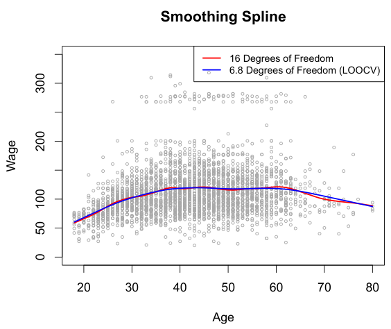

**图7.8** 对Wage数据进行平滑样条拟合。红色曲线通过指定16个有效自由度得到。蓝色曲线的$\lambda$由留一交叉验证自动确定，结果对应6.8个有效自由度。

图内英文对照：Smoothing Spline＝平滑样条；Age＝年龄；Wage＝工资；16 Degrees of Freedom＝16个自由度；6.8 Degrees of Freedom (LOOCV)＝6.8个自由度（LOOCV）。

由于两种拟合差别很小，使用6.8个自由度的平滑样条更合适，因为一般来说，除非数据提供了支持更复杂模型的证据，否则较简单的模型更好。

## 7.6 局部回归

局部回归是拟合灵活的非线性函数的另一种方法：只利用目标点 $x_0$ 附近的训练观测，计算该点处的拟合值。图7.9用模拟数据说明了这一想法，其中一个目标点接近0.4，另一个位于边界附近的0.05处。图中的蓝线表示生成数据的函数 $f(x)$，浅橙色线表示局部回归估计 $\hat f(x)$。算法7.1描述了局部回归的过程。

注意，在算法7.1的第3步中，对于不同的 $x_0$，权重 $K_{i0}$ 都不同。换句话说，要得到一个新点处的局部回归拟合值，就需要针对一组新的权重，最小化式(7.14)，重新拟合一个加权最小二乘回归模型。局部回归有时称为**基于记忆的过程（memory-based procedure）**，因为与近邻方法一样，每次计算预测值都需要全部训练数据。这里不展开局部回归的技术细节；已有专门讨论这一主题的书籍。

进行局部回归时，需要作出多种选择，例如如何定义权重函数 $K$，以及在第3步中拟合线性、常数还是二次回归。（式(7.14)对应于线性回归。）虽然这些选择都会产生一定影响，但最重要的是选择**跨度（span）** $s$。如算法第1步所定义的，它是在 $x_0$ 处计算局部回归时所用的数据点比例。跨度的作用类似于平滑样条中的调节参数 $\lambda$：它控制非线性拟合的灵活性。

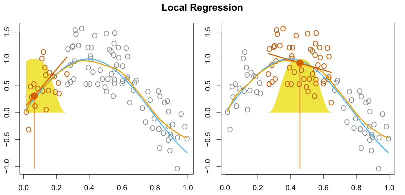

**图7.9** 用模拟数据说明局部回归。蓝色曲线表示生成数据的 $f(x)$，浅橙色曲线对应局部回归估计 $\hat f(x)$。橙色竖线表示目标点 $x_0$，橙色数据点是位于该目标点附近的观测。叠加在图中的黄色钟形表示分配给各个点的权重；离目标点越远，权重越小，直到降为零。通过拟合加权线性回归（橙色线段），再将 $x_0$ 处的拟合值（橙色实心点）作为估计 $\hat f(x_0)$，即可得到 $x_0$ 处的拟合。图内文字：Local Regression＝局部回归。

$s$ 越小，拟合就越局部，曲线起伏也越多；相反，$s$ 很大时，就会使用全部训练观测对数据进行全局拟合。我们仍可用交叉验证选择 $s$，也可以直接指定。图7.10给出了在 `Wage` 数据上使用两个不同 $s$ 值（0.7和0.2）的局部线性回归拟合。正如预期，$s=0.7$ 得到的拟合比 $s=0.2$ 得到的拟合更平滑。

局部回归的想法可以作多种推广。在有多个特征 $X_1,X_2,\ldots,X_p$ 的情形下，一种很有用的推广是拟合多元线性回归模型，使其对某些变量是全局的，而对另一个变量（如时间）是局部的。这类**变系数模型（varying coefficient models）**可以让模型适应最新采集的数据。若希望拟合的模型对一对变量 $X_1$ 和 $X_2$ 是局部的，而不是仅对一个变量局部，局部回归也能十分自然地推广：只需使用二维邻域，并利用二维空间中每个目标点附近的观测，拟合包含两个预测变量的线性回归模型。从理论上说，同样的方法可以推广到更高维，在 $p$ 维邻域中拟合线性回归。然而，当 $p$ 远大于大约3或4时，局部回归可能表现很差，因为 $x_0$ 附近通常只有很少的训练观测。第3章讨论的近邻回归在高维情形下也面临类似问题。

<div class="algorithm" id="algorithm-7-1">

**算法7.1　在 $X=x_0$ 处进行局部回归**

1. 选取 $x_i$ 最接近 $x_0$ 的训练点，占全部训练点的比例为 $s=k/n$。
2. 给这个邻域中的每个点分配权重 $K_{i0}=K(x_i,x_0)$，使离 $x_0$ 最远的点权重为零，最近的点权重最高。这 $k$ 个最近邻之外的所有点，权重均为零。
3. 使用上述权重，对 $y_i$ 关于 $x_i$ 进行加权最小二乘回归，即求出使下式最小的 $\hat\beta_0$ 和 $\hat\beta_1$：

   $$
   \sum_{i=1}^{n}K_{i0}(y_i-\beta_0-\beta_1x_i)^2. \tag{7.14}
   $$

4. $x_0$ 处的拟合值为 $\hat f(x_0)=\hat\beta_0+\hat\beta_1x_0$。

</div>

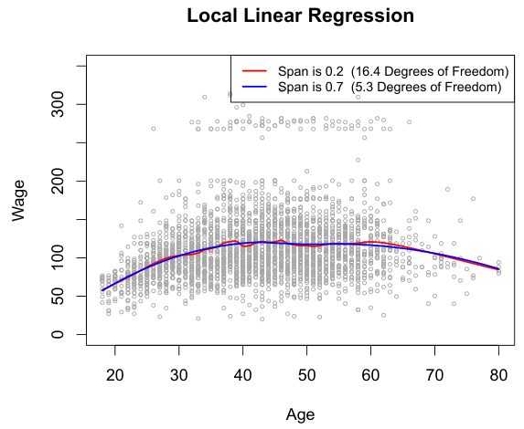

**图7.10** `Wage` 数据的局部线性拟合。跨度指定了在每个目标点处计算拟合时使用的数据比例。图内文字：Local Linear Regression＝局部线性回归；Span is 0.2 (16.4 Degrees of Freedom)＝跨度为0.2（16.4个自由度）；Span is 0.7 (5.3 Degrees of Freedom)＝跨度为0.7（5.3个自由度）；Age＝年龄；Wage＝工资。

## 7.7 广义加性模型

第7.1—7.6节介绍了多种方法，根据单个预测变量 $X$ 灵活地预测响应 $Y$。这些方法可以看作简单线性回归的扩展。这里考察根据多个预测变量 $X_1,\ldots,X_p$ 灵活预测 $Y$ 的问题，也就是对多元线性回归进行扩展。

广义加性模型（GAM）提供了一个扩展标准线性模型的通用框架：在保持可加性的同时，允许每个变量通过非线性函数进入模型。与线性模型一样，GAM既适用于定量响应，也适用于定性响应。我们先在第7.7.1节考察定量响应的GAM，再在第7.7.2节考察定性响应的GAM。

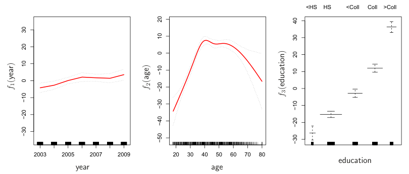

**图7.11** 在 `Wage` 数据上拟合模型(7.16)后，各个特征与响应 `wage` 之间关系的图。每幅图都展示了拟合函数和逐点标准误。前两个函数分别是关于 `year` 和 `age` 的自然样条，自由度分别为4和5。第三个函数是对定性变量 `education` 拟合的阶梯函数。图内文字：year＝年份；age＝年龄；education＝教育水平；$f_1(\mathrm{year})$、$f_2(\mathrm{age})$、$f_3(\mathrm{education})$ 为对应的拟合函数，教育水平标签 `<HS`、`HS`、`<Coll`、`Coll`、`>Coll` 保持原样。

### 7.7.1 回归问题中的GAM

为了允许各个特征与响应之间存在非线性关系，一种自然的做法是将多元线性回归模型

$$
y_i=\beta_0+\beta_1x_{i1}+\beta_2x_{i2}+\cdots+\beta_px_{ip}+\epsilon_i
$$

中的每个线性分量 $\beta_jx_{ij}$，替换为一个（平滑的）非线性函数 $f_j(x_{ij})$。此时，模型可以写为

$$
\begin{aligned}
y_i&=\beta_0+\sum_{j=1}^{p}f_j(x_{ij})+\epsilon_i\\
&=\beta_0+f_1(x_{i1})+f_2(x_{i2})+\cdots+f_p(x_{ip})+\epsilon_i.
\end{aligned} \tag{7.15}
$$

这就是一个GAM的例子。之所以称为加性模型，是因为我们针对每个 $X_j$ 分别计算一个 $f_j$，然后将它们的贡献相加。

第7.1—7.6节讨论了对单个变量拟合函数的多种方法。GAM的巧妙之处在于，可以把这些方法作为构件来拟合加性模型。事实上，对本章目前介绍的大多数方法来说，这很容易做到。以自然样条为例，考虑在 `Wage` 数据上拟合模型

$$
\mathrm{wage}=\beta_0+f_1(\mathrm{year})+f_2(\mathrm{age})+f_3(\mathrm{education})+\epsilon. \tag{7.16}
$$

这里，`year` 和 `age` 是定量变量，`education` 是具有五个水平的定性变量：`<HS`、`HS`、`<Coll`、`Coll`、`>Coll`，表示个人完成高中或大学教育的程度。前两个函数用自然样条拟合。

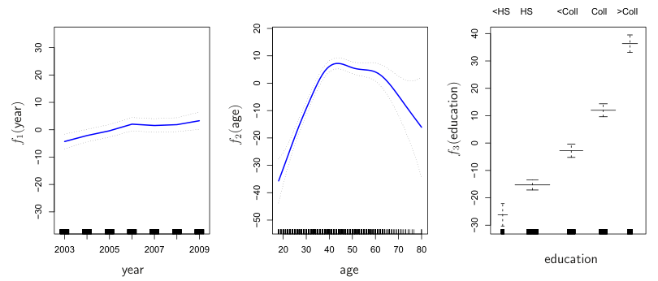

**图7.12** 细节与图7.11相同，但这里 $f_1$ 和 $f_2$ 分别是自由度为4和5的平滑样条。图内文字与函数、教育水平标签的含义同图7.11。

第三个函数则采用第3.3.1节常用的虚拟变量方法，对每个水平分别拟合一个常数。

图7.11给出了用最小二乘法拟合模型(7.16)的结果。这很容易实现，因为正如第7.4节所述，可以用适当选择的一组基函数构造自然样条。因此，整个模型只是对样条基变量和虚拟变量做一次大型回归，把这些变量一起放入一个大的回归矩阵中即可。

图7.11很容易解释。左图表明，在 `age` 和 `education` 保持不变时，`wage` 往往会随 `year` 略有增加，这可能是通货膨胀所致。中图表明，在 `education` 和 `year` 保持不变时，`wage` 在年龄居中的人群中往往最高，而在非常年轻和非常年长的人群中最低。右图表明，在 `year` 和 `age` 保持不变时，`wage` 往往随 `education` 提高而增加：受教育程度越高，平均工资也越高。这些结果都符合直觉。

图7.12给出了类似的一组三幅图，但这次 $f_1$ 和 $f_2$ 分别是自由度为4和5的平滑样条。使用平滑样条拟合GAM，不像使用自然样条那样简单，因为对于平滑样条，不能使用最小二乘法。不过，Python包 `pygam` 等标准软件可以通过一种称为**回拟合（backfitting）**的方法，用平滑样条拟合GAM。这种方法依次更新各个预测变量的拟合，在每次更新时保持其余部分不变，反复进行，从而拟合包含多个预测变量的模型。它的巧妙之处在于：每次更新一个函数时，只需把该变量的拟合方法应用于一个**部分残差（partial residual）**。<sup><a href="#ch07-fn6" id="ch07-fnref6">6</a></sup>

<aside class="footnote" id="ch07-fn6"><a href="#ch07-fnref6">6</a> 例如，$X_3$ 的部分残差形式为 $r_i=y_i-f_1(x_{i1})-f_2(x_{i2})$。如果已知 $f_1$ 和 $f_2$，就可以把这个残差当作响应，对 $X_3$ 进行非线性回归，从而拟合 $f_3$。</aside>

图7.11与图7.12中的拟合函数看起来十分相似。在大多数情形下，用平滑样条与用自然样条得到的GAM差别都不大。

构造GAM时，并不一定要用样条作为构件；也可以使用局部回归、多项式回归，或把本章前面介绍的方法任意组合起来。章末实验将进一步讨论GAM。

#### GAM的优点与局限

继续往下之前，先归纳GAM的优点与局限。

<div class="gam-pros-cons">

- <span style="color:#00c516" aria-label="优点">▲</span> GAM允许对每个 $X_j$ 拟合一个非线性函数 $f_j$，从而自动建模标准线性回归无法捕捉的非线性关系。这意味着，我们不必对每个变量逐一手动尝试许多不同的变换。
- <span style="color:#00c516" aria-label="优点">▲</span> 非线性拟合有可能更准确地预测响应 $Y$。
- <span style="color:#00c516" aria-label="优点">▲</span> 由于模型具有可加性，可以在其他所有变量保持不变的条件下，单独考察每个 $X_j$ 对 $Y$ 的影响。
- <span style="color:#00c516" aria-label="优点">▲</span> 变量 $X_j$ 对应函数 $f_j$ 的平滑程度，可以通过自由度来概括。
- <span style="color:#e4a900" aria-label="局限">◆</span> GAM的主要局限是模型受到可加性的约束。变量很多时，可能遗漏重要的交互作用。不过，与线性回归一样，可以手动向GAM加入形如 $X_j\times X_k$ 的额外预测变量，从而添加交互项。此外，还可以向模型加入形如 $f_{jk}(X_j,X_k)$ 的低维交互函数；这类项可以用局部回归等二维平滑方法，或二维样条来拟合（本书不讨论二维样条）。

</div>

对于完全一般的模型，就需要寻找更加灵活的方法，例如第8章介绍的随机森林和提升法。GAM在线性模型与完全非参数模型之间提供了一种有用的折中。

### 7.7.2 分类问题中的GAM

GAM也可以用于 $Y$ 为定性变量的情形。为简单起见，这里假设 $Y$ 的取值为0或1，并令 $p(X)=\Pr(Y=1\mid X)$ 表示给定预测变量时，响应等于1的条件概率。回顾逻辑回归模型(4.6)：

$$
\log\left(\frac{p(X)}{1-p(X)}\right)=\beta_0+\beta_1X_1+\beta_2X_2+\cdots+\beta_pX_p. \tag{7.17}
$$

左边是 $P(Y=1\mid X)$ 相对于 $P(Y=0\mid X)$ 的几率的对数；式(7.17)将它表示为预测变量的线性函数。为了允许非线性关系，一种自然的扩展是使用模型

$$
\log\left(\frac{p(X)}{1-p(X)}\right)=\beta_0+f_1(X_1)+f_2(X_2)+\cdots+f_p(X_p). \tag{7.18}
$$


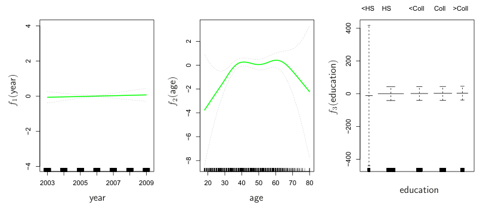

**图7.13** 在 `Wage` 数据上，将式(7.19)给出的逻辑回归GAM拟合于二元响应 $I(\mathrm{wage}>250)$。每幅图都展示了拟合函数和逐点标准误。第一个函数关于 `year` 是线性的，第二个函数是关于 `age`、自由度为5的平滑样条，第三个是关于 `education` 的阶梯函数。`education` 的第一个水平 `<HS` 对应的标准误非常大。图内文字：year＝年份；age＝年龄；education＝教育水平；$f_1(\mathrm{year})$、$f_2(\mathrm{age})$、$f_3(\mathrm{education})$ 为对应的拟合函数，教育水平标签 `<HS`、`HS`、`<Coll`、`Coll`、`>Coll` 保持原样。

式(7.18)是一个逻辑回归GAM。上一节针对定量响应讨论的所有优点与局限，也同样适用于它。

我们对 `Wage` 数据拟合一个GAM，以预测个人年收入超过250,000美元的概率。所拟合的GAM形式为

$$
\log\left(\frac{p(X)}{1-p(X)}\right)=\beta_0+\beta_1\times\mathrm{year}+f_2(\mathrm{age})+f_3(\mathrm{education}), \tag{7.19}
$$

其中

$$
p(X)=\Pr(\mathrm{wage}>250\mid\mathrm{year},\mathrm{age},\mathrm{education}).
$$

这里仍使用自由度为5的平滑样条拟合 $f_2$，并为 `education` 的各个水平建立虚拟变量，用阶梯函数拟合 $f_3$。得到的拟合见图7.13。最后一个面板看起来有些可疑，`<HS` 水平的置信区间非常宽。事实上，这个类别中没有任何响应值等于1：没有高中以下学历的个人年收入超过250,000美元。因此，我们排除高中以下学历的个人，重新拟合GAM。得到的模型见图7.14。与图7.11和图7.12一样，三个面板的纵轴刻度范围相近，这使我们能够直观地评估各个变量的相对贡献。可以看到，`age` 和 `education` 对成为高收入者概率的影响远大于 `year`。

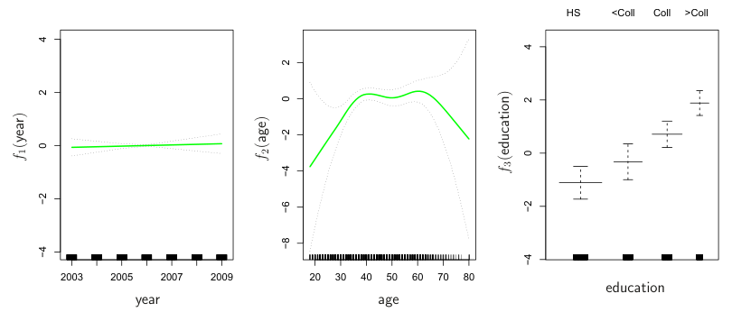

**图7.14** 拟合与图7.13相同的模型，但这次排除 `education` 为 `<HS` 的观测。现在可以看到，较高的教育水平往往与较高的工资相关联。图内文字与函数标签的含义同图7.13；教育水平标签仅保留 `HS`、`<Coll`、`Coll`、`>Coll`。

## 7.8 实验：非线性建模

本实验演示本章讨论的部分非线性模型。我们以 Wage 数据集为贯穿全节的例子，展示如何用 Python 轻松实现前面讨论的许多复杂非线性拟合方法。

和往常一样，我们先导入一些常用工具。

In[1]:

```python
import numpy as np, pandas as pd
from matplotlib.pyplot import subplots
import statsmodels.api as sm
from ISLP import load_data
from ISLP.models import (summarize,
                         poly,
                         ModelSpec as MS)
from statsmodels.stats.anova import anova_lm
```

下面集中导入本实验需要的新工具。其中许多是专门为 `ISLP` 包开发的。

In[2]:

```python
from pygam import (s as s_gam,
                   l as l_gam,
                   f as f_gam,
                   LinearGAM,
                   LogisticGAM)

from ISLP.transforms import (BSpline,
                             NaturalSpline)
from ISLP.models import bs, ns
from ISLP.pygam import (approx_lam ,
                        degrees_of_freedom ,
                        plot as plot_gam,
                        anova as anova_gam)
```

### 7.8.1 多项式回归与阶梯函数

我们先演示如何重现图7.1。首先载入数据。

In[3]:

```python
Wage = load_data('Wage')
y = Wage['wage']
age = Wage['age']
```

本实验大部分内容的响应变量都是 `Wage['wage']`，上面已将其存为 `y`。和3.6.6节一样，我们将用 `poly()` 函数创建设计矩阵，以拟合 `age` 的四次多项式。

In[4]:

```python
poly_age = MS([poly('age', degree=4)]).fit(Wage)
M = sm.OLS(y, poly_age.transform(Wage)).fit()
summarize(M)
```

Out[4]:

```text
                             coef std err        t  P>|t|
              intercept  111.7036    0.729  153.283  0.000
 poly(age, degree=4)[0]  447.0679   39.915   11.201  0.000
 poly(age, degree=4)[1] -478.3158   39.915  -11.983  0.000
 poly(age, degree=4)[2]  125.5217   39.915    3.145  0.002
 poly(age, degree=4)[3]  -77.9112   39.915   -1.952  0.051
```

这个多项式由 `poly()` 函数构造。该函数创建一个专门的变换器（transformer）`Poly()`，从而便于在新的数据点上计算多项式的值。这里使用了 `sklearn` 对特征变换的术语，类似的例子是6.5.3节介绍的 `PCA()`。这里的 `poly()` 称为辅助函数（helper function），负责设定变换；实际承担变换计算的是 `Poly()`。关于变换，也可参见第118页的讨论。

上面代码的第一行对数据框 `Wage` 执行 `fit()` 方法。这会在训练数据上重新计算 `Poly()` 所需的所有参数，并将其存为属性；以后每次调用 `transform()` 方法时都会使用这些参数。例如，第二行以及下面将编写的绘图函数都使用了它们。

现在创建一个 `age` 值的网格，以便在这些位置进行预测。

In[5]:

```python
age_grid = np.linspace(age.min(),
                       age.max(),
                       100)
age_df = pd.DataFrame({'age': age_grid})
```

最后，我们希望画出数据，并添加四次多项式的拟合曲线。由于下面还要绘制多幅类似的图，因此先编写一个函数，完成所需的各项计算并作图。这个函数接收模型设定（此处是由变换指定的一组基）和年龄值网格，生成拟合曲线及95%置信带。通过为 `basis` 提供不同的参数，我们可以生成并绘制多种变换的结果，例如稍后将介绍的样条。

In[6]:

```python
def plot_wage_fit(age_df,
                  basis,
                  title):

    X = basis.transform(Wage)
    Xnew = basis.transform(age_df)
    M = sm.OLS(y, X).fit()
    preds = M.get_prediction(Xnew)
    bands = preds.conf_int(alpha=0.05)
    fig, ax = subplots(figsize=(8,8))
    ax.scatter(age,
               y,
               facecolor='gray',
               alpha=0.5)
    for val, ls in zip([preds.predicted_mean ,
                      bands[:,0],
                      bands[:,1]],
                     ['b','r--','r--']):
        ax.plot(age_df.values, val, ls, linewidth=3)
    ax.set_title(title, fontsize=20)
    ax.set_xlabel('Age', fontsize=20)
    ax.set_ylabel('Wage', fontsize=20);
    return ax
```

我们为 `ax.scatter()` 添加 `alpha` 参数，使点具有一定透明度，从而直观地显示数据密度。请注意上面 `for` 循环中 `zip()` 函数的用法（参见2.3.8节）。我们要画三条线，它们分别使用不同的颜色和线型。这里的 `zip()` 可以方便地将这些内容组合起来，作为循环中的迭代器（iterator）。<sup id="ch07-fnref7"><a href="#ch07-fn7">7</a></sup>

<aside class="footnote" id="ch07-fn7"><p><sup>7</sup> 在 Python 的术语中，“迭代器”是含有有限个值的对象，可以对其进行迭代，例如在循环中逐一访问。 <a href="#ch07-fnref7" class="footnote-back">↩</a></p></aside>

现在用这个函数绘制四次多项式的拟合结果。

In[7]:

```python
plot_wage_fit(age_df,
              poly_age,
              'Degree-4 Polynomial');
```

使用多项式回归时，必须决定多项式的次数。有时我们会凭经验决定采用二次或三次多项式，只是为了得到一个非线性拟合。但也可以用更系统的方法作出选择，其中一种就是这里将演示的假设检验。我们拟合从线性（一次）到五次多项式的一系列模型，希望找出足以解释 `wage` 与 `age` 之间关系的最简单模型。我们使用 `anova_lm()` 函数进行一系列 ANOVA 检验。方差分析（analysis of variance，ANOVA）检验的原假设是模型 $\mathcal{M}_1$ 已足以解释数据，备择假设则是需要更复杂的模型 $\mathcal{M}_2$。判断基于 F 检验。要进行该检验，模型 $\mathcal{M}_1$ 和 $\mathcal{M}_2$ 必须嵌套：$\mathcal{M}_1$ 中预测变量张成的空间，必须是 $\mathcal{M}_2$ 中预测变量张成空间的子空间。在这个例子中，我们拟合五个不同次数的多项式模型，依次比较较简单模型和较复杂模型。

In[8]:

```python
models = [MS([poly('age', degree=d)])
          for d in range(1, 6)]
Xs = [model.fit_transform(Wage) for model in models]
anova_lm(*[sm.OLS(y, X_).fit()
           for X_ in Xs])
```

Out[8]:

```text
    df_resid       ssr   df_diff     ss_diff       F     Pr(>F)
0     2998.0  5.022e+06     0.0         NaN      NaN        NaN
1     2997.0  4.793e+06     1.0   228786.010  143.593  2.364e-32
2     2996.0  4.778e+06     1.0    15755.694    9.889  1.679e-03
3     2995.0  4.772e+06     1.0     6070.152    3.810  5.105e-02
4     2994.0  4.770e+06     1.0     1282.563    0.805  3.697e-01
```

请注意上面 `anova_lm()` 那一行中的 `*`。该函数可以接收数量不定的非关键字参数，这里传入的是拟合后的模型。当这些模型以列表形式提供时（这里就是如此），必须在列表前加上 `*`。

比较线性模型 `models[0]` 和二次模型 `models[1]` 的 p 值基本为零，表明线性拟合并不充分。<sup id="ch07-fnref8"><a href="#ch07-fn8">8</a></sup> 同样，比较二次模型 `models[1]` 和三次模型 `models[2]` 的 p 值也很低（0.0017），因此二次拟合仍不充分。比较三次和四次多项式 `models[2]`、`models[3]` 的 p 值约为5%；五次多项式 `models[4]` 的 p 值为0.37，似乎没有必要使用。因此，三次或四次多项式似乎都能合理地拟合数据，而更低次或更高次的模型则缺乏依据。

<aside class="footnote" id="ch07-fn8"><p><sup>8</sup> 在这个多项式次数的例子中，从零开始的索引容易令人混淆，因为 <code>models[1]</code> 是二次模型，而不是线性模型！ <a href="#ch07-fnref8" class="footnote-back">↩</a></p></aside>

在这个例子中，我们也可以利用 `poly()` 构造正交多项式这一性质，更简洁地得到这些 p 值，而不必使用 `anova()` 函数。

In[9]:

```python
summarize(M)
```

Out[9]:

```text
                            coef std err        t  P>|t|
 intercept               111.7036    0.729  153.283  0.000
 poly(age, degree=4)[0]  447.0679   39.915   11.201  0.000
 poly(age, degree=4)[1] -478.3158   39.915  -11.983  0.000
 poly(age, degree=4)[2]  125.5217   39.915    3.145  0.002
 poly(age, degree=4)[3]  -77.9112   39.915   -1.952  0.051
```

请注意，这里的 p 值相同；实际上，t 统计量的平方等于 `anova_lm()` 函数给出的 F 统计量。例如：

In[10]:

```python
(-11.983)**2
```

Out[10]:

```text
143.59228
```

不过，只要模型嵌套，无论是否使用正交多项式，ANOVA 方法都适用。例如，可以用 `anova_lm()` 比较下面三个模型：它们都包含 `education` 的线性项，以及不同次数的 `age` 多项式。

In[11]:

```python
models = [MS(['education', poly('age', degree=d)])
          for d in range(1, 4)]
XEs = [model.fit_transform(Wage)
       for model in models]
anova_lm(*[sm.OLS(y, X_).fit() for X_ in XEs])
```

Out[11]:

```text
    df_resid       ssr   df_diff     ss_diff       F      Pr(>F)
0     2997.0  3.902e+06     0.0         NaN      NaN         NaN
1     2996.0  3.759e+06     1.0   142862.701  113.992   3.838e-26
2     2995.0  3.754e+06     1.0     5926.207    4.729   2.974e-02
```

除了假设检验和 ANOVA，也可以用第5章讨论的交叉验证来选择多项式次数。

接下来考虑预测一个人的年收入是否超过250,000美元。做法和前面基本相同，只是先创建适当的响应向量，再使用二项分布族调用 `glm()` 函数，拟合多项式逻辑回归模型。

In[12]:

```python
X = poly_age.transform(Wage)
high_earn = Wage['high_earn'] = y > 250 # shorthand
glm = sm.GLM(y > 250,
             X,
             family=sm.families.Binomial())
B = glm.fit()
summarize(B)
```

Out[12]:

```text
                            coef std err       z  P>|z|
              intercept  -4.3012    0.345 -12.457  0.000
 poly(age, degree=4)[0]  71.9642   26.133   2.754  0.006
 poly(age, degree=4)[1] -85.7729   35.929  -2.387  0.017
 poly(age, degree=4)[2]  34.1626   19.697   1.734  0.083
 poly(age, degree=4)[3] -47.4008   24.105  -1.966  0.049
```

我们仍用 `get_prediction()` 方法进行预测。

In[13]:

```python
newX = poly_age.transform(age_df)
preds = B.get_prediction(newX)
bands = preds.conf_int(alpha=0.05)
```

现在画出估计的关系。

In[14]:

```python
fig, ax = subplots(figsize=(8,8))
rng = np.random.default_rng(0)
ax.scatter(age +
           0.2 * rng.uniform(size=y.shape[0]),
           np.where(high_earn, 0.198, 0.002),
           fc='gray',
           marker='|')
for val, ls in zip([preds.predicted_mean ,
                  bands[:,0],
                  bands[:,1]],
                 ['b','r--','r--']):
    ax.plot(age_df.values, val, ls, linewidth=3)
ax.set_title('Degree -4Polynomial', fontsize=20)
ax.set_xlabel('Age', fontsize=20)
ax.set_ylim([0,0.2])
ax.set_ylabel('P(Wage > 250)', fontsize=20);
```

对于 `wage` 大于250的观测，我们将对应的 `age` 值画成图上方的灰色短线；对于 `wage` 小于250的观测，则将其画在图的下方。我们添加少量噪声，使年龄值略有抖动，避免相同年龄的观测相互遮挡。这种图通常称为地毯图（rug plot）。

为了拟合7.2节讨论的阶梯函数，我们先用 `pd.qcut()` 根据分位数将 `age` 离散化，再用 `pd.get_dummies()` 为这个类别型变量创建模型矩阵的各列。

请注意，对于给定的类别型变量，该函数会包含**所有**列，而不是按通常做法删去其中一个水平。

In[15]:

```python
cut_age = pd.qcut(age, 4)
summarize(sm.OLS(y, pd.get_dummies(cut_age)).fit())
```

Out[15]:

```text
                      coef std err       t  P>|t|
(17.999, 33.75]    94.1584    1.478  63.692   0.0
 (33.75,  42.0]   116.6608    1.470  79.385   0.0
  (42.0,  51.0]   119.1887    1.416  84.147   0.0
  (51.0,  80.0]   116.5717    1.559  74.751   0.0
```

这里的 `pd.qcut()` 自动根据25%、50%和75%分位数选择切分点，从而形成四个区间。我们也可以直接指定所需的分位数，而不用参数 `4`。如果切分不以分位数为依据，则应使用 `pd.cut()` 函数。`pd.qcut()` 和 `pd.cut()` 都返回有序类别型变量，回归模型随后创建一组用于回归的虚拟变量。由于模型中只有 `age` 一个变量，94,158.40美元就是年龄低于33.75岁者的平均工资，其余系数则是其他年龄组的平均工资。我们可以像多项式拟合时一样生成预测并作图。

### 7.8.2 样条

拟合回归样条时，我们使用 `ISLP` 包提供的变换。实际计算样条值的函数来自 `scipy.interpolate` 包；我们只是将它们封装成类似 `Poly()` 和 `PCA()` 的变换。

7.4节介绍了如何通过构造适当的基函数矩阵来拟合回归样条。`BSpline()` 函数为给定的一组结点生成完整的样条基函数矩阵。默认生成的是三次 B 样条（B-spline）；若要改变次数，可使用 `degree` 参数。

In[16]:

```python
bs_ = BSpline(internal_knots=[25,40,60], intercept=True).fit(age)
bs_age = bs_.transform(age)
bs_age.shape
```

Out[16]:

```text
(3000,7)
```

结果是一个七列矩阵，符合有3个内部结点的三次样条基应有的列数。也可以用 `bs()` 对象生成同样的矩阵，这样便于将其加入7.8.1节介绍的模型矩阵构造器；这类似于 `poly()` 和实际执行计算的 `Poly()` 之间的关系。

现在对 Wage 数据拟合一个三次样条模型。

In[17]:

```python
bs_age = MS([bs('age', internal_knots=[25,40,60])])
Xbs = bs_age.fit_transform(Wage)
M = sm.OLS(y, Xbs).fit()
summarize(M)
```

Out[17]:

```text
                                           coef std err  ...
                              intercept  60.494    9.460 ...
bs(age, internal_knots=[25,40,  60])[0]   3.980   12.538 ...
bs(age, internal_knots=[25,40,  60])[1]  44.631    9.626 ...
bs(age, internal_knots=[25,40,  60])[2]  62.839   10.755 ...
bs(age, internal_knots=[25,40,  60])[3]  55.991   10.706 ...
bs(age, internal_knots=[25,40,  60])[4]  50.688   14.402 ...
bs(age, internal_knots=[25,40,  60])[5]  16.606   19.126 ...
```

列名有些冗长，因此我们截短了打印的汇总结果。构造时可以像下面这样用 `name` 参数设定列名。

In[18]:

```python
bs_age = MS([bs('age',
                internal_knots=[25,40,60],
                name='bs(age)')])
Xbs = bs_age.fit_transform(Wage)
M = sm.OLS(y, Xbs).fit()
summarize(M)
```

Out[18]:

```text
                          coefstd err      t   P>|t|
        intercept       60.494   9.460  6.394   0.000
bs(age, knots)[0]        3.981  12.538  0.317   0.751
bs(age, knots)[1]       44.631   9.626  4.636   0.000
bs(age, knots)[2]       62.839  10.755  5.843   0.000
bs(age, knots)[3]       55.991  10.706  5.230   0.000
bs(age, knots)[4]       50.688  14.402  3.520   0.000
bs(age, knots)[5]       16.606  19.126  0.868   0.385
```

请注意，样条系数有6个，而不是7个。这是因为模型通常已包含一个整体截距，所以 `bs()` 默认采用 `intercept=False`。它先按照给定的结点生成样条基，再丢弃一个基函数，以计入截距的影响。

我们也可以用 `df`（自由度）选项指定样条的复杂程度。上面的例子有3个结点，样条基有6列，即6个自由度。如果指定 `df=6` 而不直接指定结点，`bs()` 会在训练数据的等间隔分位数处选取3个结点，生成相应样条。直接使用 `Bspline()`，最容易看清所选的结点：

In[19]:

```python
BSpline(df=6).fit(age).internal_knots_
```

Out[19]:

```text
array([33.75,42.0,  51.0])
```

当要求六个自由度时，该变换选取的结点是年龄33.75、42.0和51.0，分别对应 `age` 的第25、第50和第75百分位数。

使用 B 样条时，不必局限于三次多项式（即 `degree=3`）。例如，`degree=0` 会产生分段常数函数，就像上面使用 `pd.qcut()` 的例子一样。

In[20]:

```python
bs_age0 = MS([bs('age',
                 df=3,
                 degree=0)]).fit(Wage)
Xbs0 = bs_age0.transform(Wage)
summarize(sm.OLS(y, Xbs0).fit())
```

Out[20]:

```text
                                  coef std err        t   P>|t|
                 intercept      94.158    1.478   63.687    0.0
bs(age,df=3,  degree=0)[0]      22.349    2.152   10.388    0.0
bs(age,df=3,  degree=0)[1]      24.808    2.044   12.137    0.0
bs(age,df=3,  degree=0)[2]      22.781    2.087   10.917    0.0
```

应将这个拟合结果与单元格[15]作比较：那里用 `qcut()` 在 `age` 的25%、50%和75%分位数处切分，得到四个分箱区间。这里为零次样条指定 `df=3`，因此结点也位于相同的三个分位数处。虽然系数看起来不同，但这是编码方式不同造成的。例如，两种情形下的第一个系数相同，都是第一个区间中的响应均值。对于第二个系数，有 $94.158+22.349=116.507\approx116.611$，后者是单元格[15]中第二个区间的均值。这里截距由一列全为1的数编码，因此第二、第三和第四个系数是相应区间的增量。为什么加起来并不完全相同？原因是确定观测属于哪个区间时，`qcut()` 使用 $\leq$，而 `bs()` 使用 $<$。

要拟合自然样条，我们使用 `NaturalSpline()` 变换及相应的辅助函数 `ns()`。下面拟合一个具有五个自由度（不含截距）的自然样条，并画出结果。

In[21]:

```python
ns_age = MS([ns('age', df=5)]).fit(Wage)
M_ns = sm.OLS(y, ns_age.transform(Wage)).fit()
summarize(M_ns)
```

Out[21]:

```text
                      coef std err         t   P>|t|
       intercept    60.475    4.708    12.844   0.000
ns(age,df=5)[0]     61.527    4.709    13.065   0.000
ns(age,df=5)[1]     55.691    5.717     9.741   0.000
ns(age,df=5)[2]     46.818    4.948     9.463   0.000
ns(age,df=5)[3]     83.204   11.918     6.982   0.000
ns(age,df=5)[4]      6.877    9.484     0.725   0.468
```

现在用我们的绘图函数画出自然样条。

In[22]:

```python
plot_wage_fit(age_df,
              ns_age,
              'Natural spline, df=5');
```

### 7.8.3 平滑样条与GAM

平滑样条是只有一个特征、采用平方误差损失的 GAM 特例。我们用 `pygam` 包在 Python 中拟合 GAM；可通过 `pip install pygam` 安装该包。估计器 `LinearGAM()` 使用平方误差损失。指定 GAM 时，需要将模型矩阵的每一列与一种特定的平滑操作关联起来：`s` 表示平滑样条，`l` 表示线性项，`f` 表示因子或类别型变量。下面传给 `s` 的参数 `0` 表示，该平滑器作用于特征矩阵的第一列。这里传入只有一列的矩阵 `X_age`。参数 `lam` 就是7.5.2节讨论的惩罚参数 $\lambda$。

In[23]:

```python
X_age = np.asarray(age).reshape((-1,1))
gam = LinearGAM(s_gam(0, lam=0.6))
gam.fit(X_age, y)
```

Out[23]:

```text
LinearGAM(callbacks=[Deviance(), Diffs()], fit_intercept=True,
    max_iter=100, scale=None, terms=s(0)+  intercept,tol=0.0001,
    verbose=False)
```

`pygam` 库通常要求输入特征矩阵，因此我们将 `age` 从向量（一维数组）重塑为矩阵（二维数组）。调用 `reshape()` 方法时使用 `-1`，是告诉 `numpy` 根据形状元组中的其余值推算这一维的大小。

下面考察拟合结果如何随平滑参数 `lam` 改变。函数 `np.logspace()` 类似于 `np.linspace()`，但生成的点在对数刻度上等间隔。下面让 `lam` 从 $10^{-2}$ 变化到 $10^6$。

In[24]:

```python
fig, ax = subplots(figsize=(8,8))
ax.scatter(age, y, facecolor='gray', alpha=0.5)
for lam in np.logspace(-2, 6, 5):
    gam = LinearGAM(s_gam(0, lam=lam)).fit(X_age, y)
    ax.plot(age_grid,
            gam.predict(age_grid),
            label='{:.1e}'.format(lam),
            linewidth=3)
ax.set_xlabel('Age', fontsize=20)
ax.set_ylabel('Wage', fontsize=20);
ax.legend(title='$\lambda$');
```

`pygam` 包可以搜索最优平滑参数。

In[25]:

```python
gam_opt = gam.gridsearch(X_age, y)
ax.plot(age_grid,
        gam_opt.predict(age_grid),
        label='Grid search',
        linewidth=4)
ax.legend()
fig
```

另一种做法是使用 `ISLP.pygam` 包中的函数，固定平滑样条的自由度。下面寻找一个 $\lambda$ 值，使自由度大约为4。需要注意，这里的自由度包含平滑样条中未受惩罚的截距和线性项，因此至少有两个自由度。

In[26]:

```python
age_term = gam.terms[0]
lam_4 = approx_lam(X_age, age_term, 4)
age_term.lam = lam_4
degrees_of_freedom(X_age, age_term)
```

Out[26]:

```text
4.000000100004728
```

下面画一幅与前面类似的图，改变其中的自由度。由于这些平滑样条始终包含截距项，我们将实际使用的自由度设为所需自由度加1。因此，`df` 为1时就是线性拟合。

In[27]:

```python
fig, ax = subplots(figsize=(8,8))
ax.scatter(X_age,
           y,
           facecolor='gray',
           alpha=0.3)
for df in [1,3,4,8,15]:
    lam = approx_lam(X_age, age_term, df+1)
    age_term.lam = lam
    gam.fit(X_age, y)
    ax.plot(age_grid,
            gam.predict(age_grid),
            label='{:d}'.format(df),
            linewidth=4)
ax.set_xlabel('Age', fontsize=20)
ax.set_ylabel('Wage', fontsize=20);
ax.legend(title='Degrees of freedom');
```

#### 包含多个项的加性模型

广义加性模型的优势在于：它可以拟合比线性模型更灵活的多元回归模型。下面演示两种方法：第一种采用较为手动的方式，使用自然样条和分段常数函数；第二种使用 `pygam` 包和平滑样条。

我们先手动拟合一个 GAM，用 `year` 和 `age` 的自然样条函数预测 `wage`，并像式(7.16)一样将 `education` 视为定性预测变量。由于这只是选用适当基函数的大型线性回归模型，因此可以直接使用 `sm.OLS()` 函数。

这里将以较为手动的方式构造模型矩阵，因为在构建部分依赖图（partial dependence plot）时，我们希望分别访问矩阵的各个组成部分。

In[28]:

```python
ns_age = NaturalSpline(df=4).fit(age)
ns_year = NaturalSpline(df=5).fit(Wage['year'])
Xs = [ns_age.transform(age),
      ns_year.transform(Wage['year']),
      pd.get_dummies(Wage['education']).values]
X_bh = np.hstack(Xs)
gam_bh = sm.OLS(y, X_bh).fit()
```

这里的 `NaturalSpline()` 函数是辅助函数 `ns()` 背后实际执行计算的工具。对于类别型变量 `education`，我们选用了指示变量矩阵的所有列，因此不再需要截距。最后，将三个组成矩阵横向拼接，构成模型矩阵 `X_bh`。

下面演示如何为这个简单 GAM 的各项构造部分依赖图。给定 `age` 和 `year` 的网格后，可以手动完成这项工作：每次只让一个特征变化，将其余特征固定，然后用新的 $X$ 矩阵进行预测。

In[29]:

```python
age_grid = np.linspace(age.min(),
                       age.max(),
                       100)
X_age_bh = X_bh.copy()[:100]
X_age_bh[:] = X_bh[:].mean(0)[None,:]
X_age_bh[:,:4] = ns_age.transform(age_grid)
preds = gam_bh.get_prediction(X_age_bh)
bounds_age = preds.conf_int(alpha=0.05)
partial_age = preds.predicted_mean
center = partial_age.mean()
partial_age -= center
bounds_age -= center
fig, ax = subplots(figsize=(8,8))
ax.plot(age_grid, partial_age ,'b', linewidth=3)
ax.plot(age_grid, bounds_age[:,0], 'r--', linewidth=3)
ax.plot(age_grid, bounds_age[:,1], 'r--', linewidth=3)
ax.set_xlabel('Age')
ax.set_ylabel('Effect on wage')
ax.set_title('Partial dependence of age on wage', fontsize=20);
```

下面更详细地解释刚才的操作。思路是创建一个新的预测矩阵：除属于 `age` 的列以外，其他列都保持常数（设为其训练数据均值）；属于 `age` 的四列，则填入自然样条基在 `age_grid` 的100个值处的取值。

1. 创建长度为100的 `age` 网格，并创建矩阵 `X_age_bh`；该矩阵有100行，列数与 `X_bh` 相同。
2. 将这个矩阵的每一行替换为原矩阵的各列均值。
3. 只将代表 `age` 的前四列替换为在 `age_grid` 各值处计算得到的自然样条基。

其余步骤到这里应该已经很熟悉了。

我们也考察 `year` 对 `wage` 的影响；过程相同。

In[30]:

```python
year_grid = np.linspace(2003, 2009, 100)
year_grid = np.linspace(Wage['year'].min(),
                        Wage['year'].max(),
                        100)
X_year_bh = X_bh.copy()[:100]
X_year_bh[:] = X_bh[:].mean(0)[None,:]
X_year_bh[:,4:9] = ns_year.transform(year_grid)
preds = gam_bh.get_prediction(X_year_bh)
bounds_year = preds.conf_int(alpha=0.05)
partial_year = preds.predicted_mean
center = partial_year.mean()
partial_year -= center
bounds_year -= center
fig, ax = subplots(figsize=(8,8))
ax.plot(year_grid, partial_year ,'b', linewidth=3)
ax.plot(year_grid, bounds_year[:,0], 'r--', linewidth=3)
ax.plot(year_grid, bounds_year[:,1], 'r--', linewidth=3)
ax.set_xlabel('Year')
ax.set_ylabel('Effect on wage')
ax.set_title('Partial dependence of year on wage', fontsize=20);
```

现在使用平滑样条来拟合模型(7.16)，替代自然样条。式(7.16)中的所有项同时拟合，在解释响应时相互考虑彼此的作用。`pygam` 包只接受矩阵，因此必须将类别型序列 `education` 转换为数组表示；可以通过 `education` 的 `cat.codes` 属性取得该表示。由于 `year` 只有7个不同取值，因此只为它使用七个基函数。

In[31]:

```python
gam_full = LinearGAM(s_gam(0) +
                     s_gam(1, n_splines=7) +
                     f_gam(2, lam=0))
Xgam = np.column_stack([age,
                        Wage['year'],
                        Wage['education'].cat.codes])
gam_full = gam_full.fit(Xgam, y)
```

两个 `s_gam()` 项产生平滑样条拟合，并采用默认的 $\lambda$ 值（`lam=0.6`），这个取值有一定任意性。对于用 `f_gam()` 指定的类别型项 `education`，我们设定 `lam=0`，以避免任何收缩。下面绘制 `age` 的部分依赖图，观察这些选择的影响。

图中所需的值由 `pygam` 包生成。我们在 `ISLP.pygam` 中提供了绘制部分依赖图的 `plot_gam()` 函数；与刚才使用自然样条的例子相比，它使这项工作更方便。

In[32]:

```python
fig, ax = subplots(figsize=(8,8))
plot_gam(gam_full, 0, ax=ax)
ax.set_xlabel('Age')
ax.set_ylabel('Effect on wage')
ax.set_title('Partial dependence of age on wage - default lam=0.6',
     fontsize=20);
```

可以看到，函数有些曲折起伏。与指定 `lam` 值相比，指定 `df` 更自然。我们重新拟合 GAM，分别为 `age` 和 `year` 使用四个自由度。回顾一下，下面加1是为了计入平滑样条的截距。

In[33]:

```python
age_term = gam_full.terms[0]
age_term.lam = approx_lam(Xgam, age_term, df=4+1)
year_term = gam_full.terms[1]
year_term.lam = approx_lam(Xgam, year_term, df=4+1)
gam_full = gam_full.fit(Xgam, y)
```

请注意，上面更新 `age_term.lam` 时，`gam_full.terms[0]` 中的对应值也会更新！`year_term.lam` 也是如此。

再次绘制 `age` 的图，可以看到它平滑了许多。我们也为 `year` 作图。

In[34]:

```python
fig, ax = subplots(figsize=(8,8))
plot_gam(gam_full,
         1,
         ax=ax)
ax.set_xlabel('Year')
ax.set_ylabel('Effect on wage')
ax.set_title('Partial dependence of year on wage', fontsize=20)
```

最后，为类别型变量 `education` 作图。这里的部分依赖图有所不同，更适于展示该变量各个水平所拟合的常数。

In[35]:

```python
fig, ax = subplots(figsize=(8, 8))
ax = plot_gam(gam_full, 2)
ax.set_xlabel('Education')
ax.set_ylabel('Effect on wage')
ax.set_title('Partial dependence of wage on education',
             fontsize=20);
ax.set_xticklabels(Wage['education'].cat.categories, fontsize=8);
```

#### 加性模型的ANOVA检验

在所有模型中，`year` 的函数看起来都相当接近线性。我们可以进行一系列 ANOVA 检验，判断以下三个模型中哪个最好：不包含 `year` 的 GAM（$\mathcal{M}_1$）、使用 `year` 线性函数的 GAM（$\mathcal{M}_2$），以及使用 `year` 样条函数的 GAM（$\mathcal{M}_3$）。

In[36]:

```python
gam_0 = LinearGAM(age_term + f_gam(2, lam=0))
gam_0.fit(Xgam, y)
gam_linear = LinearGAM(age_term +
                       l_gam(1, lam=0) +
                       f_gam(2, lam=0))
gam_linear.fit(Xgam, y)
```

Out[36]:

```text
LinearGAM(callbacks=[Deviance(), Diffs()], fit_intercept=True,
   max_iter=100, scale=None, terms=s(0)+ l(1) + f(2) +  intercept,
  tol=0.0001,  verbose=False)
```

请注意，上面的表达式使用了 `age_term`。这是因为前面已经为这一项设定了 `lam` 的值，使它具有四个自由度。

为了直接评估 `year` 的作用，我们对上面拟合的三个模型进行 ANOVA。

In[37]:

```python
anova_gam(gam_0, gam_linear, gam_full)
```

Out[37]:

```text
       deviance       df  deviance_diff  df_diff      F   pvalue
0   3714362.366  2991.004          NaN      NaN     NaN     NaN
1   3696745.823  2990.005     17616.543    0.999  14.265   0.002
2   3693142.930  2987.007      3602.894    2.998   0.972   0.436
```

结果提供了有力证据，表明包含 `year` 线性函数的 GAM 优于完全不含 `year` 的 GAM（p 值=0.002）。不过，没有证据表明需要使用 `year` 的非线性函数（p 值=0.435）。换言之，根据这次 ANOVA 的结果，应优先选择 $\mathcal{M}_2$。

也可以对 `age` 重复相同的过程。可以看到，有非常明确的证据表明 `age` 需要非线性项。

In[38]:

```python
gam_0 = LinearGAM(year_term +
                  f_gam(2, lam=0))
gam_linear = LinearGAM(l_gam(0, lam=0) +
                       year_term +
                       f_gam(2, lam=0))
gam_0.fit(Xgam, y)
gam_linear.fit(Xgam, y)
anova_gam(gam_0, gam_linear, gam_full)
```

Out[38]:

```text
        deviance       df  deviance_diff  df_diff       F   pvalue
0   3975443.045  2991.001           NaN      NaN      NaN     NaN
1   3850246.908  2990.001     125196.137    1.000  101.270   0.000
2   3693142.930  2987.007     157103.978    2.993   42.448   0.000
```

GAM 拟合结果提供了一个输出详细的 `summary()` 方法。（这里不展示其输出。）

In[39]:

```python
gam_full.summary()
```

可以像对 `lm` 对象一样，通过 `gam` 类的 `predict()` 方法，使用 `gam` 对象进行预测。这里对训练集作预测。

In[40]:

```python
Yhat = gam_full.predict(Xgam)
```

要拟合逻辑回归 GAM，使用 `pygam` 中的 `LogisticGAM()`。

In[41]:

```python
gam_logit = LogisticGAM(age_term +
                        l_gam(1, lam=0) +
                        f_gam(2, lam=0))
gam_logit.fit(Xgam, high_earn)
```

Out[41]:

```text
LogisticGAM(callbacks=[Deviance(), Diffs(), Accuracy()],
    fit_intercept=True, max_iter=100,
    terms=s(0)+ l(1) + f(2) +  intercept,tol=0.0001,  verbose=False)
```

In[42]:

```python
fig, ax = subplots(figsize=(8, 8))
ax = plot_gam(gam_logit, 2)
ax.set_xlabel('Education')
ax.set_ylabel('Effect on wage')
ax.set_title('Partial dependence of wage on education',
             fontsize=20);
ax.set_xticklabels(Wage['education'].cat.categories, fontsize=8);
```

模型看起来很平坦，尤其是第一个类别的误差条非常大。我们再仔细看看数据。

In[43]:

```python
pd.crosstab(Wage['high_earn'], Wage['education'])
```

可以看到，`education` 的第一个类别中没有高收入者，这意味着模型很难拟合。我们将排除属于这一类别的所有观测，再拟合逻辑回归 GAM。这样可以得到更合理的结果。

为此，可以选取模型矩阵的一个子集，不过这并不会从 `Xgam` 中删除相应的列。虽然可以推断哪一列对应这个特征，但为了保证可复现性，我们还是用这个较小的数据子集重新构造模型矩阵。

In[44]:

```python
only_hs = Wage['education'] == '1. < HS Grad'
Wage_ = Wage.loc[~only_hs]
Xgam_ = np.column_stack([Wage_['age'],
                         Wage_['year'],
                         Wage_['education'].cat.codes -1])
high_earn_ = Wage_['high_earn']
```

上面倒数第二行将类别编码减1，是为了处理 `pygam` 中的一个程序缺陷。这只是重新标记 `education` 的取值，因此不会影响拟合结果。

现在拟合模型。

In[45]:

```python
gam_logit_ = LogisticGAM(age_term +
                         year_term +
                         f_gam(2, lam=0))
gam_logit_.fit(Xgam_, high_earn_)
```

Out[45]:

```text
LogisticGAM(callbacks=[Deviance(), Diffs(), Accuracy()],
  fit_intercept=True, max_iter=100,
  terms=s(0)+ s(1) + f(2) +  intercept,tol=0.0001,  verbose=False)
```

排除这些观测后，我们再考察 `education`、`year` 和 `age` 对是否属于高收入者的影响。

In[46]:

```python
fig, ax = subplots(figsize=(8, 8))
ax = plot_gam(gam_logit_, 2)
ax.set_xlabel('Education')
ax.set_ylabel('Effect on wage')
ax.set_title('Partial dependence of high earner status on education
    ', fontsize=20);
ax.set_xticklabels(Wage['education'].cat.categories[1:],
                   fontsize=8);
```

In[47]:

```python
fig, ax = subplots(figsize=(8, 8))
ax = plot_gam(gam_logit_, 1)
ax.set_xlabel('Year')
ax.set_ylabel('Effect on wage')
ax.set_title('Partial dependence of high earner status on year',
             fontsize=20);
```

In[48]:

```python
fig, ax = subplots(figsize=(8, 8))
ax = plot_gam(gam_logit_, 0)
ax.set_xlabel('Age')
ax.set_ylabel('Effect on wage')
ax.set_title('Partial dependence of high earner status on age',
    fontsize=20);
```

### 7.8.4 局部回归

我们用 `sm.nonparametric` 中的 `lowess()` 函数演示局部回归。一些 GAM 实现允许模型项采用局部回归算子，但 `pygam` 不支持这种做法。

这里使用0.2和0.5的跨度拟合局部线性回归模型，也就是说，每个邻域分别包含20%或50%的观测。正如预期，跨度为0.5时的拟合比0.2时更平滑。

In[49]:

```python
lowess = sm.nonparametric.lowess
fig, ax = subplots(figsize=(8,8))
ax.scatter(age, y, facecolor='gray', alpha=0.5)
for span in [0.2, 0.5]:
    fitted = lowess(y,
                    age,
                    frac=span,
                    xvals=age_grid)
    ax.plot(age_grid,
            fitted,
            label='{:.1f}'.format(span),
            linewidth=4)
ax.set_xlabel('Age', fontsize=20)
ax.set_ylabel('Wage', fontsize=20);
ax.legend(title='span', fontsize=15);
```

## 7.9 习题

### 概念题

**1.**  本章曾提到，在 $\xi$ 处有一个结点的三次回归样条，可以用形如 $x$、$x^2$、$x^3$、$(x-\xi)^3_+$ 的基来构造，其中，当 $x>\xi$ 时，$(x-\xi)^3_+=(x-\xi)^3$，否则等于0。下面证明，无论 $\beta_0$、$\beta_1$、$\beta_2$、$\beta_3$、$\beta_4$ 取何值，形如

$$
f(x)=\beta_0+\beta_1x+\beta_2x^2+\beta_3x^3+\beta_4(x-\xi)^3_+
$$

的函数确实是三次回归样条。

**(a)** 求一个三次多项式

$$
f_1(x)=a_1+b_1x+c_1x^2+d_1x^3,
$$

使得对所有 $x\leq\xi$，都有 $f(x)=f_1(x)$。用 $\beta_0$、$\beta_1$、$\beta_2$、$\beta_3$、$\beta_4$ 表示 $a_1$、$b_1$、$c_1$、$d_1$。

**(b)** 求一个三次多项式

$$
f_2(x)=a_2+b_2x+c_2x^2+d_2x^3,
$$

使得对所有 $x>\xi$，都有 $f(x)=f_2(x)$。用 $\beta_0$、$\beta_1$、$\beta_2$、$\beta_3$、$\beta_4$ 表示 $a_2$、$b_2$、$c_2$、$d_2$。这样，我们便证明了 $f(x)$ 是分段多项式。

**(c)** 证明 $f_1(\xi)=f_2(\xi)$。也就是说，$f(x)$ 在 $\xi$ 处连续。

**(d)** 证明 $f'_1(\xi)=f'_2(\xi)$。也就是说，$f'(x)$ 在 $\xi$ 处连续。

**(e)** 证明 $f''_1(\xi)=f''_2(\xi)$。也就是说，$f''(x)$ 在 $\xi$ 处连续。

因此，$f(x)$ 确实是三次样条。

*提示：本题的(d)和(e)需要一元微积分知识。回顾一下，给定三次多项式*

$$
f_1(x)=a_1+b_1x+c_1x^2+d_1x^3,
$$

*其一阶导数为*

$$
f'_1(x)=b_1+2c_1x+3d_1x^2,
$$

*二阶导数为*

$$
f''_1(x)=2c_1+6d_1x.
$$

**2.** 假设用下式计算曲线 $\hat g$，以平滑地拟合一组 $n$ 个点：

$$
\hat g=\arg\min_g\left(\sum_{i=1}^{n}(y_i-g(x_i))^2+\lambda\int\left[g^{(m)}(x)\right]^2\,dx\right),
$$

其中 $g^{(m)}$ 表示 $g$ 的 $m$ 阶导数（且 $g^{(0)}=g$）。针对下列各情形，画出 $\hat g$ 的示例草图。

**(a)** $\lambda=\infty$，$m=0$。

**(b)** $\lambda=\infty$，$m=1$。

**(c)** $\lambda=\infty$，$m=2$。

**(d)** $\lambda=\infty$，$m=3$。

**(e)** $\lambda=0$，$m=3$。

**3.** 假设用基函数 $b_1(X)=X$、$b_2(X)=(X-1)^2I(X\geq1)$ 拟合一条曲线。（注意，当 $X\geq1$ 时，$I(X\geq1)$ 等于1，否则等于0。）拟合线性回归模型

$$
Y=\beta_0+\beta_1b_1(X)+\beta_2b_2(X)+\epsilon,
$$

得到系数估计值 $\hat\beta_0=1$、$\hat\beta_1=1$、$\hat\beta_2=-2$。画出 $X=-2$ 到 $X=2$ 之间的估计曲线草图。标出截距、斜率及其他相关信息。

**4.** 假设用基函数 $b_1(X)=I(0\leq X\leq2)-(X-1)I(1\leq X\leq2)$、$b_2(X)=(X-3)I(3\leq X\leq4)+I(4<X\leq5)$ 拟合一条曲线。拟合线性回归模型

$$
Y=\beta_0+\beta_1b_1(X)+\beta_2b_2(X)+\epsilon,
$$

得到系数估计值 $\hat\beta_0=1$、$\hat\beta_1=1$、$\hat\beta_2=3$。画出 $X=-2$ 到 $X=6$ 之间的估计曲线草图。标出截距、斜率及其他相关信息。

**5.** 考虑由下式定义的两条曲线 $\hat g_1$ 和 $\hat g_2$：

$$
\hat g_1=\arg\min_g\left(\sum_{i=1}^{n}(y_i-g(x_i))^2+\lambda\int\left[g^{(3)}(x)\right]^2\,dx\right),
$$

$$
\hat g_2=\arg\min_g\left(\sum_{i=1}^{n}(y_i-g(x_i))^2+\lambda\int\left[g^{(4)}(x)\right]^2\,dx\right),
$$

其中 $g^{(m)}$ 表示 $g$ 的 $m$ 阶导数。

**(a)** 当 $\lambda\to\infty$ 时，$\hat g_1$ 和 $\hat g_2$ 哪一个的训练RSS更小？

**(b)** 当 $\lambda\to\infty$ 时，$\hat g_1$ 和 $\hat g_2$ 哪一个的测试RSS更小？

**(c)** 当 $\lambda=0$ 时，$\hat g_1$ 和 $\hat g_2$ 哪一个的训练RSS和测试RSS更小？

### 应用题

**6.** 本题将进一步分析本章多次使用的 `Wage` 数据集。

**(a)** 进行多项式回归，用 `age` 预测 `wage`。用交叉验证选择多项式的最优次数 $d$。选中了几次多项式？与使用ANOVA进行假设检验的结果相比如何？绘制所得多项式对数据的拟合图。

**(b)** 拟合阶梯函数，用 `age` 预测 `wage`，并用交叉验证选择最优的切分点个数。绘制所得拟合图。

**7.** `Wage` 数据集还包含本章未曾探讨的许多其他特征，如婚姻状况（`maritl`）、工作类别（`jobclass`）等。探索其中一些预测变量与 `wage` 的关系，并运用非线性拟合方法，为数据拟合灵活的模型。绘制所得结果，并对你的发现作出总结。

**8.** 对 `Auto` 数据集拟合本章研究过的一些非线性模型。该数据集中是否存在非线性关系的证据？绘制能够说明问题的图，为你的回答提供依据。

**9.** 本题使用 `Boston` 数据中的变量 `dis`（到波士顿五个就业中心的距离的加权平均值）和 `nox`（氮氧化物浓度，单位为每千万份中的份数）。把 `dis` 作为预测变量，把 `nox` 作为响应。

**(a)** 使用 `ISLP.models` 模块中的 `poly()` 函数拟合三次多项式回归，用 `dis` 预测 `nox`。报告回归输出，并绘制数据及多项式拟合曲线。

**(b)** 针对一系列不同的多项式次数（例如从1到10），绘制多项式拟合曲线，并报告对应的残差平方和。

**(c)** 用交叉验证或其他方法选择多项式的最优次数，并解释结果。

**(d)** 使用 `ISLP.models` 模块中的 `bs()` 函数拟合回归样条，用 `dis` 预测 `nox`。报告使用4个自由度进行拟合的输出。你如何选择结点？绘制所得拟合曲线。

**(e)** 现在，针对一系列自由度拟合回归样条，绘制所得拟合曲线，并报告相应的RSS。描述所得结果。

**(f)** 用交叉验证或其他方法，为该数据上的回归样条选择最优自由度。描述你的结果。

**10.** 本题与 `College` 数据集有关。

**(a)** 将数据划分为训练集和测试集。把州外学生学费作为响应，其他变量作为预测变量，在训练集上进行前向逐步选择，找出一个仅使用部分预测变量且令人满意的模型。

**(b)** 在训练数据上拟合GAM，以州外学生学费作为响应，以上一步选中的特征作为预测变量。绘制结果，并解释你的发现。

**(c)** 在测试集上评估所得模型，并解释结果。

**(d)** 对于哪些变量，存在它们与响应之间具有非线性关系的证据？也可能没有这样的变量。

**11.** 第7.7节曾提到，GAM通常用回拟合方法拟合。回拟合背后的想法其实很简单。下面在多元线性回归的背景下考察回拟合。

假设我们希望进行多元线性回归，却没有相应的软件，只能使用进行简单线性回归的软件。因此，采用如下迭代方法：反复将某一个系数以外的所有系数估计值固定为当前值，只用简单线性回归更新这一个系数的估计值。持续这一过程，直到收敛（convergence），也就是系数估计值不再变化。下面用一个简单示例来尝试这一方法。

**(a)** 生成一个响应 $Y$ 和两个预测变量 $X_1$、$X_2$，其中 $n=100$。

**(b)** 编写一个函数 `simple_reg()`，接受两个参数 `outcome` 和 `feature`，用这一响应和特征拟合简单线性回归模型，并返回估计的截距和斜率。

**(c)** 为 `beta1` 指定一个初始值。你选什么值都没有关系。

**(d)** 固定 `beta1`，用函数 `simple_reg()` 拟合模型：

$$
Y-\mathtt{beta1}\cdot X_1=\beta_0+\beta_2X_2+\epsilon.
$$

将所得值保存为 `beta0` 和 `beta2`。

**(e)** 固定 `beta2`，拟合模型

$$
Y-\mathtt{beta2}\cdot X_2=\beta_0+\beta_1X_1+\epsilon.
$$

将结果保存为 `beta0` 和 `beta1`（覆盖先前的值）。

**(f)** 编写一个 `for` 循环，将(c)和(d)重复1,000次。报告 `for` 循环每次迭代中 `beta0`、`beta1` 和 `beta2` 的估计值。绘图展示这些值，包括 `beta0`、`beta1` 和 `beta2`。

**(g)** 将你在(e)中的答案与直接进行多元线性回归、用 $X_1$ 和 $X_2$ 预测 $Y$ 的结果比较。用 `axline()` 方法，将这些多元线性回归系数的估计值叠加到(e)得到的图中。

**(h)** 在这个数据集上，需要多少次回拟合迭代，才能对多元回归系数的估计值给出一个“良好”的近似？

**12.** 本题是上一题的延续。在一个 $p=100$ 的简单示例中，说明通过在回拟合过程中反复进行简单线性回归，可以近似得到多元线性回归系数的估计值。需要多少次回拟合迭代，才能对多元回归系数的估计值给出一个“良好”的近似？绘图为你的回答提供依据。
