本章介绍用于回归和分类的基于树的方法。这些方法把**预测变量空间（predictor space）** 分层或分割为若干简单区域。对一个给定观测进行预测时，通常使用其所属区域内训练观测的响应均值或众数。由于分割预测变量空间所用的一组切分规则可以概括为一棵树，这类方法也称为**决策树（decision tree）** 方法。

基于树的方法简单、易于解释。不过，在预测准确性方面，它们通常无法与表现最好的监督学习方法竞争，例如第6章和第7章介绍的方法。因此，本章还介绍 **装袋法（bagging)** 、 **随机森林 (random forest)** 、 **提升法 （boosting）** 和 **贝叶斯加性回归树（Bayesian additive regression trees）**。这些方法都先生成多棵树，再把它们组合起来，得到一个综合的预测结果。我们将看到，组合大量的树，往往能大幅提高预测准确性，代价是损失一部分可解释性。

## 8.1 决策树基础

决策树既可用于回归，也可用于分类。我们先考察回归问题，再转向分类。

### 8.1.1 回归树（Regression Trees）

为了引出回归树，我们先看一个简单的例子。


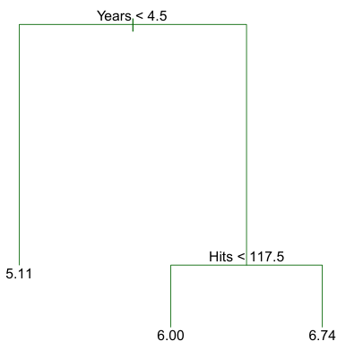

**图8.1** 对于 `Hitters` 数据，利用棒球运动员在大联盟效力的年数和前一年击出安打的次数，预测其对数薪资的回归树。在给定的**内部结点（internal node）** 处，形如 $X_j<t_k$ 的标签表示从该切分处伸出的左**分支（branch）**，右分支则对应 $X_j\ge t_k$。例如，树顶的切分产生两个大分支：左分支对应 `Years<4.5`，右分支对应 `Years>=4.5`。这棵树有两个内部结点和三个**终端结点（terminal nodes）**，也称为**叶结点（leaves）**。每个叶结点中的数值，是落入该结点的观测的响应均值。图内变量名 `Years`（效力年数）、`Hits`（安打次数）、切分条件及叶结点数值保持原样。

#### 用回归树预测棒球运动员的薪资

我们使用 `Hitters` 数据集，根据 `Years`（在大联盟效力的年数）和 `Hits`（前一年的[安打](https://zh.wikipedia.org/wiki/%E5%AE%89%E6%89%93)次数）预测棒球运动员的 `Salary`。首先删除 `Salary` 缺失的观测，再对 `Salary` 取对数，使其分布更接近典型的钟形。（回顾一下，`Salary` 的单位是千美元。）

图8.1展示了对这些数据拟合得到的一棵回归树。它由一系列切分规则组成，从树顶开始。最上方的切分把 `Years<4.5` 的观测分配到左分支。<sup><a href="#ch08-fn1" id="ch08-fnref1">1</a></sup> 这些球员的预测薪资，由数据集中 `Years<4.5` 的球员的响应均值给出。这些球员的平均对数薪资为5.107，因此对他们预测的薪资为 $e^{5.107}$ 千美元，即165,174美元。`Years>=4.5` 的球员被分配到右分支，再按 `Hits` 进一步分组。总体上，这棵树把球员分到预测变量空间的三个区域：效力不超过4年的球员；效力至少5年、且上一年安打少于118次的球员；效力至少5年、且上一年至少有118次安打的球员。这三个区域可写为 $R_1=\{X\mid\mathrm{Years}<4.5\}$，$R_2=\{X\mid\mathrm{Years}\ge4.5,\mathrm{Hits}<117.5\}$，以及 $R_3=\{X\mid\mathrm{Years}\ge4.5,\mathrm{Hits}\ge117.5\}$。图8.2展示了这些区域如何由 `Years` 和 `Hits` 确定。

<aside class="footnote" id="ch08-fn1"><a href="#ch08-fnref1">1</a> 这些数据中的 `Years` 和 `Hits` 都是整数；拟合这棵树所用的函数，把切分位置标记在两个相邻取值的中点。</aside>


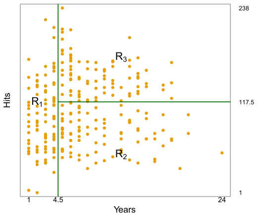

**图8.2** 图8.1的回归树对 `Hitters` 数据集给出的三区域划分。图内文字：Years＝效力年数；Hits＝安打次数；区域标签 $R_1,R_2,R_3$ 及切分数值保持原样。

这三组的预测薪资分别为 $1{,}000\times e^{5.107}=165{,}174$ 美元、$1{,}000\times e^{5.999}=402{,}834$ 美元，以及 $1{,}000\times e^{6.740}=845{,}346$ 美元。

沿用树的比喻，区域 $R_1$、$R_2$ 和 $R_3$ 称为树的终端结点或叶结点。决策树通常像图8.1那样倒着画，也就是说，叶结点位于树的底部。树中对预测变量空间进行切分的位置，称为内部结点。在图8.1中，两个内部结点分别用 `Years<4.5` 和 `Hits<117.5` 标示。树中连接各结点的线段称为分支。

可以这样解释图8.1中的回归树：`Years` 是决定 `Salary` 的最重要因素，经验较少的球员薪资低于经验较丰富的球员。对于经验较少的球员，前一年的安打次数似乎对其薪资作用不大；但在大联盟效力至少5年的球员中，前一年的安打次数确实会影响薪资，上一年安打较多的球员往往有更高的薪资。图8.1的回归树，很可能过度简化了 `Hits`、`Years` 与 `Salary` 之间的真实关系。不过，相比第3章和第6章介绍的其他回归模型，它更容易解释，也具有清晰的图形表示。

#### 通过对特征空间分层进行预测

下面讨论构建回归树的过程。大体上分为两步。

1. 将预测变量空间，即 $X_1,X_2,\ldots,X_p$ 所有可能取值构成的集合，划分成 $J$ 个互不重叠的区域 $R_1,R_2,\ldots,R_J$。

2. 对于落入区域 $R_j$ 的每个观测，都作出相同的预测：$R_j$ 内训练观测的响应均值。

例如，假设第1步得到两个区域 $R_1$ 和 $R_2$，第一个区域内训练观测的响应均值是10，第二个区域内的响应均值是20。那么，对于给定观测 $X=x$，若 $x\in R_1$，就预测为10；若 $x\in R_2$，就预测为20。

现在详细考察第1步：如何构造区域 $R_1,\ldots,R_J$？理论上，这些区域可以是任意形状。不过，为了简便，也为了便于解释得到的预测模型，我们将预测变量空间划分为高维矩形，也称为盒子。目标是找到使下面的残差平方和(RSS)最小的盒子 $R_1,\ldots,R_J$：

$$
\sum_{j=1}^{J}\sum_{i\in R_j}(y_i-\hat y_{R_j})^2, \tag{8.1}
$$

其中，$\hat y_{R_j}$ 是第 $j$ 个盒子内训练观测的响应均值。遗憾的是，考虑将特征空间划分成 $J$ 个盒子的所有可能方式，在计算上不可行。因此，我们采用一种自上而下的贪心方法，称为**递归二元切分（recursive binary splitting）**。它是自上而下的，因为从树顶开始，此时所有观测都属于同一个区域，然后依次切分预测变量空间；每次切分都由树中更下方的两个新分支表示。它是贪心的，因为构建树时，每一步只选择当前这一步最好的切分，而不向前考虑哪种切分能在后续步骤中得到更好的树。

进行递归二元切分时，首先选择预测变量 $X_j$ 和切分点 $s$，使得将预测变量空间划分为 $\{X\mid X_j<s\}$ 和 $\{X\mid X_j\ge s\}$ 两个区域后，RSS的下降尽可能大。（$\{X\mid X_j<s\}$ 表示预测变量空间中 $X_j$ 取值小于 $s$ 的区域。）也就是说，考察全部预测变量 $X_1,\ldots,X_p$，以及每个预测变量的所有可能切分点 $s$，再选择能使所得树的RSS最小的预测变量和切分点。更具体地说，对于任意 $j$ 和 $s$，定义一对半平面

$$
R_1(j,s)=\{X\mid X_j<s\}\quad\text{和}\quad R_2(j,s)=\{X\mid X_j\ge s\}, \tag{8.2}
$$

再寻找使下式最小的 $j$ 和 $s$：

$$
\sum_{i:\,x_i\in R_1(j,s)}(y_i-\hat y_{R_1})^2+\sum_{i:\,x_i\in R_2(j,s)}(y_i-\hat y_{R_2})^2, \tag{8.3}
$$

其中，$\hat y_{R_1}$ 是 $R_1(j,s)$ 中训练观测的响应均值，$\hat y_{R_2}$ 是 $R_2(j,s)$ 中训练观测的响应均值。找出使式(8.3)最小的 $j$ 和 $s$ 可以很快完成，特别是在特征数 $p$ 不太大时。

接下来，重复这一过程，寻找最佳预测变量和最佳切分点，进一步划分数据，使所得各区域内的RSS最小。

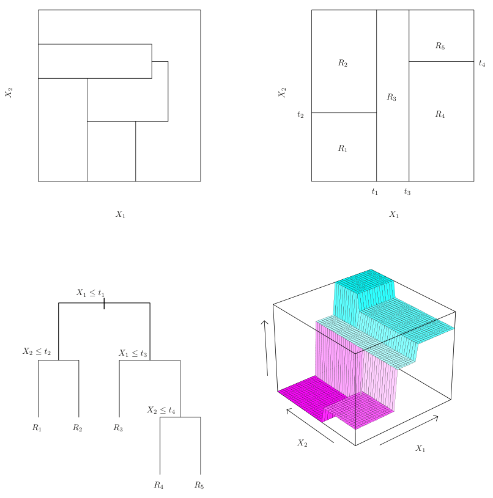

**图8.3** 左上：一种无法通过递归二元切分得到的二维特征空间划分。右上：在一个二维例子中，递归二元切分得到的结果。左下：与右上图划分对应的树。右下：该树对应的预测曲面的透视图。图内数学符号 $X_1,X_2$、阈值 $t_1,\ldots,t_4$、区域 $R_1,\ldots,R_5$ 和切分条件保持原样。

不过，这次并不切分整个预测变量空间，而是切分之前得到的两个区域之一。现在就有了三个区域。然后再进一步切分这三个区域中的一个，使RSS最小。这个过程持续进行，直到达到停止准则；例如，可以继续切分，直到没有任何区域包含超过5个观测。

一旦构造好区域 $R_1,\ldots,R_J$，就用给定测试观测所在区域内训练观测的响应均值，来预测这个测试观测的响应。

图8.3给出了这种方法产生的五区域例子。

#### 树的剪枝

上述过程可能在训练集上得到良好的预测，但也很可能过拟合数据，导致测试集表现不佳，因为得到的树可能过于复杂。切分更少、也就是区域 $R_1,\ldots,R_J$ 更少的小树，可能以少量偏差为代价，换取更低的方差和更好的可解释性。

一种可能的替代做法是，只有在每次切分使RSS下降的幅度超过某个较高阈值时，才继续生长树。这会产生更小的树，但也过于短视，因为早期一个看似毫无价值的切分，后面可能跟着一个非常好的切分，也就是在后续使RSS大幅下降的切分。

因此，更好的策略是先长出一棵很大的树 $T_0$，再对它进行**剪枝（pruning）**，得到一棵**子树（subtree）**。怎样确定最佳剪枝方式？直观上，我们希望选出的子树有最低的测试错误率。给定一棵子树，可以用交叉验证或验证集法估计其测试误差。但可能的子树数量极大，为每棵子树估计交叉验证误差，会过于繁琐。因此，我们需要一种方法，选出少量子树作为候选。

**代价复杂度剪枝（cost complexity pruning）**，也称为**最弱环节剪枝（weakest link pruning）**，就提供了这样一种方法。我们不考虑所有可能的子树，而只考虑一个由非负调节参数 $\alpha$ 索引的树序列。每个 $\alpha$ 都对应一棵子树 $T\subset T_0$，使下式尽可能小：

$$
\sum_{m=1}^{|T|}\sum_{i:\,x_i\in R_m}(y_i-\hat y_{R_m})^2+\alpha|T|. \tag{8.4}
$$

这里，$|T|$ 表示树 $T$ 的终端结点数，$R_m$ 是第 $m$ 个终端结点对应的矩形，也就是预测变量空间的一个子集；$\hat y_{R_m}$ 是与 $R_m$ 对应的预测响应，即 $R_m$ 中训练观测的响应均值。调节参数 $\alpha$ 控制子树复杂度与其对训练数据拟合程度之间的权衡。当 $\alpha=0$ 时，子树 $T$ 就等于 $T_0$，因为此时式(8.4)只度量训练误差。随着 $\alpha$ 增大，拥有较多终端结点的树就需要付出代价，因此较小的子树往往能使式(8.4)最小。这让人联想到第6章的套索法(6.7)：那里也用类似的形式来控制线性模型的复杂度。

事实上，在式(8.4)中让 $\alpha$ 从零开始增大时，树的分支会以一种嵌套且可预测的方式被剪去，因此很容易得到随 $\alpha$ 变化的完整子树序列。可以用验证集或交叉验证选择 $\alpha$，再回到完整数据集，得到与该 $\alpha$ 对应的子树。算法8.1概括了这一过程。

图8.4和图8.5展示了使用 `Hitters` 数据中的9个特征，拟合回归树并进行剪枝的结果。首先，将数据集随机分成两半，得到包含132个观测的训练集和包含131个观测的测试集。然后，在训练数据上长出一棵大的回归树，通过改变式(8.4)中的 $\alpha$，得到终端结点数不同的子树。最后，进行6折交叉验证，估计这些树随 $\alpha$ 变化的交叉验证MSE。

<div class="algorithm" id="algorithm-8-1">

**算法8.1　构建回归树**

1. 在训练数据上用递归二元切分长出一棵大树，只有当每个终端结点的观测数都少于某个最小数量时才停止。
2. 对这棵大树进行代价复杂度剪枝，得到随 $\alpha$ 变化的一系列最佳子树。
3. 用 $K$ 折交叉验证选择 $\alpha$。具体来说，将训练观测分成 $K$ 折。对于每个 $k=1,\ldots,K$：

   **(a)** 用除第 $k$ 折之外的所有训练数据，重复第1步和第2步。

   **(b)** 在留出的第 $k$ 折数据上，评价随 $\alpha$ 变化的均方预测误差。

   对每个 $\alpha$ 的结果取平均，并选择使平均误差最小的 $\alpha$。

4. 返回第2步中与选定 $\alpha$ 对应的子树。

</div>

之所以采用6折交叉验证，是因为132恰好是6的整数倍。未经剪枝的回归树见图8.4。图8.5中的绿色曲线表示交叉验证误差随叶结点数的变化，<sup><a href="#ch08-fn2" id="ch08-fnref2">2</a></sup> 橙色曲线表示测试误差。图中还给出了估计误差周围的标准误差条。作为参照，训练误差曲线用黑色表示。交叉验证误差合理地近似了测试误差：它在三个结点的树处达到最小，测试误差在三个结点的树处也有所下降，尽管测试误差的最低值出现在十个结点的树处。剪枝后具有三个终端结点的树见图8.1。

<aside class="footnote" id="ch08-fn2"><a href="#ch08-fnref2">2</a> 虽然交叉验证误差是作为 $\alpha$ 的函数计算的，但将结果绘成叶结点数 $|T|$ 的函数更方便。这是根据用全部训练数据长出的原始树中 $\alpha$ 与 $|T|$ 之间的关系得到的。</aside>


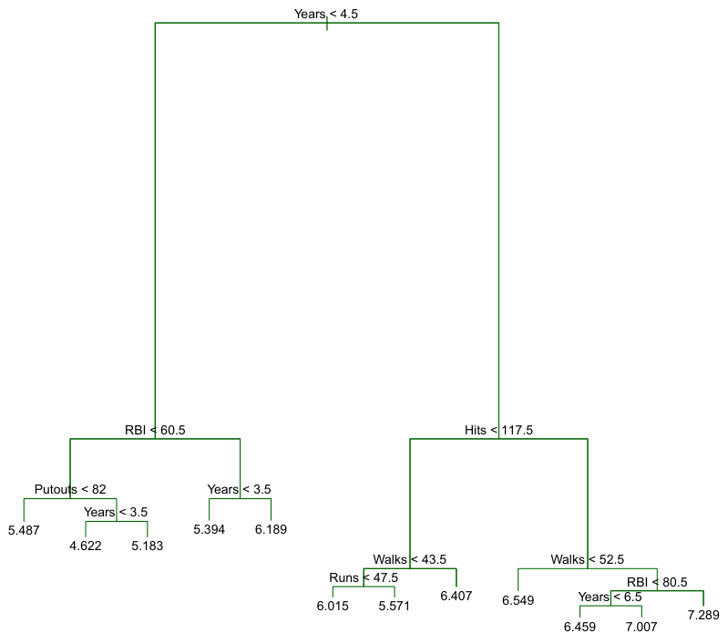

**图8.4** `Hitters` 数据的回归树分析。图中展示了在训练数据上通过自上而下的贪心切分得到的未经剪枝的树。图内变量名、切分条件和叶结点数值均保持原样；Years＝效力年数，Hits＝安打次数，RBI＝打点数，Putouts＝刺杀出局次数，Walks＝保送次数，Runs＝得分。


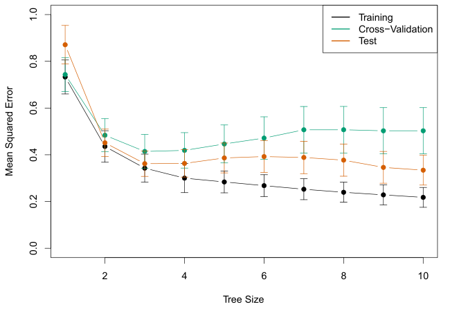

**图8.5** `Hitters` 数据的回归树分析。图中展示了训练、交叉验证和测试MSE随剪枝后树的终端结点数的变化，并给出了标准误差带。最小交叉验证误差出现在大小为3的树处。图内文字：Tree Size＝树的大小；Mean Squared Error＝均方误差；Training＝训练；Cross-Validation＝交叉验证；Test＝测试。

### 8.1.2 分类树（Classification Trees）

分类树与回归树非常相似，区别在于它预测的是定性响应，而不是定量响应。回想一下，对于回归树，一个观测的响应预测值，是与它属于同一终端结点的训练观测的响应均值。对于分类树，我们则把每个观测预测为：它所在区域中训练观测出现最多的类别。在解释分类树结果时，我们关心的往往不仅是某个终端结点区域所对应的类别预测，还包括落入该区域的训练观测中各类别所占的比例。

生长分类树的任务与生长回归树十分相似。与回归情形一样，我们使用递归二元切分来生长分类树。

不过，在分类情形下，不能用RSS作为二元切分的准则。一个自然的替代准则是分类错误率。由于我们要把某一区域中的观测判为该区域训练观测中出现最多的类别，分类错误率就是该区域训练观测中不属于这一多数类别的比例：

$$
E=1-\max_k(\hat{p}_{mk}). \tag{8.5}
$$

这里，$\hat{p}_{mk}$ 表示第 $m$ 个区域的训练观测中，属于第 $k$ 类的比例。不过，分类错误率对树的生长不够敏感，因此实际中更倾向于使用另外两种度量。

**基尼指数（Gini index）** 定义为

$$
G=\sum_{k=1}^{K}\hat{p}_{mk}(1-\hat{p}_{mk}), \tag{8.6}
$$

它衡量 $K$ 个类别的总方差。不难看出，当所有 $\hat{p}_{mk}$ 都接近0或1时，基尼指数就很小。因此，基尼指数被称为衡量结点纯度的指标——值越小，说明结点中的观测主要来自同一个类别。


基尼指数的一种替代指标是**熵（entropy）**，其定义为

$$
D=-\sum_{k=1}^{K}\hat{p}_{mk}\log\hat{p}_{mk}. \tag{8.7}
$$

因为 $0\leq\hat{p}_{mk}\leq1$，所以 $0\leq-\hat{p}_{mk}\log\hat{p}_{mk}$。可以证明，如果所有 $\hat{p}_{mk}$ 都接近0或1，熵就接近0。因此，与基尼指数一样，第 $m$ 个结点越纯，熵就越小。事实上，基尼指数和熵在数值上十分相近。

构建分类树时，通常用基尼指数或熵来评价某次切分的好坏，因为这两种方法比分类错误率对结点纯度更敏感。剪枝时，这三种方法都可以使用；不过，如果目标是最终剪枝树的预测准确率，那么分类错误率更为合适。

图8.6给出了 `Heart` 数据集上的一个例子。这些数据包含303名因胸痛就诊的患者，其结局变量 `HD` 为二元变量。取值 `Yes` 表示血管造影检查发现有心脏病，`No` 表示没有心脏病。共有13个预测变量，包括 `Age`、`Sex`、`Chol`（胆固醇测量值），以及其他心肺功能测量值。通过交叉验证，得到了一棵具有六个终端结点的树。

到目前为止，我们一直假定预测变量取连续值。不过，即使存在定性预测变量，也可以构建决策树。例如，在 `Heart` 数据中，`Sex`、`Thal`（铊负荷试验）和 `ChestPain` 等预测变量都是定性的。


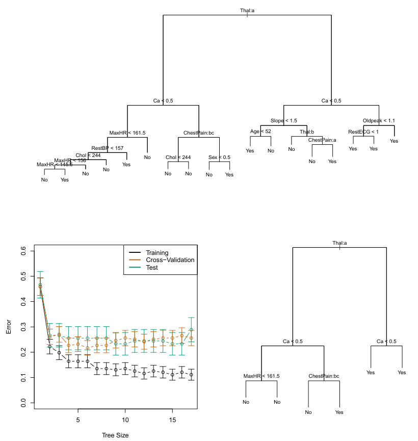

**图8.6** `Heart` 数据。上图：未剪枝的树。左下图：不同剪枝树大小所对应的交叉验证误差、训练误差和测试误差。右下图：交叉验证误差最小时所对应的剪枝树。图内文字：Tree Size＝树的大小；Error＝误差；Training＝训练；Cross-Validation＝交叉验证；Test＝测试；Yes／No＝有／无心脏病。变量名保持原样：Age＝年龄，Sex＝性别，Chol＝胆固醇，Thal＝铊负荷试验，Ca＝主要血管数，MaxHR＝最大心率，RestBP＝静息血压，ChestPain＝胸痛类型，Slope＝运动峰值ST段斜率，Oldpeak＝运动相对于静息所致的ST段压低，RestECG＝静息心电图结果；切分阈值及类别代码保留。

因此，对这类变量进行切分，就是把其中一些定性取值分配到一个分支，其余取值分配到另一个分支。在图8.6中，有些内部结点对应于定性变量的切分。例如，最上方的内部结点对应于 `Thal` 的切分。`Thal:a` 表示从这个结点出发的左分支包含 `Thal` 变量取第一个值（正常）的观测，右侧结点则包含其余观测（固定性或可逆性缺损）。沿树的左侧向下两次切分后出现的 `ChestPain:bc`，表示从该结点出发的左分支包含 `ChestPain` 变量取第二个和第三个值的观测。该变量的所有可能取值依次为典型心绞痛、不典型心绞痛、非心绞痛性胸痛和无症状。

图8.6有一个令人意外的特点：有些切分产生的两个终端结点具有相同的预测值。例如，考虑未剪枝树右下方附近的切分 `RestECG<1`。无论 `RestECG` 取何值，这些观测的响应都被预测为 `Yes`。

既然如此，为什么还要进行这次切分呢？因为它提高了结点纯度。具体来说，右侧叶结点对应的9个观测，其响应值全都是 `Yes`；而左侧叶结点对应的观测中，响应值为 `Yes` 的比例是 $7/11$。为什么结点纯度很重要？假设有一个测试观测落入右侧叶结点对应的区域，我们就可以相当确定，它的响应值是 `Yes`。相反，如果测试观测落入左侧叶结点对应的区域，它的响应值很可能也是 `Yes`，但我们的把握要小得多。尽管切分 `RestECG<1` 没有降低分类错误率，但它改善了对结点纯度更敏感的基尼指数和熵。

### 8.1.3 树与线性模型

回归树和分类树与第3章、第4章介绍的较为经典的回归和分类方法有很大不同。具体来说，线性回归假定模型具有如下形式：

$$
f(X)=\beta_0+\sum_{j=1}^{p}X_j\beta_j, \tag{8.8}
$$

而回归树假定模型具有如下形式：

$$
f(X)=\sum_{m=1}^{M}c_m\cdot1_{(X\in R_m)} \tag{8.9}
$$

其中，$R_1,\ldots,R_M$ 表示对特征空间的一个划分，如图8.3所示。

哪一种模型更好，取决于具体问题。如果特征与响应之间的关系可以由式(8.8)这样的线性模型很好地近似，那么线性回归一类方法很可能表现良好，并且会优于回归树这类不利用线性结构的方法。如果特征与响应之间存在高度非线性且复杂的关系，如模型(8.9)所示，那么决策树可能优于经典方法。图8.7给出了一个说明性的例子。可以使用交叉验证或验证集方法（第5章）估计测试误差，从而比较基于树的方法与经典方法的表现。

当然，在选择统计学习方法时，除了测试误差，还可能需要考虑其他因素。例如，在某些情形下，出于可解释性和可视化的考虑，人们可能更愿意使用树进行预测。

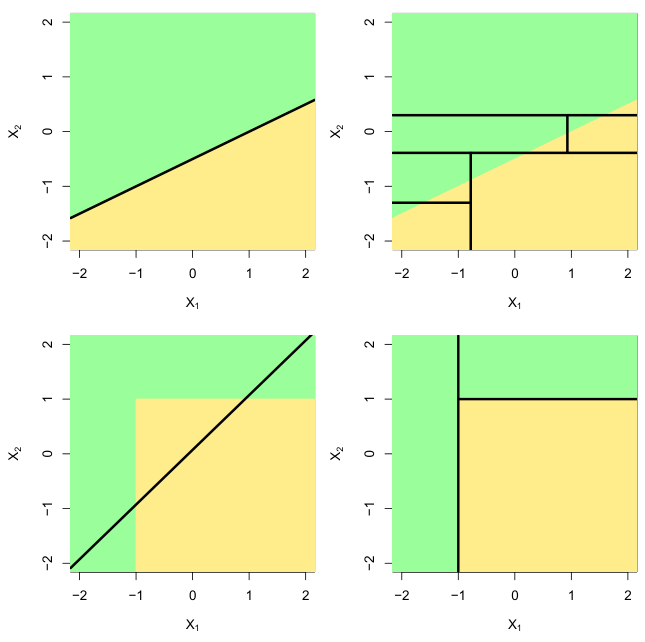

**图8.7** 上排：一个二维分类例子，真实决策边界为线性边界，由着色区域表示。假定线性边界的经典方法（左）会优于沿平行于坐标轴的方向进行切分的决策树（右）。下排：这里的真实决策边界是非线性的。线性模型无法捕捉真实决策边界（左），而决策树可以成功做到（右）。图内 $X_1$、$X_2$ 分别表示两个预测变量，刻度保持原样。

### 8.1.4 树的优点与缺点

用于回归和分类的决策树，相对于第3章和第4章介绍的较为经典的方法，具有以下优点：

- <span style="color:#00ff00" aria-label="优点">▲</span> 树非常容易向他人解释。事实上，它甚至比线性回归还容易解释！
- <span style="color:#00ff00" aria-label="优点">▲</span> 有人认为，与前面各章介绍的回归和分类方法相比，决策树更接近人类的决策过程。
- <span style="color:#00ff00" aria-label="优点">▲</span> 树可以用图形展示，即使是非专业人士也很容易理解，尤其是在树较小的时候。
- <span style="color:#00ff00" aria-label="优点">▲</span> 树可以轻松处理定性预测变量，无须创建虚拟变量。
- <span style="color:#ff0000" aria-label="缺点">▼</span> 遗憾的是，树的预测准确率通常不及本书介绍的其他一些回归和分类方法。
- <span style="color:#ff0000" aria-label="缺点">▼</span> 此外，树可能很不稳健。换句话说，数据的微小变化可能导致最终估计得到的树发生很大变化。

不过，通过装袋法、随机森林和提升法等方法聚合许多棵决策树，可以大幅改善树的预测表现。下一节将介绍这些概念。

## 8.2 装袋法、随机森林、提升法与贝叶斯加性回归树

**集成（ensemble）方法**将许多简单的“构件”模型组合起来，得到一个可能十分强大的模型。这些简单的构件模型有时称为**弱学习器（weak learners）**，因为它们单独使用时，预测表现可能平平。

下面讨论装袋法、随机森林、提升法和贝叶斯加性回归树。这些都是以回归树或分类树作为简单构件的集成方法。

### 8.2.1 装袋法

第5章介绍的自助法是一个极其强大的思想。在许多情形下，我们很难甚至根本无法直接计算某个所关心的量的标准差，自助法便能派上用场。这里将看到，自助法还可以用于一个完全不同的场景，改进决策树等统计学习方法。

第8.1节讨论的决策树存在**方差较高**的问题。这意味着，如果把训练数据随机分成两半，并在每一半上各拟合一棵决策树，得到的结果可能很不一样。相比之下，方差较低的方法在不同数据集上反复应用时，会得到相似的结果；当 $n$ 与 $p$ 的比值较大时，线性回归的方差往往较低。**自助聚合（bootstrap aggregation）**，也称为**装袋法**，是一种降低统计学习方法方差的通用方法。这里介绍它，是因为它在决策树中尤其有用，也经常使用。

回顾一下，给定 $n$ 个相互独立的观测 $Z_1,\ldots,Z_n$，若每个观测的方差都是 $\sigma^2$，那么观测均值 $\bar Z$ 的方差为 $\sigma^2/n$。换句话说，*对一组观测取平均能够降低方差*。因此，要降低统计学习方法的方差并提高其在测试集上的准确性，一个自然的办法是从总体中取得许多训练集，在每个训练集上分别构建一个预测模型，再对得到的预测取平均。也就是说，可以使用 $B$ 个不同的训练集，计算 $\hat f^1(x),\hat f^2(x),\ldots,\hat f^B(x)$，然后取平均，得到一个方差较低的统计学习模型：

$$
\hat f_{\mathrm{avg}}(x)=\frac{1}{B}\sum_{b=1}^{B}\hat f^b(x).
$$

当然，这种做法并不现实，因为我们通常无法取得多个训练集。不过，我们可以使用自助法，从这个唯一的训练数据集中反复抽样。具体来说，先生成 $B$ 个不同的自助训练数据集，再在第 $b$ 个自助训练集上训练所用方法，得到 $\hat f^{*b}(x)$，最后对所有预测取平均，得到

$$
\hat f_{\mathrm{bag}}(x)=\frac{1}{B}\sum_{b=1}^{B}\hat f^{*b}(x).
$$


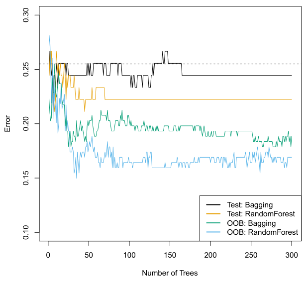

**图8.8** `Heart` 数据上的装袋法与随机森林结果。图中给出了测试误差（黑色和橙色）随所用自助训练集数量 $B$ 的变化。随机森林取 $m=\sqrt p$。虚线表示单棵分类树的测试误差。绿色和蓝色曲线表示袋外误差；在这个例子中，袋外误差碰巧明显更低。图内文字：Number of Trees＝树的数量；Error＝误差；Test: Bagging＝测试：装袋法；Test: RandomForest＝测试：随机森林；OOB: Bagging＝袋外：装袋法；OOB: RandomForest＝袋外：随机森林。

这就称为装袋法。

装袋法可以改进许多回归方法的预测，对决策树尤其有用。将装袋法用于回归树时，只需使用 $B$ 个自助训练集构建 $B$ 棵回归树，然后对得到的预测取平均。这些树生长得很深，而且不做剪枝。因此，每棵树的方差都很高，但偏差很低。对这 $B$ 棵树取平均可以降低方差。已有结果表明，将数百棵甚至数千棵树组合成一种方法，装袋法能够使准确性得到可观的提升。

到目前为止，我们是在回归问题中介绍装袋法，用它来预测定量结果 $Y$。那么，如何将装袋法扩展到 $Y$ 为定性变量的分类问题呢？有几种可行的办法，其中最简单的一种如下。对于给定的测试观测，记录 $B$ 棵树各自预测的类别，然后进行**多数投票（majority vote）**：以这 $B$ 个预测中出现次数最多的类别作为总体预测。

图8.8给出了在 `Heart` 数据上使用装袋树的结果。图中展示了测试错误率随树的数量 $B$ 的变化，这些树分别使用自助训练数据集构建。可以看到，在这个例子中，装袋法的测试错误率略低于单棵树的测试错误率。树的数量 $B$ 并不是装袋法中一个关键的参数；即使 $B$ 很大，也不会导致过拟合。

实践中，我们使用足够大的 $B$，使误差趋于稳定。在本例中，取 $B=100$ 就足以获得良好的表现。

#### 袋外误差估计

实际上，有一种非常直接的办法，可以估计装袋模型的测试误差，而无须进行交叉验证或使用验证集法。回顾一下，装袋法的关键是反复在观测的自助抽样子集上拟合树。可以证明，平均而言，每棵装袋树会用到约三分之二的观测。<sup><a href="#ch08-fn3" id="ch08-fnref3">3</a></sup> 对于一棵给定的装袋树，剩下约三分之一未用于拟合它的观测称为**袋外（out-of-bag，OOB）观测**。对于第 $i$ 个观测，我们可以使用所有以它为袋外观测的树，来预测其响应。这会为第 $i$ 个观测产生大约 $B/3$ 个预测。要得到第 $i$ 个观测的单个预测，可以对这些响应预测取平均（回归问题），也可以进行多数投票（分类问题）。这样就得到了第 $i$ 个观测的一个袋外预测。对 $n$ 个观测中的每一个，都可以用这种方式得到袋外预测，再据此计算总体袋外MSE（回归问题）或分类错误率（分类问题）。由于每个观测的响应都只使用未以该观测拟合的树来预测，所得袋外误差是装袋模型测试误差的有效估计。图8.8展示了 `Heart` 数据上的袋外误差。可以证明，当 $B$ 足够大时，袋外误差与留一交叉验证误差实际上相当。对大型数据集使用装袋法时，交叉验证可能需要很大的计算量，此时用袋外方法估计测试误差尤其方便。

<aside class="footnote" id="ch08-fn3"><a href="#ch08-fnref3">3</a> 这与第5章习题2有关。</aside>

#### 变量重要性度量

如前所述，与使用单棵树预测相比，装袋法通常能提高准确性。不过，得到的模型可能较难解释。回顾一下，决策树的一个优点是可以画成直观、易于解释的图，如图8.1所示。然而，对大量树进行装袋后，就无法再用单棵树来表示所得统计学习方法，也不再容易看出哪些变量对该方法最重要。因此，装袋法以可解释性为代价，提高了预测准确性。

虽然一组装袋树远比单棵树难以解释，但仍可以利用RSS（回归树装袋）或基尼指数（分类树装袋），对每个预测变量的重要性作总体概括。对于回归树装袋，可以记录按某个给定预测变量进行分裂所带来的RSS (8.1)下降总量，再对全部 $B$ 棵树取平均。这个数值越大，表明该预测变量越重要。

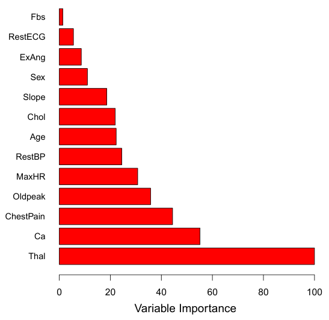

**图8.9** `Heart` 数据的变量重要性图。变量重要性根据基尼指数的平均下降量计算，并表示为相对于最大值的数值。图内文字：Variable Importance＝变量重要性；变量标识符 `Thal`、`Ca`、`ChestPain`、`Oldpeak`、`MaxHR`、`RestBP`、`Age`、`Chol`、`Slope`、`Sex`、`ExAng`、`RestECG`、`Fbs` 保持原样。

类似地，对于分类树装袋，可以将按某个给定预测变量进行分裂所带来的基尼指数(8.6)下降量相加，再对全部 $B$ 棵树取平均。

图8.9以图形展示了 `Heart` 数据中各变量的**变量重要性（variable importance）**。图中给出了各变量的基尼指数平均下降量相对于最大值的数值。基尼指数平均下降量最大的变量是 `Thal`、`Ca` 和 `ChestPain`。

### 8.2.2 随机森林

随机森林通过一个小小的调整，降低各棵树之间的相关性，从而改进装袋树。与装袋法一样，我们先在自助训练样本上构建多棵决策树。不过，在构建这些决策树时，每当考虑进行一次分裂，都从全部 $p$ 个预测变量中随机抽取 $m$ 个，作为分裂的候选变量。这次分裂只能使用这 $m$ 个预测变量中的一个。每次分裂都重新抽取 $m$ 个预测变量，通常选择 $m\approx\sqrt p$，也就是说，每次分裂所考虑的预测变量数量约等于预测变量总数的平方根（对于 `Heart` 数据，即13个变量中的4个）。

换句话说，在构建随机森林时，每次分裂甚至都不允许算法考虑大部分可用的预测变量。这听起来或许有些疯狂，却有一个巧妙的道理。假设数据集中有一个预测能力很强的变量，以及若干预测能力中等的变量。那么，在一组装袋树中，大部分乃至全部树都会在最顶层的分裂中使用这个很强的预测变量。因此，这些装袋树看起来都会十分相似。

于是，装袋树给出的预测会高度相关。遗憾的是，对许多高度相关的量取平均，所能降低的方差不如对许多不相关的量取平均那么多。具体而言，在这种情形下，与单棵树相比，装袋法无法大幅降低方差。

随机森林强制每次分裂只考虑预测变量的一个子集，从而克服这一问题。因此，平均有 $(p-m)/p$ 的分裂根本不会考虑那个很强的预测变量，其他预测变量也就有了更多机会。可以把这个过程理解为降低各棵树之间的相关性，使所得各棵树的平均预测变异更小，因而更加可靠。

装袋法与随机森林的主要区别在于预测变量子集大小 $m$ 的选择。例如，如果构建随机森林时使用 $m=p$，那就相当于装袋法。对于 `Heart` 数据，与装袋法相比，取 $m=\sqrt p$ 的随机森林同时降低了测试误差和袋外误差（图8.8）。

当存在大量彼此相关的预测变量时，构建随机森林时采用较小的 $m$ 通常会有帮助。我们将随机森林用于一个高维生物学数据集，其中包含349名患者组织样本上4,718个基因的表达测量值。人类约有20,000个基因，在特定的细胞、组织和生物学条件下，不同基因具有不同的活性水平，也就是表达水平。在这个数据集中，每个患者样本都有一个定性标签，共有15个不同水平：正常，或14种不同癌症类型中的一种。我们的目标是根据训练集中方差最大的500个基因，使用随机森林预测癌症类型。我们将观测随机划分为训练集和测试集，并在训练集上分别采用三种不同的分裂变量数量 $m$ 来拟合随机森林。结果如图8.10所示。单棵树的错误率为45.7%，空模型错误率为75.4%。<sup><a href="#ch08-fn4" id="ch08-fnref4">4</a></sup> 可以看到，使用400棵树就足以获得良好的表现；在本例中，选择 $m=\sqrt p$ 时，测试误差比装袋法（$m=p$）略有改善。与装袋法一样，增加 $B$ 不会使随机森林过拟合，因此，实践中会使用足够大的 $B$，使错误率趋于稳定。

<aside class="footnote" id="ch08-fn4"><a href="#ch08-fnref4">4</a> 空模型错误率是将每个观测都归入总体中占优势的类别所得到的错误率；在本例中，该类别为正常类。</aside>


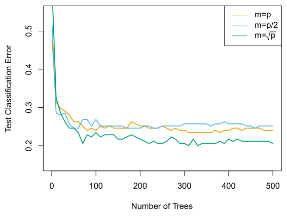

**图8.10** 对具有 $p=500$ 个预测变量的15类别基因表达数据集应用随机森林的结果。图中给出了测试误差随树的数量的变化。每条彩色曲线对应一个不同的 $m$ 值，即树的每个内部结点可供分裂选择的预测变量数量。随机森林（$m<p$）比装袋法（$m=p$）略有改善。单棵分类树的错误率为45.7%。图内文字：Number of Trees＝树的数量；Test Classification Error＝测试分类错误率；图例 $m=p$、$m=p/2$、$m=\sqrt p$ 保留原样。

### 8.2.3 提升法

下面讨论提升法，这是另一种改进决策树预测的方法。与装袋法一样，提升法也是一种通用方法，可以用于许多回归或分类的统计学习方法。这里仅讨论决策树中的提升法。

回顾一下，装袋法先使用自助法，从原始训练数据集生成多个副本，在每个副本上分别拟合一棵决策树，再将所有树组合成一个预测模型。

特别要注意的是，每棵树都在一个自助数据集上构建，并且独立于其他树。提升法的工作方式与此类似，不过，树是*依次生长*的：每棵树都会利用先前已生长的树所提供的信息。提升法不使用自助抽样，而是在原始数据集经过修改的版本上拟合每棵树。

先考虑回归问题。与装袋法一样，提升法也将大量决策树 $\hat f^1,\ldots,\hat f^B$ 组合起来。算法8.2描述了提升法。

这一过程背后的思想是什么？在数据上拟合单棵大型决策树，相当于着力拟合数据，可能造成过拟合；提升法则是*缓慢学习*。给定当前模型，先对该模型的残差拟合一棵决策树。也就是说，拟合树时将当前残差作为响应，而不是把结果 $Y$ 作为响应。然后，将这棵新的决策树加入拟合函数，并更新残差。每棵树都可以很小，只有几个终端结点，其数量由算法中的参数 $d$ 决定。通过对残差拟合小树，我们逐渐改进 $\hat f$ 表现不佳的部分。收缩参数 $\lambda$ 会进一步放慢这一过程，让更多形状各异的树来处理残差。一般而言，*学习较慢*的统计学习方法往往表现良好。注意，与装袋法不同，在提升法中，每棵树的构建都强烈依赖于已经生长的树。

以上描述的是回归树的提升过程。分类树的提升过程与此类似，但稍微复杂一些，这里省略其细节。

<div class="algorithm" id="algorithm-8-2">

**算法8.2 回归树的提升法**

1. 令 $\hat f(x)=0$，并对训练集中所有 $i$，令 $r_i=y_i$。
2. 对 $b=1,2,\ldots,B$，重复以下步骤：

   (a) 对训练数据 $(X,r)$ 拟合一棵具有 $d$ 次分裂（$d+1$ 个终端结点）的树 $\hat f^b$。

   (b) 将新树收缩后加入 $\hat f$，对其进行更新：

   $$
   \hat f(x)\leftarrow\hat f(x)+\lambda\hat f^b(x). \tag{8.10}
   $$

   (c) 更新残差：

   $$
   r_i\leftarrow r_i-\lambda\hat f^b(x_i). \tag{8.11}
   $$

3. 输出提升后的模型：

   $$
   \hat f(x)=\sum_{b=1}^{B}\lambda\hat f^b(x). \tag{8.12}
   $$

</div>

提升法有三个调节参数：

1. 树的数量 $B$。与装袋法和随机森林不同，若 $B$ 过大，提升法可能会过拟合；不过，即使出现过拟合，这一过程往往也很缓慢。我们使用交叉验证选择 $B$。
2. 收缩参数 $\lambda$，是一个较小的正数。它控制提升法的学习速度。典型取值为0.01或0.001，合适的选择可能因问题而异。当 $\lambda$ 非常小时，可能需要使用非常大的 $B$ 才能取得良好表现。
3. 每棵树的分裂次数 $d$，它控制提升集成模型的复杂程度。$d=1$ 往往就能取得良好的表现，此时每棵树都是只含一次分裂的**树桩（stump）**。在这种情形下，由于每一项仅涉及单个变量，提升集成拟合的是一个加性模型。更一般地，$d$ 是**交互深度（interaction depth）**，控制提升模型的交互阶数，因为 $d$ 次分裂至多涉及 $d$ 个变量。

在图8.11中，我们将提升法用于15类别癌症基因表达数据集，构建一个能够将正常类与14个癌症类别区分开的分类器。图中展示了测试误差随树的总数和交互深度 $d$ 的变化。可以看到，只要数量足够多，交互深度为1的简单树桩就能取得良好的表现。这个模型优于深度为2的模型，而两者又都优于随机森林。这突出了提升法与随机森林的一点区别：在提升法中，一棵树生长时会考虑先前已经生长的其他树，因此，较小的树通常就足够了。


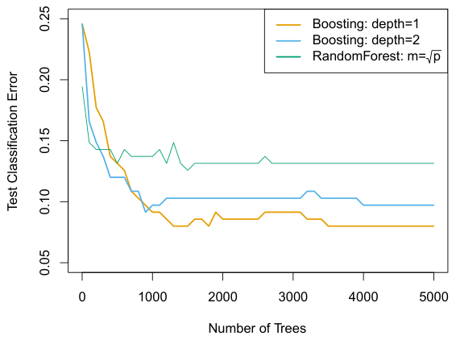

**图8.11** 在15类别基因表达数据集上使用提升法和随机森林，以预测癌症与正常的结果。图中给出了测试误差随树的数量的变化。两个提升模型都取 $\lambda=0.01$。深度为1的树略优于深度为2的树，且两者都优于随机森林；不过，标准误约为0.02，因此这些差异均不显著。单棵树的测试错误率为24%。图内文字：Number of Trees＝树的数量；Test Classification Error＝测试分类错误率；Boosting: depth=1＝提升法：深度=1；Boosting: depth=2＝提升法：深度=2；RandomForest: $m=\sqrt p$＝随机森林：$m=\sqrt p$。

使用较小的树也有助于解释模型；例如，使用树桩会得到加性模型。

### 8.2.4 贝叶斯加性回归树

最后讨论**贝叶斯加性回归树（Bayesian additive regression trees，BART）**，这是另一种以决策树为构件的集成方法。为简单起见，这里介绍用于回归而非分类的BART。

回顾一下，装袋法和随机森林对回归树取平均来进行预测，每棵树都使用随机抽取的数据和／或预测变量构建。各棵树彼此独立地构建。相比之下，提升法使用树的加权和，每棵树都是对当前拟合的残差进行拟合而构建的。因此，每棵新树都试图捕捉当前这组树尚未解释的信号。BART与这两类方法都有联系：与装袋法和随机森林一样，每棵树都以随机方式构建；与提升法一样，每棵树都试图捕捉当前模型尚未解释的信号。BART的主要创新在于生成新树的方式。

在介绍BART算法之前，先定义一些记号。用 $K$ 表示回归树的数量，用 $B$ 表示BART算法运行的迭代次数。记号 $\hat f_k^b(x)$ 表示第 $b$ 次迭代中所用的第 $k$ 棵回归树在 $x$ 处的预测。在每次迭代结束时，将该次迭代的 $K$ 棵树相加，即对 $b=1,\ldots,B$，有 $\hat f^b(x)=\sum_{k=1}^{K}\hat f_k^b(x)$。

在BART算法的第一次迭代中，所有树都被初始化为仅有一个根结点，并令 $\hat f_k^1(x)=\frac{1}{nK}\sum_{i=1}^{n}y_i$，即将响应值的均值除以树的总数。


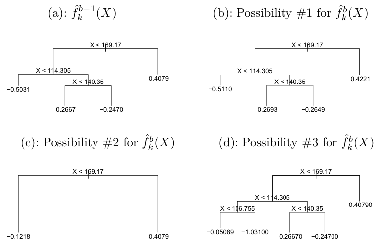

**图8.12** BART算法中经扰动的树的示意图。(a)：第 $b-1$ 次迭代中的第 $k$ 棵树 $\hat f_k^{b-1}(X)$。给定 $\hat f_k^{b-1}(X)$ 的形式，(b)—(d)展示了 $\hat f_k^b(X)$ 的众多可能结果中的三种。(b)：一种可能是 $\hat f_k^b(X)$ 与 $\hat f_k^{b-1}(X)$ 结构相同，但终端结点的预测不同。(c)：另一种可能是对 $\hat f_k^{b-1}(X)$ 剪枝，得到 $\hat f_k^b(X)$。(d)：还可能使 $\hat f_k^b(X)$ 比 $\hat f_k^{b-1}(X)$ 具有更多终端结点。图内文字：Possibility #1， #2， #3  for $\hat f_k^b(X)$＝$\hat f_k^b(X)$ 的第1／2／3种可能结果；分裂条件、预测数值及函数记号均保持原样。 

因此，$\hat f^1(x)=\sum_{k=1}^{K}\hat f_k^1(x)=\frac{1}{n}\sum_{i=1}^{n}y_i$。

在后续迭代中，BART逐一更新这 $K$ 棵树。在第 $b$ 次迭代中，更新第 $k$ 棵树时，从每个响应值中减去除第 $k$ 棵树以外的所有树的预测，得到第 $i$ 个观测（$i=1,\ldots,n$）的部分残差

$$
r_i=y_i-\sum_{k'<k}\hat f_{k'}^b(x_i)-\sum_{k'>k}\hat f_{k'}^{b-1}(x_i).
$$

BART并不对这个部分残差重新拟合一棵全新的树，而是从一组可能的扰动中，随机选择一种，对上次迭代的树（$\hat f_k^{b-1}$）进行扰动，并偏向选择能够改善部分残差拟合的扰动。这种扰动包含两个方面：

1. 可以通过增加分支或剪枝来改变树的结构。
2. 可以改变树中每个终端结点的预测值。

图8.12给出了对一棵树进行扰动的一些可能示例。

BART输出的是一组预测模型：

$$
\hat f^b(x)=\sum_{k=1}^{K}\hat f_k^b(x),\quad b=1,2,\ldots,B.
$$


<div class="algorithm" id="algorithm-8-3">

**算法8.3 贝叶斯加性回归树**

1. 令 $\hat f_1^1(x)=\hat f_2^1(x)=\cdots=\hat f_K^1(x)=\frac{1}{nK}\sum_{i=1}^{n}y_i$。
2. 计算 $\hat f^1(x)=\sum_{k=1}^{K}\hat f_k^1(x)=\frac{1}{n}\sum_{i=1}^{n}y_i$。
3. 对 $b=2,\ldots,B$：

   (a) 对 $k=1,2,\ldots,K$：

       i. 对 $i=1,\ldots,n$，计算当前部分残差

          $$
          r_i=y_i-\sum_{k'<k}\hat f_{k'}^b(x_i)-\sum_{k'>k}\hat f_{k'}^{b-1}(x_i).
	          $$

       ii. 通过随机扰动上次迭代的第 $k$ 棵树 $\hat f_k^{b-1}(x)$，对 $r_i$ 拟合一棵新树 $\hat f_k^b(x)$。更倾向于选择能够改善拟合的扰动。

   (b) 计算 $\hat f^b(x)=\sum_{k=1}^{K}\hat f_k^b(x)$。

4. 舍去 $L$ 个预热样本后计算均值：

   $$
   \hat f(x)=\frac{1}{B-L}\sum_{b=L+1}^{B}\hat f^b(x).
   $$
   
</div>

通常会丢弃最初的几个预测模型，因为在较早的迭代阶段，也就是**预热期（burn-in period）**，得到的模型往往无法提供很好的结果。可以用 $L$ 表示预热迭代的次数，例如取 $L=200$。然后，要得到单个预测，只需对预热迭代之后的结果取平均，即 $\hat f(x)=\frac{1}{B-L}\sum_{b=L+1}^{B}\hat f^b(x)$。不过，也可以计算均值以外的其他量：例如，$\hat f^{L+1}(x),\ldots,\hat f^B(x)$ 的百分位数可以度量最终预测的不确定性。算法8.3概括了整个BART过程。

BART方法的一个关键之处在于：在步骤3(a)ii中，并不对当前部分残差拟合一棵全新的树，而是通过略微修改上次迭代得到的树，来改善对当前部分残差的拟合（见图8.12）。粗略地说，这限制了每次迭代中对数据拟合的强度，从而有助于防止过拟合。此外，单棵树通常都很小。我们限制树的大小，是为了避免对数据过拟合；如果树长得很大，就更容易出现过拟合。

图8.13给出了在 `Heart` 数据上使用 $K=200$ 棵树，并将迭代次数增加至10,000时，BART的结果。在最初的迭代中，测试误差和训练误差都有一些波动。度过最初的预热期后，错误率趋于稳定。可以看到，训练误差与测试误差之间的差距很小，表明对树进行扰动的过程在很大程度上避免了过拟合。

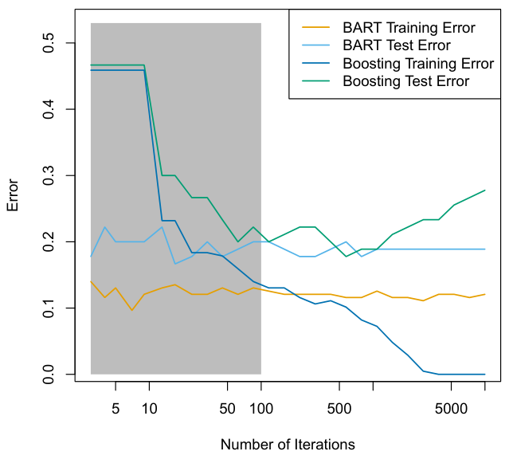

**图8.13** `Heart` 数据上的BART与提升法结果。图中同时展示了训练误差和测试误差。经过100次迭代的预热期（灰色区域）后，BART的错误率趋于稳定。提升法在数百次迭代后开始过拟合。图内文字：Number of Iterations＝迭代次数；Error＝误差；BART Training Error＝BART训练误差；BART Test Error＝BART测试误差；Boosting Training Error＝提升法训练误差；Boosting Test Error＝提升法测试误差。

图8.13还展示了提升法的训练误差和测试误差。可以看到，提升法的测试误差先接近BART的测试误差，随后随着迭代次数增加而开始上升。与此同时，提升法的训练误差随着迭代次数增加而下降，表明提升法对数据发生了过拟合。

虽然细节超出了本书范围，但BART方法可以看作拟合树集成模型的一种贝叶斯方法：每次为了拟合残差而对树进行随机扰动时，实际上都是在从后验分布中抽取一棵新树。（当然，这种与贝叶斯方法的联系也正是BART名称的由来。）此外，算法8.3可以看作一种用于拟合BART模型的**马尔可夫链蒙特卡洛（Markov chain Monte Carlo）**算法。

应用BART时，必须选择树的数量 $K$、迭代次数 $B$ 和预热迭代次数 $L$。通常会为 $B$ 和 $K$ 选择较大的值，为 $L$ 选择适中的值；例如，$K=200$、$B=1{,}000$、$L=100$ 就是一组合适的选择。已有结果表明，BART的开箱即用表现非常出色，也就是说，只需极少的调节就能取得良好表现。

### 8.2.5 树集成方法小结

树很适合作为集成方法的弱学习器，原因有许多，包括灵活性，以及能够处理混合类型预测变量（即同时含定性和定量预测变量）的能力。

到目前为止，我们已经看过拟合树集成模型的四种方法：装袋法、随机森林、提升法和BART。

- 在**装袋法**中，各棵树在随机抽取的观测样本上独立生长。因此，各棵树往往十分相似。于是，装袋法可能陷入局部最优，无法充分探索模型空间。
- 在**随机森林**中，各棵树同样在随机抽取的观测样本上独立生长。不过，每棵树的每次分裂都使用随机抽取的特征子集，从而降低各棵树之间的相关性，与装袋法相比，能够更充分地探索模型空间。
- 在**提升法**中，只使用原始数据，不抽取任何随机样本。各棵树依次生长，采用一种“缓慢”的学习方式：每棵新树都对先前各棵树尚未捕捉的信号进行拟合，并在使用前进行收缩。
- 在**BART**中，同样只使用原始数据，各棵树依次生长。不过，每棵树都会受到扰动，以避免陷入局部极小值，并更充分地探索模型空间。

## 8.3 实验：基于树的方法

我们先在顶层导入一些常用的库。

In[1]:

```python
import numpy as np
import pandas as pd
from matplotlib.pyplot import subplots
from statsmodels.datasets import get_rdataset
import sklearn.model_selection as skm
from ISLP import load_data, confusion_table
from ISLP.models import ModelSpec as MS
```

同时集中导入本实验新用到的工具。

In[2]:

```python
from sklearn.tree import (DecisionTreeClassifier as DTC,
                          DecisionTreeRegressor as DTR,
                          plot_tree,
                          export_text)
from sklearn.metrics import (accuracy_score ,
                             log_loss)
from sklearn.ensemble import \
     (RandomForestRegressor as RF,
      GradientBoostingRegressor as GBR)
from ISLP.bart import BART
```

### 8.3.1 拟合分类树

我们首先用分类树分析 `Carseats` 数据集。在这个数据集中，`Sales` 是连续变量，因此先将它重新编码为二元变量。我们用 `where()` 函数创建一个名为 `High` 的变量：当 `Sales` 大于8时，其值为 `Yes`；否则为 `No`。

In[3]:

```python
Carseats = load_data('Carseats')
High = np.where(Carseats.Sales > 8,
                "Yes",
                "No")
```

现在使用 `DecisionTreeClassifier()` 拟合一棵分类树，用除 `Sales` 以外的所有变量预测 `High`。为此，需要像拟合回归模型时那样构造模型矩阵。

In[4]:

```python
model = MS(Carseats.columns.drop('Sales'), intercept=False)
D = model.fit_transform(Carseats)
feature_names = list(D.columns)
X = np.asarray(D)
```

我们将数据框 `D` 转换成了数组 `X`，后面的一些分析需要使用这个数组。还需要保留 `feature_names`，以便稍后给图形添加标注。

指定分类器时需要设置若干选项，例如 `max_depth`（树生长的最大深度）、`min_samples_split`（一个结点至少要有多少个观测才允许继续切分）以及 `criterion`（采用基尼指数还是交叉熵（cross-entropy）作为切分准则）。我们还设置了 `random_state`，以保证结果可复现；当多个切分的准则值相同时，会随机选择其中一个。

In[5]:

```python
clf = DTC(criterion='entropy',
          max_depth=3,
          random_state=0)
clf.fit(X, High)
```

Out[5]:

```python
DecisionTreeClassifier(criterion='entropy', max_depth=3)
```

在3.3节讨论定性特征时，我们提到，对于线性回归模型，可以使用 `statsmodels` 的公式记法，在模型矩阵中加入一个虚拟变量矩阵（独热编码）来表示这类特征。正如8.1节所述，构建决策树时，可以用一种更自然的方式处理定性特征，而不需要这些虚拟变量：每次切分都是将各个水平划分成两组。不过，`sklearn` 中的决策树实现没有采用这种方法，而是直接将独热编码后的各个水平作为单独的变量。

In[6]:

```python
accuracy_score(High, clf.predict(X))
```

Out[6]:

```python
0.7275
```

仅使用默认参数时，训练错误率为21%。对于分类树，可以用 `log_loss()` 得到偏差统计量的值，其表达式为

$$
-2\sum_m\sum_k n_{mk}\log\hat{p}_{mk},
$$

其中，$n_{mk}$ 是第 $m$ 个终端结点中属于第 $k$ 类的观测数。

In[7]:

```python
resid_dev = np.sum(log_loss(High, clf.predict_proba(X)))
resid_dev
```

Out[7]:

```python
0.4711
```

它与式（8.7）定义的熵密切相关。较小的偏差统计量表明，这棵树对（训练）数据的拟合较好。

树最吸引人的特点之一是可以用图形展示。这里用 `plot()` 函数显示树的结构（此处未展示图形）。

In[8]:

```python
ax = subplots(figsize=(12,12))[1]
plot_tree(clf,
          feature_names=feature_names ,
          ax=ax);
```

`Sales` 最重要的指标似乎是 `ShelveLoc`。

可以用 `export_text()` 查看树的文本表示，其中会显示每个分支的切分准则（例如 `Price <= 92.5`），对于叶结点则显示总体预测结果（`Yes` 或 `No`）。设置 `show_weights=True` 后，还可以看到该叶结点中取值为 `Yes` 和 `No` 的观测数。

In[9]:

```python
print(export_text(clf,
                  feature_names=feature_names ,
                  show_weights=True))
```

Out[9]:

```python
|--- ShelveLoc[Good] <= 0.50
|   |--- Price <= 92.50
|   |   |--- Income <= 57.00
|   |   |   |--- weights: [7.00, 3.00] class: No
|   |   |--- Income >  57.00
|   |   |   |--- weights: [7.00, 29.00] class: Yes
|   |--- Price >  92.50
|   |   |--- Advertising <= 13.50
|   |   |   |--- weights: [183.00, 41.00] class: No
|   |   |--- Advertising >  13.50
|   |   |   |--- weights: [20.00, 25.00] class: Yes
|--- ShelveLoc[Good] >  0.50
|   |--- Price <= 135.00
|   |   |--- US[Yes] <= 0.50
|   |   |   |--- weights: [6.00, 11.00] class: Yes
|   |   |--- US[Yes] >  0.50
|   |   |   |--- weights: [2.00, 49.00] class: Yes
|   |--- Price >  135.00
|   |   |--- Income <= 46.00
|   |   |   |--- weights: [6.00, 0.00] class: No
|   |   |--- Income >  46.00
|   |   |   |--- weights: [5.00, 6.00] class: Yes
```

要恰当地评估分类树在这些数据上的表现，需要估计测试误差，而不能只计算训练误差。我们将观测划分为训练集和测试集，用训练集构建树，再用测试数据评估其表现。这一流程与第6章类似，只是将线性模型换成了决策树，验证所用的代码几乎相同。采用这种方法，可以正确预测测试数据集中68.5%的销售地点。

In[10]:

```python
validation = skm.ShuffleSplit(n_splits=1,
                              test_size=200,
                              random_state=0)
results = skm.cross_validate(clf,
                             D,
                             High,
                             cv=validation)
results['test_score']
```

Out[10]:

```python
array([0.685])
```

接下来，考察剪枝能否改善分类表现。首先，将数据划分为训练集和测试集。我们将利用交叉验证，在训练集上对树进行剪枝，然后在测试集上评估剪枝后树的表现。

In[11]:

```python
(X_train,
 X_test,
 High_train,
 High_test) = skm.train_test_split(X,
                                   High,
                                   test_size=0.5,
                                   random_state=0)
```

先在训练集上重新拟合完整树。这里不设置 `max_depth` 参数，因为将通过交叉验证来确定它。

In[12]:

```python
clf = DTC(criterion='entropy', random_state=0)
clf.fit(X_train, High_train)
accuracy_score(High_test, clf.predict(X_test))
```

Out[12]:

```python
0.735
```

接下来，使用 `clf` 的 `cost_complexity_pruning_path()` 方法提取代价复杂度的取值。

In[13]:

```python
ccp_path = clf.cost_complexity_pruning_path(X_train, High_train)
kfold = skm.KFold(10,
                  random_state=1,
                  shuffle=True)
```

这样得到一组不纯度及相应的 $\alpha$ 值，可以通过交叉验证从中选出最优值。

In[14]:

```python
grid = skm.GridSearchCV(clf,
                        {'ccp_alpha': ccp_path.ccp_alphas},
                        refit=True,
                        cv=kfold,
                        scoring='accuracy')
grid.fit(X_train, High_train)
grid.best_score_
```

Out[14]:

```python
0.685
```

来看看剪枝后的树。

In[15]:

```python
ax = subplots(figsize=(12, 12))[1]
best_ = grid.best_estimator_
plot_tree(best_,
          feature_names=feature_names ,
          ax=ax);
```

这棵树的分支相当繁茂。可以数一数叶结点，也可以直接查询 `best_`。

In[16]:

```python
best_.tree_.n_leaves
```

Out[16]:

```python
30
```

有30个终端结点的树取得了最低的交叉验证错误率，准确率为68.5%。这棵剪枝后的树在测试数据集上表现如何？我们再次使用 `predict()` 函数。

In[17]:

```python
print(accuracy_score(High_test,
                     best_.predict(X_test)))
confusion = confusion_table(best_.predict(X_test),
                            High_test)
confusion
```

Out[17]:

```python
0.72

    Truth    No  Yes
Predicted
      No    108   61
     Yes     10   21
```

现在，72.0%的测试观测被正确分类，表现比完整树（有35个叶结点）略差。因此，这里的交叉验证没有带来多大帮助：它只剪掉了5个叶结点，却使错误率略有上升。如果改变前面的随机数种子，结果也会改变；交叉验证虽然提供了一种无偏的模型选择方法，但它也有方差。

### 8.3.2 拟合回归树

这里对 `Boston` 数据集拟合一棵回归树。步骤与分类树类似。

In[18]:

```python
Boston = load_data("Boston")
model = MS(Boston.columns.drop('medv'), intercept=False)
D = model.fit_transform(Boston)
feature_names = list(D.columns)
X = np.asarray(D)
```

首先，将数据划分为训练集和测试集，在训练数据上拟合这棵树。这里将30%的数据用作测试集。

In[19]:

```python
(X_train,
 X_test,
 y_train,
 y_test) = skm.train_test_split(X,
                                Boston['medv'],
                                test_size=0.3,
                                random_state=0)
```

建立训练集和测试集之后，就可以拟合回归树。

In[20]:

```python
reg = DTR(max_depth=3)
reg.fit(X_train, y_train)
ax = subplots(figsize=(12,12))[1]
plot_tree(reg,
          feature_names=feature_names ,
          ax=ax);
```

变量 `lstat` 衡量社会经济地位较低的人口所占的百分比。这棵树表明，较低的 `lstat` 值对应着更昂贵的房屋。对于居民社会经济地位较低（`lstat > 14.4`）、犯罪率中等（`crim > 5.8`）的郊区中的小型住宅（`rm < 6.8`），这棵树预测的房价中位数为12,042美元。

现在，使用交叉验证函数，看看剪枝能否改善表现。

In[21]:

```python
ccp_path = reg.cost_complexity_pruning_path(X_train, y_train)
kfold = skm.KFold(5,
                  shuffle=True,
                  random_state=10)
grid = skm.GridSearchCV(reg,
                        {'ccp_alpha': ccp_path.ccp_alphas},
                        refit=True,
                        cv=kfold,
                        scoring='neg_mean_squared_error')
G = grid.fit(X_train, y_train)
```

根据交叉验证结果，用剪枝后的树对测试集进行预测。

In[22]:

```python
best_ = grid.best_estimator_
np.mean((y_test - best_.predict(X_test))**2)
```

Out[22]:

```python
28.07
```

换句话说，这棵回归树的测试集MSE为28.07。因此，MSE的平方根约为5.30，表明模型在测试集上给出的预测与相应郊区真实房价中位数之间的差距大致在5,300美元以内。

来画出最优的树，看看它的可解释性如何。

In[23]:

```python
ax = subplots(figsize=(12,12))[1]
plot_tree(G.best_estimator_ ,
          feature_names=feature_names ,
          ax=ax);
```

### 8.3.3 装袋法与随机森林

这里使用 `sklearn.ensemble` 包中的 `RandomForestRegressor()`，将装袋法和随机森林应用于 `Boston` 数据。回顾一下，装袋法就是 $m=p$ 时随机森林的一个特例。因此，`RandomForestRegressor()` 函数既可以用于装袋法，也可以用于随机森林。我们先从装袋法开始。

In[24]:

```python
bag_boston = RF(max_features=X_train.shape[1], random_state=0)
bag_boston.fit(X_train, y_train)
```

Out[24]:

```python
RandomForestRegressor(max_features=12, random_state=0)
```

参数 `max_features` 表示，在树的每次切分中都应考虑全部12个预测变量，换句话说，就是采用装袋法。这个装袋模型在测试集上表现如何？

In[25]:

```python
ax = subplots(figsize=(8,8))[1]
y_hat_bag = bag_boston.predict(X_test)
ax.scatter(y_hat_bag, y_test)
np.mean((y_test - y_hat_bag)**2)
```

Out[25]:

```python
14.63
```

装袋回归树的测试集MSE为14.63，大约是最优剪枝后的单棵树的一半。可以使用 `n_estimators` 参数，将树的数量从默认的100改为其他值：

In[26]:

```python
bag_boston = RF(max_features=X_train.shape[1],
                n_estimators=500,
                random_state=0).fit(X_train, y_train)
y_hat_bag = bag_boston.predict(X_test)
np.mean((y_test - y_hat_bag)**2)
```

Out[26]:

```python
14.61
```

变化不大。装袋法和随机森林不会因为增加树的数量而过拟合，但树的数量过少时可能欠拟合。

构建随机森林的过程完全相同，只需将 `max_features` 参数设为更小的值。默认情况下，`RandomForestRegressor()` 在构建由回归树组成的随机森林时使用 $p$ 个变量（也就是说，默认采用装袋法）；`RandomForestClassifier()` 在构建由分类树组成的随机森林时则使用 $\sqrt{p}$ 个变量。这里使用 `max_features=6`。

In[27]:

```python
RF_boston = RF(max_features=6,
               random_state=0).fit(X_train, y_train)
y_hat_RF = RF_boston.predict(X_test)
np.mean((y_test - y_hat_RF)**2)
```

Out[27]:

```python
20.04
```

测试集MSE为20.04，说明在这个例子中，随机森林的表现比装袋法稍差。从拟合模型中提取 `feature_importances_` 的值，可以查看各变量的重要性。

In[28]:

```python
feature_imp = pd.DataFrame(
    {'importance':RF_boston.feature_importances_},
    index=feature_names)
feature_imp.sort_values(by='importance', ascending=False)
```

Out[28]:

```python
         importance
  lstat    0.368683
     rm    0.333842
ptratio    0.057306
  indus    0.053303
   crim    0.052426
    dis    0.042493
    nox    0.034410
    age    0.024327
    tax    0.022368
    rad    0.005048
     zn    0.003238
   chas    0.002557
```

这一相对度量先计算依据某个变量进行切分所带来的结点不纯度总降幅，再对所有树取平均值（图8.9展示了对 `Heart` 数据拟合模型后得到的这一度量）。

结果表明，在随机森林所考虑的全部树中，社区的财富水平（`lstat`）和房屋大小（`rm`）是两个远比其他变量重要的变量。

### 8.3.4 提升法

这里使用 `sklearn.ensemble` 中的 `GradientBoostingRegressor()`，对 `Boston` 数据集拟合提升回归树。分类问题则应使用 `GradientBoostingClassifier()`。参数 `n_estimators=5000` 表示要构建5,000棵树，选项 `max_depth=3` 限制每棵树的深度。参数 `learning_rate` 就是前面介绍提升法时提到的 $\lambda$。

In[29]:

```python
boost_boston = GBR(n_estimators=5000,
                   learning_rate=0.001,
                   max_depth=3,
                   random_state=0)
boost_boston.fit(X_train, y_train)
```

可以通过 `train_score_` 属性查看训练误差如何下降。要了解测试误差的下降过程，可以用 `staged_predict()` 方法得到沿着拟合路径各阶段的预测值。

In[30]:

```python
test_error = np.zeros_like(boost_boston.train_score_)
for idx, y_ in enumerate(boost_boston.staged_predict(X_test)):
   test_error[idx] = np.mean((y_test - y_)**2)

plot_idx = np.arange(boost_boston.train_score_.shape[0])
ax = subplots(figsize=(8,8))[1]
ax.plot(plot_idx,
        boost_boston.train_score_ ,
        'b',
        label='Training')
ax.plot(plot_idx,
        test_error,
        'r',
        label='Test')
ax.legend();
```

现在，用提升模型预测测试集中的 `medv`：

In[31]:

```python
y_hat_boost = boost_boston.predict(X_test);
np.mean((y_test - y_hat_boost)**2)
```

Out[31]:

```python
14.48
```

得到的测试MSE为14.48，与装袋法的测试MSE相近。如果需要，也可以改变式（8.10）中收缩参数 $\lambda$ 的值来进行提升。默认值为0.001，不过很容易修改。这里取 $\lambda=0.2$。

In[32]:

```python
boost_boston = GBR(n_estimators=5000,
                   learning_rate=0.2,
                   max_depth=3,
                   random_state=0)
boost_boston.fit(X_train,
                 y_train)
y_hat_boost = boost_boston.predict(X_test);
np.mean((y_test - y_hat_boost)**2)
```

Out[32]:

```python
14.50
```

在这个例子中，使用 $\lambda=0.2$ 得到的测试MSE与使用 $\lambda=0.001$ 时几乎相同。

### 8.3.5 贝叶斯加性回归树

本节演示 `ISLP.bart` 包中的BART Python实现。我们对 `Boston` 房价数据集拟合模型。这里的 `BART()` 估计器专为定量响应变量设计；也有其他实现，可以对分类响应拟合逻辑回归和概率单位（probit）模型。

In[33]:

```python
bart_boston = BART(random_state=0, burnin=5, ndraw=15)
bart_boston.fit(X_train, y_train)
```

Out[33]:

```text
BART(burnin=5, ndraw=15, random_state=0)
```

在这个数据集及这次训练集、测试集划分下，可以看到BART的测试误差与随机森林相近。

In[34]:

```python
yhat_test = bart_boston.predict(X_test.astype(np.float32))
np.mean((y_test - yhat_test)**2)
```

Out[34]:

```python
20.92
```

可以检查各个变量在这一组树中出现了多少次。这提供了一种汇总，与提升法和随机森林的变量重要性图类似。

In[35]:

```python
var_inclusion = pd.Series(bart_boston.variable_inclusion_.mean(0),
                               index=D.columns)
var_inclusion
```

Out[35]:

```python
   crim    25.333333
     zn    27.000000
  indus    21.266667
   chas    20.466667
    nox    25.400000
     rm    32.400000
    age    26.133333
    dis    25.666667
    rad    24.666667
    tax    23.933333
ptratio    25.000000
  lstat    31.866667
dtype: float64
```

## 8.4 习题

### 概念题

1. 自行构造一个二维特征空间的划分例子，使其能够由递归二元切分得到。你的例子应至少包含六个区域。画出与这一划分对应的决策树。务必标明图中的各个要素，包括区域 $R_1,R_2,\ldots$、切分点 $t_1,t_2,\ldots$ 等。

   *提示：结果应与图8.1和图8.2类似。*

2. 第8.2.3节提到，用深度为1的树（即树桩）进行提升会得到一个加性模型，即具有以下形式的模型：

   $$
   f(X)=\sum_{j=1}^{p}f_j(X_j).
   $$

   解释为什么如此。可以从算法8.2中的式(8.12)入手。

3. 考虑一个只有两个类别的简单分类问题中的基尼指数、分类错误率和熵。在同一张图中画出这三个量随 $\hat{p}_{m1}$ 变化的曲线。横轴为 $\hat{p}_{m1}$，取值从0到1；纵轴为基尼指数、分类错误率和熵的取值。

   *提示：在二分类情形下，$\hat{p}_{m1}=1-\hat{p}_{m2}$。可以手绘这张图，但用R绘图会容易得多。*

4. 本题与图8.14中的图形有关。

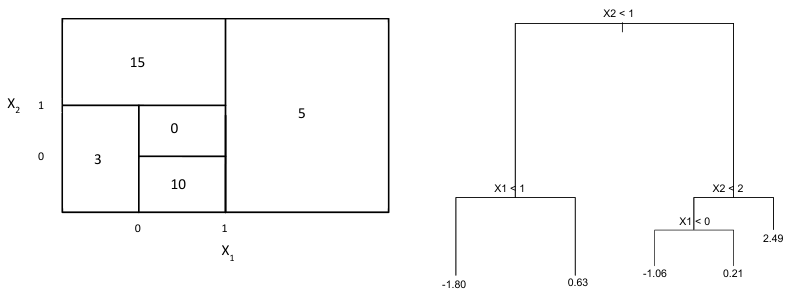

**图8.14** 左图：习题4(a)中的预测变量空间划分。右图：习题4(b)中的树。图内 $X_1$、$X_2$ 为两个预测变量；区域均值、切分阈值及叶结点数值保持原样。

   (a) 画出与图8.14左图所示预测变量空间划分对应的树。方框中的数字表示各区域内 $Y$ 的均值。

   (b) 根据图8.14右图所示的树，画一张与该图左侧类似的示意图。应将预测变量空间划分为正确的区域，并标明各区域的均值。

5. 假设从一个包含红、绿两类的数据集中生成十个自助样本，然后分别在每个自助样本上拟合一棵分类树。对于某个特定的 $X$ 值，得到 $P(\text{类别为红色}\mid X)$ 的10个估计值：

   $$
   0.1,\ 0.15,\ 0.2,\ 0.2,\ 0.55,\ 0.6,\ 0.6,\ 0.65,\ 0.7,\ 0.75.
   $$

   将这些结果合并为单个类别预测有两种常见方法：一种是本章介绍的多数投票法，另一种是根据平均概率进行分类。在这个例子中，两种方法最终分别会给出什么分类？

6. 详细解释用于拟合回归树的算法。

### 应用题

7. 在第8.3.3节中，我们将随机森林用于 `Boston` 数据，设置 `max_features = 6`，并分别使用 `n_estimators = 100` 和 `n_estimators = 500`。现在，针对更广泛的 `max_features` 和 `n_estimators` 取值范围，画图展示随机森林在该数据集上的测试误差。可以仿照图8.10绘图。描述所得结果。

8. 在实验中，我们先把 `Sales` 转换为定性响应变量，再对 `Carseats` 数据集应用分类树。现在将响应视为定量变量，使用回归树及相关方法预测 `Sales`。

   (a) 将数据集划分为训练集和测试集。

   (b) 在训练集上拟合回归树。画出这棵树并解释结果。得到的测试MSE是多少？

   (c) 使用交叉验证确定最优的树复杂度。剪枝是否改善了测试MSE？

   (d) 使用装袋法分析这些数据。得到的测试MSE是多少？根据 `feature_importance_` 的值确定哪些变量最重要。

   (e) 使用随机森林分析这些数据。得到的测试MSE是多少？根据 `feature_importance_` 的值确定哪些变量最重要。描述每次切分时考虑的变量数 $m$ 对所得错误率的影响。

   (f) 现在使用BART分析这些数据，并报告结果。

9. 本题使用 `ISLP` 包中的 `OJ` 数据集。

   (a) 随机抽取800个观测构成训练集，其余观测构成测试集。

   (b) 在训练数据上拟合一棵树，以 `Purchase` 为响应，其余变量为预测变量。训练错误率是多少？

   (c) 画出这棵树并解释结果。树有多少个终端结点？

   (d) 使用 `export_tree()` 函数生成所拟合树的文本摘要。选取其中一个终端结点，解释所显示的信息。

   (e) 预测测试数据的响应，生成混淆矩阵，比较测试标签与预测的测试标签。测试错误率是多少？

   (f) 在训练集上使用交叉验证，确定最优的树大小。

   (g) 画一张图，横轴为树的大小，纵轴为交叉验证分类错误率。

   (h) 交叉验证分类错误率最低时，树的大小是多少？

   (i) 根据交叉验证得到的最优树大小，生成相应的剪枝树。如果交叉验证没有选择剪枝树，则生成一棵具有五个终端结点的剪枝树。

   (j) 比较剪枝树与未剪枝树的训练错误率。哪一个更高？

   (k) 比较剪枝树与未剪枝树的测试错误率。哪一个更高？

10. 现在使用提升法预测 `Hitters` 数据集中的 `Salary`。

    (a) 删除薪资信息未知的观测，然后对薪资做对数变换。

    (b) 用前200个观测构成训练集，其余观测构成测试集。

    (c) 对收缩参数 $\lambda$ 采用一系列不同取值，在训练集上使用1,000棵树进行提升。画一张图，横轴为不同的收缩参数值，纵轴为相应的训练集MSE。

    (d) 画一张图，横轴为不同的收缩参数值，纵轴为相应的测试集MSE。

    (e) 将提升法的测试MSE，与第3章和第6章介绍的回归方法中任选两种所得到的测试MSE进行比较。

    (f) 在提升模型中，哪些变量看起来是最重要的预测变量？

    (g) 现在对训练集应用装袋法。这种方法的测试集MSE是多少？

11. 本题使用 `Caravan` 数据集。

    (a) 用前1,000个观测构成训练集，其余观测构成测试集。

    (b) 在训练集上拟合提升模型，以 `Purchase` 为响应，其余变量为预测变量。使用1,000棵树，收缩参数取0.01。哪些预测变量看起来最重要？

    (c) 用提升模型预测测试数据的响应。如果估计的购买概率大于20%，就预测该人会购买。构造混淆矩阵。在被预测为会购买的人中，实际购买的比例是多少？与在该数据集上应用KNN或逻辑回归所得的结果相比如何？

12. 自选一个数据集，应用提升法、装袋法、随机森林和BART。务必在训练集上拟合模型，并在测试集上评价表现。与线性回归或逻辑回归等简单方法相比，结果有多准确？其中哪种方法表现最好？
