本章讨论支持向量机（SVM）。这是一种分类方法，由计算机科学界在20世纪90年代提出，此后日益流行。支持向量机在多种情境中都表现良好，常被认为是最好的“开箱即用”分类器之一。

支持向量机是对一种简单、直观的分类器的推广，这种分类器称为**最大间隔分类器（maximal margin classifier）**，将在9.1节介绍。虽然它简洁而优美，但我们将看到，它要求各类别能够用线性边界分开，因此遗憾的是，大多数数据集都不能使用它。9.2节介绍**支持向量分类器（support vector classifier）**，它扩展了最大间隔分类器，适用情形更广。9.3节介绍支持向量机，它在支持向量分类器的基础上进一步扩展，以适应非线性的类别边界。支持向量机原本面向只有两个类别的二元分类情形；9.4节将讨论如何把它扩展到两个以上类别的情形。9.5节讨论支持向量机与逻辑回归等其他统计方法之间的密切联系。

人们常常把最大间隔分类器、支持向量分类器和支持向量机统称为“支持向量机”。为避免混淆，本章将仔细区分这三个概念。

## 9.1 最大间隔分类器

本节定义**超平面（hyperplane）**，并介绍**最优分离超平面（optimal separating hyperplane）** 的概念。

### 9.1.1 什么是超平面？

在 $p$ 维空间中，超平面是一个维数为 $p-1$ 的平坦仿射子空间。<sup><a href="#ch09-fn1" id="ch09-fnref1">1</a></sup> 例如，在二维空间中，超平面是平坦的一维子空间，也就是一条直线。在三维空间中，超平面是平坦的二维子空间，也就是一个平面。当 $p>3$ 时，超平面可能难以直观呈现，但它仍然是一个平坦的 $(p-1)$ 维子空间。

<aside class="footnote" id="ch09-fn1"><a href="#ch09-fnref1">1</a> “仿射（affine）”表示这个子空间不必经过原点。</aside>

超平面的数学定义相当简单。在二维空间中，超平面由方程

$$
\beta_0+\beta_1X_1+\beta_2X_2=0 \tag{9.1}
$$

定义，其中参数为 $\beta_0$、$\beta_1$ 和 $\beta_2$。我们说式（9.1）“定义”了超平面，是指任何满足式（9.1）的 $X=(X_1,X_2)^T$，都是超平面上的一个点。注意，式（9.1）就是直线方程，因为在二维空间中，超平面确实就是一条直线。

式（9.1）很容易扩展到 $p$ 维情形：

$$
\beta_0+\beta_1X_1+\beta_2X_2+\cdots+\beta_pX_p=0 \tag{9.2}
$$

定义了一个 $p$ 维超平面。同样，这意味着：如果 $p$ 维空间中的点 $X=(X_1,X_2,\ldots,X_p)^T$（即长度为 $p$ 的向量）满足式（9.2），那么 $X$ 就位于该超平面上。

现在，假设 $X$ 不满足式（9.2），而是满足

$$
\beta_0+\beta_1X_1+\beta_2X_2+\cdots+\beta_pX_p>0. \tag{9.3}
$$

这就说明，$X$ 位于超平面的一侧。反之，如果

$$
\beta_0+\beta_1X_1+\beta_2X_2+\cdots+\beta_pX_p<0, \tag{9.4}
$$

那么 $X$ 就位于超平面的另一侧。因此，可以把超平面看作将 $p$ 维空间分成两半。只需计算式（9.2）左侧的正负号，就能轻易判断一个点位于超平面的哪一侧。图9.1展示了二维空间中的一个超平面。

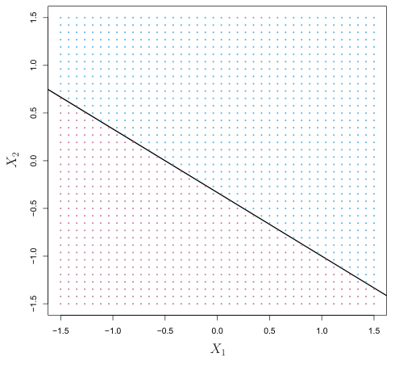

**图9.1** 图中展示了超平面 $1+2X_1+3X_2=0$。蓝色区域由满足 $1+2X_1+3X_2>0$ 的点构成，紫色区域由满足 $1+2X_1+3X_2<0$ 的点构成。图内坐标 $X_1$、$X_2$ 和数值保持原样。

### 9.1.2 使用分离超平面进行分类

现在，假设我们有一个 $n\times p$ 的数据矩阵 $\mathbf{X}$，它由 $p$ 维空间中的 $n$ 个训练观测构成：

$$
x_1=\begin{pmatrix}x_{11}\\\vdots\\x_{1p}\end{pmatrix},\ldots,x_n=\begin{pmatrix}x_{n1}\\\vdots\\x_{np}\end{pmatrix}, \tag{9.5}
$$

这些观测属于两个类别，即 $y_1,\ldots,y_n\in\{-1,1\}$，其中 $-1$ 代表一个类别，1代表另一个类别。

我们还有一个测试观测，它的观测特征是一个 $p$ 维向量 $x^*=(x_1^*\ \cdots\ x_p^*)^T$。我们的目标是根据训练数据构建分类器，利用测试观测的特征测量值对其正确分类。前面已经介绍过一些完成这项任务的方法，例如第4章的线性判别分析和逻辑回归，以及第8章的分类树、装袋法和提升法。现在，我们将介绍一种基于**分离超平面（separating hyperplane）** 概念的新方法。

假设能够构建一个超平面，按照类别标签将训练观测完全分开。图9.2左图展示了三个这样的分离超平面。可以把蓝色类别的观测标为 $y_i=1$，把紫色类别的观测标为 $y_i=-1$。于是，分离超平面具有以下性质：

$$
\beta_0+\beta_1x_{i1}+\beta_2x_{i2}+\cdots+\beta_px_{ip}>0\quad\text{若 }y_i=1, \tag{9.6}
$$

且

$$
\beta_0+\beta_1x_{i1}+\beta_2x_{i2}+\cdots+\beta_px_{ip}<0\quad\text{若 }y_i=-1. \tag{9.7}
$$

等价地，分离超平面具有性质

$$
y_i(\beta_0+\beta_1x_{i1}+\beta_2x_{i2}+\cdots+\beta_px_{ip})>0 \tag{9.8}
$$

对所有 $i=1,\ldots,n$ 成立。

如果存在分离超平面，就可以利用它构建一种很自然的分类器：根据测试观测位于超平面的哪一侧，把它分配给相应类别。图9.2右图给出了这样的分类器的例子。也就是说，根据 $f(x^*)=\beta_0+\beta_1x_1^*+\beta_2x_2^*+\cdots+\beta_px_p^*$ 的正负号对测试观测 $x^*$ 分类。如果 $f(x^*)$ 为正，就把它分到类别1；如果 $f(x^*)$ 为负，就把它分到类别 $-1$。还可以利用 $f(x^*)$ 的大小。

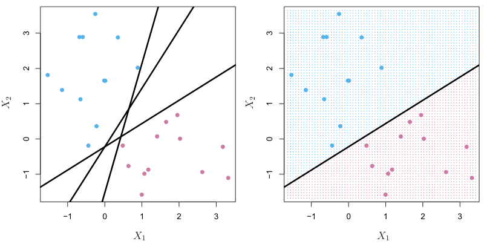

**图9.2** 左图：两个类别的观测分别用蓝色和紫色表示，每个观测都有两个变量的测量值。黑线给出了众多可能的分离超平面中的三个。右图：黑线表示一个分离超平面。蓝色和紫色网格表示基于这个分离超平面的分类器所采用的决策规则：落在网格蓝色部分的测试观测被分到蓝色类别，落在紫色部分的测试观测被分到紫色类别。图内坐标 $X_1$、$X_2$ 和数值保持原样。

如果 $f(x^*)$ 远离0，就说明 $x^*$ 离超平面很远，因此我们对 $x^*$ 的类别判定可以很有把握。反之，如果 $f(x^*)$ 接近0，那么 $x^*$ 就位于超平面附近，我们对其类别判定的把握也就较小。正如图9.2所示，基于分离超平面的分类器会产生线性决策边界，这并不令人意外。

### 9.1.3 最大间隔分类器

一般来说，如果数据能被一个超平面完全分开，那么实际上会存在无穷多个这样的超平面。这是因为，通常可以把给定的分离超平面稍微向上或向下移动，或稍微旋转，而不碰到任何观测。图9.2左图展示了三个可能的分离超平面。要根据分离超平面构建分类器，就必须有合理的方法，从无穷多个可能的分离超平面中决定采用哪一个。

一个自然的选择是**最大间隔超平面（maximal margin hyperplane）**，也称**最优分离超平面**，即离训练观测最远的分离超平面。具体而言，对于一个给定的分离超平面，可以计算每个训练观测到它的垂直距离；这些距离中的最小值，就是观测到该超平面的最短距离，称为**间隔（margin）**。最大间隔超平面，就是使间隔达到最大的分离超平面；换言之，它到训练观测的最短距离最大。随后，根据测试观测位于最大间隔超平面的哪一侧，对其分类。这就称为最大间隔分类器。

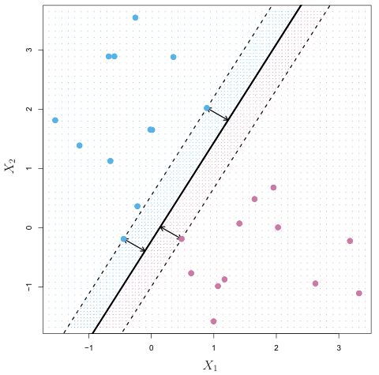

**图9.3** 两个类别的观测分别用蓝色和紫色表示。实线表示最大间隔超平面。间隔是实线到任意一条虚线的距离。位于虚线上的两个蓝点和一个紫点是支持向量；箭头表示这些点到超平面的距离。紫色和蓝色网格表示基于这个分离超平面的分类器所采用的决策规则。图内坐标 $X_1$、$X_2$ 和数值保持原样。

我们希望，训练数据上间隔较大的分类器，在测试数据上也有较大的间隔，从而正确分类测试观测。虽然最大间隔分类器往往表现不错，但当 $p$ 很大时，它也可能导致过拟合。

如果 $\beta_0,\beta_1,\ldots,\beta_p$ 是最大间隔超平面的系数，那么最大间隔分类器就根据 $f(x^*)=\beta_0+\beta_1x_1^*+\beta_2x_2^*+\cdots+\beta_px_p^*$ 的正负号，对测试观测 $x^*$ 分类。

图9.3展示了图9.2数据集的最大间隔超平面。把图9.2右图与图9.3比较，就会发现，图9.3的最大间隔超平面确实使观测到分离超平面的最短距离更大，也就是间隔更大。从某种意义上说，最大间隔超平面是能插入两个类别之间的最宽“板带”的中线。

仔细看图9.3，可以发现有三个训练观测与最大间隔超平面的距离相同，并位于表示间隔宽度的虚线上。这三个观测称为**支持向量（support vectors）**：它们是 $p$ 维空间中的向量（图9.3中 $p=2$），而且“支撑”着最大间隔超平面；如果稍微移动这些点，最大间隔超平面也会随之移动。有趣的是，最大间隔超平面直接依赖支持向量，却不依赖其他观测：只要其他观测的移动没有使其越过间隔所确定的边界，移动其中任何一个观测都不会影响分离超平面。

最大间隔超平面只直接依赖少量观测这一性质十分重要。在本章后面讨论支持向量分类器和支持向量机时，我们还会遇到这一性质。

### 9.1.4 构建最大间隔分类器

现在考虑如何根据 $n$ 个训练观测 $x_1,\ldots,x_n\in\mathbb{R}^p$ 及其类别标签 $y_1,\ldots,y_n\in\{-1,1\}$，构建最大间隔超平面。简言之，最大间隔超平面是以下优化问题的解：

$$
\underset{\beta_0,\beta_1,\ldots,\beta_p,M}{\text{最大化}}\ M \tag{9.9}
$$

$$
\text{满足}\quad\sum_{j=1}^{p}\beta_j^2=1, \tag{9.10}
$$

$$
y_i(\beta_0+\beta_1x_{i1}+\beta_2x_{i2}+\cdots+\beta_px_{ip})\ge M\quad\forall\ i=1,\ldots,n. \tag{9.11}
$$

优化问题（9.9）–（9.11）其实比看起来简单。首先，只要 $M$ 为正，式（9.11）中的约束

$$
y_i(\beta_0+\beta_1x_{i1}+\beta_2x_{i2}+\cdots+\beta_px_{ip})\ge M\quad\forall\ i=1,\ldots,n
$$

就保证每个观测都位于超平面的正确一侧。（实际上，要让每个观测都位于超平面的正确一侧，只需 $y_i(\beta_0+\beta_1x_{i1}+\beta_2x_{i2}+\cdots+\beta_px_{ip})>0$。因此，只要 $M$ 为正，式（9.11）就进一步要求每个观测在超平面的正确一侧留出一定余地。）

其次，注意式（9.10）实际上并不限制超平面本身，因为如果 $\beta_0+\beta_1x_{i1}+\beta_2x_{i2}+\cdots+\beta_px_{ip}=0$ 定义了一个超平面，那么对于任意 $k\ne0$，$k(\beta_0+\beta_1x_{i1}+\beta_2x_{i2}+\cdots+\beta_px_{ip})=0$ 也定义了同一个超平面。不过，式（9.10）使式（9.11）有了明确的含义：可以证明，在这一约束下，第 $i$ 个观测到超平面的垂直距离为

$$
y_i(\beta_0+\beta_1x_{i1}+\beta_2x_{i2}+\cdots+\beta_px_{ip}).
$$

因此，约束（9.10）和（9.11）保证每个观测都在超平面的正确一侧，而且到超平面的距离至少为 $M$。所以，$M$ 代表超平面的间隔，优化问题则选择 $\beta_0,\beta_1,\ldots,\beta_p$，使 $M$ 达到最大。这正是最大间隔超平面的定义！问题（9.9）–（9.11）可以高效求解，但这种优化的细节超出了本书范围。

### 9.1.5 不可分的情形

*如果存在分离超平面*，最大间隔分类器是一种很自然的分类方法。不过，正如前面所暗示的，很多情况下并不存在分离超平面，因此也就没有最大间隔分类器。

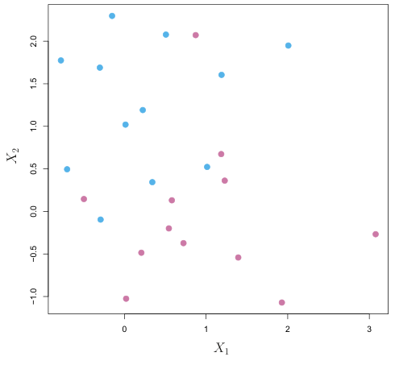

**图9.4** 两个类别的观测分别用蓝色和紫色表示。在这个例子中，无法用超平面将两个类别分开，因此不能使用最大间隔分类器。图内坐标 $X_1$、$X_2$ 和数值保持原样。

此时，优化问题（9.9）–（9.11）没有满足 $M>0$ 的解。图9.4给出了一个例子：这里无法将两个类别*完全*分开。不过，正如下节将要介绍的，可以扩展分离超平面的概念，使用所谓的**软间隔（soft margin）**，构建一个*几乎*能分开两个类别的超平面。将最大间隔分类器推广到不可分情形，就得到了支持向量分类器。

## 9.2 支持向量分类器

### 9.2.1 支持向量分类器概述

从图9.4可知，属于两个类别的观测未必能用一个超平面分开。事实上，即使存在分离超平面，在某些情形下，基于它的分类器也未必理想。基于分离超平面的分类器必然会将所有训练观测完全正确地分类，这可能使它对个别观测十分敏感。图9.5展示了一个例子：右图仅增加了一个观测，就导致最大间隔超平面发生剧烈变化。由此得到的最大间隔超平面并不令人满意，首先，它的间隔极小。这是个问题，因为如前所述，观测到超平面的距离可以看作我们对其分类正确程度的信心度量。此外，最大间隔超平面对一个观测的变化都极其敏感，这也提示它可能对训练数据过拟合了。

在这种情况下，我们也许愿意考虑一种基于超平面的分类器，它不必完全分开两个类别，以求：

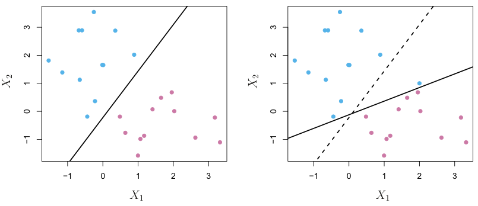

**图9.5** 左图：蓝色和紫色表示两个类别的观测，同时画出了最大间隔超平面。右图：增加了一个蓝色观测，使实线所示的最大间隔超平面发生剧烈偏移。虚线表示没有增加这个点时得到的最大间隔超平面。图内坐标 $X_1$、$X_2$ 和数值保持原样。

- 对个别观测更加稳健；
- 更好地分类大多数训练观测。

也就是说，为了更好地分类其余观测，允许少数训练观测被误分类，可能是值得的。

支持向量分类器有时也称为**软间隔分类器（soft margin classifier）**，它正是这样做的。我们不再追求一个尽可能大的间隔，同时要求每个观测既位于超平面的正确一侧，也位于间隔边界的正确一侧；相反，允许部分观测落在间隔边界的错误一侧，甚至落在超平面的错误一侧。（间隔之所以是“软”的，是因为部分训练观测可以违背它的限制。）图9.6左图给出了一个例子。大多数观测位于间隔边界的正确一侧，但少量观测位于错误一侧。

观测不仅可能位于间隔边界的错误一侧，还可能位于超平面的错误一侧。事实上，当不存在分离超平面时，这种情形不可避免。位于超平面错误一侧的观测，就是被支持向量分类器误分类的训练观测。图9.6右图展示了这种情形。

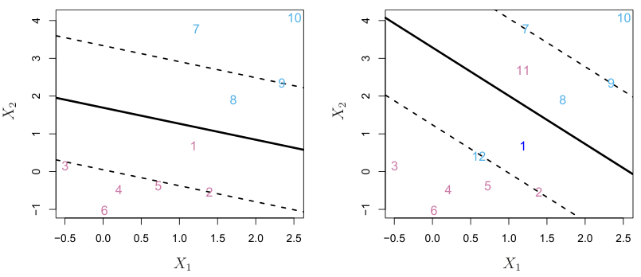

**图9.6** 左图：对一个小型数据集拟合支持向量分类器。实线表示超平面，虚线表示间隔边界。紫色观测：观测3、4、5、6位于间隔边界的正确一侧，观测2在间隔边界上，观测1位于间隔边界的错误一侧。蓝色观测：观测7、10位于间隔边界的正确一侧，观测9在间隔边界上，观测8位于间隔边界的错误一侧。没有观测位于超平面的错误一侧。右图：与左图相同，但增加了两个点11、12。这两个观测既位于超平面的错误一侧，也位于间隔边界的错误一侧。图内坐标 $X_1$、$X_2$、观测编号和数值保持原样。

### 9.2.2 支持向量分类器的细节

支持向量分类器根据测试观测位于超平面的哪一侧，对其分类。所选择的超平面应能将大多数训练观测正确地分到两个类别中，但也可能误分类少数观测。

它是以下优化问题的解：

$$
\underset{\beta_0,\beta_1,\ldots,\beta_p,\epsilon_1,\ldots,\epsilon_n,M}{\text{最大化}}\ M \tag{9.12}
$$

$$
\text{满足}\quad\sum_{j=1}^{p}\beta_j^2=1, \tag{9.13}
$$

$$
y_i(\beta_0+\beta_1x_{i1}+\beta_2x_{i2}+\cdots+\beta_px_{ip})\ge M(1-\epsilon_i), \tag{9.14}
$$

$$
\epsilon_i\ge0,\quad\sum_{i=1}^{n}\epsilon_i\le C, \tag{9.15}
$$

其中，$C$ 是非负的调节参数。与式（9.11）中一样，$M$ 是间隔的宽度；我们的目标是使它尽可能大。式（9.14）中的 $\epsilon_1,\ldots,\epsilon_n$ 是**松弛变量（slack variables）**，它们允许个别观测位于间隔边界或超平面的错误一侧；稍后会详细解释。求解问题（9.12）–（9.15）之后，就像前面一样，只需确定测试观测 $x^*$ 位于超平面的哪一侧，就能对其分类。也就是说，根据 $f(x^*)=\beta_0+\beta_1x_1^*+\cdots+\beta_px_p^*$ 的正负号分类。

问题（9.12）–（9.15）看似复杂，但通过下面一系列简单的观察，就能理解其行为。首先，松弛变量 $\epsilon_i$ 告诉我们第 $i$ 个观测相对于超平面和间隔的位置。如果 $\epsilon_i=0$，那么第 $i$ 个观测位于间隔边界的正确一侧，正如9.1.4节所示。如果 $\epsilon_i>0$，那么第 $i$ 个观测位于间隔边界的错误一侧，我们称它违背了间隔的限制。如果 $\epsilon_i>1$，那么它位于超平面的错误一侧。

现在考虑调节参数 $C$ 的作用。在式（9.15）中，$C$ 为所有 $\epsilon_i$ 之和设定上限，因此决定了我们能够容忍的间隔违例（以及超平面违例）的数量和严重程度。可以把 $C$ 理解为：允许 $n$ 个观测违背间隔限制的“预算”。如果 $C=0$，就没有违例预算，此时必有 $\epsilon_1=\cdots=\epsilon_n=0$，问题（9.12）–（9.15）也就等同于最大间隔超平面的优化问题（9.9）–（9.11）。（当然，只有两个类别可分时，最大间隔超平面才存在。）当 $C>0$ 时，位于超平面错误一侧的观测不可能超过 $C$ 个，因为这样的观测必有 $\epsilon_i>1$，而式（9.15）要求 $\sum_{i=1}^{n}\epsilon_i\le C$。随着预算 $C$ 增大，我们对间隔违例的容忍度提高，因此间隔变宽。反之，随着 $C$ 减小，对间隔违例的容忍度降低，间隔也变窄。图9.7展示了一个例子。

实践中，通常把 $C$ 作为调节参数，通过交叉验证选择。与本书此前介绍的调节参数一样，$C$ 控制这一统计学习方法的偏差—方差权衡。当 $C$ 很小时，我们寻求的是很少出现违例的窄间隔；这意味着分类器对数据拟合得很紧，可能具有低偏差和高方差。另一方面，当 $C$ 较大时，间隔更宽，也允许更多违例；这相当于放松对数据的拟合，得到的分类器可能偏差较高，但方差较低。

优化问题（9.12）–（9.15）有一个很有趣的性质：只有位于间隔边界上，或违背间隔限制的观测，才会影响超平面，从而影响得到的分类器。换言之，严格位于间隔边界正确一侧的观测，不会影响支持向量分类器！只要这类观测的新位置仍在间隔边界的正确一侧，改变其位置完全不会改变分类器。恰好位于间隔边界上，或位于其所属类别的间隔边界错误一侧的观测，称为支持向量。这些观测会影响支持向量分类器。

只有支持向量影响分类器，这与前面关于 $C$ 控制支持向量分类器偏差—方差权衡的说法一致。当调节参数 $C$ 很大时，间隔很宽，许多观测违背间隔限制，因此支持向量很多。这时，许多观测都参与决定超平面。图9.7左上图展示了这种情形：这个分类器的方差较低（因为许多观测都是支持向量），但偏差可能较高。相反，如果 $C$ 很小，支持向量就较少，得到的分类器便具有低偏差和高方差。图9.7右下图展示了这种情形，其中只有八个支持向量。

支持向量分类器的决策规则可能只依赖少量训练观测（即支持向量），这意味着它对远离超平面的观测的变化相当稳健。

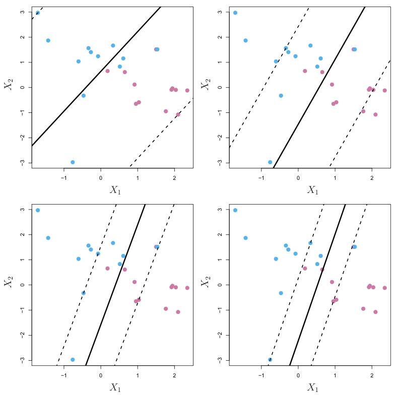

**图9.7** 用问题（9.12）–（9.15）中调节参数 $C$ 的四个不同取值，分别拟合支持向量分类器。左上图使用的 $C$ 最大；右上、左下、右下各图依次使用更小的值。当 $C$ 很大时，对观测位于间隔边界错误一侧的容忍度很高，因此间隔很大。随着 $C$ 减小，这种容忍度下降，间隔也变窄。图内坐标 $X_1$、$X_2$ 和数值保持原样。

这一性质不同于前几章介绍的一些分类方法，例如线性判别分析。回想一下，LDA的分类规则依赖每个类别中所有观测的均值，以及利用全部观测计算的类内协方差矩阵。与LDA不同，逻辑回归对远离决策边界的观测也很不敏感。事实上，9.5节将说明，支持向量分类器与逻辑回归关系密切。

## 9.3 支持向量机 (Support Vector Machines)

我们先讨论一种通用机制，将线性分类器转变为能够产生非线性决策边界的分类器。然后介绍支持向量机，它能够自动实现这一过程。

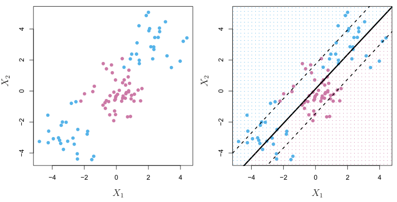

**图9.8** 左图：观测分属于两个类别，类别之间的边界是非线性的。右图：支持向量分类器寻找线性边界，因此表现很差。图内的 $X_1$、$X_2$ 为两个特征，坐标刻度保持原样。

### 9.3.1 使用非线性决策边界进行分类

在二分类问题中，如果两个类别之间的边界是线性的，支持向量分类器是一种自然的分类方法。然而，实践中有时会遇到非线性的类别边界。例如，考虑图9.8左图中的数据。显然，支持向量分类器或任何线性分类器在这里都会表现不佳。事实上，图9.8右图所示的支持向量分类器在这里毫无用处。

第7章中也遇到过类似的情况。我们在那里看到，当预测变量与结果之间存在非线性关系时，线性回归的表现可能很差。在这种情况下，我们考虑利用预测变量的函数，例如二次项和三次项，扩展**特征空间（feature space）**，以处理这种非线性。对于支持向量分类器，也可以采用类似的方法：利用预测变量的二次、三次乃至更高次多项式函数扩展特征空间，从而处理类别之间可能存在的非线性边界。例如，我们可以不使用 $p$ 个特征

$$
X_1,X_2,\ldots,X_p,
$$

而改为使用 $2p$ 个特征来拟合支持向量分类器：

$$
X_1,X_1^2,X_2,X_2^2,\ldots,X_p,X_p^2.
$$


于是，式（9.12）–（9.15）变为

$$
\begin{aligned}
&\underset{\beta_0,\beta_{11},\beta_{12},\ldots,\beta_{p1},\beta_{p2},\epsilon_1,\ldots,\epsilon_n,\,M}{\text{最大化}}\quad M\\
&\text{约束条件为}\quad y_i\left(\beta_0+\sum_{j=1}^{p}\beta_{j1}x_{ij}+\sum_{j=1}^{p}\beta_{j2}x_{ij}^{2}\right)\geq M(1-\epsilon_i),\\
&\sum_{i=1}^{n}\epsilon_i\leq C,\quad \epsilon_i\geq0,\quad\sum_{j=1}^{p}\sum_{k=1}^{2}\beta_{jk}^{2}=1.
\end{aligned}\tag{9.16}
$$

为什么这会产生非线性决策边界？在扩展后的特征空间中，由式（9.16）得到的决策边界实际上是线性的。但在原始特征空间中，决策边界具有 $q(x)=0$ 的形式，其中 $q$ 是一个二次多项式，其解通常是非线性的。我们还可能希望利用更高次的多项式项，或者形如 $X_jX_{j'}$（$j\ne j'$）的交互项，进一步扩展特征空间。也可以不采用多项式，而考虑预测变量的其他函数。不难看出，扩展特征空间的方法很多；如果不加注意，最终可能会得到数量极其庞大的特征，使计算变得难以处理。接下来介绍的支持向量机能够扩展支持向量分类器所使用的特征空间，同时保持计算效率。

### 9.3.2 支持向量机 (The Support Vector Machine)

支持向量机（SVM）是支持向量分类器的一种扩展，它使用**核（kernel）**，以特定方式扩展特征空间。下面讨论这一扩展，其细节较为复杂，超出了本书范围。不过，主要思路已在9.3.1节说明：我们可能希望扩展特征空间，以适应类别之间的非线性边界。这里介绍的核方法，只是高效实现这一思路的一种计算方法。

我们尚未具体讨论如何计算支持向量分类器，因为其细节涉及一些技术问题。不过，支持向量分类器问题（9.12）–（9.15）的解，实际上只涉及观测之间的**内积（inner product）**，而不直接涉及观测本身。两个 $r$ 维向量 $a$ 与 $b$ 的内积定义为 $\langle a,b\rangle=\sum_{i=1}^{r}a_ib_i$。因此，两个观测 $x_i$ 与 $x_{i'}$ 的内积为

$$
\langle x_i,x_{i'}\rangle=\sum_{j=1}^{p}x_{ij}x_{i'j}.\tag{9.17}
$$

可以证明：

- 线性支持向量分类器可以表示为

    $$
    f(x)=\beta_0+\sum_{i=1}^{n}\alpha_i\langle x,x_i\rangle,\tag{9.18}
    $$


    其中有 $n$ 个参数 $\alpha_i$（$i=1,\ldots,n$），每个训练观测对应一个参数。

- 要估计参数 $\alpha_1,\ldots,\alpha_n$ 和 $\beta_0$，我们只需要所有训练观测对之间的 $\binom{n}{2}$ 个内积 $\langle x_i,x_{i'}\rangle$。（记号 $\binom{n}{2}$ 表示 $n(n-1)/2$，即 $n$ 个元素中不同元素对的数量。）

注意，在式（9.18）中，为了计算函数 $f(x)$ 的值，需要计算新点 $x$ 与每个训练点 $x_i$ 之间的内积。不过，实际上只有解中的支持向量对应的 $\alpha_i$ 非零；也就是说，如果某个训练观测不是支持向量，它的 $\alpha_i$ 就等于零。因此，如果用 $\mathcal{S}$ 表示这些支持点的索引集合，就可以把式（9.18）形式的任意解函数改写为

$$
f(x)=\beta_0+\sum_{i\in\mathcal{S}}\alpha_i\langle x,x_i\rangle,\tag{9.19}
$$

其中的项数通常远少于式（9.18）。<sup><a href="#ch09-fn2" id="ch09-fnref2">2</a></sup>

<aside class="footnote" id="ch09-fn2"><a href="#ch09-fnref2">2</a> 展开式（9.19）中的每个内积，就容易看出，$f(x)$ 是 $x$ 的各坐标的线性函数。这样做也能建立 $\alpha_i$ 与原始参数 $\beta_j$ 之间的对应关系。</aside>

概括来说，无论是表示线性分类器 $f(x)$，还是计算其系数，我们都只需要内积。

现在假设，每当内积（9.17）出现在表示式（9.18）中，或者出现在支持向量分类器的求解计算中，我们都将其替换为一种广义内积，形式为

$$
K(x_i,x_{i'}),\tag{9.20}
$$

其中 $K$ 是某个函数，我们称之为核。核是一个量化两个观测相似程度的函数。例如，我们可以直接取

$$
K(x_i,x_{i'})=\sum_{j=1}^{p}x_{ij}x_{i'j},\tag{9.21}
$$

这样得到的就是原来的支持向量分类器。式（9.21）称为**线性核（linear kernel）**，因为支持向量分类器对于特征是线性的；线性核本质上使用皮尔逊（标准）相关来量化一对观测的相似性。但是，也可以为式（9.20）选择其他形式。例如，可以将每一处 $\sum_{j=1}^{p}x_{ij}x_{i'j}$ 替换为

$$
K(x_i,x_{i'})=\left(1+\sum_{j=1}^{p}x_{ij}x_{i'j}\right)^d.\tag{9.22}
$$

这称为 $d$ 次**多项式核（polynomial kernel）**，其中 $d$ 为正整数。在支持向量分类器算法中，用 $d>1$ 的这种核代替标准线性核（9.21），会得到灵活得多的决策边界。


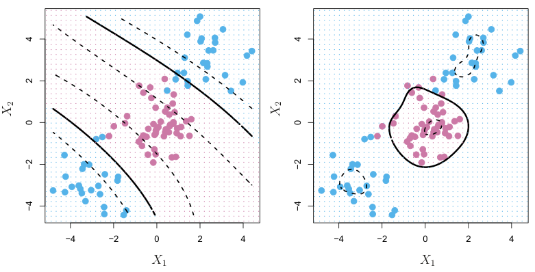

**图9.9** 左图：将使用三次多项式核的SVM应用于图9.8的非线性数据，得到的决策规则合适得多。右图：应用使用径向核的SVM。在本例中，两种核都能捕捉到决策边界。图内的 $X_1$、$X_2$ 及坐标刻度保持原样。

从本质上说，这相当于在一个包含 $d$ 次多项式的更高维空间中拟合支持向量分类器，而不是在原始特征空间中拟合。当支持向量分类器与式（9.22）这样的非线性核相结合时，得到的分类器就称为支持向量机。注意，此时的非线性函数具有如下形式：

$$
f(x)=\beta_0+\sum_{i\in\mathcal{S}}\alpha_iK(x,x_i).\tag{9.23}
$$

图9.9左图展示了一个例子：将带有多项式核的SVM应用于图9.8的非线性数据。与线性支持向量分类器相比，拟合有了很大改善。当 $d=1$ 时，SVM便退化为本章前面介绍的支持向量分类器。

式（9.22）中的多项式核只是非线性核的一个例子，还有许多其他选择。另一种常见选择是**径向核（radial kernel）**，其形式为

$$
K(x_i,x_{i'})=\exp\left(-\gamma\sum_{j=1}^{p}(x_{ij}-x_{i'j})^2\right).\tag{9.24}
$$

式（9.24）中，$\gamma$ 是一个正常数。图9.9右图给出了将使用径向核的SVM应用于这一非线性数据的例子；它也能很好地区分这两个类别。

径向核（9.24）究竟如何起作用？如果一个给定的测试观测 $x^*=(x_1^*,\ldots,x_p^*)^T$ 与某个训练观测 $x_i$ 的**欧几里得距离（Euclidean distance）** 很大，那么 $\sum_{j=1}^{p}(x_j^*-x_{ij})^2$ 就很大，因此 $K(x^*,x_i)=\exp(-\gamma\sum_{j=1}^{p}(x_j^*-x_{ij})^2)$ 就非常小。这意味着，在式（9.23）中，$x_i$ 对 $f(x^*)$ 几乎不起作用。回顾一下，测试观测 $x^*$ 的预测类别标签取决于 $f(x^*)$ 的正负号。换言之，远离 $x^*$ 的训练观测对 $x^*$ 的预测类别标签基本不起作用。

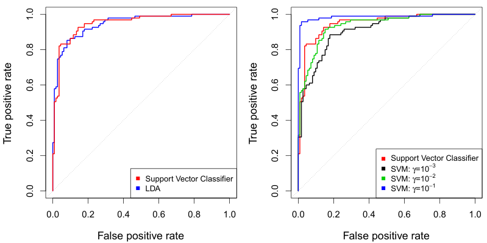

**图9.10** `Heart` 数据训练集上的ROC曲线。左图：比较支持向量分类器与LDA。右图：将支持向量分类器与使用径向基核（radial basis kernel）、$\gamma$ 分别为 $10^{-3}$、$10^{-2}$ 和 $10^{-1}$ 的SVM进行比较。图内文字：True positive rate＝真阳性率；False positive rate＝假阳性率；Support Vector Classifier＝支持向量分类器；LDA＝线性判别分析；SVM及 $\gamma$ 取值保持原样。

因此，径向核具有很强的局部性，也就是说，只有邻近的训练观测才会影响某个测试观测的类别标签。

使用核，与像式（9.16）那样直接利用原始特征的函数扩展特征空间相比，有什么优势？一个优势在于计算：使用核时，只需要对所有 $\binom{n}{2}$ 个不同的观测对 $i,i'$ 计算 $K(x_i,x_i')$，无须显式地在扩展后的特征空间中计算。这一点很重要，因为在许多SVM应用中，扩展后的特征空间非常大，计算会变得难以处理。对于径向核（9.24）这样的某些核，特征空间是隐式且无限维的，因此我们无论如何也不可能在那里直接完成计算！

### 9.3.3 在心脏病数据上的应用

第8章中，我们将决策树及相关方法应用于 `Heart` 数据。目标是利用 `Age`、`Sex` 和 `Chol` 等13个预测变量，预测一个人是否患有心脏病。现在考察SVM在这一数据上的表现与LDA相比如何。删除6个有缺失值的观测后，数据包含297名受试者。我们将其随机划分为207个训练观测和90个测试观测。

首先，对训练数据拟合LDA和支持向量分类器。注意，支持向量分类器等价于使用 $d=1$ 次多项式核的SVM。图9.10左图展示了LDA与支持向量分类器对训练集预测所得的ROC曲线（见4.4.2节）。两种分类器都会为每个观测计算形如 $\hat f(X)=\hat\beta_0+\hat\beta_1X_1+\hat\beta_2X_2+\cdots+\hat\beta_pX_p$ 的得分。对于任意给定的阈值 $t$，根据 $\hat f(X)<t$ 还是 $\hat f(X)\geq t$，将观测归入患有心脏病或没有心脏病的类别。对一系列 $t$ 值作出这些预测，并计算假阳性率和真阳性率，就可以得到ROC曲线。最优分类器的曲线会紧贴ROC图的左上角。

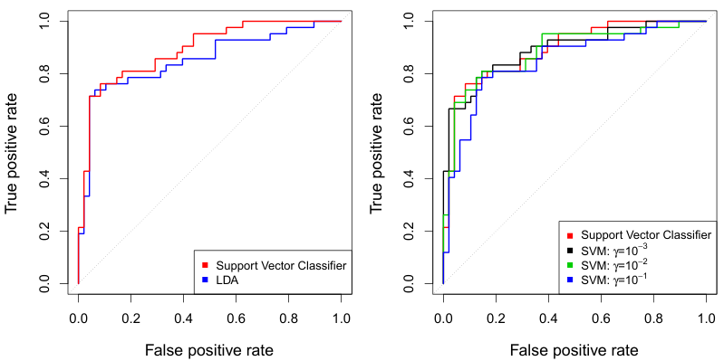

**图9.11** `Heart` 数据测试集上的ROC曲线。左图：比较支持向量分类器与LDA。右图：将支持向量分类器与使用径向基核、$\gamma$ 分别为 $10^{-3}$、$10^{-2}$ 和 $10^{-1}$ 的SVM进行比较。图内文字：True positive rate＝真阳性率；False positive rate＝假阳性率；Support Vector Classifier＝支持向量分类器；LDA＝线性判别分析；SVM及 $\gamma$ 取值保持原样。

在本例中，LDA和支持向量分类器的表现都很好，不过，支持向量分类器似乎略胜一筹。

图9.10右图展示了使用径向核、取不同 $\gamma$ 值的SVM所对应的ROC曲线。随着 $\gamma$ 增大、拟合变得更为非线性，ROC曲线有所改善。取 $\gamma=10^{-1}$ 时，ROC曲线看上去几乎完美。然而，这些曲线反映的是训练错误率，可能会误导我们对新测试数据上表现的判断。图9.11展示了在90个测试观测上计算得到的ROC曲线。它们与训练ROC曲线有所不同。图9.11左图中，支持向量分类器似乎比LDA略有优势，不过这些差异在统计上并不显著。右图中，在训练数据上表现最好的 $\gamma=10^{-1}$ 的SVM，在测试数据上给出了最差的估计结果。这再次表明，更灵活的方法虽然往往能获得较低的训练错误率，却不一定能改善在测试数据上的表现。$\gamma=10^{-2}$ 和 $\gamma=10^{-3}$ 的SVM与支持向量分类器表现相当，三者都优于 $\gamma=10^{-1}$ 的SVM。

## 9.4 多于两个类别的SVM

到目前为止，我们的讨论仅限于二分类，也就是只有两个类别的分类问题。如何将SVM扩展到类别数任意的一般情况？SVM所依据的分离超平面概念，并不能自然地适用于两个以上的类别。虽然已有多种将SVM扩展到 $K$ 类问题的方案，最常用的两种是**一对一（one-versus-one）**和**一对其余（one-versus-all）**方法。下面简要介绍这两种方法。

### 9.4.1 一对一分类

假设我们希望使用SVM进行分类，且有 $K>2$ 个类别。一对一方法，也称**全配对（all-pairs）**方法，会构建 $\binom{K}{2}$ 个SVM，每个SVM比较一对类别。例如，其中一个SVM可能比较编码为 $+1$ 的第 $k$ 类与编码为 $-1$ 的第 $k'$ 类。我们用这 $\binom{K}{2}$ 个分类器分别对一个测试观测进行分类，并统计该观测被分入各个类别的次数。最终，将它分入这 $\binom{K}{2}$ 次两两分类中出现次数最多的类别。

### 9.4.2 一对其余分类

一对其余方法（one-versus-all，也称 **one-versus-rest**）是将SVM应用于 $K>2$ 个类别时的另一种方法。我们拟合 $K$ 个SVM，每次将其中一个类别与其余 $K-1$ 个类别进行比较。用 $\beta_{0k},\beta_{1k},\ldots,\beta_{pk}$ 表示拟合一个SVM时得到的参数；这个SVM比较的是第 $k$ 类（编码为 $+1$）与其余类别（编码为 $-1$）。设 $x^*$ 表示一个测试观测。我们将该观测分入使 $\beta_{0k}+\beta_{1k}x_1^*+\beta_{2k}x_2^*+\cdots+\beta_{pk}x_p^*$ 最大的类别，因为这意味着，我们较有把握认为该观测属于第 $k$ 类，而不是其他任何类别。

## 9.5 与逻辑回归的关系 

SVM在20世纪90年代中期刚出现时，在统计学和机器学习领域引起了很大反响。部分原因在于它表现出色、宣传得力，也在于其基本方法看上去既新颖又神秘。寻找一个尽可能将数据分开的超平面，同时允许一些违背这种分离的情况，这一思路似乎与逻辑回归、线性判别分析等经典分类方法截然不同。此外，使用核扩展特征空间，以适应非线性类别边界，也仿佛是一项独特而有价值的特性。

然而，此后人们逐渐发现，SVM与其他更为经典的统计方法之间存在深刻联系。原来，拟合支持向量分类器 $f(X)=\beta_0+\beta_1X_1+\cdots+\beta_pX_p$ 的准则（9.12）–（9.15）可以改写为

$$
\underset{\beta_0,\beta_1,\ldots,\beta_p}{\text{最小化}}\left\{\sum_{i=1}^{n}\max\left[0,1-y_if(x_i)\right]+\lambda\sum_{j=1}^{p}\beta_j^2\right\},\tag{9.25}
$$

其中，$\lambda$ 是一个非负调节参数。当 $\lambda$ 较大时，$\beta_1,\ldots,\beta_p$ 较小，允许更多的间隔违例，得到的分类器方差较低、偏差较高。当 $\lambda$ 较小时，间隔违例较少，对应的分类器方差较高、偏差较低。

因此，式（9.25）中较小的 $\lambda$ 对应于式（9.15）中较小的 $C$。注意，式（9.25）中的 $\lambda\sum_{j=1}^{p}\beta_j^2$ 就是6.2.1节中的岭惩罚项；它在控制支持向量分类器的偏差—方差权衡方面发挥着类似作用。

式（9.25）现在具有本书中反复出现的“损失＋惩罚项”形式：

$$
\underset{\beta_0,\beta_1,\ldots,\beta_p}{\text{最小化}}\left\{L(\mathbf X,\mathbf y,\boldsymbol\beta)+\lambda P(\boldsymbol\beta)\right\}.\tag{9.26}
$$

式（9.26）中，$L(\mathbf X,\mathbf y,\boldsymbol\beta)$ 是某个损失函数，量化以 $\boldsymbol\beta$ 为参数的模型对数据 $(\mathbf X,\mathbf y)$ 的拟合程度；$P(\boldsymbol\beta)$ 是对参数向量 $\boldsymbol\beta$ 的惩罚函数，其作用由非负调节参数 $\lambda$ 控制。例如，岭回归和套索法都具有这一形式，其中

$$
L(\mathbf X,\mathbf y,\boldsymbol\beta)=\sum_{i=1}^{n}\left(y_i-\beta_0-\sum_{j=1}^{p}x_{ij}\beta_j\right)^2,
$$

岭回归对应 $P(\boldsymbol\beta)=\sum_{j=1}^{p}\beta_j^2$，套索法对应 $P(\boldsymbol\beta)=\sum_{j=1}^{p}|\beta_j|$。对于式（9.25），损失函数则采用如下形式：

$$
L(\mathbf X,\mathbf y,\boldsymbol\beta)=\sum_{i=1}^{n}\max\left[0,1-y_i(\beta_0+\beta_1x_{i1}+\cdots+\beta_px_{ip})\right].
$$

这称为**合页损失（hinge loss）**，如图9.12所示。不过，合页损失函数与逻辑回归所使用的损失函数有着密切联系；后者也展示在图9.12中。

支持向量分类器有一个有趣的特征：只有支持向量会影响最终得到的分类器，处于间隔正确一侧的观测不会影响它。这是因为，对于满足 $y_i(\beta_0+\beta_1x_{i1}+\cdots+\beta_px_{ip})\geq1$ 的观测，图9.12中的损失函数恰好为零；这些观测对应于处在间隔正确一侧的观测。<sup><a href="#ch09-fn3" id="ch09-fnref3">3</a></sup>

<aside class="footnote" id="ch09-fn3"><a href="#ch09-fnref3">3</a> 在这种“合页损失＋惩罚项”的表示中，间隔对应于数值1，而间隔的宽度由 $\sum\beta_j^2$ 决定。</aside>

相比之下，图9.12中逻辑回归的损失函数在任何位置都不恰好等于零，但对于远离决策边界的观测，其值非常小。由于两者的损失函数相似，逻辑回归与支持向量分类器往往给出非常接近的结果。当各类别分离得较好时，SVM的表现通常优于逻辑回归；当各类别重叠较多时，往往更倾向于采用逻辑回归。

支持向量分类器和SVM刚出现时，人们曾认为，式（9.15）中的调节参数 $C$ 是一个无关紧要的“干扰”参数，可以设为某个默认值，例如1。然而，支持向量分类器的“损失＋惩罚项”表示式（9.25）说明，事实并非如此。调节参数的选择非常重要，它决定了模型对数据欠拟合或过拟合的程度，例如图9.7所展示的情况。

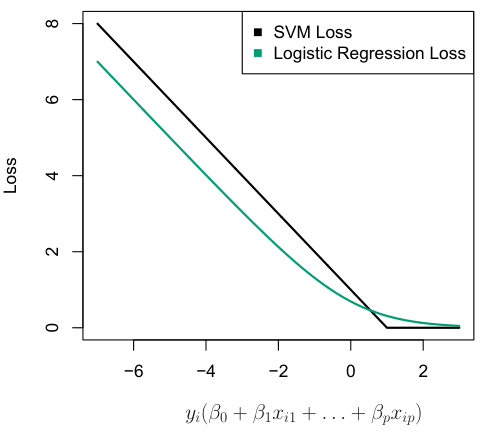

**图9.12** 比较SVM和逻辑回归的损失函数，它们都是 $y_i(\beta_0+\beta_1x_{i1}+\cdots+\beta_px_{ip})$ 的函数。当 $y_i(\beta_0+\beta_1x_{i1}+\cdots+\beta_px_{ip})$ 大于1时，SVM损失为零，因为这对应于处在间隔正确一侧的观测。总体而言，两个损失函数的表现相当相似。图内文字：Loss＝损失；SVM Loss＝SVM损失；Logistic Regression Loss＝逻辑回归损失；横轴表达式保持原样。

我们已经说明，支持向量分类器与逻辑回归以及其他已有的统计方法密切相关。那么，使用核扩展特征空间，以适应非线性类别边界，是SVM独有的做法吗？答案是否定的。逻辑回归和本书介绍的许多其他分类方法，同样可以使用非线性核；这与第7章中的一些非线性方法关系密切。不过，由于历史原因，非线性核在SVM中的使用，远比在逻辑回归或其他方法中的使用广泛。

虽然这里没有讨论，SVM实际上还可以扩展到回归问题，也就是响应为定量而非定性的情况，这称为**支持向量回归（support vector regression）**。第3章中，我们看到，最小二乘回归寻找系数 $\beta_0,\beta_1,\ldots,\beta_p$，使残差平方和尽可能小。（回顾第3章，残差定义为 $y_i-\beta_0-\beta_1x_{i1}-\cdots-\beta_px_{ip}$。）支持向量回归寻找的系数，则使另一种损失达到最小；在这种损失中，只有绝对值大于某个正常数的残差才会对损失函数作出贡献。这相当于将支持向量分类器中的间隔推广到了回归情形。

## 9.6 实验：支持向量机

本实验使用 `sklearn.svm` 库演示支持向量分类器和支持向量机。

先导入一些常用的库。

In[1]:

```python
import numpy as np
from matplotlib.pyplot import subplots, cm
import sklearn.model_selection as skm
from ISLP import load_data, confusion_table
```

同时集中导入本实验新用到的工具。

In[2]:

```python
from sklearn.svm import SVC
from ISLP.svm import plot as plot_svm
from sklearn.metrics import RocCurveDisplay
```

我们将用 `RocCurveDisplay.from_estimator()` 函数绘制几幅ROC图，并将它简记为 `roc_curve`。

In[3]:

```python
roc_curve = RocCurveDisplay.from_estimator # shorthand
```

### 9.6.1 支持向量分类器

现在使用 `sklearn` 中的 `SupportVectorClassifier()` 函数（简称 `SVC()`），针对给定的参数 `C` 拟合支持向量分类器。参数 `C` 用来指定违背间隔的代价。代价参数较小时，间隔较宽，许多支持向量会位于间隔边界上，或违背间隔。参数 `C` 较大时，间隔较窄，位于间隔边界上或违背间隔的支持向量也较少。

这里用一个二维示例演示 `SVC()` 的用法，以便画出得到的决策边界。首先生成属于两个类别的观测，并检查这两个类别是否线性可分。

In[4]:

```python
rng = np.random.default_rng(1)
X = rng.standard_normal((50, 2))
y = np.array([-1]*25+[1]*25)
X[y==1] += 1
fig, ax = subplots(figsize=(8,8))
ax.scatter(X[:,0],
           X[:,1],
           c=y,
           cmap=cm.coolwarm);
```

结果表明，它们并非线性可分。现在拟合分类器。

In[5]:

```python
svm_linear = SVC(C=10, kernel='linear')
svm_linear.fit(X, y)
```

Out[5]:

```python
SVC(C=10, kernel='linear')
```

对于具有两个特征的支持向量分类器，可以通过绘制其**决策函数（decision function）**的取值来展示分类结果。`ISLP` 包中提供了一个用于此目的的函数（其灵感来自 `sklearn` 文档中的一个类似示例）。

In[6]:

```python
fig, ax = subplots(figsize=(8,8))
plot_svm(X,
         y,
         svm_linear,
         ax=ax)
```

两个类别之间的决策边界是线性的（因为使用了参数 `kernel='linear'`）。支持向量用 `+` 标记，其余观测则画成圆点。

如果改用较小的代价参数值，会怎样呢？

In[7]:

```python
svm_linear_small = SVC(C=0.1, kernel='linear')
svm_linear_small.fit(X, y)
fig, ax = subplots(figsize=(8,8))
plot_svm(X,
         y,
         svm_linear_small ,
         ax=ax)
```

代价参数较小时，间隔更宽，因此会得到更多支持向量。对于线性核，可以按如下方式提取线性决策边界的系数：

In[8]:

```python
svm_linear.coef_
```

Out[8]:

```python
array([[1.173  , 0.7734]])
```

由于支持向量机在 `sklearn` 中是一个估计器，因此可以使用常规方法调节其参数。

In[9]:

```python
kfold = skm.KFold(5,
                  random_state=0,
                  shuffle=True)
grid = skm.GridSearchCV(svm_linear,
                        {'C':[0.001,0.01,0.1,1,5,10,100]},
                        refit=True,
                        cv=kfold,
                        scoring='accuracy')
grid.fit(X, y)
grid.best_params_
```

Out[9]:

```python
{'C': 1}
```

每个模型的交叉验证误差都可以方便地从 `grid.cv_results_` 中获得。它会输出大量细节，因此这里只提取准确率结果。

In[10]:

```python
grid.cv_results_[('mean_test_score')]
```

Out[10]:

```text
array([0.46, 0.46, 0.72, 0.74, 0.74, 0.74, 0.74])
```

可以看到，`C=1` 时得到最高的交叉验证准确率0.74，不过有几个 `C` 值的准确率相同。分类器 `grid.best_estimator_` 可以用于预测一组测试观测的类别标签。下面生成一个测试数据集。

In[11]:

```python
X_test = rng.standard_normal((20, 2))
y_test = np.array([-1]*10+[1]*10)
X_test[y_test==1] += 1
```

现在预测这些测试观测的类别标签。这里用交叉验证选出的最佳模型进行预测。

In[12]:

```python
best_ = grid.best_estimator_
y_test_hat = best_.predict(X_test)
confusion_table(y_test_hat , y_test)
```

Out[12]:

```text
    Truth  -1   1
Predicted
       -1   8   4
        1   2   6
```

因此，使用这个 `C` 值时，70%的测试观测得到正确分类。如果改用 `C=0.001`，会怎样呢？

In[13]:

```python
svm_ = SVC(C=0.001,
           kernel='linear').fit(X, y)
y_test_hat = svm_.predict(X_test)
confusion_table(y_test_hat , y_test)
```

Out[13]:

```text
    Truth  -1   1
Predicted
       -1   2   0
        1   8  10
```

此时，60%的测试观测得到正确分类。

现在考虑两个类别线性可分的情形。这时可以用 `SVC()` 估计器找到一个最优分离超平面。首先，将模拟数据中的两个类别进一步分开，使其线性可分：

In[14]:

```python
X[y==1] += 1.9;
fig, ax = subplots(figsize=(8,8))
ax.scatter(X[:,0], X[:,1], c=y, cmap=cm.coolwarm);
```

现在，这些观测刚好能够线性分开。

In[15]:

```python
svm_ = SVC(C=1e5, kernel='linear').fit(X, y)
y_hat = svm_.predict(X)
confusion_table(y_hat, y)
```

Out[15]:

```text
    Truth   -1   1
Predicted
       -1   25   0
        1    0  25
```

我们使用一个非常大的 `C` 值拟合支持向量分类器，并画出得到的超平面，使所有观测均不会被误分类。

In[16]:

```python
fig, ax = subplots(figsize=(8,8))
plot_svm(X,
         y,
         svm_,
         ax=ax)
```

确实没有出现训练错误，而且只用到了三个支持向量。事实上，较大的 `C` 值也意味着这三个支持点都位于间隔边界上，并共同确定了间隔。一个仅依赖三个数据点的分类器，在测试数据上究竟能表现多好，难免让人疑惑！现在试一个较小的 `C` 值。

In[17]:

```python
svm_ = SVC(C=0.1, kernel='linear').fit(X, y)
y_hat = svm_.predict(X)
confusion_table(y_hat, y)
```

Out[17]:

```python
    Truth   -1   1
Predicted
       -1   25   0
        1    0  25
```

使用 `C=0.1` 时，同样没有任何训练观测被误分类，但间隔宽得多，而且用到了十二个支持向量。它们共同确定决策边界的方向；由于支持向量更多，决策边界也更稳定。这个模型在测试数据上的表现可能会优于 `C=1e5` 的模型（事实上，用一个大的测试集做简单实验便能证实这一点）。

In[18]:

```python
fig, ax = subplots(figsize=(8,8))
plot_svm(X,
         y,
         svm_,
         ax=ax)
```

### 9.6.2 支持向量机

要使用非线性核拟合SVM，仍然使用 `SVC()` 估计器，但这次要改变参数 `kernel` 的取值。拟合多项式核SVM时使用 `kernel="poly"`，拟合径向核SVM时使用 `kernel="rbf"`。前一种情形还要用 `degree` 参数指定多项式核的次数（即式（9.22）中的 $d$）；后一种情形则用 `gamma` 指定径向基核（9.24）中的 $\gamma$ 值。

首先，按如下方式生成一些类别边界非线性的数据：

In[19]:

```python
X = rng.standard_normal((200, 2))
X[:100] += 2
X[100:150] -= 2
y = np.array([1]*150+[2]*50)
```

把数据画出来，就能清楚地看到类别边界确实是非线性的。

In[20]:

```python
fig, ax = subplots(figsize=(8,8))
ax.scatter(X[:,0],
           X[:,1],
           c=y,
           cmap=cm.coolwarm)
```

Out[20]:

```python
<matplotlib.collections.PathCollection at 0x7faa9ba52eb0 >
```

将数据随机分为训练组和测试组，然后使用具有径向核且 $\gamma=1$ 的 `SVC()` 估计器拟合训练数据：

In[21]:

```python
(X_train,
 X_test,
 y_train,
 y_test) = skm.train_test_split(X,
                                y,
                                test_size=0.5,
                                random_state=0)
svm_rbf = SVC(kernel="rbf", gamma=1, C=1)
svm_rbf.fit(X_train, y_train)
```

图中显示，得到的SVM具有明显非线性的边界。

In[22]:

```python
fig, ax = subplots(figsize=(8,8))
plot_svm(X_train,
         y_train,
         svm_rbf,
         ax=ax)
```

从图中可以看到，这个SVM拟合有相当多的训练错误。增大 `C` 的值可以减少训练错误，但代价是决策边界更不规则，似乎存在过拟合数据的风险。

In[23]:

```python
svm_rbf = SVC(kernel="rbf", gamma=1, C=1e5)
svm_rbf.fit(X_train, y_train)
fig, ax = subplots(figsize=(8,8))
plot_svm(X_train,
         y_train,
         svm_rbf,
         ax=ax)
```

对于具有径向核的SVM，可以用 `skm.GridSearchCV()` 进行交叉验证，选择最佳的 $\gamma$ 和 $C$：

In[24]:

```python
kfold = skm.KFold(5,
                  random_state=0,
                  shuffle=True)
grid = skm.GridSearchCV(svm_rbf,
                        {'C':[0.1,1,10,100,1000],
                         'gamma':[0.5,1,2,3,4]},
                        refit=True,
                        cv=kfold,
                        scoring='accuracy');
grid.fit(X_train, y_train)
grid.best_params_
```

Out[24]:

```text
{'C': 100, 'gamma': 1}
```

五折交叉验证下，最佳参数选择出现在 `C=1`、`gamma=0.5`，不过其他几个取值也能达到相同的结果。

In[25]:

```python
best_svm = grid.best_estimator_
fig, ax = subplots(figsize=(8,8))
plot_svm(X_train,
         y_train,
         best_svm,
         ax=ax)

y_hat_test = best_svm.predict(X_test)
confusion_table(y_hat_test , y_test)
```

Out[25]:

```text
    Truth   1   2
Predicted
        1  69   6
        2   6  19
```

使用这些参数时，这个SVM将12%的测试观测误分类。

### 9.6.3 ROC曲线

SVM和支持向量分类器会为每个观测输出一个类别标签。不过，也可以得到每个观测的拟合值，即用来确定类别标签的数值评分。例如，对于支持向量分类器，观测 $X=(X_1,X_2,\ldots,X_p)^T$ 的拟合值具有 $\hat\beta_0+\hat\beta_1X_1+\hat\beta_2X_2+\ldots+\hat\beta_pX_p$ 的形式。对于采用非线性核的SVM，拟合值的计算式见（9.23）。拟合值的正负号决定了观测位于决策边界的哪一侧。因此，对于给定观测，拟合值与预测类别之间的关系很简单：拟合值大于零时，将观测归入一个类别；小于零时，则归入另一个类别。把阈值从零改成某个正值，就会使分类倾向于其中一个类别。考虑一系列正、负阈值，就能得到绘制ROC图所需的信息。调用已拟合SVM估计器的 `decision_function()` 方法，即可取得这些数值。

函数 `ROCCurveDisplay.from_estimator()`（这里简记为 `roc_curve()`）可以绘制ROC曲线。它的第一个参数是已拟合的估计器，后面依次为模型矩阵 `X` 和标签 `y`。参数 `name` 用于图例，`color` 用于指定线条颜色。结果会画在坐标轴对象 `ax` 上。

In[26]:

```python
fig, ax = subplots(figsize=(8,8))
roc_curve(best_svm,
          X_train,
          y_train,
          name='Training',
          color='r',
          ax=ax);
```

在这个示例中，SVM似乎能给出准确的预测。增大 $\gamma$ 可以得到更灵活的拟合，并进一步提高准确率。

In[27]:

```python
svm_flex = SVC(kernel="rbf",
              gamma=50,
              C=1)
svm_flex.fit(X_train, y_train)
fig, ax = subplots(figsize=(8,8))
roc_curve(svm_flex,
          X_train,
          y_train,
          name='Training $\gamma=50$',
          color='r',
          ax=ax);
```

不过，这些ROC曲线都是基于训练数据的。我们真正更关心的是测试数据上的预测准确率。在测试数据上计算ROC曲线时，$\gamma=0.5$ 的模型似乎给出了最准确的结果。

In[28]:

```python
roc_curve(svm_flex,
          X_test,
          y_test,
          name='Test $\gamma=50$',
          color='b',
          ax=ax)
fig;
```

下面看看调参后的SVM。

In[29]:

```python
fig, ax = subplots(figsize=(8,8))
for (X_, y_, c, name) in zip(
     (X_train, X_test),
     (y_train, y_test),
     ('r', 'b'),
     ('CV tuned on training',
      'CV tuned on test')):
    roc_curve(best_svm,
              X_,
              y_,
              name=name,
              ax=ax,
              color=c)
```

### 9.6.4 多类别SVM

如果响应是一个包含两个以上水平的因子，`SVC()` 函数就会使用一对一方法（当 `decision_function_shape=='ovo'` 时）或一对其余方法<sup><a href="#ch09-fn4" id="ch09-fnref4">4</a></sup>（当 `decision_function_shape=='ovr'` 时）进行多类别分类。这里通过生成第三类观测，简要考察这种情形。

<aside class="footnote" id="ch09-fn4"><a href="#ch09-fnref4">4</a> one-versus-rest也称为one-versus-all。</aside>

In[30]:

```python
rng = np.random.default_rng(123)
X = np.vstack([X, rng.standard_normal((50, 2))])
y = np.hstack([y, [0]*50])
X[y==0,1] += 2
fig, ax = subplots(figsize=(8,8))
ax.scatter(X[:,0], X[:,1], c=y, cmap=cm.coolwarm);
```

现在对数据拟合一个SVM：

In[31]:

```python
svm_rbf_3 = SVC(kernel="rbf",
                C=10,
                gamma=1,
                decision_function_shape='ovo');
svm_rbf_3.fit(X, y)
fig, ax = subplots(figsize=(8,8))
plot_svm(X,
         y,
         svm_rbf_3,
         scatter_cmap=cm.tab10,
         ax=ax)
```

`sklearn.svm` 库还可以使用估计器 `SupportVectorRegression()`，对数值型响应进行**支持向量回归（support vector regression）**。

### 9.6.5 基因表达数据的应用

现在考察 `Khan` 数据集。它包含来自四种不同类型的**小圆蓝细胞肿瘤（small round blue cell tumors）**的若干组织样本，每个组织样本都有基因表达测量值。数据集包含训练数据 `xtrain` 和 `ytrain`，以及测试数据 `xtest` 和 `ytest`。

先查看数据的维度：

In[32]:

```python
Khan = load_data('Khan')
Khan['xtrain'].shape, Khan['xtest'].shape
```

Out[32]:

```text
((63, 2308), (20, 2308))
```

这个数据集包含2,308个基因的表达测量值。训练集和测试集分别有63个和20个观测。

我们将使用支持向量方法，根据基因表达测量值预测癌症亚型。这个数据集的特征数相对于观测数非常多。这提示我们应当使用线性核，因为使用多项式核或径向核带来的额外灵活性并无必要。

In[33]:

```python
khan_linear = SVC(kernel='linear', C=10)
khan_linear.fit(Khan['xtrain'], Khan['ytrain'])
confusion_table(khan_linear.predict(Khan['xtrain']),
                Khan['ytrain'])
```

Out[33]:

```text
    Truth   1   2   3   4
Predicted
        1   8   0   0   0
        2   0  23   0   0
        3   0   0  12   0
        4   0   0   0  20
```

可以看到，没有任何训练错误。事实上，这并不奇怪，因为变量数远多于观测数，很容易找到能够将各个类别完全分开的超平面。

我们更关心的是支持向量分类器在测试观测上的表现。

In[34]:

```python
confusion_table(khan_linear.predict(Khan['xtest']),
                Khan['ytest'])
```

Out[34]:

```text
    Truth   1  2  3  4
Predicted
        1   3  0  0  0
        2   0  6  2  0
        3   0  0  4  0
        4   0  0  0  5
```

可以看到，使用 `C=10` 时，这些数据中有两个测试集错误。

## 9.7 习题

### 概念题

1. 本题讨论二维空间中的超平面。

   (a) 画出超平面 $1+3X_1-X_2=0$ 的示意图。标出满足 $1+3X_1-X_2>0$ 的点集，以及满足 $1+3X_1-X_2<0$ 的点集。

   (b) 在同一张图上画出超平面 $-2+X_1+2X_2=0$。标出满足 $-2+X_1+2X_2>0$ 的点集，以及满足 $-2+X_1+2X_2<0$ 的点集。

2. 我们已经看到，在 $p=2$ 维空间中，线性决策边界具有 $\beta_0+\beta_1X_1+\beta_2X_2=0$ 的形式。现在考察一个非线性决策边界。

   (a) 画出曲线

   $$
   (1+X_1)^2+(2-X_2)^2=4.
   $$

   (b) 在图中标出满足

   $$
   (1+X_1)^2+(2-X_2)^2>4,
   $$

   的点集，以及满足

   $$
   (1+X_1)^2+(2-X_2)^2\leq 4.
   $$

   的点集。

   (c) 假设一个分类器在观测满足

   $$
   (1+X_1)^2+(2-X_2)^2>4,
   $$

   时将其划为蓝色类，否则划为红色类。观测 $(0,0)$ 被划为哪一类？$(-1,1)$、$(2,2)$、$(3,8)$ 又分别被划为哪一类？

   (d) 说明：虽然(c)中的决策边界对于 $X_1$ 和 $X_2$ 而言不是线性的，但对于 $X_1$、$X_1^2$、$X_2$ 和 $X_2^2$ 而言是线性的。

3. 这里用一个示例数据集考察最大间隔分类器。

   (a) 给定 $p=2$ 维空间中的 $n=7$ 个观测，每个观测都有相应的类别标签。

   | 观测序号 | $X_1$ | $X_2$ | $Y$ |
   |---:|---:|---:|---|
   | 1 | 3 | 4 | Red |
   | 2 | 2 | 2 | Red |
   | 3 | 4 | 4 | Red |
   | 4 | 1 | 4 | Red |
   | 5 | 2 | 1 | Blue |
   | 6 | 4 | 3 | Blue |
   | 7 | 4 | 1 | Blue |

   画出这些观测。表中Red和Blue分别表示红色类和蓝色类。

   (b) 画出最优分离超平面，并给出这个超平面的方程（采用式(9.1)的形式）。

   (c) 描述最大间隔分类器的分类规则。其形式应类似于：“若 $\beta_0+\beta_1X_1+\beta_2X_2>0$，则划为Red类，否则划为Blue类。”给出 $\beta_0$、$\beta_1$ 和 $\beta_2$ 的值。

   (d) 在图中标出最大间隔超平面的间隔。

   (e) 标出最大间隔分类器的支持向量。

   (f) 说明为什么对第七个观测进行小幅移动不会影响最大间隔超平面。

   (g) 画出一个*不是*最优分离超平面的超平面，并给出其方程。

   (h) 在图中增加一个观测，使两个类别不再能被一个超平面分开。

### 应用题

4. 生成一个模拟的二分类数据集，包含100个观测和两个特征，两类之间有明显的非线性分界。证明在这种情形下，采用多项式核（次数大于1）或径向核的支持向量机在训练数据上的表现优于支持向量分类器。哪种方法在测试数据上表现最好？画图并报告训练错误率和测试错误率，以支持你的判断。

5. 我们已经看到，可以拟合采用非线性核的SVM，利用非线性决策边界进行分类。现在将看到，对特征进行非线性变换后再做逻辑回归，也可以得到非线性决策边界。

   (a) 生成一个 $n=500$、$p=2$ 的数据集，使观测属于两个类别，两类之间的决策边界为二次曲线。例如，可以这样做：

   ```python
   rng = np.random.default_rng(5)
   x1 = rng.uniform(size=500) - 0.5
   x2 = rng.uniform(size=500) - 0.5
   y = x1**2 - x2**2 > 0
   ```

   (b) 画出观测，并按类别标签着色。图中应以 $X_1$ 为横轴，$X_2$ 为纵轴。

   (c) 以 $X_1$ 和 $X_2$ 为预测变量，对数据拟合逻辑回归模型。

   (d) 将该模型用于*训练数据*，为每个训练观测得到一个预测类别标签。画出观测，并按*预测类别标签*着色。决策边界应为线性的。

   (e) 现在以 $X_1$ 和 $X_2$ 的非线性函数（例如 $X_1^2$、$X_1\times X_2$、$\log(X_2)$ 等）为预测变量，对数据拟合逻辑回归模型。

   (f) 将该模型用于*训练数据*，为每个训练观测得到一个预测类别标签。画出观测，并按*预测类别标签*着色。决策边界应明显为非线性的。若不是，则重复(a)–(e)，直到得到一个预测类别标签呈明显非线性分布的例子。

   (g) 以 $X_1$ 和 $X_2$ 为预测变量，对数据拟合支持向量分类器。为每个训练观测得到一个类别预测。画出观测，并按*预测类别标签*着色。

   (h) 对数据拟合采用非线性核的SVM。为每个训练观测得到一个类别预测。画出观测，并按*预测类别标签*着色。

   (i) 评价你的结果。

6. 第9.6.1节末尾提出：当数据恰好勉强线性可分时，采用较小 $C$ 值、错分少数训练观测的支持向量分类器，在测试数据上的表现可能优于采用很大 $C$ 值、不错分任何训练观测的分类器。现在来考察这一说法。

   (a) 生成 $p=2$ 的二分类数据，使两个类别恰好勉强线性可分。

   (b) 对一系列不同的 $C$ 值，计算支持向量分类器的交叉验证错误率。对于考察的每个 $C$ 值，有多少个训练观测被错分？这与所得交叉验证误差之间有什么关系？

   (c) 生成适当的测试数据集，计算所考察的每个 $C$ 值对应的测试误差。哪个 $C$ 值产生的测试错误最少？与产生最少训练错误和最少交叉验证错误的 $C$ 值相比如何？

   (d) 讨论你的结果。

7. 本题根据 `Auto` 数据集，利用支持向量方法预测给定汽车的燃油里程是高还是低。

   (a) 创建一个二元变量：燃油里程高于中位数的汽车取值为1，低于中位数的汽车取值为0。

   (b) 使用不同的 $C$ 值对数据拟合支持向量分类器，预测汽车的燃油里程是高还是低。报告这个参数不同取值对应的交叉验证误差，并评价你的结果。注意：为得到合理结果，拟合分类器时需要排除燃油里程变量。

   (c) 重复(b)，这次采用径向核和多项式基核的SVM，并使用不同的 `gamma`、`degree` 和 $C$ 值。评价你的结果。

   (d) 画一些图，以支持你在(b)和(c)中的判断。

   *提示：在实验中，我们对拟合后的SVM使用了 `plot_svm()` 函数。当 $p>2$ 时，可以使用关键字参数 `features`，每次画出一对变量的图。*

8. 本题使用 `ISLP` 包中的 `OJ` 数据集。

   (a) 从数据中随机抽取800个观测作为训练集，其余观测构成测试集。

   (b) 采用 $C=0.01$，以 `Purchase` 为响应、其余变量为预测变量，对训练数据拟合支持向量分类器。有多少个支持点？

   (c) 训练错误率和测试错误率分别是多少？

   (d) 使用交叉验证选择最优的 $C$。考虑0.01至10范围内的取值。

   (e) 使用这个新的 $C$ 值，计算训练错误率和测试错误率。

   (f) 采用径向核的支持向量机，重复(b)至(e)。使用 `gamma` 的默认值。

   (g) 采用多项式核的支持向量机，重复(b)至(e)。设 `degree = 2`。

   (h) 总体而言，哪种方法在这些数据上似乎给出了最好的结果？
